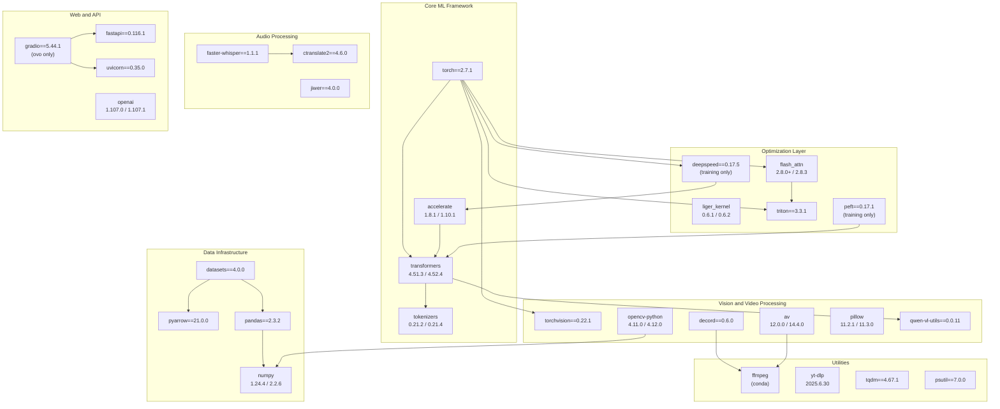
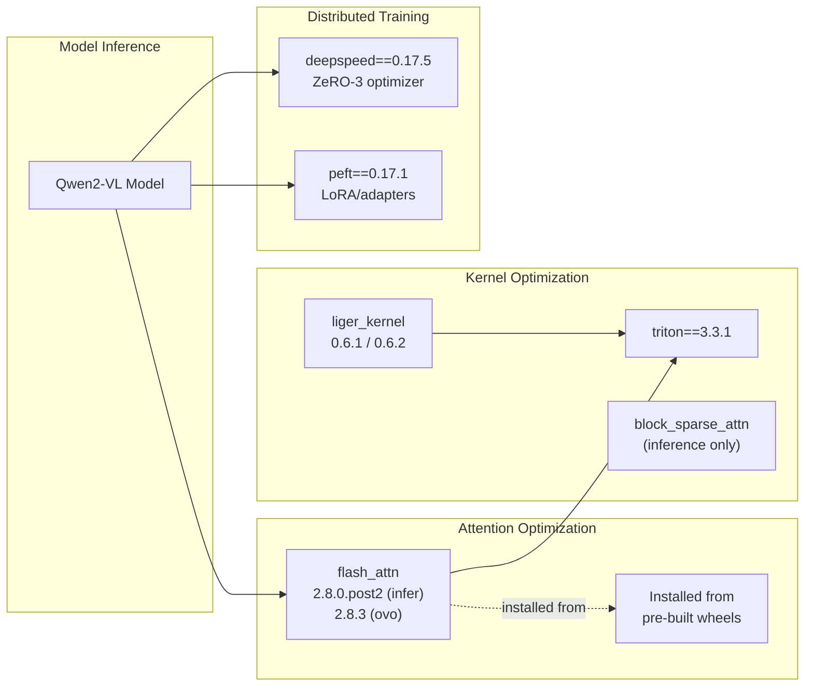
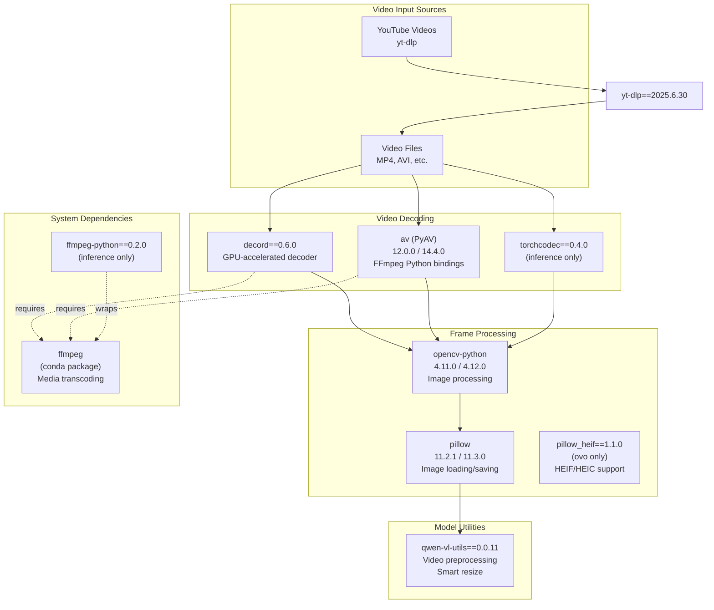
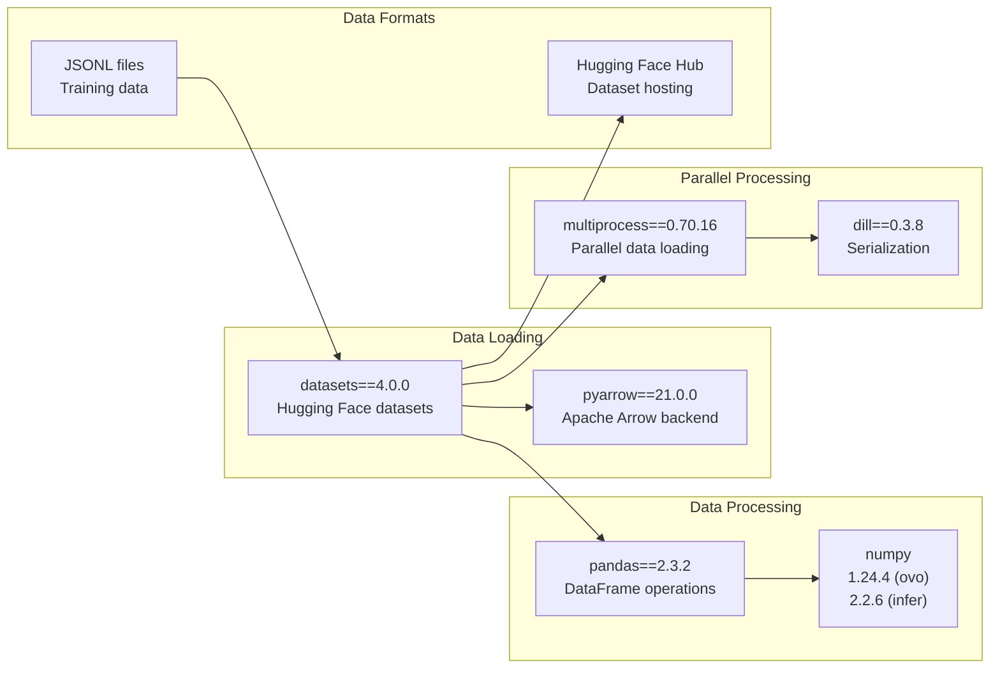
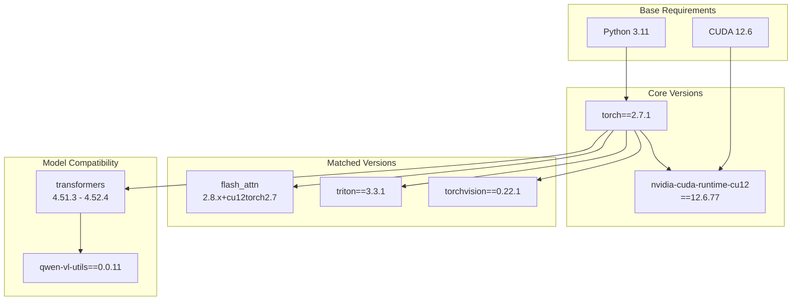

<!-- source: DeepWiki mcp.deepwiki.com · repo mit-han-lab/streaming-vlm · page 2.2 Dependencies · fetched 2026-10-30 -->

# Dependencies

<details>
<summary>Relevant source files</summary>

The following files were used as context for generating this wiki page:

- [infer_requirements.txt](infer_requirements.txt)
- [ovo_requirements.txt](ovo_requirements.txt)

</details>


## Purpose and Scope

This document details the Python package dependencies required for StreamingVLM across different operational modes: inference, training, and evaluation. Each environment has specific dependency requirements optimized for its use case. For instructions on setting up these environments, see [Environment Setup](#2.1). For practical usage examples after installation, see [Quick Start Guide](#2.3).

The repository maintains three primary dependency configurations:
- **Inference environment**: Optimized for real-time streaming and video QA inference
- **Training environment**: Includes distributed training frameworks and optimization tools
- **Evaluation environment**: Contains benchmark-specific packages and evaluation frameworks

---

## Dependency Architecture

The following diagram illustrates how major dependency groups interact to support StreamingVLM's functionality:

**Dependency System Architecture**



**Sources:** [infer_requirements.txt](), [ovo_requirements.txt](), [scripts/env_infer.sh]()

---

## Core ML Framework Dependencies

### PyTorch Ecosystem

The foundation of StreamingVLM is built on PyTorch 2.7.1 with CUDA 12.6 support:

| Package | Version | Purpose |
|---------|---------|---------|
| `torch` | 2.7.1 | Core deep learning framework with CUDA support |
| `torchvision` | 0.22.1 | Computer vision utilities and models |
| `torchaudio` | 2.7.1 | Audio processing (training environments) |
| `triton` | 3.3.1 | GPU kernel compiler for optimized operations |

The specific NVIDIA CUDA libraries are automatically installed as torch dependencies:
- `nvidia-cuda-runtime-cu12==12.6.77`
- `nvidia-cudnn-cu12==9.5.1.17`
- `nvidia-cublas-cu12==12.6.4.1`
- `nvidia-nccl-cu12==2.26.2` (for distributed training)

### Transformers Framework

| Package | Version (Inference/OVO) | Purpose |
|---------|-------------------------|---------|
| `transformers` | 4.52.4 / 4.51.3 | Hugging Face transformers library for model loading and inference |
| `accelerate` | 1.8.1 / 1.10.1 | Distributed training and mixed precision utilities |
| `tokenizers` | 0.21.2 / 0.21.4 | Fast tokenization for text processing |
| `safetensors` | 0.5.3 / 0.6.2 | Safe model serialization format |

**Sources:** [infer_requirements.txt:106-110](), [ovo_requirements.txt:110-114]()

---

## Optimization and Performance Dependencies

### Flash Attention and Custom Kernels

StreamingVLM's efficient attention mechanism relies on specialized CUDA kernels:

**Performance Optimization Stack**



| Package | Version | Environment | Purpose |
|---------|---------|-------------|---------|
| `flash_attn` | 2.8.0.post2 / 2.8.3 | Both | Memory-efficient attention implementation |
| `liger_kernel` | 0.6.1 / 0.6.2 | Both | Custom CUDA kernels for transformer operations |
| `block_sparse_attn` | 0.0.1 | Inference only | Sparse attention patterns |
| `deepspeed` | 0.17.5 | Training/OVO | ZeRO optimization for distributed training |
| `peft` | 0.17.1 | OVO | Parameter-efficient fine-tuning (LoRA) |

**Installation Note:** Flash Attention must be installed from pre-built wheels matching the CUDA and PyTorch versions. See [scripts/env_infer.sh:10-13]() for the download and installation process.

**Sources:** [infer_requirements.txt:31,52](), [ovo_requirements.txt:25,42,18,75](), [scripts/env_infer.sh:9-13]()

---

## Vision and Video Processing Dependencies

### Video Decoding and Processing

StreamingVLM processes video streams using multiple video handling libraries:

**Video Processing Pipeline Dependencies**



| Package | Version | Environment | Purpose |
|---------|---------|-------------|---------|
| `decord` | 0.6.0 | Both | GPU-accelerated video decoding with frame seeking |
| `av` (PyAV) | 12.0.0 / 14.4.0 | Both | FFmpeg Python bindings for media processing |
| `torchcodec` | 0.4.0 | Inference | PyTorch-native video codec |
| `opencv-python` | 4.11.0 / 4.12.0 | Both | Image processing and transformations |
| `pillow` | 11.2.1 / 11.3.0 | Both | Image I/O and basic operations |
| `qwen-vl-utils` | 0.0.11 | Both | Qwen-VL specific preprocessing utilities |
| `yt-dlp` | 2025.6.30 | Inference | YouTube video downloading |
| `ffmpeg` | (conda) | Both | System-level media transcoding |

**Critical:** FFmpeg must be installed via conda ([scripts/env_infer.sh:3]()) before installing Python video libraries, as `decord` and `av` require FFmpeg system libraries.

**Sources:** [infer_requirements.txt:23,9,94,78,82,120](), [ovo_requirements.txt:17,77,76,91](), [scripts/env_infer.sh:3]()

---

## Model-Specific Dependencies

### Qwen2-VL Integration

| Package | Version | Purpose |
|---------|---------|---------|
| `qwen-vl-utils` | 0.0.11 | Video preprocessing, smart resize, frame extraction utilities |
| `einops` | 0.8.1 | Tensor manipulation for vision transformers |
| `timm` | 1.0.19 | Vision model architectures (OVO env) |

The `qwen-vl-utils` package provides critical video preprocessing functions including:
- Smart resizing to fit maximum pixel constraints (19,267,584 pixels)
- Frame extraction with temporal subsampling
- Clip interleaving for streaming inference

**Sources:** [infer_requirements.txt:94,26](), [ovo_requirements.txt:91,21,107]()

---

## Data Processing Dependencies

### Dataset Handling

**Data Processing Infrastructure**



| Package | Version | Purpose |
|---------|---------|---------|
| `datasets` | 4.0.0 | Hugging Face datasets library for data loading and caching |
| `pyarrow` | 21.0.0 | Apache Arrow backend for efficient data serialization |
| `pandas` | 2.3.2 | DataFrame operations for data manipulation |
| `numpy` | 1.24.4 / 2.2.6 | Numerical computing foundation |
| `multiprocess` | 0.70.16 | Parallel data processing |
| `dill` | 0.3.8 | Extended pickling for complex Python objects |

**Version Note:** Inference environment uses NumPy 2.2.6 while OVO environment uses NumPy 1.24.4 for compatibility with certain evaluation frameworks.

**Sources:** [infer_requirements.txt:22,87,80,61,58,24](), [ovo_requirements.txt:16,82,74,54]()

---

## Audio Processing Dependencies

### Speech Recognition and Transcription

Audio processing is primarily used for WhisperX-based transcription in data processing pipelines:

| Package | Version | Environment | Purpose |
|---------|---------|-------------|---------|
| `faster-whisper` | 1.1.1 | Inference | Optimized Whisper implementation using CTranslate2 |
| `ctranslate2` | 4.6.0 | Inference | Fast inference engine for transformer models |
| `jiwer` | 4.0.0 | Inference | Word error rate calculation for transcription evaluation |
| `pydub` | 0.25.1 | OVO | Audio file manipulation and format conversion |

**Sources:** [infer_requirements.txt:28,19,50](), [ovo_requirements.txt:85]()

---

## Web Interface and API Dependencies

### Gradio Web Demo

The OVO evaluation environment includes a comprehensive web interface stack:

| Package | Version | Environment | Purpose |
|---------|---------|-------------|---------|
| `gradio` | 5.44.1 | OVO only | Web UI framework for interactive demos |
| `gradio_client` | 1.12.1 | OVO only | Client library for Gradio applications |
| `fastapi` | 0.116.1 | Both | High-performance web framework |
| `uvicorn` | 0.35.0 | Both | ASGI server for FastAPI applications |
| `starlette` | 0.47.1 / 0.47.3 | Both | ASGI framework (FastAPI dependency) |
| `httpx` | 0.28.1 | Both | Async HTTP client |
| `websockets` | 15.0.1 | OVO only | WebSocket protocol support |

**Sources:** [infer_requirements.txt:27,116,42](), [ovo_requirements.txt:29-30,22,121,43]()

---

## Environment-Specific Dependency Matrix

The following table summarizes key differences between dependency configurations:

**Environment Dependency Comparison**

| Dependency Category | Inference | OVO/Training | Purpose Difference |
|---------------------|-----------|--------------|-------------------|
| `transformers` | 4.52.4 | 4.51.3 | Inference uses latest, OVO pins for stability |
| `accelerate` | 1.8.1 | 1.10.1 | OVO includes newer distributed features |
| `flash_attn` | 2.8.0.post2 | 2.8.3 | Version matched to PyTorch build |
| `numpy` | 2.2.6 | 1.24.4 | Inference uses latest, OVO maintains compatibility |
| `av` (PyAV) | 14.4.0 | 12.0.0 | Different FFmpeg binding versions |
| `opencv-python` | 4.12.0 | 4.11.0 | Minor version differences |
| `deepspeed` | ❌ | 0.17.5 | Training-only distributed optimization |
| `peft` | ❌ | 0.17.1 | Training-only parameter-efficient fine-tuning |
| `gradio` | ❌ | 5.44.1 | OVO-only web UI |
| `tensorboard` | ❌ | 2.20.0 | OVO-only training visualization |
| `gpustat` | ❌ | 1.1.1 | OVO-only GPU monitoring |
| `timm` | ❌ | 1.0.19 | OVO-only vision model utilities |
| `ruff` | ❌ | 0.12.12 | OVO-only code linting |
| `torchcodec` | 0.4.0 | ❌ | Inference-only PyTorch video codec |
| `faster-whisper` | 1.1.1 | ❌ | Inference-only audio transcription |
| `yt-dlp` | 2025.6.30 | ❌ | Inference-only YouTube downloading |
| `block_sparse_attn` | 0.0.1 | ❌ | Inference-only sparse attention |

**Sources:** [infer_requirements.txt](), [ovo_requirements.txt]()

---

## Critical Version Requirements

### Version Compatibility Constraints

The following version constraints are critical for system stability:

**PyTorch Ecosystem Compatibility**



#### Critical Constraints

1. **Python 3.11**: Required for all environments ([scripts/env_infer.sh:1]())
2. **PyTorch 2.7.1**: Exact version match required for CUDA 12.6 compatibility
3. **Flash Attention**: Must match PyTorch version and CUDA version in wheel filename
   - Example: `flash_attn-2.8.3+cu12torch2.7cxx11abiTRUE-cp311-cp311-linux_x86_64.whl`
4. **NumPy Compatibility**: 
   - Inference: 2.2.6 (latest)
   - OVO: 1.24.4 (required for some evaluation tools)
5. **Transformers**: 4.51.3 - 4.52.4 range tested and compatible with Qwen2-VL

**Sources:** [infer_requirements.txt:106](), [ovo_requirements.txt:110](), [scripts/env_infer.sh:1,7,12]()

---

## Installation Considerations

### Special Installation Procedures

#### Flash Attention Installation

Flash Attention cannot be installed directly via pip and requires pre-built wheels:

1. Identify your configuration: Python 3.11, PyTorch 2.7.1, CUDA 12.6
2. Download matching wheel from [Flash Attention releases](https://github.com/Dao-AILab/flash-attention/releases)
3. Install the wheel file directly

[scripts/env_infer.sh:9-13]() demonstrates this process:

```bash
# find your version at https://github.com/Dao-AILab/flash-attention/releases
# example:
wget https://github.com/Dao-AILab/flash-attention/releases/download/v2.8.3/flash_attn-2.8.3+cu12torch2.7cxx11abiTRUE-cp311-cp311-linux_x86_64.whl
pip install flash_attn-2.8.3+cu12torch2.7cxx11abiTRUE-cp311-cp311-linux_x86_64.whl
```

#### FFmpeg System Dependency

FFmpeg must be installed via conda before installing Python video libraries:

```bash
conda install -y ffmpeg -y
```

This system-level installation is required for `decord` and `av` to function properly.

#### LiveCC Utils Local Package

The inference environment includes a local package installation:

```bash
pip install -e streaming_vlm/livecc_utils/
```

This installs the `livecc-utils` package in editable mode from the repository ([scripts/env_infer.sh:8]()).

### Installation Order

The recommended installation sequence ([scripts/env_infer.sh:1-13]()):

1. Create conda environment with Python 3.11
2. Install FFmpeg via conda
3. Install requirements from `infer_requirements.txt` or `ovo_requirements.txt`
4. Install additional packages via pip (transformers, deepspeed, etc.)
5. Install PyTorch 2.7.1 with matching torchvision and torchaudio
6. Install qwen-vl-utils
7. Install local livecc_utils package (if applicable)
8. Install Flash Attention from pre-built wheel

**Sources:** [scripts/env_infer.sh]()

---

## Monitoring and Debugging Dependencies

### Development and Monitoring Tools

| Package | Version | Environment | Purpose |
|---------|---------|-------------|---------|
| `gpustat` | 1.1.1 | OVO | GPU utilization monitoring |
| `tensorboard` | 2.20.0 | OVO | Training visualization and logging |
| `psutil` | 7.0.0 | Both | System and process utilities |
| `tqdm` | 4.67.1 | Both | Progress bars for long-running operations |
| `ruff` | 0.12.12 | OVO | Fast Python linter and code formatter |
| `wandb` | (optional) | Training | Weights & Biases experiment tracking |

**Sources:** [infer_requirements.txt:86,109](), [ovo_requirements.txt:28,105,80,113,95]()

---

## Summary of Key Package Roles

| Package | Primary Role | Critical For |
|---------|-------------|--------------|
| `torch` 2.7.1 | Deep learning framework | All functionality |
| `transformers` 4.51.3/4.52.4 | Model loading and inference | Model execution |
| `flash_attn` 2.8.x | Memory-efficient attention | Streaming performance |
| `liger_kernel` 0.6.x | Custom CUDA kernels | Training/inference optimization |
| `decord` 0.6.0 | GPU video decoding | Video processing |
| `qwen-vl-utils` 0.0.11 | Model-specific preprocessing | Video frame handling |
| `datasets` 4.0.0 | Data loading and caching | Training data pipeline |
| `deepspeed` 0.17.5 | Distributed training | Model training (OVO only) |
| `gradio` 5.44.1 | Web UI framework | Interactive demos (OVO only) |
| `yt-dlp` 2025.6.30 | Video downloading | Data collection (inference only) |

**Sources:** [infer_requirements.txt](), [ovo_requirements.txt]()

---

