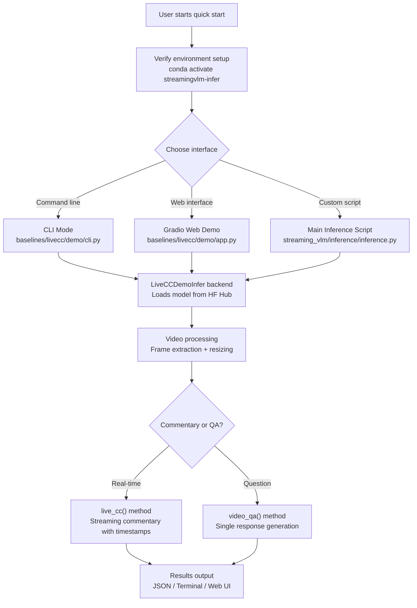
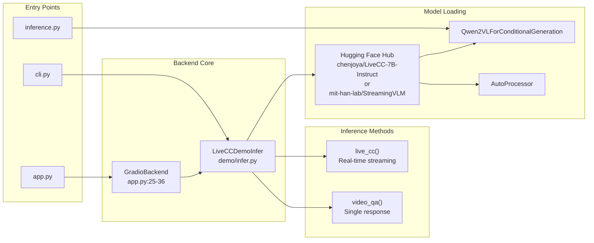
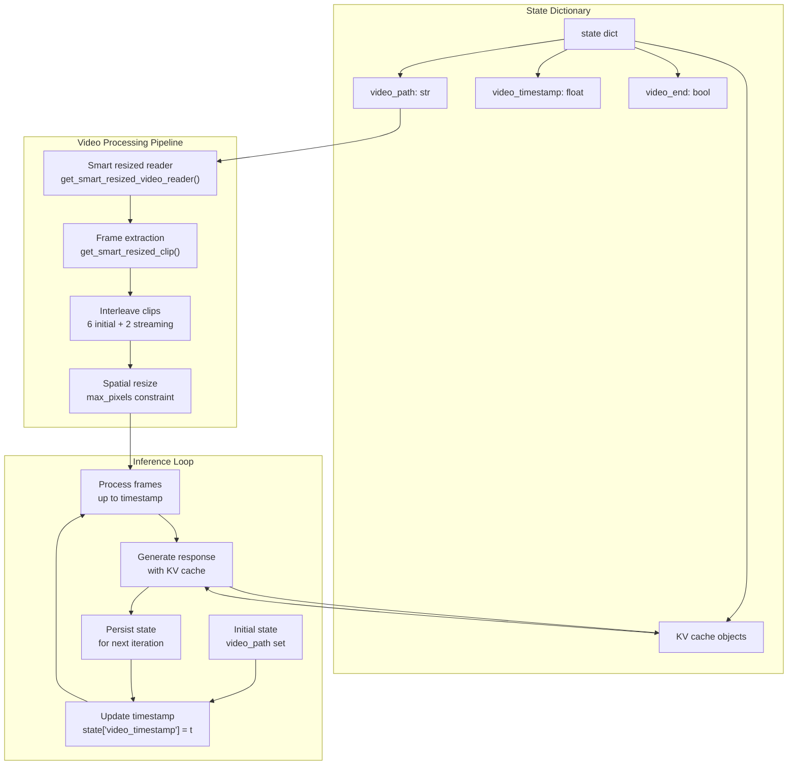

<!-- source: DeepWiki mcp.deepwiki.com · repo mit-han-lab/streaming-vlm · page 2.3 Quick Start Guide · fetched 2026-10-30 -->

# Quick Start Guide

<details>
<summary>Relevant source files</summary>

The following files were used as context for generating this wiki page:

- [baselines/livecc/demo/app.py](baselines/livecc/demo/app.py)
- [baselines/livecc/demo/cli.py](baselines/livecc/demo/cli.py)
- [readme.md](readme.md)

</details>


This guide provides step-by-step instructions for running your first inference with StreamingVLM, covering both command-line and web-based interfaces. After completing this guide, you will be able to process videos using either real-time commentary mode or video question-answering mode.

**Scope**: This page covers initial inference setup and basic usage. For detailed environment setup, see [Environment Setup](#2.1). For dependency explanations, see [Dependencies](#2.2). For advanced inference configurations, see [Inference Systems](#5). For training workflows, see [Training Pipeline](#4).

## Prerequisites Checklist

Before starting, ensure you have completed:

| Requirement | Reference | Verification Command |
|-------------|-----------|---------------------|
| Conda environment installed | [Environment Setup](#2.1) | `conda env list \| grep streamingvlm-infer` |
| Python 3.11+ activated | [Dependencies](#2.2) | `python --version` |
| Required packages installed | [Dependencies](#2.2) | `python -c "import qwen_vl_utils; print('OK')"` |
| Model access | [Model Configuration](#3.3) | Check Hugging Face access to `chenjoya/LiveCC-7B-Instruct` |

## Quick Start Workflow Overview



**Sources**: [readme.md:30-41](), [baselines/livecc/demo/cli.py:1-28](), [baselines/livecc/demo/app.py:1-179]()

## Running Your First Inference

### Method 1: Using the Main Inference Script

The simplest way to run inference is using the main inference script:

```bash
# Activate the environment
conda activate streamingvlm-infer

# Run inference
python streaming_vlm/inference/inference.py
```

This script loads the StreamingVLM model and processes a default video. The model will be automatically downloaded from Hugging Face Hub on first run.

**Sources**: [readme.md:38-41]()

### Method 2: Using the CLI Demo

For more control, use the CLI demo which provides access to both LiveCC and StreamingVLM models:

```bash
# Navigate to demo directory
cd baselines/livecc/demo

# Run CLI demo
python cli.py
```

The CLI demo [baselines/livecc/demo/cli.py:1-28]() processes videos in a loop, generating timestamped commentary and saving results to JSON.

**Key parameters in the CLI script**:

| Parameter | Default Value | Purpose |
|-----------|---------------|---------|
| `model_path` | `'chenjoya/LiveCC-7B-Instruct'` | Model identifier from Hugging Face |
| `video_path` | `'demo/sources/howto_fix_laptop_mute_1080p.mp4'` | Input video file path |
| `query` | `'Please describe the video.'` | User query/instruction |
| `max_pixels` | `384 * 28 * 28` (301,056) | Maximum pixel count for resizing |
| `repetition_penalty` | `1.05` | Token repetition control |
| `streaming_eos_base_threshold` | `0.0` | EOS threshold for streaming mode |

**Sources**: [baselines/livecc/demo/cli.py:4-19]()

### Method 3: Using the Gradio Web Demo

For an interactive web interface, launch the Gradio demo:

```bash
# Navigate to demo directory
cd baselines/livecc/demo

# Launch Gradio app
python app.py
```

The web interface will open at `http://localhost:7860` (port may vary). The demo supports:
- Video upload or example selection
- Mode switching between "Real-Time Commentary" and "Conversation"
- Interactive chat interface for multi-turn conversations

**Optional flags**:

```bash
# For Hugging Face Spaces deployment
python app.py --hf_spaces

# Disable JS-based video timestamp monitoring (for high-latency environments)
python app.py --js_monitor False
```

**Sources**: [baselines/livecc/demo/app.py:1-11](), [baselines/livecc/demo/app.py:40-179]()

## Inference Architecture and Code Flow



**Sources**: [baselines/livecc/demo/app.py:25-36](), [baselines/livecc/demo/cli.py:1-28]()

## Basic Usage Examples

### Example 1: Real-Time Commentary (CLI)

The following code from [baselines/livecc/demo/cli.py:4-26]() demonstrates real-time commentary generation:

```python
from demo.infer import LiveCCDemoInfer

# Initialize inference engine
model_path = 'chenjoya/LiveCC-7B-Instruct'
infer = LiveCCDemoInfer(model_path=model_path)

# Set video and query
state = {'video_path': "demo/sources/howto_fix_laptop_mute_1080p.mp4"}
query = "Please describe the video."

# Process video in time steps
commentaries = []
for t in range(31):
    state['video_timestamp'] = t
    
    # Generate commentary for current timestamp
    for (start_t, stop_t), response, state in infer.live_cc(
        message=query, 
        state=state,
        max_pixels=384 * 28 * 28,
        repetition_penalty=1.05
    ):
        print(f'{start_t}s-{stop_t}s: {response}')
        commentaries.append([start_t, stop_t, response])
    
    # Check if video ended
    if state.get('video_end', False):
        break
```

**Output format**: The `live_cc()` method yields tuples of `((start_timestamp, stop_timestamp), response_text, updated_state)`. Each iteration processes frames up to the current timestamp and generates commentary with temporal bounds.

**Sources**: [baselines/livecc/demo/cli.py:4-24]()

### Example 2: Video Question Answering (Gradio)

The Gradio demo [baselines/livecc/demo/app.py:78-89]() handles video QA through the chat interface:

**User workflow**:
1. Upload video via `gr.Video` component
2. Select "Conversation" mode via `gr.Radio`
3. Type question in chat textbox
4. Receive single comprehensive response

**Backend processing**:
- `GradioBackend.__call__()` routes to appropriate method based on mode
- For "Conversation" mode: calls `self.infer.video_qa()`
- For "Real-Time Commentary": calls `self.infer.live_cc()`

**Sources**: [baselines/livecc/demo/app.py:28-36](), [baselines/livecc/demo/app.py:78-89]()

## State Management and Video Processing



**Key state variables**:

| Variable | Type | Purpose |
|----------|------|---------|
| `state['video_path']` | str | Path to video file being processed |
| `state['video_timestamp']` | float | Current playback position in seconds |
| `state['video_end']` | bool | Flag indicating end of video reached |
| `state` (KV cache) | Internal | Cached key-value pairs for efficient processing |

**Sources**: [baselines/livecc/demo/cli.py:10-24](), [baselines/livecc/demo/app.py:47-50]()

## Configuration Parameters

### Common Inference Parameters

The following parameters can be passed to `live_cc()` or `video_qa()` methods:

| Parameter | Type | Default | Description |
|-----------|------|---------|-------------|
| `message` | str | None | User query or instruction |
| `history` | list | None | Conversation history for multi-turn |
| `state` | dict | {} | State dictionary with video path, timestamp, cache |
| `max_pixels` | int | 384×28×28 | Maximum pixel count for video resizing |
| `repetition_penalty` | float | 1.05 | Penalty for token repetition |
| `streaming_eos_base_threshold` | float | 0.0 | Base threshold for EOS token in streaming |
| `streaming_eos_threshold_step` | float | 0.0 | Step size for threshold adjustment |

**Sources**: [baselines/livecc/demo/cli.py:15-19]()

### Gradio-Specific Configuration

The Gradio demo uses additional state management through special components:

| Component | Type | Purpose |
|-----------|------|---------|
| `gr_state` | gr.State | Main state dictionary with KV cache |
| `gr_video_state` | gr.JSON | Lightweight video metadata only |
| `gr_static_trigger` | gr.Number | Controls streaming start/stop |
| `gr_dynamic_trigger` | gr.Number | Triggers continuous refresh |

**Sources**: [baselines/livecc/demo/app.py:47-50]()

### Mode Selection

The `GradioBackend` class maps user-facing mode names to inference methods:

```python
mode2api = {
    'Real-Time Commentary': 'live_cc',
    'Conversation': 'video_qa'
}
```

This mapping [baselines/livecc/demo/app.py:28-31]() enables dynamic method dispatch based on user selection in the UI.

**Sources**: [baselines/livecc/demo/app.py:28-31]()

## Output Formats

### CLI Output Structure

The CLI demo saves results to JSON with the following schema:

```json
{
  "video_path": "demo/sources/howto_fix_laptop_mute_1080p.mp4",
  "query": "Please describe the video.",
  "commentaries": [
    [0.0, 2.5, "The video begins with..."],
    [2.5, 5.0, "Next, we see..."],
    ...
  ]
}
```

Each commentary entry is a tuple: `[start_time, stop_time, response_text]`.

**File path**: Results are saved to a path derived from the video path by replacing `/assets/` with `/results/` and changing extension to `.json` [baselines/livecc/demo/cli.py:26]().

**Sources**: [baselines/livecc/demo/cli.py:25-28]()

### Gradio Output Format

The Gradio interface displays streaming commentary as chat messages with timestamps:

```
1.2s-3.5s: The presenter introduces the topic...
3.5s-6.0s: They demonstrate the first step...
```

Messages are appended to the chat history in real-time as they are generated [baselines/livecc/demo/app.py:136-142]().

**Sources**: [baselines/livecc/demo/app.py:134-146]()

## Troubleshooting Common Issues

### Model Download Fails

**Issue**: Hugging Face Hub authentication or network errors

**Solution**: 
```bash
# Login to Hugging Face
huggingface-cli login

# Or set token as environment variable
export HF_TOKEN=your_token_here
```

### Out of Memory Errors

**Issue**: GPU runs out of memory during inference

**Solutions**:
1. Reduce `max_pixels`: Try `256 * 28 * 28` instead of `384 * 28 * 28`
2. Process shorter videos or smaller time windows
3. Ensure no other processes are using GPU memory

### Video Not Found

**Issue**: `Video does not exist...` message

**Solution**: Verify the video path is absolute or relative to the working directory. The demo expects videos in `demo/sources/` by default.

### Gradio Interface Not Loading

**Issue**: Web interface fails to launch

**Solutions**:
1. Check if port 7860 is available: `lsof -i :7860`
2. Try different port: Gradio will auto-increment if blocked
3. Disable `share=True` [baselines/livecc/demo/app.py:179]() if behind firewall

**Sources**: [baselines/livecc/demo/app.py:26-27](), [baselines/livecc/demo/app.py:179]()

## Next Steps

After completing this quick start guide:

- **Customize inference**: See [Inference Systems](#5) for advanced configuration options
- **Process your own videos**: See [Video Processing Pipeline](#5.4) for format requirements
- **Train custom models**: See [Training Pipeline](#4) for fine-tuning workflows
- **Evaluate performance**: See [Evaluation Framework](#6) for benchmark setup
- **Deploy to production**: See [User Interfaces](#7) for deployment options

**Sources**: [readme.md:1-184]()

---

