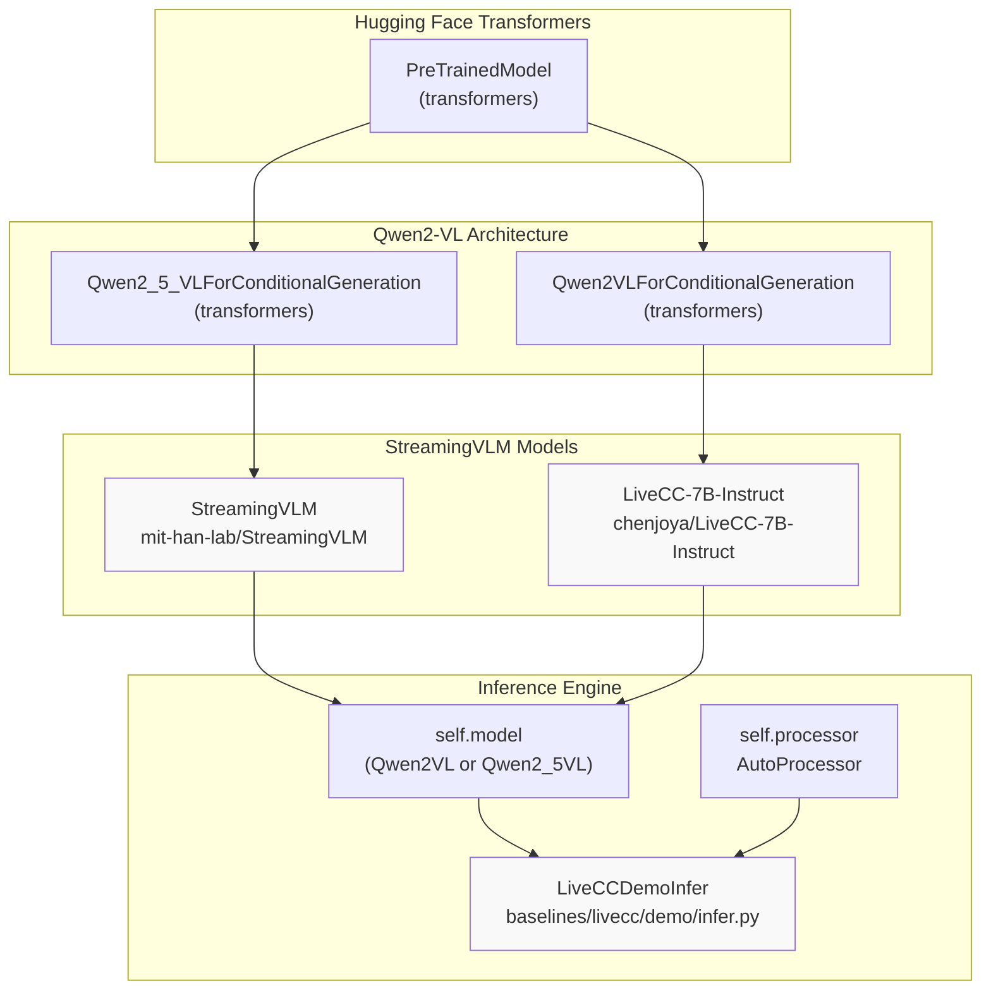
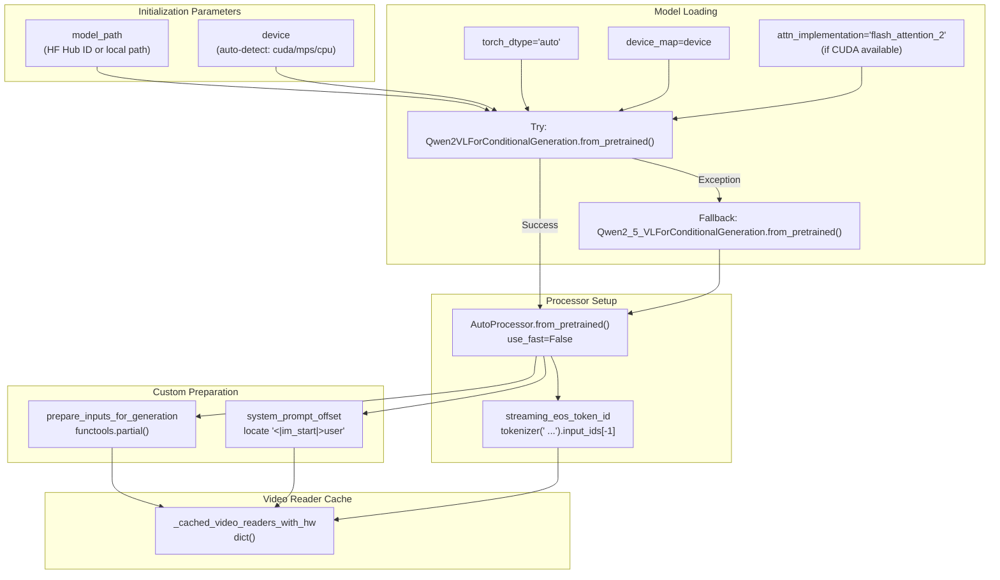
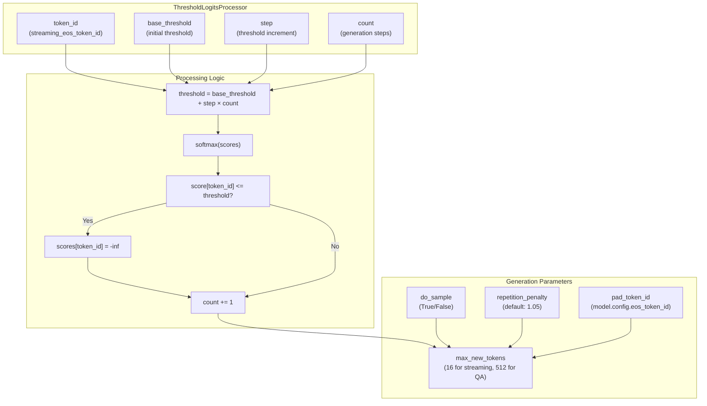

<!-- source: DeepWiki mcp.deepwiki.com · repo mit-han-lab/streaming-vlm · page 3 Model Architecture · fetched 2026-10-30 -->

# Model Architecture

<details>
<summary>Relevant source files</summary>

The following files were used as context for generating this wiki page:

- [assets/StreamingVLM_slides.pdf](assets/StreamingVLM_slides.pdf)
- [models.py](models.py)
- [readme.md](readme.md)

</details>


This document describes the core model architectures used in the StreamingVLM repository. It covers the foundational components shared by both the StreamingVLM model and the LiveCC baseline, including the underlying Qwen2-VL architecture, model initialization, and key optimization strategies.

For detailed information about the StreamingVLM-specific innovations (compact KV cache, training-inference alignment), see [StreamingVLM Model](#3.1). For the LiveCC baseline implementation, see [LiveCC Baseline](#3.2). For model configuration parameters, see [Model Configuration](#3.3).

## Architecture Overview

The repository implements two primary model architectures:

| Model | Base Architecture | Key Features | Hub Location |
|-------|------------------|--------------|---------------|
| **StreamingVLM** | Qwen2.5-VL-7B-Instruct | Compact KV cache, streaming optimization | `mit-han-lab/StreamingVLM` |
| **LiveCC-7B-Instruct** | Qwen2-VL | Baseline for comparison | `chenjoya/LiveCC-7B-Instruct` |

Both models build on the Qwen2-VL vision-language model architecture and share the same inference engine implementation in `LiveCCDemoInfer`. The primary differences lie in the training methodology and KV cache management strategies.

**Sources:** [baselines/livecc/demo/infer.py:44-54]()

## Model Class Hierarchy



**Model Loading Logic:**

The inference engine attempts to load `Qwen2VLForConditionalGeneration` first, falling back to `Qwen2_5_VLForConditionalGeneration` if necessary. This allows compatibility with both model variants.

**Sources:** [baselines/livecc/demo/infer.py:43-54]()

## Base Model Components

The Qwen2-VL architecture consists of four primary components that work together to process multimodal inputs:

```mermaid
graph LR
    subgraph "Input Processing"
        VideoInput["Video Input<br/>get_smart_resized_clip()"]
        TextInput["Text Input<br/>processor.tokenizer"]
        MaxPixels["Max Pixels Constraint<br/>384 × 28 × 28 = 19,267,584"]
    end
    
    subgraph "Vision Processing"
        SpatialResize["Spatial Resize<br/>_spatial_resize_video()"]
        VisualEncoder["Visual Encoder<br/>Vision Transformer"]
        VisualFeatures["Visual Features<br/>Pixel Values Tensor"]
    end
    
    subgraph "Text Processing"
        ChatTemplate["Chat Template<br/>processor.apply_chat_template()"]
        Tokenization["Tokenization<br/>input_ids"]
        TextEmbedding["Text Embedding<br/>Token Embeddings"]
    end
    
    subgraph "Multimodal Fusion"
        CrossAttention["Cross-Attention<br/>prepare_inputs_for_generation()"]
        FusedRepresentation["Fused Representation<br/>Multimodal Context"]
    end
    
    subgraph "Generation"
        TransformerDecoder["Transformer Decoder<br/>Qwen2-VL Layers"]
        KVCache["KV Cache<br/>past_key_values"]
        OutputTokens["Output Tokens<br/>Generated Sequences"]
    end
    
    VideoInput --> MaxPixels
    MaxPixels --> SpatialResize
    SpatialResize --> VisualEncoder
    VisualEncoder --> VisualFeatures
    
    TextInput --> ChatTemplate
    ChatTemplate --> Tokenization
    Tokenization --> TextEmbedding
    
    VisualFeatures --> CrossAttention
    TextEmbedding --> CrossAttention
    CrossAttention --> FusedRepresentation
    
    FusedRepresentation --> TransformerDecoder
    TransformerDecoder --> KVCache
    KVCache --> TransformerDecoder
    TransformerDecoder --> OutputTokens
```



**Component Details:**

1. **Visual Encoder**: Processes video frames with a spatial resolution constraint of 19,267,584 pixels (384 × 28 × 28). Videos are smart-resized to fit within this limit while maintaining aspect ratio.

2. **Text Encoder**: Applies conversation templates using `processor.apply_chat_template()` and tokenizes text inputs. The system prompt offset is tracked for multi-turn conversations.

3. **Multimodal Fusion**: Custom `prepare_inputs_for_generation()` function handles cross-attention between visual and text modalities through `prepare_multiturn_multimodal_inputs_for_generation()`.

4. **Transformer Decoder**: Standard Qwen2-VL transformer layers with causal attention. The decoder maintains KV cache state for efficient autoregressive generation.

**Sources:** [baselines/livecc/demo/infer.py:55-66](), [baselines/livecc/demo/infer.py:154-165]()

## Model Initialization

The `LiveCCDemoInfer` class handles model loading and configuration:



**Key Configuration Choices:**

- **Device Selection**: Automatically detects MPS (Apple Silicon), CUDA (NVIDIA), or CPU
- **Flash Attention 2**: Enabled only for CUDA devices for memory-efficient attention computation
- **Processor Settings**: `use_fast=False` ensures compatibility with vision inputs
- **Streaming EOS Token**: Identifies the token ID for `' ...'` to control streaming generation termination

**Sources:** [baselines/livecc/demo/infer.py:35-66]()

## Optimization Strategies

The models employ several optimization techniques applied at different stages:

| Optimization | Location | Purpose | Configuration |
|-------------|----------|---------|---------------|
| **Liger Kernel** | [baselines/livecc/demo/infer.py:2-3]() | Custom CUDA kernels for Qwen2-VL | `apply_liger_kernel_to_qwen2_vl()` |
| **Flash Attention 2** | [baselines/livecc/demo/infer.py:47]() | Memory-efficient attention | `attn_implementation='flash_attention_2'` |
| **DeepSpeed ZeRO-3** | Training scripts | Parameter/optimizer sharding | `zero3.json` config |
| **Gradient Checkpointing** | Training | Activation recomputation | Enabled during training |

### Liger Kernel Application

The Liger kernel is applied globally at module import time to optimize all Qwen2-VL model operations:

```python
# baselines/livecc/demo/infer.py:2-3
from liger_kernel.transformers import apply_liger_kernel_to_qwen2_vl
apply_liger_kernel_to_qwen2_vl()
```

This must occur before importing the Transformers model classes to ensure the optimized kernels are registered.

**Sources:** [baselines/livecc/demo/infer.py:1-4]()

## Generation Control

The models use specialized logits processors to control generation behavior:



**ThresholdLogitsProcessor Mechanism:**

The `ThresholdLogitsProcessor` class dynamically adjusts the likelihood of generating the streaming EOS token (`' ...'`) based on generation progress. The threshold increases linearly with each generated token, preventing premature termination early in generation while allowing natural stopping later.

- **Initial threshold**: Set via `streaming_eos_base_threshold` parameter
- **Increment**: Set via `streaming_eos_threshold_step` parameter  
- **Effect**: If softmax probability for EOS token ≤ threshold, set logit to -∞ (prevent selection)

**Sources:** [baselines/livecc/demo/infer.py:10-23](), [baselines/livecc/demo/infer.py:168-179]()

## Model Configuration

The `ModelArguments` dataclass defines the model configuration schema used during training:

```python
# models.py and baselines/livecc/models.py
@dataclass
class ModelArguments:
    pretrained_model_name_or_path: str = ''
    freeze_modules: list[str] = field(default_factory=lambda: [])
```

**Fields:**

- `pretrained_model_name_or_path`: Hugging Face Hub model ID or local path
- `freeze_modules`: List of module names to freeze during fine-tuning (e.g., `['visual']` to freeze vision encoder)

This configuration is used in training scripts to initialize models from pre-trained checkpoints and control which parameters are updated during fine-tuning.

**Sources:** [models.py:1-7](), [baselines/livecc/models.py:1-7]()

## Inference Engine Architecture

The `LiveCCDemoInfer` class provides a unified inference interface for both models:

```mermaid
graph TB
    subgraph "LiveCCDemoInfer Class"
        Init["__init__()<br/>model_path, device"]
        
        LiveCC["live_cc()<br/>Real-time streaming commentary"]
        VideoQA["video_qa()<br/>Conversational QA"]
        LiveCCEval["live_cc_once_for_evaluation()<br/>Evaluation mode"]
    end
    
    subgraph "Instance Variables"
        Model["self.model<br/>(Qwen2VL model)"]
        Processor["self.processor<br/>(AutoProcessor)"]
        StreamingEOSID["self.streaming_eos_token_id<br/>(int)"]
        SystemPromptOffset["self.system_prompt_offset<br/>(int)"]
        VideoCache["self._cached_video_readers_with_hw<br/>(dict)"]
    end
    
    subgraph "Class Constants"
        FPS["fps = 2<br/>(frames per second)"]
        InitialFrames["initial_fps_frames = 6"]
        StreamingFrames["streaming_fps_frames = 2"]
        InitialInterval["initial_time_interval = 3.0s"]
        StreamingInterval["streaming_time_interval = 1.0s"]
    end
    
    Init --> Model
    Init --> Processor
    Init --> StreamingEOSID
    Init --> SystemPromptOffset
    Init --> VideoCache
    
    Model --> LiveCC
    Model --> VideoQA
    Model --> LiveCCEval
    
    Processor --> LiveCC
    Processor --> VideoQA
    Processor --> LiveCCEval
    
    FPS --> LiveCC
    InitialFrames --> LiveCC
    StreamingFrames --> LiveCC
    InitialInterval --> LiveCC
    StreamingInterval --> LiveCC
    
    FPS --> LiveCCEval
    InitialFrames --> LiveCCEval
    StreamingFrames --> LiveCCEval
```



**Inference Modes:**

1. **`live_cc()`**: Streaming commentary mode with state management, yields timestamped responses as video progresses
2. **`video_qa()`**: Conversational QA mode, returns single response per question with multi-turn history
3. **`live_cc_once_for_evaluation()`**: Batch evaluation mode for benchmarking, processes entire video clip and returns all responses

All three modes share the same model instance and processing pipeline but differ in state management and output formatting.

**Sources:** [baselines/livecc/demo/infer.py:25-34](), [baselines/livecc/demo/infer.py:68-188](), [baselines/livecc/demo/infer.py:251-318]()

---

