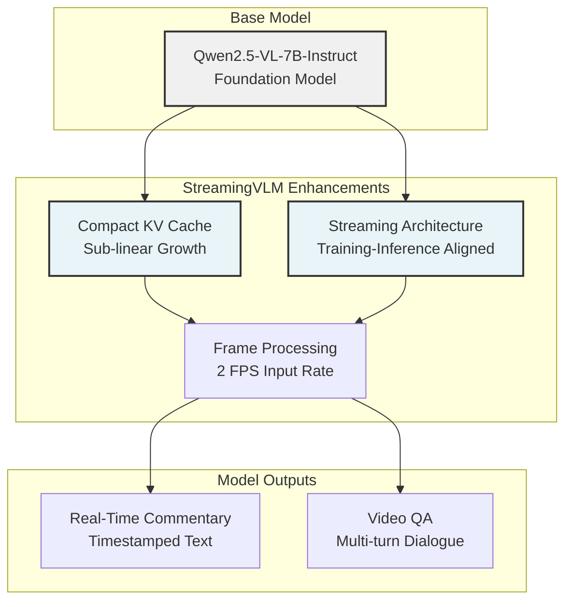
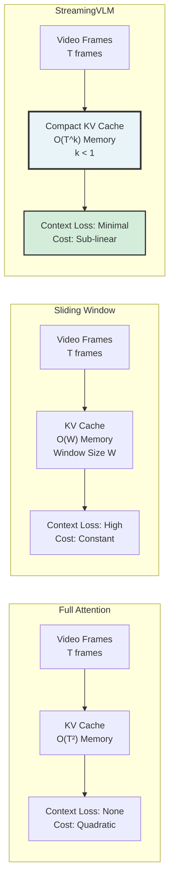
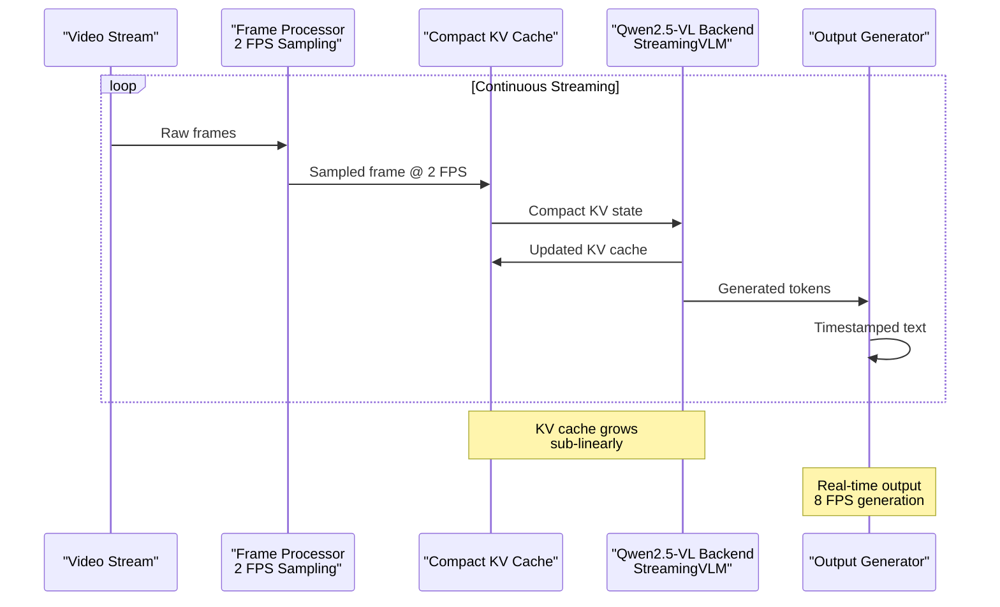
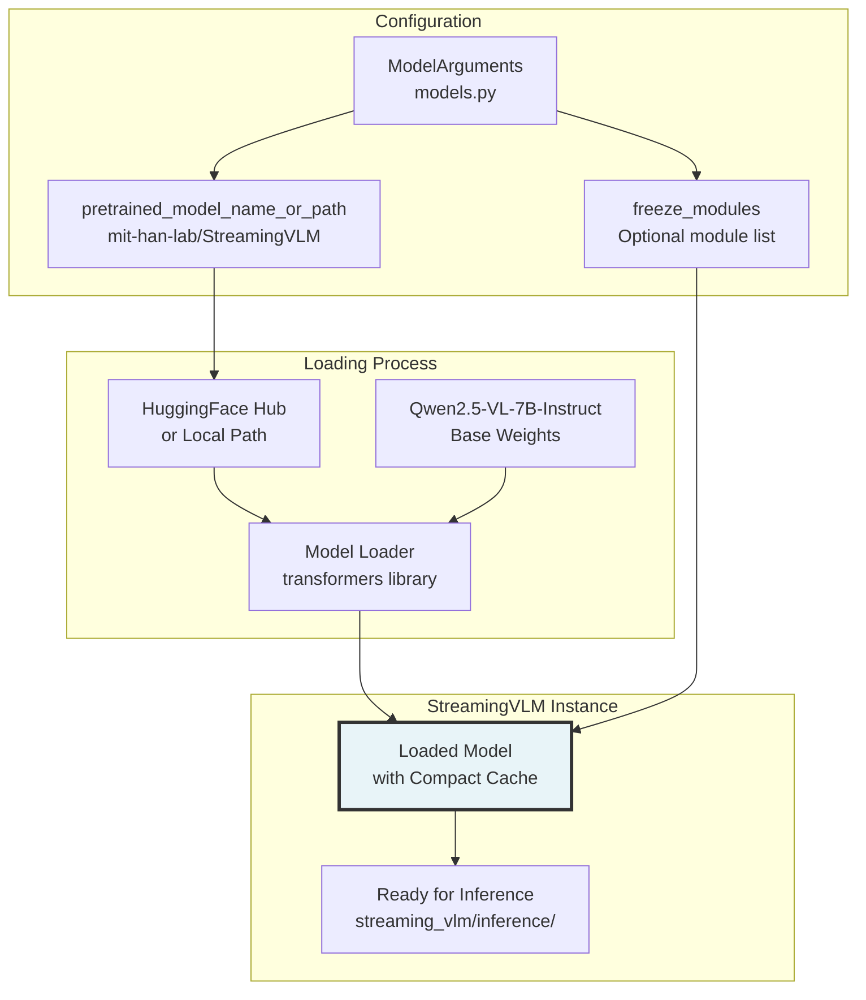
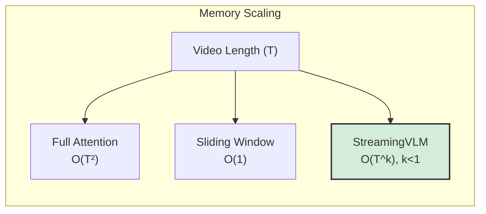

<!-- source: DeepWiki mcp.deepwiki.com · repo mit-han-lab/streaming-vlm · page 3.1 StreamingVLM Model · fetched 2026-10-30 -->

# StreamingVLM Model

Relevant source files

The following files were used as context for generating this wiki page:

- [assets/StreamingVLM_slides.pdf](assets/StreamingVLM_slides.pdf)
- [assets/infer.png](assets/infer.png)
- [models.py](models.py)
- [readme.md](readme.md)

## Purpose and Scope

This document describes the **StreamingVLM model architecture**, including its compact KV cache design, streaming inference methodology, and relationship to the underlying Qwen2.5-VL base model. StreamingVLM enables real-time understanding of effectively infinite video streams by maintaining a compact KV cache and aligning training with streaming inference, avoiding quadratic computational costs and sliding-window pitfalls.

For information about training the model, see [Training Pipeline](#4). For inference system implementation details, see [Inference Engine Architecture](#5.1). For model configuration parameters, see [Model Configuration](#3.3).

---

## Architecture Overview

StreamingVLM is built upon the Qwen2.5-VL-7B-Instruct foundation model and introduces architectural modifications that enable efficient streaming video understanding. The model maintains a compact key-value cache that grows sub-linearly with video length, allowing it to process effectively infinite video streams in real-time.

**Diagram: StreamingVLM Core Architecture**

**Sources:** [readme.md:1-11](), high-level system diagrams from prompt

---

## Base Model: Qwen2.5-VL-7B-Instruct

StreamingVLM is initialized from the **Qwen2.5-VL-7B-Instruct** base model, a vision-language model with 7 billion parameters. The base model provides strong multimodal understanding capabilities, which StreamingVLM extends with streaming-specific optimizations.

### Model Configuration

The model path is specified through the `ModelArguments` dataclass:

| Parameter | Type | Purpose |
|-----------|------|---------|
| `pretrained_model_name_or_path` | `str` | HuggingFace model identifier or local path |
| `freeze_modules` | `list[str]` | List of module names to freeze during training |

The default pretrained model identifier for StreamingVLM is `mit-han-lab/StreamingVLM`, which can be loaded from HuggingFace Hub.

**Sources:** [models.py:1-7](), [readme.md:47-63]()

---

## Compact KV Cache Mechanism

The core innovation of StreamingVLM is its **compact KV cache** that enables processing infinite video streams with bounded memory. Unlike full attention (quadratic growth) or sliding windows (context loss), the compact cache maintains essential temporal information while growing sub-linearly.

**Diagram: KV Cache Comparison**

### Cache Management Strategy

The compact KV cache implements the following principles:

1. **Temporal Compression**: Older frames are represented more compactly while recent frames maintain full detail
2. **Adaptive Retention**: Semantically important tokens are retained longer in the cache
3. **Bounded Growth**: Cache size grows sub-linearly (O(T^k) where k < 1) with video length T
4. **Training-Inference Alignment**: Cache management during training matches inference behavior

This design allows StreamingVLM to:
- Process videos of arbitrary length without memory overflow
- Maintain stable understanding across the entire video stream
- Avoid the "forgetting" problem of sliding window approaches
- Achieve real-time performance (8 FPS on H100 GPU)

**Sources:** [readme.md:1-11](), high-level system diagrams from prompt

---

## Streaming Inference Methodology

StreamingVLM processes video streams continuously at **2 FPS** (frames per second), generating outputs in real-time. The streaming methodology is designed to minimize latency while maintaining context across long videos.

**Diagram: Streaming Inference Flow**

### Frame Processing Rate

The model samples input video at **2 FPS**, meaning it processes one frame every 0.5 seconds. This rate balances:
- **Temporal coverage**: Captures sufficient detail for continuous understanding
- **Computational efficiency**: Allows real-time processing on single GPU
- **Context maintenance**: Provides enough frames for the compact cache to maintain continuity

The FPS rate can be modified via environment variable (see [readme.md:158-164]()).

### Real-Time Performance

StreamingVLM achieves:
- **8 FPS generation rate** on NVIDIA H100 GPU
- **Sub-second latency** for streaming commentary
- **Stable understanding** across arbitrarily long videos
- **No degradation** as video length increases (due to compact cache)

**Sources:** [readme.md:1-11, 158-164](), high-level system diagrams from prompt

---

## Operational Modes

StreamingVLM supports two distinct operational modes, both leveraging the same compact KV cache architecture:

### Mode 1: Real-Time Commentary

In this mode, the model continuously generates timestamped commentary as the video plays:

- **Input**: Live or pre-recorded video stream
- **Processing**: Frames sampled at 2 FPS, processed through compact cache
- **Output**: Timestamped text commentary, synchronized with video timeline
- **Use case**: Live sports commentary, video narration, real-time event description

### Mode 2: Video Question Answering

In this mode, the model answers questions about video content:

- **Input**: Video segment + user query
- **Processing**: Full video context maintained in compact cache
- **Output**: Natural language answers with multi-turn dialogue support
- **Use case**: Video understanding tasks, content search, educational applications

Both modes use the same underlying model and cache mechanism, differing only in their output format and interaction pattern.

**Sources:** High-level system diagrams from prompt, [readme.md:30-41]()

---

## Model Initialization and Loading

**Diagram: Model Loading Pipeline**

The model is loaded using the `ModelArguments` configuration:

1. **Model Path**: Specified via `pretrained_model_name_or_path` (typically `mit-han-lab/StreamingVLM`)
2. **Module Freezing**: Optional `freeze_modules` list to freeze specific layers during fine-tuning
3. **Transformers Integration**: Uses HuggingFace `transformers` library for model management
4. **Inference Setup**: Model instance is passed to inference classes (e.g., `LiveCCDemoInfer`)

**Sources:** [models.py:1-7](), [readme.md:38-41](), high-level system diagrams from prompt

---

## Training-Inference Alignment

A critical design principle of StreamingVLM is **training-inference alignment**: the model is trained using the same compact KV cache mechanism employed during inference. This ensures:

1. **Consistent Behavior**: Model learns to work within compact cache constraints
2. **No Distribution Shift**: Training and inference use identical cache management
3. **Stable Performance**: No degradation when switching from training to inference mode
4. **Optimized Cache Usage**: Model learns to maximize information retention in compact cache

The training process uses a **two-stage supervised fine-tuning (SFT)** approach:

| Stage | Dataset | Purpose |
|-------|---------|---------|
| Stage 1 | Full training data | Base streaming capability development |
| Stage 2 | High-quality subset | Refinement and quality improvement |

Both stages maintain training-inference alignment by using the compact cache during training.

**Sources:** [readme.md:43-78](), high-level system diagrams from prompt

---

## Performance Characteristics

StreamingVLM achieves the following performance metrics:

### Computational Efficiency

| Metric | Value | Comparison |
|--------|-------|------------|
| **Generation Speed** | 8 FPS | On single NVIDIA H100 GPU |
| **Input Processing** | 2 FPS | Frame sampling rate |
| **Memory Growth** | Sub-linear | vs. Quadratic (full attention) |
| **Context Length** | Infinite | No hard limit due to compact cache |

### Quality Metrics

- **66.18% win rate** vs GPT-4o mini on long-video benchmark (Inf-Stream-Eval)
- **Strong general VQA performance** without task-specific fine-tuning
- **Stable understanding** maintained across arbitrary video lengths
- **No sliding window degradation** (maintains full temporal context)

### Scalability

The compact KV cache enables StreamingVLM to scale to videos of arbitrary length:

**Sources:** [readme.md:1-11, 82-93](), high-level system diagrams from prompt

---

## Model Deployment

The trained StreamingVLM model is deployed via:

1. **HuggingFace Hub**: Publicly available at `mit-han-lab/StreamingVLM`
2. **Inference Script**: `streaming_vlm/inference/inference.py` provides inference interface
3. **Demo Interface**: Web demo available at [streamingvlm.hanlab.ai](https://streamingvlm.hanlab.ai)
4. **CLI Interface**: Command-line inference via `cli.py`
5. **Gradio Web UI**: Interactive web interface via `app.py`

The model can be loaded and used through standard HuggingFace `transformers` library APIs, with custom inference classes handling the streaming-specific logic.

**Sources:** [readme.md:16-17, 38-41](), high-level system diagrams from prompt

---

