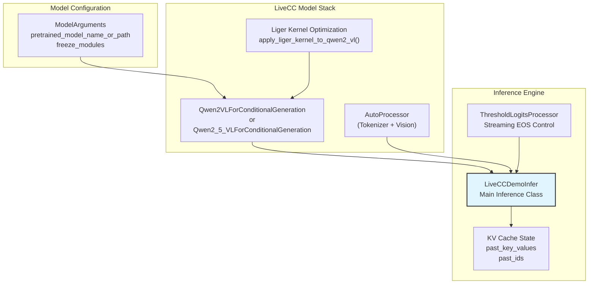
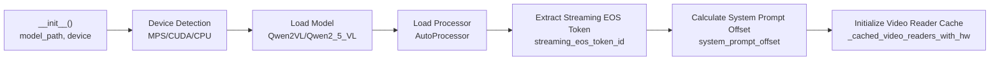
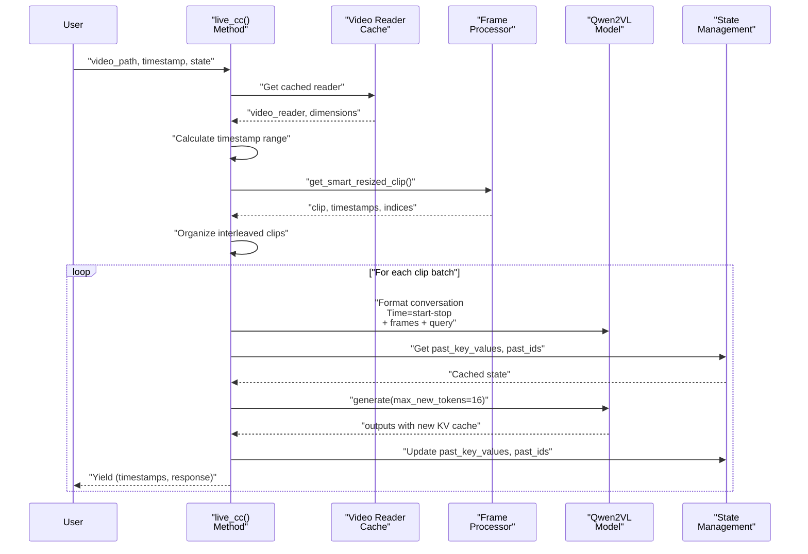
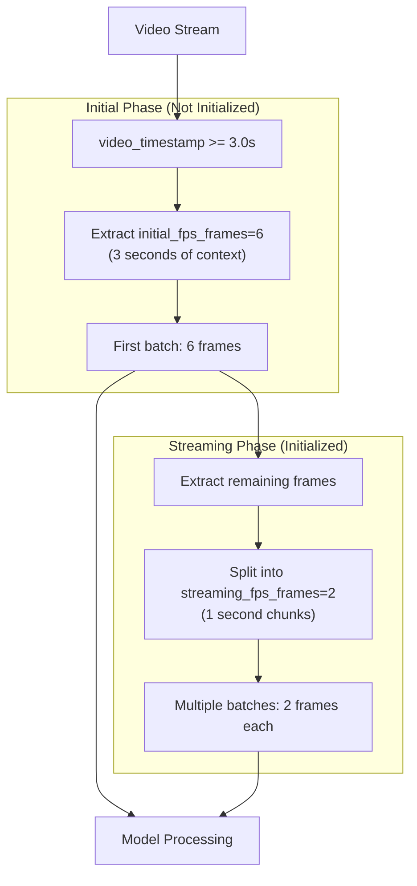
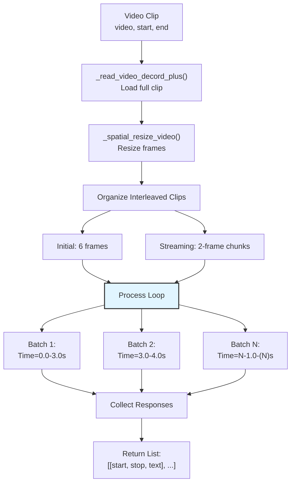
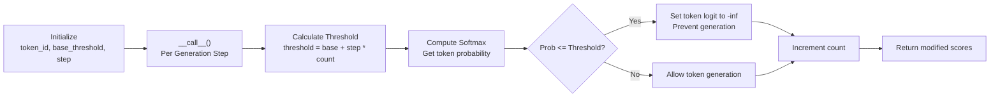
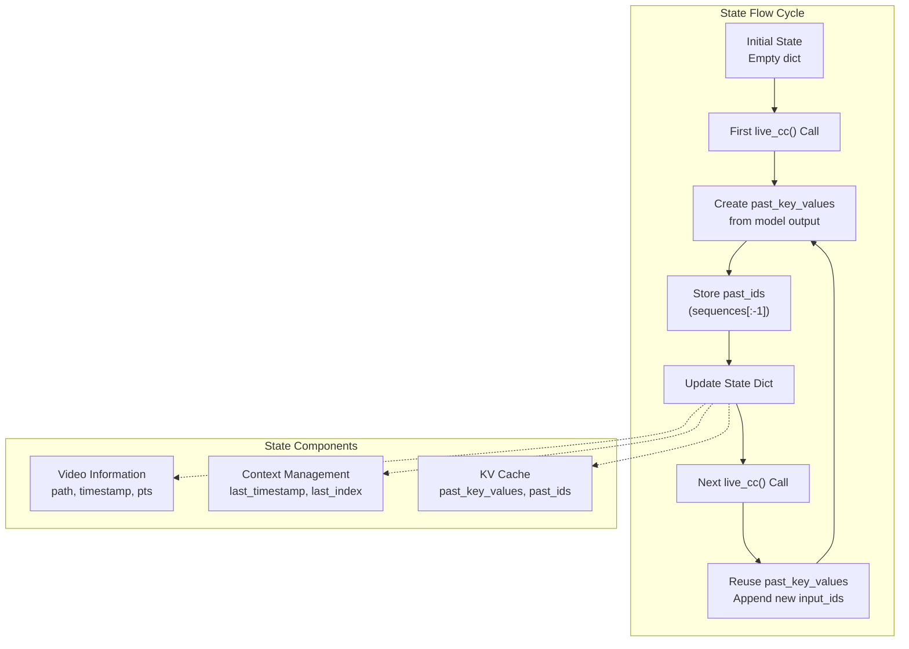
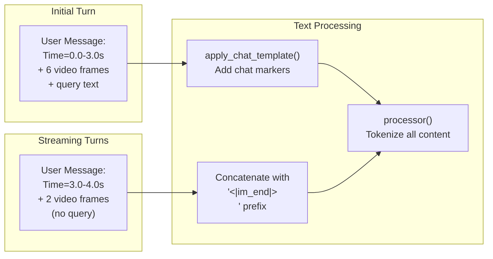
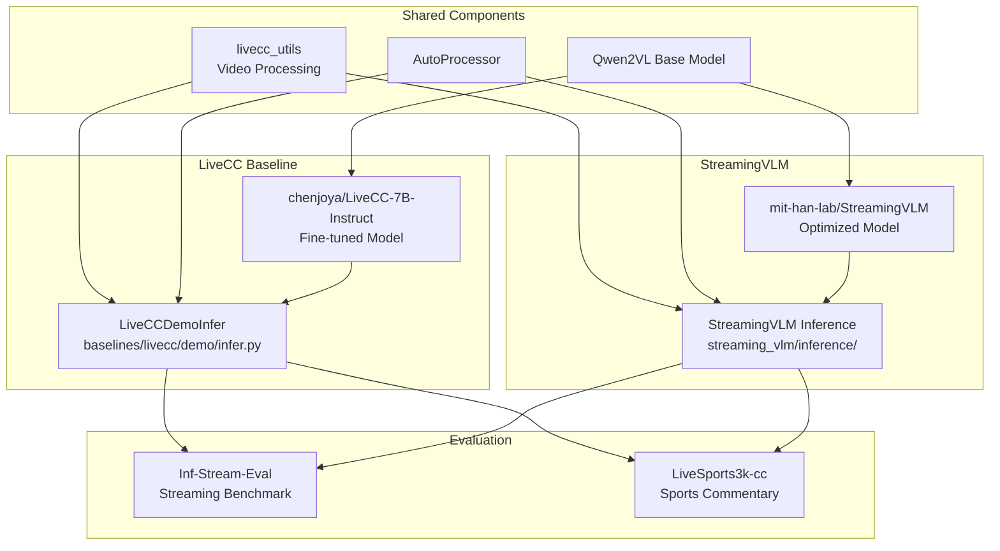

<!-- source: DeepWiki mcp.deepwiki.com · repo mit-han-lab/streaming-vlm · page 3.2 LiveCC Baseline · fetched 2026-10-30 -->

# LiveCC Baseline

<details>
<summary>Relevant source files</summary>

The following files were used as context for generating this wiki page:

- [baselines/livecc/demo/infer.py](baselines/livecc/demo/infer.py)
- [baselines/livecc/models.py](baselines/livecc/models.py)
- [readme.md](readme.md)

</details>


## Purpose and Scope

This document describes the **LiveCC baseline model** implementation, which serves as a comparison baseline for StreamingVLM's streaming video understanding capabilities. LiveCC (Live Commentary) is a Qwen2VL-based model fine-tuned for generating real-time commentary on video streams. The baseline implementation is located in `baselines/livecc/` and shares much of its inference architecture with StreamingVLM.

For information about the StreamingVLM model architecture, see [StreamingVLM Model](#3.1). For training configuration details, see [Model Configuration](#3.3).

---

## Overview

LiveCC is implemented as a baseline to evaluate StreamingVLM's performance improvements. The model is identified as `chenjoya/LiveCC-7B-Instruct` on Hugging Face and uses the same underlying Qwen2VL architecture as StreamingVLM but with different training data and objectives. The baseline shares the inference engine implementation with StreamingVLM, enabling direct performance comparisons.

**Sources:** [readme.md:1-182](), [baselines/livecc/demo/infer.py:1-319]()

---

## Model Architecture

### Core Components



**LiveCC Model Configuration**

| Component | Implementation | Purpose |
|-----------|----------------|---------|
| Base Model | `Qwen2VLForConditionalGeneration` | Vision-language model for video understanding |
| Processor | `AutoProcessor` | Tokenization and vision preprocessing |
| Optimization | Liger Kernel | Memory-efficient attention kernels |
| Configuration | `ModelArguments` | Model path and module freezing settings |

**Sources:** [baselines/livecc/demo/infer.py:1-55](), [baselines/livecc/models.py:1-7]()

### ModelArguments Configuration

The `ModelArguments` dataclass defines the minimal configuration needed for LiveCC:

```python
@dataclass
class ModelArguments:
    pretrained_model_name_or_path: str = ''
    freeze_modules: list[str] = field(default_factory=lambda: [])
```

- **`pretrained_model_name_or_path`**: Path to the pre-trained model (e.g., `chenjoya/LiveCC-7B-Instruct`)
- **`freeze_modules`**: List of module names to freeze during training

**Sources:** [baselines/livecc/models.py:4-7]()

---

## LiveCCDemoInfer Class

The `LiveCCDemoInfer` class is the central inference engine, providing three operational modes and managing the entire inference pipeline.

### Initialization



**Key Initialization Parameters:**

| Parameter | Default | Description |
|-----------|---------|-------------|
| `fps` | 2 | Frames per second for processing |
| `initial_fps_frames` | 6 | Frames for initial context |
| `streaming_fps_frames` | 2 | Frames per streaming update |
| `initial_time_interval` | 3.0 | Initial time window (6/2 seconds) |
| `streaming_time_interval` | 1.0 | Streaming update interval (2/2 seconds) |
| `frame_time_interval` | 0.5 | Time between frames (1/2 seconds) |

**Sources:** [baselines/livecc/demo/infer.py:25-66]()

---

## Inference Modes

### Mode 1: Live Commentary (`live_cc`)

The `live_cc` method generates real-time commentary on streaming video by processing frames incrementally and maintaining conversation state.



**Live Commentary State Dictionary:**

| State Key | Type | Purpose |
|-----------|------|---------|
| `video_path` | `str` | Path to video file |
| `video_timestamp` | `float` | Current playback position |
| `last_timestamp` | `float` | Last processed timestamp |
| `last_video_pts_index` | `int` | Last processed frame index |
| `video_pts` | `torch.Tensor` | Video presentation timestamps |
| `past_key_values` | `tuple` | Cached KV states |
| `past_ids` | `torch.Tensor` | Past input token IDs |
| `message` | `str` | User query (cached) |
| `video_end` | `bool` | Video completion flag |

**Sources:** [baselines/livecc/demo/infer.py:68-188]()

### Frame Processing Strategy

LiveCC uses an **interleaved frame approach** to balance initial context and streaming efficiency:



**Frame Batch Organization:**

1. **Initial Batch**: 6 frames (3 seconds) providing rich initial context
2. **Streaming Batches**: 2 frames (1 second) each for efficient updates
3. **Timestamp Formatting**: Each batch includes `Time=start-stop` text prefix

**Sources:** [baselines/livecc/demo/infer.py:112-137]()

### Mode 2: Video Question Answering (`video_qa`)

The `video_qa` method handles traditional video QA with multi-turn conversation support.


**Key Differences from Live Commentary:**

| Aspect | Live Commentary | Video QA |
|--------|-----------------|----------|
| Max Tokens | 16 | 512 |
| Video Usage | Interleaved frames | Single video |
| Sampling | `do_sample=True` | `do_sample=False` |
| Output Format | Streaming timestamped | Single response |

**Sources:** [baselines/livecc/demo/infer.py:189-249]()

### Mode 3: Evaluation (`live_cc_once_for_evaluation`)

A specialized method for benchmark evaluation that processes entire video clips in batch.



**Evaluation Parameters:**

| Parameter | Default | Purpose |
|-----------|---------|---------|
| `query` | - | User query for the video |
| `video` | - | Video file path |
| `video_start` | 0 | Start timestamp |
| `video_end` | None | End timestamp (None = full) |
| `remote_loader` | None | Custom video loader |
| `max_new_tokens` | 32 | Maximum response length |
| `repetition_penalty` | 1.05 | Repetition control |

**Sources:** [baselines/livecc/demo/infer.py:251-318]()

---

## ThresholdLogitsProcessor

The `ThresholdLogitsProcessor` is a custom logits processor that dynamically controls when the streaming EOS token can be generated, preventing premature termination of commentary.



**ThresholdLogitsProcessor Implementation:**

| Field | Type | Purpose |
|-------|------|---------|
| `token_id` | `int` | ID of streaming EOS token (` ...`) |
| `base_threshold` | `float` | Initial threshold probability |
| `step` | `float` | Threshold increase per step |
| `count` | `int` | Generation step counter |

**Behavior:**
- Initially sets strict threshold to prevent early EOS
- Gradually increases threshold to allow natural completion
- Ensures minimum commentary length before termination

**Sources:** [baselines/livecc/demo/infer.py:10-23]()

---

## State Management

LiveCC maintains conversation state across multiple inference calls through the KV cache mechanism.



**State Update Pattern:**

1. **First Call**: `past_key_values=None`, model generates full output
2. **Generate Output**: Extract `outputs.past_key_values` and `outputs.sequences[:, :-1]`
3. **Store State**: Update state dict with new cache
4. **Subsequent Calls**: Concatenate `past_ids` with new `input_ids`, reuse KV cache
5. **Prompt Continuation**: Use `'<|im_end|>\n' + texts[system_prompt_offset:]` to continue conversation

**Sources:** [baselines/livecc/demo/infer.py:154-187](), [baselines/livecc/demo/infer.py:220-248]()

---

## Conversation Formatting

LiveCC uses a specific conversation format for streaming commentary:



**Conversation Structure:**

| Turn | Role | Content |
|------|------|---------|
| Initial | User | `Time=0.0-3.0s` + 6 frames + query |
| Initial | Assistant | Model response (cached) |
| Streaming 1 | User | `Time=3.0-4.0s` + 2 frames |
| Streaming 1 | Assistant | Model response (cached) |
| Streaming 2 | User | `Time=4.0-5.0s` + 2 frames |
| ... | ... | ... |

**Query Handling:**
- Query text is included only in the first turn
- Stored in `state['message']` to avoid repetition
- Subsequent turns only include timestamp and frames

**Sources:** [baselines/livecc/demo/infer.py:138-154](), [baselines/livecc/demo/infer.py:283-294]()

---

## Integration with StreamingVLM

LiveCC serves as a baseline for evaluating StreamingVLM's improvements:



**Key Differences:**

| Aspect | LiveCC Baseline | StreamingVLM |
|--------|----------------|--------------|
| Model | `chenjoya/LiveCC-7B-Instruct` | `mit-han-lab/StreamingVLM` |
| KV Cache | Standard Qwen2VL cache | Compact streaming cache |
| Training Data | Live-WhisperX-526K | Inf-Stream-Train + annealing |
| Inference Engine | `baselines/livecc/demo/infer.py` | `streaming_vlm/inference/` |
| Performance | Baseline | 8 FPS on H100 |

**Sources:** [readme.md:1-182](), [baselines/livecc/demo/infer.py:1-55]()

---

## Usage Example

The LiveCC baseline can be used through the same inference pipeline as StreamingVLM:

**State Initialization:**
```python
state = {
    'video_path': '/path/to/video.mp4',
    'video_timestamp': 0.0,
}
```

**Live Commentary:**
```python
for (start, stop), response, state in infer.live_cc(
    message="Describe what's happening",
    state=state,
    max_pixels=384 * 28 * 28,
):
    print(f"[{start:.1f}s - {stop:.1f}s]: {response}")
```

**Video QA:**
```python
response, state = infer.video_qa(
    message="What is the main topic?",
    history=[],
    state={'video_path': '/path/to/video.mp4'},
)
print(response)
```

**Sources:** [baselines/livecc/demo/infer.py:68-249]()

---

