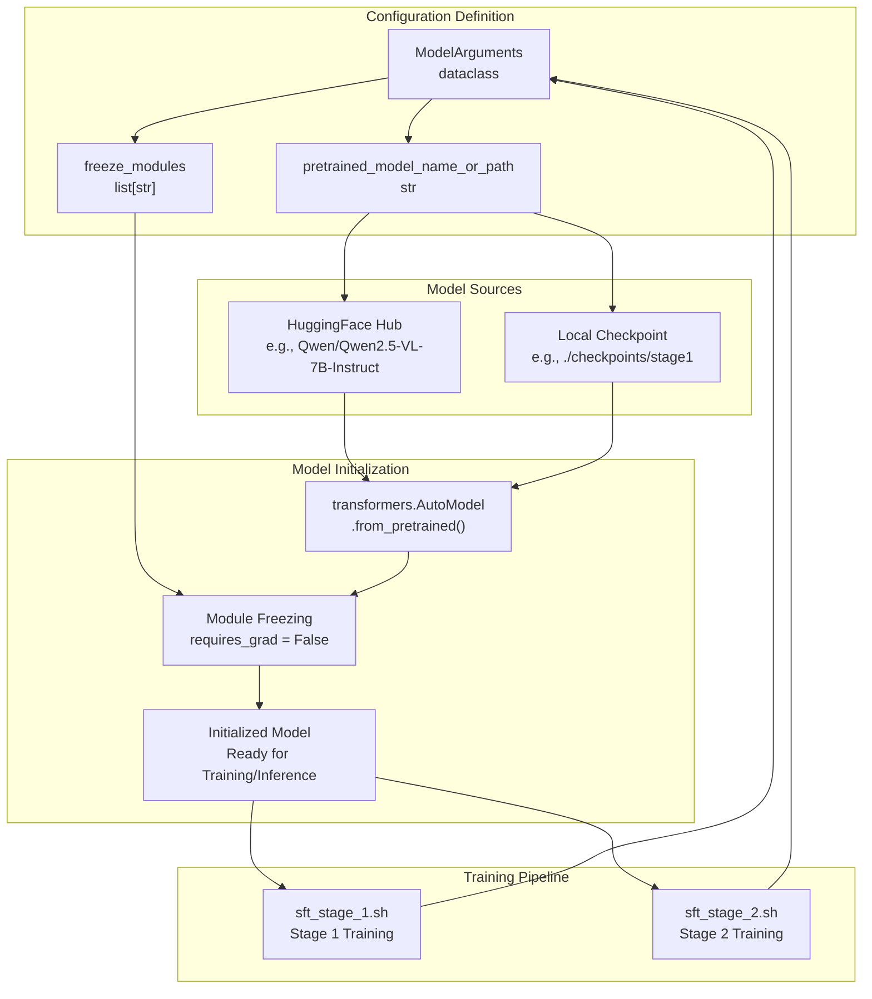

<!-- source: DeepWiki mcp.deepwiki.com · repo mit-han-lab/streaming-vlm · page 3.3 Model Configuration · fetched 2026-10-30 -->

# Model Configuration

<details>
<summary>Relevant source files</summary>

The following files were used as context for generating this wiki page:

- [baselines/livecc/models.py](baselines/livecc/models.py)
- [models.py](models.py)

</details>


## Purpose and Scope

This document describes the model configuration system used across the StreamingVLM codebase. The configuration is implemented through the `ModelArguments` dataclass, which specifies pretrained model sources and selective module freezing during training.

For details about the StreamingVLM model architecture itself, see [StreamingVLM Model](#3.1). For information about the LiveCC baseline architecture, see [LiveCC Baseline](#3.2). For training pipeline usage, see [Stage 1 Training](#4.2) and [Stage 2 Training](#4.3).

## ModelArguments Dataclass

The model configuration is centralized in the `ModelArguments` dataclass, which provides a standardized interface for specifying model initialization parameters. This dataclass is defined identically in two locations to support both the main StreamingVLM system and the LiveCC baseline.

**File Locations:**
- [models.py:1-7]() - Main StreamingVLM configuration
- [baselines/livecc/models.py:1-7]() - LiveCC baseline configuration

```python
@dataclass
class ModelArguments:
    pretrained_model_name_or_path: str = ''
    freeze_modules: list[str] = field(default_factory=lambda: [])
```

The dataclass uses Python's `dataclasses` module to provide automatic initialization, representation, and comparison methods. Default values ensure that the configuration can be instantiated without explicitly providing all parameters.

**Sources:** [models.py:1-7](), [baselines/livecc/models.py:1-7]()

## Configuration Parameters

### Parameter Reference Table

| Parameter | Type | Default | Description |
|-----------|------|---------|-------------|
| `pretrained_model_name_or_path` | `str` | `''` | HuggingFace Hub model identifier or local path to pretrained model |
| `freeze_modules` | `list[str]` | `[]` | List of module names to freeze during training (excludes from gradient updates) |

### pretrained_model_name_or_path

This parameter specifies the source of the pretrained model weights. It accepts two formats:

1. **HuggingFace Hub identifier**: A string like `"Qwen/Qwen2.5-VL-7B-Instruct"` that references a model hosted on the HuggingFace Model Hub
2. **Local file path**: An absolute or relative path to a directory containing model checkpoint files

The system uses this parameter to initialize the base model before fine-tuning. For StreamingVLM, the typical value is `"Qwen/Qwen2.5-VL-7B-Instruct"`. For LiveCC baseline training, this may point to intermediate checkpoints or other pretrained vision-language models.

### freeze_modules

This parameter enables selective parameter freezing during training, which is crucial for efficient fine-tuning and preventing catastrophic forgetting. The list contains module name patterns that should be excluded from gradient updates.

Common use cases:
- **Visual encoder freezing**: Prevent updates to the visual backbone when focusing on alignment layers
- **Embedding freezing**: Keep token embeddings stable during later training stages
- **Partial fine-tuning**: Update only task-specific layers while preserving general capabilities

The module names should match the named modules in the model's state dictionary as returned by `model.named_modules()`.

**Sources:** [models.py:4-7](), [baselines/livecc/models.py:4-7]()

## Configuration Flow

The following diagram shows how `ModelArguments` integrates into the model initialization and training pipeline:

**Diagram: Model Configuration Flow**



**Sources:** [models.py:1-7](), [baselines/livecc/models.py:1-7]()

## Integration with Training Scripts

The training scripts for both Stage 1 and Stage 2 supervised fine-tuning utilize `ModelArguments` to configure the base model. The configuration is typically passed via command-line arguments or configuration files that are parsed into the dataclass.

**Diagram: Training Script Integration**

```mermaid
graph LR
    subgraph "Script Invocation"
        BASH["sft_stage_1.sh or<br/>sft_stage_2.sh"]
        ARGS["Command Line Args<br/>--pretrained_model_name_or_path<br/>--freeze_modules"]
    end
    
    subgraph "Argument Parsing"
        HF_PARSER["transformers.HfArgumentParser"]
        MA_INST["ModelArguments<br/>instance"]
    end
    
    subgraph "Model Setup"
        FROM_PRETRAINED["AutoModelForVision2Seq<br/>.from_pretrained()"]
        APPLY_FREEZE["apply freeze_modules<br/>to model.named_modules()"]
        CONFIGURED["Configured Model"]
    end
    
    subgraph "Training Loop"
        TRAINER["transformers.Trainer"]
        BACKWARD["gradient computation<br/>(frozen params excluded)"]
    end
    
    BASH --> ARGS
    ARGS --> HF_PARSER
    HF_PARSER --> MA_INST
    
    MA_INST --> FROM_PRETRAINED
    MA_INST --> APPLY_FREEZE
    
    FROM_PRETRAINED --> APPLY_FREEZE
    APPLY_FREEZE --> CONFIGURED
    
    CONFIGURED --> TRAINER
    TRAINER --> BACKWARD
```



**Sources:** [models.py:1-7](), [baselines/livecc/models.py:1-7]()

## Module Freezing Strategy

The `freeze_modules` parameter enables fine-grained control over which parts of the model receive gradient updates during training. This is implemented by setting `requires_grad = False` for parameters belonging to specified modules.

### Implementation Pattern

The typical freezing logic follows this pattern:

1. Load the pretrained model using `pretrained_model_name_or_path`
2. Iterate through `model.named_modules()`
3. For each module name matching patterns in `freeze_modules`:
   - Set `param.requires_grad = False` for all parameters in that module
4. Verify that trainable parameter count matches expectations

### Common Freezing Scenarios

**Scenario 1: Full Fine-Tuning (Default)**
```python
freeze_modules = []  # No freezing, all parameters trainable
```

**Scenario 2: Visual Encoder Freezing**
```python
freeze_modules = ["visual", "vision_tower"]  # Freeze visual components
```

**Scenario 3: Embedding Freezing**
```python
freeze_modules = ["embed_tokens", "wte"]  # Freeze token embeddings
```

**Scenario 4: Partial Decoder Freezing**
```python
freeze_modules = ["model.layers.0", "model.layers.1"]  # Freeze first 2 layers
```

The exact module names depend on the architecture of the pretrained model being used (e.g., Qwen2-VL has specific naming conventions for its components).

**Sources:** [models.py:4-7](), [baselines/livecc/models.py:4-7]()

## Dual Configuration System

The repository maintains two identical `ModelArguments` definitions to support independent configuration of the main StreamingVLM system and the LiveCC baseline:

| Location | Purpose | Typical Model |
|----------|---------|---------------|
| [models.py:1-7]() | StreamingVLM training and inference | `Qwen/Qwen2.5-VL-7B-Instruct` |
| [baselines/livecc/models.py:1-7]() | LiveCC baseline training and inference | `chenjoya/LiveCC-7B-Instruct` or intermediate checkpoints |

This separation allows:
- **Independent experimentation**: Modify baseline configuration without affecting main system
- **Different model sources**: Use different pretrained models for comparison
- **Isolated dependency management**: Each system can evolve its configuration independently

Both configurations share the same interface, ensuring consistency in how models are initialized across the codebase.

**Sources:** [models.py:1-7](), [baselines/livecc/models.py:1-7]()

## Configuration in Inference

While `ModelArguments` is primarily used during training, the same configuration system can initialize models for inference. The inference scripts typically:

1. Instantiate `ModelArguments` with a specific `pretrained_model_name_or_path`
2. Load the model using the specified path (which may be a fine-tuned checkpoint)
3. Skip the freezing logic (since gradients are not computed during inference)

For inference-specific configuration details, see [Inference Engine Architecture](#5.1).

**Sources:** [models.py:1-7](), [baselines/livecc/models.py:1-7]()

---

