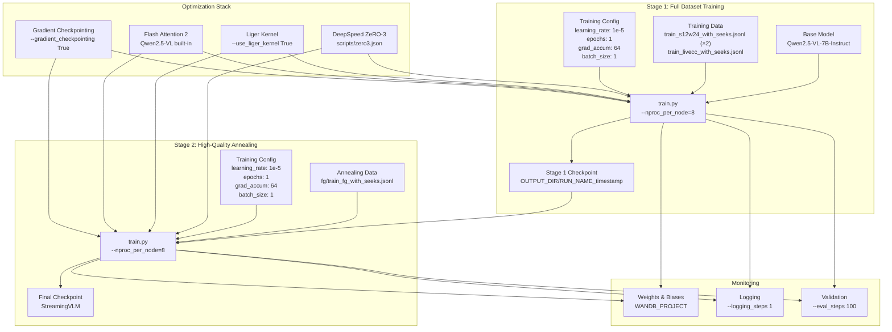
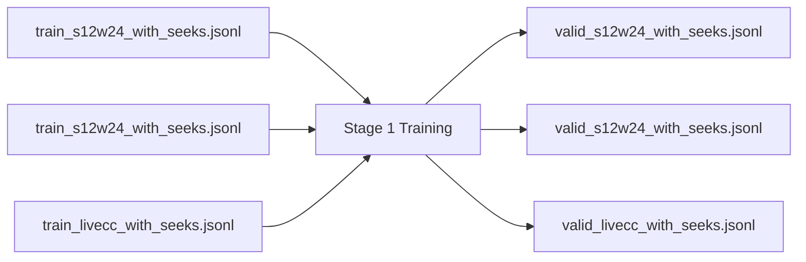
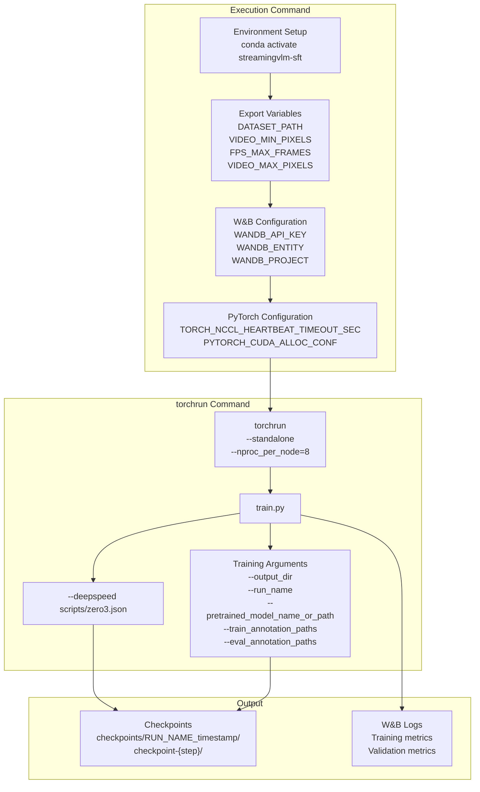

<!-- source: DeepWiki mcp.deepwiki.com · repo mit-han-lab/streaming-vlm · page 4 Training Pipeline · fetched 2026-10-30 -->

# Training Pipeline

<details>
<summary>Relevant source files</summary>

The following files were used as context for generating this wiki page:

- [assets/train.png](assets/train.png)
- [readme.md](readme.md)
- [scripts/sft_stage_1.sh](scripts/sft_stage_1.sh)
- [scripts/sft_stage_2.sh](scripts/sft_stage_2.sh)

</details>


This document describes the two-stage supervised fine-tuning (SFT) process used to train StreamingVLM. It covers the training infrastructure, configuration parameters, optimization strategies, and execution flow. For details on data preparation and formatting, see [Data Preparation](#4.1). For model architecture details, see [Model Architecture](#3).

## Overview

StreamingVLM training uses a two-stage SFT approach:

1. **Stage 1**: Full dataset training on Inf-Stream-Train and LiveCC data
2. **Stage 2**: High-quality data annealing on a curated fine-grained subset

Both stages train the Qwen2.5-VL-7B-Instruct base model with a compact KV cache configuration (512-token text sink + 512-token sliding window) to align training with streaming inference. The training leverages DeepSpeed ZeRO-3 for distributed optimization across 8 GPUs.

**Sources:** [readme.md:44-78](), [scripts/sft_stage_1.sh](), [scripts/sft_stage_2.sh]()

## Two-Stage Training Architecture



**Training Pipeline Flow**

This diagram shows how the base Qwen2.5-VL-7B-Instruct model progresses through two training stages, each utilizing the same optimization stack but different datasets. Stage 1 produces an intermediate checkpoint that becomes the starting point for Stage 2's fine-grained annealing.

**Sources:** [scripts/sft_stage_1.sh:1-46](), [scripts/sft_stage_2.sh:1-41](), [readme.md:67-78]()

## Key Configuration Parameters

### Video Processing Parameters

| Parameter | Value | Description |
|-----------|-------|-------------|
| `VIDEO_MIN_PIXELS` | 78400 | Minimum visual tokens (100×28×28) |
| `FPS_MAX_FRAMES` | 480 | Maximum frames per video (4 min at 2 FPS) |
| `VIDEO_MAX_PIXELS` | 19267584 | Maximum visual tokens (24576×28×28) |
| `text_sink` | 512 | KV cache sink size for text tokens |
| `TEXT_SLIDING_WINDOW` | 512 | Sliding window size for text tokens |

The video processing parameters ensure that each video sample can contain up to 480 frames while allocating up to 24,576 visual tokens to the model, leaving approximately 8,192 tokens for language processing within the typical 32K context window.

**Sources:** [scripts/sft_stage_1.sh:1-7](), [scripts/sft_stage_2.sh:1-7]()

### Training Hyperparameters

| Parameter | Stage 1 | Stage 2 | Description |
|-----------|---------|---------|-------------|
| `learning_rate` | 1e-5 | 1e-5 | Initial learning rate |
| `num_train_epochs` | 1 | 1 | Training epochs |
| `per_device_train_batch_size` | 1 | 1 | Batch size per GPU |
| `gradient_accumulation_steps` | 64 | 64 | Gradient accumulation steps |
| `warmup_ratio` | 0.03 | 0.03 | Learning rate warmup ratio |
| `lr_scheduler_type` | cosine | cosine | Learning rate scheduler |
| `optim` | adamw_torch | adamw_torch | Optimizer |

Effective batch size = `per_device_train_batch_size` × `gradient_accumulation_steps` × `nproc_per_node` = 1 × 64 × 8 = 512

**Sources:** [scripts/sft_stage_1.sh:12-15](), [scripts/sft_stage_2.sh:12-15]()

## Training Datasets

### Stage 1 Datasets



**Stage 1 Dataset Configuration**

Stage 1 uses the `train_s12w24_with_seeks.jsonl` dataset twice (for data augmentation or weighting) along with the LiveCC dataset. The validation split mirrors this structure.

**Sources:** [scripts/sft_stage_1.sh:30-42]()

### Stage 2 Datasets

Stage 2 trains exclusively on high-quality fine-grained data:
- Training: `fg/train_fg_with_seeks.jsonl`
- Validation: `fg/valid_fg_with_seeks.jsonl`

This annealing stage refines the model on carefully curated examples to improve output quality.

**Sources:** [scripts/sft_stage_2.sh:28-36]()

## Training Execution



**Training Execution Flow**

The training process begins with environment setup and variable exports, then launches a distributed training job using `torchrun` with 8 GPUs. The `train.py` script loads the DeepSpeed configuration and processes the specified training arguments.

**Sources:** [scripts/sft_stage_1.sh:44-45](), [scripts/sft_stage_2.sh:39-40](), [readme.md:74-77]()

### Critical Environment Variables

```bash
# Prevent NCCL timeouts during long training steps
TORCH_NCCL_HEARTBEAT_TIMEOUT_SEC=1800

# Enable memory segment expansion for large models
PYTORCH_CUDA_ALLOC_CONF=expandable_segments:True

# Disable tokenizer parallelism to avoid warnings
TOKENIZERS_PARALLELISM=false
```

**Sources:** [scripts/sft_stage_1.sh:44](), [scripts/sft_stage_2.sh:39]()

## Memory Optimization Strategies

### DeepSpeed ZeRO-3

The training uses DeepSpeed ZeRO-3 optimization configured via `scripts/zero3.json`. ZeRO-3 partitions:
- **Model parameters** across GPUs
- **Gradients** across GPUs  
- **Optimizer states** across GPUs

This enables training of the 7B parameter model with limited GPU memory per device.

**Sources:** [scripts/sft_stage_1.sh:45](), [scripts/sft_stage_2.sh:40]()

### Additional Optimizations

| Optimization | Flag | Description |
|--------------|------|-------------|
| **Liger Kernel** | `--use_liger_kernel True` | Custom CUDA kernels for efficient operations |
| **Gradient Checkpointing** | `--gradient_checkpointing True` | Trade computation for memory by recomputing activations |
| **BF16 Precision** | `--bf16 True` | Use BFloat16 mixed precision training |
| **TF32 Mode** | `--tf32 True` | Enable TensorFloat-32 on Ampere GPUs |
| **Flash Attention 2** | Built into Qwen2.5-VL | Memory-efficient attention computation |

**Sources:** [scripts/sft_stage_1.sh:45](), [scripts/sft_stage_2.sh:40]()

## Checkpoint Management

### Saving Strategy

```python
# Configuration flags
--save_strategy steps
--save_steps 20
--save_total_limit 10
--save_on_each_node True
```

Checkpoints are saved every 20 training steps, with a maximum of 10 checkpoints retained. Each checkpoint is saved on every node to prevent data loss in distributed training.

### Checkpoint Structure

```
checkpoints/
└── {RUN_NAME}_{timestamp}/
    ├── checkpoint-20/
    ├── checkpoint-40/
    ├── checkpoint-60/
    └── ...
```

The `RUN_NAME` follows the pattern: `{WANDB_PROJECT_NAME}_e{epoch_num}_lr{learning_rate}_ps{text_sink}_pw{TEXT_SLIDING_WINDOW}`

**Sources:** [scripts/sft_stage_1.sh:27-28,45](), [scripts/sft_stage_2.sh:24-25,40]()

## Validation and Monitoring

### Evaluation Configuration

```python
# Evaluation settings
--eval_strategy steps
--eval_steps 100
--per_device_eval_batch_size 1
--metric_for_best_model eval_loss
--prediction_loss_only true
```

The model is evaluated every 100 training steps using the validation datasets. Only prediction loss is computed during evaluation to optimize for speed.

### Weights & Biases Integration

Training metrics are logged to W&B with the following configuration:

```bash
WANDB_API_KEY=$WANDB_API_KEY
WANDB_ENTITY=$WANDB_ENTITY
WANDB_PROJECT=$WANDB_PROJECT_NAME
--report_to wandb
--logging_steps 1
```

Metrics are logged at every training step, providing fine-grained visibility into training dynamics.

**Sources:** [scripts/sft_stage_1.sh:18-27,45](), [scripts/sft_stage_2.sh:18-24,40]()

## Data Loading Configuration

```python
--dataloader_num_workers 32
--ignore_data_skip False
```

The training uses 32 dataloader workers per GPU to parallelize data loading and preprocessing. The `ignore_data_skip` flag ensures that training resumes from the exact data position when loading from a checkpoint.

**Sources:** [scripts/sft_stage_1.sh:45](), [scripts/sft_stage_2.sh:40]()

## Running the Training Pipeline

### Prerequisites

1. Activate the SFT environment: `conda activate streamingvlm-sft`
2. Set `DATASET_PATH` to the Inf-Stream-Train directory
3. Configure W&B credentials in the training scripts

### Stage 1 Execution

```bash
./scripts/sft_stage_1.sh
```

This trains on the full dataset for 1 epoch with a learning rate of 1e-5. The output checkpoint will be saved to `./checkpoints/{RUN_NAME}_{timestamp}/`.

### Stage 2 Execution

```bash
# Update model_name in sft_stage_2.sh to point to Stage 1 checkpoint
./scripts/sft_stage_2.sh
```

Before running Stage 2, update the `model_name` variable in `scripts/sft_stage_2.sh` to point to the desired Stage 1 checkpoint path. Stage 2 performs annealing on high-quality data.

**Sources:** [readme.md:67-78](), [scripts/sft_stage_1.sh](), [scripts/sft_stage_2.sh:15]()

---

