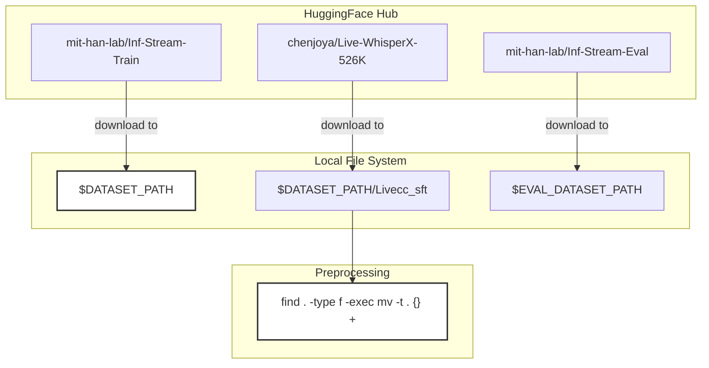
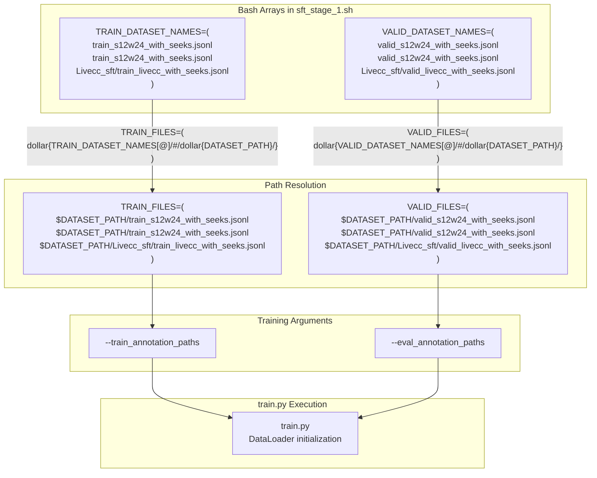
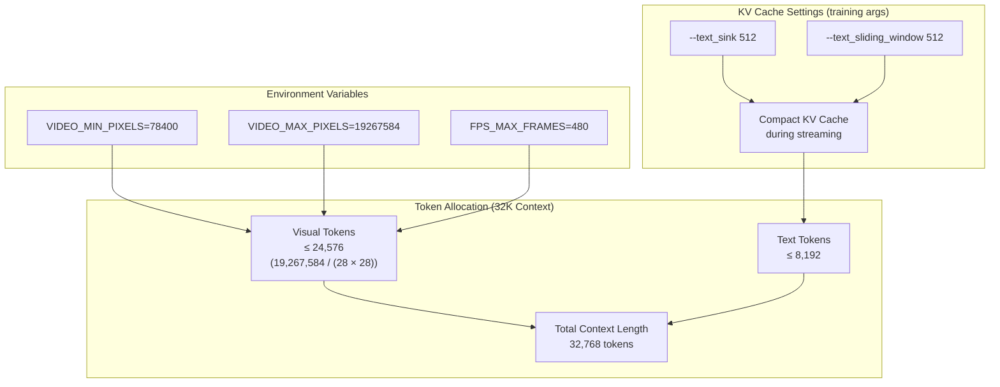
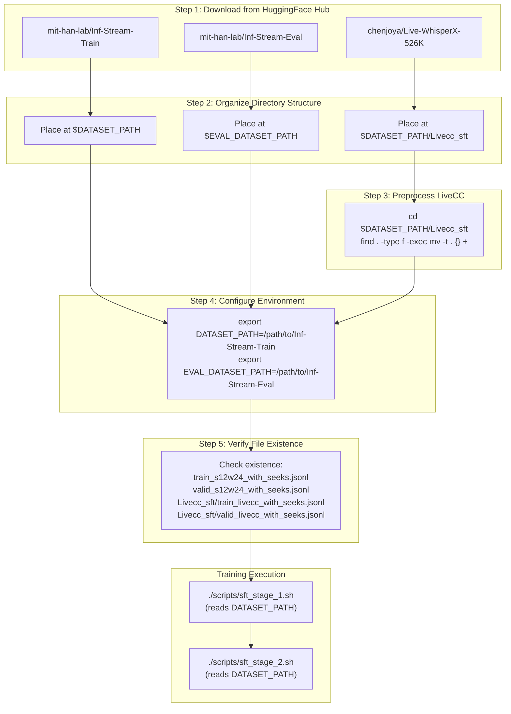
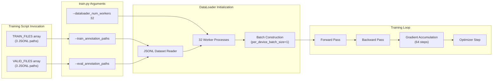

<!-- source: DeepWiki mcp.deepwiki.com · repo mit-han-lab/streaming-vlm · page 4.1 Data Preparation · fetched 2026-10-30 -->

# Data Preparation

<details>
<summary>Relevant source files</summary>

The following files were used as context for generating this wiki page:

- [baselines/livecc/debug.py](baselines/livecc/debug.py)
- [readme.md](readme.md)

</details>


## Purpose and Scope

This document describes the dataset acquisition, directory organization, and preprocessing steps required to prepare data for StreamingVLM training. It covers downloading datasets from HuggingFace Hub, organizing the file structure, preprocessing operations, and environment configuration. The prepared datasets feed into the two-stage supervised fine-tuning pipeline described in sections 4.2 and 4.3.

For detailed information about data curation utilities (category filtering, ASD selection, dataset statistics), see [Dataset Processing Pipeline](#4.1.1). For JSONL schema specifications and annotation structure, see [Data Formats and Schemas](#4.1.2).

## Required Datasets

StreamingVLM training requires two training datasets and one evaluation dataset from HuggingFace Hub:

| Dataset | HuggingFace Repository | Purpose | Key Files |
|---------|----------------------|---------|-----------|
| Inf-Stream-Train | `mit-han-lab/Inf-Stream-Train` | Primary streaming training data | `train_s12w24_with_seeks.jsonl`<br/>`valid_s12w24_with_seeks.jsonl` |
| Live-WhisperX-526K | `chenjoya/Live-WhisperX-526K` | LiveCC training data with WhisperX ASR | `train_livecc_with_seeks.jsonl`<br/>`valid_livecc_with_seeks.jsonl` |
| Inf-Stream-Eval | `mit-han-lab/Inf-Stream-Eval` | Streaming evaluation benchmark | Evaluation data (see section 6.5) |

The **Inf-Stream-Train** dataset contains video segments with streaming annotations in JSONL format, preprocessed for continuous video understanding tasks. The **Live-WhisperX-526K** dataset (526K samples) provides live commentary training data with automatic speech recognition transcriptions, used for training the LiveCC baseline and StreamingVLM.

**Sources:** [readme.md:45-56]()

## Dataset Acquisition and Setup

### Download Steps

The datasets must be downloaded from HuggingFace Hub and organized in a specific directory structure:



**Dataset Directory Setup Workflow**

The setup process follows these steps:

1. **Download Inf-Stream-Train**: Download the primary training dataset to your chosen base directory
2. **Download Live-WhisperX-526K**: Download to the `Livecc_sft` subdirectory within the base path
3. **Flatten LiveCC Structure**: Execute the preprocessing command to move all files to the root of `Livecc_sft`
4. **Download Inf-Stream-Eval**: Download the evaluation dataset to a separate directory

**Sources:** [readme.md:45-63]()

### Preprocessing Command

The LiveCC dataset requires a directory flattening operation to ensure all data files are accessible at the root level:

```bash
cd $DATASET_PATH/Livecc_sft
find . -type f -exec mv -t . {} +
```

This command moves all nested files to the `Livecc_sft` directory root, which is required for the training scripts to locate the data files correctly.

**Sources:** [readme.md:51-54]()

## Environment Configuration

### Required Environment Variables

Two environment variables must be set before training:

| Variable | Purpose | Example Value |
|----------|---------|---------------|
| `DATASET_PATH` | Root directory containing Inf-Stream-Train and Livecc_sft | `/path/to/your/Inf-Stream-Train` |
| `EVAL_DATASET_PATH` | Directory containing Inf-Stream-Eval benchmark | `/path/to/your/Inf-Stream-Eval` |

```bash
export DATASET_PATH=/path/to/your/Inf-Stream-Train
export EVAL_DATASET_PATH=/path/to/your/Inf-Stream-Eval
```

These variables are referenced throughout the training scripts to locate dataset files dynamically.

**Sources:** [readme.md:58-63](), [scripts/sft_stage_1.sh:9]()

## Training Dataset Organization

### Expected File Structure

After completing the setup steps, the dataset directory structure should match the following layout:

```
$DATASET_PATH/                           # Root directory (Inf-Stream-Train)
├── train_s12w24_with_seeks.jsonl       # Main training annotations
├── valid_s12w24_with_seeks.jsonl       # Main validation annotations
├── [video files from Inf-Stream-Train] # Video files referenced in annotations
├── Livecc_sft/                          # LiveCC subdirectory
│   ├── train_livecc_with_seeks.jsonl   # LiveCC training annotations
│   ├── valid_livecc_with_seeks.jsonl   # LiveCC validation annotations
│   └── [LiveCC video files]            # Flattened video files
└── ...

$EVAL_DATASET_PATH/                      # Evaluation dataset (separate path)
└── [Inf-Stream-Eval evaluation data]
```

The training scripts in `scripts/sft_stage_1.sh` and `scripts/sft_stage_2.sh` reference these specific JSONL filenames when constructing the `--train_annotation_paths` and `--eval_annotation_paths` arguments.

**Sources:** [scripts/sft_stage_1.sh:30-42](), [readme.md:45-63]()

### Dataset File Resolution Pipeline



**Dataset Path Construction in Training Scripts**

The training script [scripts/sft_stage_1.sh:30-45]() uses bash parameter expansion to prepend `$DATASET_PATH` to relative filenames:

- **Array Prefix Expansion**: `"${TRAIN_DATASET_NAMES[@]/#/$DATASET_PATH/}"` prepends the dataset path to each array element
- **Duplicate Entries**: `train_s12w24_with_seeks.jsonl` appears twice in `TRAIN_DATASET_NAMES`, effectively doubling its sampling weight during training
- **Argument Passing**: The expanded arrays are passed to `train.py` via `--train_annotation_paths "${TRAIN_FILES[@]}"` and `--eval_annotation_paths "${VALID_FILES[@]}"`

**Sources:** [scripts/sft_stage_1.sh:30-45]()

## Video Processing Configuration

### Frame and Token Limits

The training scripts set environment variables that control video processing constraints:

| Environment Variable | Value | Interpretation | Purpose |
|---------------------|-------|----------------|---------|
| `VIDEO_MIN_PIXELS` | `78400` | 100 frames × 28 × 28 pixels | Minimum visual tokens per video sample |
| `FPS_MAX_FRAMES` | `480` | 480 frames | Maximum frames per video (8 minutes @ 1 FPS) |
| `VIDEO_MAX_PIXELS` | `19267584` | 24,576 frames × 28 × 28 pixels | Maximum visual tokens (reserves 8K for text) |

These environment variables are read by the `qwen_vl_utils` video processing utilities during data loading. The 28×28 pixel patches correspond to the visual tokenization grid used by the Qwen2-VL vision encoder.

**Sources:** [scripts/sft_stage_1.sh:1-4]()

### Token Budget and KV Cache Configuration



**Token Budget Configuration in Training**

The training configuration in [scripts/sft_stage_1.sh:1-7]() establishes a 32,768-token context budget:

- **Visual Token Budget**: Up to 24,576 visual tokens derived from `VIDEO_MAX_PIXELS` (19,267,584 pixels ÷ 784 pixels per patch)
- **Text Token Budget**: Up to 8,192 text tokens, managed by KV cache configuration
- **KV Cache Parameters**: `--text_sink 512` and `--text_sliding_window 512` enable compact memory usage during streaming inference

These settings align training with the streaming inference behavior described in section 5.1, ensuring the model learns to maintain compact KV states.

**Sources:** [scripts/sft_stage_1.sh:1-7]()

## Data Preparation Workflow

### Complete Preparation Pipeline



**End-to-End Setup Procedure**

The data preparation workflow consists of five sequential steps:

1. **Download Datasets**: Retrieve the three required datasets from HuggingFace Hub
2. **Organize Directories**: Place datasets in the designated paths (`$DATASET_PATH` and `$EVAL_DATASET_PATH`)
3. **Flatten LiveCC Directory**: Execute `find . -type f -exec mv -t . {} +` to move all nested files to the `Livecc_sft` root
4. **Set Environment Variables**: Export `DATASET_PATH` and `EVAL_DATASET_PATH` for training scripts to reference
5. **Verify Files**: Confirm all required JSONL annotation files exist before initiating training

After verification, the datasets are ready for the two-stage SFT process (sections 4.2 and 4.3).

**Sources:** [readme.md:45-78](), [scripts/sft_stage_1.sh:9-42]()

## Dataset Composition and Weighting

### Training Data Sources

The `TRAIN_DATASET_NAMES` array in [scripts/sft_stage_1.sh:30-34]() specifies the training data composition:

```bash
TRAIN_DATASET_NAMES=(
    train_s12w24_with_seeks.jsonl
    train_s12w24_with_seeks.jsonl    # Duplicate entry for 2x weight
    Livecc_sft/train_livecc_with_seeks.jsonl
)
```

**Training Data Mix**:
- **Inf-Stream-Train**: `train_s12w24_with_seeks.jsonl` appears twice (66.7% of training data weight)
- **LiveCC**: `Livecc_sft/train_livecc_with_seeks.jsonl` (33.3% of training data weight)

This 2:1 weighting strategy emphasizes general streaming understanding while incorporating live commentary examples.

### Validation Data Structure

The `VALID_DATASET_NAMES` array mirrors the training composition for consistent evaluation:

```bash
VALID_DATASET_NAMES=(
    valid_s12w24_with_seeks.jsonl
    valid_s12w24_with_seeks.jsonl    # Duplicate entry for 2x weight
    Livecc_sft/valid_livecc_with_seeks.jsonl
)
```

Validation occurs every 100 training steps as specified by `--eval_steps 100` in the training command.

**Sources:** [scripts/sft_stage_1.sh:30-45]()

## Integration with Training Pipeline

### Training Command Arguments

The prepared dataset paths are passed to `train.py` via the following arguments in [scripts/sft_stage_1.sh]():

| Argument | Value | Purpose |
|----------|-------|---------|
| `--train_annotation_paths` | `"${TRAIN_FILES[@]}"` | Array of training JSONL file paths |
| `--eval_annotation_paths` | `"${VALID_FILES[@]}"` | Array of validation JSONL file paths |
| `--dataloader_num_workers` | `32` | Parallel data loading workers |
| `--per_device_train_batch_size` | `1` | Samples per GPU (memory constraint) |
| `--gradient_accumulation_steps` | `64` | Effective batch size = 64 × num_gpus |
| `--eval_steps` | `100` | Validation frequency (every 100 steps) |

### Data Loading Architecture



**Data Loading and Training Flow**

The training script `train.py` (invoked by `sft_stage_1.sh`) initializes PyTorch DataLoaders with 32 worker processes to parallelize JSONL reading and video preprocessing. Each GPU processes one sample per batch (`per_device_train_batch_size=1`) with gradients accumulated over 64 steps before optimizer updates, achieving an effective batch size of 64 × number of GPUs.

**Sources:** [scripts/sft_stage_1.sh:45]()

## Next Steps

After completing data preparation:

1. **Processing Pipeline**: See [Dataset Processing Pipeline](#4.1.1) for details on data curation, category filtering, ASD selection, and JSONL generation
2. **Data Format Details**: See [Data Formats and Schemas](#4.1.2) for JSONL schema specifications, annotation structure, and video metadata format
3. **Training Execution**: Proceed to [Stage 1 Training](#4.2) to begin the supervised fine-tuning process with the prepared datasets

**Sources:** [readme.md:67-78]()

---

