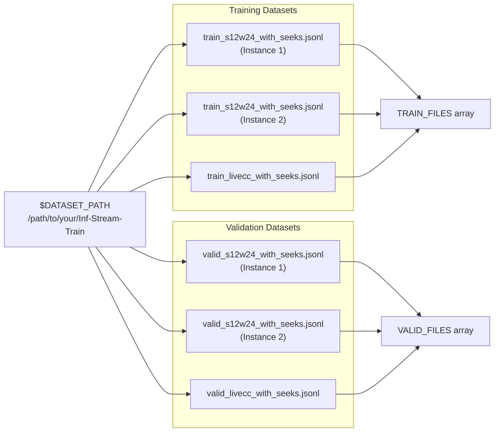
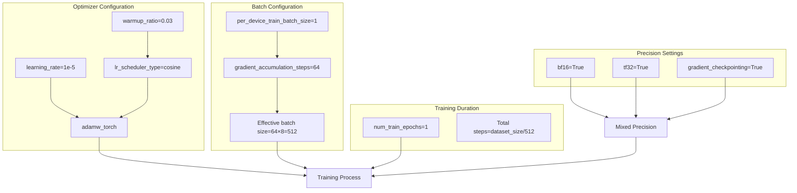
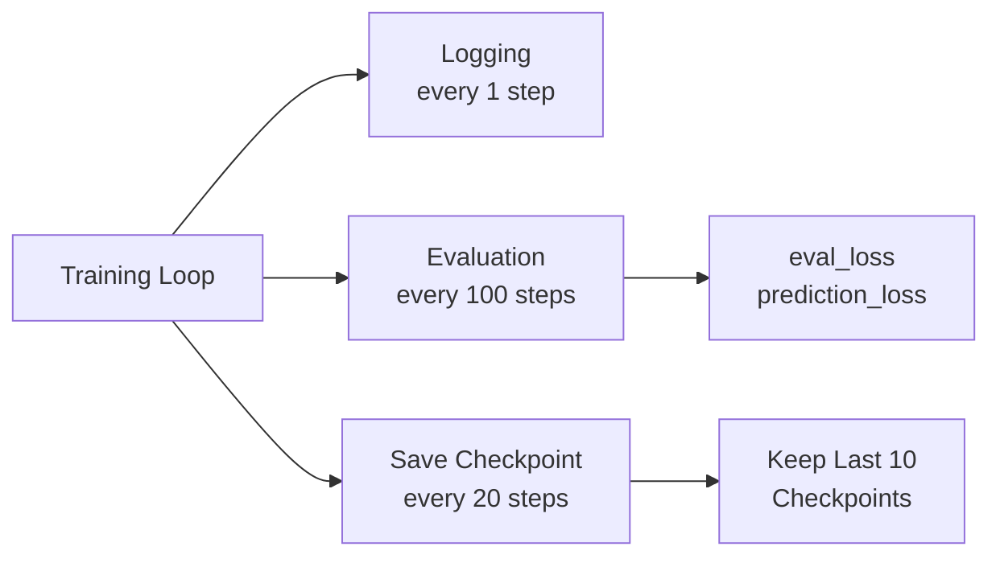
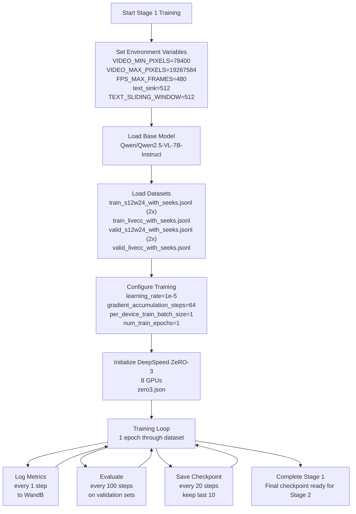

<!-- source: DeepWiki mcp.deepwiki.com · repo mit-han-lab/streaming-vlm · page 4.2 Stage 1 Training · fetched 2026-10-30 -->

# Stage 1 Training

<details>
<summary>Relevant source files</summary>

The following files were used as context for generating this wiki page:

- [readme.md](readme.md)
- [scripts/sft_stage_1.sh](scripts/sft_stage_1.sh)

</details>


This document describes the Stage 1 supervised fine-tuning process for StreamingVLM. Stage 1 trains the base Qwen2.5-VL-7B-Instruct model on the combined Inf-Stream-Train and LiveCC datasets to create an initial checkpoint capable of streaming video commentary. For information about Stage 2 high-quality annealing, see [Stage 2 Training](#4.3). For details on data preparation and filtering, see [Data Preparation](#4.1).

## Training Objective

Stage 1 SFT transforms the pretrained Qwen2.5-VL-7B-Instruct model into a streaming-capable model by fine-tuning on annotated video commentary datasets. The training objective is to teach the model to:

1. Generate timestamped commentary for continuous video streams
2. Maintain temporal context across long videos (up to 4 minutes per sample)
3. Handle compact attention windows (`text_sink=512`, `text_sliding_window=512`)
4. Process video at streaming-aligned frame rates

This stage produces a checkpoint that serves as the foundation for Stage 2 refinement.

**Sources:** [scripts/sft_stage_1.sh:1-46](), [readme.md:43-78]()

## Base Model and Output Configuration

Stage 1 begins with the pretrained `Qwen/Qwen2.5-VL-7B-Instruct` model from Hugging Face. The training script configures the model path and output directory:

```bash
model_name="Qwen/Qwen2.5-VL-7B-Instruct"
OUTPUT_DIR="./checkpoints"
RUN_NAME="${WANDB_PROJECT_NAME}_e${epoch_num}_lr${learning_rate}_ps${text_sink}_pw${TEXT_SLIDING_WINDOW}"
```

The output directory structure follows the pattern:
```
./checkpoints/
└── StreamingVLM_SFT_stage_1_e1_lr1e-5_ps512_pw512_YYYYMMDD_HHMMSS/
```

Checkpoints are saved every 20 steps with a maximum of 10 checkpoints retained (`save_steps=20`, `save_total_limit=10`).

**Sources:** [scripts/sft_stage_1.sh:15-28]()

## Dataset Configuration

Stage 1 uses three dataset files from the `$DATASET_PATH` directory, with each dataset included for training and validation:



The `train_s12w24_with_seeks.jsonl` dataset is included twice to increase its sampling weight during training. All files must be located in the `$DATASET_PATH` directory set via environment variable.

**Dataset Composition:**
- **s12w24**: Inf-Stream-Train dataset with seek annotations
- **livecc**: Live-WhisperX-526K dataset with temporal annotations

**Sources:** [scripts/sft_stage_1.sh:9,30-42](), [readme.md:46-56]()

## Video Processing Parameters

Stage 1 training configures video processing through environment variables that control frame extraction and token allocation:

| Parameter | Value | Description |
|-----------|-------|-------------|
| `VIDEO_MIN_PIXELS` | 78400 | Minimum visual tokens (100×28×28), ensures at least 100 frame tokens |
| `VIDEO_MAX_PIXELS` | 19267584 | Maximum visual tokens (24576×28×28), limits to 24k video tokens |
| `FPS_MAX_FRAMES` | 480 | Maximum frames per video (480 frames ÷ 2 FPS ÷ 60 = 4 minutes) |

These parameters ensure training aligns with streaming inference constraints:
- Videos are sampled at 2 FPS (configurable via `QWENVL_FPS` environment variable)
- Visual tokens are capped at 24k, reserving 8k tokens for language output
- Maximum video duration is 4 minutes per training sample

**Sources:** [scripts/sft_stage_1.sh:1-4]()

## Attention Window Configuration

Stage 1 implements compact attention windows to train the model for streaming inference:

```bash
text_sink=512
TEXT_SLIDING_WINDOW=512
```

These parameters define the text attention mechanism:
- **text_sink**: Number of initial tokens always retained (512)
- **TEXT_SLIDING_WINDOW**: Size of the sliding attention window (512)

This configuration trains the model to operate within compact KV cache constraints, essential for real-time streaming performance. The model learns to maintain relevant context within the 512-token window while discarding older tokens.

**Sources:** [scripts/sft_stage_1.sh:6-7]()

## Training Hyperparameters



**Core Training Parameters:**

| Parameter | Value | Purpose |
|-----------|-------|---------|
| `learning_rate` | 1e-5 | Conservative learning rate for fine-tuning |
| `num_train_epochs` | 1 | Single pass through the dataset |
| `gradient_accumulation_steps` | 64 | Accumulate gradients across 64 steps |
| `per_device_train_batch_size` | 1 | One sample per GPU per step |
| `optim` | adamw_torch | AdamW optimizer implementation |
| `lr_scheduler_type` | cosine | Cosine annealing learning rate schedule |
| `warmup_ratio` | 0.03 | Warm up for 3% of training steps |

**Memory Optimization:**
- `bf16=True`: BFloat16 mixed precision training
- `tf32=True`: TensorFloat-32 for faster matrix operations
- `gradient_checkpointing=True`: Trade compute for memory by recomputing activations
- `use_liger_kernel=True`: Use Liger kernel for memory efficiency

With 8 GPUs, the effective batch size is 1 × 64 × 8 = 512 samples per optimization step.

**Sources:** [scripts/sft_stage_1.sh:12-15,45]()

## Distributed Training Setup

Stage 1 uses DeepSpeed ZeRO-3 for memory-efficient distributed training across 8 GPUs:

```bash
TORCH_NCCL_HEARTBEAT_TIMEOUT_SEC=1800
PYTORCH_CUDA_ALLOC_CONF=expandable_segments:True

torchrun --standalone --nproc_per_node=8 train.py \
  --deepspeed ./scripts/zero3.json \
  --save_on_each_node True \
  --dataloader_num_workers 32
```

**Distributed Training Configuration:**

| Component | Configuration | Purpose |
|-----------|--------------|---------|
| Framework | `torchrun --standalone` | PyTorch distributed launcher |
| GPUs | `nproc_per_node=8` | 8 GPUs per node |
| DeepSpeed | `zero3.json` | ZeRO Stage 3 configuration |
| NCCL Timeout | 1800 seconds | Extended timeout for large model synchronization |
| CUDA Allocator | `expandable_segments:True` | Dynamic memory allocation |
| Data Workers | 32 | Parallel data loading threads |
| Node Saving | `save_on_each_node=True` | Each node saves checkpoints independently |

The DeepSpeed ZeRO-3 configuration partitions optimizer states, gradients, and model parameters across all GPUs, enabling training of the 7B parameter model with compact memory footprint. For detailed ZeRO-3 settings, see [DeepSpeed Configuration](#4.4).

**Sources:** [scripts/sft_stage_1.sh:44-45]()

## Evaluation and Checkpointing Strategy

Stage 1 implements periodic evaluation and checkpoint saving:



**Evaluation Configuration:**

| Parameter | Value | Description |
|-----------|-------|-------------|
| `eval_strategy` | steps | Evaluate periodically during training |
| `eval_steps` | 100 | Run evaluation every 100 optimization steps |
| `per_device_eval_batch_size` | 1 | Evaluation batch size per GPU |
| `metric_for_best_model` | eval_loss | Track evaluation loss |
| `prediction_loss_only` | true | Only compute loss during evaluation |

**Checkpointing Configuration:**

| Parameter | Value | Description |
|-----------|-------|-------------|
| `save_strategy` | steps | Save checkpoints periodically |
| `save_steps` | 20 | Save every 20 optimization steps |
| `save_total_limit` | 10 | Keep only the 10 most recent checkpoints |
| `load_best_model_at_end` | False | Do not load best checkpoint at completion |
| `ignore_data_skip` | False | Resume from exact data position on restart |

Validation is performed on the three `valid_*_with_seeks.jsonl` files, computing loss to monitor training progress.

**Sources:** [scripts/sft_stage_1.sh:45]()

## Monitoring and Logging

Stage 1 integrates Weights & Biases (WandB) for experiment tracking:

```bash
WANDB_API_KEY=your-wandb-api-key
WANDB_ENTITY=your-wandb-entity
WANDB_PROJECT_NAME=StreamingVLM_SFT_stage_1

RUN_NAME="${WANDB_PROJECT_NAME}_e${epoch_num}_lr${learning_rate}_ps${text_sink}_pw${TEXT_SLIDING_WINDOW}"
```

**WandB Configuration:**
- **Project Name**: `StreamingVLM_SFT_stage_1`
- **Run Name Format**: `StreamingVLM_SFT_stage_1_e1_lr1e-5_ps512_pw512`
- **Logging Frequency**: Every optimization step (`logging_steps=1`)
- **Reported Metrics**: Training loss, evaluation loss, learning rate, throughput

The run name encodes key hyperparameters for easy identification:
- `e1`: 1 epoch
- `lr1e-5`: Learning rate 1e-5
- `ps512`: Text sink size 512
- `pw512`: Text sliding window 512

**Sources:** [scripts/sft_stage_1.sh:18-27,45]()

## Stage 1 Training Flow



**Sources:** [scripts/sft_stage_1.sh:1-46]()

## Complete Training Command

The complete `torchrun` command executed by `sft_stage_1.sh`:

```bash
PYTORCH_CUDA_ALLOC_CONF=expandable_segments:True \
WANDB_API_KEY=$WANDB_API_KEY \
WANDB_ENTITY=$WANDB_ENTITY \
WANDB_PROJECT=$WANDB_PROJECT_NAME \
TOKENIZERS_PARALLELISM=false \
torchrun --standalone --nproc_per_node=8 train.py \
  --deepspeed ./scripts/zero3.json \
  --overwrite_output_dir True \
  --output_dir "${OUTPUT_DIR}/${RUN_NAME}_${timestamp}" \
  --run_name $RUN_NAME \
  --save_on_each_node True \
  --do_train True \
  --per_device_train_batch_size 1 \
  --gradient_accumulation_steps 64 \
  --learning_rate 1e-5 \
  --warmup_ratio 0.03 \
  --optim adamw_torch \
  --lr_scheduler_type cosine \
  --num_train_epochs 1 \
  --logging_steps 1 \
  --bf16 True \
  --tf32 True \
  --gradient_checkpointing True \
  --pretrained_model_name_or_path "Qwen/Qwen2.5-VL-7B-Instruct" \
  --train_annotation_paths "${TRAIN_FILES[@]}" \
  --dataloader_num_workers 32 \
  --use_liger_kernel True \
  --report_to wandb \
  --ignore_data_skip False \
  --save_strategy steps \
  --save_steps 20 \
  --save_total_limit 10 \
  --load_best_model_at_end False \
  --greater_is_better False \
  --prediction_loss_only true \
  --eval_steps 100 \
  --metric_for_best_model eval_loss \
  --eval_strategy steps \
  --per_device_eval_batch_size 1 \
  --eval_annotation_paths "${VALID_FILES[@]}" \
  --text_sink 512 \
  --text_sliding_window 512
```

This command invokes `train.py` with all necessary arguments for Stage 1 training. The script assumes `train.py` is located in the repository root and implements the training loop using the Hugging Face Trainer API with DeepSpeed integration.

**Sources:** [scripts/sft_stage_1.sh:45]()

## Output Checkpoint

Upon completion, Stage 1 produces a checkpoint directory:

```
./checkpoints/StreamingVLM_SFT_stage_1_e1_lr1e-5_ps512_pw512_YYYYMMDD_HHMMSS/
├── checkpoint-XXXXX/
│   ├── config.json
│   ├── generation_config.json
│   ├── model.safetensors.index.json
│   ├── optimizer.pt
│   ├── rng_state.pth
│   ├── scheduler.pt
│   ├── trainer_state.json
│   └── training_args.bin
└── ...
```

This checkpoint serves as the input for Stage 2 high-quality annealing. The most recent checkpoint (based on `save_total_limit=10`) contains the model weights, optimizer state, and training configuration needed for continued training.

**Sources:** [scripts/sft_stage_1.sh:28,45]()

---

