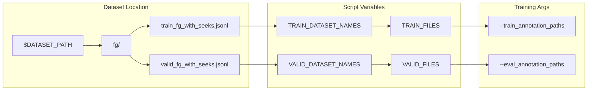
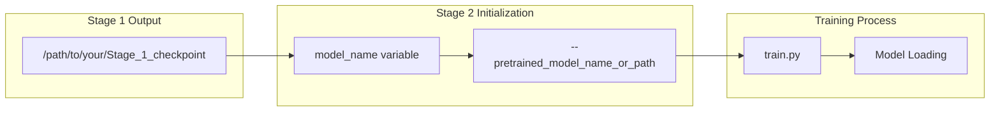
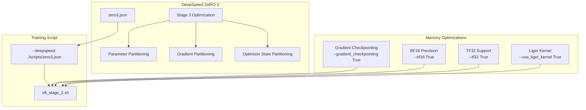
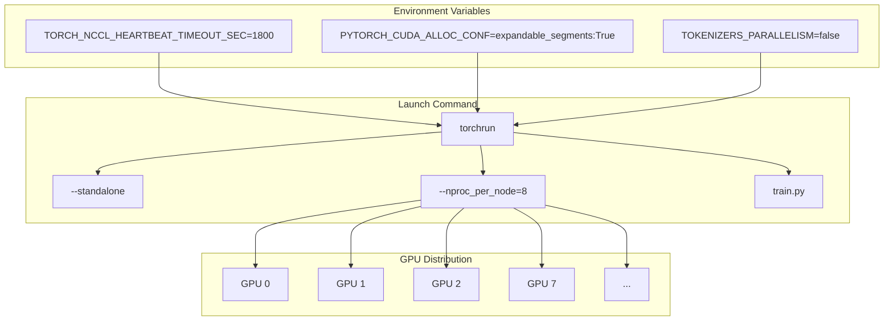
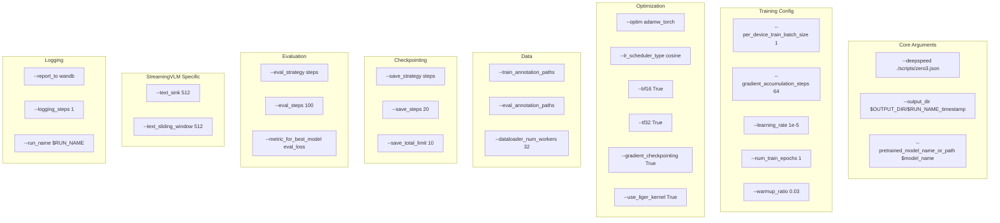

<!-- source: DeepWiki mcp.deepwiki.com · repo mit-han-lab/streaming-vlm · page 4.3 Stage 2 Training · fetched 2026-10-30 -->

# Stage 2 Training

<details>
<summary>Relevant source files</summary>

The following files were used as context for generating this wiki page:

- [readme.md](readme.md)
- [scripts/sft_stage_2.sh](scripts/sft_stage_2.sh)

</details>


## Purpose and Scope

This document describes Stage 2 of the two-stage supervised fine-tuning pipeline for StreamingVLM. Stage 2 performs annealing on a high-quality subset of the training data using the checkpoint produced by Stage 1 as the starting point. This stage uses a refined dataset with reduced learning rate to stabilize and improve model performance on carefully curated examples.

For information about the initial training phase, see [Stage 1 Training](#4.2). For details on the distributed training optimization strategy, see [DeepSpeed Configuration](#4.4). For dataset preparation steps, see [Data Preparation](#4.1).

**Sources:** [readme.md:43-78](), [scripts/sft_stage_2.sh:1-42]()

## Overview

Stage 2 training implements an annealing process that refines the model learned in Stage 1. The key characteristics of this stage are:

- **High-Quality Data**: Trains exclusively on a curated subset labeled "fg" (fine-grained)
- **Lower Learning Rate**: Uses reduced learning rate for stable refinement
- **Single Epoch**: Performs one complete pass over the annealing dataset
- **Checkpoint Continuation**: Initializes from Stage 1 checkpoint rather than base model

The annealing process helps the model converge to better quality outputs by focusing on carefully selected examples after the initial broad training phase.

**Sources:** [readme.md:77](), [scripts/sft_stage_2.sh:1-42]()

## Dataset Configuration

Stage 2 uses a distinct dataset from Stage 1, focusing on quality over quantity:

| Dataset Component | File Path | Purpose |
|------------------|-----------|---------|
| Training Data | `fg/train_fg_with_seeks.jsonl` | High-quality examples for annealing |
| Validation Data | `fg/valid_fg_with_seeks.jsonl` | Validation set for monitoring |

The dataset paths are constructed relative to `$DATASET_PATH`:



**Sources:** [scripts/sft_stage_2.sh:28-36]()

## Training Hyperparameters

Stage 2 uses carefully tuned hyperparameters to refine the model without destabilizing learned representations:

### Core Training Parameters

| Parameter | Value | Description |
|-----------|-------|-------------|
| `learning_rate` | `1e-5` | Learning rate for optimizer |
| `num_train_epochs` | `1` | Single pass through dataset |
| `gradient_accumulation_steps` | `64` | Steps to accumulate before update |
| `per_device_train_batch_size` | `1` | Batch size per GPU |
| `per_device_eval_batch_size` | `1` | Evaluation batch size per GPU |
| `warmup_ratio` | `0.03` | Fraction of training for warmup |

### Optimizer Configuration

| Parameter | Value | Description |
|-----------|-------|-------------|
| `optim` | `adamw_torch` | PyTorch AdamW optimizer |
| `lr_scheduler_type` | `cosine` | Cosine learning rate schedule |

### Video Processing Parameters

| Environment Variable | Value | Description |
|---------------------|-------|-------------|
| `VIDEO_MIN_PIXELS` | `78400` | Minimum visual tokens (100×28×28) |
| `VIDEO_MAX_PIXELS` | `19267584` | Maximum visual tokens (24576×28×28) |
| `FPS_MAX_FRAMES` | `480` | Maximum frames per video |

### KV Cache Configuration

| Parameter | Value | Description |
|-----------|-------|-------------|
| `text_sink` | `512` | Size of text sink for KV cache |
| `TEXT_SLIDING_WINDOW` | `512` | Size of sliding window for text |

**Sources:** [scripts/sft_stage_2.sh:1-24](), [scripts/sft_stage_2.sh:40]()

## Model Initialization

Stage 2 initializes from the Stage 1 checkpoint rather than the base Qwen2.5-VL model:



The checkpoint path must be configured in the script at [scripts/sft_stage_2.sh:15]():

```bash
model_name="/path/to/your/Stage_1_checkpoint"
```

This path should point to the final checkpoint directory produced by Stage 1 training, which contains the model weights, tokenizer configuration, and processor settings.

**Sources:** [scripts/sft_stage_2.sh:15](), [scripts/sft_stage_2.sh:40]()

## Memory Optimization Strategy

Stage 2 employs the same memory optimization techniques as Stage 1 to enable training of the large multimodal model:



The DeepSpeed configuration is specified in [scripts/zero3.json:1-28](), which configures ZeRO Stage 3 optimization with:
- Parameter sharding across GPUs
- Gradient communication overlap
- Contiguous memory allocation for gradients
- 16-bit weight gathering on checkpoint save

**Sources:** [scripts/sft_stage_2.sh:40](), [scripts/zero3.json:1-28]()

## Checkpointing Strategy

Stage 2 implements a comprehensive checkpointing strategy to preserve training progress:

| Parameter | Value | Description |
|-----------|-------|-------------|
| `save_strategy` | `steps` | Save checkpoints based on steps |
| `save_steps` | `20` | Save every 20 training steps |
| `save_total_limit` | `10` | Keep maximum 10 checkpoints |
| `save_on_each_node` | `True` | Save checkpoints on each distributed node |
| `overwrite_output_dir` | `True` | Overwrite existing output directory |

### Output Directory Structure

Checkpoints are saved to a timestamped directory:

```
${OUTPUT_DIR}/${RUN_NAME}_${timestamp}/
```

Where:
- `OUTPUT_DIR` defaults to `./checkpoints`
- `RUN_NAME` includes training configuration: `StreamingVLM_SFT_stage_2_e1_lr1e-5_ps512_pw512`
- `timestamp` is generated at script start: `YYYYMMDD_HHMMSS`

**Sources:** [scripts/sft_stage_2.sh:22-25](), [scripts/sft_stage_2.sh:40]()

## Evaluation During Training

Stage 2 performs periodic evaluation to monitor training progress:

| Parameter | Value | Description |
|-----------|-------|-------------|
| `eval_strategy` | `steps` | Evaluate based on training steps |
| `eval_steps` | `100` | Evaluate every 100 steps |
| `metric_for_best_model` | `eval_loss` | Metric to track for best model |
| `greater_is_better` | `False` | Lower eval_loss is better |
| `load_best_model_at_end` | `False` | Don't load best model at end |
| `prediction_loss_only` | `true` | Only compute loss for evaluation |

The validation dataset (`fg/valid_fg_with_seeks.jsonl`) is used for these periodic evaluations.

**Sources:** [scripts/sft_stage_2.sh:40]()

## Monitoring and Logging

Stage 2 integrates with Weights & Biases for experiment tracking:

### WandB Configuration

The following environment variables must be set:

| Variable | Purpose | Example |
|----------|---------|---------|
| `WANDB_API_KEY` | Authentication key | `your-wandb-api-key` |
| `WANDB_ENTITY` | WandB username/team | `your-wandb-entity` |
| `WANDB_PROJECT` | Project name | `StreamingVLM_SFT_stage_2` |

### Run Naming

The run name encodes key hyperparameters for easy identification:

```
StreamingVLM_SFT_stage_2_e${epoch_num}_lr${learning_rate}_ps${text_sink}_pw${TEXT_SLIDING_WINDOW}
```

For default parameters, this produces:
```
StreamingVLM_SFT_stage_2_e1_lr1e-5_ps512_pw512
```

### Logging Frequency

Training metrics are logged every step (`--logging_steps 1`) to provide detailed training curves.

**Sources:** [scripts/sft_stage_2.sh:18-24](), [scripts/sft_stage_2.sh:40]()

## Distributed Training Configuration

Stage 2 uses `torchrun` for distributed training across 8 GPUs:



### Key Environment Variables

- `TORCH_NCCL_HEARTBEAT_TIMEOUT_SEC=1800`: Increases NCCL timeout to 30 minutes to prevent timeout errors during long operations
- `PYTORCH_CUDA_ALLOC_CONF=expandable_segments:True`: Enables CUDA memory allocator to use expandable segments for better memory utilization
- `TOKENIZERS_PARALLELISM=false`: Disables tokenizer parallelism to avoid warnings in distributed training

**Sources:** [scripts/sft_stage_2.sh:39-40]()

## Data Loading Configuration

The training script configures efficient data loading for video processing:

| Parameter | Value | Description |
|-----------|-------|-------------|
| `dataloader_num_workers` | `32` | Number of worker processes for data loading |
| `ignore_data_skip` | `False` | Whether to skip data when resuming |

The large number of data loader workers (32) is necessary to handle the computationally intensive video preprocessing, including frame extraction, resizing, and clip interleaving.

**Sources:** [scripts/sft_stage_2.sh:40]()

## Script Execution

To run Stage 2 training:

### Prerequisites

1. Complete Stage 1 training and obtain checkpoint path
2. Prepare the `fg` dataset in `$DATASET_PATH/fg/`
3. Set up the training environment:
   ```bash
   conda activate streamingvlm-sft
   ```
4. Configure WandB credentials in the script

### Execution Steps

1. **Configure the script** [scripts/sft_stage_2.sh:9-20]():
   - Set `DATASET_PATH` to your dataset directory
   - Set `model_name` to your Stage 1 checkpoint path
   - Set WandB credentials (`WANDB_API_KEY`, `WANDB_ENTITY`)

2. **Run the training script**:
   ```bash
   ./scripts/sft_stage_2.sh
   ```

3. **Monitor training**:
   - Check WandB dashboard for training curves
   - Monitor GPU memory usage
   - Verify checkpoint creation in output directory

### Expected Output

The script produces:
- Checkpoints every 20 steps in `./checkpoints/${RUN_NAME}_${timestamp}/`
- Evaluation metrics every 100 steps
- WandB logs with loss curves and training statistics
- Final checkpoint containing the refined StreamingVLM model

**Sources:** [readme.md:67-78](), [scripts/sft_stage_2.sh:1-42]()

## Training Command Breakdown

The final training command passed to `train.py` includes all parameters:



All arguments are passed in a single line to the `train.py` script via `torchrun`.

**Sources:** [scripts/sft_stage_2.sh:40]()

## Differences from Stage 1

Key differences between Stage 1 and Stage 2 training:

| Aspect | Stage 1 | Stage 2 |
|--------|---------|---------|
| **Dataset** | Full Inf-Stream-Train dataset | High-quality fg subset |
| **Learning Rate** | Higher (initial training) | 1e-5 (annealing) |
| **Starting Point** | Base Qwen2.5-VL-7B-Instruct | Stage 1 checkpoint |
| **Purpose** | Broad streaming capability learning | Quality refinement and stabilization |
| **Data Quality** | Mixed quality, comprehensive coverage | Curated high-quality examples |

Stage 2 is designed to polish the model's outputs and improve generation quality without relearning the fundamental streaming video understanding capabilities acquired in Stage 1.

**Sources:** [readme.md:76-77](), [scripts/sft_stage_2.sh:1-42]()

---

