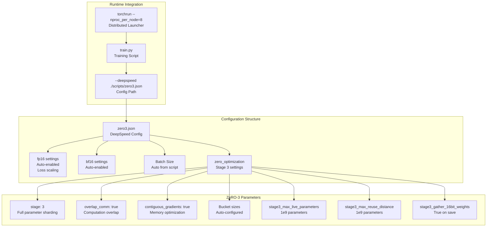
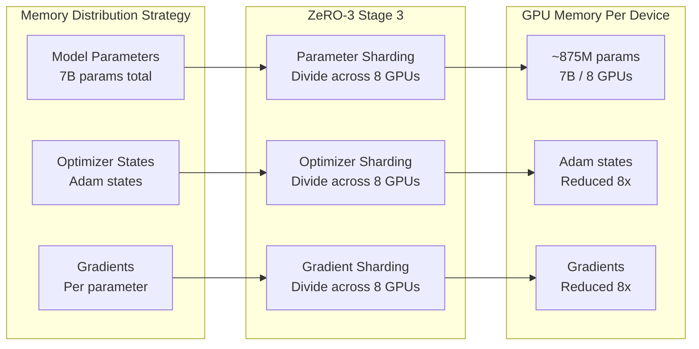
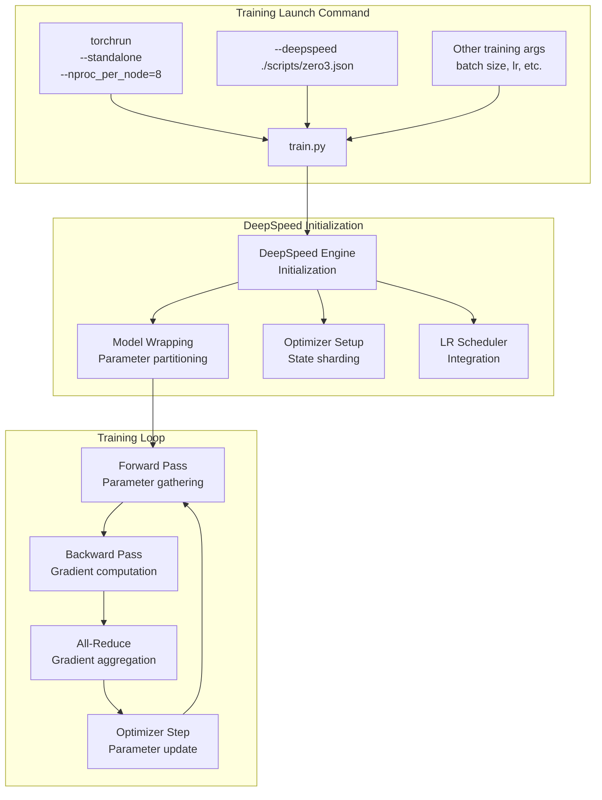
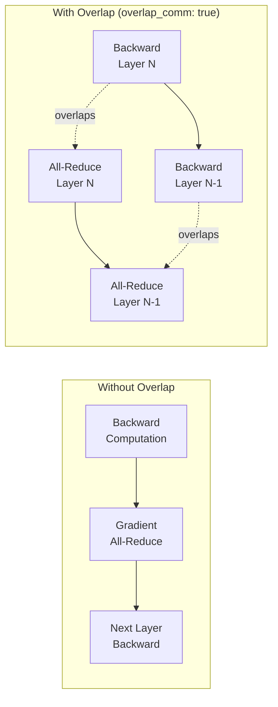
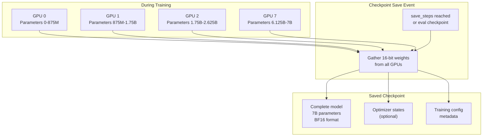

<!-- source: DeepWiki mcp.deepwiki.com · repo mit-han-lab/streaming-vlm · page 4.4 DeepSpeed Configuration · fetched 2026-10-30 -->

# DeepSpeed Configuration

<details>
<summary>Relevant source files</summary>

The following files were used as context for generating this wiki page:

- [scripts/sft_stage_1.sh](scripts/sft_stage_1.sh)
- [scripts/sft_stage_2.sh](scripts/sft_stage_2.sh)
- [scripts/zero3.json](scripts/zero3.json)

</details>


This document details the DeepSpeed ZeRO-3 configuration used in the StreamingVLM training pipeline. It covers the configuration file structure, optimization parameters, and integration with the distributed training setup.

For information about the overall training pipeline and stages, see [Training Pipeline](#4). For specific training stage configurations, see [Stage 1 Training](#4.2) and [Stage 2 Training](#4.3).

## Overview

StreamingVLM uses DeepSpeed with ZeRO-3 (Zero Redundancy Optimizer Stage 3) optimization to enable memory-efficient distributed training of the Qwen2.5-VL-7B-Instruct base model. The configuration is defined in `scripts/zero3.json` and enables training with gradient accumulation of 64 steps across 8 GPUs while maintaining manageable memory footprints.

The DeepSpeed configuration is essential for:
- **Parameter Partitioning**: Distributing model parameters across GPUs
- **Optimizer State Sharding**: Reducing per-GPU memory requirements for optimizer states
- **Communication Optimization**: Overlapping computation with gradient communication
- **Mixed Precision Training**: Enabling BF16/FP16 training with automatic precision management

**Sources**: [scripts/zero3.json:1-28](), [scripts/sft_stage_1.sh:45]()

## ZeRO-3 Configuration File

The configuration file `scripts/zero3.json` defines all DeepSpeed optimization parameters:



**Sources**: [scripts/zero3.json:1-28](), [scripts/sft_stage_1.sh:45]()

## Configuration Parameters

### Precision Settings

The configuration supports both FP16 and BF16 mixed precision training with automatic mode detection:

| Parameter | Value | Purpose |
|-----------|-------|---------|
| `fp16.enabled` | `"auto"` | Enable FP16 if `--fp16` flag is used |
| `fp16.loss_scale` | `0` | Dynamic loss scaling (0 = auto) |
| `fp16.loss_scale_window` | `1000` | Window for loss scale updates |
| `fp16.initial_scale_power` | `16` | Initial loss scale = 2^16 |
| `fp16.hysteresis` | `2` | Number of overflows before scale decrease |
| `fp16.min_loss_scale` | `1` | Minimum allowed loss scale |
| `bf16.enabled` | `"auto"` | Enable BF16 if `--bf16` flag is used |

In practice, StreamingVLM training uses BF16 (`--bf16 True` in training scripts), which provides better numerical stability than FP16 for large language models.

**Sources**: [scripts/zero3.json:2-12](), [scripts/sft_stage_1.sh:45]()

### Batch Size Configuration

The configuration uses automatic batch size detection from training script arguments:

| Parameter | Value | Source |
|-----------|-------|--------|
| `train_micro_batch_size_per_gpu` | `"auto"` | From `--per_device_train_batch_size` |
| `train_batch_size` | `"auto"` | Calculated automatically |
| `gradient_accumulation_steps` | `"auto"` | From `--gradient_accumulation_steps` |

The training scripts set:
- Per-device batch size: `1`
- Gradient accumulation steps: `64`
- Effective batch size: `1 × 8 GPUs × 64 = 512`

**Sources**: [scripts/zero3.json:13-15](), [scripts/sft_stage_1.sh:13,45]()

### ZeRO-3 Optimization Parameters

The core ZeRO-3 optimization configuration enables full parameter sharding:



**Key ZeRO-3 Parameters**:

| Parameter | Value | Effect |
|-----------|-------|--------|
| `stage` | `3` | Full sharding of parameters, gradients, and optimizer states |
| `overlap_comm` | `true` | Overlap gradient all-reduce with backward pass computation |
| `contiguous_gradients` | `true` | Store gradients contiguously for efficient communication |
| `sub_group_size` | `1e9` | Maximum sub-group size for communication |
| `reduce_bucket_size` | `"auto"` | Bucket size for gradient reduction |
| `stage3_prefetch_bucket_size` | `"auto"` | Prefetch bucket size for parameters |
| `stage3_param_persistence_threshold` | `"auto"` | Threshold for keeping parameters in memory |
| `stage3_max_live_parameters` | `1e9` | Maximum parameters to keep unpartitioned (1B params) |
| `stage3_max_reuse_distance` | `1e9` | Distance threshold for parameter reuse optimization |
| `stage3_gather_16bit_weights_on_model_save` | `true` | Gather full precision weights when saving checkpoints |

**Sources**: [scripts/zero3.json:16-27]()

## Integration with Training Pipeline

### DeepSpeed Installation

DeepSpeed is installed in the SFT training environment with specific version pinning:

```bash
pip install deepspeed==0.17.1
```

This version is compatible with:
- PyTorch 2.7.1
- Flash Attention 2.8.0.post2
- Transformers ≤4.51.3
- CUDA 12.x

**Sources**: [scripts/env_sft.sh:6]()

### Training Script Integration

The DeepSpeed configuration is integrated into the training process via the `--deepspeed` argument:



**Key integration points**:

1. **Distributed Launch**: `torchrun --standalone --nproc_per_node=8` launches 8 processes
2. **Config Path**: `--deepspeed ./scripts/zero3.json` specifies the configuration file
3. **Environment Variables**: `PYTORCH_CUDA_ALLOC_CONF=expandable_segments:True` enables memory optimization
4. **NCCL Timeout**: `TORCH_NCCL_HEARTBEAT_TIMEOUT_SEC=1800` prevents timeout during long operations

**Sources**: [scripts/sft_stage_1.sh:44-45]()

## Memory Optimization Impact

### ZeRO-3 Memory Savings

ZeRO-3 enables training of the 7B parameter model on 8 GPUs by reducing per-GPU memory requirements:

| Component | Without ZeRO | With ZeRO-3 | Reduction |
|-----------|--------------|-------------|-----------|
| Model Parameters (BF16) | 14 GB | 1.75 GB | 8x |
| Optimizer States (Adam) | 28 GB | 3.5 GB | 8x |
| Gradients (BF16) | 14 GB | 1.75 GB | 8x |
| **Total (Parameters + Optimizer + Gradients)** | **56 GB** | **7 GB** | **8x** |

Additional memory is required for:
- Activations (reduced by gradient checkpointing)
- KV cache (512 text sink + 512 sliding window)
- Video features (up to 480 frames × varying resolution)

**Sources**: [scripts/zero3.json:16-27]()

### Communication Patterns

The `overlap_comm: true` setting optimizes training throughput:



This overlapping reduces the wall-clock time for gradient synchronization across GPUs.

**Sources**: [scripts/zero3.json:18]()

## Checkpoint Saving

### Weight Gathering for Checkpoints

The `stage3_gather_16bit_weights_on_model_save: true` parameter ensures that when checkpoints are saved, the full-precision weights are gathered from all GPUs:



The training script saves checkpoints every 20 steps (`--save_steps 20`) with a limit of 10 total checkpoints (`--save_total_limit 10`).

**Sources**: [scripts/zero3.json:26](), [scripts/sft_stage_1.sh:45]()

## Configuration Tuning Guidelines

### When to Modify Parameters

Most parameters in `zero3.json` are set to `"auto"` for automatic tuning, but certain parameters may need adjustment for specific scenarios:

| Scenario | Parameter to Adjust | Recommended Value |
|----------|---------------------|-------------------|
| Out of memory during training | `stage3_max_live_parameters` | Reduce to 5e8 |
| Slow gradient communication | `reduce_bucket_size` | Increase to 5e8 |
| Memory fragmentation issues | `contiguous_gradients` | Keep as `true` |
| Different GPU count | No changes needed | Auto-scales |
| Larger model (>7B) | `stage3_max_live_parameters` | Reduce proportionally |

### Compatibility with Other Optimizations

The ZeRO-3 configuration works in conjunction with other memory optimizations:

| Optimization | Compatibility | Notes |
|--------------|---------------|-------|
| Gradient Checkpointing | ✓ Compatible | `--gradient_checkpointing True` |
| Flash Attention 2 | ✓ Compatible | Reduces activation memory |
| Liger Kernel | ✓ Compatible | `--use_liger_kernel True` |
| Mixed Precision (BF16) | ✓ Compatible | `--bf16 True` |
| CPU Offloading | ⚠ Not used | ZeRO-3 sufficient for 7B model |

**Sources**: [scripts/sft_stage_1.sh:45](), [scripts/env_sft.sh:4]()

## Verification and Monitoring

### Environment Variable Configuration

The training scripts set critical environment variables for DeepSpeed:

```bash
export TORCH_NCCL_HEARTBEAT_TIMEOUT_SEC=1800
PYTORCH_CUDA_ALLOC_CONF=expandable_segments:True
```

- `TORCH_NCCL_HEARTBEAT_TIMEOUT_SEC`: Prevents timeouts during long checkpoint saves
- `PYTORCH_CUDA_ALLOC_CONF=expandable_segments:True`: Enables dynamic memory allocation

**Sources**: [scripts/sft_stage_1.sh:44-45]()

### Expected Training Metrics

With the current configuration (8 GPUs, batch size 1, gradient accumulation 64):

- **Effective Batch Size**: 512 samples
- **Training Throughput**: ~20-30 seconds per step (depending on video length)
- **Memory Usage**: ~35-45 GB per GPU (including activations)
- **Checkpoint Size**: ~14 GB (BF16 weights)

Monitoring is integrated through Weights & Biases (`--report_to wandb`) which tracks:
- Training loss
- Evaluation loss
- GPU memory usage
- Training throughput

**Sources**: [scripts/sft_stage_1.sh:45]()

---

