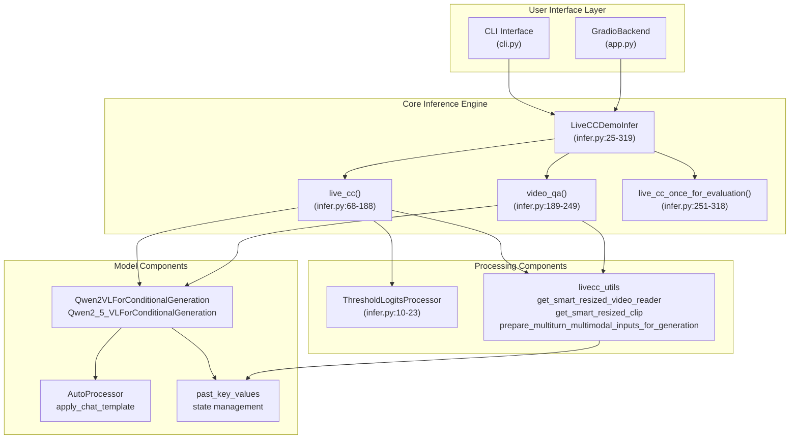
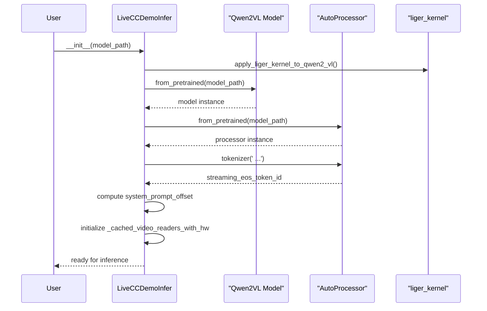
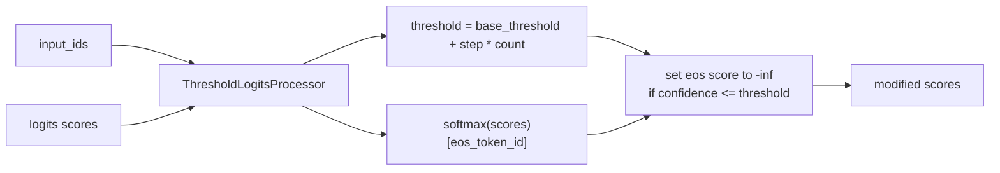
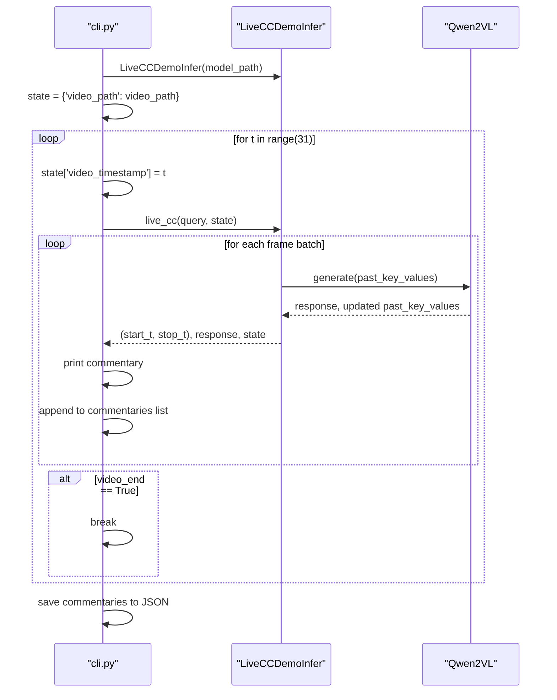

<!-- source: DeepWiki mcp.deepwiki.com · repo mit-han-lab/streaming-vlm · page 5 Inference Systems · fetched 2026-10-30 -->

# Inference Systems

<details>
<summary>Relevant source files</summary>

The following files were used as context for generating this wiki page:

- [baselines/livecc/demo/app.py](baselines/livecc/demo/app.py)
- [baselines/livecc/demo/cli.py](baselines/livecc/demo/cli.py)
- [baselines/livecc/demo/infer.py](baselines/livecc/demo/infer.py)

</details>


## Purpose and Scope

The Inference Systems module implements the runtime execution layer for StreamingVLM, providing both real-time streaming commentary and traditional video question-answering capabilities. This system manages model loading, video frame processing, KV cache state management, and generation output. The core inference engine is implemented in the `LiveCCDemoInfer` class, which serves as the backend for both CLI and web-based user interfaces.

For details on specific operational modes, see [Real-Time Commentary Mode](#5.2) and [Video Question Answering Mode](#5.3). For the underlying video processing utilities, see [Video Processing Pipeline](#5.4). For information about user-facing interfaces, see [User Interfaces](#7).

## System Architecture Overview



**Diagram: Core Inference System Architecture**

The inference system is organized into three layers: the user interface layer (CLI and Gradio), the core inference engine (LiveCCDemoInfer), and the underlying model components (Qwen2VL, processor, and KV cache). The `LiveCCDemoInfer` class provides three primary methods for different use cases: `live_cc()` for streaming commentary, `video_qa()` for traditional question-answering, and `live_cc_once_for_evaluation()` for benchmark testing.

**Sources:** [baselines/livecc/demo/infer.py:1-319](), [baselines/livecc/demo/app.py:1-179](), [baselines/livecc/demo/cli.py:1-28]()

## Core Components

### LiveCCDemoInfer Class

The `LiveCCDemoInfer` class is the central inference engine that manages model initialization, video processing, and generation. It is instantiated with a model path and automatically selects the appropriate device (MPS, CUDA, or CPU).

**Key Class Attributes:**

| Attribute | Value | Purpose |
|-----------|-------|---------|
| `fps` | 2 | Frame processing rate for streaming |
| `initial_fps_frames` | 6 | Number of frames in initial context window |
| `streaming_fps_frames` | 2 | Number of frames in each streaming update |
| `initial_time_interval` | 3.0 seconds | Initial context duration |
| `streaming_time_interval` | 1.0 second | Streaming update interval |
| `frame_time_interval` | 0.5 seconds | Time between individual frames |

[baselines/livecc/demo/infer.py:28-33]()

**Initialization Sequence:**



**Diagram: LiveCCDemoInfer Initialization Flow**

The initialization process applies Liger kernel optimizations, loads the Qwen2VL model with appropriate device mapping and attention implementation (Flash Attention 2 for CUDA), configures the processor, extracts the streaming EOS token ID for commentary termination, and initializes caching structures for video readers.

**Sources:** [baselines/livecc/demo/infer.py:35-66]()

### Model Loading Strategy

The inference engine supports both `Qwen2VLForConditionalGeneration` and `Qwen2_5_VLForConditionalGeneration` models with automatic fallback handling:

[baselines/livecc/demo/infer.py:43-54]()

Device selection prioritizes MPS (Apple Silicon), CUDA (NVIDIA GPUs), and falls back to CPU. Flash Attention 2 is enabled for CUDA devices to optimize memory usage during long-context streaming inference.

**Sources:** [baselines/livecc/demo/infer.py:35-54]()

## State Management

The inference system maintains a persistent `state` dictionary that tracks the inference session across multiple video frame updates. This state enables efficient streaming by preserving KV cache and processing history.

### State Dictionary Schema

| Key | Type | Purpose |
|-----|------|---------|
| `video_path` | `str` | Path to current video file |
| `video_timestamp` | `float` | Current playback position (seconds) |
| `last_timestamp` | `float` | Last processed timestamp |
| `last_video_pts_index` | `int` | Last processed frame index |
| `video_pts` | `torch.Tensor` | Frame presentation timestamps |
| `past_key_values` | `tuple` | Cached KV states from previous generations |
| `past_ids` | `torch.Tensor` | Previously generated token IDs |
| `message` | `str` | User query message |
| `video_end` | `bool` | Flag indicating video completion |

[baselines/livecc/demo/infer.py:83-90](), [baselines/livecc/demo/infer.py:201-208]()

The `past_key_values` and `past_ids` enable incremental generation without reprocessing the entire video history, which is critical for maintaining real-time performance in streaming mode.

**Sources:** [baselines/livecc/demo/infer.py:68-188](), [baselines/livecc/demo/infer.py:189-249]()

## Video Reader Caching

The inference engine maintains a cache of video readers to avoid repeated video file loading:

```python
self._cached_video_readers_with_hw = {}  # Maps video_path -> (video_reader, height, width)
```

[baselines/livecc/demo/infer.py:66](), [baselines/livecc/demo/infer.py:96-109]()

When a new video is encountered, the system calls `get_smart_resized_video_reader()` from `livecc_utils`, which returns a video reader along with the optimal resized dimensions based on the `max_pixels` constraint. The frame presentation timestamps (PTS) are extracted and stored in the state for efficient frame indexing.

**Sources:** [baselines/livecc/demo/infer.py:96-109]()

## Generation Control

### ThresholdLogitsProcessor

The `ThresholdLogitsProcessor` class implements dynamic threshold control for streaming EOS token generation, preventing premature commentary termination in early frames while allowing natural completion in later frames.



**Diagram: ThresholdLogitsProcessor Flow**

The processor maintains a count that increments with each generation step, progressively raising the threshold. This allows early commentary segments to continue generating even with moderate EOS confidence, while later segments can terminate naturally.

**Sources:** [baselines/livecc/demo/infer.py:10-23]()

**Usage in Live Commentary:**

[baselines/livecc/demo/infer.py:168-171]()

The `streaming_eos_base_threshold` and `streaming_eos_threshold_step` parameters control this behavior. Default values in CLI usage are `base_threshold=0.0` and `threshold_step=0`, which effectively disables the threshold mechanism.

**Sources:** [baselines/livecc/demo/infer.py:168-179](), [baselines/livecc/demo/cli.py:17-18]()

### Generation Parameters

**Real-Time Commentary Generation:**

| Parameter | Default | Purpose |
|-----------|---------|---------|
| `max_new_tokens` | 16 | Tokens per streaming update |
| `do_sample` | `True` | Enable sampling for natural commentary |
| `repetition_penalty` | 1.05 | Reduce repetitive phrases |
| `temperature` | Not set (streaming) | Uses default from model config |

[baselines/livecc/demo/infer.py:172-179]()

**Video QA Generation:**

| Parameter | Default | Purpose |
|-----------|---------|---------|
| `max_new_tokens` | 512 | Allow full-length answers |
| `do_sample` | `False` | Deterministic responses |
| `repetition_penalty` | 1.05 | Reduce repetitive phrases |

[baselines/livecc/demo/infer.py:239-245]()

The shorter `max_new_tokens` in streaming mode (16 vs 512) ensures low-latency updates, with each frame batch generating a concise commentary segment.

**Sources:** [baselines/livecc/demo/infer.py:172-179](), [baselines/livecc/demo/infer.py:239-245]()

## Integration with User Interfaces

### CLI Interface

The CLI implementation demonstrates iterative streaming commentary generation:



**Diagram: CLI Streaming Commentary Flow**

The CLI iterates through video timestamps in 1-second increments, simulating real-time playback. The `live_cc()` method yields commentary segments with timestamps, which the CLI prints and collects for final JSON output.

**Sources:** [baselines/livecc/demo/cli.py:4-28]()

### Gradio Web Interface

The `GradioBackend` class wraps the inference engine and provides mode-based routing:

[baselines/livecc/demo/app.py:25-36]()

**Mode Mapping:**

| UI Mode String | API Method |
|----------------|-----------|
| `"Real-Time Commentary"` | `live_cc` |
| `"Conversation"` | `video_qa` |

The Gradio interface manages state persistence across user interactions and implements JavaScript-based video timestamp monitoring for synchronized commentary display.

**Sources:** [baselines/livecc/demo/app.py:25-36](), [baselines/livecc/demo/app.py:148-176]()

## System Prompt Management

The inference engine computes a `system_prompt_offset` during initialization to enable efficient prompt reuse in multi-turn conversations:

[baselines/livecc/demo/infer.py:58-65]()

This offset marks the position of `<|im_start|>user` in the chat template, allowing the system to skip the system prompt when appending new turns. When `past_ids` exist (indicating a continuing conversation), the new text is prefixed with `<|im_end|>\n` and starts from the system prompt offset:

[baselines/livecc/demo/infer.py:157](), [baselines/livecc/demo/infer.py:228](), [baselines/livecc/demo/infer.py:294]()

This optimization reduces token overhead in streaming scenarios where the system prompt would otherwise be redundantly processed with each frame batch.

**Sources:** [baselines/livecc/demo/infer.py:58-65](), [baselines/livecc/demo/infer.py:154-167](), [baselines/livecc/demo/infer.py:226-238]()

## Evaluation Mode

The `live_cc_once_for_evaluation()` method provides a simplified interface for benchmark testing that processes a complete video clip in a single call:

[baselines/livecc/demo/infer.py:251-318]()

This method differs from interactive `live_cc()` by:
- Accepting video segment parameters (`video_start`, `video_end`)
- Supporting remote video loading via callable `remote_loader`
- Returning a complete list of timestamped responses rather than yielding incrementally
- Using deterministic generation parameters (`temperature=0.9`, no sampling flag)

The method is used by evaluation scripts for consistent benchmark measurements across different models and datasets.

**Sources:** [baselines/livecc/demo/infer.py:251-318]()

---

