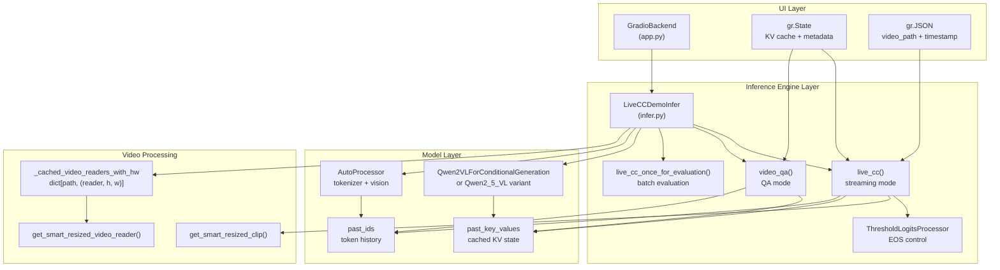
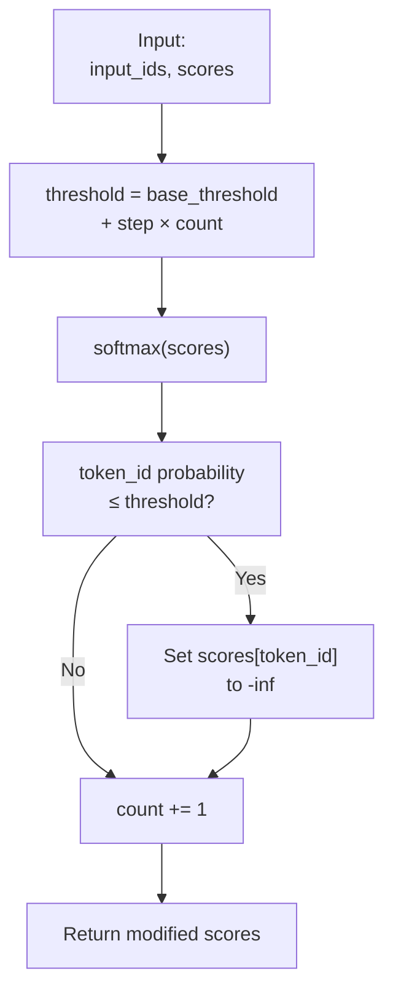
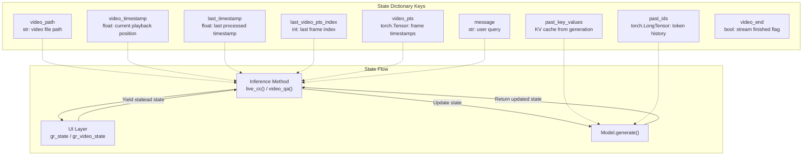
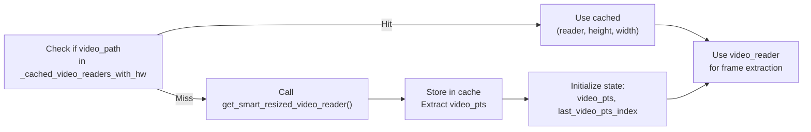
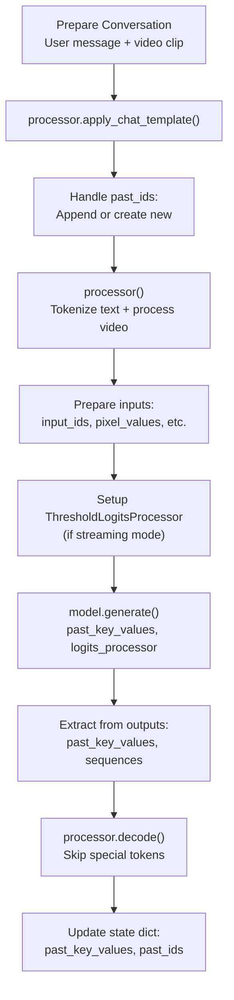
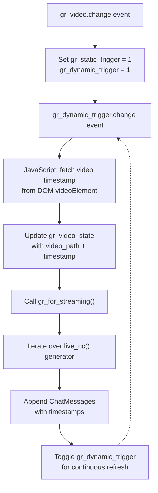

<!-- source: DeepWiki mcp.deepwiki.com · repo mit-han-lab/streaming-vlm · page 5.1 Inference Engine Architecture · fetched 2026-10-30 -->

# Inference Engine Architecture

<details>
<summary>Relevant source files</summary>

The following files were used as context for generating this wiki page:

- [assets/infer.png](assets/infer.png)
- [baselines/livecc/demo/infer.py](baselines/livecc/demo/infer.py)

</details>


## Purpose and Scope

This document describes the architecture of the StreamingVLM inference engine, centered on the `LiveCCDemoInfer` class and its integration with user interfaces. The inference engine is responsible for loading models, managing KV cache state, processing video inputs, and orchestrating the generation of responses in both streaming commentary and conversational QA modes.

For details on the streaming commentary mode behavior, see [Real-Time Commentary Mode](#5.2). For conversational QA mode details, see [Video Question Answering Mode](#5.3). For video frame extraction and processing specifics, see [Video Processing Pipeline](#5.4).

**Sources:** [baselines/livecc/demo/infer.py](), [baselines/livecc/demo/app.py]()

## System Architecture Overview

The inference system consists of three main layers: the model layer, the inference engine layer, and the UI integration layer.



**Diagram: Inference Engine Component Architecture**

**Sources:** [baselines/livecc/demo/infer.py:1-319](), [baselines/livecc/demo/app.py:25-36]()

## Core Components

### LiveCCDemoInfer Class

The `LiveCCDemoInfer` class is the central inference engine, managing model initialization, state persistence, and execution of the three inference modes.

| Component | Description | Location |
|-----------|-------------|----------|
| **Class Definition** | Main inference engine | [baselines/livecc/demo/infer.py:25-319]() |
| **Model Instance** | Qwen2VL or Qwen2.5-VL model | [baselines/livecc/demo/infer.py:44-54]() |
| **Processor** | Tokenizer and vision processor | [baselines/livecc/demo/infer.py:55]() |
| **Video Cache** | `_cached_video_readers_with_hw` dict | [baselines/livecc/demo/infer.py:66]() |
| **System Prompt Offset** | Chat template offset for multi-turn | [baselines/livecc/demo/infer.py:58-65]() |

**Key Constants:**

The class defines critical timing parameters that control frame processing:

```python
fps = 2                              # Target frames per second
initial_fps_frames = 6               # Initial window size (6 frames)
streaming_fps_frames = 2             # Streaming window size (2 frames)
initial_time_interval = 3.0          # 6 frames / 2 fps = 3s
streaming_time_interval = 1.0        # 2 frames / 2 fps = 1s
frame_time_interval = 0.5            # 1 / 2 fps = 0.5s
```

**Sources:** [baselines/livecc/demo/infer.py:25-66]()

### Initialization and Model Loading

The constructor handles device selection and model loading with appropriate optimizations:

```mermaid
graph LR
    init["__init__()"]
    device_detect["Device Detection<br/>MPS > CUDA > CPU"]
    model_load["Model Loading<br/>Qwen2VL or Qwen2_5_VL"]
    flash_attn["Flash Attention 2<br/>if CUDA available"]
    processor_load["AutoProcessor.from_pretrained()"]
    system_prompt["System Prompt Offset<br/>Calculate chat template offset"]
    cache_init["Video Reader Cache<br/>_cached_video_readers_with_hw = {}"]
    
    init --> device_detect
    device_detect --> model_load
    model_load --> flash_attn
    flash_attn --> processor_load
    processor_load --> system_prompt
    system_prompt --> cache_init
```



**Diagram: Initialization Sequence**

The initialization attempts to load `Qwen2VLForConditionalGeneration` first, falling back to `Qwen2_5_VLForConditionalGeneration` if the first fails [baselines/livecc/demo/infer.py:43-54](). Flash Attention 2 is enabled when CUDA is available [baselines/livecc/demo/infer.py:47]().

**Sources:** [baselines/livecc/demo/infer.py:35-66]()

### GradioBackend Wrapper

The `GradioBackend` class provides a thin abstraction layer between the Gradio UI and the inference engine, routing requests based on the selected mode.

| Field | Type | Description |
|-------|------|-------------|
| `infer` | `LiveCCDemoInfer` | Inference engine instance |
| `mode2api` | `dict[str, str]` | Maps UI mode names to method names |
| `waiting_video_response` | `str` | Response when waiting for video |
| `not_found_video_response` | `str` | Response when video not found |

**Mode Routing:**

```python
mode2api = {
    'Real-Time Commentary': 'live_cc',
    'Conversation': 'video_qa'
}
```

The `__call__` method uses `getattr` to dynamically route to the appropriate inference method [baselines/livecc/demo/app.py:35-36]().

**Sources:** [baselines/livecc/demo/app.py:25-36]()

### ThresholdLogitsProcessor

The `ThresholdLogitsProcessor` is a custom logits processor that controls EOS token generation during streaming inference, preventing premature termination.



**Diagram: ThresholdLogitsProcessor Logic Flow**

The processor dynamically increases the threshold with each generation step, making it progressively harder to generate the streaming EOS token (`' ...'`). This prevents the model from stopping too early during streaming commentary.

**Sources:** [baselines/livecc/demo/infer.py:10-23]()

## State Management System

The inference engine maintains state across multiple turns using a dictionary-based system. State flows between the UI layer and the inference engine, preserving KV cache and metadata.



**Diagram: State Management Flow**

**State Lifecycle:**

1. **Initialization**: When a new video is loaded, the state dictionary is cleared [baselines/livecc/demo/app.py:92-93]()
2. **Video Loading**: `video_path` and `video_pts` are initialized [baselines/livecc/demo/infer.py:96-101]()
3. **Frame Processing**: `last_timestamp` and `last_video_pts_index` track progress [baselines/livecc/demo/infer.py:110-125]()
4. **Generation**: `past_key_values` and `past_ids` are updated after each generation [baselines/livecc/demo/infer.py:180-181]()
5. **Persistence**: State is yielded back to the UI layer for the next turn [baselines/livecc/demo/infer.py:187]()

**Sources:** [baselines/livecc/demo/infer.py:82-90](), [baselines/livecc/demo/infer.py:200-208](), [baselines/livecc/demo/app.py:47-50]()

## Inference Methods

The `LiveCCDemoInfer` class provides three inference methods, each designed for different use cases:

| Method | Purpose | Key Features | Max New Tokens |
|--------|---------|--------------|----------------|
| `live_cc()` | Real-time streaming commentary | Generator yielding timestamped responses, dynamic frame processing | 16 |
| `video_qa()` | Conversational video QA | Single response per turn, multi-turn support | 512 |
| `live_cc_once_for_evaluation()` | Batch evaluation | Process entire video clip, return all responses at once | 32 |

**Method Signatures:**

```python
# Streaming commentary generator
def live_cc(
    self,
    message: str,
    state: dict,
    max_pixels: int = 384 * 28 * 28,
    default_query: str = 'Please describe the video.',
    do_sample: bool = True,
    repetition_penalty: float = 1.05,
    streaming_eos_base_threshold: float = None,
    streaming_eos_threshold_step: float = None,
    hf_spaces: bool = False,
    **kwargs,
) -> Generator[tuple[tuple[float, float], str, dict], None, None]

# Question answering
def video_qa(
    self,
    message: str,
    history: list,
    state: dict,
    do_sample: bool = False,
    repetition_penalty: float = 1.05,
    hf_spaces: bool = False,
    **kwargs,
) -> tuple[str, dict]

# Evaluation mode
def live_cc_once_for_evaluation(
    self,
    query: str,
    video: str,
    video_start: float = 0,
    video_end: float = None,
    remote_loader: callable = None,
    max_new_tokens: int = 32,
    repetition_penalty: float = 1.05,
) -> list[list[float, float, str]]
```

Detailed behavior of `live_cc()` is documented in [Real-Time Commentary Mode](#5.2), and `video_qa()` in [Video Question Answering Mode](#5.3).

**Sources:** [baselines/livecc/demo/infer.py:68-81](), [baselines/livecc/demo/infer.py:189-199](), [baselines/livecc/demo/infer.py:251-261]()

## Video Reader Caching

The inference engine maintains a cache of video readers to avoid repeatedly opening the same video file:



**Diagram: Video Reader Cache Flow**

The cache structure is a dictionary mapping video paths to tuples of `(video_reader, resized_height, resized_width)` [baselines/livecc/demo/infer.py:66](). On cache miss, the video reader is initialized and its frame timestamps (`video_pts`) are extracted and stored in the state [baselines/livecc/demo/infer.py:96-101]().

Cache clearing occurs when the chatbot is cleared in the Gradio interface [baselines/livecc/demo/app.py:92]().

**Sources:** [baselines/livecc/demo/infer.py:96-109](), [baselines/livecc/demo/app.py:91-93]()

## Integration with Model Generation

The inference engine integrates tightly with the Hugging Face `generate()` API, managing inputs, past state, and custom logits processors.



**Diagram: Model Generation Pipeline**

**Key Integration Points:**

1. **Chat Template Application**: Multi-turn conversations are handled by prepending `'<|im_end|>\n'` and removing the system prompt for subsequent turns [baselines/livecc/demo/infer.py:157]()
2. **Past State Concatenation**: When `past_ids` exists, new input IDs are concatenated [baselines/livecc/demo/infer.py:167]()
3. **KV Cache Passing**: `past_key_values` from previous generation is passed to enable efficient streaming [baselines/livecc/demo/infer.py:173]()
4. **Custom Logits Processing**: `ThresholdLogitsProcessor` is conditionally added for streaming mode [baselines/livecc/demo/infer.py:168-171]()

**Sources:** [baselines/livecc/demo/infer.py:138-182](), [baselines/livecc/demo/infer.py:226-249]()

## Liger Kernel Integration

The inference engine applies Liger kernel optimizations to the Qwen2-VL model for improved efficiency:

```python
from liger_kernel.transformers import apply_liger_kernel_to_qwen2_vl
apply_liger_kernel_to_qwen2_vl()
```

This optimization is applied globally at module import time [baselines/livecc/demo/infer.py:2-3](), enabling custom CUDA kernels for faster inference without requiring code changes in the inference logic.

**Sources:** [baselines/livecc/demo/infer.py:2-3]()

## UI Integration Points

The Gradio demo integrates with the inference engine through several key mechanisms:

| Component | Purpose | Implementation |
|-----------|---------|----------------|
| **Mode Selection** | Routes to `live_cc` or `video_qa` | [baselines/livecc/demo/app.py:28-31]() |
| **State Triggers** | Controls when streaming starts | [baselines/livecc/demo/app.py:49-50]() |
| **Video Timestamp Fetching** | JavaScript monitors video playback | [baselines/livecc/demo/app.py:148-153]() |
| **State Persistence** | Gradio State objects hold KV cache | [baselines/livecc/demo/app.py:47-48]() |
| **Zero-GPU Support** | Lightweight state for HF Spaces | [baselines/livecc/demo/infer.py:183-186]() |

**Streaming Flow in Gradio:**



**Diagram: Gradio Streaming Event Flow**

The dynamic trigger creates a refresh loop: each completion toggles the trigger value (`1 - dynamic_trigger`), which fires another change event, fetching the latest video timestamp and continuing the stream [baselines/livecc/demo/app.py:144]().

**Sources:** [baselines/livecc/demo/app.py:108-176]()

---

