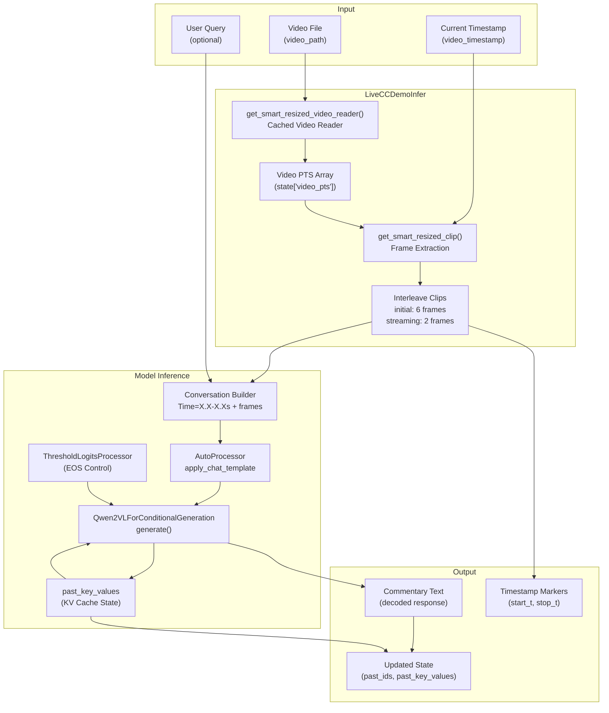
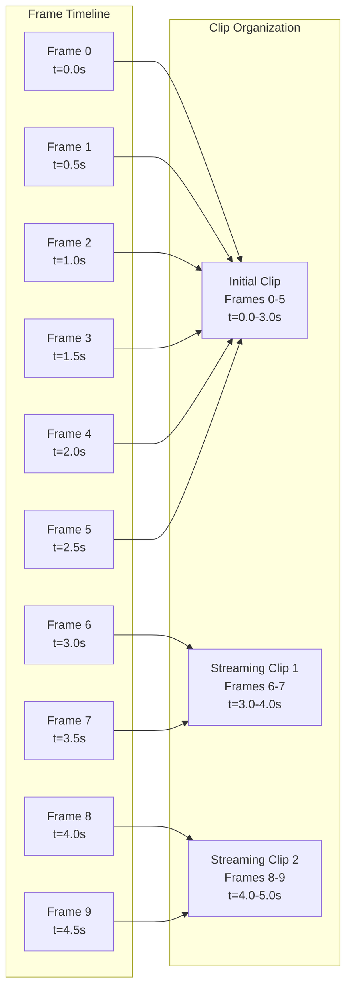
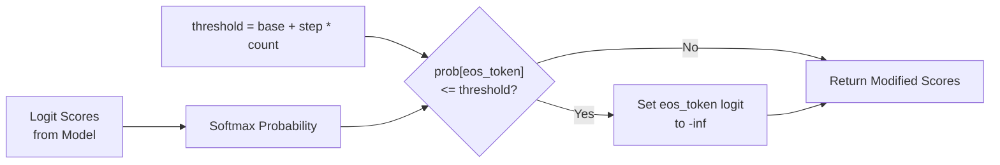

<!-- source: DeepWiki mcp.deepwiki.com · repo mit-han-lab/streaming-vlm · page 5.2 Real-Time Commentary Mode · fetched 2026-10-30 -->

# Real-Time Commentary Mode

<details>
<summary>Relevant source files</summary>

The following files were used as context for generating this wiki page:

- [baselines/livecc/demo/app.py](baselines/livecc/demo/app.py)
- [baselines/livecc/demo/cli.py](baselines/livecc/demo/cli.py)
- [baselines/livecc/demo/infer.py](baselines/livecc/demo/infer.py)

</details>


## Purpose and Scope

This document describes the Real-Time Commentary mode in the StreamingVLM inference system, which generates timestamped commentary as video frames stream in. This mode simulates live commentary by processing video chunks incrementally and producing synchronized text outputs with temporal markers. It is the core demonstration of StreamingVLM's ability to process infinite video streams with constant memory usage.

For conversational video question answering, see [Video Question Answering Mode](#5.3). For the underlying video frame extraction and processing utilities, see [Video Processing Pipeline](#5.4).

## Overview

Real-Time Commentary mode processes video streams by:
1. Extracting frames at a fixed frame rate (default: 2 FPS)
2. Organizing frames into interleaved clips (6 initial frames, then 2-frame chunks)
3. Generating timestamped commentary for each clip using the model
4. Maintaining KV cache state across clips to preserve context
5. Yielding streaming responses with `(start_timestamp, stop_timestamp)` markers

The mode is implemented primarily in the `LiveCCDemoInfer.live_cc()` method and exposed through both Gradio web interface and CLI.

**Sources:** [baselines/livecc/demo/infer.py:68-187](), [baselines/livecc/demo/app.py:28-36]()

## System Architecture



**Sources:** [baselines/livecc/demo/infer.py:68-187](), [baselines/livecc/demo/app.py:107-146]()

## Frame Processing Pipeline

### Frame Rate and Chunking Strategy

The system operates at a fixed frame rate defined by class-level constants:

| Parameter | Value | Purpose |
|-----------|-------|---------|
| `fps` | 2 | Processing frame rate |
| `initial_fps_frames` | 6 | Frames in first chunk |
| `streaming_fps_frames` | 2 | Frames in subsequent chunks |
| `initial_time_interval` | 3.0s | Duration of initial chunk |
| `streaming_time_interval` | 1.0s | Duration of streaming chunks |
| `frame_time_interval` | 0.5s | Time between frames |

**Sources:** [baselines/livecc/demo/infer.py:28-33]()

### Interleaved Clip Generation



The frame organization logic:

1. **Initialization phase** ([baselines/livecc/demo/infer.py:129-133]()):
   - Extracts first 6 frames (3 seconds at 2 FPS)
   - Provides initial context for the model
   - Triggered when `initialized = False` (first iteration)

2. **Streaming phase** ([baselines/livecc/demo/infer.py:134-136]()):
   - Processes remaining frames in 2-frame chunks
   - Each chunk represents 1 second of video
   - Uses `torch.Tensor.split(streaming_fps_frames)` to create chunks

**Sources:** [baselines/livecc/demo/infer.py:127-136]()

## Streaming Inference Loop

### State Management Across Iterations

The `state` dictionary maintains persistent information across multiple `live_cc()` calls:

| State Key | Type | Purpose |
|-----------|------|---------|
| `video_path` | str | Path to video file |
| `video_timestamp` | float | Current playback timestamp |
| `last_timestamp` | float | Last processed timestamp |
| `last_video_pts_index` | int | Index of last processed frame |
| `video_pts` | torch.Tensor | Array of all frame timestamps |
| `past_key_values` | tuple | Cached KV states from model |
| `past_ids` | torch.Tensor | Previously generated token IDs |
| `message` | str | User query (cached) |
| `video_end` | bool | Whether video has ended |

**Sources:** [baselines/livecc/demo/infer.py:83-90]()

### Iteration Flow

```mermaid
graph TB
    START["live_cc() called<br/>with state"]
    
    CHECK_VIDEO{"video_path<br/>exists?"}
    LOAD_READER["Load/Cache<br/>get_smart_resized_video_reader()"]
    GET_PTS["Extract video_pts array"]
    
    CHECK_INIT{"initialized?<br/>(last_timestamp >= 0)"}
    SET_MIN_TIME["video_timestamp =<br/>max(timestamp, 3.0s)"]
    
    CHECK_TIME{"timestamp ><br/>last_timestamp + 0.5s?"}
    CALC_RANGE["timestamps = arange<br/>(last_t+0.5, current_t, 0.5)"]
    
    EXTRACT["get_smart_resized_clip()<br/>Extract frames at timestamps"]
    UPDATE_STATE["Update last_video_pts_index<br/>Update last_timestamp"]
    
    ORGANIZE["Organize interleave_clips:<br/>- Initial: 6 frames<br/>- Streaming: 2-frame chunks"]
    
    LOOP_START{"For each clip"}
    BUILD_CONV["Build conversation:<br/>Time=X.X-X.Xs + frames + query"]
    APPEND_PAST{"past_ids<br/>exists?"}
    CONCAT["Concatenate with<br/>past_ids"]
    
    GENERATE["model.generate()<br/>with past_key_values"]
    SAVE_KV["Save past_key_values<br/>Save past_ids"]
    DECODE["processor.decode()<br/>Get response text"]
    
    YIELD["yield (start_t, stop_t),<br/>response, state"]
    
    LOOP_END{"More clips?"}
    END["Return"]
    
    START --> CHECK_VIDEO
    CHECK_VIDEO -->|No| END
    CHECK_VIDEO -->|Yes| LOAD_READER
    LOAD_READER --> GET_PTS
    GET_PTS --> CHECK_INIT
    CHECK_INIT -->|No| SET_MIN_TIME
    CHECK_INIT -->|Yes| CHECK_TIME
    SET_MIN_TIME --> CHECK_TIME
    CHECK_TIME -->|No| END
    CHECK_TIME -->|Yes| CALC_RANGE
    CALC_RANGE --> EXTRACT
    EXTRACT --> UPDATE_STATE
    UPDATE_STATE --> ORGANIZE
    ORGANIZE --> LOOP_START
    LOOP_START -->|Yes| BUILD_CONV
    BUILD_CONV --> APPEND_PAST
    APPEND_PAST -->|Yes| CONCAT
    APPEND_PAST -->|No| GENERATE
    CONCAT --> GENERATE
    GENERATE --> SAVE_KV
    SAVE_KV --> DECODE
    DECODE --> YIELD
    YIELD --> LOOP_END
    LOOP_END -->|Yes| LOOP_START
    LOOP_END -->|No| END
```



**Sources:** [baselines/livecc/demo/infer.py:68-187]()

### Conversation Template Construction

Each frame chunk is converted to a conversation message with temporal markers ([baselines/livecc/demo/infer.py:141-153]()):

```
{
    "role": "user",
    "content": [
        {"type": "text", "text": "Time=3.0-4.0s"},
        {"type": "video", "video": <2-frame tensor>},
        {"type": "text", "text": <user_query>}  # only on first iteration
    ]
}
```

The processor applies chat template transformation:
- First iteration: Full system prompt + user content
- Subsequent iterations: Trimmed to `<|im_end|>\n<|im_start|>user...` ([baselines/livecc/demo/infer.py:157]())
- This optimization works because `past_ids` already contains the system prompt tokens

**Sources:** [baselines/livecc/demo/infer.py:141-167]()

## EOS Token Control

### ThresholdLogitsProcessor

The `ThresholdLogitsProcessor` class controls when the model can generate the streaming EOS token (` ...`):



Parameters:
- `streaming_eos_base_threshold`: Initial threshold (e.g., 0.0)
- `streaming_eos_threshold_step`: Increment per token (e.g., 0.0 for constant)
- `count`: Increments with each token generated

This prevents premature commentary termination by suppressing the EOS token unless the model has sufficient confidence.

**Sources:** [baselines/livecc/demo/infer.py:10-23](), [baselines/livecc/demo/infer.py:168-171]()

## Generation Parameters

### Model Generation Configuration

The `model.generate()` call uses these parameters ([baselines/livecc/demo/infer.py:172-179]()):

| Parameter | Default/Typical Value | Purpose |
|-----------|----------------------|---------|
| `max_new_tokens` | 16 | Limit commentary length per chunk |
| `do_sample` | True | Enable sampling for natural language |
| `repetition_penalty` | 1.05 | Discourage repetitive phrases |
| `logits_processor` | ThresholdLogitsProcessor | Control EOS token generation |
| `pad_token_id` | eos_token_id | Padding configuration |
| `past_key_values` | from state | Reuse KV cache |
| `return_dict_in_generate` | True | Return full output dict |

**Sources:** [baselines/livecc/demo/infer.py:172-179]()

## Interface Integration

### Gradio Web Interface

The real-time commentary mode is triggered in the Gradio app when:
1. User selects "Real-Time Commentary" mode
2. Video is uploaded/changed → sets `gr_static_trigger=1`
3. `gr_dynamic_trigger` changes → calls `gr_for_streaming()`
4. JavaScript fetches current video timestamp via `js_video_timestamp_fetcher`

The streaming loop ([baselines/livecc/demo/app.py:108-146]()):
```
for (start_t, stop_t), response, state in gradio_backend.live_cc(...):
    response_with_timestamp = f'{start_t:.1f}s-{stop_t:.1f}s: {response}'
    history.append(gr.ChatMessage(role="assistant", content=response_with_timestamp))
    yield history, state, dynamic_trigger
```

**Sources:** [baselines/livecc/demo/app.py:108-146](), [baselines/livecc/demo/app.py:148-176]()

### Command Line Interface

The CLI demonstrates batch processing ([baselines/livecc/demo/cli.py:1-28]()):

```python
state = {'video_path': video_path}
for t in range(31):  # Process up to 31 seconds
    state['video_timestamp'] = t
    for (start_t, stop_t), response, state in infer.live_cc(...):
        commentaries.append([start_t, stop_t, response])
    if state.get('video_end', False):
        break
```

Output format: JSON with `video_path`, `query`, and `commentaries` list.

**Sources:** [baselines/livecc/demo/cli.py:1-28]()

## Video Caching and Memory Optimization

### Smart Resized Video Reader Cache

Video readers are cached in `_cached_video_readers_with_hw` dictionary ([baselines/livecc/demo/infer.py:66](), [baselines/livecc/demo/infer.py:96-101]()):

```
key: video_path
value: (video_reader, resized_height, resized_width)
```

This cache:
- Prevents re-reading video metadata on each call
- Stores spatial resize dimensions (matching `max_pixels` constraint)
- Persists across multiple `live_cc()` invocations
- Cleared when chat history is cleared in Gradio UI

**Sources:** [baselines/livecc/demo/infer.py:66](), [baselines/livecc/demo/infer.py:96-101](), [baselines/livecc/demo/app.py:91-93]()

## Output Format

### Timestamped Response Structure

Each yield from `live_cc()` produces a 3-tuple:
```python
((start_timestamp, stop_timestamp), response_text, updated_state)
```

Example:
```python
(3.0, 4.0), "The presenter opens the laptop and points to the mute button.", {<state_dict>}
```

The timestamps correspond to:
- `start_timestamp`: First frame in the clip (inclusive)
- `stop_timestamp`: Last frame timestamp + `frame_time_interval` (exclusive)

Display format in UI: `"3.0s-4.0s: The presenter opens the laptop..."`

**Sources:** [baselines/livecc/demo/infer.py:134-187](), [baselines/livecc/demo/app.py:136]()

### State Propagation

For Hugging Face Spaces deployment, a lightweight state is returned ([baselines/livecc/demo/infer.py:183-185]()):
```python
if hf_spaces:
    light_state = {k: v for k, v in state.items() if k not in ['past_ids', 'past_key_values']}
    yield (start_timestamp, stop_timestamp), response, light_state
```

This prevents transferring large tensors over network connections, though it sacrifices KV cache reuse across requests.

**Sources:** [baselines/livecc/demo/infer.py:183-187]()

---

