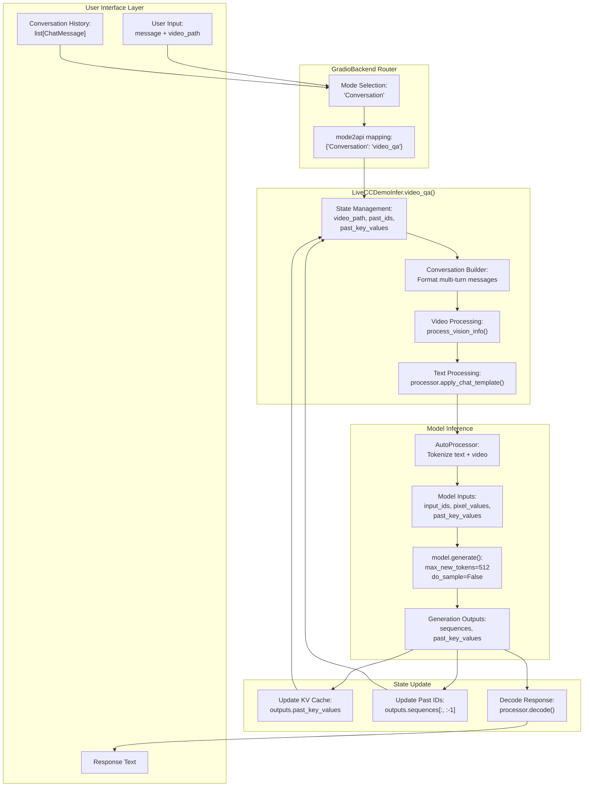
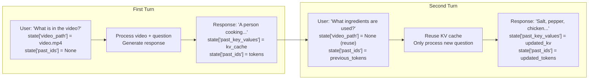
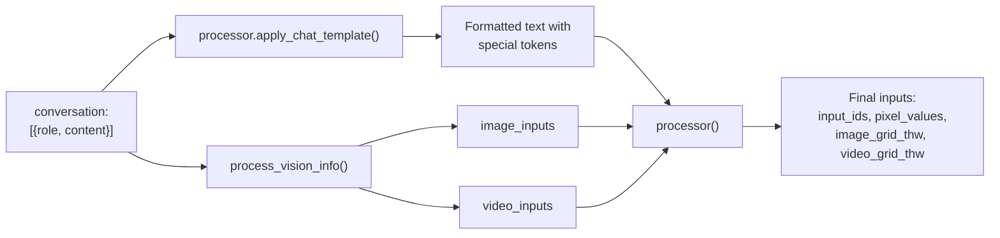
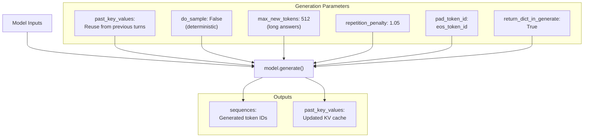
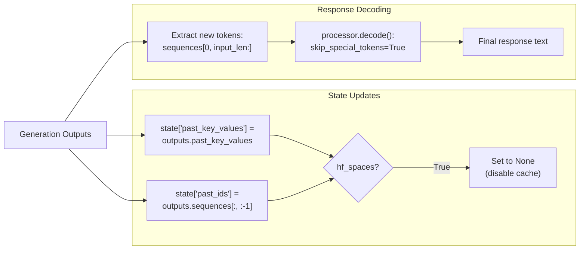
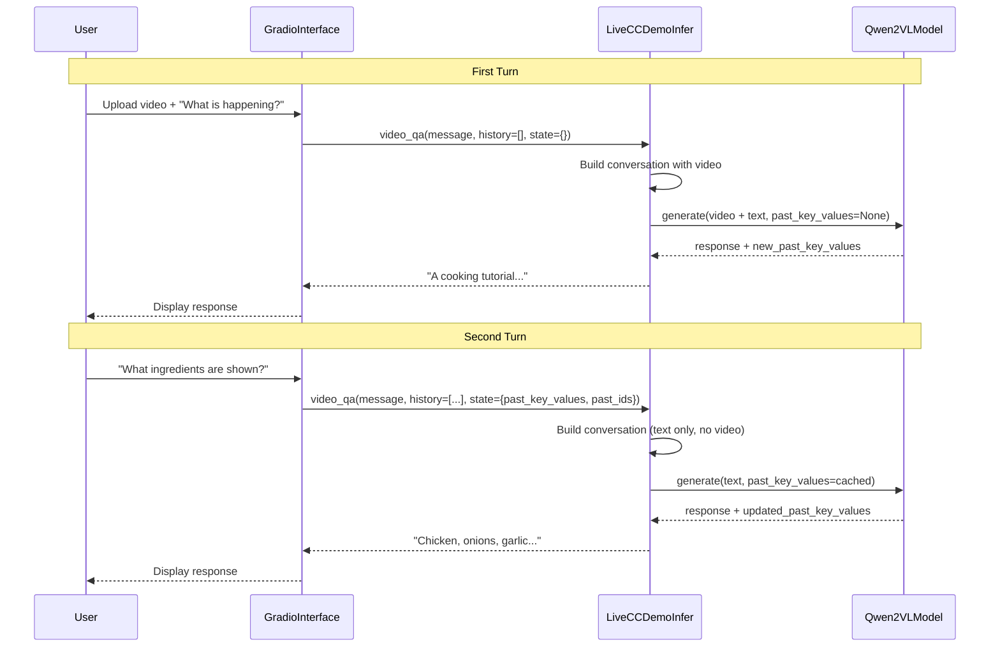
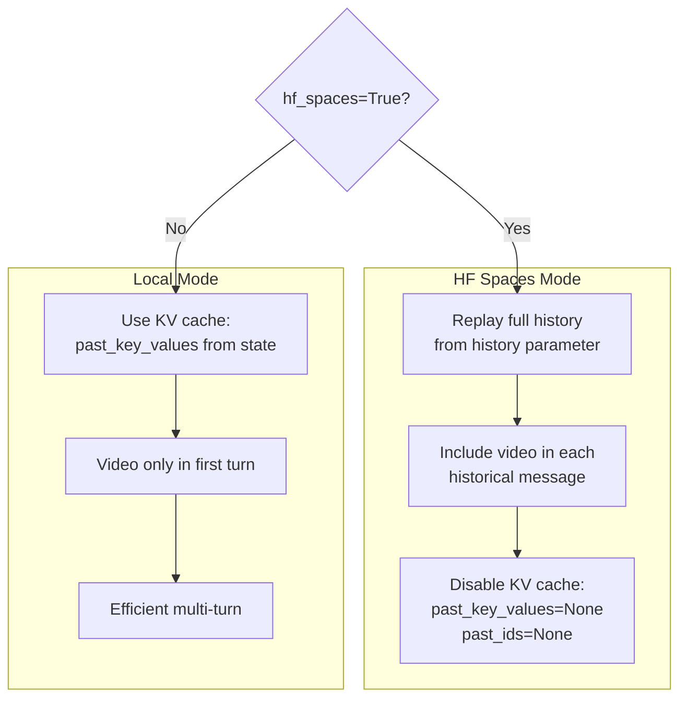
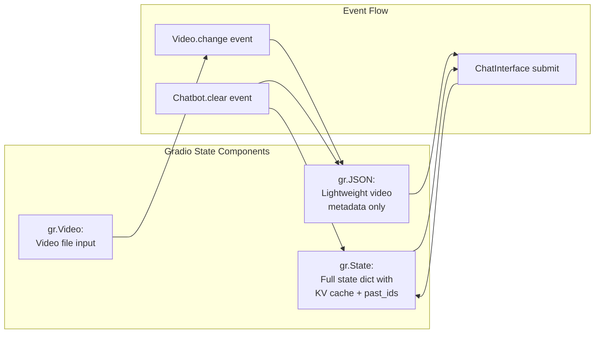

<!-- source: DeepWiki mcp.deepwiki.com · repo mit-han-lab/streaming-vlm · page 5.3 Video Question Answering Mode · fetched 2026-10-30 -->

# Video Question Answering Mode

<details>
<summary>Relevant source files</summary>

The following files were used as context for generating this wiki page:

- [baselines/livecc/demo/app.py](baselines/livecc/demo/app.py)
- [baselines/livecc/demo/infer.py](baselines/livecc/demo/infer.py)

</details>


## Purpose and Scope

This document describes the Video Question Answering (Video QA) mode of the StreamingVLM inference system, which enables conversational question-answering about video content. Unlike the Real-Time Commentary mode (see [5.2](#5.2)), Video QA mode processes a complete user query and returns a single comprehensive response rather than generating timestamped streaming commentary.

Video QA mode supports multi-turn conversations with efficient KV cache reuse, making it suitable for interactive video analysis and exploration. For details on the underlying video processing pipeline, see [5.4](#5.4). For information on the inference engine architecture, see [5.1](#5.1).

---

## Overview

Video QA mode is one of two primary inference modes provided by the `LiveCCDemoInfer` class. It is designed for traditional video question-answering tasks where users ask specific questions about video content and receive complete answers.

**Key Characteristics:**

| Feature | Video QA Mode | Real-Time Commentary Mode |
|---------|---------------|---------------------------|
| Response Type | Single comprehensive answer | Continuous timestamped commentary |
| Conversation Support | Multi-turn with history | Single-turn queries |
| KV Cache Usage | Accumulated across turns | Accumulated across video segments |
| Max Output Tokens | 512 | 16 per segment |
| Sampling | Disabled by default (`do_sample=False`) | Enabled by default (`do_sample=True`) |
| Primary Use Case | Interactive QA | Live commentary generation |

Sources: [baselines/livecc/demo/infer.py:189-249](), [baselines/livecc/demo/app.py:28-31]()

---

## Architecture and Data Flow

### Video QA Processing Flow



**Diagram: End-to-End Video QA Processing Pipeline**

Sources: [baselines/livecc/demo/app.py:78-89](), [baselines/livecc/demo/infer.py:189-249]()

---

## Implementation Details

### The video_qa Method

The core implementation is the `video_qa` method in the `LiveCCDemoInfer` class, which handles single-turn question answering with optional multi-turn conversation support.

**Method Signature:**

[baselines/livecc/demo/infer.py:189-199]()

```python
@torch.inference_mode()
def video_qa(
    self,
    message: str,
    history: list,
    state: dict,
    do_sample: bool = False,
    repetition_penalty: float = 1.05,
    hf_spaces: bool = False,
    **kwargs,
)
```

**Key Parameters:**

- `message`: The user's question text
- `history`: List of previous conversation messages (for multi-turn)
- `state`: Dictionary containing conversation state and KV cache
- `do_sample`: Whether to use sampling (default `False` for deterministic outputs)
- `repetition_penalty`: Penalty for token repetition (default 1.05)
- `hf_spaces`: Flag for HuggingFace Spaces compatibility (disables KV cache reuse)

Sources: [baselines/livecc/demo/infer.py:189-199]()

---

### State Management

The `state` dictionary maintains conversation context across turns:

**State Schema:**

| Key | Type | Purpose |
|-----|------|---------|
| `video_path` | `str` | Path to the video file being analyzed |
| `past_key_values` | `tuple` | Cached key-value pairs from previous turns |
| `past_ids` | `torch.LongTensor` | Previously generated token IDs |
| `last_history` | `list` | Last processed conversation history |



**Diagram: State Evolution Across Multi-Turn Conversation**

Sources: [baselines/livecc/demo/infer.py:200-208](), [baselines/livecc/demo/infer.py:220-248]()

---

### Conversation Building

The conversation format differs based on whether it's the first turn or a subsequent turn:

**Conversation Structure Mapping:**

```mermaid
graph TB
    subgraph "First Turn (No past_ids)"
        FIRST_CHECK{"past_ids is None?"}
        FIRST_VIDEO["Insert video at position 0:<br/>{'type': 'video', 'video': video_path}"]
        FIRST_TEXT["Add text message:<br/>{'type': 'text', 'text': message}"]
        FIRST_CONV["conversation = [<br/>  {'role': 'user',<br/>   'content': [video, text]}<br/>]"]
    end
    
    subgraph "Subsequent Turns (Has past_ids)"
        NEXT_CHECK{"past_ids exists?"}
        NO_VIDEO["No video (already processed)"]
        NEXT_TEXT["Add only text:<br/>{'type': 'text', 'text': message}"]
        NEXT_CONV["conversation = [<br/>  {'role': 'user',<br/>   'content': [text]}<br/>]"]
        PREPEND["Prepend '<|im_end|>\\n'<br/>Strip system_prompt_offset"]
    end
    
    FIRST_CHECK -->|"Yes"| FIRST_VIDEO
    FIRST_VIDEO --> FIRST_TEXT
    FIRST_TEXT --> FIRST_CONV
    
    NEXT_CHECK -->|"Yes"| NO_VIDEO
    NO_VIDEO --> NEXT_TEXT
    NEXT_TEXT --> NEXT_CONV
    NEXT_CONV --> PREPEND
```



**Diagram: Conversation Format Logic**

**Implementation:**

[baselines/livecc/demo/infer.py:220-228]()

The video is only included in the first turn. Subsequent turns reuse the cached video embeddings through the `past_key_values` mechanism, eliminating redundant video processing.

The `system_prompt_offset` [baselines/livecc/demo/infer.py:65]() is used to strip the system prompt prefix when continuing conversations, ensuring proper concatenation of token sequences.

Sources: [baselines/livecc/demo/infer.py:220-238](), [baselines/livecc/demo/infer.py:58-65]()

---

### Video and Text Processing

The conversation is processed through two key functions:

**Processing Pipeline:**



**Diagram: Video and Text Processing Flow**

1. **Vision Processing** [baselines/livecc/demo/infer.py:225](): `process_vision_info()` extracts image and video inputs from the conversation
2. **Text Template** [baselines/livecc/demo/infer.py:226](): `apply_chat_template()` formats the conversation with special tokens
3. **Final Processing** [baselines/livecc/demo/infer.py:229-235](): The processor tokenizes text and processes vision inputs

Sources: [baselines/livecc/demo/infer.py:225-235]()

---

### Model Inference

The inference process uses the Qwen2-VL model's `generate` method with specific parameters optimized for video QA:

**Generation Configuration:**



**Diagram: Model Generation Configuration**

**Key Differences from Real-Time Commentary:**

- **max_new_tokens**: 512 vs 16 (allows for comprehensive answers)
- **do_sample**: False vs True (deterministic vs creative responses)
- **No logits_processor**: Video QA doesn't use threshold-based EOS control

[baselines/livecc/demo/infer.py:239-245]()

Sources: [baselines/livecc/demo/infer.py:239-249](), [baselines/livecc/demo/infer.py:172-179]()

---

### Response Decoding and State Update

After generation, the system decodes the response and updates the conversation state:

**Post-Generation Flow:**

[baselines/livecc/demo/infer.py:246-249]()



**Diagram: Response Decoding and State Update**

The `past_ids` excludes the final token (`[:, :-1]`) to prepare for concatenation with the next turn's input.

Sources: [baselines/livecc/demo/infer.py:246-249]()

---

## Multi-Turn Conversation Support

Video QA mode efficiently handles multi-turn conversations through KV cache accumulation:

### Conversation Flow Example



**Diagram: Multi-Turn Conversation Sequence**

### Efficiency Benefits

**Token Processing Comparison:**

| Aspect | Without KV Cache | With KV Cache |
|--------|------------------|---------------|
| Turn 1 Processing | Full video + query | Full video + query |
| Turn 2 Processing | Full video + history + query | New query only |
| Turn 3 Processing | Full video + history + query | New query only |
| Memory Growth | Linear with turns | KV cache size constant |
| Computation | O(n²) per turn | O(n) per turn |

Sources: [baselines/livecc/demo/infer.py:220-249](), [baselines/livecc/demo/app.py:78-104]()

---

## HuggingFace Spaces Compatibility

The `hf_spaces` parameter enables special handling for HuggingFace Spaces deployments:

**HuggingFace Spaces Mode:**

[baselines/livecc/demo/infer.py:211-217]()



**Diagram: HuggingFace Spaces vs Local Mode**

**Why HF Spaces Mode Differs:**

1. **Zero GPU Constraints**: HuggingFace Spaces uses dynamic GPU allocation with @spaces.GPU decorator, which can reload the model between requests
2. **State Persistence**: Cannot reliably maintain `past_key_values` across requests
3. **Conversation Replay**: Must rebuild full conversation history from scratch each time
4. **Performance Trade-off**: Sacrifices efficiency for compatibility with serverless infrastructure

Sources: [baselines/livecc/demo/infer.py:211-217](), [baselines/livecc/demo/infer.py:246-247](), [baselines/livecc/demo/app.py:4-8](), [baselines/livecc/demo/app.py:83-86]()

---

## Integration with Gradio Interface

The Gradio web interface integrates Video QA mode through the `gr.ChatInterface` component:

### Mode Selection and Routing

[baselines/livecc/demo/app.py:28-36]()

The `GradioBackend` class routes requests based on the selected mode:

```python
mode2api = {
    'Real-Time Commentary': 'live_cc',
    'Conversation': 'video_qa'
}
```

### Chat Interface Callback

[baselines/livecc/demo/app.py:78-89]()

The `gr_chatinterface_fn` callback:
1. Checks if mode is 'Conversation' (otherwise redirects to commentary mode)
2. Initializes the model if needed (for HF Spaces)
3. Updates state with video path
4. Calls `gradio_backend.video_qa()`
5. Yields response incrementally

### State Management in UI



**Diagram: Gradio State Management Architecture**

Sources: [baselines/livecc/demo/app.py:47-49](), [baselines/livecc/demo/app.py:78-106]()

---

## Usage Patterns

### Basic Video QA

**Typical Flow:**
1. User uploads video through `gr.Video` component
2. User selects "Conversation" mode
3. User types question in chat interface
4. System processes video + question, returns comprehensive answer
5. User can ask follow-up questions without re-uploading video

### Multi-Turn Conversation

**Example Conversation:**
- **Turn 1**: "What is this video about?" → Model processes full video, returns overview
- **Turn 2**: "Can you describe the first scene?" → Model reuses video understanding, focuses on specific aspect
- **Turn 3**: "What happens at the end?" → Model provides ending details from cached context

### Cache Clearing

The cache is cleared when:
- User clicks "Clean" button [baselines/livecc/demo/app.py:71]()
- User clears the chatbot [baselines/livecc/demo/app.py:104]()
- User changes video [baselines/livecc/demo/app.py:161-165]()

**Cache Clear Implementation:**

[baselines/livecc/demo/app.py:91-93]()

```python
def gr_chatinterface_chatbot_clear_fn(gr_dynamic_trigger):
    gradio_backend.infer._cached_video_readers_with_hw = {}
    return {}, {}, 0, gr_dynamic_trigger
```

Sources: [baselines/livecc/demo/app.py:71-106](), [baselines/livecc/demo/app.py:161-165]()

---

## Comparison with Real-Time Commentary Mode

### Architectural Differences

**Code Entity Mapping:**

| Aspect | Video QA (`video_qa`) | Real-Time Commentary (`live_cc`) |
|--------|----------------------|----------------------------------|
| Method Location | [infer.py:189-249]() | [infer.py:68-188]() |
| Primary Loop | Single call per turn | Generator yielding per clip |
| Video Processing | Full video once | Streaming chunks (2-6 frames) |
| Timestamp Handling | No timestamps | Explicit time ranges per response |
| Response Format | `(response, state)` | `((start_ts, stop_ts), response, state)` |
| State Keys | `video_path`, `past_key_values`, `past_ids` | All QA keys + `last_timestamp`, `video_pts`, `last_video_pts_index` |
| Conversation Format | Standard chat messages | Time-prefixed messages |

### When to Use Each Mode

**Video QA Mode:**
- Traditional video question-answering tasks
- Multi-turn conversations about video content
- When comprehensive answers are needed
- Interactive video analysis and exploration

**Real-Time Commentary Mode:**
- Live event commentary (sports, tutorials, etc.)
- Streaming video understanding
- Time-synchronized annotations
- Continuous video monitoring

Sources: [baselines/livecc/demo/infer.py:68-249](), [baselines/livecc/demo/app.py:28-31]()

---

## Summary

Video Question Answering mode provides efficient, multi-turn conversational video understanding through:

1. **Single-Response Generation**: 512 token comprehensive answers vs 16 token streaming chunks
2. **KV Cache Reuse**: Efficient multi-turn conversations without reprocessing video
3. **Flexible Architecture**: Supports both local (cached) and HF Spaces (stateless) deployments
4. **Gradio Integration**: Seamless chat interface with automatic state management
5. **Video-Once Processing**: Video embeddings computed once, reused across conversation turns

The implementation balances efficiency (through caching) with flexibility (through HF Spaces support) to provide a robust video QA experience across different deployment scenarios.

Sources: [baselines/livecc/demo/infer.py:189-249](), [baselines/livecc/demo/app.py:28-106]()

---

