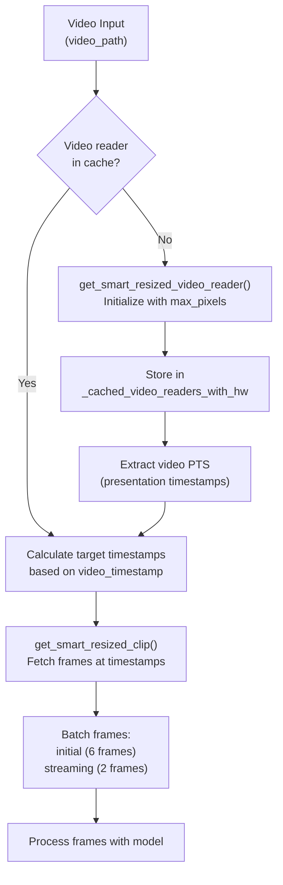
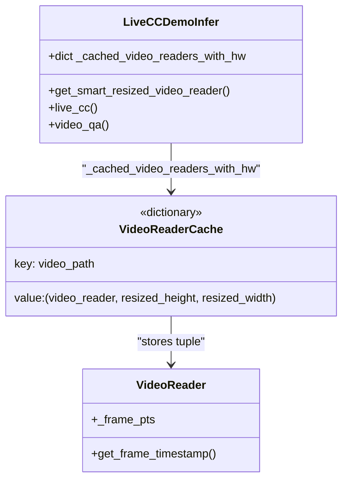
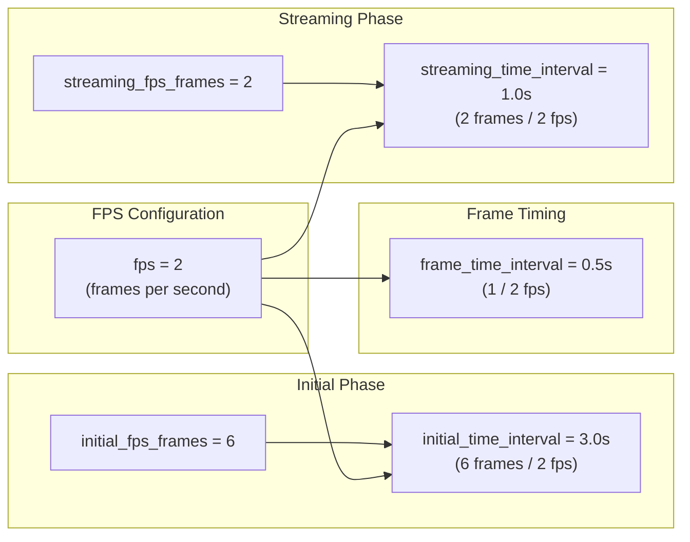
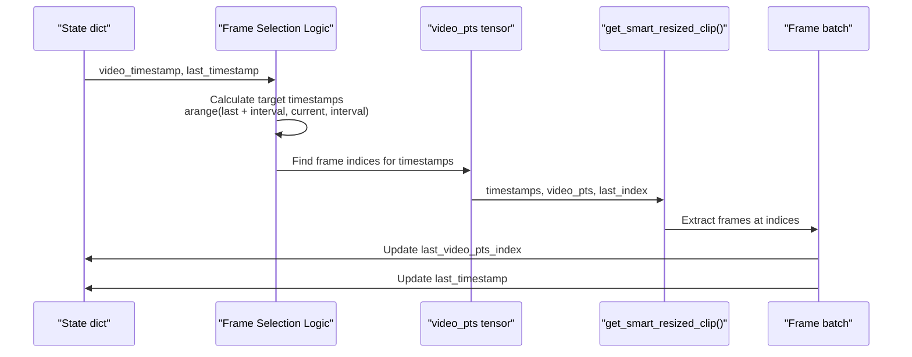
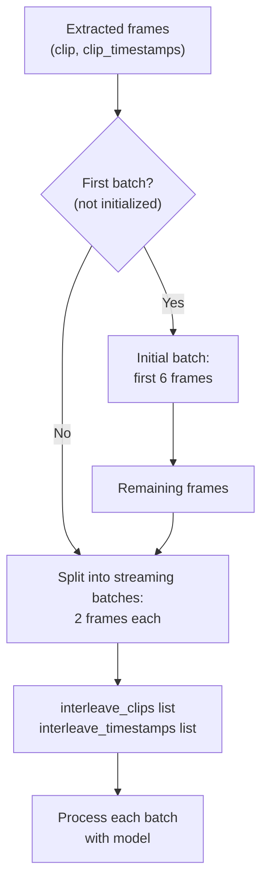
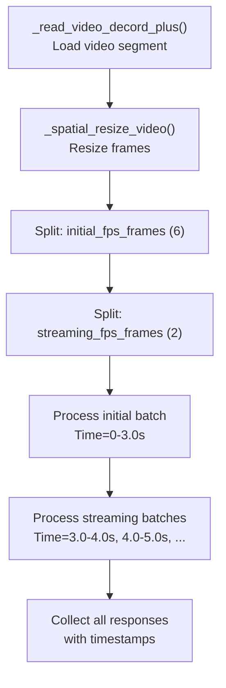

<!-- source: DeepWiki mcp.deepwiki.com · repo mit-han-lab/streaming-vlm · page 5.4 Video Processing Pipeline · fetched 2026-10-30 -->

# Video Processing Pipeline

<details>
<summary>Relevant source files</summary>

The following files were used as context for generating this wiki page:

- [baselines/livecc/demo/infer.py](baselines/livecc/demo/infer.py)
- [baselines/livecc/utils/__init__.py](baselines/livecc/utils/__init__.py)

</details>


This document describes the video processing pipeline used in StreamingVLM's inference systems. The pipeline handles frame extraction, temporal sampling, smart resizing, and video reader caching to enable efficient real-time commentary and video question answering.

For information about how these processed frames are used in model inference, see [Inference Engine Architecture](#5.1). For details on the streaming commentary mode that drives frame extraction, see [Real-Time Commentary Mode](#5.2).

## Overview

The video processing pipeline is responsible for:

- **Video reader initialization and caching** - Reusing video readers across multiple inference calls
- **Smart resizing** - Dynamically resizing videos to fit within pixel budgets while preserving aspect ratios
- **Temporal frame extraction** - Selecting frames at specific timestamps based on video playback state
- **Frame batching** - Organizing frames into initial and streaming batches for efficient processing

The pipeline is implemented through utility functions imported from `livecc_utils` and managed by the `LiveCCDemoInfer` class.

Sources: [baselines/livecc/demo/infer.py:1-319]()

## Video Processing Flow



**Video Processing Pipeline Flow**: This diagram shows the complete flow from video input through frame extraction to model processing, highlighting the caching mechanism and frame batching strategy.

Sources: [baselines/livecc/demo/infer.py:91-137]()

## Video Reader Initialization and Caching

The `LiveCCDemoInfer` class maintains a cache of video readers to avoid repeated initialization overhead:



**Video Reader Caching Structure**: Shows how the `_cached_video_readers_with_hw` dictionary maps video paths to tuples containing the video reader and resized dimensions.

### Initialization Process

When a video is first accessed, the following steps occur:

1. **Check cache** - [baselines/livecc/demo/infer.py:96-97]()
   ```
   if video_path not in self._cached_video_readers_with_hw:
       self._cached_video_readers_with_hw[video_path] = get_smart_resized_video_reader(video_path, max_pixels)
   ```

2. **Extract video PTS** - [baselines/livecc/demo/infer.py:98-101]()
   - Initialize frame timestamps by calling `video_reader.get_frame_timestamp(0)`
   - Store presentation timestamps (PTS) as `torch.Tensor` in `state['video_pts']`
   - Initialize `state['last_video_pts_index']` to -1

3. **Cache tuple** - [baselines/livecc/demo/infer.py:109]()
   ```
   video_reader, resized_height, resized_width = self._cached_video_readers_with_hw[video_path]
   ```

The cache persists for the lifetime of the `LiveCCDemoInfer` instance, enabling efficient repeated access to the same video.

Sources: [baselines/livecc/demo/infer.py:66-110]()

## Smart Resizing

The `get_smart_resized_video_reader()` function performs dynamic video resizing based on a pixel budget constraint (default: `384 * 28 * 28 = 301,056` pixels).

### Resizing Strategy

| Component | Purpose | Implementation |
|-----------|---------|----------------|
| `max_pixels` | Total pixel budget constraint | Passed to `get_smart_resized_video_reader()` |
| `resized_height` | Output height after resize | Calculated to fit within pixel budget |
| `resized_width` | Output width after resize | Preserves aspect ratio |
| Smart resize | Efficient dimension calculation | Handles both spatial and temporal constraints |

The resizing maintains the video's aspect ratio while ensuring the total pixel count per frame stays within the specified budget. This is critical for:

- **Memory efficiency** - Prevents out-of-memory errors with large videos
- **Inference speed** - Reduces computational cost per frame
- **Quality preservation** - Maintains aspect ratio for visual understanding

Sources: [baselines/livecc/demo/infer.py:73-97]()

## Temporal Processing Parameters

The `LiveCCDemoInfer` class defines temporal parameters that control frame extraction:



**Temporal Parameters Relationship**: Shows how the base FPS value derives all other temporal parameters used in frame extraction.

### Parameter Definitions

The following class variables control temporal sampling [baselines/livecc/demo/infer.py:28-33]():

| Parameter | Value | Description |
|-----------|-------|-------------|
| `fps` | 2 | Base frame rate for video processing |
| `initial_fps_frames` | 6 | Number of frames in first batch (provides initial context) |
| `streaming_fps_frames` | 2 | Number of frames per subsequent batch |
| `initial_time_interval` | 3.0 seconds | Duration covered by initial batch |
| `streaming_time_interval` | 1.0 seconds | Duration covered by each streaming batch |
| `frame_time_interval` | 0.5 seconds | Time between consecutive frames |

These parameters create a two-phase processing strategy:
- **Initial phase**: Process 6 frames (3 seconds) to establish context
- **Streaming phase**: Process 2 frames (1 second) continuously

Sources: [baselines/livecc/demo/infer.py:28-33]()

## Frame Extraction and Timestamp Selection

The core frame extraction logic uses video presentation timestamps (PTS) to select frames:



**Frame Extraction Sequence**: Shows the timestamp-based frame selection process using the video PTS tensor.

### Timestamp Calculation

The system calculates which frames to process based on the video playback state [baselines/livecc/demo/infer.py:112-121]():

1. **Initialization check** [baselines/livecc/demo/infer.py:113-115]()
   ```python
   initialized = last_timestamp >= 0
   if not initialized:
       video_timestamp = max(video_timestamp, self.initial_time_interval)
   ```

2. **Early return conditions** [baselines/livecc/demo/infer.py:116-117]()
   - If `video_timestamp <= last_timestamp + frame_time_interval`, no new frames to process

3. **Generate target timestamps** [baselines/livecc/demo/infer.py:118]()
   ```python
   timestamps = torch.arange(last_timestamp + self.frame_time_interval, video_timestamp, self.frame_time_interval)
   ```

4. **Extract frames** [baselines/livecc/demo/infer.py:121-125]()
   ```python
   clip, clip_timestamps, clip_idxs = get_smart_resized_clip(
       video_reader, resized_height, resized_width, 
       timestamps, video_pts, 
       video_pts_index_from=last_video_pts_index+1
   )
   ```

The `get_smart_resized_clip()` function returns:
- `clip`: Tensor of extracted frames
- `clip_timestamps`: Actual timestamps of extracted frames (may differ from requested)
- `clip_idxs`: Frame indices in the original video

Sources: [baselines/livecc/demo/infer.py:112-126]()

## Frame Batching Strategy

After extraction, frames are organized into batches for model processing:



**Frame Batching Strategy**: Shows how extracted frames are organized into initial and streaming batches before model processing.

### Batching Implementation

The batching logic creates interleaved frame lists [baselines/livecc/demo/infer.py:127-136]():

```python
interleave_clips, interleave_timestamps = [], []

# Handle initial batch (6 frames for context)
if not initialized:
    interleave_clips.append(clip[:self.initial_fps_frames])
    interleave_timestamps.append(clip_timestamps[:self.initial_fps_frames])
    clip = clip[self.initial_fps_frames:]
    clip_timestamps = clip_timestamps[self.initial_fps_frames:]

# Split remaining frames into streaming batches (2 frames each)
if len(clip) > 0:
    interleave_clips.extend(list(clip.split(self.streaming_fps_frames)))
    interleave_timestamps.extend(list(clip_timestamps.split(self.streaming_fps_frames)))
```

Each batch is then processed with the model [baselines/livecc/demo/infer.py:139-187]():

1. Calculate time window: `start_timestamp` and `stop_timestamp` for the batch
2. Create conversation with timestamp annotation: `"Time={start_timestamp:.1f}-{stop_timestamp:.1f}s"`
3. Attach video frames as `{"type": "video", "video": clip}`
4. Generate model response for that time window
5. Update KV cache state for next batch

This strategy enables:
- **Context establishment** - Initial 6 frames provide sufficient video context
- **Efficient streaming** - Subsequent 2-frame batches minimize latency
- **Temporal continuity** - Timestamp annotations maintain temporal awareness

Sources: [baselines/livecc/demo/infer.py:127-187]()

## State Management

The video processing pipeline maintains state across inference calls through a `state` dictionary:

| State Key | Type | Purpose |
|-----------|------|---------|
| `video_path` | str | Path to video file being processed |
| `video_timestamp` | float | Current playback position (seconds) |
| `last_timestamp` | float | Last processed timestamp (seconds) |
| `last_video_pts_index` | int | Index of last processed frame |
| `video_pts` | torch.Tensor | Array of all frame presentation timestamps |
| `message` | str | Current user query |
| `past_ids` | torch.Tensor | Token IDs from previous generations |
| `past_key_values` | tuple | KV cache from previous model calls |
| `video_end` | bool | Flag indicating video has ended |

### State Updates

The state is updated at key points during processing:

1. **Video reader initialization** [baselines/livecc/demo/infer.py:100-101]()
   - Set `video_pts` and initialize `last_video_pts_index`

2. **After frame extraction** [baselines/livecc/demo/infer.py:124-125]()
   - Update `last_video_pts_index` with last extracted frame index
   - Update `last_timestamp` with last extracted timestamp

3. **Video end detection** [baselines/livecc/demo/infer.py:106-108]()
   ```python
   if last_timestamp + self.frame_time_interval > video_pts[-1]:
       state['video_end'] = True
       return
   ```

4. **After model generation** [baselines/livecc/demo/infer.py:180-181]()
   - Update `past_key_values` and `past_ids` for KV cache continuity

Sources: [baselines/livecc/demo/infer.py:82-187]()

## Evaluation Mode Processing

For evaluation purposes, the system provides a simplified processing method that handles complete video clips:



**Evaluation Mode Processing**: Shows the simplified pipeline for batch evaluation without state management or caching.

### Implementation Details

The `live_cc_once_for_evaluation()` method [baselines/livecc/demo/infer.py:252-318]() provides evaluation-specific processing:

**Key differences from live mode:**

1. **No caching** - Reads video directly without reader cache
2. **Complete processing** - Processes entire video segment in one call
3. **Simple state** - Uses local `past_key_values` instead of persistent state
4. **Batch responses** - Returns all timestamp-response pairs at once

**Processing flow:**

1. Load video clip [baselines/livecc/demo/infer.py:263-264]()
   ```python
   clip, _ = _read_video_decord_plus({'video': video, 'video_start': video_start, 'video_end': video_end, 'remote_loader': remote_loader})
   clip = _spatial_resize_video(clip)
   ```

2. Create interleaved batches [baselines/livecc/demo/infer.py:266-273]()
   - Initial batch: first 6 frames
   - Streaming batches: subsequent frames in groups of 2

3. Process each batch sequentially [baselines/livecc/demo/infer.py:275-318]()
   - Generate timestamp annotations
   - Maintain KV cache across batches
   - Collect responses with timestamps

4. Return complete results
   ```python
   return responses  # List of [start_time, end_time, text] tuples
   ```

This mode is used by evaluation scripts to process videos in a reproducible, non-interactive manner.

Sources: [baselines/livecc/demo/infer.py:252-318]()

## Pipeline Configuration

The video processing pipeline can be configured through parameters passed to the inference methods:

### Common Parameters

| Parameter | Default | Effect on Pipeline |
|-----------|---------|-------------------|
| `max_pixels` | `384 * 28 * 28` | Controls smart resizing dimensions |
| `video_start` | 0 | Starting timestamp for evaluation mode |
| `video_end` | None | Ending timestamp for evaluation mode |
| `remote_loader` | None | Custom loader for remote video sources |

### Frame Sampling Parameters

These are class-level constants but could be subclassed for different configurations:

| Parameter | Value | Use Case |
|-----------|-------|----------|
| `fps = 2` | 2 FPS | Standard real-time processing |
| `initial_fps_frames = 6` | 6 frames | Initial context establishment |
| `streaming_fps_frames = 2` | 2 frames | Ongoing streaming updates |

To use different frame rates or batch sizes, one would need to create a subclass of `LiveCCDemoInfer` with modified class variables.

Sources: [baselines/livecc/demo/infer.py:28-33, 73]()

---

