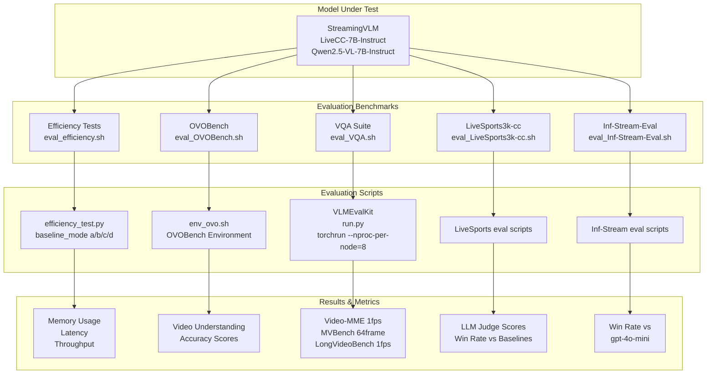
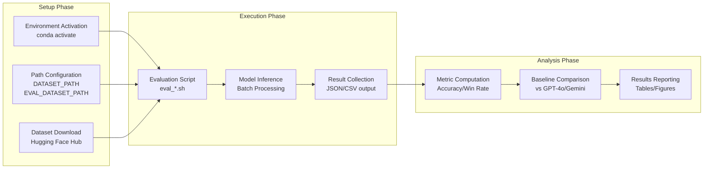
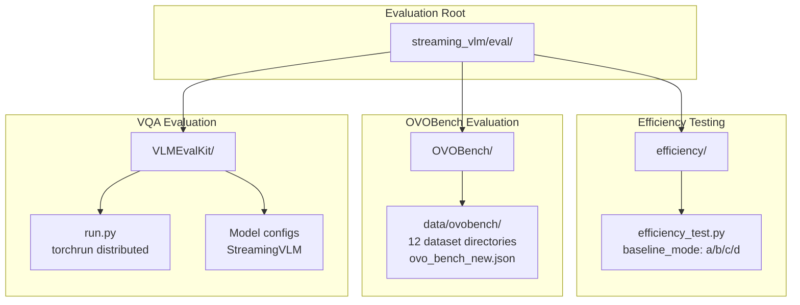
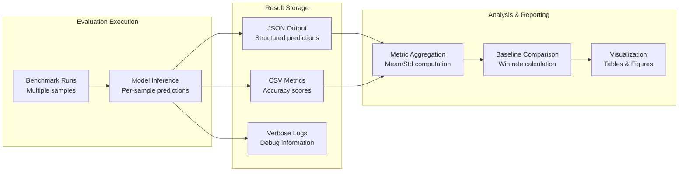

<!-- source: DeepWiki mcp.deepwiki.com · repo mit-han-lab/streaming-vlm · page 6 Evaluation Framework · fetched 2026-10-30 -->

# Evaluation Framework

<details>
<summary>Relevant source files</summary>

The following files were used as context for generating this wiki page:

- [readme.md](readme.md)
- [scripts/eval_OVOBench.sh](scripts/eval_OVOBench.sh)
- [scripts/eval_efficiency.sh](scripts/eval_efficiency.sh)

</details>


## Purpose and Scope

This document provides an overview of the comprehensive evaluation framework used to assess StreamingVLM and baseline models across multiple dimensions: efficiency, general video understanding, video question answering, live commentary generation, and infinite stream processing. The framework consists of five distinct benchmark systems, each targeting specific capabilities of streaming video language models.

For detailed information about specific benchmarks, see:
- Efficiency comparisons: [Efficiency Benchmarks](#6.1)
- General video understanding: [OVOBench Evaluation](#6.2)
- Video QA tasks: [VQA Benchmarks](#6.3)
- Live sports commentary: [LiveSports3k-cc Evaluation](#6.4)
- Infinite stream testing: [Inf-Stream-Eval](#6.5)

For information about model architecture and optimization strategies being evaluated, see [Model Architecture](#3). For inference system implementation details, see [Inference Systems](#5).

## Evaluation Architecture Overview

The evaluation framework is organized into five major benchmark categories, each served by dedicated evaluation scripts and infrastructure:



**Sources:** [readme.md:80-156](), [scripts/eval_VQA.sh:1-5](), [scripts/eval_efficiency.sh:1-6]()

## Benchmark Categories

The evaluation framework assesses models across five complementary dimensions:

| Benchmark | Purpose | Key Metrics | Script | Environment |
|-----------|---------|-------------|--------|-------------|
| **Efficiency** | Compare memory and latency of attention mechanisms | Memory usage, Latency, Throughput | `eval_efficiency.sh` | `streamingvlm-infer` |
| **OVOBench** | General video understanding across 12 datasets | Accuracy scores | `eval_OVOBench.sh` | `streamingvlm-ovo` |
| **VQA Suite** | Video question answering at various frame rates | Task-specific accuracy | `eval_VQA.sh` | `streamingvlm-infer` |
| **LiveSports3k-cc** | Live sports commentary generation quality | Win rate vs GPT-4o/Gemini/LLaVA | `eval_LiveSports3k-cc.sh` | `streamingvlm-infer` |
| **Inf-Stream-Eval** | Infinite stream processing capability | Win rate vs gpt-4o-mini | `eval_Inf-Stream-Eval.sh` | `streamingvlm-infer` |

**Sources:** [readme.md:80-156]()

## Evaluation Workflow

The typical evaluation workflow follows a standardized pattern across all benchmarks:



**Sources:** [readme.md:80-156]()

## Environment Requirements

Different evaluation benchmarks require specific conda environments:

### Inference Environment (`streamingvlm-infer`)

Used for efficiency testing, VQA benchmarks, LiveSports3k-cc, and Inf-Stream-Eval:

```bash
conda activate streamingvlm-infer
```

Set up via [scripts/env_infer.sh:1-end]()

### OVOBench Environment (`streamingvlm-ovo`)

Dedicated environment for OVOBench evaluation with specific dependencies:

```bash
./scripts/env_ovo.sh
conda activate streamingvlm-ovo
```

Set up via [scripts/env_ovo.sh:1-end]()

**Sources:** [readme.md:21-26](), [readme.md:119-120]()

## Dataset Configuration

Evaluation requires proper dataset paths to be configured:

```bash
export DATASET_PATH=/path/to/your/Inf-Stream-Train
export EVAL_DATASET_PATH=/path/to/your/Inf-Stream-Eval
export LIVESPORTS3K_PATH=/path/to/your/LiveSports-3K/videos
```

### Required Datasets

1. **Inf-Stream-Train** (`mit-han-lab/Inf-Stream-Train`): Training data used for model development
2. **Inf-Stream-Eval** (`mit-han-lab/Inf-Stream-Eval`): In-house evaluation benchmark for infinite streams
3. **LiveSports-3K**: Live sports video dataset for commentary evaluation
4. **OVOBench**: Comprehensive video understanding benchmark with 12 sub-datasets
5. **VQA Datasets**: Video-MME, MVBench, LongVideoBench (handled by VLMEvalKit)

**Sources:** [readme.md:45-63](), [readme.md:148-153]()

## Evaluation Code Structure

The evaluation codebase is organized by benchmark type:



**Sources:** [scripts/eval_efficiency.sh:1-6](), [scripts/eval_VQA.sh:1-5](), [readme.md:97-114]()

## Baseline Comparison Modes

The efficiency evaluation framework supports four distinct baseline modes for comparing attention mechanisms:

| Mode | Description | Paper Reference |
|------|-------------|-----------------|
| `a` | FullAttention | Full attention baseline |
| `b` | Sliding window w/o overlapping | Non-overlapping window approach |
| `c` | Sliding window w/ overlapping | Overlapping window approach |
| `d` | StreamingVLM | Compact KV cache with sink + sliding window |

These modes are selected via the `--baseline_mode` parameter in [streaming_vlm/eval/efficiency/efficiency_test.py:1-end]():

```bash
python streaming_vlm/eval/efficiency/efficiency_test.py --baseline_mode d
```

**Sources:** [scripts/eval_efficiency.sh:1-6]()

## Distributed Evaluation

### VQA Multi-GPU Evaluation

The VQA evaluation leverages PyTorch distributed training with 8 GPUs for parallel processing:

```bash
torchrun --nproc-per-node=8 run.py --data Video-MME_1fps --model StreamingVLM --verbose --reuse
```

Key parameters:
- `--nproc-per-node=8`: Runs 8 parallel processes (one per GPU)
- `--data`: Specifies the benchmark dataset
- `--model`: Model configuration name
- `--verbose`: Enables detailed logging
- `--reuse`: Reuses previous results when available

The evaluation runs sequentially across three VQA benchmarks:
1. **Video-MME_1fps**: Video understanding at 1 FPS sampling
2. **MVBench_64frame**: Multi-choice video QA with 64 frames
3. **LongVideoBench_1fps**: Long-form video understanding at 1 FPS

**Sources:** [scripts/eval_VQA.sh:1-5]()

### OVOBench Distributed Evaluation

OVOBench evaluation also utilizes distributed processing across 8 GPUs to handle the comprehensive benchmark suite spanning 12 different datasets.

**Sources:** [readme.md:115-122]()

## FPS Configuration

The evaluation framework allows dynamic FPS adjustment for inference across all benchmarks. This is controlled via environment variable and in-place modification of the `qwen_vl_utils.vision_process` module:

```bash
sed -i 's/^FPS = .*/FPS = float(os.environ.get("QWENVL_FPS", "2.0"))/' \
  "$(python -c 'import inspect,qwen_vl_utils.vision_process as m; import os; print(os.path.abspath(inspect.getsourcefile(m)))')"
```

This command modifies the FPS setting in the installed package, allowing evaluation at different frame rates (default: 2.0 FPS, up to 8 FPS on H100 GPU).

**Sources:** [readme.md:157-166]()

## Memory Configuration

All evaluation scripts use expandable CUDA memory segments to handle variable-length video inputs:

```bash
export PYTORCH_CUDA_ALLOC_CONF=expandable_segments:True
```

This configuration prevents out-of-memory errors during evaluation of long videos by allowing PyTorch to expand GPU memory allocations dynamically.

**Sources:** [scripts/eval_VQA.sh:1]()

## Result Aggregation

Evaluation results are collected and stored in structured formats:



**Sources:** [readme.md:80-156]()

## Key Performance Metrics

The evaluation framework reports the following key metrics across benchmarks:

### Efficiency Metrics
- **Memory Usage**: Peak GPU memory consumption during inference
- **Latency**: Time per frame processing
- **Throughput**: Frames processed per second
- **KV Cache Size**: Memory footprint of attention cache

### Accuracy Metrics
- **OVOBench**: Overall accuracy across 12 video understanding tasks
- **Video-MME**: Video understanding score at 1 FPS
- **MVBench**: Multi-choice accuracy with 64 frames
- **LongVideoBench**: Long-form video QA accuracy at 1 FPS

### Comparative Metrics
- **LiveSports3k-cc**: Win rate vs GPT-4o, Gemini-1.5-Pro, LLaVA-NeXT
- **Inf-Stream-Eval**: Win rate vs gpt-4o-mini (reported as 66.18% in TL;DR)

**Sources:** [readme.md:9-11]()

## Benchmark Data Structure

### OVOBench Directory Structure

The OVOBench evaluation requires a specific directory organization:

```
data/ovobench
├── AutoEvalMetaData
├── COIN
├── cross_task
├── Ego4D
├── hirest
├── MovieNet
├── OpenEQA
├── ovo_bench_new.json
├── perception_test
├── star
├── thumos
├── youcook2
└── YouTube_Games
```

This structure contains:
- 12 dataset directories with video files and annotations
- `ovo_bench_new.json`: Master annotation file with evaluation metadata

**Sources:** [readme.md:97-114]()

## Evaluation Best Practices

1. **Environment Isolation**: Use dedicated conda environments for different benchmarks to avoid dependency conflicts
2. **Path Configuration**: Always export required dataset paths before running evaluation scripts
3. **GPU Resources**: Ensure adequate GPU memory (H100 recommended) for distributed evaluation
4. **Result Reuse**: Use `--reuse` flag in VQA evaluation to avoid redundant inference on already-processed samples
5. **Verbose Logging**: Enable `--verbose` flag during evaluation for detailed debugging information
6. **FPS Tuning**: Adjust FPS based on GPU capacity and video complexity (2-8 FPS range)

**Sources:** [readme.md:80-166](), [scripts/eval_VQA.sh:1-5]()

---

