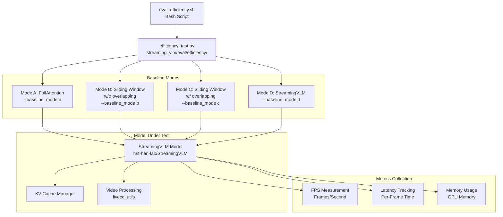
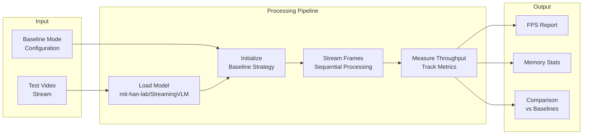

<!-- source: DeepWiki mcp.deepwiki.com · repo mit-han-lab/streaming-vlm · page 6.1 Efficiency Benchmarks · fetched 2026-10-30 -->

# Efficiency Benchmarks

<details>
<summary>Relevant source files</summary>

The following files were used as context for generating this wiki page:

- [assets/efficiency.png](assets/efficiency.png)
- [readme.md](readme.md)
- [scripts/eval_efficiency.sh](scripts/eval_efficiency.sh)

</details>


## Purpose and Scope

This page documents the efficiency testing methodology used to measure StreamingVLM's real-time video processing performance. Efficiency benchmarks focus on **throughput metrics** (frames per second) and **computational efficiency** across different attention mechanisms. The evaluation compares StreamingVLM against baseline attention strategies to demonstrate the advantages of compact KV cache management.

For evaluation of model accuracy on video understanding tasks, see [OVOBench Evaluation](#6.2), [VQA Benchmarks](#6.3), [LiveSports3k-cc Evaluation](#6.4), and [Inf-Stream-Eval](#6.5).

## Overview

Efficiency benchmarking measures how many frames per second the model can process in real-time streaming scenarios. The key innovation of StreamingVLM is achieving **8 FPS on a single H100 GPU** while maintaining stable understanding of effectively infinite video streams, avoiding the quadratic cost of full attention and the instability issues of naive sliding windows.

The efficiency evaluation script compares four distinct inference strategies:
- **Full Attention**: Standard approach with quadratic memory/compute cost
- **Sliding Window (non-overlapping)**: Fixed-size window without frame overlap
- **Sliding Window (overlapping)**: Fixed-size window with frame overlap for smoother transitions
- **StreamingVLM**: Compact KV cache with aligned training-inference strategy

Sources: [readme.md:82-93](), [scripts/eval_efficiency.sh:1-6]()

## Test Execution Architecture



Sources: [scripts/eval_efficiency.sh:1-6]()

## Baseline Comparison Modes

The efficiency test supports four baseline modes, each representing a different attention and memory management strategy:

| Mode | Flag | Description | Attention Strategy | Memory Cost |
|------|------|-------------|-------------------|-------------|
| **Full Attention** | `--baseline_mode a` | Standard Transformer attention over all historical frames | Attends to all previous frames | O(T²) where T = number of frames |
| **Sliding Window (non-overlapping)** | `--baseline_mode b` | Fixed-size window that completely replaces old frames | Attends to last W frames, no overlap | O(W) constant |
| **Sliding Window (overlapping)** | `--baseline_mode c` | Fixed-size window with gradual frame replacement | Attends to last W frames with overlap | O(W) constant |
| **StreamingVLM** | `--baseline_mode d` | Compact KV cache with training-inference alignment | Attends to compressed temporal context | O(1) effective |

### Mode Characteristics

**Full Attention (Mode A)**
- Maintains complete history of all processed frames
- Provides maximum context but becomes computationally prohibitive as video length increases
- Useful as an upper bound for accuracy comparison
- Memory and compute cost grows quadratically with video length

**Sliding Window without Overlap (Mode B)**
- Discards old frames abruptly when window is full
- Can cause instability and discontinuities in understanding
- Constant memory footprint regardless of video length
- May lose important long-term context

**Sliding Window with Overlap (Mode C)**
- Gradually transitions between frames to reduce discontinuities
- Improved stability compared to non-overlapping window
- Still limited by fixed context window
- Better than Mode B but still loses long-term dependencies

**StreamingVLM (Mode D)**
- Uses compact KV cache to maintain effectively infinite context
- Training procedure aligned with streaming inference
- Stable performance regardless of video length
- Achieves real-time performance (8 FPS on H100)

Sources: [scripts/eval_efficiency.sh:1-6](), [readme.md:9-11]()

## Running Efficiency Tests

### Environment Setup

Activate the inference environment before running efficiency benchmarks:

```bash
conda activate streamingvlm-infer
```

Sources: [readme.md:85]()

### Execution Command

Run the efficiency test script with the desired baseline mode:

```bash
./scripts/eval_efficiency.sh
```

The script internally calls:
```bash
python streaming_vlm/eval/efficiency/efficiency_test.py --baseline_mode d
```

Sources: [scripts/eval_efficiency.sh:1](), [readme.md:85-86]()

### Testing Different Modes

To test specific baseline modes, modify the `baseline_mode` parameter in [scripts/eval_efficiency.sh:1]():

```bash
# Test Full Attention
python streaming_vlm/eval/efficiency/efficiency_test.py --baseline_mode a

# Test Sliding Window without overlap
python streaming_vlm/eval/efficiency/efficiency_test.py --baseline_mode b

# Test Sliding Window with overlap
python streaming_vlm/eval/efficiency/efficiency_test.py --baseline_mode c

# Test StreamingVLM (default)
python streaming_vlm/eval/efficiency/efficiency_test.py --baseline_mode d
```

Sources: [scripts/eval_efficiency.sh:1-6]()

## Performance Metrics

### Primary Metric: Frames Per Second (FPS)

The main efficiency metric is **throughput** measured in frames per second (FPS). StreamingVLM achieves:

- **8 FPS on single H100 GPU** for real-time streaming inference
- Maintains stable performance regardless of video length
- Processes at 2 FPS during actual video processing (configurable)

The difference between 8 FPS maximum throughput and 2 FPS operational rate allows for:
- Headroom for variable computational load
- Stability during complex scenes
- Integration with other system components

Sources: [readme.md:9-11](), [readme.md:89-91]()

### Secondary Metrics

While FPS is the primary metric, efficiency testing may also track:

1. **Latency per frame**: Time to process a single frame
2. **GPU memory usage**: Peak and average memory consumption
3. **KV cache size**: Memory footprint of cached key-value states
4. **Stability over time**: Performance degradation with increasing video length

### Efficiency Test Workflow



Sources: [scripts/eval_efficiency.sh:1-6]()

## Implementation Details

### Test Module Location

The efficiency testing implementation is located in:
- Test script: [streaming_vlm/eval/efficiency/efficiency_test.py]()
- Execution wrapper: [scripts/eval_efficiency.sh:1-6]()

### FPS Configuration

The operational FPS can be adjusted via environment variable or by modifying the Qwen VL utilities. To change the inference FPS:

```bash
sed -i 's/^FPS = .*/FPS = float(os.environ.get("QWENVL_FPS", "2.0"))/' \
  "$(python -c 'import inspect,qwen_vl_utils.vision_process as m; import os; print(os.path.abspath(inspect.getsourcefile(m)))')"
```

This modifies the `FPS` constant in the Qwen VL vision processing module to use the `QWENVL_FPS` environment variable, defaulting to 2.0 FPS.

Sources: [readme.md:157-164]()

### Hardware Requirements

Efficiency benchmarks are designed for:
- **GPU**: Single H100 (target hardware for 8 FPS benchmark)
- Other GPUs may achieve different throughput rates
- The StreamingVLM architecture is optimized for H100 but can run on other modern GPUs

### Baseline Mode Selection

The test infrastructure uses a single character flag to select the baseline mode:
- Character flags (`a`, `b`, `c`, `d`) correspond to different attention strategies
- Implemented in [streaming_vlm/eval/efficiency/efficiency_test.py]() via `--baseline_mode` argument
- Mode selection affects both the attention mechanism and KV cache management strategy

Sources: [scripts/eval_efficiency.sh:2-6]()

## Efficiency Results Visualization

The efficiency evaluation produces comparative results across all baseline modes. The results demonstrate:

1. **StreamingVLM's superior throughput**: 8 FPS on H100
2. **Computational efficiency**: Constant-time processing regardless of video length
3. **Memory efficiency**: Compact KV cache vs. quadratic growth in full attention
4. **Real-time capability**: Sufficient headroom for production deployment

The visual representation of these results is shown in the efficiency benchmark figure:


This figure illustrates the performance comparison across different baseline modes, highlighting StreamingVLM's ability to maintain real-time processing speeds while other approaches either become computationally prohibitive (full attention) or sacrifice understanding quality (sliding windows).

Sources: [readme.md:89-91](), [assets/efficiency.png:1]()

## Key Takeaways

1. **Throughput**: StreamingVLM achieves 8 FPS on single H100, enabling real-time video understanding
2. **Scalability**: Constant computational cost regardless of video length
3. **Comparison**: Four baseline modes (a, b, c, d) enable comprehensive efficiency analysis
4. **Simplicity**: Single script execution with mode parameter for different baseline tests
5. **Configuration**: Adjustable FPS settings via environment variables for different use cases

The efficiency benchmarks validate that StreamingVLM's compact KV cache and training-inference alignment enable practical real-time video understanding at scale, addressing the limitations of both full attention (quadratic cost) and naive sliding windows (stability issues).

Sources: [readme.md:82-93](), [scripts/eval_efficiency.sh:1-6]()

---

