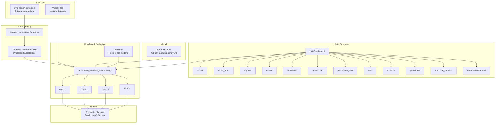
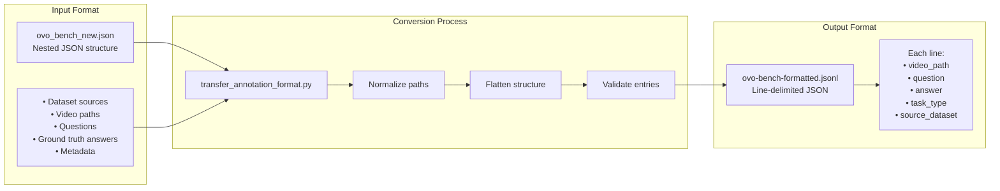
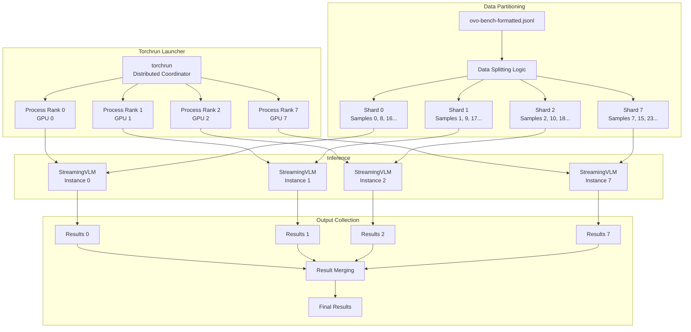
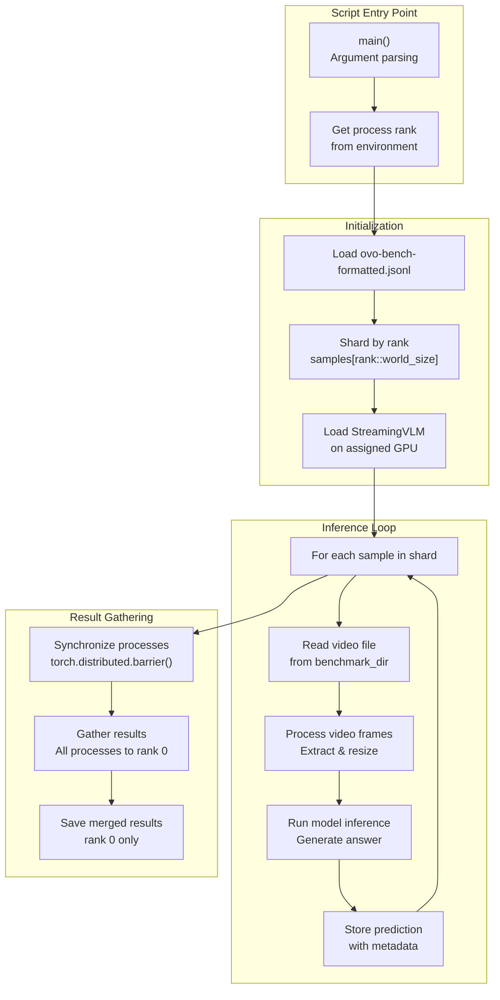

<!-- source: DeepWiki mcp.deepwiki.com · repo mit-han-lab/streaming-vlm · page 6.2 OVOBench Evaluation · fetched 2026-10-30 -->

# OVOBench Evaluation

<details>
<summary>Relevant source files</summary>

The following files were used as context for generating this wiki page:

- [readme.md](readme.md)
- [scripts/eval_OVOBench.sh](scripts/eval_OVOBench.sh)

</details>


## Purpose and Scope

This document describes the OVOBench evaluation system for StreamingVLM, which assesses general video understanding capabilities across multiple datasets and tasks. OVOBench is a comprehensive benchmark that aggregates video understanding tasks from various sources including COIN, Ego4D, MovieNet, and others.

For other evaluation benchmarks, see [Efficiency Benchmarks](#6.1), [VQA Benchmarks](#6.3), [LiveSports3k-cc Evaluation](#6.4), and [Inf-Stream-Eval](#6.5). For the core inference system that powers evaluation, see [Inference Engine Architecture](#5.1).

**Sources:** [readme.md:95-124](), [scripts/eval_OVOBench.sh:1-8]()

## Overview

OVOBench evaluation consists of two main stages:
1. **Annotation format transfer**: Converting the original OVOBench annotation format to a JSONL format compatible with the evaluation pipeline
2. **Distributed evaluation**: Running inference across 8 GPUs using PyTorch's distributed training framework

The evaluation pipeline processes videos from multiple source datasets and generates predictions that can be scored against ground truth annotations.

**Sources:** [scripts/eval_OVOBench.sh:1-8]()

## Evaluation Pipeline Architecture



**Sources:** [readme.md:95-124](), [scripts/eval_OVOBench.sh:1-8]()

## Environment Setup

OVOBench evaluation requires a dedicated conda environment separate from the inference and training environments. This is configured through the `env_ovo.sh` script.

### Environment Creation

The environment uses Python 3.11 and installs dependencies from `ovo_requirements.txt`:

```bash
conda create -n streamingvlm-ovo python=3.11 -y
conda activate streamingvlm-ovo
pip install -r ovo_requirements.txt --no-deps
```

The `--no-deps` flag is used to prevent automatic dependency resolution conflicts, as the requirements file specifies exact versions needed for OVOBench compatibility.

**Sources:** [scripts/env_ovo.sh:1-4](), [readme.md:119-120]()

## Data Structure Requirements

OVOBench requires a specific directory structure containing videos and metadata from multiple source datasets. The benchmark directory must be organized as follows:

| Directory | Purpose |
|-----------|---------|
| `AutoEvalMetaData` | Metadata for automatic evaluation |
| `COIN` | COIN dataset videos and annotations |
| `cross_task` | CrossTask dataset |
| `Ego4D` | Ego4D egocentric videos |
| `hirest` | HiREST dataset |
| `MovieNet` | MovieNet dataset |
| `OpenEQA` | OpenEQA embodied QA dataset |
| `perception_test` | Perception Test videos |
| `star` | STAR dataset |
| `thumos` | THUMOS action recognition dataset |
| `youcook2` | YouCook2 cooking videos |
| `YouTube_Games` | YouTube gaming videos |
| `ovo_bench_new.json` | Original annotation file |

The complete structure should look like:

```
data/ovobench
├── AutoEvalMetaData
├── COIN
├── cross_task
├── Ego4D
├── hirest
├── MovieNet
├── OpenEQA
├── ovo_bench_new.json
├── perception_test
├── star
├── thumos
├── youcook2
└── YouTube_Games
```

**Sources:** [readme.md:97-114]()

## Annotation Format Transfer

Before evaluation can begin, the original OVOBench annotations must be converted to a JSONL format compatible with the evaluation pipeline.

### Transfer Script

The `transfer_annotation_format.py` script handles this conversion:

```bash
python streaming_vlm/eval/ovobench/transfer_annotation_format.py \
    --input data/ovobench/ovo_bench_new.json \
    --output data/ovobench/ovo-bench-formatted.jsonl
```

### Format Conversion Process



The transfer process:
1. Parses the nested JSON structure from `ovo_bench_new.json`
2. Normalizes video file paths to match the data directory structure
3. Flattens the hierarchical annotation structure into line-delimited format
4. Validates each entry for completeness
5. Outputs one JSON object per line in `ovo-bench-formatted.jsonl`

**Sources:** [scripts/eval_OVOBench.sh:1-4]()

## Distributed Evaluation Process

OVOBench evaluation uses PyTorch's `torchrun` for distributed processing across 8 GPUs, enabling parallel inference on the large benchmark dataset.

### Launching Distributed Evaluation

The evaluation is launched using the following command:

```bash
conda activate streamingvlm-ovo
torchrun --standalone --nproc_per_node=8 \
    streaming_vlm/eval/ovobench/distributed_evaluate_ovobench.py \
    --benchmark_dir data/ovobench \
    --model_path mit-han-lab/StreamingVLM
```

### Command Arguments

| Argument | Purpose |
|----------|---------|
| `--standalone` | Run on a single node without requiring external coordination |
| `--nproc_per_node=8` | Spawn 8 processes (one per GPU) |
| `--benchmark_dir` | Path to the OVOBench data directory |
| `--model_path` | Hugging Face model identifier or local path |

### Distribution Strategy



The distributed evaluation process:

1. **Process Initialization**: `torchrun` spawns 8 processes, each assigned to a different GPU
2. **Data Sharding**: The JSONL file is partitioned so each process handles every 8th sample (strided sharding)
3. **Model Loading**: Each process independently loads the StreamingVLM model
4. **Parallel Inference**: Processes run inference on their assigned samples concurrently
5. **Result Collection**: Partial results from each process are gathered and merged
6. **Final Output**: Combined results are written to the output file

**Sources:** [scripts/eval_OVOBench.sh:6-8](), [readme.md:120-122]()

## Evaluation Script Architecture

The `distributed_evaluate_ovobench.py` script coordinates the evaluation process:



**Sources:** [scripts/eval_OVOBench.sh:6-8]()

## Integration with StreamingVLM Inference

The evaluation process leverages the same video processing and inference infrastructure used in the main StreamingVLM system:

| Component | File Reference | Purpose |
|-----------|---------------|---------|
| Video processing | [streaming_vlm/inference/](/) | Frame extraction and smart resizing |
| Model loading | [streaming_vlm/inference/](/) | StreamingVLM model initialization |
| Batch inference | [streaming_vlm/inference/](/) | Question-answering inference mode |
| Result formatting | [streaming_vlm/eval/ovobench/](/) | Prediction output structure |

The evaluation uses the video QA mode rather than streaming commentary mode, as OVOBench tasks require single-response answers to specific questions about video content.

**Sources:** [scripts/eval_OVOBench.sh:6-8](), [readme.md:120-122]()

## Running the Complete Evaluation

The complete evaluation workflow is:

### Step 1: Prepare Data Structure

Ensure the benchmark directory contains all required subdirectories and the `ovo_bench_new.json` annotation file.

### Step 2: Activate Environment

```bash
conda activate streamingvlm-ovo
```

### Step 3: Transfer Annotations

```bash
python streaming_vlm/eval/ovobench/transfer_annotation_format.py \
    --input data/ovobench/ovo_bench_new.json \
    --output data/ovobench/ovo-bench-formatted.jsonl
```

### Step 4: Run Distributed Evaluation

```bash
torchrun --standalone --nproc_per_node=8 \
    streaming_vlm/eval/ovobench/distributed_evaluate_ovobench.py \
    --benchmark_dir data/ovobench \
    --model_path mit-han-lab/StreamingVLM
```

### Step 5: Analyze Results

The evaluation generates prediction files that can be scored against ground truth annotations to compute accuracy metrics.

**Sources:** [scripts/eval_OVOBench.sh:1-8](), [readme.md:116-122]()

## Performance Considerations

### GPU Memory Requirements

Each process loads a full StreamingVLM model instance, requiring approximately:
- Model parameters: ~7B parameters
- KV cache: Compact sink + sliding window architecture minimizes memory
- Activation memory: Depends on video length and resolution

With 8 GPUs, the evaluation can process the full OVOBench dataset efficiently while maintaining reasonable memory usage per GPU.

### Throughput Optimization

The distributed setup provides near-linear speedup:
- Single GPU: Process 1/8 of dataset sequentially
- 8 GPUs: Process all samples in parallel with 8× throughput

The actual speedup depends on:
- Data loading overhead from disk I/O
- Video decoding time
- Model inference time
- Inter-process synchronization

**Sources:** [scripts/eval_OVOBench.sh:6-8](), [readme.md:120-122]()

---

