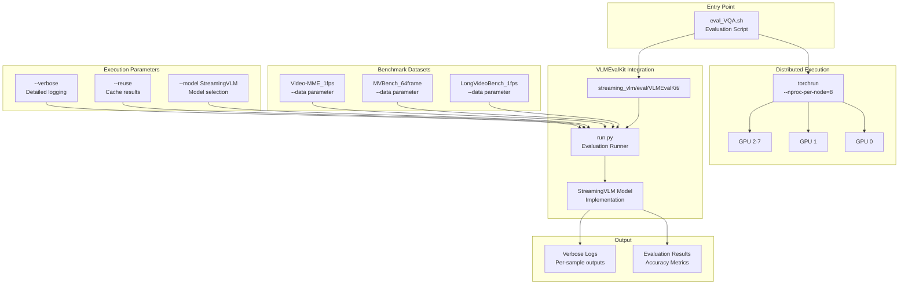
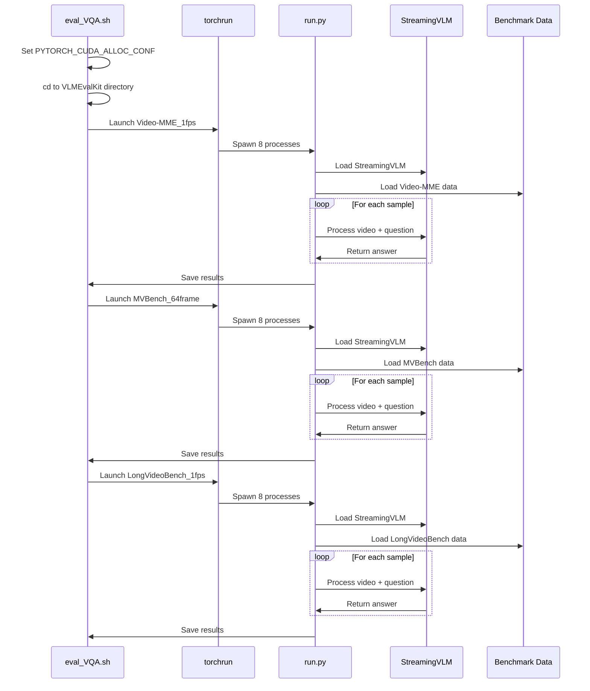
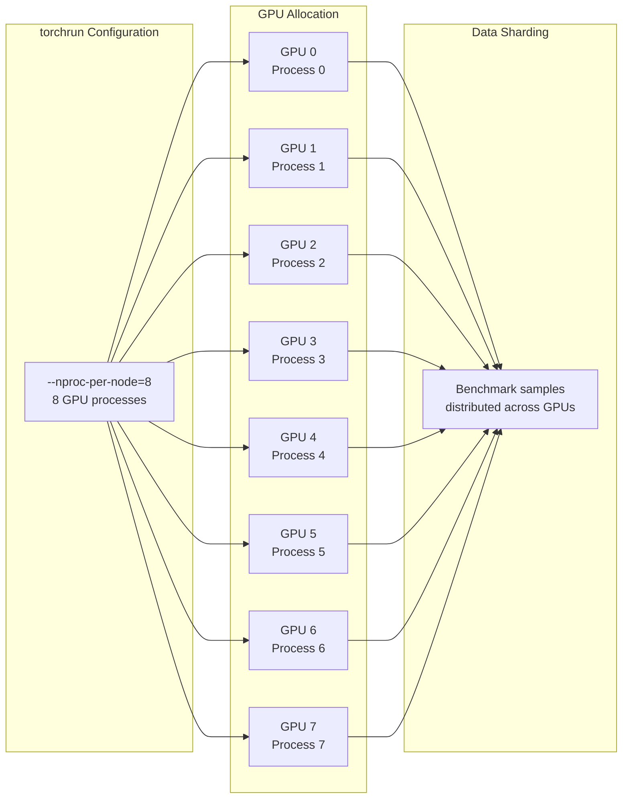

<!-- source: DeepWiki mcp.deepwiki.com · repo mit-han-lab/streaming-vlm · page 6.3 VQA Benchmarks · fetched 2026-10-30 -->

# VQA Benchmarks

<details>
<summary>Relevant source files</summary>

The following files were used as context for generating this wiki page:

- [readme.md](readme.md)
- [scripts/eval_VQA.sh](scripts/eval_VQA.sh)

</details>


## Purpose and Scope

This page documents the Video Question Answering (VQA) benchmark evaluation system used to assess StreamingVLM's performance on standard video understanding tasks. The VQA benchmarks evaluate the model's ability to answer questions about video content across different temporal resolutions and video lengths. This evaluation is separate from the streaming-specific benchmarks (see [Inf-Stream-Eval](#6.5)) and live commentary evaluation (see [LiveSports3k-cc Evaluation](#6.4)).

The VQA evaluation framework tests three major benchmarks:
- **Video-MME**: Multi-modal evaluation at 1 frame per second
- **MVBench**: Multi-view benchmark using 64 frames per video
- **LongVideoBench**: Long-form video understanding at 1 fps

**Sources:** [readme.md:126-135](), [scripts/eval_VQA.sh:1-5]()

## VQA Evaluation Architecture

The VQA evaluation system integrates with VLMEvalKit, a third-party evaluation framework, to run standardized video question-answering benchmarks using distributed GPU processing.

### System Components



**Sources:** [scripts/eval_VQA.sh:1-5]()

### Execution Flow



**Sources:** [scripts/eval_VQA.sh:1-5]()

## Benchmark Specifications

### Video-MME

Video-MME evaluates multi-modal understanding with temporal sampling at 1 frame per second.

| Parameter | Value |
|-----------|-------|
| Dataset Identifier | `Video-MME_1fps` |
| Temporal Resolution | 1 frame per second |
| Model | `StreamingVLM` |
| GPU Processes | 8 (distributed) |
| Execution Flags | `--verbose`, `--reuse` |

**Command:**
```bash
torchrun --nproc-per-node=8 run.py --data Video-MME_1fps --model StreamingVLM --verbose --reuse
```

**Sources:** [scripts/eval_VQA.sh:3](), [readme.md:126-135]()

### MVBench

MVBench uses a fixed frame count of 64 frames per video, testing multi-view understanding capabilities.

| Parameter | Value |
|-----------|-------|
| Dataset Identifier | `MVBench_64frame` |
| Temporal Resolution | 64 frames per video |
| Model | `StreamingVLM` |
| GPU Processes | 8 (distributed) |
| Execution Flags | `--verbose`, `--reuse` |

**Command:**
```bash
torchrun --nproc-per-node=8 run.py --data MVBench_64frame --model StreamingVLM --verbose --reuse
```

**Sources:** [scripts/eval_VQA.sh:4](), [readme.md:126-135]()

### LongVideoBench

LongVideoBench evaluates understanding of long-form videos with temporal sampling at 1 frame per second.

| Parameter | Value |
|-----------|-------|
| Dataset Identifier | `LongVideoBench_1fps` |
| Temporal Resolution | 1 frame per second |
| Model | `StreamingVLM` |
| GPU Processes | 8 (distributed) |
| Execution Flags | `--verbose`, `--reuse` (note: typo in original script) |

**Command:**
```bash
torchrun --nproc-per-node=8 run.py --data LongVideoBench_1fps --model StreamingVLM --verbose --reus
```

**Note:** The script contains a typo with `--reus` instead of `--reuse` on line 5.

**Sources:** [scripts/eval_VQA.sh:5](), [readme.md:126-135]()

## Configuration and Execution

### Environment Setup

The VQA benchmarks use the inference environment:

```bash
conda activate streamingvlm-infer
```

**Sources:** [readme.md:131]()

### Memory Configuration

The evaluation script sets PyTorch CUDA memory allocation to use expandable segments:

```bash
export PYTORCH_CUDA_ALLOC_CONF=expandable_segments:True
```

This configuration allows dynamic memory expansion to handle varying video lengths and batch sizes across the benchmarks.

**Sources:** [scripts/eval_VQA.sh:1]()

### Working Directory

All VQA evaluation commands execute from the VLMEvalKit subdirectory:

```bash
cd streaming_vlm/eval/VLMEvalKit/
```

**Sources:** [scripts/eval_VQA.sh:2]()

## Execution Parameters

### Distributed Processing



**Sources:** [scripts/eval_VQA.sh:3-5]()

### Command-Line Flags

| Flag | Purpose |
|------|---------|
| `--data` | Specifies the benchmark dataset identifier |
| `--model` | Specifies the model name (`StreamingVLM`) |
| `--verbose` | Enables detailed logging of evaluation progress |
| `--reuse` | Enables caching and reuse of intermediate results |

The `--reuse` flag prevents redundant computation by caching processed samples, which is particularly useful when debugging or re-running evaluations after failures.

**Sources:** [scripts/eval_VQA.sh:3-5]()

## VLMEvalKit Integration Details

### Model Registration

StreamingVLM must be registered as a model implementation within VLMEvalKit. The `--model StreamingVLM` parameter in [scripts/eval_VQA.sh:3-5]() references this registered model name.

### Dataset Loading

VLMEvalKit handles dataset downloading, preprocessing, and loading based on the `--data` parameter. The framework automatically:
1. Downloads benchmark data if not present
2. Preprocesses videos according to benchmark specifications
3. Loads questions and ground truth answers
4. Distributes samples across GPU processes

**Sources:** [scripts/eval_VQA.sh:1-5]()

## Temporal Resolution Comparison

The three benchmarks use different temporal sampling strategies:

```mermaid
graph TD
    subgraph "Video-MME: 1 FPS"
        VME_VID["Input Video<br/>Variable length"]
        VME_SAMPLE["Sample at 1 FPS"]
        VME_FRAMES["Frame sequence<br/>1 frame/second"]
    end
    
    subgraph "MVBench: 64 Frames"
        MVB_VID["Input Video<br/>Variable length"]
        MVB_SAMPLE["Sample 64 frames<br/>uniformly"]
        MVB_FRAMES["Fixed 64 frames<br/>regardless of duration"]
    end
    
    subgraph "LongVideoBench: 1 FPS"
        LVB_VID["Input Video<br/>Long-form content"]
        LVB_SAMPLE["Sample at 1 FPS"]
        LVB_FRAMES["Frame sequence<br/>1 frame/second<br/>more frames total"]
    end
    
    VME_VID --> VME_SAMPLE
    VME_SAMPLE --> VME_FRAMES
    
    MVB_VID --> MVB_SAMPLE
    MVB_SAMPLE --> MVB_FRAMES
    
    LVB_VID --> LVB_SAMPLE
    LVB_SAMPLE --> LVB_FRAMES
```



**Key Differences:**
- **Video-MME** and **LongVideoBench** use temporal sampling at 1 fps, resulting in variable frame counts based on video duration
- **MVBench** uses uniform sampling to extract exactly 64 frames, normalizing temporal resolution across videos of different lengths
- **LongVideoBench** focuses on longer videos, resulting in more total frames despite the same 1 fps sampling rate

**Sources:** [scripts/eval_VQA.sh:3-5](), [readme.md:126-135]()

## Running VQA Evaluation

### Complete Execution Script

To run all three VQA benchmarks sequentially:

```bash
conda activate streamingvlm-infer
./scripts/eval_VQA.sh
```

The script will execute each benchmark in order, with full results saved by VLMEvalKit.

**Sources:** [readme.md:130-135]()

### Individual Benchmark Execution

To run a single benchmark:

```bash
conda activate streamingvlm-infer
export PYTORCH_CUDA_ALLOC_CONF=expandable_segments:True 
cd streaming_vlm/eval/VLMEvalKit/

# Choose one:
torchrun --nproc-per-node=8 run.py --data Video-MME_1fps --model StreamingVLM --verbose --reuse
torchrun --nproc-per-node=8 run.py --data MVBench_64frame --model StreamingVLM --verbose --reuse
torchrun --nproc-per-node=8 run.py --data LongVideoBench_1fps --model StreamingVLM --verbose --reuse
```

**Sources:** [scripts/eval_VQA.sh:1-5]()

## Performance Considerations

### GPU Memory Requirements

The `expandable_segments:True` configuration is critical for handling:
- Variable-length videos in Video-MME and LongVideoBench
- Different frame counts across benchmarks
- Concurrent processing across 8 GPU processes

### Result Caching

The `--reuse` flag enables intermediate result caching, which:
- Prevents redundant video processing
- Allows resumption after interruptions
- Speeds up debugging and iterative evaluation

**Sources:** [scripts/eval_VQA.sh:1-5]()

---

