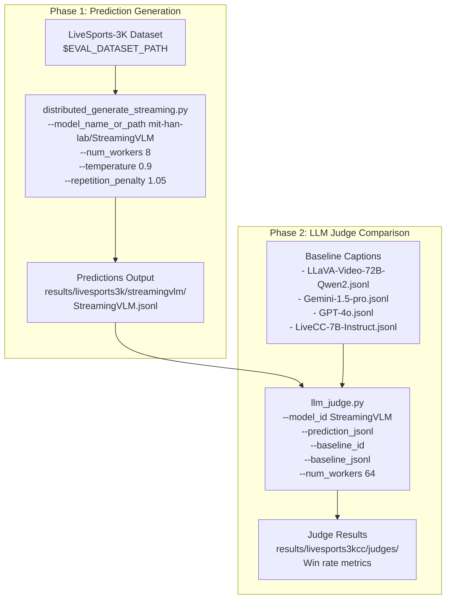
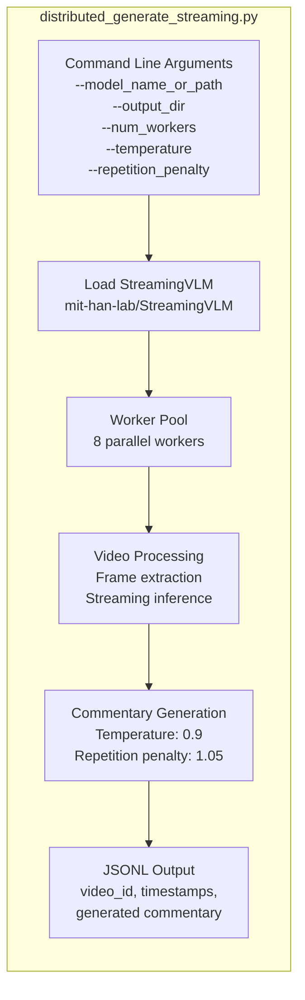
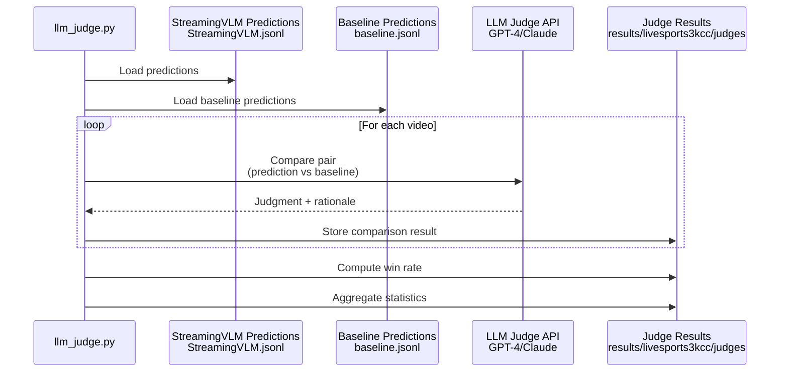
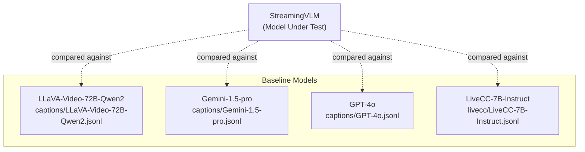
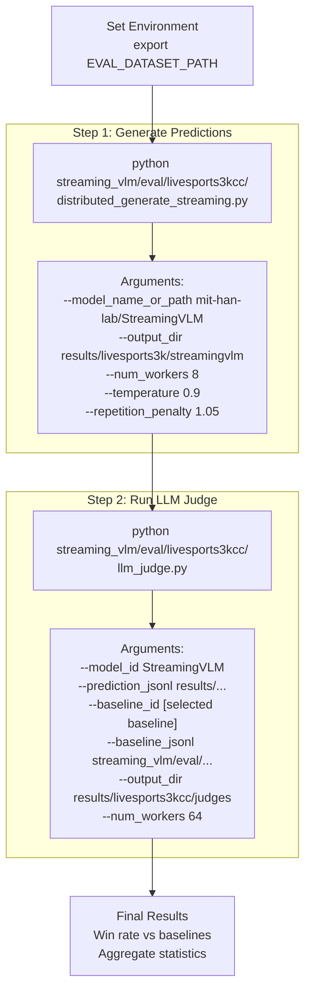

<!-- source: DeepWiki mcp.deepwiki.com · repo mit-han-lab/streaming-vlm · page 6.4 LiveSports3k-cc Evaluation · fetched 2026-10-30 -->

# LiveSports3k-cc Evaluation

<details>
<summary>Relevant source files</summary>

The following files were used as context for generating this wiki page:

- [readme.md](readme.md)
- [scripts/eval_LiveSports3k-cc.sh](scripts/eval_LiveSports3k-cc.sh)

</details>


## Purpose and Scope

This document describes the LiveSports3k-cc evaluation system, which assesses the quality of automatically generated sports commentary on the LiveSports-3K dataset. This evaluation track tests StreamingVLM's ability to generate real-time sports commentary by comparing its outputs against baseline models using an LLM judge. For general evaluation framework architecture, see [Evaluation Framework](#6). For streaming-specific evaluation, see [Inf-Stream-Eval](#6.5).

The LiveSports3k-cc evaluation consists of two phases: (1) generating streaming commentary predictions using the model under test, and (2) using an LLM judge to compare predictions against baseline model outputs.

**Sources:** [readme.md:146-155](), [scripts/eval_LiveSports3k-cc.sh:1-11]()

---

## Evaluation Workflow

The LiveSports3k-cc evaluation follows a two-phase pipeline. First, the system generates streaming commentary for sports videos using distributed inference. Second, an LLM judge performs pairwise comparisons between the generated commentary and baseline model outputs.

### Two-Phase Evaluation Pipeline



**Sources:** [scripts/eval_LiveSports3k-cc.sh:3-10]()

---

## Dataset Setup

The LiveSports3k-cc evaluation requires access to the LiveSports-3K video dataset. The evaluation script expects the dataset path to be configured via environment variable.

### Environment Configuration

| Environment Variable | Purpose | Example Value |
|---------------------|---------|---------------|
| `EVAL_DATASET_PATH` | Path to LiveSports-3K evaluation dataset | `/path/to/your/livesports3k_eval_dataset` |
| `LIVESPORTS3K_PATH` | Alternative path variable for video files | `/path/to/your/LiveSports-3K/videos` |

The dataset contains sports video footage used to test real-time commentary generation. The evaluation system processes these videos to generate streaming commentary predictions.

**Sources:** [scripts/eval_LiveSports3k-cc.sh:1](), [readme.md:150]()

---

## Phase 1: Prediction Generation

The prediction phase uses distributed inference to generate streaming commentary for the LiveSports-3K videos. This phase is implemented in `distributed_generate_streaming.py`.

### Distributed Generation Process



### Generation Parameters

The prediction phase uses specific generation parameters optimized for sports commentary:

| Parameter | Value | Purpose |
|-----------|-------|---------|
| `model_name_or_path` | `mit-han-lab/StreamingVLM` | Model to evaluate |
| `output_dir` | `results/livesports3k/streamingvlm` | Directory for predictions |
| `num_workers` | `8` | Parallel processing workers |
| `temperature` | `0.9` | Generation randomness control |
| `repetition_penalty` | `1.05` | Penalty for repeated phrases |

The temperature of 0.9 provides diverse commentary generation while maintaining coherence, and the repetition penalty of 1.05 prevents the model from repeating the same phrases excessively, which is important for natural sports commentary.

**Sources:** [scripts/eval_LiveSports3k-cc.sh:4]()

---

## Phase 2: LLM Judge Evaluation

The judging phase compares StreamingVLM's generated commentary against baseline models using an LLM judge. The `llm_judge.py` script orchestrates this comparison.

### LLM Judge Comparison Architecture



### Judge Parameters

The LLM judge evaluation requires the following configuration:

| Parameter | Description | Example Value |
|-----------|-------------|---------------|
| `--model_id` | Identifier for model under test | `StreamingVLM` |
| `--prediction_jsonl` | Path to generated predictions | `results/livesports3k/streamingvlm/StreamingVLM.jsonl` |
| `--baseline_id` | Identifier for baseline model | `LLaVA-Video-72B-Qwen2` |
| `--baseline_jsonl` | Path to baseline predictions | `streaming_vlm/eval/livesports3kcc/captions/LLaVA-Video-72B-Qwen2.jsonl` |
| `--output_dir` | Directory for judge results | `results/livesports3kcc/judges` |
| `--num_workers` | Parallel API calls | `64` |

The high number of workers (64) enables parallel LLM judge API calls to accelerate the evaluation process across all video pairs.

**Sources:** [scripts/eval_LiveSports3k-cc.sh:6-10]()

---

## Baseline Model Comparisons

The evaluation framework supports comparison against multiple baseline models, each representing different approaches to video understanding and commentary generation.

### Available Baselines



### Baseline Characteristics

| Baseline Model | Size/Type | Caption Location | Purpose |
|----------------|-----------|------------------|---------|
| `LLaVA-Video-72B-Qwen2` | 72B parameters | `streaming_vlm/eval/livesports3kcc/captions/` | Large-scale video understanding model |
| `Gemini-1.5-pro` | Proprietary API | `streaming_vlm/eval/livesports3kcc/captions/` | Google's multimodal model |
| `GPT-4o` | Proprietary API | `streaming_vlm/eval/livesports3kcc/captions/` | OpenAI's vision-language model |
| `LiveCC-7B-Instruct` | 7B parameters | `streaming_vlm/eval/livesports3kcc/livecc/` | Domain-specific live commentary model |

Each baseline provides pre-generated commentary stored in JSONL format. The LLM judge performs pairwise comparisons between StreamingVLM's outputs and each baseline independently.

**Sources:** [scripts/eval_LiveSports3k-cc.sh:6-10]()

---

## Evaluation Script Execution

The complete evaluation process is orchestrated through the main evaluation script, which sets up the environment and executes both phases sequentially.

### Complete Execution Flow



### Script Invocation

To run the complete LiveSports3k-cc evaluation:

```bash
conda activate streamingvlm-infer
export LIVESPORTS3K_PATH=/path/to/your/LiveSports-3K/videos
./scripts/eval_LiveSports3k-cc.sh
```

The script first generates predictions using distributed streaming inference, then performs LLM judge comparisons against the default baseline (LLaVA-Video-72B-Qwen2). Additional baselines can be evaluated by uncommenting the corresponding judge commands in the script.

**Sources:** [readme.md:148-155](), [scripts/eval_LiveSports3k-cc.sh:1-11]()

---

## Output Format and Results

### Prediction Output Structure

The `distributed_generate_streaming.py` script outputs predictions in JSONL format, where each line represents one video's generated commentary:

```
{
  "video_id": "sports_video_001",
  "predictions": [
    {"timestamp": 0.0, "text": "The game begins..."},
    {"timestamp": 5.0, "text": "Player advances..."},
    ...
  ]
}
```

### Judge Output Structure

The `llm_judge.py` script produces comparison results including win/loss/tie judgments and aggregate statistics:

- Individual comparison results per video pair
- Win rate percentage (e.g., "66.18% vs GPT-4o mini" as mentioned in the README)
- Detailed rationales for each judgment
- Aggregate statistics across all videos

The judge results are saved in the `results/livesports3kcc/judges` directory, organized by baseline model comparison.

**Sources:** [readme.md:11](), [scripts/eval_LiveSports3k-cc.sh:4-10]()

---

## Key Implementation Details

### Distributed Processing

Both phases use parallel processing to accelerate evaluation:
- **Prediction generation**: 8 workers for concurrent video processing
- **LLM judging**: 64 workers for parallel API calls

### Generation Strategy

The generation parameters are specifically tuned for sports commentary:
- **Temperature 0.9**: Balances diversity and coherence in generated commentary
- **Repetition penalty 1.05**: Prevents monotonous or repetitive commentary patterns while maintaining natural flow

### Baseline Diversity

The evaluation includes both:
- **Proprietary models** (GPT-4o, Gemini-1.5-pro): Representing state-of-the-art closed-source systems
- **Open-source models** (LLaVA-Video-72B-Qwen2, LiveCC-7B-Instruct): Representing accessible research baselines

This diverse baseline set ensures comprehensive evaluation across different model architectures and capabilities.

**Sources:** [scripts/eval_LiveSports3k-cc.sh:4-10]()

---

