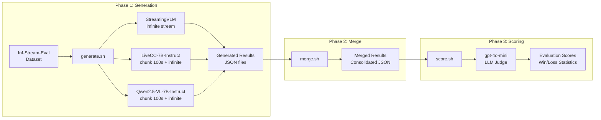
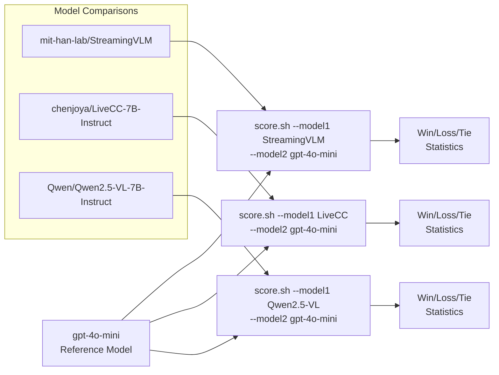
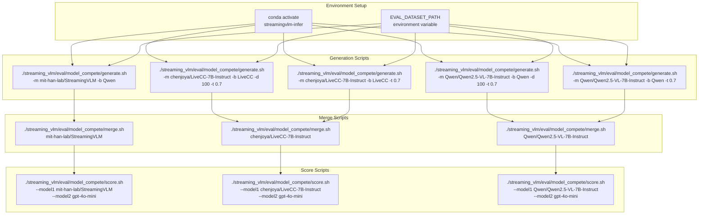
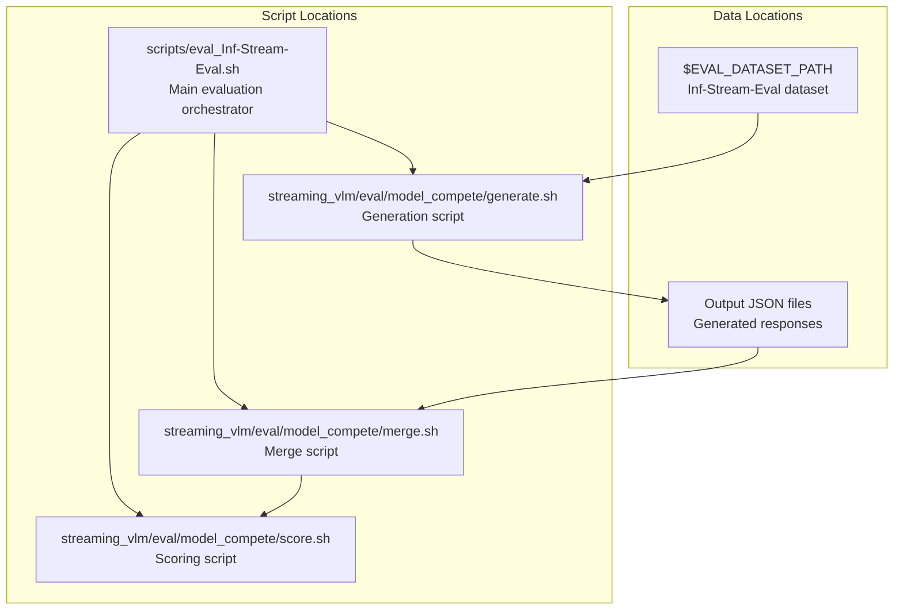

<!-- source: DeepWiki mcp.deepwiki.com · repo mit-han-lab/streaming-vlm · page 6.5 Inf-Stream-Eval · fetched 2026-10-30 -->

# Inf-Stream-Eval

<details>
<summary>Relevant source files</summary>

The following files were used as context for generating this wiki page:

- [readme.md](readme.md)
- [scripts/eval_Inf-Stream-Eval.sh](scripts/eval_Inf-Stream-Eval.sh)

</details>


## Purpose and Scope

Inf-Stream-Eval is a benchmark evaluation framework designed to test model performance on infinite video stream understanding tasks. This evaluation assesses how well vision-language models can process and generate commentary for effectively infinite video streams without predefined endpoints. The benchmark compares model outputs against a reference baseline (gpt-4o-mini) using an LLM-as-judge methodology.

This evaluation is specifically focused on infinite stream capabilities. For general video understanding evaluation, see [OVOBench Evaluation](#6.2). For live sports commentary evaluation, see [LiveSports3k-cc Evaluation](#6.4). For standard VQA benchmarks, see [VQA Benchmarks](#6.3).

**Sources:** [readme.md:137-144](), [scripts/eval_Inf-Stream-Eval.sh:1-20]()

## Evaluation Methodology

Inf-Stream-Eval uses a three-phase evaluation pipeline that generates model responses, merges distributed results, and scores them against a baseline using an LLM judge.

### Workflow Overview



**Sources:** [scripts/eval_Inf-Stream-Eval.sh:1-20]()

### Generation Phase

The generation phase runs inference on the Inf-Stream-Eval dataset using different models and configurations. Each model is tested in both infinite stream mode and optionally chunked mode.

#### Generation Script Parameters

The `generate.sh` script accepts several command-line parameters:

| Parameter | Flag | Description | Example Values |
|-----------|------|-------------|----------------|
| Model Path | `-m` | Hugging Face model identifier | `mit-han-lab/StreamingVLM` |
| Backend | `-b` | Inference backend type | `Qwen`, `LiveCC` |
| Duration | `-d` | Chunk duration in seconds (optional) | `100` |
| Threshold | `-t` | EOS threshold for streaming control | `0.7` |

**Sources:** [scripts/eval_Inf-Stream-Eval.sh:1-9]()

#### Model Configurations

```mermaid
graph TB
    subgraph "StreamingVLM Configuration"
        SVM_MODEL["Model: mit-han-lab/StreamingVLM"]
        SVM_BACKEND["Backend: Qwen"]
        SVM_MODE["Mode: infinite stream only"]
        SVM_THRESH["Threshold: default"]
    end
    
    subgraph "LiveCC Configuration"
        LC_MODEL["Model: chenjoya/LiveCC-7B-Instruct"]
        LC_BACKEND["Backend: LiveCC"]
        LC_MODE1["Mode 1: chunk 100s"]
        LC_MODE2["Mode 2: infinite stream"]
        LC_THRESH["Threshold: 0.7"]
    end
    
    subgraph "Qwen2.5-VL Configuration"
        QW_MODEL["Model: Qwen/Qwen2.5-VL-7B-Instruct"]
        QW_BACKEND["Backend: Qwen"]
        QW_MODE1["Mode 1: chunk 100s"]
        QW_MODE2["Mode 2: infinite stream"]
        QW_THRESH["Threshold: 0.7"]
    end
    
    SVM_MODEL --> SVM_BACKEND
    SVM_BACKEND --> SVM_MODE
    SVM_MODE --> SVM_THRESH
    
    LC_MODEL --> LC_BACKEND
    LC_BACKEND --> LC_MODE1
    LC_BACKEND --> LC_MODE2
    LC_MODE1 --> LC_THRESH
    LC_MODE2 --> LC_THRESH
    
    QW_MODEL --> QW_BACKEND
    QW_BACKEND --> QW_MODE1
    QW_BACKEND --> QW_MODE2
    QW_MODE1 --> QW_THRESH
    QW_MODE2 --> QW_THRESH
```



StreamingVLM is only evaluated in infinite stream mode, while LiveCC and Qwen2.5-VL are tested in both chunked (100-second segments) and infinite stream modes. The threshold parameter (`-t 0.7`) controls EOS token generation during streaming inference.

**Sources:** [scripts/eval_Inf-Stream-Eval.sh:2-9]()

### Merge Phase

After distributed generation, the merge phase consolidates results from multiple workers into unified output files for each model.

```bash
./streaming_vlm/eval/model_compete/merge.sh mit-han-lab/StreamingVLM
./streaming_vlm/eval/model_compete/merge.sh chenjoya/LiveCC-7B-Instruct
./streaming_vlm/eval/model_compete/merge.sh Qwen/Qwen2.5-VL-7B-Instruct
```

The `merge.sh` script takes a single argument: the model identifier used during generation. This script aggregates JSON results from parallel inference workers into a single consolidated file per model.

**Sources:** [scripts/eval_Inf-Stream-Eval.sh:11-14]()

### Scoring Phase

The scoring phase compares each model's outputs against the gpt-4o-mini baseline using an LLM judge to determine which model produces better responses.

#### Scoring Comparisons



Each model is independently compared to gpt-4o-mini, producing win/loss statistics. According to the repository documentation, StreamingVLM achieves a 66.18% win rate against gpt-4o-mini on this benchmark.

**Sources:** [scripts/eval_Inf-Stream-Eval.sh:16-19](), [readme.md:11-11]()

## Dataset Structure

The Inf-Stream-Eval dataset is hosted at `mit-han-lab/Inf-Stream-Eval` on Hugging Face Hub and must be downloaded to a local path specified by the `EVAL_DATASET_PATH` environment variable.

```bash
export EVAL_DATASET_PATH=/path/to/your/Inf-Stream-Eval
```

The dataset contains test videos and annotations designed to evaluate infinite stream understanding. Videos are processed without predefined endpoints to test models' ability to maintain coherent understanding over extended durations.

**Sources:** [readme.md:56-62]()

## Execution Workflow

### Complete Evaluation Pipeline

The following diagram shows the complete code execution flow from dataset setup to final scoring:



**Sources:** [scripts/eval_Inf-Stream-Eval.sh:1-20](), [readme.md:139-142]()

### Running the Evaluation

To execute the complete Inf-Stream-Eval benchmark:

1. **Activate environment:**
   ```bash
   conda activate streamingvlm-infer
   ```

2. **Set dataset path:**
   ```bash
   export EVAL_DATASET_PATH=/path/to/your/Inf-Stream-Eval
   ```

3. **Run evaluation script:**
   ```bash
   ./scripts/eval_Inf-Stream-Eval.sh
   ```

The script orchestrates all three phases (generation, merge, scoring) for all models automatically.

**Sources:** [readme.md:137-142](), [scripts/eval_Inf-Stream-Eval.sh:1-20]()

## Evaluation Modes

### Infinite Stream Mode

In infinite stream mode, models process videos without predefined duration limits. This tests the model's ability to:
- Maintain coherent understanding over extended periods
- Generate commentary without knowing when the video will end
- Avoid degradation in output quality over time

StreamingVLM is specifically designed for this mode and is only evaluated in infinite stream configuration.

**Sources:** [scripts/eval_Inf-Stream-Eval.sh:3](), [readme.md:11-11]()

### Chunked Mode (100 seconds)

Chunked mode processes videos in fixed 100-second segments. This provides a baseline comparison for models that may not be optimized for infinite streams. LiveCC and Qwen2.5-VL are evaluated in both chunked and infinite modes to compare their performance across different processing strategies.

The duration parameter `-d 100` in the generation script enables chunked mode processing.

**Sources:** [scripts/eval_Inf-Stream-Eval.sh:5,8]()

## LLM Judge Methodology

The scoring phase uses gpt-4o-mini as an LLM judge to evaluate response quality. The judge compares pairs of responses (model output vs. baseline output) and determines which is better based on:
- Accuracy of content description
- Coherence and relevance of commentary
- Temporal alignment with video events
- Overall response quality

Results are aggregated into win/loss/tie statistics, with StreamingVLM achieving a 66.18% win rate against the gpt-4o-mini baseline, demonstrating superior performance on long video understanding tasks.

**Sources:** [readme.md:11-11](), [scripts/eval_Inf-Stream-Eval.sh:16-19]()

## File Structure



The evaluation scripts are organized under `streaming_vlm/eval/model_compete/` with the main orchestration script at `scripts/eval_Inf-Stream-Eval.sh`.

**Sources:** [scripts/eval_Inf-Stream-Eval.sh:1-20]()

---

