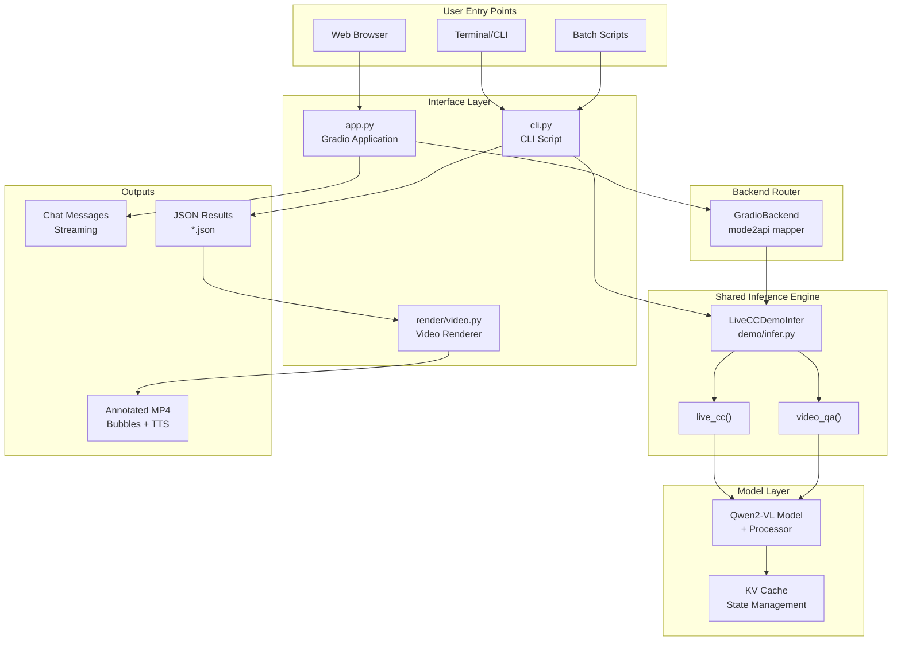
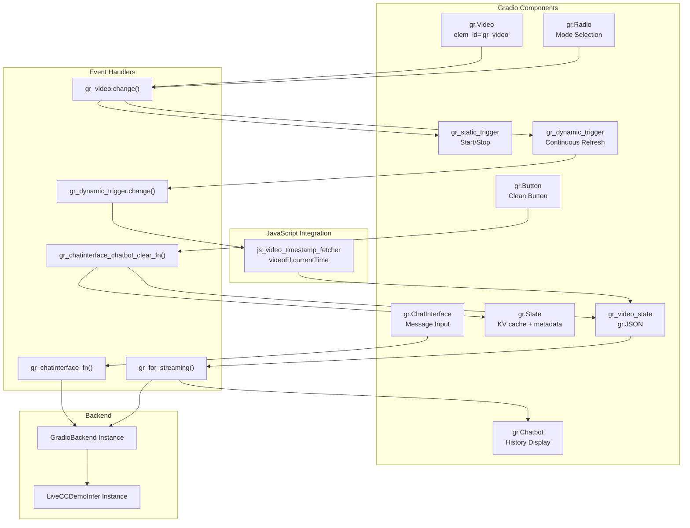
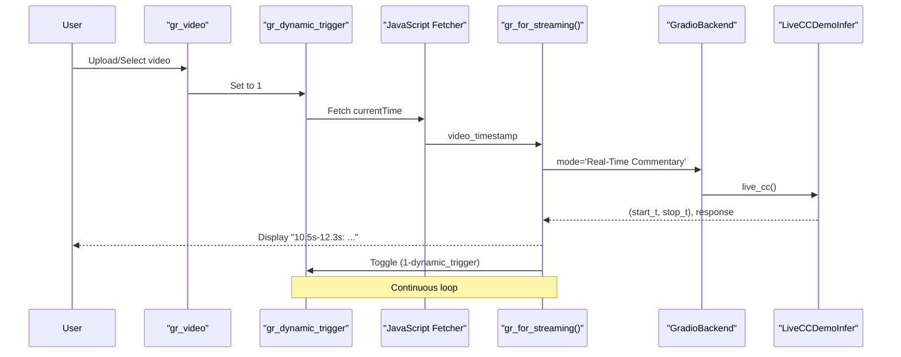
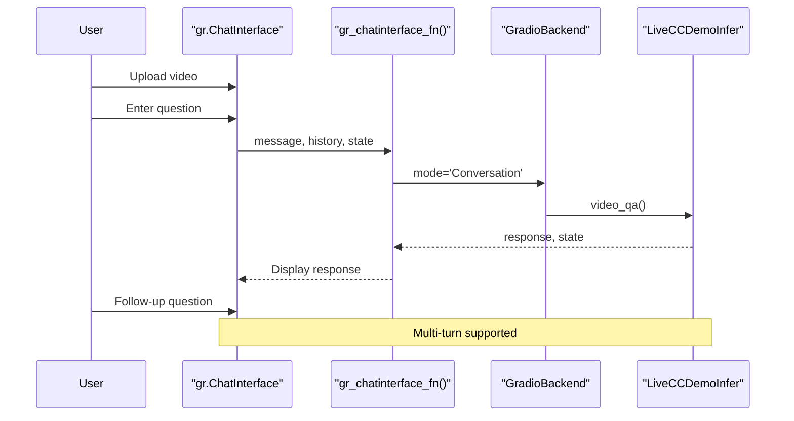
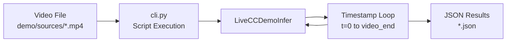
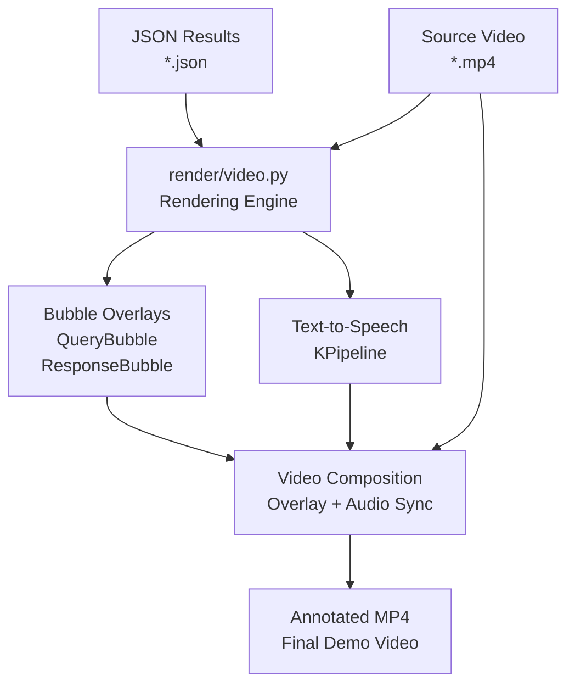

<!-- source: DeepWiki mcp.deepwiki.com · repo mit-han-lab/streaming-vlm · page 7 User Interfaces · fetched 2026-10-30 -->

# User Interfaces

<details>
<summary>Relevant source files</summary>

The following files were used as context for generating this wiki page:

- [baselines/livecc/demo/app.py](baselines/livecc/demo/app.py)
- [baselines/livecc/demo/cli.py](baselines/livecc/demo/cli.py)

</details>


This page documents the user-facing interfaces for interacting with StreamingVLM and LiveCC models. The repository provides three primary interaction methods: a Gradio web application for interactive demonstrations, a command-line interface for batch processing and evaluation, and a video rendering system for generating annotated demonstration videos with overlays and text-to-speech.

For information about the underlying inference engines that these interfaces utilize, see [Inference Systems](#5). For evaluation-specific usage patterns, see [Evaluation Framework](#6).

---

## Overview

The user interfaces are organized into three distinct systems:

| Interface Type | Primary Use Case | Entry Point | Output Format |
|---------------|------------------|-------------|---------------|
| Gradio Web Demo | Interactive demonstration, real-time streaming | `baselines/livecc/demo/app.py` | Web UI with chat interface |
| Command Line Interface | Batch processing, evaluation, scripting | `baselines/livecc/demo/cli.py` | JSON files |
| Video Rendering System | Creating demonstration videos | `baselines/livecc/render/video.py` | Annotated MP4 with TTS |

All three interfaces share the same backend inference engine (`LiveCCDemoInfer`) but expose different interaction patterns optimized for their respective use cases.

**Sources:** [baselines/livecc/demo/app.py](), [baselines/livecc/demo/cli.py](), [readme.md:14-18]()

---

## Interface Architecture



**Architecture Overview**

The interface layer is decoupled from the inference engine, allowing multiple entry points to share the same model backend. The `GradioBackend` class [baselines/livecc/demo/app.py:25-36]() acts as a router, mapping user-selected modes ("Real-Time Commentary" or "Conversation") to the appropriate API methods (`live_cc` or `video_qa`) on the `LiveCCDemoInfer` instance.

**Sources:** [baselines/livecc/demo/app.py:1-179](), [baselines/livecc/demo/cli.py:1-28]()

---

## Gradio Web Demo

The Gradio web application provides an interactive browser-based interface for demonstrating both real-time commentary and conversational video question-answering capabilities.

### Application Structure



**Component Organization**

The Gradio demo uses a complex state management system with multiple interconnected components:

- **Video Component** (`gr_video`): Displays the uploaded video with `autoplay=True` [baselines/livecc/demo/app.py:54-62]()
- **Mode Radio** (`gr_radio_mode`): Toggles between "Real-Time Commentary" and "Conversation" modes [baselines/livecc/demo/app.py:75]()
- **State Objects**: 
  - `gr_state`: Holds KV cache and all inference metadata [baselines/livecc/demo/app.py:47]()
  - `gr_video_state`: Lightweight JSON object tracking video path and timestamp [baselines/livecc/demo/app.py:48]()
- **Trigger Mechanisms**:
  - `gr_static_trigger`: Controls whether streaming should start or stop [baselines/livecc/demo/app.py:49]()
  - `gr_dynamic_trigger`: Enables continuous refresh cycles for streaming mode [baselines/livecc/demo/app.py:50]()

**Sources:** [baselines/livecc/demo/app.py:40-106]()

### Interaction Modes

The application supports two distinct interaction patterns:

#### Real-Time Commentary Mode



In Real-Time Commentary mode:
1. Video upload triggers `gr_video.change()` which sets both triggers to 1 [baselines/livecc/demo/app.py:161-165]()
2. JavaScript fetches current video timestamp via `js_video_timestamp_fetcher` [baselines/livecc/demo/app.py:148-153]()
3. The `gr_for_streaming()` function continuously calls `live_cc()` [baselines/livecc/demo/app.py:108-146]()
4. Responses are formatted with timestamps: `f'{start_timestamp:.1f}s-{stop_timestamp:.1f}s: {response}'` [baselines/livecc/demo/app.py:136]()
5. The dynamic trigger toggles to create a refresh loop when `js_monitor=True` [baselines/livecc/demo/app.py:143-146]()

**Sources:** [baselines/livecc/demo/app.py:108-176]()

#### Conversation Mode



In Conversation mode:
1. User uploads video and enters a question
2. `gr_chatinterface_fn()` handles the interaction [baselines/livecc/demo/app.py:78-89]()
3. The function calls `GradioBackend` with `mode='Conversation'` which maps to `video_qa()` [baselines/livecc/demo/app.py:28-31]()
4. Supports multi-turn conversations by maintaining `history` and `state`
5. Video upload does not trigger automatic streaming (triggers set to 0) [baselines/livecc/demo/app.py:160]()

**Sources:** [baselines/livecc/demo/app.py:78-89](), [baselines/livecc/demo/app.py:94-105]()

### State Management and Lifecycle

The demo implements sophisticated state management to handle both modes:

| State Variable | Type | Purpose | Reset Condition |
|----------------|------|---------|-----------------|
| `gr_state` | `gr.State` | KV cache, video metadata, inference context | Clean button or chatbot clear |
| `gr_video_state` | `gr.JSON` | Video path and current timestamp | Clean button or chatbot clear |
| `gr_static_trigger` | `gr.Number` | Start/stop streaming | Video change or clean |
| `gr_dynamic_trigger` | `gr.Number` | Continuous refresh toggle | Each streaming iteration |

The clean operation resets all state and clears cached video readers [baselines/livecc/demo/app.py:91-93]():

```python
def gr_chatinterface_chatbot_clear_fn(gr_dynamic_trigger):
    gradio_backend.infer._cached_video_readers_with_hw = {}
    return {}, {}, 0, gr_dynamic_trigger
```

**Sources:** [baselines/livecc/demo/app.py:47-50](), [baselines/livecc/demo/app.py:91-105]()

### JavaScript Integration

For environments with low latency, the demo uses JavaScript to fetch real-time video timestamps [baselines/livecc/demo/app.py:5-11]():

```javascript
js_video_timestamp_fetcher = """
    (state, video_state) => {
        const videoEl = document.querySelector("#gr_video video");
        return { video_path: videoEl.currentSrc, video_timestamp: videoEl.currentTime };
    }
"""
```

This JavaScript function:
- Queries the DOM for the video element using `elem_id="gr_video"`
- Extracts `currentSrc` and `currentTime`
- Returns the data to populate `gr_video_state`
- Can be disabled with `--js_monitor=False` for high-latency environments [baselines/livecc/demo/app.py:117-118]()

**Sources:** [baselines/livecc/demo/app.py:148-172]()

### Hugging Face Spaces Integration

The application supports deployment on Hugging Face Spaces with special handling [baselines/livecc/demo/app.py:1-18]():

- `--hf_spaces` flag enables Spaces-specific mode
- Imports `spaces` decorator for GPU allocation
- Delayed model initialization under `@spaces.GPU` decorator
- Backend initialized on first request instead of at startup [baselines/livecc/demo/app.py:38](), [baselines/livecc/demo/app.py:83-86]()

```python
gradio_backend = None if hf_spaces else GradioBackend()
```

When running on Spaces, the first inference request triggers model loading with a waiting message displayed to the user.

**Sources:** [baselines/livecc/demo/app.py:1-18](), [baselines/livecc/demo/app.py:32-38](), [baselines/livecc/demo/app.py:83-86]()

---

## Command Line Interface

The CLI provides a programmatic interface for batch processing and evaluation workflows.

### Basic Usage Pattern



The CLI script [baselines/livecc/demo/cli.py]() follows a straightforward pattern:

1. **Initialize Inference Engine** [baselines/livecc/demo/cli.py:5-9]():
   ```python
   model_path = 'chenjoya/LiveCC-7B-Instruct'
   video_path = "demo/sources/howto_fix_laptop_mute_1080p.mp4"
   query = """Please describe the video."""
   infer = LiveCCDemoInfer(model_path=model_path)
   ```

2. **Process Video in Timestamp Loop** [baselines/livecc/demo/cli.py:10-24]():
   ```python
   state = {'video_path': video_path}
   commentaries = []
   for t in range(31):
       state['video_timestamp'] = t
       for (start_t, stop_t), response, state in infer.live_cc(...):
           print(f'{start_t}s-{stop_t}s: {response}')
           commentaries.append([start_t, stop_t, response])
       if state.get('video_end', False):
           break
   ```

3. **Save Results** [baselines/livecc/demo/cli.py:25-28]():
   ```python
   result = {'video_path': video_path, 'query': query, 'commentaries': commentaries}
   result_path = video_path.replace('/assets/', '/results/').replace('.mp4', '.json')
   json.dump(result, open(result_path, 'w'))
   ```

**Sources:** [baselines/livecc/demo/cli.py:1-28]()

### Configuration Parameters

The CLI exposes key inference parameters directly in the `live_cc()` call [baselines/livecc/demo/cli.py:15-19]():

| Parameter | Value | Purpose |
|-----------|-------|---------|
| `max_pixels` | `384 * 28 * 28` | Maximum spatial resolution (19,267,584 pixels) |
| `repetition_penalty` | `1.05` | Reduces repetitive outputs |
| `streaming_eos_base_threshold` | `0.0` | Base threshold for EOS token |
| `streaming_eos_threshold_step` | `0` | Step size for threshold adjustment |

These parameters control the quality-performance tradeoff and are commonly tuned for different evaluation benchmarks.

**Sources:** [baselines/livecc/demo/cli.py:15-19]()

### Output Schema

The JSON output follows a standardized schema:

```json
{
  "video_path": "demo/sources/howto_fix_laptop_mute_1080p.mp4",
  "query": "Please describe the video.",
  "commentaries": [
    [0.0, 2.5, "The video begins with..."],
    [2.5, 5.1, "Next, the presenter demonstrates..."],
    [5.1, 7.8, "The key step involves..."]
  ]
}
```

Each commentary entry is a 3-tuple: `[start_timestamp, stop_timestamp, response_text]`.

**Sources:** [baselines/livecc/demo/cli.py:25-26]()

### Integration with Evaluation Scripts

The CLI output format is designed for compatibility with evaluation pipelines. The path transformation [baselines/livecc/demo/cli.py:26]():

```python
result_path = video_path.replace('/assets/', '/results/').replace('.mp4', '.json')
```

This convention places results in a parallel directory structure, facilitating batch evaluation workflows where scripts process all videos in `/assets/` and collect results from `/results/`.

**Sources:** [baselines/livecc/demo/cli.py:26-28]()

---

## Video Rendering System

The video rendering system generates demonstration videos with visual overlays and synchronized text-to-speech audio. While the specific implementation code is not provided in the available files, the system architecture is documented in the high-level diagrams.

### Rendering Pipeline



### Component Roles

Based on the architectural diagrams, the rendering system consists of:

1. **QueryBubble**: Visual overlay for user queries/prompts
2. **ResponseBubble**: Visual overlay for model responses with timestamps
3. **KPipeline**: Text-to-speech engine for audio narration
4. **Video Composition**: Combines source video, bubble overlays, and TTS audio into final MP4

The rendering system consumes the JSON output format from the CLI, enabling automated generation of demonstration videos from batch inference results.

**Sources:** Diagram 4 (Demo and Deployment Architecture), Diagram 1 (Overall System Architecture)

---

## Usage Examples

### Launching Gradio Demo

```bash
conda activate streamingvlm-infer
cd baselines/livecc
python demo/app.py
```

Optional flags:
- `--hf_spaces`: Enable Hugging Face Spaces mode
- `--js_monitor`: Enable/disable JavaScript timestamp monitoring (default: True)

The demo will launch with `share=True` [baselines/livecc/demo/app.py:179](), providing a public URL for sharing.

**Sources:** [baselines/livecc/demo/app.py:1-11](), [baselines/livecc/demo/app.py:178-179](), [readme.md:14-16]()

### Running CLI Inference

```bash
conda activate streamingvlm-infer
cd baselines/livecc
python demo/cli.py
```

The default configuration processes a sample video at 1 FPS for up to 31 seconds. Modify the script variables to process different videos or adjust parameters.

**Sources:** [baselines/livecc/demo/cli.py:4-9](), [readme.md:30-41]()

### FPS Configuration

Both interfaces respect the global FPS setting configured via environment variable or source modification [readme.md:157-166]():

```bash
export QWENVL_FPS=4.0
# or
sed -i 's/^FPS = .*/FPS = float(os.environ.get("QWENVL_FPS", "2.0"))/' \
  "$(python -c 'import inspect,qwen_vl_utils.vision_process as m; import os; print(os.path.abspath(inspect.getsourcefile(m)))')"
```

This affects frame extraction rates for both real-time commentary and batch processing.

**Sources:** [readme.md:157-166]()

---

## Examples and Demonstrations

The repository includes three demo videos [baselines/livecc/demo/app.py:64-68]():

| Video | Category | Description |
|-------|----------|-------------|
| `howto_fix_laptop_mute_1080p.mp4` | Tutorial | Instructional content |
| `warriors_vs_rockets_2025wcr1_mute_1080p.mp4` | Sports | Live sports commentary |
| `cvpr25_vlog.mp4` | Vlog | Conference vlog |

Example queries are also provided [baselines/livecc/demo/app.py:100-103]():
- "Please commentate on Game 1 of 2025 Playoffs First Round."
- "My VLog~"

These examples demonstrate the model's capability across different video genres and query styles.

**Sources:** [baselines/livecc/demo/app.py:63-70](), [baselines/livecc/demo/app.py:100-103](), [readme.md:14-18]()

---

