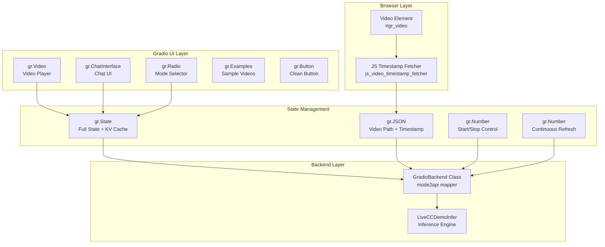
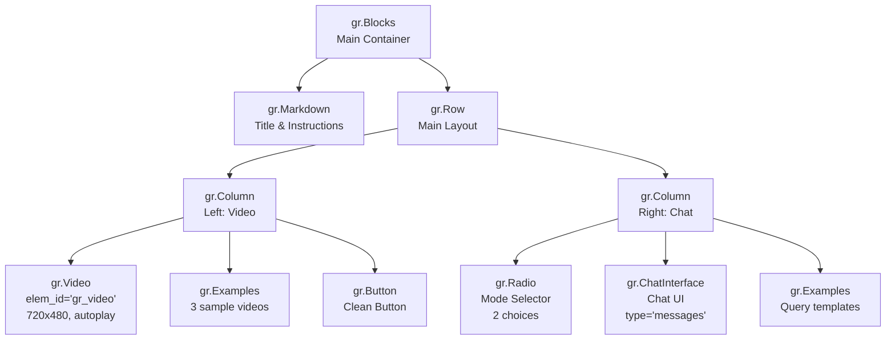
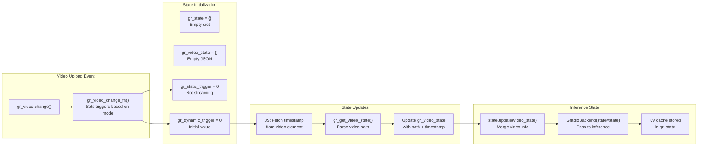
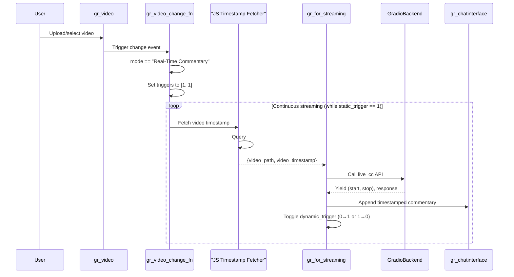
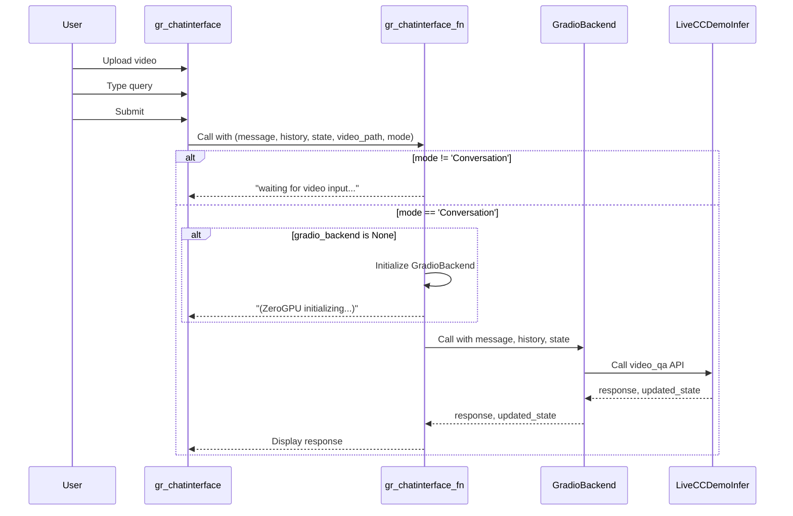
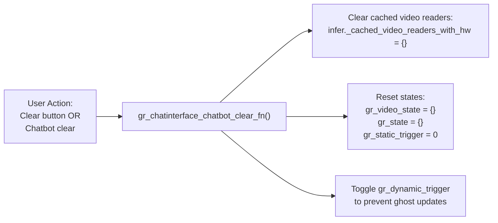

<!-- source: DeepWiki mcp.deepwiki.com · repo mit-han-lab/streaming-vlm · page 7.1 Gradio Web Demo · fetched 2026-10-30 -->

# Gradio Web Demo

<details>
<summary>Relevant source files</summary>

The following files were used as context for generating this wiki page:

- [baselines/livecc/demo/app.py](baselines/livecc/demo/app.py)

</details>


## Purpose and Scope

This document describes the Gradio-based web interface for StreamingVLM, implemented in `baselines/livecc/demo/app.py`. The web demo provides an interactive browser-based interface with two operational modes: **Real-Time Commentary** for streaming video commentary generation and **Conversation** for traditional video question-answering. The interface handles video playback synchronization, state management across user interactions, and JavaScript-based timestamp monitoring.

For the underlying inference engine that the web demo wraps, see [Inference Engine Architecture](#5.1). For the command-line alternative to this web interface, see [Command Line Interface](#7.2).

---

## Architecture Overview

The Gradio web demo consists of three primary layers: the **GradioBackend** wrapper, the **Gradio UI components**, and the **JavaScript integration** for video timestamp tracking.

### System Component Architecture



**Sources:** [baselines/livecc/demo/app.py:1-179]()

---

## GradioBackend Class

The `GradioBackend` class serves as an adapter between the Gradio UI framework and the underlying `LiveCCDemoInfer` inference engine. It provides a unified interface for both operational modes.

### Class Structure

| Component | Type | Purpose |
|-----------|------|---------|
| `infer` | LiveCCDemoInfer | Inference engine instance |
| `mode2api` | dict | Maps mode names to API method names |
| `waiting_video_response` | str | Default message when awaiting video |
| `not_found_video_response` | str | Error message for missing video |

The `mode2api` dictionary maps user-facing mode names to inference engine methods:
- `"Real-Time Commentary"` → `"live_cc"`
- `"Conversation"` → `"video_qa"`

### Initialization and Invocation

[baselines/livecc/demo/app.py:25-36]()

The `__init__` method instantiates `LiveCCDemoInfer` with the specified model path (defaults to `'chenjoya/LiveCC-7B-Instruct'`). The `__call__` method dynamically dispatches to the appropriate inference API based on the selected mode using `getattr(self.infer, self.mode2api[mode])`.

### Hugging Face Spaces Integration

[baselines/livecc/demo/app.py:38]()

The global `gradio_backend` is initialized conditionally: it's set to `None` when running on Hugging Face Spaces (`hf_spaces=True`) to enable lazy initialization under the `@spaces.GPU` decorator, which is required for ZeroGPU allocation on the platform.

**Sources:** [baselines/livecc/demo/app.py:25-38]()

---

## UI Component Structure

The Gradio interface is organized into a two-column layout with video display on the left and chat interface on the right.

### Component Hierarchy



### Video Component Configuration

[baselines/livecc/demo/app.py:54-62]()

The `gr.Video` component is configured with:
- `elem_id="gr_video"`: Used for JavaScript DOM selection
- `sources=['upload']`: Accepts user-uploaded videos
- `autoplay=True`: Automatically starts playback
- Fixed dimensions: 720x480 pixels

### Example Videos

[baselines/livecc/demo/app.py:63-70]()

Three example videos are provided:
1. `howto_fix_laptop_mute_1080p.mp4` - Tutorial video
2. `warriors_vs_rockets_2025wcr1_mute_1080p.mp4` - Sports footage
3. `cvpr25_vlog.mp4` - Conference vlog

**Sources:** [baselines/livecc/demo/app.py:40-106]()

---

## State Management System

The web demo uses four Gradio state components to manage application state, video information, and UI triggers.

### State Component Table

| Component | Type | Visibility | Purpose |
|-----------|------|-----------|---------|
| `gr_state` | gr.State | Hidden | Stores all useful state including KV cache |
| `gr_video_state` | gr.JSON | Hidden | Lightweight video path and timestamp only |
| `gr_static_trigger` | gr.Number | Hidden | Controls start/stop of streaming (0 or 1) |
| `gr_dynamic_trigger` | gr.Number | Hidden | Toggles between 0 and 1 for continuous refresh |

### State Flow Diagram



### State Lifecycle

[baselines/livecc/demo/app.py:47-50]()

The four state components are initialized at the top level of the Gradio Blocks context. The `gr_state` dictionary serves as the primary state container, holding the KV cache for streaming inference. The `gr_video_state` is a lightweight JSON object containing only video path and timestamp, extracted from `gr_state` to enable efficient JavaScript interaction.

### Trigger Mechanism

The `gr_static_trigger` determines whether streaming should be active (1) or inactive (0). The `gr_dynamic_trigger` toggles between 0 and 1 on each streaming iteration when JavaScript monitoring is enabled, triggering the `.change()` event handler to fetch updated video timestamps.

**Sources:** [baselines/livecc/demo/app.py:47-50, 159-176]()

---

## Operational Modes

The web demo supports two distinct operational modes, each with different workflows and UI behaviors.

### Mode Selection and Routing

[baselines/livecc/demo/app.py:28-31, 75]()

The `gr.Radio` component allows users to select between "Real-Time Commentary" and "Conversation" modes. The selected mode value is passed to `GradioBackend.__call__`, which uses the `mode2api` dictionary to route to the appropriate inference method.

### Real-Time Commentary Mode Workflow



[baselines/livecc/demo/app.py:108-146, 159-165]()

In Real-Time Commentary mode:
1. Video upload sets both triggers to 1
2. The `gr_dynamic_trigger.change()` event fires repeatedly
3. JavaScript fetches the current video timestamp
4. `gr_for_streaming` generates commentary for the current video segment
5. Responses are formatted with timestamps: `"{start:.1f}s-{stop:.1f}s: {response}"`
6. The dynamic trigger toggles to trigger the next iteration

### Conversation Mode Workflow



[baselines/livecc/demo/app.py:78-89]()

In Conversation mode:
1. User uploads video first
2. User types a query in the chat interface
3. The `gr_chatinterface_fn` handles the query
4. If not in Conversation mode, returns "waiting for video input..."
5. Otherwise, calls `GradioBackend` with `mode='Conversation'`
6. Returns a single response without timestamps

**Sources:** [baselines/livecc/demo/app.py:78-89, 108-165]()

---

## JavaScript Integration

The web demo uses JavaScript to fetch real-time video playback information from the browser's video element, enabling precise timestamp synchronization.

### JavaScript Timestamp Fetcher

[baselines/livecc/demo/app.py:148-153]()

```javascript
(state, video_state) => {
    const videoEl = document.querySelector("#gr_video video");
    return { 
        video_path: videoEl.currentSrc, 
        video_timestamp: videoEl.currentTime 
    };
}
```

This JavaScript function:
- Selects the video element using `querySelector("#gr_video video")`
- Extracts `currentSrc` (video file path) and `currentTime` (playback position in seconds)
- Returns a dictionary with `video_path` and `video_timestamp`

### JavaScript Monitoring Toggle

[baselines/livecc/demo/app.py:5-11, 117-118]()

The `--js_monitor` command-line flag (default `True`) controls whether JavaScript-based timestamp monitoring is enabled. When disabled (`js_monitor=False`), the system sets `video_state['video_timestamp']` to a sentinel value `19260817` instead of fetching real timestamps. This is useful for environments with high latency where frequent JavaScript calls would degrade performance.

### Video State Processing

[baselines/livecc/demo/app.py:155-158]()

The `gr_get_video_state` function processes the video path returned by JavaScript. If the path contains `'file='`, it extracts the actual file path by splitting on `'file='` and taking the second part. This handles the URL encoding used by Gradio's file serving.

### Event Chain with JavaScript

[baselines/livecc/demo/app.py:167-176]()

The JavaScript integration is wired into the event chain:
1. `gr_dynamic_trigger.change()` fires
2. Calls `gr_get_video_state` with `js=js_video_timestamp_fetcher`
3. The JavaScript runs in the browser, fetching timestamp
4. Result passes to `gr_get_video_state` in Python
5. Chains to `gr_for_streaming` to generate commentary

**Sources:** [baselines/livecc/demo/app.py:5-11, 117-118, 148-176]()

---

## Event Handling System

The web demo uses Gradio's event system to orchestrate interactions between UI components and backend functions.

### Event Handler Functions

| Function | Trigger | Purpose |
|----------|---------|---------|
| `gr_chatinterface_fn` | ChatInterface submit | Handles Conversation mode queries |
| `gr_chatinterface_chatbot_clear_fn` | Clear button / chatbot clear | Resets state and clears cached video readers |
| `gr_for_streaming` | Dynamic trigger change | Generates streaming commentary |
| `gr_get_video_state` | Dynamic trigger change (with JS) | Parses video state from JavaScript |
| `gr_video_change_fn` | Video upload/change | Sets triggers based on mode |

### Clear Event Flow



[baselines/livecc/demo/app.py:91-93, 104-105]()

The clear function:
1. Clears the cached video readers in the inference engine
2. Resets `gr_video_state` and `gr_state` to empty dictionaries
3. Sets `gr_static_trigger` to 0 to stop streaming
4. Returns the current `gr_dynamic_trigger` value (unchanged) to prevent spurious events

### Video Change Event

[baselines/livecc/demo/app.py:159-165]()

When a video is uploaded or changed:
1. `gr_video.change()` event fires
2. Calls `gr_video_change_fn` with the current mode
3. Returns `[1, 1]` for Real-Time Commentary (enables streaming)
4. Returns `[0, 0]` for Conversation mode (disables streaming)
5. Updates both `gr_static_trigger` and `gr_dynamic_trigger`

### Streaming Event Chain

[baselines/livecc/demo/app.py:167-176]()

The streaming event chain creates a loop:
```
gr_dynamic_trigger.change 
  → gr_get_video_state (with JavaScript) 
    → gr_for_streaming 
      → Toggle gr_dynamic_trigger 
        → (triggers change event again)
```

This creates a continuous loop while `gr_static_trigger == 1`. The loop terminates when the static trigger is set to 0 (via clear or mode change).

### Message History Management

[baselines/livecc/demo/app.py:120-132]()

The `gr_for_streaming` function processes the message history to find pending user queries:
1. Iterates through history in reverse order
2. Finds the first user message with `status != 'done'`
3. Marks it as `'pending'` and extracts the query
4. Marks all subsequent user messages as `'done'`
5. Finds the assistant's waiting message to update

**Sources:** [baselines/livecc/demo/app.py:91-93, 104-105, 120-176]()

---

## Deployment Configuration

The web demo includes configuration for both local deployment and Hugging Face Spaces hosting.

### Command-Line Arguments

[baselines/livecc/demo/app.py:3-11]()

| Argument | Default | Purpose |
|----------|---------|---------|
| `--hf_spaces` | False | Enable Hugging Face Spaces-specific behavior |
| `--js_monitor` | True | Enable JavaScript-based video timestamp monitoring |

### Queue Configuration

[baselines/livecc/demo/app.py:178-179]()

The demo is launched with:
- `demo.queue(max_size=5, default_concurrency_limit=5)`: Limits concurrent users to 5
- `demo.launch(share=True)`: Creates a public shareable link

### Hugging Face Spaces Adaptations

When `hf_spaces=True`:
1. The `spaces` module is imported for GPU allocation
2. `gradio_backend` is initialized as `None`
3. Backend initialization is deferred to the first user interaction
4. Initialization happens under the `@spaces.GPU` decorator context (commented in code at lines 77 and 107)
5. Users see "(ZeroGPU needs to initialize model...)" during initialization

**Sources:** [baselines/livecc/demo/app.py:3-18, 38, 83-86, 113-115, 178-179]()

---

