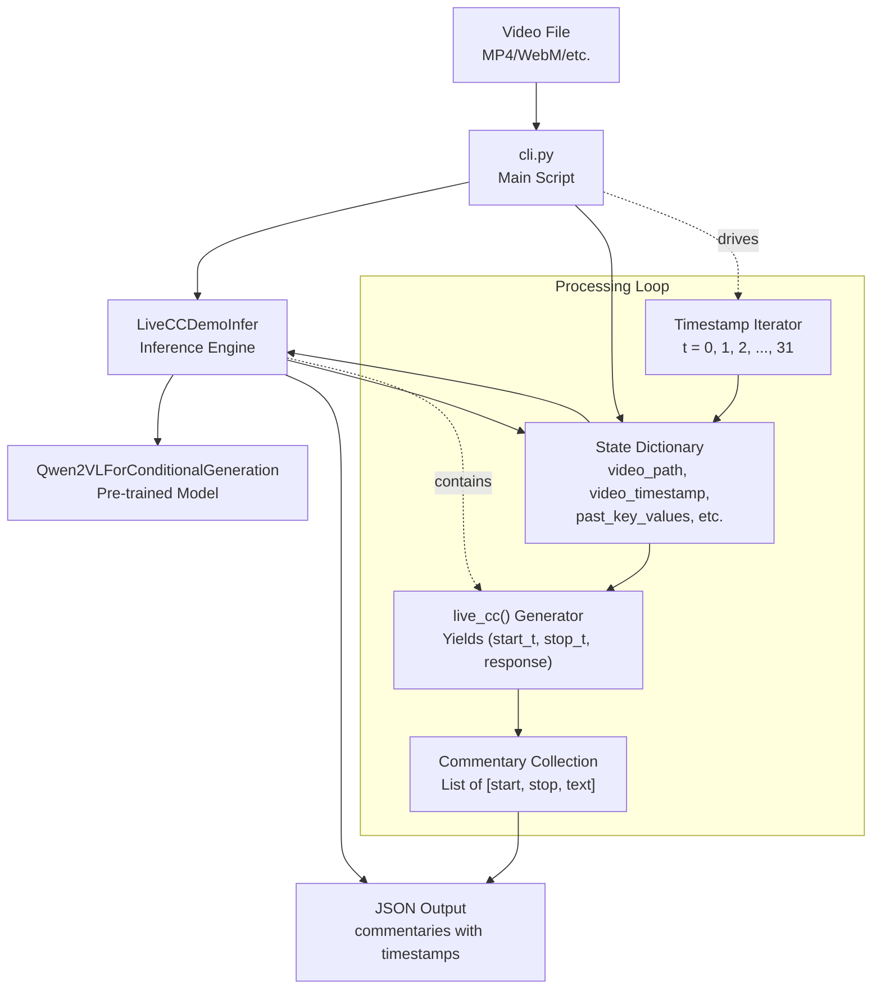
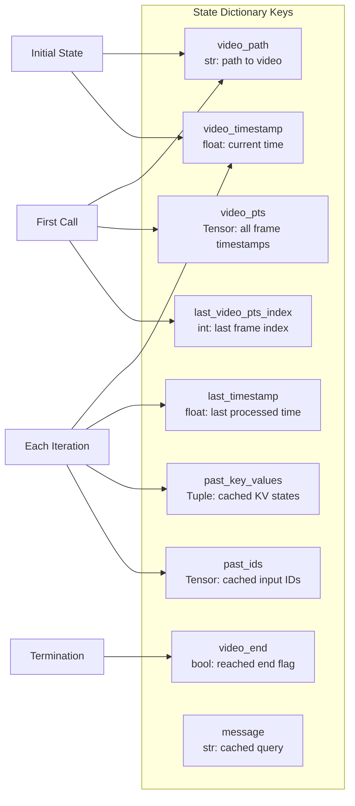
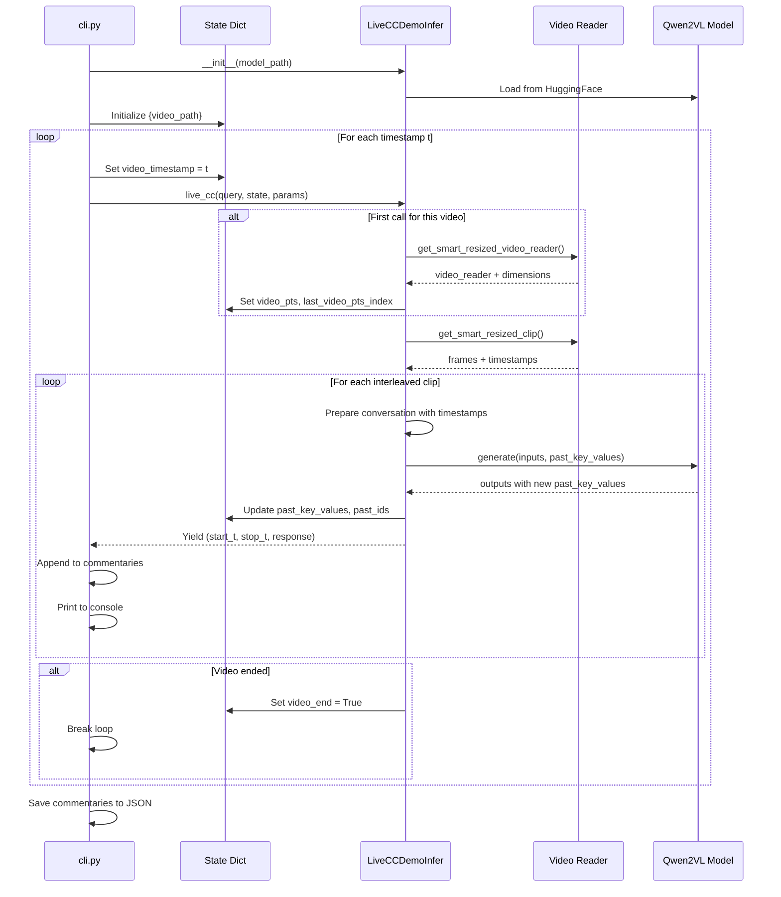

<!-- source: DeepWiki mcp.deepwiki.com · repo mit-han-lab/streaming-vlm · page 7.2 Command Line Interface · fetched 2026-10-30 -->

# Command Line Interface

<details>
<summary>Relevant source files</summary>

The following files were used as context for generating this wiki page:

- [baselines/livecc/demo/cli.py](baselines/livecc/demo/cli.py)

</details>


## Purpose and Scope

The Command Line Interface provides a programmatic way to run video commentary generation in batch mode for evaluation and testing purposes. Unlike the interactive Gradio web demo (see [Gradio Web Demo](#7.1)), the CLI is designed for automated processing of videos without user interaction during inference.

The CLI implementation is found in [baselines/livecc/demo/cli.py]() and serves as a reference implementation for integrating the `LiveCCDemoInfer` inference engine into custom workflows. For details about the underlying inference engine, see [Inference Engine Architecture](#5.1).

**Sources:** [baselines/livecc/demo/cli.py:1-28]()

## CLI Architecture



**Sources:** [baselines/livecc/demo/cli.py:1-28](), [baselines/livecc/demo/infer.py:25-319]()

## Basic Usage Pattern

The CLI script demonstrates a simple usage pattern for processing videos:

### Initialization

```python
# Set paths and parameters
model_path = 'chenjoya/LiveCC-7B-Instruct'
video_path = "demo/sources/howto_fix_laptop_mute_1080p.mp4"
query = "Please describe the video."

# Create inference engine
infer = LiveCCDemoInfer(model_path=model_path)
```

The `LiveCCDemoInfer` class loads the model and processor, supporting automatic device selection (CUDA, MPS, or CPU).

**Sources:** [baselines/livecc/demo/cli.py:5-9]()

### Processing Loop

```python
state = {'video_path': video_path}
commentaries = []
for t in range(31):
    state['video_timestamp'] = t
    for (start_t, stop_t), response, state in infer.live_cc(
        message=query, state=state, 
        max_pixels=384 * 28 * 28, 
        repetition_penalty=1.05, 
        streaming_eos_base_threshold=0.0, 
        streaming_eos_threshold_step=0
    ):
        print(f'{start_t}s-{stop_t}s: {response}')
        commentaries.append([start_t, stop_t, response])
    if state.get('video_end', False):
        break
```

The loop iterates through video timestamps, calling `live_cc()` at each second. The method yields commentary segments as they are generated.

**Sources:** [baselines/livecc/demo/cli.py:10-24]()

### Output Generation

```python
result = {'video_path': video_path, 'query': query, 'commentaries': commentaries}
result_path = video_path.replace('/assets/', '/results/').replace('.mp4', '.json')
json.dump(result, open(result_path, 'w'))
```

Results are saved as JSON files with the same name as the input video but in a different directory.

**Sources:** [baselines/livecc/demo/cli.py:25-28]()

## Configuration Parameters

### Model Configuration

| Parameter | Type | Default | Description |
|-----------|------|---------|-------------|
| `model_path` | str | `'chenjoya/LiveCC-7B-Instruct'` | Hugging Face model identifier or local path |
| `device` | str | Auto-detected | Device for inference: `'cuda'`, `'mps'`, or `'cpu'` |

**Sources:** [baselines/livecc/demo/cli.py:5](), [baselines/livecc/demo/infer.py:35-54]()

### Inference Parameters

| Parameter | Type | Default | Description |
|-----------|------|---------|-------------|
| `max_pixels` | int | `384 * 28 * 28` | Maximum pixel count for video resizing (10,838,016 pixels) |
| `repetition_penalty` | float | `1.05` | Penalty applied to repeated tokens during generation |
| `streaming_eos_base_threshold` | float | `0.0` | Base threshold for streaming EOS token control |
| `streaming_eos_threshold_step` | float | `0` | Increment to threshold at each generation step |
| `do_sample` | bool | `True` | Whether to use sampling (vs greedy decoding) |
| `max_new_tokens` | int | `16` | Maximum tokens to generate per segment |

**Sources:** [baselines/livecc/demo/cli.py:15-18](), [baselines/livecc/demo/infer.py:69-81]()

### Timestamp Configuration

The CLI processes video at discrete timestamps. The processing frequency is controlled by:

| Constant | Value | Description |
|----------|-------|-------------|
| `fps` | 2 | Processing frame rate (frames per second) |
| `initial_fps_frames` | 6 | Number of frames in initial clip (3 seconds at 2 fps) |
| `streaming_fps_frames` | 2 | Number of frames per subsequent clip (1 second at 2 fps) |

**Sources:** [baselines/livecc/demo/infer.py:28-33]()

## State Management



The state dictionary maintains processing context across multiple calls to `live_cc()`:

### Initialization State
- `video_path`: Path to the input video file
- `video_timestamp`: Current playback position (in seconds)

### Cached Video Information
- `video_pts`: Tensor of all frame presentation timestamps from the video
- `last_video_pts_index`: Index of the last processed frame in `video_pts`
- `last_timestamp`: Timestamp of the last processed frame

### Model State (KV Cache)
- `past_key_values`: Cached key-value pairs from transformer attention layers
- `past_ids`: Previously processed input token IDs
- `message`: Cached user query to avoid redundant inclusion

### Termination State
- `video_end`: Boolean flag indicating video has been fully processed

**Sources:** [baselines/livecc/demo/infer.py:82-90](), [baselines/livecc/demo/cli.py:10-24]()

## CLI vs Evaluation Mode

The `LiveCCDemoInfer` class provides two distinct modes for command-line usage:

```mermaid
graph TB
    subgraph "CLI Interactive Mode"
        CLI_LOOP["Timestamp Loop<br/>t = 0, 1, 2, ..."]
        CLI_STATE["Persistent State<br/>Accumulated KV cache"]
        CLI_LIVE["live_cc()<br/>Streaming generator"]
        CLI_OUT["Incremental Output<br/>Per-timestamp commentary"]
        
        CLI_LOOP --> CLI_STATE
        CLI_STATE --> CLI_LIVE
        CLI_LIVE --> CLI_OUT
        CLI_OUT -.updates.-> CLI_STATE
    end
    
    subgraph "Evaluation Batch Mode"
        EVAL_VIDEO["Full Video Segment<br/>video_start to video_end"]
        EVAL_ONCE["live_cc_once_for_evaluation()<br/>Single function call"]
        EVAL_PROC["Internal Loop<br/>All clips processed"]
        EVAL_OUT["Complete Output<br/>All commentaries"]
        
        EVAL_VIDEO --> EVAL_ONCE
        EVAL_ONCE --> EVAL_PROC
        EVAL_PROC --> EVAL_OUT
    end
    
    CLI_LIVE -.state continuity.-> CLI_LIVE
    EVAL_PROC -.no external state.-> EVAL_PROC
```



### Interactive Mode (`live_cc()`)

Used by [baselines/livecc/demo/cli.py](), this mode:
- Processes video incrementally, timestamp by timestamp
- Maintains state across multiple calls via the state dictionary
- Yields commentary segments as a generator
- Supports real-time streaming scenarios where video end is unknown

**Sources:** [baselines/livecc/demo/infer.py:68-188](), [baselines/livecc/demo/cli.py:15-23]()

### Evaluation Mode (`live_cc_once_for_evaluation()`)

Used for benchmark evaluation, this mode:
- Processes entire video segments in a single call
- Takes `video_start` and `video_end` parameters
- Returns complete list of commentaries
- Self-contained without external state management
- Optimized for batch evaluation workflows

**Sources:** [baselines/livecc/demo/infer.py:251-319]()

## Output Format

### JSON Schema

The CLI outputs results in a structured JSON format:

```json
{
    "video_path": "demo/sources/howto_fix_laptop_mute_1080p.mp4",
    "query": "Please describe the video.",
    "commentaries": [
        [0.0, 3.0, "The video opens with..."],
        [3.0, 4.0, "Next, we see..."],
        [4.0, 5.0, "The presenter demonstrates..."]
    ]
}
```

| Field | Type | Description |
|-------|------|-------------|
| `video_path` | string | Path to the processed video file |
| `query` | string | User query/instruction used for generation |
| `commentaries` | array | List of commentary segments |
| `commentaries[i][0]` | float | Start timestamp (seconds) |
| `commentaries[i][1]` | float | Stop timestamp (seconds) |
| `commentaries[i][2]` | string | Generated commentary text |

**Sources:** [baselines/livecc/demo/cli.py:25-28]()

### Output Path Convention

The CLI automatically generates output paths by transforming the input path:
- Replace `/assets/` directory with `/results/`
- Replace `.mp4` extension with `.json`

Example transformation:
```
demo/sources/howto_fix_laptop_mute_1080p.mp4
    ↓
demo/results/howto_fix_laptop_mute_1080p.json
```

**Sources:** [baselines/livecc/demo/cli.py:26]()

## Processing Flow



**Sources:** [baselines/livecc/demo/cli.py:10-28](), [baselines/livecc/demo/infer.py:68-188]()

## Integration with Inference Engine

The CLI delegates all processing to the `LiveCCDemoInfer` class methods:

| Method | Purpose | Used By CLI |
|--------|---------|-------------|
| `__init__()` | Initialize model and processor | Yes - Once at startup |
| `live_cc()` | Generate streaming commentary | Yes - Main processing loop |
| `video_qa()` | Answer questions about video | No - Used by Gradio demo |
| `live_cc_once_for_evaluation()` | Batch evaluation mode | No - Used by benchmarks |

The CLI exclusively uses `live_cc()` in a loop to simulate real-time processing. For details on how `live_cc()` processes video frames and manages state, see [Real-Time Commentary Mode](#5.2).

**Sources:** [baselines/livecc/demo/cli.py:9-23](), [baselines/livecc/demo/infer.py:25-319]()

## Customization Examples

### Processing Specific Time Range

```python
# Process only seconds 10-20
for t in range(10, 21):
    state['video_timestamp'] = t
    for (start_t, stop_t), response, state in infer.live_cc(...):
        commentaries.append([start_t, stop_t, response])
    if state.get('video_end', False):
        break
```

### Adjusting Frame Quality

```python
# Higher quality (more pixels)
infer.live_cc(
    message=query, 
    state=state,
    max_pixels=768 * 28 * 28  # 4x more pixels
)

# Lower quality (faster processing)
infer.live_cc(
    message=query,
    state=state, 
    max_pixels=192 * 28 * 28  # 1/4 pixels
)
```

### Controlling Generation Length

```python
# Shorter responses
infer.live_cc(
    message=query,
    state=state,
    max_new_tokens=8  # Half the default
)

# Longer responses  
infer.live_cc(
    message=query,
    state=state,
    max_new_tokens=32  # Double the default
)
```

**Sources:** [baselines/livecc/demo/infer.py:68-81]()

## Limitations

The CLI implementation in [baselines/livecc/demo/cli.py]() is intentionally minimal and serves as a reference implementation. Key limitations include:

1. **Fixed timestamp loop**: Processes every second from 0 to 30, regardless of video length
2. **No argument parsing**: All parameters are hardcoded in the script
3. **No error handling**: Assumes video exists and is readable
4. **Single video processing**: Requires manual modification for batch processing
5. **Fixed output location**: Output path transformation is hardcoded

For production use cases, evaluation scripts in [eval/]() directories provide more robust implementations with proper argument parsing, error handling, and batch processing capabilities. See [Evaluation Framework](#6) for details.

**Sources:** [baselines/livecc/demo/cli.py:1-28]()

---

