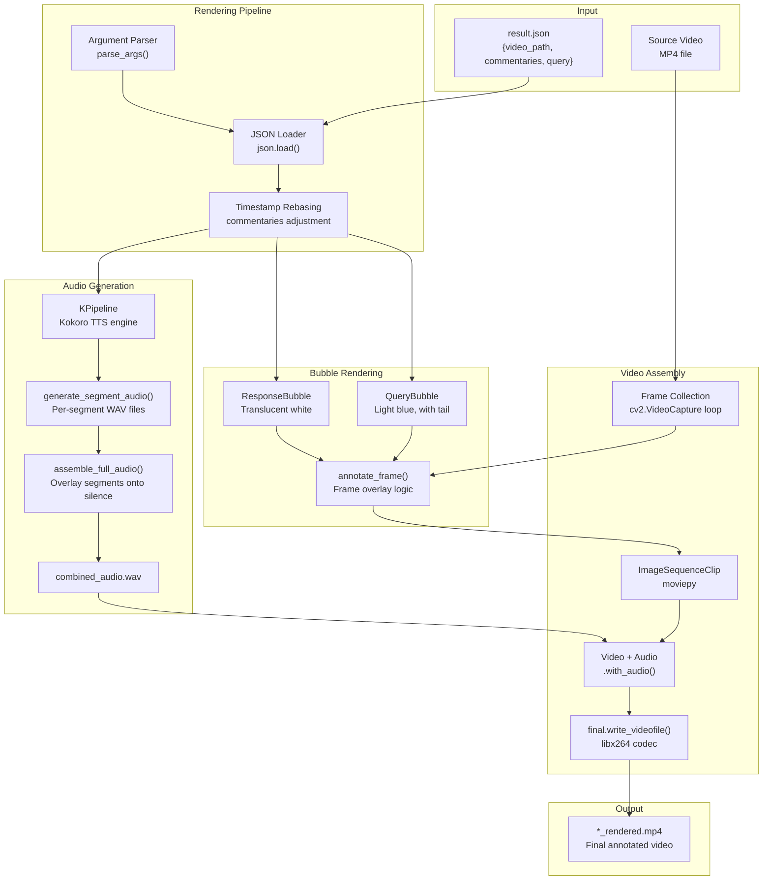
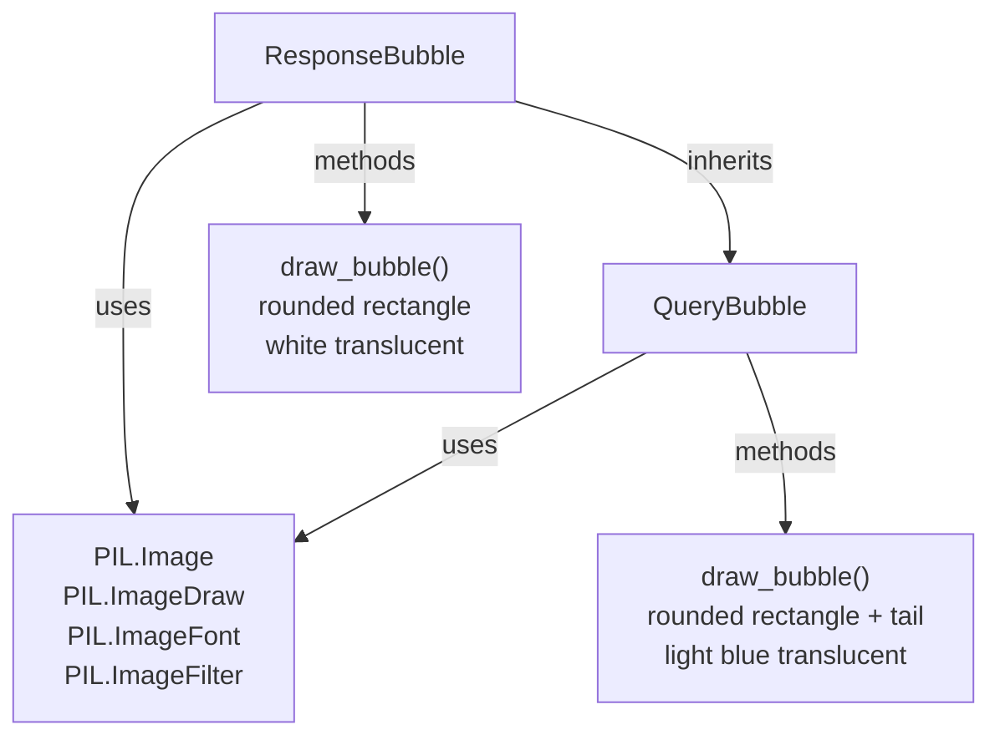
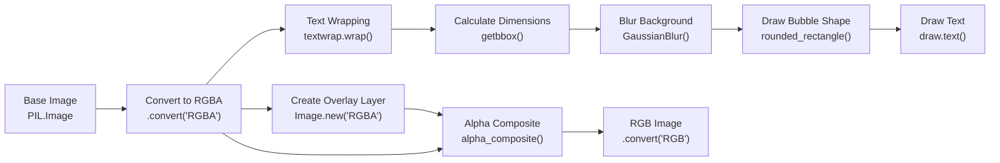
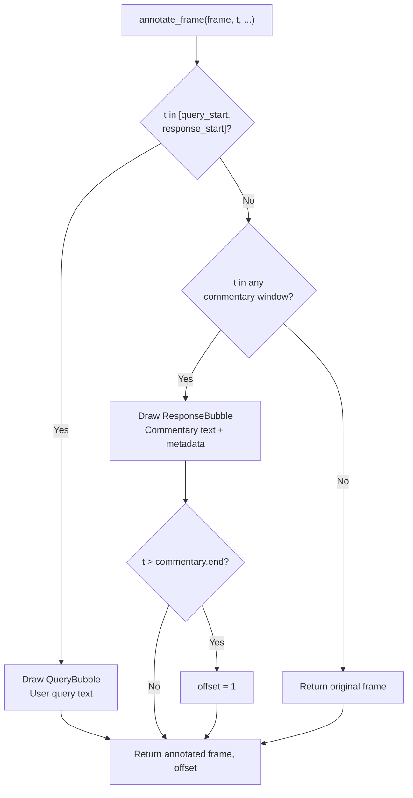
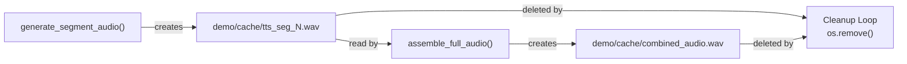

<!-- source: DeepWiki mcp.deepwiki.com · repo mit-han-lab/streaming-vlm · page 7.3 Video Rendering System · fetched 2026-10-30 -->

# Video Rendering System

<details>
<summary>Relevant source files</summary>

The following files were used as context for generating this wiki page:

- [baselines/livecc/demo/render/bubble.py](baselines/livecc/demo/render/bubble.py)
- [baselines/livecc/demo/render/video.py](baselines/livecc/demo/render/video.py)

</details>


## Purpose and Scope

The Video Rendering System generates annotated demonstration videos by overlaying visual speech bubbles and synchronized text-to-speech audio onto raw video files. This system transforms JSON inference results (from CLI evaluations) into polished MP4 outputs suitable for presentations and demonstrations.

The rendering pipeline operates on pre-generated inference results and does not perform model inference itself. For information about generating inference results, see [Command Line Interface](#7.2). For the interactive web demo interface, see [Gradio Web Demo](#7.1).

**Sources:** [baselines/livecc/demo/render/video.py:1-214]()

---

## System Architecture

The rendering system consists of three major subsystems: bubble overlay rendering, text-to-speech audio generation, and video assembly. The pipeline processes JSON files containing video paths, commentary timestamps, and query text to produce final annotated videos.



**Sources:** [baselines/livecc/demo/render/video.py:10-213]()

---

## Bubble Rendering Classes

The bubble rendering subsystem provides two specialized bubble classes for overlaying text onto video frames with distinct visual styles.

### Class Hierarchy



**Sources:** [baselines/livecc/demo/render/bubble.py:5-126]()

### ResponseBubble

The `ResponseBubble` class renders model responses with a clean rounded rectangle overlay. It provides translucent white backgrounds with Gaussian blur for visual separation from the video content.

**Key Features:**
- **Text Wrapping**: Automatic text wrapping at 50 characters per line ([bubble.py:37]())
- **Metadata Display**: Timestamp and model name shown above main text ([bubble.py:38-41]())
- **Gaussian Blur**: Background region blurred for contrast ([bubble.py:48]())
- **Translucent Overlay**: RGBA compositing with alpha channel ([bubble.py:25,63]())

**Configuration Parameters:**

| Parameter | Default | Purpose |
|-----------|---------|---------|
| `font_path` | `/usr/share/fonts/truetype/dejavu/DejaVuSans.ttf` | Main text font |
| `font_size` | 50 | Main text size in points |
| `meta_font_path` | `/usr/share/fonts/truetype/dejavu/DejaVuSans.ttf` | Metadata font |
| `meta_font_size` | 25 | Metadata size in points |
| `padding` | 15 | Internal bubble padding (pixels) |
| `line_spacing` | 8 | Vertical spacing between lines |
| `radius` | 20 | Corner radius for rounded rectangle |
| `bg_color` | `(255, 255, 255, 200)` | Background RGBA color |
| `blur_radius` | 8 | Gaussian blur radius |

**Sources:** [baselines/livecc/demo/render/bubble.py:5-64]()

### QueryBubble

The `QueryBubble` class extends `ResponseBubble` to render user queries with a distinct visual style. It adds a triangular speech tail pointing left and uses a light blue background to differentiate queries from responses.

**Key Differences from ResponseBubble:**
- **Speech Tail**: Triangular pointer on left side ([bubble.py:98-100]())
- **Background Color**: Light blue `(173, 216, 230, 150)` instead of white ([bubble.py:76]())
- **Extended Blur Region**: Blur includes tail area ([bubble.py:102-109]())
- **Optional Metadata**: Metadata parameter can be empty ([bubble.py:72,89]())

**Tail Geometry:**
```python
tail_h = 12
tail = [(x, y + 20), (x - tail_h, y + 30), (x, y + 40)]
```

The tail is rendered as a filled polygon before the rounded rectangle to ensure proper compositing.

**Sources:** [baselines/livecc/demo/render/bubble.py:66-126]()

### Rendering Pipeline

Both bubble classes follow the same rendering pipeline:



**Sources:** [baselines/livecc/demo/render/bubble.py:30-64,82-126]()

---

## Text-to-Speech Integration

The rendering system uses the Kokoro TTS engine to generate synchronized audio narration for commentary text.

### Audio Generation Functions

**Function: `generate_segment_audio()`**

Generates TTS audio for a single text segment and saves it as a WAV file.

```python
def generate_segment_audio(pipeline, text, voice, out_path):
    # Returns: duration in seconds
```

**Process:**
1. Feed text to KPipeline with specified voice ([video.py:42]())
2. Concatenate audio buffers from generator ([video.py:41-44]())
3. Write WAV file at 24kHz sample rate ([video.py:45]())
4. Calculate duration using AudioFileClip ([video.py:46-48]())

**Sources:** [baselines/livecc/demo/render/video.py:37-49]()

**Function: `assemble_full_audio()`**

Overlays multiple TTS segments onto a silent audio track matching video duration.

```python
def assemble_full_audio(segments, total_duration, base_name="tts_seg"):
    # Returns: path to combined_audio.wav
```

**Process:**
1. Create silent track matching video duration ([video.py:56]())
2. Load each segment WAV file ([video.py:58-61]())
3. Overlay at specified timestamp ([video.py:62]())
4. Export combined WAV ([video.py:63-65]())

**Sources:** [baselines/livecc/demo/render/video.py:51-65]()

### Audio Segment Processing

The system supports two TTS modes controlled by the `--sentence_tts` flag:

| Mode | Description | Use Case |
|------|-------------|----------|
| Word-by-word | Each commentary entry generates separate audio | Preserves fine-grained timing |
| Sentence-based | Concatenates text until punctuation, generates single audio | More natural speech flow |

**Sentence Detection Logic:**
```python
# Sentence ends on: comma, period, exclamation, question mark
if t.endswith(',') or t.endswith('.') or t.endswith('!') or t.endswith('?'):
    # Generate audio for accumulated sentence
```

**Sources:** [baselines/livecc/demo/render/video.py:131-157]()

---

## Video Assembly Pipeline

The video assembly pipeline processes source video frames, applies bubble annotations, and combines them with generated audio.

### Frame Annotation Logic

**Function: `annotate_frame()`**

Determines which bubble to render based on current timestamp and commentary windows.



**Timeline Structure:**
- **Query Phase**: `[query_start, response_start]` - Show QueryBubble
- **Response Phase**: `[response_start, ∞)` - Show ResponseBubble for active commentaries

**Sources:** [baselines/livecc/demo/render/video.py:67-99]()

### Main Rendering Loop

The main loop processes video frames sequentially, annotating each with appropriate bubbles.

```python
while True:
    ret, frame = cap.read()
    if not ret:
        break
    t = frame_idx / fps
    annotated, commentary_idx_offset = annotate_frame(...)
    commentary_idx += commentary_idx_offset
    frames.append(annotated)
    frame_idx += 1
    if commentary_idx >= len(commentaries):
        break
```

**Key Operations:**
1. Read frame from VideoCapture ([video.py:167-169]())
2. Calculate relative timestamp ([video.py:171]())
3. Annotate frame with current bubbles ([video.py:173-177]())
4. Advance commentary index if needed ([video.py:178]())
5. Collect annotated frames ([video.py:179]())
6. Terminate after last commentary ([video.py:181-182]())

**Sources:** [baselines/livecc/demo/render/video.py:163-183]()

### Timestamp Rebasing

The system rebases all timestamps to align with the trimmed output video:

```python
# Rebase commentaries to query_start
commentaries = [(s-query_start, e-query_start, t) for s, e, t in commentaries]
response_start = response_start - query_start
query_start = 0  # Now the origin
```

This ensures bubble overlays and audio segments align correctly when video starts at the query timestamp.

**Sources:** [baselines/livecc/demo/render/video.py:116-123]()

---

## Output Format and Codec Configuration

The final video is exported using moviepy with high-quality encoding settings.

### Video Codec Parameters

```python
final.write_videofile(
    save_path, 
    codec='libx264',           # H.264 video codec
    audio_codec='aac',         # AAC audio codec
    fps=fps,                   # Match source FPS
    ffmpeg_params=[
        '-crf', '18',          # Quality level (18 = high quality)
        '-preset', 'slow',     # Encoding speed vs compression
        '-pix_fmt', 'yuv420p', # Pixel format for compatibility
    ]
)
```

**Parameter Details:**

| Parameter | Value | Purpose |
|-----------|-------|---------|
| `codec` | `libx264` | Industry-standard H.264 compression |
| `audio_codec` | `aac` | Efficient audio compression |
| `crf` | `18` | Constant Rate Factor (0-51, lower = better quality) |
| `preset` | `slow` | Slower encoding for better compression |
| `pix_fmt` | `yuv420p` | Ensures broad player compatibility |

**Sources:** [baselines/livecc/demo/render/video.py:190-200]()

### File Naming Convention

Output files use the input JSON filename with `_rendered.mp4` suffix:

```python
save_path = os.path.splitext(result_path)[0] + '_rendered.mp4'
```

Example: `demo_result.json` → `demo_result_rendered.mp4`

**Sources:** [baselines/livecc/demo/render/video.py:189]()

---

## Command Line Interface

The rendering system is invoked via command line with required and optional arguments.

### Required Arguments

```bash
python baselines/livecc/demo/render/video.py \
  --result_json path/to/result.json \
  --query_start 5.0 \
  --response_start 6.5
```

| Argument | Type | Description |
|----------|------|-------------|
| `--result_json` | str | Path to JSON file with inference results |
| `--query_start` | float | Timestamp (seconds) when query bubble appears |
| `--response_start` | float | Timestamp (seconds) when response bubbles begin |

**Sources:** [baselines/livecc/demo/render/video.py:14-25]()

### Optional Arguments

| Argument | Type | Default | Description |
|----------|------|---------|-------------|
| `--sentence_tts` | flag | False | Concatenate audio for complete sentences instead of word-by-word |
| `--voice` | str | `af_heart` | Kokoro TTS voice identifier |

**Sources:** [baselines/livecc/demo/render/video.py:26-34]()

### Input JSON Schema

The `result_json` file must contain the following structure:

```json
{
  "video_path": "path/to/source/video.mp4",
  "query": "User query text (optional)",
  "commentaries": [
    [start_time, end_time, "commentary text"],
    [3.5, 5.2, "This is happening now"],
    [5.2, 7.8, "Next observation"]
  ]
}
```

**Field Specifications:**
- `video_path`: Absolute or relative path to source video file
- `query`: Optional user query text for QueryBubble
- `commentaries`: List of `[start_sec, end_sec, text]` tuples in chronological order

**Sources:** [baselines/livecc/demo/render/video.py:109-113]()

---

## Resource Management

The system performs cleanup operations to manage temporary files.

### Temporary File Lifecycle



**Cleanup Operations:**
```python
# Remove individual segment files
for i in range(idx):
    os.remove(f"demo/cache/tts_seg_{i}.wav")
# Remove combined audio
os.remove(combined_audio_path)
```

The cache directory (`demo/cache/`) is automatically created if it doesn't exist ([video.py:153]()).

**Sources:** [baselines/livecc/demo/render/video.py:203-205]()

### File Handle Management

The system properly closes moviepy clips to release file handles:

```python
video_clip.close()
audio_clip.close()
```

This prevents resource leaks when processing multiple videos in sequence.

**Sources:** [baselines/livecc/demo/render/video.py:207-208]()

---

## Usage Example

Complete workflow from inference to rendered video:

```bash
# Step 1: Run CLI inference (generates result.json)
python baselines/livecc/demo/cli.py \
  --video_path demo/sources/writing.mp4 \
  --model_path chenjoya/LiveCC-7B-Instruct

# Step 2: Render annotated video
python baselines/livecc/demo/render/video.py \
  --result_json demo/results/writing_result.json \
  --query_start 0.0 \
  --response_start 1.5 \
  --sentence_tts \
  --voice af_heart

# Output: demo/results/writing_result_rendered.mp4
```

This produces a professional demonstration video with:
- User query bubble from 0.0s to 1.5s
- Model response bubbles starting at 1.5s with appropriate timestamps
- Synchronized TTS audio narration
- High-quality H.264 encoding

**Sources:** [baselines/livecc/demo/render/video.py:101-213]()

---

