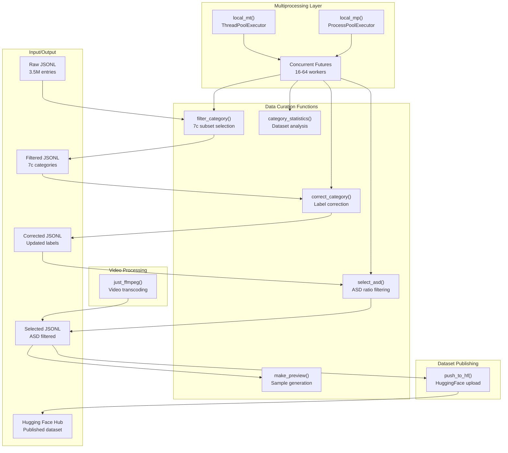
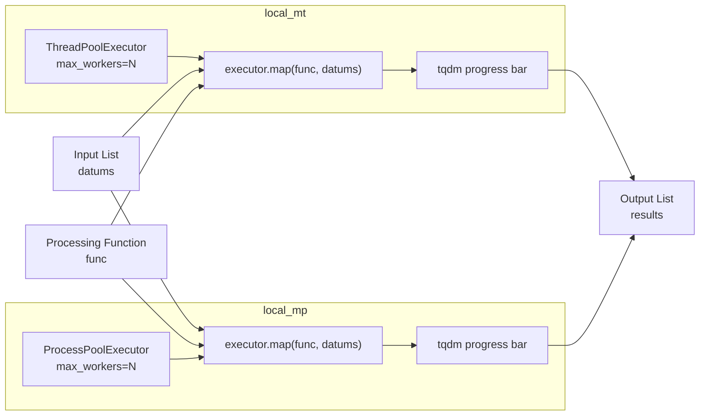
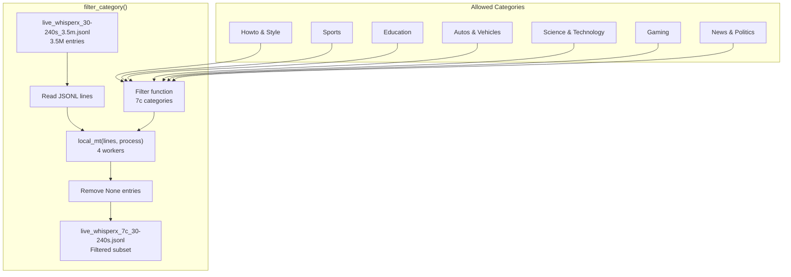
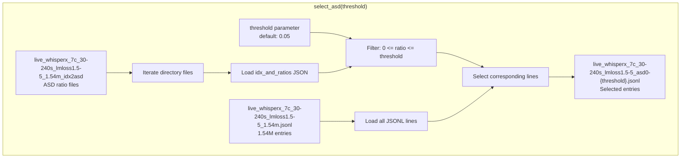
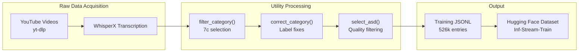

<!-- source: DeepWiki mcp.deepwiki.com · repo mit-han-lab/streaming-vlm · page 8 Utilities and Tools · fetched 2026-10-30 -->

# Utilities and Tools

<details>
<summary>Relevant source files</summary>

The following files were used as context for generating this wiki page:

- [baselines/livecc/debug.py](baselines/livecc/debug.py)
- [baselines/livecc/utils/multiprocessor.py](baselines/livecc/utils/multiprocessor.py)

</details>


This document covers the supporting utilities and helper functions used throughout the StreamingVLM codebase for data processing, multiprocessing, video manipulation, and dataset preparation. These utilities provide foundational functionality for the data pipeline described in [Data Preparation](#4.1) and support the training workflows documented in [Training Pipeline](#4).

The utilities fall into two main categories:
- **Multiprocessing Utilities**: Parallel execution frameworks for efficient large-scale data processing
- **Data Curation Tools**: Functions for filtering, correcting, and preparing video datasets

For information about the video processing pipeline used during inference, see [Video Processing Pipeline](#5.4). For dataset format specifications, see [Data Formats and Schemas](#4.1.2).

---

## Overview

The utilities system provides infrastructure for processing millions of video dataset entries efficiently. The architecture separates parallel execution primitives from domain-specific data curation logic, enabling flexible composition of processing pipelines.

### Utility System Architecture



**Sources:** [baselines/livecc/utils/multiprocessor.py:1-15](), [baselines/livecc/debug.py:1-103]()

The system processes data in stages: raw JSONL files are filtered by category, labels are corrected using external mappings, entries are selected based on Audio Segment Detection (ASD) ratios, and final datasets are optionally published to Hugging Face Hub.

---

## Multiprocessing Primitives

The `multiprocessor.py` module provides two core functions for parallel data processing: `local_mt()` for I/O-bound tasks using threads and `local_mp()` for CPU-bound tasks using processes.

### Function Specifications

| Function | Executor Type | Use Case | Typical Worker Count |
|----------|--------------|----------|---------------------|
| `local_mt()` | ThreadPoolExecutor | I/O-bound operations (file reading, network requests) | 4-16 |
| `local_mp()` | ProcessPoolExecutor | CPU-bound operations (heavy computation) | 8-64 |

Both functions share identical signatures and behavior:

**Parameters:**
- `datums: list` - Input data items to process
- `func: callable` - Function to apply to each item
- `desc: str = None` - Optional progress bar description
- `num_workers: int = 16` - Concurrent worker count

**Returns:**
- `list` - Processed results in original order

### Implementation Details



**Sources:** [baselines/livecc/utils/multiprocessor.py:4-14]()

The functions use Python's `concurrent.futures` module to parallelize execution. When `desc` is provided, they wrap the iterator with `tqdm` for progress tracking. The implementations are minimal and focused, delegating complexity to the standard library.

### Usage Patterns

**Example 1: Thread-based JSON parsing** [baselines/livecc/debug.py:59]()
```python
datums = local_mt(lines[:-1], json.loads, desc='json.loads', num_workers=8)
```

**Example 2: Thread-based JSON serialization** [baselines/livecc/debug.py:91]()
```python
lines = list(local_mt(datums_7c, json.dumps, desc='json.dumps', num_workers=8))
```

**Example 3: Thread-based line processing** [baselines/livecc/debug.py:18]()
```python
lines = local_mt(lines, process, desc='process', num_workers=4)
```

The thread-based `local_mt()` is used throughout for I/O operations like reading/writing JSON, as these are not CPU-intensive and benefit from shared memory space.

**Sources:** [baselines/livecc/debug.py:18-19](), [baselines/livecc/debug.py:39](), [baselines/livecc/debug.py:59](), [baselines/livecc/debug.py:86](), [baselines/livecc/debug.py:91]()

---

## Data Curation Tools

The `debug.py` module provides a suite of functions for curating large-scale video datasets. These tools operate on JSONL files containing video metadata, transcriptions, and annotations.

### Category Filtering Pipeline



**Sources:** [baselines/livecc/debug.py:6-23]()

The `filter_category()` function filters a 3.5M entry dataset down to a "7c" subset containing only seven instructional/educational categories [baselines/livecc/debug.py:14](). The processing function returns the original line if the category matches, or `None` otherwise [baselines/livecc/debug.py:12-16]().

### Label Correction System

The `correct_category()` function updates category labels using an external mapping file:

**Function Flow:**
1. Load JSONL dataset [baselines/livecc/debug.py:29-30]()
2. Load `video2cat.json` lookup table [baselines/livecc/debug.py:31]()
3. Define processing function that updates category field [baselines/livecc/debug.py:33-37]()
4. Apply in parallel using `local_mt()` [baselines/livecc/debug.py:39]()
5. Write corrected JSONL [baselines/livecc/debug.py:40-41]()

The processing function replaces each datum's category with the correct value from the lookup table:
```python
datum['category'] = video2cat[datum['video']]
```

**Sources:** [baselines/livecc/debug.py:26-42]()

### ASD-Based Selection



**Sources:** [baselines/livecc/debug.py:44-55]()

The `select_asd()` function performs Audio Segment Detection (ASD) ratio filtering [baselines/livecc/debug.py:44]():

1. Reads a directory of JSON files containing ASD ratios [baselines/livecc/debug.py:45-50]()
2. Filters entries where `0 <= ratio <= threshold` [baselines/livecc/debug.py:51]()
3. Selects corresponding lines from the source JSONL [baselines/livecc/debug.py:52]()
4. Writes filtered dataset [baselines/livecc/debug.py:53-54]()

The ASD ratio represents the proportion of audio segments detected in a video clip. Lower ratios indicate cleaner, more focused content suitable for training.

### Statistical Analysis

The `category_statistics()` function analyzes category distribution in datasets:

**Process:**
1. Load JSONL lines [baselines/livecc/debug.py:58]()
2. Parse JSON in parallel [baselines/livecc/debug.py:59]()
3. Extract categories from conversation structure [baselines/livecc/debug.py:60]()
4. Count occurrences using `collections.Counter` [baselines/livecc/debug.py:61]()

The function expects data in a specific conversation format where categories are nested at `conversations[0]['content'][1]['category']`.

**Sources:** [baselines/livecc/debug.py:57-61]()

### Preview Generation

The `make_preview()` function creates a 100-sample preview for dataset inspection:

**Extracted Fields:**

| Source Path | Output Key | Description |
|-------------|-----------|-------------|
| `datum[0]['content'][0]['video']` | `video` | Video file path |
| `datum[0]['content'][0]['video_start']` | `video_start` | Start timestamp |
| `datum[0]['content'][0]['video_end']` | `video_end` | End timestamp |
| `datum[0]['content'][1]['text']` | `query` | Query/prompt text |
| `datum[1]['content'][0]['text_stream']` | `text_stream` | Streaming response (JSON-encoded) |

The function reads the first 100 lines [baselines/livecc/debug.py:70](), parses each as JSON [baselines/livecc/debug.py:71](), extracts key fields into a simplified format [baselines/livecc/debug.py:72](), and writes to `live_whisperx_100_for_preview.json` [baselines/livecc/debug.py:73]().

**Sources:** [baselines/livecc/debug.py:69-73]()

---

## Video Processing Utilities

The `just_ffmpeg()` function provides video transcoding with spatial resizing and temporal manipulation:

**Function Signature:**
```python
def just_ffmpeg(input_path: str, output_path: str)
```

**FFmpeg Command Template:** [baselines/livecc/debug.py:95]()
```bash
ffmpeg -ss 16 -t 31 -i {input_path} \
  -vf "setpts=PTS*1.1,scale='if(gt(a,1),-2,1080)':'if(gt(a,1),1080,-2)'" \
  -an {output_path} -y
```

**Parameters:**
- `-ss 16` - Start at 16 seconds offset
- `-t 31` - Duration of 31 seconds
- `-vf` - Video filter chain:
  - `setpts=PTS*1.1` - Slow down playback by 10%
  - `scale=...` - Resize to 1080p maintaining aspect ratio
- `-an` - Remove audio track
- `-y` - Overwrite output without prompting

The conditional scaling formula `if(gt(a,1),-2,1080)` checks if aspect ratio > 1 (landscape), then sets height to 1080 and width to auto (-2 ensures even dimensions).

**Sources:** [baselines/livecc/debug.py:93-96]()

---

## Dataset Publishing

The `push_to_hf()` function uploads datasets to Hugging Face Hub:

**Function Signature:** [baselines/livecc/debug.py:75-82]()
```python
def push_to_hf(folder_path: str, repo_id: str, repo_type: str)
```

**Parameters:**
- `folder_path` - Local directory containing dataset files
- `repo_id` - Hugging Face repository identifier
- `repo_type` - Repository type (e.g., "dataset")

**Implementation:**
```python
from huggingface_hub import HfApi
HfApi(token=os.environ.get('HF_TOKEN')).upload_folder(
    folder_path=folder_path,
    repo_id=repo_id,
    repo_type=repo_type,
)
```

The function retrieves the Hugging Face token from the `HF_TOKEN` environment variable and uses the official `HfApi` client to upload entire directories.

**Sources:** [baselines/livecc/debug.py:75-82]()

---

## Additional Utilities

### Video Extraction

The `unknown()` function extracts video identifiers from JSONL files:

**Process:** [baselines/livecc/debug.py:63-67]()
1. Read JSONL lines (excluding last)
2. Extract video ID using string slicing: `line[57:line.index('video_start')-4]`
3. Save video list to JSON

This utility supports dataset deduplication and cross-referencing tasks.

### Category Subset Removal

The `remove_7c()` function filters a 2.6M dataset to include only the 7c category subset:

**Steps:** [baselines/livecc/debug.py:84-91]()
1. Load 2.6M entry JSONL
2. Parse JSON in parallel (8 workers)
3. Filter for 7c categories
4. Extract unique video identifiers
5. Serialize filtered datums back to JSONL

The function demonstrates end-to-end use of multiprocessing utilities for large-scale filtering operations.

**Sources:** [baselines/livecc/debug.py:63-67](), [baselines/livecc/debug.py:84-91]()

---

## Integration with Data Pipeline

These utilities integrate with the broader data preparation workflow described in [Dataset Processing Pipeline](#4.1.1):



**Sources:** [baselines/livecc/debug.py:1-103]()

The utilities enable processing millions of raw entries down to curated training datasets. The parallel processing capabilities ensure efficient handling of large-scale data while maintaining data integrity through careful filtering and validation steps.

---

