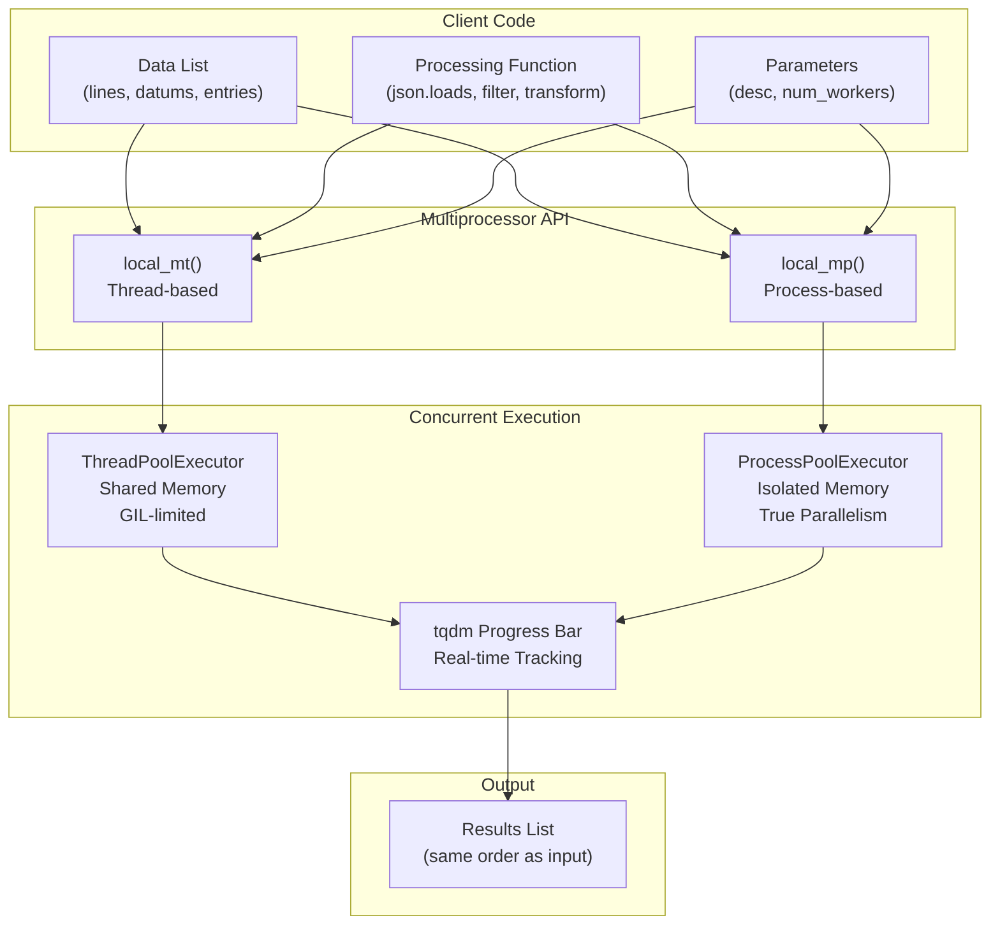
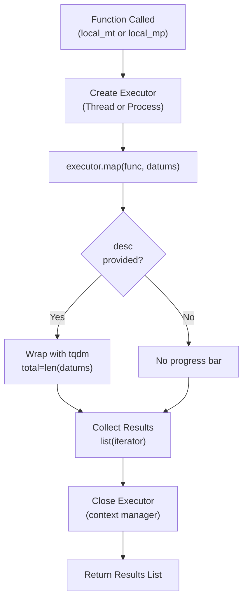
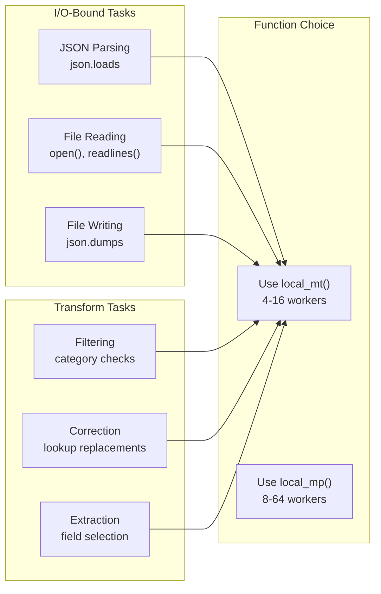
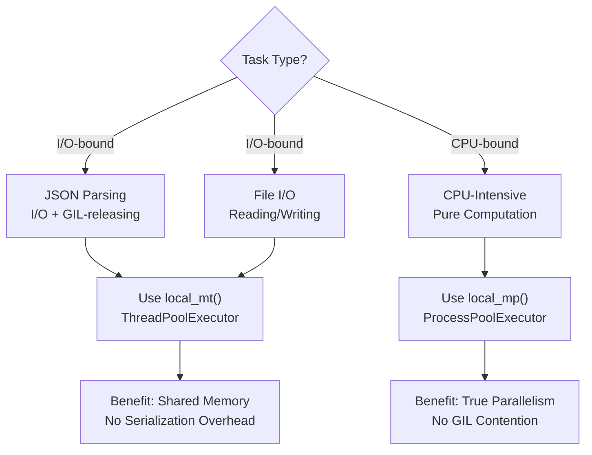
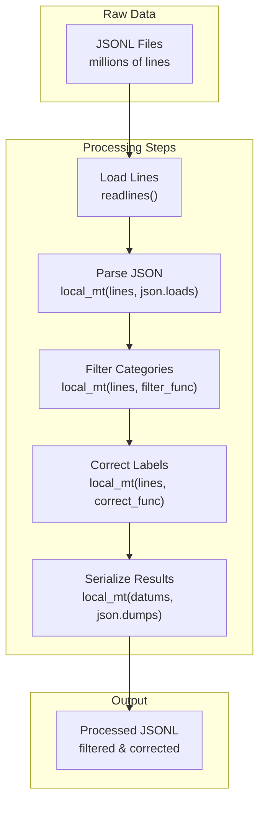

<!-- source: DeepWiki mcp.deepwiki.com · repo mit-han-lab/streaming-vlm · page 8.1 Multiprocessing Utilities · fetched 2026-10-30 -->

# Multiprocessing Utilities

<details>
<summary>Relevant source files</summary>

The following files were used as context for generating this wiki page:

- [baselines/livecc/utils/multiprocessor.py](baselines/livecc/utils/multiprocessor.py)

</details>


## Purpose and Scope

The multiprocessing utilities provide simple, high-level functions for parallel data processing across the StreamingVLM codebase. These utilities wrap Python's `concurrent.futures` module to enable efficient processing of large datasets with automatic progress tracking. The primary module is located at [baselines/livecc/utils/multiprocessor.py](). 

For information about how these utilities are applied to dataset curation workflows, see [Data Curation Tools](#8.2).

**Sources:** [baselines/livecc/utils/multiprocessor.py:1-17]()

## Overview

The multiprocessing utilities consist of two core functions that abstract away the complexity of parallel processing:

| Function | Execution Model | Use Case | Concurrency Primitive |
|----------|----------------|----------|----------------------|
| `local_mt()` | Multi-threaded | I/O-bound tasks (JSON parsing, file reading) | `ThreadPoolExecutor` |
| `local_mp()` | Multi-process | CPU-bound tasks (heavy computation) | `ProcessPoolExecutor` |

Both functions provide:
- Automatic progress tracking via `tqdm`
- Configurable worker counts
- Simple map-based interface
- Synchronous collection of results

**Sources:** [baselines/livecc/utils/multiprocessor.py:4-14]()

## Architecture



**Diagram: Multiprocessing Utilities Data Flow**

**Sources:** [baselines/livecc/utils/multiprocessor.py:1-17]()

## Core Functions

### local_mt() - Thread-Based Processing

```python
def local_mt(datums: list, func: callable, desc: str = None, num_workers=16)
```

Thread-based parallel processing using `ThreadPoolExecutor`. Best suited for I/O-bound operations that release the GIL.

**Parameters:**
- `datums`: List of input data items to process
- `func`: Callable that takes a single datum and returns a processed result
- `desc`: Optional description string for progress bar
- `num_workers`: Number of worker threads (default: 16)

**Returns:** List of results in the same order as input

**Sources:** [baselines/livecc/utils/multiprocessor.py:4-8]()

### local_mp() - Process-Based Processing

```python
def local_mp(datums: list, func: callable, desc: str = None, num_workers=16)
```

Process-based parallel processing using `ProcessPoolExecutor`. Provides true parallelism for CPU-bound operations.

**Parameters:**
- `datums`: List of input data items to process
- `func`: Callable that takes a single datum and returns a processed result (must be picklable)
- `desc`: Optional description string for progress bar
- `num_workers`: Number of worker processes (default: 16)

**Returns:** List of results in the same order as input

**Sources:** [baselines/livecc/utils/multiprocessor.py:10-14]()

## Implementation Details



**Diagram: Execution Flow for Multiprocessing Functions**

Both functions use Python's context manager protocol (`with` statement) to ensure proper cleanup of executor resources. The `executor.map()` method preserves input order in the output, making it predictable for downstream processing.

**Sources:** [baselines/livecc/utils/multiprocessor.py:4-14]()

## Usage Patterns

### JSON Parsing

Thread-based parsing of large JSONL files:

```python
lines = open('live_whisperx_526k_with_seeks.jsonl').readlines()
datums = local_mt(lines[:-1], json.loads, desc='json.loads', num_workers=8)
```

**Sources:** [baselines/livecc/debug.py:59]()

### Category Filtering

Thread-based filtering with custom predicate function:

```python
def process(line: str):
    datum = json.loads(line)
    if datum['category'] in ['Howto & Style', 'Sports', 'Education', ...]:
        return line
    return None

lines = local_mt(lines, process, desc='process', num_workers=4)
lines = [line for line in lines if line is not None]
```

**Sources:** [baselines/livecc/debug.py:12-19]()

### Label Correction

Thread-based transformation with lookup dictionary:

```python
video2cat = json.load(open('video2cat.json'))

def process(line: str):
    datum = json.loads(line)
    datum['category'] = video2cat[datum['video']]
    line = json.dumps(datum) + '\n'
    return line

lines = local_mt(lines, process, desc='process', num_workers=4)
```

**Sources:** [baselines/livecc/debug.py:33-39]()

### Process-Based Serialization

Process-based JSON serialization for CPU-intensive encoding:

```python
datums_7c = [datum for datum in datums if datum['category'] in [...]]
serialized = local_mt(datums_7c, json.dumps, desc='json.dumps', num_workers=8)
```

**Sources:** [baselines/livecc/debug.py:91]()

## Common Usage Patterns by Task Type



**Diagram: Task Type to Function Mapping**

**Sources:** [baselines/livecc/debug.py:18-91]()

## Worker Configuration

The codebase demonstrates various worker count configurations based on task characteristics:

| Task Type | Workers | Function | Example |
|-----------|---------|----------|---------|
| JSON parsing | 8 | `local_mt()` | [debug.py:59]() |
| Category filtering | 4 | `local_mt()` | [debug.py:18]() |
| Label correction | 4 | `local_mt()` | [debug.py:39]() |
| JSON serialization | 8 | `local_mt()` | [debug.py:91]() |

**Default Configuration:** Both functions default to `num_workers=16`, which provides a balanced approach for most tasks.

**Sources:** [baselines/livecc/utils/multiprocessor.py:4-14](), [baselines/livecc/debug.py:18-91]()

## Performance Considerations

### Thread vs Process Selection



**Diagram: Decision Tree for Thread vs Process Selection**

### Key Observations

1. **Thread Preference in Codebase:** The provided code exclusively uses `local_mt()`, indicating that data processing tasks are primarily I/O-bound (JSON parsing, file operations)

2. **Worker Count Strategy:** 
   - Simple tasks (filtering, correction): 4 workers
   - Moderate tasks (JSON parsing): 8 workers
   - Default fallback: 16 workers

3. **Order Preservation:** Both functions maintain input order, which is critical for line-based JSONL processing where line numbers correspond to dataset indices

**Sources:** [baselines/livecc/debug.py:18-91](), [baselines/livecc/utils/multiprocessor.py:4-14]()

## Integration with Data Processing Pipeline



**Diagram: Multiprocessing Utilities in Data Pipeline Context**

The multiprocessing utilities serve as the execution engine for the data curation pipeline documented in [Data Curation Tools](#8.2). Each stage of the pipeline (filtering, correction, selection) uses `local_mt()` to process millions of dataset entries efficiently.

**Sources:** [baselines/livecc/debug.py:6-92]()

## Error Handling

The current implementation does not include explicit error handling. Processing functions should be designed to:
- Return valid results or `None` for filtering
- Handle exceptions internally if partial failures are acceptable
- Allow exceptions to propagate if the entire batch should fail

Example filtering pattern with `None` returns:

```python
def process(line: str):
    datum = json.loads(line)
    if datum['category'] in target_categories:
        return line
    return None

results = local_mt(lines, process, desc='filter', num_workers=4)
filtered = [r for r in results if r is not None]
```

**Sources:** [baselines/livecc/debug.py:12-19]()

## Limitations

1. **No Pickling Check:** `local_mp()` requires that both `func` and data items are picklable, but this is not validated

2. **No Chunk Size Control:** The executor uses default chunking, which may be suboptimal for very large datasets with varying item processing times

3. **No Exception Handling:** Individual item failures cause the entire batch to fail

4. **Fixed Execution Model:** Cannot switch between ordered and unordered execution, though unordered execution could provide better performance in some cases

**Sources:** [baselines/livecc/utils/multiprocessor.py:4-14]()

---

