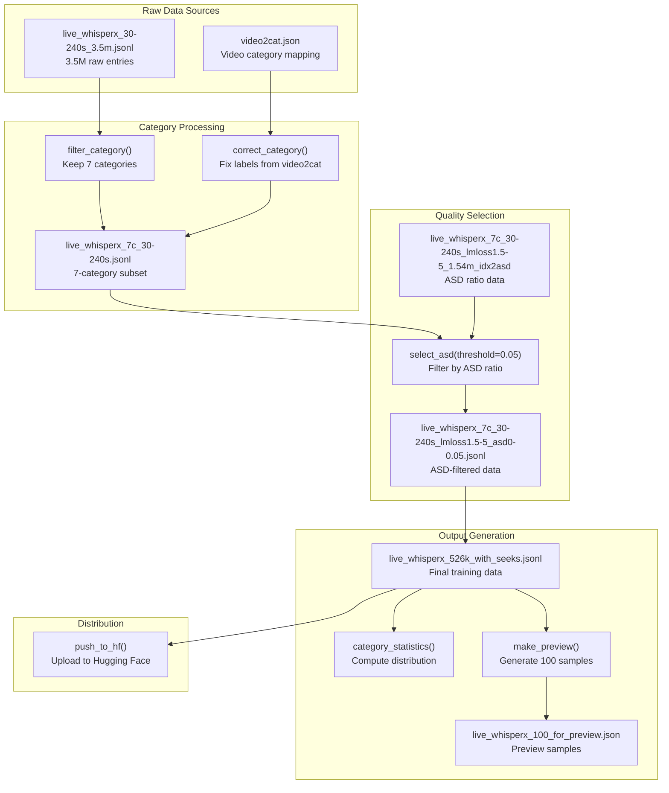
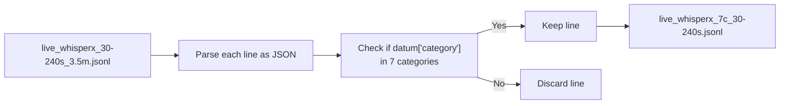
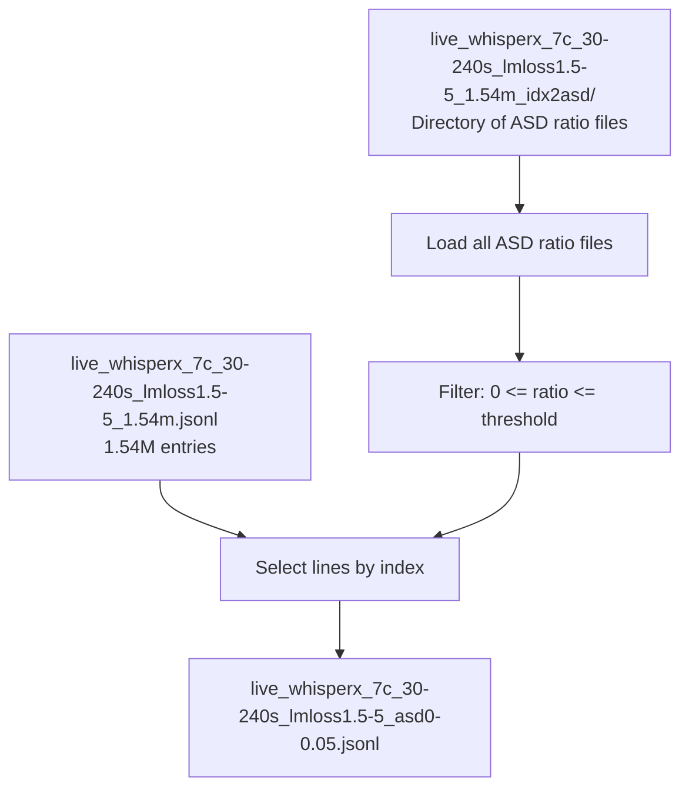
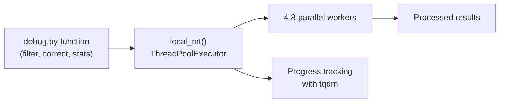
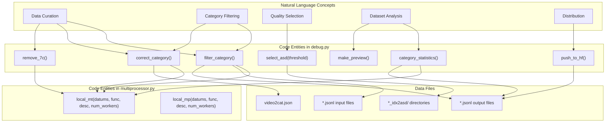

<!-- source: DeepWiki mcp.deepwiki.com · repo mit-han-lab/streaming-vlm · page 8.2 Data Curation Tools · fetched 2026-10-30 -->

# Data Curation Tools

<details>
<summary>Relevant source files</summary>

The following files were used as context for generating this wiki page:

- [baselines/livecc/debug.py](baselines/livecc/debug.py)

</details>


This document describes the data curation utilities used to prepare the Live-WhisperX-526K training dataset from raw video data. These tools handle category filtering, label correction, quality selection based on Audio Segment Detection (ASD) ratios, and dataset statistics generation.

For information about the multiprocessing infrastructure used by these tools, see [Multiprocessing Utilities](#8.1). For details on the dataset formats and schemas produced by these tools, see [Data Formats and Schemas](#4.1.2).

## Overview

The data curation pipeline processes millions of raw video entries to produce high-quality training data. The primary tool is `debug.py`, which provides functions for filtering, correcting, and selecting video data based on various criteria. These operations are parallelized using the utilities from `multiprocessor.py`.

**Sources:** [baselines/livecc/debug.py:1-103]()

## Data Curation Workflow

The following diagram illustrates the complete data curation pipeline:



**Sources:** [baselines/livecc/debug.py:6-23](), [baselines/livecc/debug.py:26-42](), [baselines/livecc/debug.py:44-55](), [baselines/livecc/debug.py:57-61](), [baselines/livecc/debug.py:69-73](), [baselines/livecc/debug.py:75-82]()

## Category Filtering

### filter_category()

The `filter_category()` function filters raw video data to retain only entries from seven specific categories:

| Category | Description |
|----------|-------------|
| Howto & Style | Instructional and lifestyle content |
| Sports | Athletic events and commentary |
| Education | Educational content |
| Autos & Vehicles | Automotive and vehicle content |
| Science & Technology | Technical and scientific content |
| Gaming | Video game content |
| News & Politics | News and political content |

**Implementation:**



The function uses `local_mt()` with 4 workers to parallelize the filtering process across all input lines.

**Sources:** [baselines/livecc/debug.py:6-23]()

### correct_category()

The `correct_category()` function updates category labels based on a ground-truth mapping stored in `video2cat.json`. This corrects any mislabeled categories in the dataset.

**Processing Logic:**
1. Load all lines from the input JSONL file
2. Load the `video2cat.json` mapping
3. For each datum, replace `datum['category']` with `video2cat[datum['video']]`
4. Write corrected lines back to the same file

The correction process also uses `local_mt()` with 4 workers for parallel processing.

**Sources:** [baselines/livecc/debug.py:26-42]()

## Audio Segment Detection (ASD) Selection

### select_asd()

The `select_asd()` function performs quality-based filtering using Audio Segment Detection (ASD) ratios. ASD ratios measure the proportion of active audio segments in a video, which correlates with content quality for live commentary generation.

**Parameters:**
- `threshold` (default: 0.05): Maximum acceptable ASD ratio. Lower values indicate higher speech density.

**Selection Criteria:**
```
0 <= ASD_ratio <= threshold
```

**Implementation Flow:**



**Data Structure:**

Each ASD file contains tuples of `(index, ratio)`:
```python
[(idx1, ratio1), (idx2, ratio2), ...]
```

Selected indices correspond to line numbers in the source JSONL file.

**Sources:** [baselines/livecc/debug.py:44-55]()

## Dataset Statistics and Preview

### category_statistics()

Computes the distribution of categories in the final dataset:

```python
def category_statistics():
    lines = open('live_whisperx_526k_with_seeks.jsonl').readlines()
    datums = local_mt(lines[:-1], json.loads, desc='json.loads', num_workers=8)
    categories = [conversations[0]['content'][1]['category'] for conversations in datums]
    print(collections.Counter(categories))
```

This function:
1. Loads all dataset lines
2. Parses JSON in parallel using 8 workers
3. Extracts categories from the conversation format
4. Prints a `Counter` object showing category distribution

**Sources:** [baselines/livecc/debug.py:57-61]()

### make_preview()

Generates a preview JSON file with 100 sample entries for quick inspection:

**Output Format:**
```json
[
  {
    "video": "video_path",
    "video_start": start_time,
    "video_end": end_time,
    "query": "query_text",
    "text_stream": "[{\"timestamp\": ..., \"text\": ...}, ...]"
  },
  ...
]
```

The function extracts these fields from the conversation format used in the full dataset and creates a simplified representation suitable for preview purposes.

**Sources:** [baselines/livecc/debug.py:69-73]()

## Hugging Face Hub Integration

### push_to_hf()

Uploads processed datasets to Hugging Face Hub for distribution:

**Parameters:**
- `folder_path`: Local directory containing dataset files
- `repo_id`: Hugging Face repository identifier (e.g., `"username/dataset-name"`)
- `repo_type`: Type of repository (typically `"dataset"`)

**Authentication:**
Requires the `HF_TOKEN` environment variable to be set with a valid Hugging Face API token.

**Implementation:**
```python
from huggingface_hub import HfApi
HfApi(token=os.environ.get('HF_TOKEN')).upload_folder(
    folder_path=folder_path,
    repo_id=repo_id,
    repo_type=repo_type,
)
```

**Sources:** [baselines/livecc/debug.py:75-82]()

## Additional Utilities

### remove_7c()

Filters a large dataset to retain only entries from the seven target categories:

**Processing:**
1. Loads 2.6M entries from `live_whisperx_2.6m.jsonl`
2. Parses JSON using 8 parallel workers
3. Filters datums to keep only those with categories in the 7-category set
4. Extracts unique video IDs
5. Writes filtered data to `live_whisperx_2.6m_7c.jsonl`

This function demonstrates the scale of data processing, handling millions of entries efficiently through parallelization.

**Sources:** [baselines/livecc/debug.py:84-91]()

### just_ffmpeg()

Provides video preprocessing using FFmpeg for demo videos:

**Operations:**
- Temporal clipping with `-ss` and `-t` flags
- Spatial scaling to 1080p resolution
- Audio removal with `-an` flag
- Optional playback speed adjustment with `setpts`

**Example Usage:**
```bash
ffmpeg -ss 16 -t 31 -i input.mp4 \
  -vf "setpts=PTS*1.1,scale='if(gt(a,1),-2,1080)':'if(gt(a,1),1080,-2)'" \
  -an output.mp4 -y
```

This utility is used to prepare demonstration videos with consistent formatting.

**Sources:** [baselines/livecc/debug.py:93-96]()

## Function Reference Table

| Function | Purpose | Input | Output | Workers |
|----------|---------|-------|--------|---------|
| `filter_category()` | Filter by 7 categories | 3.5M JSONL | 7c subset JSONL | 4 |
| `correct_category()` | Fix category labels | JSONL + mapping | Corrected JSONL | 4 |
| `select_asd(threshold)` | Quality filtering by ASD | JSONL + ASD data | Filtered JSONL | N/A |
| `category_statistics()` | Compute distribution | Final JSONL | Counter output | 8 |
| `make_preview()` | Generate samples | Final JSONL | Preview JSON (100) | N/A |
| `push_to_hf(...)` | Upload to HF Hub | Folder path | Remote dataset | N/A |
| `remove_7c()` | Remove non-7c entries | 2.6M JSONL | 7c JSONL | 8 |
| `just_ffmpeg(...)` | Video preprocessing | Video file | Processed MP4 | N/A |

**Sources:** [baselines/livecc/debug.py:1-103]()

## Parallel Processing Integration

All data-intensive operations leverage the multiprocessing utilities from `multiprocessor.py`:



**Worker Configuration by Function:**
- Category filtering/correction: 4 workers
- Statistics computation: 8 workers
- Dataset transformations: 8 workers

This parallelization enables processing of millions of entries in reasonable time.

**Sources:** [baselines/livecc/debug.py:18](), [baselines/livecc/debug.py:39](), [baselines/livecc/debug.py:59](), [baselines/livecc/utils/multiprocessor.py:4-8]()

## Code Entity Map

The following diagram maps high-level concepts to specific code entities:



**Sources:** [baselines/livecc/debug.py:1-103](), [baselines/livecc/utils/multiprocessor.py:1-17]()