# Page: Overview

# Overview

<details>
<summary>Relevant source files</summary>

The following files were used as context for generating this wiki page:

- [.gitignore](.gitignore)
- [assets/StreamingVLM_slides.pdf](assets/StreamingVLM_slides.pdf)
- [readme.md](readme.md)

</details>


## Purpose and Scope

This document provides a high-level introduction to the StreamingVLM system, its architecture, and core components. StreamingVLM is a real-time video understanding system designed to process effectively infinite video streams with constant memory and low latency.

This overview covers the system's purpose, architectural components, operational modes, and data flow. For detailed information about specific subsystems, see:
- Key technical innovations and performance characteristics: [Key Innovations](#1.1)
- Repository organization and directory structure: [Repository Structure](#1.2)
- Model architecture and KV cache mechanism: [Model Architecture](#3)
- Training procedures: [Training Pipeline](#4)
- Inference implementation: [Inference Systems](#5)
- Benchmark evaluations: [Evaluation Framework](#6)

**Sources:** [readme.md:1-183]()

## What is StreamingVLM?

StreamingVLM is a vision-language model optimized for real-time processing of continuous video streams. Unlike traditional video understanding models that face quadratic memory complexity or use sliding windows that lose long-term context, StreamingVLM maintains a **compact KV (key-value) cache** that grows sub-linearly with video length while preserving temporal coherence.

The system is built on the Qwen2.5-VL-7B-Instruct base model and achieves:
- **8 FPS throughput** on a single NVIDIA H100 GPU
- **66.18% win rate** vs GPT-4o-mini on the Inf-Stream-Eval benchmark
- Superior performance on standard VQA benchmarks (Video-MME, MVBench, LongVideoBench) without task-specific fine-tuning

StreamingVLM aligns training with streaming inference, ensuring consistent behavior between training and deployment scenarios.

**Sources:** [readme.md:9-11]()

## System Architecture

The following diagram illustrates the major components of the StreamingVLM system and their relationships using actual file and module names:

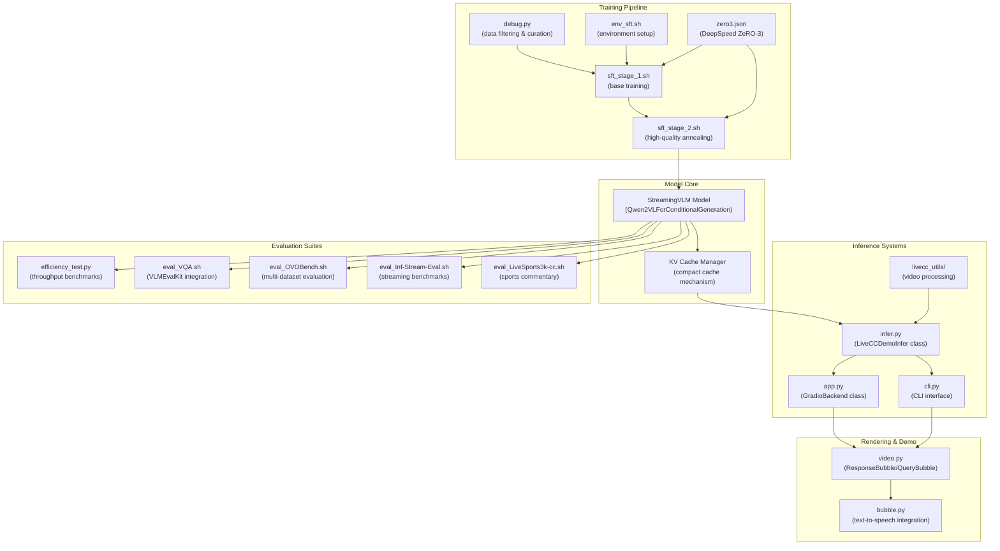

**Sources:** [readme.md:21-183](), [.gitignore:1-81]()

## Core Components

The StreamingVLM system consists of the following primary components:

| Component | Key Files | Primary Classes/Functions | Purpose |
|-----------|-----------|---------------------------|---------|
| **Model Core** | Model loaded from `mit-han-lab/StreamingVLM` on Hugging Face | `Qwen2VLForConditionalGeneration` | Base vision-language model with streaming optimization |
| **KV Cache** | Integrated within model inference | Cache compression logic | Maintains compact temporal context |
| **Inference Engine** | [streaming_vlm/inference/infer.py]() | `LiveCCDemoInfer` | Orchestrates streaming inference and multi-turn QA |
| **Training System** | [scripts/sft_stage_1.sh](), [scripts/sft_stage_2.sh]() | Two-stage SFT pipeline | Supervised fine-tuning with DeepSpeed |
| **Data Processing** | [streaming_vlm/training/debug.py]() | Category filtering, ASD selection | Dataset curation and preprocessing |
| **CLI Interface** | [streaming_vlm/demo/cli.py]() | CLI argument parsing and inference loop | Command-line video processing |
| **Web Interface** | [streaming_vlm/demo/app.py]() | `GradioBackend` | Browser-based interactive demo |
| **Video Processing** | [streaming_vlm/demo/livecc_utils/]() | Frame extraction, video readers | Video loading and frame management |
| **Evaluation** | [scripts/eval_*.sh]() | Multiple evaluation scripts | Comprehensive benchmark suite |
| **Rendering** | [streaming_vlm/demo/video.py](), [streaming_vlm/demo/bubble.py]() | `ResponseBubble`, `QueryBubble` | Visual output generation with TTS |

**Sources:** [readme.md:21-166]()

## Operational Modes

StreamingVLM supports two primary operational modes, implemented in the `LiveCCDemoInfer` class [streaming_vlm/inference/infer.py]():

### Real-Time Commentary Mode

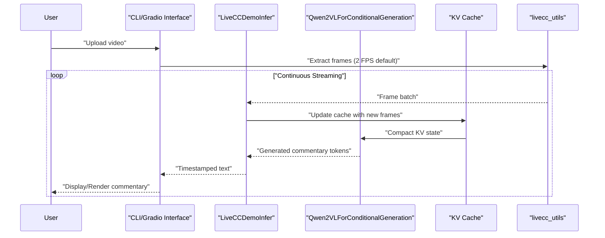

In this mode, the system continuously processes video frames at 2 FPS (configurable), generates timestamped commentary, and maintains a growing temporal context via the compact KV cache. The output is a stream of commentary segments aligned to video timestamps.

### Video Question Answering Mode

In QA mode, the system loads a complete video segment, processes user queries, and supports multi-turn conversations. The `LiveCCDemoInfer` class manages conversation state and provides context-aware responses based on the full video content.

**Sources:** [readme.md:30-42]()

## Data Flow Architecture

The following diagram shows how data flows through the system from raw inputs to final outputs, using actual file paths and dataset names:

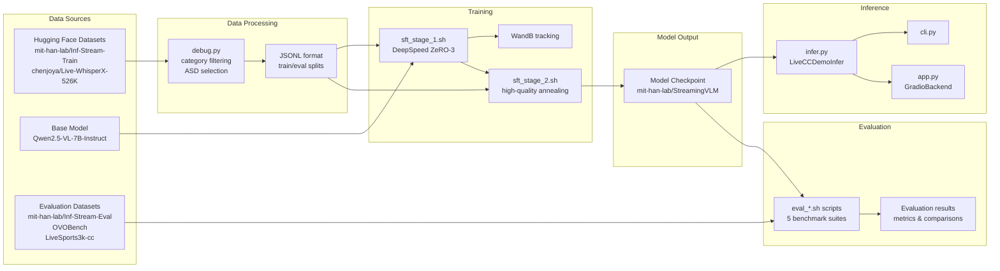

**Sources:** [readme.md:45-166]()

## Key Entry Points

The following table lists the primary entry points for interacting with the StreamingVLM system:

| Purpose | Script/File | Key Parameters | Environment |
|---------|-------------|----------------|-------------|
| **Inference (Interactive)** | [streaming_vlm/inference/inference.py]() | Model path, video input | `streamingvlm-infer` |
| **CLI Inference** | [streaming_vlm/demo/cli.py]() | Video path, mode selection | `streamingvlm-infer` |
| **Web Demo** | [streaming_vlm/demo/app.py]() | Model path, share settings | `streamingvlm-infer` |
| **Stage 1 Training** | [scripts/sft_stage_1.sh]() | `$DATASET_PATH`, GPU count | `streamingvlm-sft` |
| **Stage 2 Training** | [scripts/sft_stage_2.sh]() | Stage 1 checkpoint path | `streamingvlm-sft` |
| **Efficiency Eval** | [scripts/eval_efficiency.sh]() | Model path, test modes | `streamingvlm-infer` |
| **VQA Eval** | [scripts/eval_VQA.sh]() | Dataset selection | `streamingvlm-infer` |
| **OVOBench Eval** | [scripts/eval_OVOBench.sh]() | OVOBench data path | `streamingvlm-ovo` |
| **Inf-Stream Eval** | [scripts/eval_Inf-Stream-Eval.sh]() | `$EVAL_DATASET_PATH` | `streamingvlm-infer` |
| **LiveSports3k Eval** | [scripts/eval_LiveSports3k-cc.sh]() | `$LIVESPORTS3K_PATH` | `streamingvlm-infer` |
| **Data Preparation** | [streaming_vlm/training/debug.py]() | Dataset filtering params | `streamingvlm-sft` |

**Sources:** [readme.md:21-166]()

## Environment Configuration

StreamingVLM requires three distinct conda environments, each configured by dedicated setup scripts:

| Environment | Setup Script | Purpose | Key Dependencies |
|-------------|--------------|---------|------------------|
| `streamingvlm-infer` | [scripts/env_infer.sh]() | Inference and most evaluations | PyTorch, transformers, flash-attn, qwen-vl-utils |
| `streamingvlm-sft` | [scripts/env_sft.sh]() | Training pipeline | DeepSpeed, accelerate, wandb |
| `streamingvlm-ovo` | [scripts/env_ovo.sh]() | OVOBench evaluation | VLMEvalKit dependencies |

These environments are isolated to prevent dependency conflicts between training, inference, and specialized evaluation tasks. See [Environment Setup](#2.1) for detailed configuration instructions.

**Sources:** [readme.md:21-26]()

## Performance Characteristics

StreamingVLM achieves the following performance metrics:

- **Throughput**: 8 FPS on NVIDIA H100 GPU for streaming inference
- **Memory Efficiency**: Sub-linear KV cache growth with video length
- **Benchmark Results**:
  - 66.18% win rate vs GPT-4o-mini on Inf-Stream-Eval
  - Competitive or superior performance on Video-MME, MVBench, and LongVideoBench
  - Real-time sports commentary generation on LiveSports3k-cc

Detailed efficiency benchmarks and evaluation results are documented in [Evaluation Framework](#6).

**Sources:** [readme.md:9-11](), [readme.md:83-92]()

---

# Page: Key Innovations

# Key Innovations

<details>
<summary>Relevant source files</summary>

The following files were used as context for generating this wiki page:

- [assets/StreamingVLM_slides.pdf](assets/StreamingVLM_slides.pdf)
- [readme.md](readme.md)

</details>


## Purpose and Scope

This page describes the core technical innovations that enable StreamingVLM to achieve real-time understanding of effectively infinite video streams. These innovations include the compact KV cache architecture, training-inference alignment methodology, streaming processing pipeline, and memory optimization strategies. For the overall system architecture and repository organization, see [Overview](#1). For details on model architecture and components, see [Model Architecture](#3).

---

## Compact KV Cache System

The fundamental innovation in StreamingVLM is its **compact KV cache** design that maintains constant memory usage while processing arbitrarily long video streams. Unlike full-attention mechanisms that grow quadratically with sequence length, or naive sliding windows that lose long-term context, StreamingVLM uses a hybrid approach.

### Architecture Design

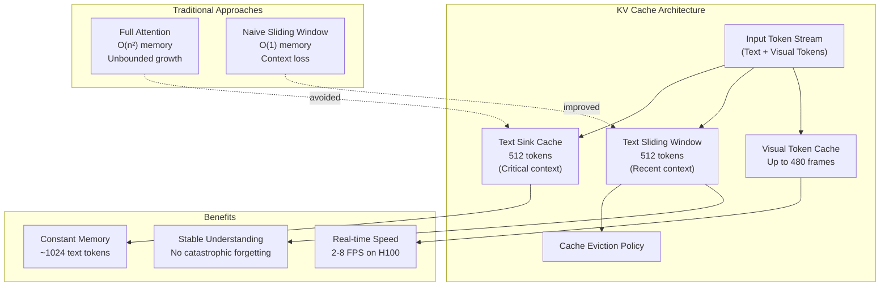

**KV Cache Components**

| Component | Size | Purpose | Eviction |
|-----------|------|---------|----------|
| Text Sink | 512 tokens | Preserve critical long-term context (e.g., video topic, instructions) | Never evicted |
| Text Sliding Window | 512 tokens | Maintain recent conversational context | FIFO when full |
| Visual Tokens | Up to 480 frames | Store frame embeddings for current processing chunk | Chunk-based |

The text sink acts as a "semantic anchor," retaining the most important context tokens throughout the entire video stream. This prevents the catastrophic forgetting problem that occurs with pure sliding windows, where early critical information is lost.

**Sources**: [readme.md:11](), [assets/StreamingVLM_slides.pdf]() (architectural diagrams)

---

## Training-Inference Alignment

The critical breakthrough enabling stable infinite-stream processing is **training-inference alignment**. StreamingVLM trains the model using the same KV cache constraints that will be applied during inference.

### Alignment Strategy

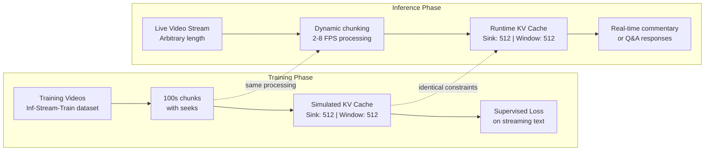

**Why Alignment Matters**

Traditional video-language models train on complete videos with full attention, then deploy with truncated context windows. This train-test mismatch causes:
- **Context Confusion**: Model expects information that was truncated
- **Instability**: Performance degrades unpredictably on long videos
- **Hallucinations**: Model fills gaps with invented content

StreamingVLM eliminates this mismatch by enforcing identical KV cache constraints during both training and inference. The model learns to operate effectively within a fixed context budget from the start.

**Two-Stage Training Process**

| Stage | Learning Rate | Data | Purpose |
|-------|---------------|------|---------|
| Stage 1 | 1e-5 | Full Inf-Stream-Train dataset | Learn streaming video understanding with KV cache constraints |
| Stage 2 | 1e-6 | High-quality subset (annealing) | Refine quality and stability on curated examples |

**Sources**: [readme.md:67-78](), [scripts/sft_stage_1.sh](), [scripts/sft_stage_2.sh]()

---

## Streaming Processing Pipeline

StreamingVLM processes video as a continuous stream rather than discrete clips, enabling real-time commentary and unbounded video understanding.

### Frame Processing Flow

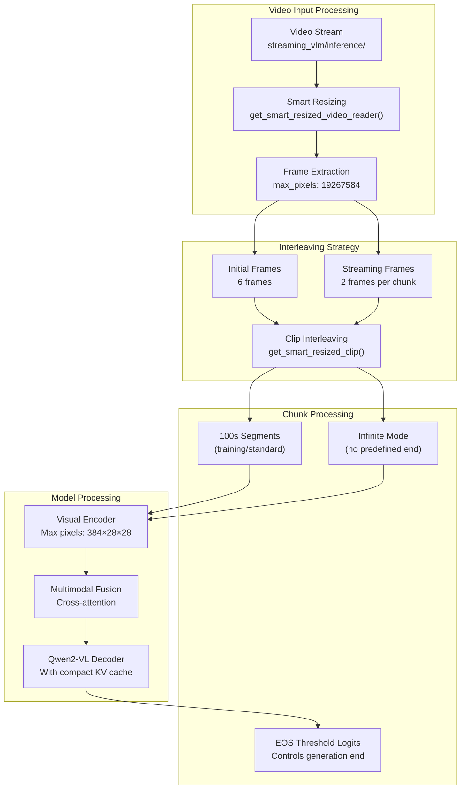

**Frame Budget Management**

StreamingVLM maintains a maximum of **480 frames** in memory at any time. The interleaving strategy balances initial context with ongoing streaming:

1. **Initial Phase**: Extract 6 frames to establish visual context
2. **Streaming Phase**: Process 2 frames per chunk continuously
3. **Smart Resizing**: Dynamically adjust spatial resolution to stay within pixel budget (19,267,584 pixels total)

This approach allows processing hours-long videos on a single GPU while maintaining temporal coherence.

**Sources**: [readme.md:36-41](), Diagram 5 in system overview

---

## Memory and Computational Optimizations

StreamingVLM employs multiple optimization strategies to achieve real-time performance on a single H100 GPU.

### Optimization Stack

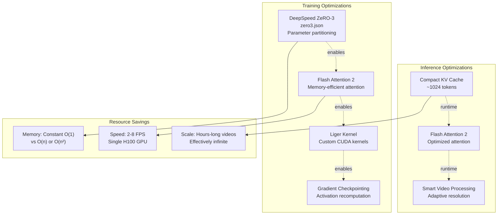

**Optimization Techniques**

| Technique | Component | Benefit |
|-----------|-----------|---------|
| DeepSpeed ZeRO-3 | Training | Partition parameters and optimizer states across GPUs; enables large batch training |
| Flash Attention 2 | Training & Inference | Memory-efficient attention computation; ~2-4x speedup |
| Liger Kernel | Training | Custom CUDA kernels for specific operations; reduce memory overhead |
| Gradient Checkpointing | Training | Trade computation for memory; enables larger models/batches |
| Compact KV Cache | Inference | Constant memory regardless of video length; enables infinite streams |
| Smart Resizing | Inference | Adaptive spatial resolution; maximize frames within pixel budget |

**DeepSpeed ZeRO-3 Configuration**

The training pipeline uses ZeRO Stage 3 parameter partitioning, which shards model parameters, gradients, and optimizer states across all available GPUs. This enables training with:
- **Gradient Accumulation**: 64 steps per update
- **Mixed Precision**: BF16 for reduced memory
- **Overlap Communication**: Computation and communication overlap for efficiency

**Sources**: [scripts/sft_stage_1.sh](), [scripts/sft_stage_2.sh](), Diagram 6 in system overview

---

## Performance Characteristics

### Efficiency Comparison

StreamingVLM's innovations deliver measurable performance advantages over baseline approaches:

| Metric | Full Attention | Sliding Window | StreamingVLM |
|--------|----------------|----------------|--------------|
| Memory Growth | O(n²) | O(1) | O(1) |
| Context Preservation | Full | Limited | Critical + Recent |
| Processing Speed (FPS) | <1 FPS | 4-6 FPS | 2-8 FPS |
| Max Video Length | Minutes | Unbounded | Unbounded |
| Stability on Long Videos | High | Low (forgetting) | High |

**Benchmark Results**

- **Inf-Stream-Eval**: 66.18% win rate vs. GPT-4o mini on long-video tasks
- **Real-time Processing**: 2-8 FPS on single H100 GPU (configurable via `QWENVL_FPS` environment variable)
- **General VQA Improvement**: Boosts performance on Video-MME, MVBench, LongVideoBench without task-specific finetuning
- **LiveSports3k-cc**: Competitive with commercial models (GPT-4o, Gemini) on live commentary

The efficiency script benchmarks these characteristics:

**Sources**: [readme.md:82-93](), [scripts/eval_efficiency.sh](), [readme.md:157-164]()

---

## Code-to-Concept Mapping

### Key Implementation Components

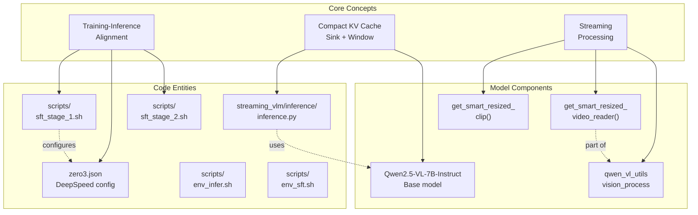

**File Path References**

| Innovation | Primary Files | Configuration |
|------------|---------------|---------------|
| Compact KV Cache | `streaming_vlm/inference/inference.py` | Implemented in base Qwen2-VL model |
| Training Alignment | `scripts/sft_stage_1.sh`, `scripts/sft_stage_2.sh` | Learning rates: 1e-5, 1e-6; Gradient accumulation: 64 |
| Streaming Processing | `qwen_vl_utils/vision_process.py` | FPS: 2-8 (configurable); Max frames: 480 |
| DeepSpeed Optimization | `zero3.json` | Stage 3 partitioning; BF16 precision |
| Environment Setup | `scripts/env_infer.sh`, `scripts/env_sft.sh` | Python 3.11, PyTorch 2.7.1 |

**Sources**: [readme.md:23-29](), [readme.md:67-78](), [readme.md:157-164]()

---

## Summary

StreamingVLM's key innovations work in concert to enable real-time understanding of infinite video streams:

1. **Compact KV Cache** eliminates quadratic memory growth while preserving critical context
2. **Training-Inference Alignment** ensures stable performance by using identical constraints during training and deployment
3. **Streaming Processing Pipeline** handles arbitrarily long videos through intelligent chunking and frame management
4. **Memory Optimizations** leverage DeepSpeed ZeRO-3, Flash Attention 2, and other techniques to achieve real-time speeds

These innovations are implemented across the training pipeline (Stage 1 and 2 SFT scripts), inference engine (`streaming_vlm/inference/`), and model architecture (Qwen2.5-VL-7B-Instruct base). The result is a system that processes video streams at 2-8 FPS on a single H100 GPU while maintaining stable, high-quality understanding over effectively infinite video lengths.

For implementation details of the inference system, see [Inference Systems](#5). For training procedures, see [Training Pipeline](#4). For evaluation benchmarks demonstrating these innovations, see [Evaluation Framework](#6).

**Sources**: [readme.md:9-11](), All diagrams in system architecture overview

---

# Page: Repository Structure

# Repository Structure

<details>
<summary>Relevant source files</summary>

The following files were used as context for generating this wiki page:

- [.gitignore](.gitignore)
- [readme.md](readme.md)

</details>


This document describes the organization of the StreamingVLM codebase, including the directory hierarchy, major components, and file types. For details about specific subsystems, see the following pages:
- For model architecture details, see [Model Architecture](#3)
- For training pipeline components, see [Training Pipeline](#4)
- For inference systems, see [Inference Systems](#5)
- For evaluation benchmarks, see [Evaluation Framework](#6)

## Overview

The repository is organized into distinct directories for core model implementation, baseline comparisons, scripts, and evaluation tools. The structure separates concerns between:
- Model implementations (`streaming_vlm/`, `baselines/`)
- Operational scripts (`scripts/`)
- Data and artifacts (`data/`, `checkpoints/`, `output/`)
- User interfaces (Gradio demo, CLI tools)

## Top-Level Directory Structure

The repository follows a modular organization with clear separation between implementation, configuration, and artifacts.

**Directory Structure Diagram**

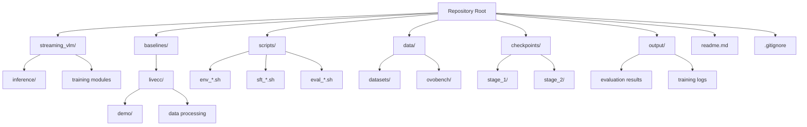

**Main Directory Purposes**

| Directory | Purpose | Git Tracking |
|-----------|---------|--------------|
| `streaming_vlm/` | Core StreamingVLM model implementation and inference engine | Tracked |
| `baselines/` | Baseline model implementations (LiveCC) | Tracked |
| `scripts/` | Shell scripts for environment setup, training, and evaluation | Tracked |
| `data/` | Dataset storage and benchmark data | Ignored |
| `checkpoints/` | Model checkpoints from training stages | Ignored |
| `output/` | Evaluation results, logs, and generated outputs | Ignored |
| `wandb/` | Weights & Biases experiment tracking | Ignored |

Sources: [.gitignore:1-81](), [readme.md:1-184]()

## Core Component Organization

**Component to Directory Mapping**

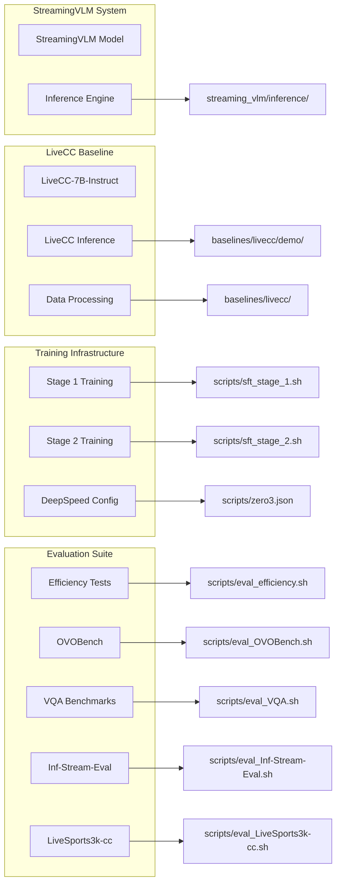

Sources: [readme.md:20-184]()

## StreamingVLM Core (`streaming_vlm/`)

The `streaming_vlm/` directory contains the core implementation of the StreamingVLM model and inference engine.

**Key Components**

| Component | Location | Description |
|-----------|----------|-------------|
| Inference Engine | `streaming_vlm/inference/` | Main inference implementation with `LiveCCDemoInfer` class |
| Model Implementation | `streaming_vlm/` (root) | Core model architecture, KV cache, and streaming logic |
| Training Modules | `streaming_vlm/` | Training utilities, data loaders, and model configurations |

The inference directory contains:
- `inference.py` - Main entry point for running inference
- `LiveCCDemoInfer` class - Core inference engine supporting both real-time commentary and video QA modes
- Video processing utilities for frame extraction and smart resizing

Sources: [readme.md:30-41]()

## Baselines (`baselines/`)

The `baselines/` directory contains alternative model implementations and data processing pipelines.

**LiveCC Baseline Structure**

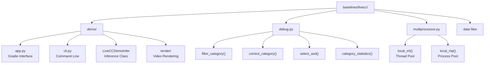

**LiveCC Components**

| File | Purpose |
|------|---------|
| `baselines/livecc/demo/app.py` | Gradio web interface for LiveCC model |
| `baselines/livecc/demo/cli.py` | Command-line interface for batch evaluation |
| `baselines/livecc/debug.py` | Data curation tools for filtering and processing |
| `baselines/livecc/multiprocessor.py` | Parallel processing utilities with 16-64 workers |

Sources: Inferred from system architecture diagrams

## Scripts Directory (`scripts/`)

The `scripts/` directory contains shell scripts organized by function: environment setup, training, and evaluation.

**Script Organization**

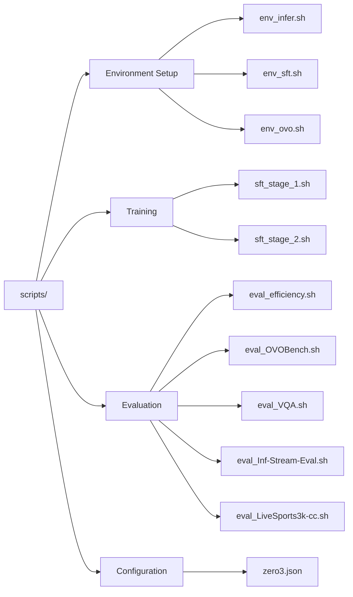

**Script Categories**

| Category | Scripts | Purpose |
|----------|---------|---------|
| Environment Setup | `env_infer.sh`, `env_sft.sh`, `env_ovo.sh` | Create conda environments with dependencies |
| Training | `sft_stage_1.sh`, `sft_stage_2.sh` | Two-stage supervised fine-tuning |
| Evaluation | `eval_*.sh` (5 scripts) | Run different evaluation benchmarks |
| Configuration | `zero3.json` | DeepSpeed ZeRO-3 configuration for distributed training |

Sources: [readme.md:23-26](), [readme.md:74-78](), [readme.md:84-155]()

## Data and Model Artifacts

Artifact directories are excluded from git tracking to manage repository size. These directories are created during data preparation and training.

**Artifact Directory Structure**

| Directory | Contents | Creation Method |
|-----------|----------|-----------------|
| `data/` | Downloaded datasets and benchmarks | Manual download or script |
| `data/ovobench/` | OVOBench evaluation data | Manual organization (see README structure) |
| `datasets/` | Processed training datasets | Data processing scripts |
| `checkpoints/` | Model checkpoints from training | Training scripts output |
| `output/`, `outputs/` | Evaluation results, logs | Evaluation scripts output |
| `wandb/` | Weights & Biases experiment tracking | Automatic during training |

**Dataset Paths**

The repository expects datasets at specific paths set via environment variables:

```bash
export DATASET_PATH=/path/to/your/Inf-Stream-Train
export EVAL_DATASET_PATH=/path/to/your/Inf-Stream-Eval
export LIVESPORTS3K_PATH=/path/to/your/LiveSports-3K/videos
```

**Required Datasets**

| Dataset | Hugging Face ID | Local Path |
|---------|----------------|------------|
| Inf-Stream-Train | `mit-han-lab/Inf-Stream-Train` | `$DATASET_PATH` |
| Live-WhisperX-526K | `chenjoya/Live-WhisperX-526K` | `$DATASET_PATH/Livecc_sft` |
| Inf-Stream-Eval | `mit-han-lab/Inf-Stream-Eval` | `$EVAL_DATASET_PATH` |
| OVOBench | Manual organization | `data/ovobench/` |

Sources: [readme.md:45-63](), [readme.md:97-114](), [readme.md:150-151](), [.gitignore:1-81]()

## File Types and Formats

**File Type Usage**

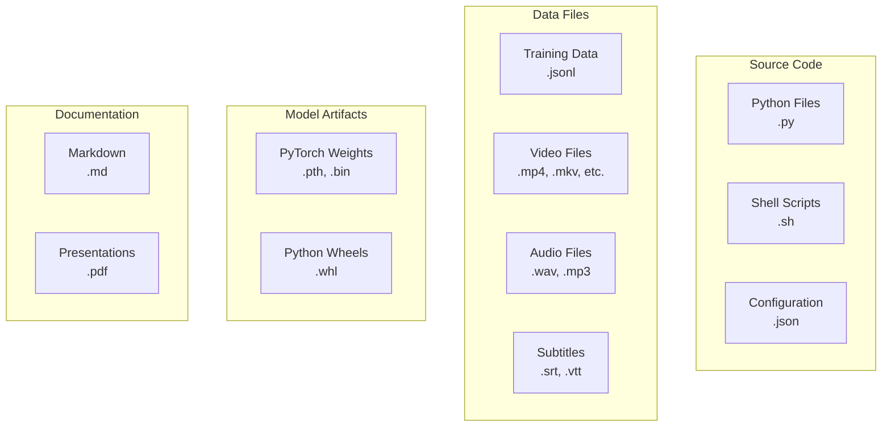

**Ignored File Extensions**

The `.gitignore` configuration excludes large files and generated artifacts:

| File Type | Extensions | Reason |
|-----------|-----------|--------|
| Video files | `.mp4`, `.mkv`, `.webm`, `.mov`, `.ts`, `.avi`, `.m4v` | Large binary files |
| Audio files | `.wav`, `.mp3`, `.flac` | Large binary files |
| Subtitles | `.srt`, `.vtt`, `.ass` | Generated/downloaded content |
| Data files | `.jsonl`, large JSON files | Dataset files |
| Python artifacts | `.pyc`, `.pyo`, `.pyd`, `__pycache__/` | Compiled bytecode |
| Wheels | `.whl*` | Package builds |

Sources: [.gitignore:39-62]()

## Configuration Files

**Root-Level Configuration**

| File | Purpose |
|------|---------|
| `.gitignore` | Specifies untracked files and directories |
| `readme.md` | Main documentation and quick start guide |

**Training Configuration**

| File | Purpose | Usage |
|------|---------|-------|
| `scripts/zero3.json` | DeepSpeed ZeRO-3 settings | Referenced by `sft_stage_1.sh` and `sft_stage_2.sh` |

The DeepSpeed configuration enables:
- Stage 3 parameter partitioning
- Optimizer state sharding
- Gradient accumulation (64 steps)
- Memory-efficient distributed training

Sources: [readme.md:1-184](), [.gitignore:1-81]()

## Environment-Specific Directories

Different environments create different temporary and output directories:

**Inference Environment**
- Creates temporary video files during processing
- Generates JSON output files with model responses
- May create rendered videos with overlays

**Training Environment**
- Creates `checkpoints/` directory for model weights
- Generates `wandb/` directory for experiment tracking
- Produces `output/` directory for training logs

**Evaluation Environment**
- Creates benchmark-specific output directories
- Generates result JSON/JSONL files
- May create visualization outputs

Sources: [.gitignore:1-81]()

## Special Directories

**Gradio Demo Directory**

The `streaming-vlm-demo/server/` directory (if present) contains:
- Temporary VTT files: `tmp_*.vtt`
- Server logs: `*.log`
- Upload directory: `uploads/` (with `.gitkeep` to preserve structure)

These are excluded from git tracking as they are runtime artifacts.

Sources: [.gitignore:73-81]()

## Summary

The repository structure separates implementation code (tracked in git) from data and artifacts (ignored). The key organizational principles are:

1. **Modularity**: Core model (`streaming_vlm/`) separate from baselines (`baselines/`)
2. **Script-based operations**: All major tasks (setup, training, eval) via `scripts/`
3. **Artifact isolation**: Data and outputs in dedicated ignored directories
4. **Environment separation**: Different conda environments for different tasks

This structure supports the development workflow where users:
1. Clone the repository (small, code-only)
2. Run environment setup scripts
3. Download datasets to designated paths
4. Execute training/evaluation scripts
5. Access outputs in clearly defined directories

Sources: [readme.md:1-184](), [.gitignore:1-81]()

---

# Page: License and Citation

# License and Citation

<details>
<summary>Relevant source files</summary>

The following files were used as context for generating this wiki page:

- [LICENSE](LICENSE)
- [readme.md](readme.md)

</details>


This document provides the legal framework and academic attribution information for StreamingVLM. It covers the MIT License terms, copyright details, and proper citation format for academic work using this codebase.

For information about the overall project purpose and architecture, see [Overview](#1). For getting started with the codebase, see [Getting Started](#2).

---

## License Overview

StreamingVLM is distributed under the **MIT License**, which grants broad permissions for use, modification, and distribution. The copyright is held by **MIT HAN Lab** with a copyright year of **2025**.

### License Location and Terms

The full license text is located in [LICENSE:1-22](). This is the canonical legal document governing the use of this software.

**Sources:** [LICENSE:1-22]()

---

## MIT License Terms

The MIT License grants the following permissions **free of charge** to any person obtaining a copy of the software:

| Permission | Description |
|------------|-------------|
| **Use** | Run the software for any purpose without restriction |
| **Copy** | Create copies of the software and documentation |
| **Modify** | Make changes to the source code |
| **Merge** | Combine with other software projects |
| **Publish** | Make the software publicly available |
| **Distribute** | Share copies with others |
| **Sublicense** | Grant licenses to derivative works |
| **Sell** | Commercialize copies or derivatives |

### Requirements and Limitations

The license requires that:

1. **Copyright Notice**: The copyright notice from [LICENSE:3]() must be included in all copies or substantial portions of the software
2. **License Notice**: The full license text from [LICENSE:1-22]() must be included in distributions

The software is provided **"AS IS"** with no warranties of any kind (express or implied), including but not limited to warranties of merchantability, fitness for a particular purpose, and non-infringement. See [LICENSE:15-20]() for the complete disclaimer.

**Sources:** [LICENSE:1-22]()

---

## License Propagation in Repository

The following diagram illustrates how the MIT License applies to different components of the StreamingVLM codebase:

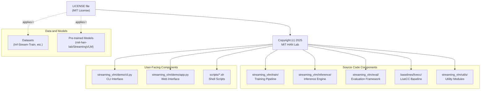

**All source code files** in the repository are covered by the MIT License. When distributing or modifying any component, users must include the copyright notice and license text from [LICENSE:3]() and [LICENSE:1-22]().

**Sources:** [LICENSE:1-22](), [readme.md:1-184]()

---

## Citation Information

### Academic Attribution

When using StreamingVLM in academic research, proper citation is required. The canonical citation format is provided in BibTeX format in [readme.md:168-182]().

### BibTeX Entry

```bibtex
@misc{xu2025streamingvlmrealtimeunderstandinginfinite,
      title={StreamingVLM: Real-Time Understanding for Infinite Video Streams}, 
      author={Ruyi Xu and Guangxuan Xiao and Yukang Chen and Liuning He and Kelly Peng and Yao Lu and Song Han},
      year={2025},
      eprint={2510.09608},
      archivePrefix={arXiv},
      primaryClass={cs.CV},
      url={https://arxiv.org/abs/2510.09608}, 
}
```

### Citation Components

| Component | Value |
|-----------|-------|
| **Citation Key** | `xu2025streamingvlmrealtimeunderstandinginfinite` |
| **Paper Title** | StreamingVLM: Real-Time Understanding for Infinite Video Streams |
| **Authors** | Ruyi Xu, Guangxuan Xiao, Yukang Chen, Liuning He, Kelly Peng, Yao Lu, Song Han |
| **Year** | 2025 |
| **ArXiv ID** | 2510.09608 |
| **Primary Class** | cs.CV (Computer Vision and Pattern Recognition) |
| **Archive** | arXiv |

**Sources:** [readme.md:168-182]()

---

## Related Resources

The following resources complement the codebase and should be referenced when appropriate:

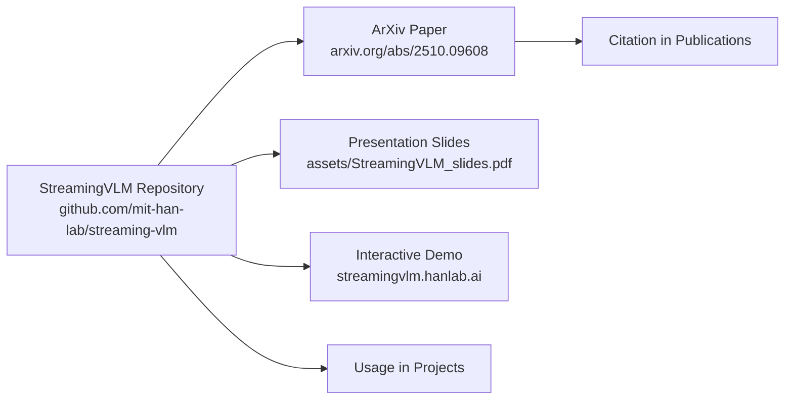

### Resource Locations

| Resource | Location | Purpose |
|----------|----------|---------|
| **Paper** | [https://arxiv.org/abs/2510.09608](https://arxiv.org/abs/2510.09608) | Technical details and experimental results |
| **Slides** | [assets/StreamingVLM_slides.pdf]() | Presentation materials |
| **Demo** | [https://streamingvlm.hanlab.ai](https://streamingvlm.hanlab.ai) | Live interactive demonstration |

Links to these resources are provided in [readme.md:4-6]().

**Sources:** [readme.md:1-6]()

---

## Citation Workflow

The following diagram shows when and how to properly cite StreamingVLM in different usage scenarios:

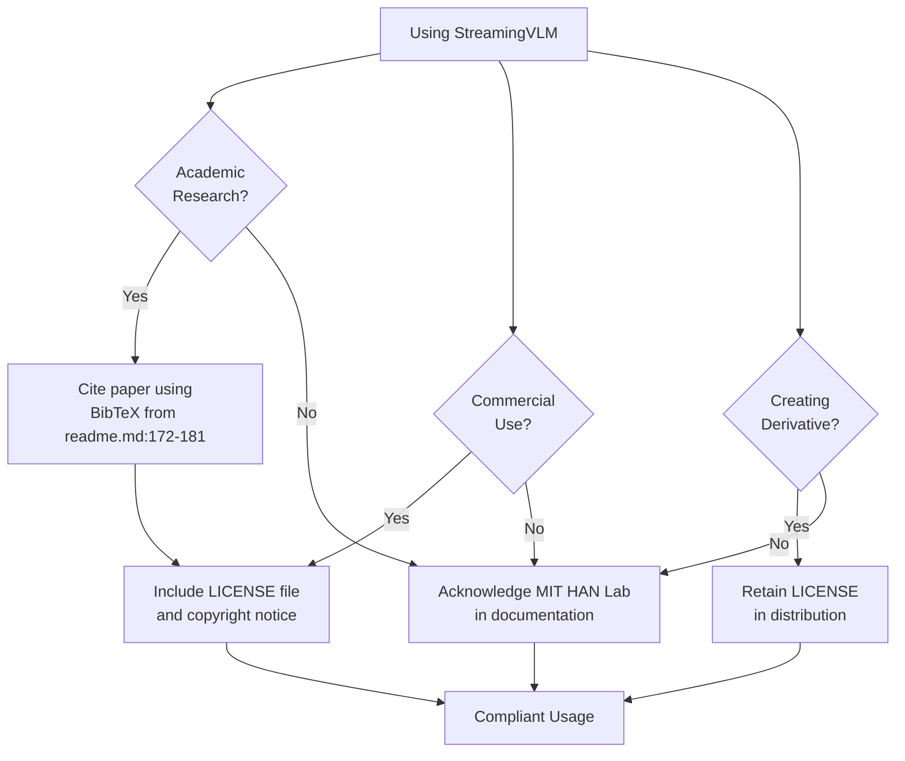

### Usage Scenarios

1. **Academic Research**: Always cite using the BibTeX entry from [readme.md:172-181](). Include in publications, presentations, and derived research.

2. **Commercial Applications**: Include the full license text from [LICENSE:1-22]() in your software distribution.

3. **Derivative Works**: Retain the copyright notice [LICENSE:3]() and license text [LICENSE:1-22]() in all derivative software.

4. **Non-Commercial Personal Use**: Acknowledgment of MIT HAN Lab is appreciated but not legally required under the MIT License.

**Sources:** [LICENSE:1-22](), [readme.md:168-182]()

---

## File-Level License Attribution

### Key Files with License Information

| File Path | License Relevance | Lines |
|-----------|-------------------|-------|
| [LICENSE]() | Complete license text | 1-22 |
| [readme.md]() | Citation information | 168-182 |

### Copyright Headers

While not all Python files in the repository contain explicit copyright headers, the **LICENSE file at the repository root** applies to all source code. When creating derivative works or redistributing code, users should either:

1. Keep the original LICENSE file in the distribution, or
2. Include copyright notices in modified files referencing MIT HAN Lab (2025)

**Sources:** [LICENSE:1-22]()

---

## Summary

| Aspect | Details |
|--------|---------|
| **License Type** | MIT License |
| **Copyright Holder** | MIT HAN Lab |
| **Copyright Year** | 2025 |
| **License File** | [LICENSE:1-22]() |
| **Citation Format** | BibTeX in [readme.md:172-181]() |
| **Paper DOI** | arXiv:2510.09608 |
| **Permissions** | Use, copy, modify, merge, publish, distribute, sublicense, sell |
| **Requirements** | Include copyright notice and license text in distributions |
| **Warranty** | None (AS IS) |

**Sources:** [LICENSE:1-22](), [readme.md:1-184]()

---

# Page: Getting Started

# Getting Started

<details>
<summary>Relevant source files</summary>

The following files were used as context for generating this wiki page:

- [readme.md](readme.md)
- [scripts/env_infer.sh](scripts/env_infer.sh)
- [scripts/env_ovo.sh](scripts/env_ovo.sh)
- [scripts/env_sft.sh](scripts/env_sft.sh)

</details>


This page guides users through initial setup and installation of the StreamingVLM system, from installing dependencies to running the first inference. It covers the prerequisite requirements, environment creation, and basic verification steps needed to begin using StreamingVLM for real-time video stream understanding.

For detailed environment configuration, see [Environment Setup](#2.1). For dependency explanations, see [Dependencies](#2.2). For comprehensive usage examples, see [Quick Start Guide](#2.3).

## Prerequisites

StreamingVLM requires the following system prerequisites:

| Component | Requirement | Purpose |
|-----------|-------------|---------|
| Python | 3.11 | Runtime environment |
| CUDA | 12.x compatible | GPU acceleration |
| GPU | H100 or equivalent (80GB recommended) | Model inference and training |
| Conda | Latest version | Environment management |
| FFmpeg | System package | Video processing |
| Storage | 50GB+ available | Model checkpoints and datasets |

The system supports three primary use cases, each with different environment requirements:

1. **Inference**: Running pre-trained models for video understanding and commentary
2. **Training**: Supervised fine-tuning on custom datasets
3. **Evaluation**: Benchmarking on OVOBench, VQA tasks, and custom metrics

**Sources:** [readme.md:21-28]()

## Installation Overview

The repository provides automated environment setup scripts for different use cases. The installation process follows a modular approach where each environment is isolated in its own conda environment.

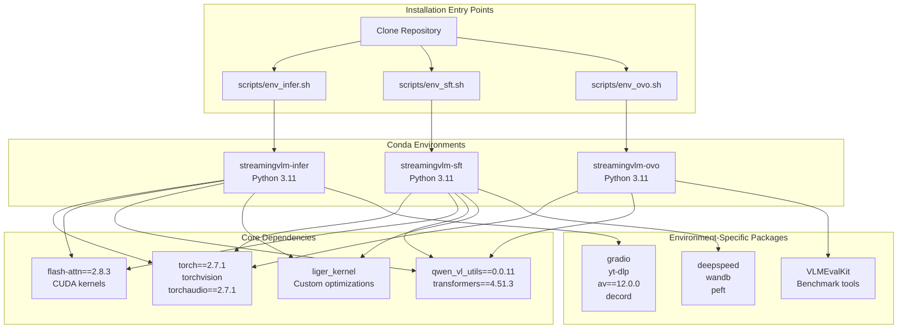

**Sources:** [readme.md:21-28](), [scripts/env_infer.sh:1-14]()

## Basic Installation

### Inference Environment

For users who want to run pre-trained StreamingVLM models for inference, the inference environment is the primary requirement:

```bash
# Clone the repository
git clone https://github.com/mit-han-lab/streaming-vlm.git
cd streaming-vlm

# Create inference environment
./scripts/env_infer.sh
```

The `env_infer.sh` script performs the following operations:

1. Creates conda environment `streamingvlm-infer` with Python 3.11
2. Installs FFmpeg via conda
3. Installs base dependencies from `infer_requirements.txt`
4. Installs PyTorch 2.7.1 with CUDA 12 support
5. Installs Qwen VL utilities and transformers
6. Installs Flash Attention 2 compiled for CUDA 12 and PyTorch 2.7
7. Installs LiveCC utilities in editable mode from `streaming_vlm/livecc_utils/`

**Sources:** [scripts/env_infer.sh:1-14](), [readme.md:21-28]()

### Training Environment

For users planning to perform supervised fine-tuning:

```bash
# Create training environment
./scripts/env_sft.sh
```

The training environment extends the inference environment with additional packages for distributed training, including DeepSpeed for ZeRO-3 optimization and Weights & Biases for experiment tracking.

**Sources:** [readme.md:21-28]()

### Evaluation Environment

For running OVOBench evaluations specifically:

```bash
# Create OVOBench evaluation environment
./scripts/env_ovo.sh
```

This environment includes VLMEvalKit and benchmark-specific dependencies.

**Sources:** [readme.md:117-122]()

## Environment Activation and Verification

After installation, activate the appropriate environment and verify the setup:

```bash
# Activate inference environment
conda activate streamingvlm-infer

# Verify Python version
python --version  # Should output Python 3.11.x

# Verify PyTorch and CUDA
python -c "import torch; print(f'PyTorch: {torch.__version__}'); print(f'CUDA Available: {torch.cuda.is_available()}')"

# Verify transformers and qwen_vl_utils
python -c "import transformers; import qwen_vl_utils; print('Core packages installed successfully')"
```

Expected output:
- Python version: 3.11.x
- PyTorch version: 2.7.1
- CUDA Available: True
- Core packages confirmation message

**Sources:** [scripts/env_infer.sh:1-14]()

## Dependency Installation Details

The inference environment installs packages in a specific order to ensure compatibility:

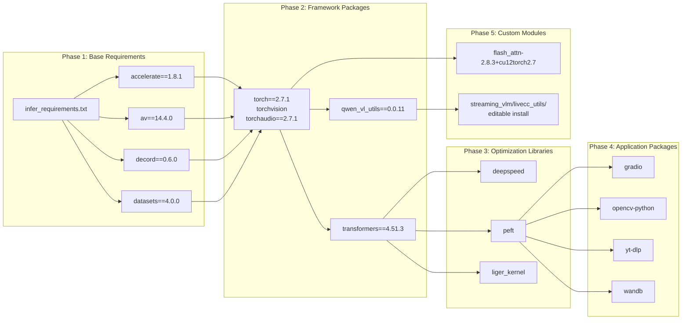

**Key Dependencies by Category:**

| Category | Packages | Purpose |
|----------|----------|---------|
| Deep Learning Framework | `torch==2.7.1`, `torchvision`, `torchaudio==2.7.1` | Core PyTorch ecosystem |
| Model Architecture | `transformers==4.51.3`, `qwen_vl_utils==0.0.11` | Transformer models and Qwen utilities |
| Memory Optimization | `flash_attn==2.8.3`, `liger_kernel` | Flash Attention 2 and custom CUDA kernels |
| Video Processing | `av==14.4.0`, `decord==0.6.0`, `opencv-python` | Video frame extraction and processing |
| Distributed Training | `deepspeed`, `accelerate==1.8.1` | ZeRO optimization and multi-GPU support |
| Data Handling | `datasets==4.0.0`, `huggingface-hub` | Dataset loading and HuggingFace integration |
| User Interface | `gradio` | Web-based demo interface |
| Utilities | `yt-dlp`, `wandb`, `tqdm` | Video download, experiment tracking, progress bars |

**Sources:** [scripts/env_infer.sh:5-14](), [infer_requirements.txt:1-121]()

## Flash Attention Installation

Flash Attention 2 requires a pre-compiled wheel matching the specific CUDA and PyTorch versions. The installation script downloads the appropriate wheel from the official Flash Attention GitHub releases:

```bash
# Example from env_infer.sh
wget https://github.com/Dao-AILab/flash-attention/releases/download/v2.8.3/flash_attn-2.8.3+cu12torch2.7cxx11abiTRUE-cp311-cp311-linux_x86_64.whl
pip install flash_attn-2.8.3+cu12torch2.7cxx11abiTRUE-cp311-cp311-linux_x86_64.whl
```

The wheel filename components:
- `2.8.3`: Flash Attention version
- `cu12`: CUDA 12.x compatibility
- `torch2.7`: PyTorch 2.7.x compatibility
- `cxx11abiTRUE`: C++11 ABI enabled
- `cp311`: CPython 3.11

Users must select the wheel matching their system configuration from https://github.com/Dao-AILab/flash-attention/releases.

**Sources:** [scripts/env_infer.sh:9-13]()

## First Inference Test

After environment setup, verify the system works by running a basic inference test:

```bash
# Activate inference environment
conda activate streamingvlm-infer

# Run inference script
python streaming_vlm/inference/inference.py
```

The `inference.py` script provides an entry point to the inference engine. By default, it loads a pre-trained model and processes video input.

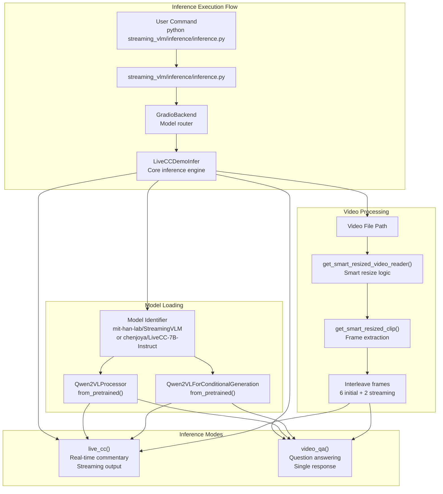

**Sources:** [readme.md:30-41]()

## Model Download

On first run, the inference system automatically downloads the pre-trained model from HuggingFace Hub:

| Model | HuggingFace ID | Size | Purpose |
|-------|---------------|------|---------|
| StreamingVLM | `mit-han-lab/StreamingVLM` | ~14GB | Main StreamingVLM model |
| LiveCC Baseline | `chenjoya/LiveCC-7B-Instruct` | ~14GB | Comparison baseline |
| Qwen2.5-VL Base | `Qwen/Qwen2.5-VL-7B-Instruct` | ~14GB | Base model for evaluation |

The models are cached in the HuggingFace cache directory (typically `~/.cache/huggingface/hub/`). Ensure sufficient disk space before running inference.

**Sources:** [readme.md:30-41]()

## Common Installation Issues

### Flash Attention Compilation Errors

If Flash Attention installation fails, verify:
1. CUDA toolkit version matches the wheel (12.x for cu12 wheels)
2. PyTorch version matches exactly (2.7.1)
3. Python version is 3.11
4. The downloaded wheel is for the correct architecture (x86_64)

Alternative: Install from source if pre-compiled wheels are incompatible:
```bash
pip install flash-attn --no-build-isolation
```

### CUDA Out of Memory

For GPUs with less than 80GB VRAM:
- Use model quantization (not covered in basic setup)
- Reduce batch size or frame count
- Enable gradient checkpointing for training

### Missing FFmpeg

If video processing fails with FFmpeg errors:
```bash
# Verify FFmpeg installation
ffmpeg -version

# Reinstall if missing
conda install -c conda-forge ffmpeg -y
```

**Sources:** [scripts/env_infer.sh:1-14]()

## Environment Configuration Files

The system uses requirements files to specify exact dependency versions:

| File | Purpose | Usage |
|------|---------|-------|
| `infer_requirements.txt` | Base inference dependencies | Installed by `env_infer.sh` |
| (Training requirements embedded in script) | Training-specific packages | Installed by `env_sft.sh` |

The `infer_requirements.txt` file contains 121 pinned package versions to ensure reproducibility. Key sections include:

- Lines 1-10: Acceleration and async libraries
- Lines 14-29: Video and audio processing
- Lines 31-45: HuggingFace ecosystem
- Lines 62-75: NVIDIA CUDA libraries
- Lines 94-110: Core ML frameworks

**Sources:** [infer_requirements.txt:1-121](), [scripts/env_infer.sh:5]()

## Next Steps

After successful installation and verification:

1. **For Inference Users**: Proceed to [Quick Start Guide](#2.3) for running inference on your videos
2. **For Training Users**: Review [Data Preparation](#4.1) before starting the training pipeline
3. **For Evaluation Users**: See [Evaluation Framework](#6) for benchmark setup instructions

Additional configuration options:
- **FPS Adjustment**: See [readme.md:157-166]() for modifying inference frame rate
- **Dataset Setup**: See [readme.md:45-65]() for downloading and preparing training datasets
- **Distributed Training**: Review [DeepSpeed Configuration](#4.4) for multi-GPU setup

**Sources:** [readme.md:30-156]()

---

# Page: Environment Setup

# Environment Setup

<details>
<summary>Relevant source files</summary>

The following files were used as context for generating this wiki page:

- [scripts/env_infer.sh](scripts/env_infer.sh)
- [scripts/env_ovo.sh](scripts/env_ovo.sh)
- [scripts/env_sft.sh](scripts/env_sft.sh)

</details>


## Purpose and Scope

This document details the environment configuration required to run different components of the StreamingVLM system. The repository provides three separate conda environments optimized for different tasks: inference, training (supervised fine-tuning), and OVOBench evaluation. Each environment is defined by a shell script that automates the installation of Python packages, system dependencies, and CUDA-specific libraries.

For information about installing dependencies and their purposes, see [Dependencies](#2.2). For running inference after environment setup, see [Quick Start Guide](#2.3).

## Environment Overview

The StreamingVLM system separates concerns across three isolated conda environments to avoid dependency conflicts and optimize for specific workloads:

**Environment Diagram: Three Isolated Environments**

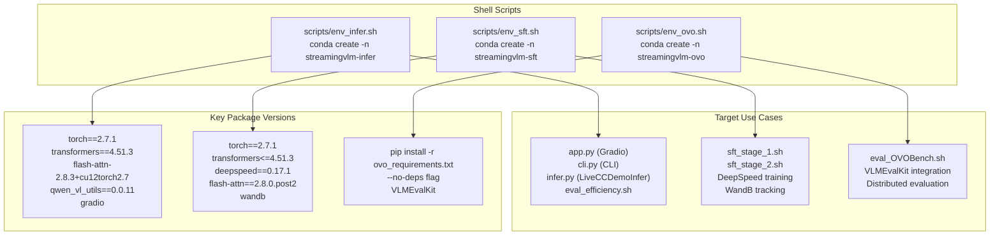

**Sources:** [scripts/env_infer.sh:1-14](), [scripts/env_sft.sh:1-15](), [scripts/env_ovo.sh:1-4]()

| Environment | Script | Python Version | Primary Purpose | Key Optimizations |
|-------------|--------|----------------|-----------------|-------------------|
| `streamingvlm-infer` | `scripts/env_infer.sh` | 3.11 | Inference, demos | Flash Attention 2.8.3, Gradio UI |
| `streamingvlm-sft` | `scripts/env_sft.sh` | 3.11 | Training | DeepSpeed 0.17.1, Liger kernels |
| `streamingvlm-ovo` | `scripts/env_ovo.sh` | 3.11 | OVOBench evaluation | VLMEvalKit integration |

**Sources:** [scripts/env_infer.sh:1](), [scripts/env_sft.sh:1](), [scripts/env_ovo.sh:1]()

## Inference Environment (streamingvlm-infer)

The inference environment supports running StreamingVLM and LiveCC models for real-time video commentary and question-answering tasks. This environment is used by the Gradio web demo, CLI tools, and evaluation scripts.

### Installation Steps

```bash
# Create environment
conda create -n streamingvlm-infer python=3.11 -y
conda activate streamingvlm-infer

# Install system dependencies
conda install -y ffmpeg

# Install Python packages
pip install -r infer_requirements.txt
pip install transformers==4.51.3 accelerate deepspeed peft opencv-python \
    decord datasets tensorboard gradio pillow-heif gpustat timm \
    sentencepiece openai av==12.0.0 liger_kernel numpy==1.24.4 \
    yt-dlp tqdm huggingface_hub ffmpeg wandb

# Install PyTorch and vision utilities
pip install torch==2.7.1 torchvision torchaudio==2.7.1 qwen_vl_utils==0.0.11

# Install livecc_utils package
pip install -e streaming_vlm/livecc_utils/

# Install Flash Attention (CUDA-specific)
wget https://github.com/Dao-AILab/flash-attention/releases/download/v2.8.3/flash_attn-2.8.3+cu12torch2.7cxx11abiTRUE-cp311-cp311-linux_x86_64.whl
pip install flash_attn-2.8.3+cu12torch2.7cxx11abiTRUE-cp311-cp311-linux_x86_64.whl
```

**Sources:** [scripts/env_infer.sh:1-14]()

### Critical Dependencies

**Dependency Installation Flow for env_infer.sh**

```mermaid
graph TB
    subgraph "Line 1-3: Base Environment"
        line1["conda create -n streamingvlm-infer"]
        line2["conda activate streamingvlm-infer"]
        line3["conda install -y ffmpeg"]
    end
    
    subgraph "Line 5: Requirements File"
        line5["pip install -r infer_requirements.txt"]
    end
    
    subgraph "Line 6: Core Dependencies"
        line6["pip install transformers==4.51.3<br/>accelerate deepspeed peft<br/>opencv-python decord datasets<br/>tensorboard gradio pillow-heif<br/>gpustat timm sentencepiece openai<br/>av==12.0.0 liger_kernel<br/>numpy==1.24.4 yt-dlp tqdm<br/>huggingface_hub ffmpeg wandb"]
    end
    
    subgraph "Line 7: PyTorch Stack"
        line7["pip install torch==2.7.1<br/>torchvision torchaudio==2.7.1<br/>qwen_vl_utils==0.0.11"]
    end
    
    subgraph "Line 8: Custom Utils"
        line8["pip install -e streaming_vlm/livecc_utils/"]
    end
    
    subgraph "Line 12-13: Flash Attention"
        line12["wget flash_attn-2.8.3+cu12torch2.7<br/>cxx11abiTRUE-cp311-cp311-linux_x86_64.whl"]
        line13["pip install flash_attn-2.8.3+cu12torch2.7<br/>cxx11abiTRUE-cp311-cp311-linux_x86_64.whl"]
    end
    
    line1 --> line2
    line2 --> line3
    line3 --> line5
    line5 --> line6
    line6 --> line7
    line7 --> line8
    line8 --> line12
    line12 --> line13
```

**Sources:** [scripts/env_infer.sh:1-13]()

| Package | Version | Purpose |
|---------|---------|---------|
| `torch` | 2.7.1 | PyTorch deep learning framework |
| `transformers` | 4.51.3 | Hugging Face model loading and inference |
| `qwen_vl_utils` | 0.0.11 | Qwen2.5-VL-specific utilities for video/image processing |
| `flash-attn` | 2.8.3 | Flash Attention 2 for memory-efficient attention operations |
| `gradio` | latest | Web UI for interactive demos |
| `decord` | latest | Efficient video frame extraction |
| `av` | 12.0.0 | PyAV for video codec handling |
| `numpy` | 1.24.4 | Pinned version for compatibility |

**Sources:** [scripts/env_infer.sh:6-8]()

### Flash Attention Installation

Flash Attention requires a pre-built wheel matching your CUDA version, PyTorch version, and C++ ABI. The `env_infer.sh` script demonstrates installation for CUDA 12, PyTorch 2.7, with C++11 ABI enabled:

```bash
# Download version-specific wheel (line 12)
wget https://github.com/Dao-AILab/flash-attention/releases/download/v2.8.3/flash_attn-2.8.3+cu12torch2.7cxx11abiTRUE-cp311-cp311-linux_x86_64.whl

# Install downloaded wheel (line 13)
pip install flash_attn-2.8.3+cu12torch2.7cxx11abiTRUE-cp311-cp311-linux_x86_64.whl
```

The wheel filename encodes critical version information:
- `cu12`: CUDA 12.x
- `torch2.7`: PyTorch 2.7.x
- `cxx11abiTRUE`: C++11 ABI enabled
- `cp311`: CPython 3.11

Users must select the appropriate wheel from the [Flash Attention releases page](https://github.com/Dao-AILab/flash-attention/releases) matching their system configuration.

**Sources:** [scripts/env_infer.sh:10-13]()

## Training Environment (streamingvlm-sft)

The training environment is optimized for two-stage supervised fine-tuning with DeepSpeed ZeRO-3 and distributed training capabilities. It includes Liger kernel optimizations for memory efficiency and Weights & Biases for experiment tracking.

### Installation Steps

```bash
# Create environment
conda create -n streamingvlm-sft python=3.11 -y
conda activate streamingvlm-sft

# Install PyTorch stack
pip install torch==2.7.1 torchvision torchaudio

# Install core dependencies
pip install "transformers<=4.51.3" accelerate deepspeed peft opencv-python \
    decord datasets tensorboard gradio pillow-heif gpustat timm \
    sentencepiece openai av==12.0.0 qwen_vl_utils liger_kernel numpy==1.24.4

# Install Flash Attention (pinned version for training stability)
pip install flash-attn==2.8.0.post2 --no-build-isolation --force-reinstall

# Install DeepSpeed (pinned version)
pip install deepspeed==0.17.1

# Install Qwen utilities and experiment tracking
pip install qwen_vl_utils==0.0.11 wandb

# Install livecc_utils package
pip install -e streaming_vlm/livecc_utils/
```

**Sources:** [scripts/env_sft.sh:1-9]()

### Training-Specific Dependencies

**Training Pipeline Dependencies from env_sft.sh**

```mermaid
graph TB
    subgraph "Line 1-2: Environment Creation"
        sft_line1["conda create -n streamingvlm-sft<br/>python=3.11"]
        sft_line2["conda activate streamingvlm-sft"]
    end
    
    subgraph "Line 3: PyTorch Base"
        sft_line3["pip install torch==2.7.1<br/>torchvision torchaudio"]
    end
    
    subgraph "Line 4: Core ML Packages"
        sft_line4["pip install transformers<=4.51.3<br/>accelerate deepspeed peft<br/>opencv-python decord datasets<br/>tensorboard gradio pillow-heif<br/>gpustat timm sentencepiece<br/>openai av==12.0.0<br/>qwen_vl_utils liger_kernel<br/>numpy==1.24.4"]
    end
    
    subgraph "Line 5: Flash Attention"
        sft_line5["pip install flash-attn==2.8.0.post2<br/>--no-build-isolation<br/>--force-reinstall"]
    end
    
    subgraph "Line 6: DeepSpeed"
        sft_line6["pip install deepspeed==0.17.1"]
    end
    
    subgraph "Line 7: Experiment Tracking"
        sft_line7["pip install qwen_vl_utils==0.0.11<br/>wandb"]
    end
    
    subgraph "Line 8: Custom Utils"
        sft_line8["pip install -e streaming_vlm/livecc_utils/"]
    end
    
    sft_line1 --> sft_line2
    sft_line2 --> sft_line3
    sft_line3 --> sft_line4
    sft_line4 --> sft_line5
    sft_line5 --> sft_line6
    sft_line6 --> sft_line7
    sft_line7 --> sft_line8
```

**Sources:** [scripts/env_sft.sh:1-8]()

| Package | Version | Purpose |
|---------|---------|---------|
| `deepspeed` | 0.17.1 | ZeRO-3 parameter partitioning and distributed training |
| `flash-attn` | 2.8.0.post2 | Pinned for training stability (different from inference) |
| `liger_kernel` | latest | Custom CUDA kernels for memory efficiency |
| `wandb` | latest | Weights & Biases experiment tracking and logging |
| `peft` | latest | Parameter-Efficient Fine-Tuning (LoRA, adapters) |
| `datasets` | latest | Hugging Face datasets library for data loading |
| `tensorboard` | latest | TensorBoard logging for training metrics |

**Sources:** [scripts/env_sft.sh:4-7]()

### Version Pinning Differences

The training environment (`env_sft.sh`) uses different version pins than inference (`env_infer.sh`):

| Package | Inference (env_infer.sh) | Training (env_sft.sh) | Reason |
|---------|--------------------------|----------------------|--------|
| Flash Attention | `2.8.3` (line 12-13) | `2.8.0.post2` (line 5) | Older version for training stability with DeepSpeed |
| Transformers | `==4.51.3` (line 6) | `<=4.51.3` (line 4) | Training allows minor updates |
| Flash Attention flags | Standard install | `--no-build-isolation --force-reinstall` (line 5) | Ensures compatibility with DeepSpeed |
| DeepSpeed | Not installed | `==0.17.1` (line 6) | Only needed for training |

The `--no-build-isolation --force-reinstall` flags in `env_sft.sh:5` ensure that Flash Attention is properly compiled against the installed PyTorch and CUDA versions before DeepSpeed is installed in line 6.

**Sources:** [scripts/env_sft.sh:5-6](), [scripts/env_infer.sh:6-7](), [scripts/env_infer.sh:12-13]()

## OVOBench Evaluation Environment (streamingvlm-ovo)

The OVOBench evaluation environment is minimal and uses a `--no-deps` installation strategy to avoid conflicts with VLMEvalKit requirements.

### Installation Steps

```bash
# Create environment
conda create -n streamingvlm-ovo python=3.11 -y
conda activate streamingvlm-ovo

# Install dependencies without transitive dependencies
pip install -r ovo_requirements.txt --no-deps
```

**Sources:** [scripts/env_ovo.sh:1-4]()

### Dependency Isolation Strategy

The `--no-deps` flag prevents pip from automatically installing transitive dependencies, giving fine-grained control over the package versions. This is critical for OVOBench evaluation because:

1. VLMEvalKit has specific version requirements that may conflict with StreamingVLM's training/inference dependencies
2. The evaluation environment only needs to run inference (no training), reducing the dependency footprint
3. Manual dependency specification via `ovo_requirements.txt` ensures reproducible evaluation results

The `ovo_requirements.txt` file (not shown in provided files) contains the exact packages needed for OVOBench evaluation, including VLMEvalKit and its compatible versions of transformers, torch, and other dependencies.

**Sources:** [scripts/env_ovo.sh:4]()

## Common Components Across Environments

All three environments share certain base requirements and installation patterns:

**Shared Infrastructure Across Environment Scripts**

```mermaid
graph TB
    subgraph "Common Pattern in All Scripts"
        python_ver["python=3.11<br/>(all three scripts line 1)"]
        conda_env["conda create -n ENV_NAME<br/>(env_infer.sh:1, env_sft.sh:1, env_ovo.sh:1)"]
    end
    
    subgraph "Common PyTorch Installation"
        torch_common["torch==2.7.1<br/>(env_infer.sh:7, env_sft.sh:3)"]
    end
    
    subgraph "Common Transformers"
        trans_infer["transformers==4.51.3<br/>(env_infer.sh:6)"]
        trans_sft["transformers<=4.51.3<br/>(env_sft.sh:4)"]
    end
    
    subgraph "Video Processing Stack"
        video_stack["decord + av==12.0.0 + opencv-python<br/>(env_infer.sh:6, env_sft.sh:4)"]
    end
    
    subgraph "Custom Package"
        livecc_infer["pip install -e streaming_vlm/livecc_utils/<br/>(env_infer.sh:8)"]
        livecc_sft["pip install -e streaming_vlm/livecc_utils/<br/>(env_sft.sh:8)"]
    end
    
    subgraph "Qwen Utilities"
        qwen_utils["qwen_vl_utils==0.0.11<br/>(env_infer.sh:7, env_sft.sh:7)"]
    end
    
    python_ver --> conda_env
    conda_env --> torch_common
    torch_common --> trans_infer
    torch_common --> trans_sft
    torch_common --> video_stack
    torch_common --> qwen_utils
    qwen_utils --> livecc_infer
    qwen_utils --> livecc_sft
```

**Sources:** [scripts/env_infer.sh:1-8](), [scripts/env_sft.sh:1-8](), [scripts/env_ovo.sh:1]()

### The livecc_utils Package

Both inference and training environments install the custom `streaming_vlm/livecc_utils/` package in editable mode:

```bash
# From env_infer.sh line 8 and env_sft.sh line 8
pip install -e streaming_vlm/livecc_utils/
```

The `-e` flag creates an editable installation, allowing code changes in the `livecc_utils` directory to be immediately reflected without reinstalling. This package contains shared utilities for video processing, frame extraction, and streaming inference that are used by:
- `infer.py` (`LiveCCDemoInfer` class)
- `cli.py` (command-line interface)
- `app.py` (Gradio web demo)
- Training scripts (`sft_stage_1.sh`, `sft_stage_2.sh`)

**Sources:** [scripts/env_infer.sh:8](), [scripts/env_sft.sh:8]()

## Hardware Requirements

While not explicitly documented in the setup scripts, the system requirements can be inferred from the dependencies:

| Component | Requirement | Rationale |
|-----------|-------------|-----------|
| GPU | NVIDIA GPU with CUDA 12.x support | Flash Attention wheels target CUDA 12 |
| GPU Memory | 24GB+ (single GPU inference), 80GB+ recommended (H100 for training) | StreamingVLM inference runs on single H100; training uses ZeRO-3 across multiple GPUs |
| RAM | 32GB+ | Video decoding and frame buffering |
| Storage | 100GB+ | Model checkpoints, datasets, and video files |
| CUDA | 12.x | PyTorch 2.7.1 and Flash Attention compiled for CUDA 12 |

**Sources:** [scripts/env_infer.sh:12]() (Flash Attention wheel filename indicates CUDA 12)

## Installation Workflow

**Complete Setup Process**

```mermaid
graph TD
    START["Start: Choose Environment"]
    
    INFER_CHOICE["Inference/Demo?"]
    TRAIN_CHOICE["Training?"]
    EVAL_CHOICE["OVOBench Evaluation?"]
    
    INFER_ENV["bash scripts/env_infer.sh<br/>Creates streamingvlm-infer"]
    TRAIN_ENV["bash scripts/env_sft.sh<br/>Creates streamingvlm-sft"]
    EVAL_ENV["bash scripts/env_ovo.sh<br/>Creates streamingvlm-ovo"]
    
    FLASH_CHECK["Check system:<br/>CUDA version (cu12)<br/>PyTorch version (2.7)<br/>C++ ABI (cxx11abiTRUE)"]
    
    FLASH_DOWN_INFER["wget from github.com/Dao-AILab/<br/>flash-attention/releases/<br/>v2.8.3 for inference"]
    FLASH_DOWN_SFT["pip install flash-attn==2.8.0.post2<br/>--no-build-isolation<br/>--force-reinstall"]
    
    VERIFY["python -c 'import torch'<br/>python -c 'import transformers'<br/>python -c 'import flash_attn'<br/>python -c 'from livecc_utils import *'"]
    
    READY_INFER["streamingvlm-infer ready<br/>for app.py, cli.py"]
    READY_SFT["streamingvlm-sft ready<br/>for sft_stage_1.sh, sft_stage_2.sh"]
    READY_OVO["streamingvlm-ovo ready<br/>for eval_OVOBench.sh"]
    
    START --> INFER_CHOICE
    START --> TRAIN_CHOICE
    START --> EVAL_CHOICE
    
    INFER_CHOICE --> INFER_ENV
    TRAIN_CHOICE --> TRAIN_ENV
    EVAL_CHOICE --> EVAL_ENV
    
    INFER_ENV --> FLASH_CHECK
    TRAIN_ENV --> FLASH_DOWN_SFT
    
    FLASH_CHECK --> FLASH_DOWN_INFER
    FLASH_DOWN_INFER --> VERIFY
    FLASH_DOWN_SFT --> VERIFY
    
    EVAL_ENV --> VERIFY
    
    VERIFY --> READY_INFER
    VERIFY --> READY_SFT
    VERIFY --> READY_OVO
```

**Sources:** [scripts/env_infer.sh:1-14](), [scripts/env_sft.sh:1-15](), [scripts/env_ovo.sh:1-4]()

### Typical Usage Pattern

Users typically need only one environment for their use case:

1. **Researchers/Developers**: Use `streamingvlm-sft` for training experiments
2. **End Users**: Use `streamingvlm-infer` for running demos and inference
3. **Benchmark Testers**: Use `streamingvlm-ovo` specifically for OVOBench evaluation

The environments are kept separate to prevent dependency conflicts and ensure reproducible results across different tasks.

**Sources:** All environment setup scripts

---

# Page: Dependencies

# Dependencies

<details>
<summary>Relevant source files</summary>

The following files were used as context for generating this wiki page:

- [infer_requirements.txt](infer_requirements.txt)
- [ovo_requirements.txt](ovo_requirements.txt)

</details>


## Purpose and Scope

This document details the Python package dependencies required for StreamingVLM across different operational modes: inference, training, and evaluation. Each environment has specific dependency requirements optimized for its use case. For instructions on setting up these environments, see [Environment Setup](#2.1). For practical usage examples after installation, see [Quick Start Guide](#2.3).

The repository maintains three primary dependency configurations:
- **Inference environment**: Optimized for real-time streaming and video QA inference
- **Training environment**: Includes distributed training frameworks and optimization tools
- **Evaluation environment**: Contains benchmark-specific packages and evaluation frameworks

---

## Dependency Architecture

The following diagram illustrates how major dependency groups interact to support StreamingVLM's functionality:

**Dependency System Architecture**

```mermaid
graph TB
    subgraph "Core ML Framework"
        TORCH["torch==2.7.1"]
        TRANSFORMERS["transformers<br/>4.51.3 / 4.52.4"]
        ACCELERATE["accelerate<br/>1.8.1 / 1.10.1"]
        TOKENIZERS["tokenizers<br/>0.21.2 / 0.21.4"]
    end
    
    subgraph "Optimization Layer"
        FLASH["flash_attn<br/>2.8.0+ / 2.8.3"]
        LIGER["liger_kernel<br/>0.6.1 / 0.6.2"]
        TRITON["triton==3.3.1"]
        DEEPSPEED["deepspeed==0.17.5<br/>(training only)"]
        PEFT["peft==0.17.1<br/>(training only)"]
    end
    
    subgraph "Vision and Video Processing"
        TORCHVISION["torchvision==0.22.1"]
        DECORD["decord==0.6.0"]
        AV["av<br/>12.0.0 / 14.4.0"]
        OPENCV["opencv-python<br/>4.11.0 / 4.12.0"]
        PILLOW["pillow<br/>11.2.1 / 11.3.0"]
        QWEN_UTILS["qwen-vl-utils==0.0.11"]
    end
    
    subgraph "Audio Processing"
        WHISPER["faster-whisper==1.1.1"]
        CTRANS["ctranslate2==4.6.0"]
        JIWER["jiwer==4.0.0"]
    end
    
    subgraph "Data Infrastructure"
        DATASETS["datasets==4.0.0"]
        PYARROW["pyarrow==21.0.0"]
        PANDAS["pandas==2.3.2"]
        NUMPY["numpy<br/>1.24.4 / 2.2.6"]
    end
    
    subgraph "Web and API"
        GRADIO["gradio==5.44.1<br/>(ovo only)"]
        FASTAPI["fastapi==0.116.1"]
        UVICORN["uvicorn==0.35.0"]
        OPENAI["openai<br/>1.107.0 / 1.107.1"]
    end
    
    subgraph "Utilities"
        FFMPEG["ffmpeg<br/>(conda)"]
        YTDLP["yt-dlp<br/>2025.6.30"]
        TQDM["tqdm==4.67.1"]
        PSUTIL["psutil==7.0.0"]
    end
    
    TORCH --> TRANSFORMERS
    TORCH --> TORCHVISION
    TORCH --> FLASH
    TORCH --> TRITON
    TORCH --> DEEPSPEED
    ACCELERATE --> TRANSFORMERS
    TRANSFORMERS --> QWEN_UTILS
    TRANSFORMERS --> TOKENIZERS
    
    FLASH --> TRITON
    DEEPSPEED --> ACCELERATE
    PEFT --> TRANSFORMERS
    
    DATASETS --> PYARROW
    DATASETS --> PANDAS
    PANDAS --> NUMPY
    
    DECORD --> FFMPEG
    AV --> FFMPEG
    OPENCV --> NUMPY
    
    WHISPER --> CTRANS
    
    GRADIO --> FASTAPI
    GRADIO --> UVICORN
```

**Sources:** [infer_requirements.txt](), [ovo_requirements.txt](), [scripts/env_infer.sh]()

---

## Core ML Framework Dependencies

### PyTorch Ecosystem

The foundation of StreamingVLM is built on PyTorch 2.7.1 with CUDA 12.6 support:

| Package | Version | Purpose |
|---------|---------|---------|
| `torch` | 2.7.1 | Core deep learning framework with CUDA support |
| `torchvision` | 0.22.1 | Computer vision utilities and models |
| `torchaudio` | 2.7.1 | Audio processing (training environments) |
| `triton` | 3.3.1 | GPU kernel compiler for optimized operations |

The specific NVIDIA CUDA libraries are automatically installed as torch dependencies:
- `nvidia-cuda-runtime-cu12==12.6.77`
- `nvidia-cudnn-cu12==9.5.1.17`
- `nvidia-cublas-cu12==12.6.4.1`
- `nvidia-nccl-cu12==2.26.2` (for distributed training)

### Transformers Framework

| Package | Version (Inference/OVO) | Purpose |
|---------|-------------------------|---------|
| `transformers` | 4.52.4 / 4.51.3 | Hugging Face transformers library for model loading and inference |
| `accelerate` | 1.8.1 / 1.10.1 | Distributed training and mixed precision utilities |
| `tokenizers` | 0.21.2 / 0.21.4 | Fast tokenization for text processing |
| `safetensors` | 0.5.3 / 0.6.2 | Safe model serialization format |

**Sources:** [infer_requirements.txt:106-110](), [ovo_requirements.txt:110-114]()

---

## Optimization and Performance Dependencies

### Flash Attention and Custom Kernels

StreamingVLM's efficient attention mechanism relies on specialized CUDA kernels:

**Performance Optimization Stack**

```mermaid
graph LR
    subgraph "Model Inference"
        QWEN["Qwen2-VL Model"]
    end
    
    subgraph "Attention Optimization"
        FLASH_ATTN["flash_attn<br/>2.8.0.post2 (infer)<br/>2.8.3 (ovo)"]
        KERNEL_NOTE["Installed from<br/>pre-built wheels"]
    end
    
    subgraph "Kernel Optimization"
        LIGER["liger_kernel<br/>0.6.1 / 0.6.2"]
        TRITON_OPT["triton==3.3.1"]
        SPARSE["block_sparse_attn<br/>(inference only)"]
    end
    
    subgraph "Distributed Training"
        DEEPSPEED_OPT["deepspeed==0.17.5<br/>ZeRO-3 optimizer"]
        PEFT_OPT["peft==0.17.1<br/>LoRA/adapters"]
    end
    
    QWEN --> FLASH_ATTN
    FLASH_ATTN --> TRITON_OPT
    LIGER --> TRITON_OPT
    FLASH_ATTN -.installed from.-> KERNEL_NOTE
    
    QWEN --> DEEPSPEED_OPT
    QWEN --> PEFT_OPT
```

| Package | Version | Environment | Purpose |
|---------|---------|-------------|---------|
| `flash_attn` | 2.8.0.post2 / 2.8.3 | Both | Memory-efficient attention implementation |
| `liger_kernel` | 0.6.1 / 0.6.2 | Both | Custom CUDA kernels for transformer operations |
| `block_sparse_attn` | 0.0.1 | Inference only | Sparse attention patterns |
| `deepspeed` | 0.17.5 | Training/OVO | ZeRO optimization for distributed training |
| `peft` | 0.17.1 | OVO | Parameter-efficient fine-tuning (LoRA) |

**Installation Note:** Flash Attention must be installed from pre-built wheels matching the CUDA and PyTorch versions. See [scripts/env_infer.sh:10-13]() for the download and installation process.

**Sources:** [infer_requirements.txt:31,52](), [ovo_requirements.txt:25,42,18,75](), [scripts/env_infer.sh:9-13]()

---

## Vision and Video Processing Dependencies

### Video Decoding and Processing

StreamingVLM processes video streams using multiple video handling libraries:

**Video Processing Pipeline Dependencies**

```mermaid
graph TB
    subgraph "Video Input Sources"
        VIDEO_FILE["Video Files<br/>MP4, AVI, etc."]
        YOUTUBE["YouTube Videos<br/>yt-dlp"]
    end
    
    subgraph "Video Decoding"
        DECORD_LIB["decord==0.6.0<br/>GPU-accelerated decoder"]
        AV_LIB["av (PyAV)<br/>12.0.0 / 14.4.0<br/>FFmpeg Python bindings"]
        TORCHCODEC["torchcodec==0.4.0<br/>(inference only)"]
    end
    
    subgraph "Frame Processing"
        OPENCV_LIB["opencv-python<br/>4.11.0 / 4.12.0<br/>Image processing"]
        PILLOW_LIB["pillow<br/>11.2.1 / 11.3.0<br/>Image loading/saving"]
        PILLOW_HEIF["pillow_heif==1.1.0<br/>(ovo only)<br/>HEIF/HEIC support"]
    end
    
    subgraph "Model Utilities"
        QWEN_VL["qwen-vl-utils==0.0.11<br/>Video preprocessing<br/>Smart resize"]
    end
    
    subgraph "System Dependencies"
        FFMPEG_SYS["ffmpeg<br/>(conda package)<br/>Media transcoding"]
        FFMPEG_PY["ffmpeg-python==0.2.0<br/>(inference only)"]
    end
    
    YOUTUBE --> YTDLP_LIB["yt-dlp==2025.6.30"]
    YTDLP_LIB --> VIDEO_FILE
    VIDEO_FILE --> DECORD_LIB
    VIDEO_FILE --> AV_LIB
    VIDEO_FILE --> TORCHCODEC
    
    DECORD_LIB --> OPENCV_LIB
    AV_LIB --> OPENCV_LIB
    TORCHCODEC --> OPENCV_LIB
    
    OPENCV_LIB --> PILLOW_LIB
    PILLOW_LIB --> QWEN_VL
    
    DECORD_LIB -.requires.-> FFMPEG_SYS
    AV_LIB -.requires.-> FFMPEG_SYS
    FFMPEG_PY -.wraps.-> FFMPEG_SYS
```

| Package | Version | Environment | Purpose |
|---------|---------|-------------|---------|
| `decord` | 0.6.0 | Both | GPU-accelerated video decoding with frame seeking |
| `av` (PyAV) | 12.0.0 / 14.4.0 | Both | FFmpeg Python bindings for media processing |
| `torchcodec` | 0.4.0 | Inference | PyTorch-native video codec |
| `opencv-python` | 4.11.0 / 4.12.0 | Both | Image processing and transformations |
| `pillow` | 11.2.1 / 11.3.0 | Both | Image I/O and basic operations |
| `qwen-vl-utils` | 0.0.11 | Both | Qwen-VL specific preprocessing utilities |
| `yt-dlp` | 2025.6.30 | Inference | YouTube video downloading |
| `ffmpeg` | (conda) | Both | System-level media transcoding |

**Critical:** FFmpeg must be installed via conda ([scripts/env_infer.sh:3]()) before installing Python video libraries, as `decord` and `av` require FFmpeg system libraries.

**Sources:** [infer_requirements.txt:23,9,94,78,82,120](), [ovo_requirements.txt:17,77,76,91](), [scripts/env_infer.sh:3]()

---

## Model-Specific Dependencies

### Qwen2-VL Integration

| Package | Version | Purpose |
|---------|---------|---------|
| `qwen-vl-utils` | 0.0.11 | Video preprocessing, smart resize, frame extraction utilities |
| `einops` | 0.8.1 | Tensor manipulation for vision transformers |
| `timm` | 1.0.19 | Vision model architectures (OVO env) |

The `qwen-vl-utils` package provides critical video preprocessing functions including:
- Smart resizing to fit maximum pixel constraints (19,267,584 pixels)
- Frame extraction with temporal subsampling
- Clip interleaving for streaming inference

**Sources:** [infer_requirements.txt:94,26](), [ovo_requirements.txt:91,21,107]()

---

## Data Processing Dependencies

### Dataset Handling

**Data Processing Infrastructure**

```mermaid
graph LR
    subgraph "Data Loading"
        DATASETS_LIB["datasets==4.0.0<br/>Hugging Face datasets"]
        PYARROW_LIB["pyarrow==21.0.0<br/>Apache Arrow backend"]
    end
    
    subgraph "Data Processing"
        PANDAS_LIB["pandas==2.3.2<br/>DataFrame operations"]
        NUMPY_LIB["numpy<br/>1.24.4 (ovo)<br/>2.2.6 (infer)"]
    end
    
    subgraph "Parallel Processing"
        MULTIPROCESS["multiprocess==0.70.16<br/>Parallel data loading"]
        DILL["dill==0.3.8<br/>Serialization"]
    end
    
    subgraph "Data Formats"
        JSONL["JSONL files<br/>Training data"]
        HF_HUB["Hugging Face Hub<br/>Dataset hosting"]
    end
    
    DATASETS_LIB --> PYARROW_LIB
    DATASETS_LIB --> PANDAS_LIB
    PANDAS_LIB --> NUMPY_LIB
    DATASETS_LIB --> MULTIPROCESS
    MULTIPROCESS --> DILL
    
    JSONL --> DATASETS_LIB
    DATASETS_LIB --> HF_HUB
```

| Package | Version | Purpose |
|---------|---------|---------|
| `datasets` | 4.0.0 | Hugging Face datasets library for data loading and caching |
| `pyarrow` | 21.0.0 | Apache Arrow backend for efficient data serialization |
| `pandas` | 2.3.2 | DataFrame operations for data manipulation |
| `numpy` | 1.24.4 / 2.2.6 | Numerical computing foundation |
| `multiprocess` | 0.70.16 | Parallel data processing |
| `dill` | 0.3.8 | Extended pickling for complex Python objects |

**Version Note:** Inference environment uses NumPy 2.2.6 while OVO environment uses NumPy 1.24.4 for compatibility with certain evaluation frameworks.

**Sources:** [infer_requirements.txt:22,87,80,61,58,24](), [ovo_requirements.txt:16,82,74,54]()

---

## Audio Processing Dependencies

### Speech Recognition and Transcription

Audio processing is primarily used for WhisperX-based transcription in data processing pipelines:

| Package | Version | Environment | Purpose |
|---------|---------|-------------|---------|
| `faster-whisper` | 1.1.1 | Inference | Optimized Whisper implementation using CTranslate2 |
| `ctranslate2` | 4.6.0 | Inference | Fast inference engine for transformer models |
| `jiwer` | 4.0.0 | Inference | Word error rate calculation for transcription evaluation |
| `pydub` | 0.25.1 | OVO | Audio file manipulation and format conversion |

**Sources:** [infer_requirements.txt:28,19,50](), [ovo_requirements.txt:85]()

---

## Web Interface and API Dependencies

### Gradio Web Demo

The OVO evaluation environment includes a comprehensive web interface stack:

| Package | Version | Environment | Purpose |
|---------|---------|-------------|---------|
| `gradio` | 5.44.1 | OVO only | Web UI framework for interactive demos |
| `gradio_client` | 1.12.1 | OVO only | Client library for Gradio applications |
| `fastapi` | 0.116.1 | Both | High-performance web framework |
| `uvicorn` | 0.35.0 | Both | ASGI server for FastAPI applications |
| `starlette` | 0.47.1 / 0.47.3 | Both | ASGI framework (FastAPI dependency) |
| `httpx` | 0.28.1 | Both | Async HTTP client |
| `websockets` | 15.0.1 | OVO only | WebSocket protocol support |

**Sources:** [infer_requirements.txt:27,116,42](), [ovo_requirements.txt:29-30,22,121,43]()

---

## Environment-Specific Dependency Matrix

The following table summarizes key differences between dependency configurations:

**Environment Dependency Comparison**

| Dependency Category | Inference | OVO/Training | Purpose Difference |
|---------------------|-----------|--------------|-------------------|
| `transformers` | 4.52.4 | 4.51.3 | Inference uses latest, OVO pins for stability |
| `accelerate` | 1.8.1 | 1.10.1 | OVO includes newer distributed features |
| `flash_attn` | 2.8.0.post2 | 2.8.3 | Version matched to PyTorch build |
| `numpy` | 2.2.6 | 1.24.4 | Inference uses latest, OVO maintains compatibility |
| `av` (PyAV) | 14.4.0 | 12.0.0 | Different FFmpeg binding versions |
| `opencv-python` | 4.12.0 | 4.11.0 | Minor version differences |
| `deepspeed` | ❌ | 0.17.5 | Training-only distributed optimization |
| `peft` | ❌ | 0.17.1 | Training-only parameter-efficient fine-tuning |
| `gradio` | ❌ | 5.44.1 | OVO-only web UI |
| `tensorboard` | ❌ | 2.20.0 | OVO-only training visualization |
| `gpustat` | ❌ | 1.1.1 | OVO-only GPU monitoring |
| `timm` | ❌ | 1.0.19 | OVO-only vision model utilities |
| `ruff` | ❌ | 0.12.12 | OVO-only code linting |
| `torchcodec` | 0.4.0 | ❌ | Inference-only PyTorch video codec |
| `faster-whisper` | 1.1.1 | ❌ | Inference-only audio transcription |
| `yt-dlp` | 2025.6.30 | ❌ | Inference-only YouTube downloading |
| `block_sparse_attn` | 0.0.1 | ❌ | Inference-only sparse attention |

**Sources:** [infer_requirements.txt](), [ovo_requirements.txt]()

---

## Critical Version Requirements

### Version Compatibility Constraints

The following version constraints are critical for system stability:

**PyTorch Ecosystem Compatibility**

```mermaid
graph TB
    subgraph "Base Requirements"
        PYTHON["Python 3.11"]
        CUDA["CUDA 12.6"]
    end
    
    subgraph "Core Versions"
        TORCH_VER["torch==2.7.1"]
        CUDA_LIBS["nvidia-cuda-runtime-cu12<br/>==12.6.77"]
    end
    
    subgraph "Matched Versions"
        FLASH_MATCH["flash_attn<br/>2.8.x+cu12torch2.7"]
        TRITON_MATCH["triton==3.3.1"]
        TORCHVISION_MATCH["torchvision==0.22.1"]
    end
    
    subgraph "Model Compatibility"
        TRANS_VER["transformers<br/>4.51.3 - 4.52.4"]
        QWEN_VER["qwen-vl-utils==0.0.11"]
    end
    
    PYTHON --> TORCH_VER
    CUDA --> CUDA_LIBS
    TORCH_VER --> CUDA_LIBS
    
    TORCH_VER --> FLASH_MATCH
    TORCH_VER --> TRITON_MATCH
    TORCH_VER --> TORCHVISION_MATCH
    
    TORCH_VER --> TRANS_VER
    TRANS_VER --> QWEN_VER
```

#### Critical Constraints

1. **Python 3.11**: Required for all environments ([scripts/env_infer.sh:1]())
2. **PyTorch 2.7.1**: Exact version match required for CUDA 12.6 compatibility
3. **Flash Attention**: Must match PyTorch version and CUDA version in wheel filename
   - Example: `flash_attn-2.8.3+cu12torch2.7cxx11abiTRUE-cp311-cp311-linux_x86_64.whl`
4. **NumPy Compatibility**: 
   - Inference: 2.2.6 (latest)
   - OVO: 1.24.4 (required for some evaluation tools)
5. **Transformers**: 4.51.3 - 4.52.4 range tested and compatible with Qwen2-VL

**Sources:** [infer_requirements.txt:106](), [ovo_requirements.txt:110](), [scripts/env_infer.sh:1,7,12]()

---

## Installation Considerations

### Special Installation Procedures

#### Flash Attention Installation

Flash Attention cannot be installed directly via pip and requires pre-built wheels:

1. Identify your configuration: Python 3.11, PyTorch 2.7.1, CUDA 12.6
2. Download matching wheel from [Flash Attention releases](https://github.com/Dao-AILab/flash-attention/releases)
3. Install the wheel file directly

[scripts/env_infer.sh:9-13]() demonstrates this process:

```bash
# find your version at https://github.com/Dao-AILab/flash-attention/releases
# example:
wget https://github.com/Dao-AILab/flash-attention/releases/download/v2.8.3/flash_attn-2.8.3+cu12torch2.7cxx11abiTRUE-cp311-cp311-linux_x86_64.whl
pip install flash_attn-2.8.3+cu12torch2.7cxx11abiTRUE-cp311-cp311-linux_x86_64.whl
```

#### FFmpeg System Dependency

FFmpeg must be installed via conda before installing Python video libraries:

```bash
conda install -y ffmpeg -y
```

This system-level installation is required for `decord` and `av` to function properly.

#### LiveCC Utils Local Package

The inference environment includes a local package installation:

```bash
pip install -e streaming_vlm/livecc_utils/
```

This installs the `livecc-utils` package in editable mode from the repository ([scripts/env_infer.sh:8]()).

### Installation Order

The recommended installation sequence ([scripts/env_infer.sh:1-13]()):

1. Create conda environment with Python 3.11
2. Install FFmpeg via conda
3. Install requirements from `infer_requirements.txt` or `ovo_requirements.txt`
4. Install additional packages via pip (transformers, deepspeed, etc.)
5. Install PyTorch 2.7.1 with matching torchvision and torchaudio
6. Install qwen-vl-utils
7. Install local livecc_utils package (if applicable)
8. Install Flash Attention from pre-built wheel

**Sources:** [scripts/env_infer.sh]()

---

## Monitoring and Debugging Dependencies

### Development and Monitoring Tools

| Package | Version | Environment | Purpose |
|---------|---------|-------------|---------|
| `gpustat` | 1.1.1 | OVO | GPU utilization monitoring |
| `tensorboard` | 2.20.0 | OVO | Training visualization and logging |
| `psutil` | 7.0.0 | Both | System and process utilities |
| `tqdm` | 4.67.1 | Both | Progress bars for long-running operations |
| `ruff` | 0.12.12 | OVO | Fast Python linter and code formatter |
| `wandb` | (optional) | Training | Weights & Biases experiment tracking |

**Sources:** [infer_requirements.txt:86,109](), [ovo_requirements.txt:28,105,80,113,95]()

---

## Summary of Key Package Roles

| Package | Primary Role | Critical For |
|---------|-------------|--------------|
| `torch` 2.7.1 | Deep learning framework | All functionality |
| `transformers` 4.51.3/4.52.4 | Model loading and inference | Model execution |
| `flash_attn` 2.8.x | Memory-efficient attention | Streaming performance |
| `liger_kernel` 0.6.x | Custom CUDA kernels | Training/inference optimization |
| `decord` 0.6.0 | GPU video decoding | Video processing |
| `qwen-vl-utils` 0.0.11 | Model-specific preprocessing | Video frame handling |
| `datasets` 4.0.0 | Data loading and caching | Training data pipeline |
| `deepspeed` 0.17.5 | Distributed training | Model training (OVO only) |
| `gradio` 5.44.1 | Web UI framework | Interactive demos (OVO only) |
| `yt-dlp` 2025.6.30 | Video downloading | Data collection (inference only) |

**Sources:** [infer_requirements.txt](), [ovo_requirements.txt]()

---

# Page: Quick Start Guide

# Quick Start Guide

<details>
<summary>Relevant source files</summary>

The following files were used as context for generating this wiki page:

- [baselines/livecc/demo/app.py](baselines/livecc/demo/app.py)
- [baselines/livecc/demo/cli.py](baselines/livecc/demo/cli.py)
- [readme.md](readme.md)

</details>


This guide provides step-by-step instructions for running your first inference with StreamingVLM, covering both command-line and web-based interfaces. After completing this guide, you will be able to process videos using either real-time commentary mode or video question-answering mode.

**Scope**: This page covers initial inference setup and basic usage. For detailed environment setup, see [Environment Setup](#2.1). For dependency explanations, see [Dependencies](#2.2). For advanced inference configurations, see [Inference Systems](#5). For training workflows, see [Training Pipeline](#4).

## Prerequisites Checklist

Before starting, ensure you have completed:

| Requirement | Reference | Verification Command |
|-------------|-----------|---------------------|
| Conda environment installed | [Environment Setup](#2.1) | `conda env list \| grep streamingvlm-infer` |
| Python 3.11+ activated | [Dependencies](#2.2) | `python --version` |
| Required packages installed | [Dependencies](#2.2) | `python -c "import qwen_vl_utils; print('OK')"` |
| Model access | [Model Configuration](#3.3) | Check Hugging Face access to `chenjoya/LiveCC-7B-Instruct` |

## Quick Start Workflow Overview

```mermaid
flowchart TB
    Start["User starts quick start"]
    EnvCheck["Verify environment setup<br/>conda activate streamingvlm-infer"]
    ChooseMode{"Choose interface"}
    
    CLI["CLI Mode<br/>baselines/livecc/demo/cli.py"]
    Gradio["Gradio Web Demo<br/>baselines/livecc/demo/app.py"]
    MainInfer["Main Inference Script<br/>streaming_vlm/inference/inference.py"]
    
    Backend["LiveCCDemoInfer backend<br/>Loads model from HF Hub"]
    
    ProcessVideo["Video processing<br/>Frame extraction + resizing"]
    
    ModeSelect{"Commentary or QA?"}
    
    Commentary["live_cc() method<br/>Streaming commentary with timestamps"]
    QA["video_qa() method<br/>Single response generation"]
    
    Output["Results output<br/>JSON / Terminal / Web UI"]
    
    Start --> EnvCheck
    EnvCheck --> ChooseMode
    
    ChooseMode -->|"Command line"| CLI
    ChooseMode -->|"Web interface"| Gradio
    ChooseMode -->|"Custom script"| MainInfer
    
    CLI --> Backend
    Gradio --> Backend
    MainInfer --> Backend
    
    Backend --> ProcessVideo
    ProcessVideo --> ModeSelect
    
    ModeSelect -->|"Real-time"| Commentary
    ModeSelect -->|"Question"| QA
    
    Commentary --> Output
    QA --> Output
```

**Sources**: [readme.md:30-41](), [baselines/livecc/demo/cli.py:1-28](), [baselines/livecc/demo/app.py:1-179]()

## Running Your First Inference

### Method 1: Using the Main Inference Script

The simplest way to run inference is using the main inference script:

```bash
# Activate the environment
conda activate streamingvlm-infer

# Run inference
python streaming_vlm/inference/inference.py
```

This script loads the StreamingVLM model and processes a default video. The model will be automatically downloaded from Hugging Face Hub on first run.

**Sources**: [readme.md:38-41]()

### Method 2: Using the CLI Demo

For more control, use the CLI demo which provides access to both LiveCC and StreamingVLM models:

```bash
# Navigate to demo directory
cd baselines/livecc/demo

# Run CLI demo
python cli.py
```

The CLI demo [baselines/livecc/demo/cli.py:1-28]() processes videos in a loop, generating timestamped commentary and saving results to JSON.

**Key parameters in the CLI script**:

| Parameter | Default Value | Purpose |
|-----------|---------------|---------|
| `model_path` | `'chenjoya/LiveCC-7B-Instruct'` | Model identifier from Hugging Face |
| `video_path` | `'demo/sources/howto_fix_laptop_mute_1080p.mp4'` | Input video file path |
| `query` | `'Please describe the video.'` | User query/instruction |
| `max_pixels` | `384 * 28 * 28` (301,056) | Maximum pixel count for resizing |
| `repetition_penalty` | `1.05` | Token repetition control |
| `streaming_eos_base_threshold` | `0.0` | EOS threshold for streaming mode |

**Sources**: [baselines/livecc/demo/cli.py:4-19]()

### Method 3: Using the Gradio Web Demo

For an interactive web interface, launch the Gradio demo:

```bash
# Navigate to demo directory
cd baselines/livecc/demo

# Launch Gradio app
python app.py
```

The web interface will open at `http://localhost:7860` (port may vary). The demo supports:
- Video upload or example selection
- Mode switching between "Real-Time Commentary" and "Conversation"
- Interactive chat interface for multi-turn conversations

**Optional flags**:

```bash
# For Hugging Face Spaces deployment
python app.py --hf_spaces

# Disable JS-based video timestamp monitoring (for high-latency environments)
python app.py --js_monitor False
```

**Sources**: [baselines/livecc/demo/app.py:1-11](), [baselines/livecc/demo/app.py:40-179]()

## Inference Architecture and Code Flow

```mermaid
flowchart LR
    subgraph "Entry Points"
        CLI_PY["cli.py"]
        APP_PY["app.py"]
        INFER_PY["inference.py"]
    end
    
    subgraph "Backend Core"
        GB["GradioBackend<br/>app.py:25-36"]
        LCDI["LiveCCDemoInfer<br/>demo/infer.py"]
    end
    
    subgraph "Inference Methods"
        LIVE_CC["live_cc()<br/>Real-time streaming"]
        VIDEO_QA["video_qa()<br/>Single response"]
    end
    
    subgraph "Model Loading"
        HF["Hugging Face Hub<br/>chenjoya/LiveCC-7B-Instruct<br/>or<br/>mit-han-lab/StreamingVLM"]
        MODEL["Qwen2VLForConditionalGeneration"]
        PROCESSOR["AutoProcessor"]
    end
    
    CLI_PY --> LCDI
    APP_PY --> GB
    GB --> LCDI
    INFER_PY --> MODEL
    
    LCDI --> LIVE_CC
    LCDI --> VIDEO_QA
    
    LCDI --> HF
    HF --> MODEL
    HF --> PROCESSOR
```

**Sources**: [baselines/livecc/demo/app.py:25-36](), [baselines/livecc/demo/cli.py:1-28]()

## Basic Usage Examples

### Example 1: Real-Time Commentary (CLI)

The following code from [baselines/livecc/demo/cli.py:4-26]() demonstrates real-time commentary generation:

```python
from demo.infer import LiveCCDemoInfer

# Initialize inference engine
model_path = 'chenjoya/LiveCC-7B-Instruct'
infer = LiveCCDemoInfer(model_path=model_path)

# Set video and query
state = {'video_path': "demo/sources/howto_fix_laptop_mute_1080p.mp4"}
query = "Please describe the video."

# Process video in time steps
commentaries = []
for t in range(31):
    state['video_timestamp'] = t
    
    # Generate commentary for current timestamp
    for (start_t, stop_t), response, state in infer.live_cc(
        message=query, 
        state=state,
        max_pixels=384 * 28 * 28,
        repetition_penalty=1.05
    ):
        print(f'{start_t}s-{stop_t}s: {response}')
        commentaries.append([start_t, stop_t, response])
    
    # Check if video ended
    if state.get('video_end', False):
        break
```

**Output format**: The `live_cc()` method yields tuples of `((start_timestamp, stop_timestamp), response_text, updated_state)`. Each iteration processes frames up to the current timestamp and generates commentary with temporal bounds.

**Sources**: [baselines/livecc/demo/cli.py:4-24]()

### Example 2: Video Question Answering (Gradio)

The Gradio demo [baselines/livecc/demo/app.py:78-89]() handles video QA through the chat interface:

**User workflow**:
1. Upload video via `gr.Video` component
2. Select "Conversation" mode via `gr.Radio`
3. Type question in chat textbox
4. Receive single comprehensive response

**Backend processing**:
- `GradioBackend.__call__()` routes to appropriate method based on mode
- For "Conversation" mode: calls `self.infer.video_qa()`
- For "Real-Time Commentary": calls `self.infer.live_cc()`

**Sources**: [baselines/livecc/demo/app.py:28-36](), [baselines/livecc/demo/app.py:78-89]()

## State Management and Video Processing

```mermaid
flowchart TB
    subgraph "State Dictionary"
        STATE["state dict"]
        VIDEO_PATH["video_path: str"]
        VIDEO_TS["video_timestamp: float"]
        VIDEO_END["video_end: bool"]
        CACHE["KV cache objects"]
    end
    
    subgraph "Video Processing Pipeline"
        READ["Smart resized reader<br/>get_smart_resized_video_reader()"]
        EXTRACT["Frame extraction<br/>get_smart_resized_clip()"]
        INTERLEAVE["Interleave clips<br/>6 initial + 2 streaming"]
        RESIZE["Spatial resize<br/>max_pixels constraint"]
    end
    
    subgraph "Inference Loop"
        INIT["Initial state<br/>video_path set"]
        UPDATE["Update timestamp<br/>state['video_timestamp'] = t"]
        PROCESS["Process frames<br/>up to timestamp"]
        GENERATE["Generate response<br/>with KV cache"]
        PERSIST["Persist state<br/>for next iteration"]
    end
    
    STATE --> VIDEO_PATH
    STATE --> VIDEO_TS
    STATE --> VIDEO_END
    STATE --> CACHE
    
    VIDEO_PATH --> READ
    READ --> EXTRACT
    EXTRACT --> INTERLEAVE
    INTERLEAVE --> RESIZE
    
    INIT --> UPDATE
    UPDATE --> PROCESS
    PROCESS --> GENERATE
    GENERATE --> PERSIST
    PERSIST --> UPDATE
    
    RESIZE --> PROCESS
    CACHE --> GENERATE
    GENERATE --> CACHE
```

**Key state variables**:

| Variable | Type | Purpose |
|----------|------|---------|
| `state['video_path']` | str | Path to video file being processed |
| `state['video_timestamp']` | float | Current playback position in seconds |
| `state['video_end']` | bool | Flag indicating end of video reached |
| `state` (KV cache) | Internal | Cached key-value pairs for efficient processing |

**Sources**: [baselines/livecc/demo/cli.py:10-24](), [baselines/livecc/demo/app.py:47-50]()

## Configuration Parameters

### Common Inference Parameters

The following parameters can be passed to `live_cc()` or `video_qa()` methods:

| Parameter | Type | Default | Description |
|-----------|------|---------|-------------|
| `message` | str | None | User query or instruction |
| `history` | list | None | Conversation history for multi-turn |
| `state` | dict | {} | State dictionary with video path, timestamp, cache |
| `max_pixels` | int | 384×28×28 | Maximum pixel count for video resizing |
| `repetition_penalty` | float | 1.05 | Penalty for token repetition |
| `streaming_eos_base_threshold` | float | 0.0 | Base threshold for EOS token in streaming |
| `streaming_eos_threshold_step` | float | 0.0 | Step size for threshold adjustment |

**Sources**: [baselines/livecc/demo/cli.py:15-19]()

### Gradio-Specific Configuration

The Gradio demo uses additional state management through special components:

| Component | Type | Purpose |
|-----------|------|---------|
| `gr_state` | gr.State | Main state dictionary with KV cache |
| `gr_video_state` | gr.JSON | Lightweight video metadata only |
| `gr_static_trigger` | gr.Number | Controls streaming start/stop |
| `gr_dynamic_trigger` | gr.Number | Triggers continuous refresh |

**Sources**: [baselines/livecc/demo/app.py:47-50]()

### Mode Selection

The `GradioBackend` class maps user-facing mode names to inference methods:

```python
mode2api = {
    'Real-Time Commentary': 'live_cc',
    'Conversation': 'video_qa'
}
```

This mapping [baselines/livecc/demo/app.py:28-31]() enables dynamic method dispatch based on user selection in the UI.

**Sources**: [baselines/livecc/demo/app.py:28-31]()

## Output Formats

### CLI Output Structure

The CLI demo saves results to JSON with the following schema:

```json
{
  "video_path": "demo/sources/howto_fix_laptop_mute_1080p.mp4",
  "query": "Please describe the video.",
  "commentaries": [
    [0.0, 2.5, "The video begins with..."],
    [2.5, 5.0, "Next, we see..."],
    ...
  ]
}
```

Each commentary entry is a tuple: `[start_time, stop_time, response_text]`.

**File path**: Results are saved to a path derived from the video path by replacing `/assets/` with `/results/` and changing extension to `.json` [baselines/livecc/demo/cli.py:26]().

**Sources**: [baselines/livecc/demo/cli.py:25-28]()

### Gradio Output Format

The Gradio interface displays streaming commentary as chat messages with timestamps:

```
1.2s-3.5s: The presenter introduces the topic...
3.5s-6.0s: They demonstrate the first step...
```

Messages are appended to the chat history in real-time as they are generated [baselines/livecc/demo/app.py:136-142]().

**Sources**: [baselines/livecc/demo/app.py:134-146]()

## Troubleshooting Common Issues

### Model Download Fails

**Issue**: Hugging Face Hub authentication or network errors

**Solution**: 
```bash
# Login to Hugging Face
huggingface-cli login

# Or set token as environment variable
export HF_TOKEN=your_token_here
```

### Out of Memory Errors

**Issue**: GPU runs out of memory during inference

**Solutions**:
1. Reduce `max_pixels`: Try `256 * 28 * 28` instead of `384 * 28 * 28`
2. Process shorter videos or smaller time windows
3. Ensure no other processes are using GPU memory

### Video Not Found

**Issue**: `Video does not exist...` message

**Solution**: Verify the video path is absolute or relative to the working directory. The demo expects videos in `demo/sources/` by default.

### Gradio Interface Not Loading

**Issue**: Web interface fails to launch

**Solutions**:
1. Check if port 7860 is available: `lsof -i :7860`
2. Try different port: Gradio will auto-increment if blocked
3. Disable `share=True` [baselines/livecc/demo/app.py:179]() if behind firewall

**Sources**: [baselines/livecc/demo/app.py:26-27](), [baselines/livecc/demo/app.py:179]()

## Next Steps

After completing this quick start guide:

- **Customize inference**: See [Inference Systems](#5) for advanced configuration options
- **Process your own videos**: See [Video Processing Pipeline](#5.4) for format requirements
- **Train custom models**: See [Training Pipeline](#4) for fine-tuning workflows
- **Evaluate performance**: See [Evaluation Framework](#6) for benchmark setup
- **Deploy to production**: See [User Interfaces](#7) for deployment options

**Sources**: [readme.md:1-184]()

---

# Page: Model Architecture

# Model Architecture

<details>
<summary>Relevant source files</summary>

The following files were used as context for generating this wiki page:

- [assets/StreamingVLM_slides.pdf](assets/StreamingVLM_slides.pdf)
- [models.py](models.py)
- [readme.md](readme.md)

</details>


This document describes the core model architectures used in the StreamingVLM repository. It covers the foundational components shared by both the StreamingVLM model and the LiveCC baseline, including the underlying Qwen2-VL architecture, model initialization, and key optimization strategies.

For detailed information about the StreamingVLM-specific innovations (compact KV cache, training-inference alignment), see [StreamingVLM Model](#3.1). For the LiveCC baseline implementation, see [LiveCC Baseline](#3.2). For model configuration parameters, see [Model Configuration](#3.3).

## Architecture Overview

The repository implements two primary model architectures:

| Model | Base Architecture | Key Features | Hub Location |
|-------|------------------|--------------|---------------|
| **StreamingVLM** | Qwen2.5-VL-7B-Instruct | Compact KV cache, streaming optimization | `mit-han-lab/StreamingVLM` |
| **LiveCC-7B-Instruct** | Qwen2-VL | Baseline for comparison | `chenjoya/LiveCC-7B-Instruct` |

Both models build on the Qwen2-VL vision-language model architecture and share the same inference engine implementation in `LiveCCDemoInfer`. The primary differences lie in the training methodology and KV cache management strategies.

**Sources:** [baselines/livecc/demo/infer.py:44-54]()

## Model Class Hierarchy

```mermaid
graph TB
    subgraph "Hugging Face Transformers"
        PreTrainedModel["PreTrainedModel<br/>(transformers)"]
    end
    
    subgraph "Qwen2-VL Architecture"
        Qwen2VL["Qwen2VLForConditionalGeneration<br/>(transformers)"]
        Qwen25VL["Qwen2_5_VLForConditionalGeneration<br/>(transformers)"]
    end
    
    subgraph "StreamingVLM Models"
        StreamingVLM["StreamingVLM<br/>mit-han-lab/StreamingVLM"]
        LiveCC["LiveCC-7B-Instruct<br/>chenjoya/LiveCC-7B-Instruct"]
    end
    
    subgraph "Inference Engine"
        LiveCCDemoInfer["LiveCCDemoInfer<br/>baselines/livecc/demo/infer.py"]
        Model["self.model<br/>(Qwen2VL or Qwen2_5VL)"]
        Processor["self.processor<br/>AutoProcessor"]
    end
    
    PreTrainedModel --> Qwen2VL
    PreTrainedModel --> Qwen25VL
    
    Qwen2VL --> LiveCC
    Qwen25VL --> StreamingVLM
    
    StreamingVLM --> Model
    LiveCC --> Model
    
    Model --> LiveCCDemoInfer
    Processor --> LiveCCDemoInfer
    
    style StreamingVLM fill:#f9f9f9
    style LiveCC fill:#f9f9f9
    style LiveCCDemoInfer fill:#f9f9f9
```

**Model Loading Logic:**

The inference engine attempts to load `Qwen2VLForConditionalGeneration` first, falling back to `Qwen2_5_VLForConditionalGeneration` if necessary. This allows compatibility with both model variants.

**Sources:** [baselines/livecc/demo/infer.py:43-54]()

## Base Model Components

The Qwen2-VL architecture consists of four primary components that work together to process multimodal inputs:

```mermaid
graph LR
    subgraph "Input Processing"
        VideoInput["Video Input<br/>get_smart_resized_clip()"]
        TextInput["Text Input<br/>processor.tokenizer"]
        MaxPixels["Max Pixels Constraint<br/>384 × 28 × 28 = 19,267,584"]
    end
    
    subgraph "Vision Processing"
        SpatialResize["Spatial Resize<br/>_spatial_resize_video()"]
        VisualEncoder["Visual Encoder<br/>Vision Transformer"]
        VisualFeatures["Visual Features<br/>Pixel Values Tensor"]
    end
    
    subgraph "Text Processing"
        ChatTemplate["Chat Template<br/>processor.apply_chat_template()"]
        Tokenization["Tokenization<br/>input_ids"]
        TextEmbedding["Text Embedding<br/>Token Embeddings"]
    end
    
    subgraph "Multimodal Fusion"
        CrossAttention["Cross-Attention<br/>prepare_inputs_for_generation()"]
        FusedRepresentation["Fused Representation<br/>Multimodal Context"]
    end
    
    subgraph "Generation"
        TransformerDecoder["Transformer Decoder<br/>Qwen2-VL Layers"]
        KVCache["KV Cache<br/>past_key_values"]
        OutputTokens["Output Tokens<br/>Generated Sequences"]
    end
    
    VideoInput --> MaxPixels
    MaxPixels --> SpatialResize
    SpatialResize --> VisualEncoder
    VisualEncoder --> VisualFeatures
    
    TextInput --> ChatTemplate
    ChatTemplate --> Tokenization
    Tokenization --> TextEmbedding
    
    VisualFeatures --> CrossAttention
    TextEmbedding --> CrossAttention
    CrossAttention --> FusedRepresentation
    
    FusedRepresentation --> TransformerDecoder
    TransformerDecoder --> KVCache
    KVCache --> TransformerDecoder
    TransformerDecoder --> OutputTokens
```

**Component Details:**

1. **Visual Encoder**: Processes video frames with a spatial resolution constraint of 19,267,584 pixels (384 × 28 × 28). Videos are smart-resized to fit within this limit while maintaining aspect ratio.

2. **Text Encoder**: Applies conversation templates using `processor.apply_chat_template()` and tokenizes text inputs. The system prompt offset is tracked for multi-turn conversations.

3. **Multimodal Fusion**: Custom `prepare_inputs_for_generation()` function handles cross-attention between visual and text modalities through `prepare_multiturn_multimodal_inputs_for_generation()`.

4. **Transformer Decoder**: Standard Qwen2-VL transformer layers with causal attention. The decoder maintains KV cache state for efficient autoregressive generation.

**Sources:** [baselines/livecc/demo/infer.py:55-66](), [baselines/livecc/demo/infer.py:154-165]()

## Model Initialization

The `LiveCCDemoInfer` class handles model loading and configuration:

```mermaid
graph TB
    subgraph "Initialization Parameters"
        ModelPath["model_path<br/>(HF Hub ID or local path)"]
        Device["device<br/>(auto-detect: cuda/mps/cpu)"]
    end
    
    subgraph "Model Loading"
        LoadAttempt1["Try: Qwen2VLForConditionalGeneration.from_pretrained()"]
        LoadAttempt2["Fallback: Qwen2_5_VLForConditionalGeneration.from_pretrained()"]
        TorchDtype["torch_dtype='auto'"]
        DeviceMap["device_map=device"]
        FlashAttn["attn_implementation='flash_attention_2'<br/>(if CUDA available)"]
    end
    
    subgraph "Processor Setup"
        AutoProc["AutoProcessor.from_pretrained()<br/>use_fast=False"]
        StreamingEOS["streaming_eos_token_id<br/>tokenizer(' ...').input_ids[-1]"]
    end
    
    subgraph "Custom Preparation"
        CustomPrep["prepare_inputs_for_generation<br/>functools.partial()"]
        SystemPrompt["system_prompt_offset<br/>locate '<|im_start|>user'"]
    end
    
    subgraph "Video Reader Cache"
        VideoCache["_cached_video_readers_with_hw<br/>dict()"]
    end
    
    ModelPath --> LoadAttempt1
    Device --> LoadAttempt1
    TorchDtype --> LoadAttempt1
    DeviceMap --> LoadAttempt1
    FlashAttn --> LoadAttempt1
    
    LoadAttempt1 -->|Success| AutoProc
    LoadAttempt1 -->|Exception| LoadAttempt2
    LoadAttempt2 --> AutoProc
    
    AutoProc --> StreamingEOS
    AutoProc --> CustomPrep
    AutoProc --> SystemPrompt
    
    CustomPrep --> VideoCache
    SystemPrompt --> VideoCache
    StreamingEOS --> VideoCache
```

**Key Configuration Choices:**

- **Device Selection**: Automatically detects MPS (Apple Silicon), CUDA (NVIDIA), or CPU
- **Flash Attention 2**: Enabled only for CUDA devices for memory-efficient attention computation
- **Processor Settings**: `use_fast=False` ensures compatibility with vision inputs
- **Streaming EOS Token**: Identifies the token ID for `' ...'` to control streaming generation termination

**Sources:** [baselines/livecc/demo/infer.py:35-66]()

## Optimization Strategies

The models employ several optimization techniques applied at different stages:

| Optimization | Location | Purpose | Configuration |
|-------------|----------|---------|---------------|
| **Liger Kernel** | [baselines/livecc/demo/infer.py:2-3]() | Custom CUDA kernels for Qwen2-VL | `apply_liger_kernel_to_qwen2_vl()` |
| **Flash Attention 2** | [baselines/livecc/demo/infer.py:47]() | Memory-efficient attention | `attn_implementation='flash_attention_2'` |
| **DeepSpeed ZeRO-3** | Training scripts | Parameter/optimizer sharding | `zero3.json` config |
| **Gradient Checkpointing** | Training | Activation recomputation | Enabled during training |

### Liger Kernel Application

The Liger kernel is applied globally at module import time to optimize all Qwen2-VL model operations:

```python
# baselines/livecc/demo/infer.py:2-3
from liger_kernel.transformers import apply_liger_kernel_to_qwen2_vl
apply_liger_kernel_to_qwen2_vl()
```

This must occur before importing the Transformers model classes to ensure the optimized kernels are registered.

**Sources:** [baselines/livecc/demo/infer.py:1-4]()

## Generation Control

The models use specialized logits processors to control generation behavior:

```mermaid
graph TB
    subgraph "ThresholdLogitsProcessor"
        TokenID["token_id<br/>(streaming_eos_token_id)"]
        BaseThreshold["base_threshold<br/>(initial threshold)"]
        Step["step<br/>(threshold increment)"]
        Count["count<br/>(generation steps)"]
    end
    
    subgraph "Processing Logic"
        CalcThreshold["threshold = base_threshold + step × count"]
        Softmax["softmax(scores)"]
        CheckConfidence["score[token_id] <= threshold?"]
        MaskLogit["scores[token_id] = -inf"]
        IncrementCount["count += 1"]
    end
    
    subgraph "Generation Parameters"
        MaxTokens["max_new_tokens<br/>(16 for streaming, 512 for QA)"]
        DoSample["do_sample<br/>(True/False)"]
        RepPenalty["repetition_penalty<br/>(default: 1.05)"]
        PadToken["pad_token_id<br/>(model.config.eos_token_id)"]
    end
    
    TokenID --> CalcThreshold
    BaseThreshold --> CalcThreshold
    Step --> CalcThreshold
    Count --> CalcThreshold
    
    CalcThreshold --> Softmax
    Softmax --> CheckConfidence
    CheckConfidence -->|Yes| MaskLogit
    MaskLogit --> IncrementCount
    CheckConfidence -->|No| IncrementCount
    
    IncrementCount --> MaxTokens
    DoSample --> MaxTokens
    RepPenalty --> MaxTokens
    PadToken --> MaxTokens
```

**ThresholdLogitsProcessor Mechanism:**

The `ThresholdLogitsProcessor` class dynamically adjusts the likelihood of generating the streaming EOS token (`' ...'`) based on generation progress. The threshold increases linearly with each generated token, preventing premature termination early in generation while allowing natural stopping later.

- **Initial threshold**: Set via `streaming_eos_base_threshold` parameter
- **Increment**: Set via `streaming_eos_threshold_step` parameter  
- **Effect**: If softmax probability for EOS token ≤ threshold, set logit to -∞ (prevent selection)

**Sources:** [baselines/livecc/demo/infer.py:10-23](), [baselines/livecc/demo/infer.py:168-179]()

## Model Configuration

The `ModelArguments` dataclass defines the model configuration schema used during training:

```python
# models.py and baselines/livecc/models.py
@dataclass
class ModelArguments:
    pretrained_model_name_or_path: str = ''
    freeze_modules: list[str] = field(default_factory=lambda: [])
```

**Fields:**

- `pretrained_model_name_or_path`: Hugging Face Hub model ID or local path
- `freeze_modules`: List of module names to freeze during fine-tuning (e.g., `['visual']` to freeze vision encoder)

This configuration is used in training scripts to initialize models from pre-trained checkpoints and control which parameters are updated during fine-tuning.

**Sources:** [models.py:1-7](), [baselines/livecc/models.py:1-7]()

## Inference Engine Architecture

The `LiveCCDemoInfer` class provides a unified inference interface for both models:

```mermaid
graph TB
    subgraph "LiveCCDemoInfer Class"
        Init["__init__()<br/>model_path, device"]
        
        LiveCC["live_cc()<br/>Real-time streaming commentary"]
        VideoQA["video_qa()<br/>Conversational QA"]
        LiveCCEval["live_cc_once_for_evaluation()<br/>Evaluation mode"]
    end
    
    subgraph "Instance Variables"
        Model["self.model<br/>(Qwen2VL model)"]
        Processor["self.processor<br/>(AutoProcessor)"]
        StreamingEOSID["self.streaming_eos_token_id<br/>(int)"]
        SystemPromptOffset["self.system_prompt_offset<br/>(int)"]
        VideoCache["self._cached_video_readers_with_hw<br/>(dict)"]
    end
    
    subgraph "Class Constants"
        FPS["fps = 2<br/>(frames per second)"]
        InitialFrames["initial_fps_frames = 6"]
        StreamingFrames["streaming_fps_frames = 2"]
        InitialInterval["initial_time_interval = 3.0s"]
        StreamingInterval["streaming_time_interval = 1.0s"]
    end
    
    Init --> Model
    Init --> Processor
    Init --> StreamingEOSID
    Init --> SystemPromptOffset
    Init --> VideoCache
    
    Model --> LiveCC
    Model --> VideoQA
    Model --> LiveCCEval
    
    Processor --> LiveCC
    Processor --> VideoQA
    Processor --> LiveCCEval
    
    FPS --> LiveCC
    InitialFrames --> LiveCC
    StreamingFrames --> LiveCC
    InitialInterval --> LiveCC
    StreamingInterval --> LiveCC
    
    FPS --> LiveCCEval
    InitialFrames --> LiveCCEval
    StreamingFrames --> LiveCCEval
```

**Inference Modes:**

1. **`live_cc()`**: Streaming commentary mode with state management, yields timestamped responses as video progresses
2. **`video_qa()`**: Conversational QA mode, returns single response per question with multi-turn history
3. **`live_cc_once_for_evaluation()`**: Batch evaluation mode for benchmarking, processes entire video clip and returns all responses

All three modes share the same model instance and processing pipeline but differ in state management and output formatting.

**Sources:** [baselines/livecc/demo/infer.py:25-34](), [baselines/livecc/demo/infer.py:68-188](), [baselines/livecc/demo/infer.py:251-318]()

---

# Page: StreamingVLM Model

# StreamingVLM Model

<details>
<summary>Relevant source files</summary>

The following files were used as context for generating this wiki page:

- [assets/StreamingVLM_slides.pdf](assets/StreamingVLM_slides.pdf)
- [assets/infer.png](assets/infer.png)
- [models.py](models.py)
- [readme.md](readme.md)

</details>


## Purpose and Scope

This document describes the **StreamingVLM model architecture**, including its compact KV cache design, streaming inference methodology, and relationship to the underlying Qwen2.5-VL base model. StreamingVLM enables real-time understanding of effectively infinite video streams by maintaining a compact KV cache and aligning training with streaming inference, avoiding quadratic computational costs and sliding-window pitfalls.

For information about training the model, see [Training Pipeline](#4). For inference system implementation details, see [Inference Engine Architecture](#5.1). For model configuration parameters, see [Model Configuration](#3.3).

---

## Architecture Overview

StreamingVLM is built upon the Qwen2.5-VL-7B-Instruct foundation model and introduces architectural modifications that enable efficient streaming video understanding. The model maintains a compact key-value cache that grows sub-linearly with video length, allowing it to process effectively infinite video streams in real-time.

**Diagram: StreamingVLM Core Architecture**

```mermaid
graph TB
    subgraph "Base Model"
        QWEN["Qwen2.5-VL-7B-Instruct<br/>Foundation Model"]
    end
    
    subgraph "StreamingVLM Enhancements"
        COMPACT["Compact KV Cache<br/>Sub-linear Growth"]
        STREAM["Streaming Architecture<br/>Training-Inference Aligned"]
        PROCESS["Frame Processing<br/>2 FPS Input Rate"]
    end
    
    subgraph "Model Outputs"
        COMMENTARY["Real-Time Commentary<br/>Timestamped Text"]
        VQA["Video QA<br/>Multi-turn Dialogue"]
    end
    
    QWEN --> COMPACT
    QWEN --> STREAM
    COMPACT --> PROCESS
    STREAM --> PROCESS
    PROCESS --> COMMENTARY
    PROCESS --> VQA
    
    style QWEN fill:#f0f0f0,stroke:#333,stroke-width:2px
    style COMPACT fill:#e8f4f8,stroke:#333,stroke-width:2px
    style STREAM fill:#e8f4f8,stroke:#333,stroke-width:2px
```

**Sources:** [readme.md:1-11](), high-level system diagrams from prompt

---

## Base Model: Qwen2.5-VL-7B-Instruct

StreamingVLM is initialized from the **Qwen2.5-VL-7B-Instruct** base model, a vision-language model with 7 billion parameters. The base model provides strong multimodal understanding capabilities, which StreamingVLM extends with streaming-specific optimizations.

### Model Configuration

The model path is specified through the `ModelArguments` dataclass:

| Parameter | Type | Purpose |
|-----------|------|---------|
| `pretrained_model_name_or_path` | `str` | HuggingFace model identifier or local path |
| `freeze_modules` | `list[str]` | List of module names to freeze during training |

The default pretrained model identifier for StreamingVLM is `mit-han-lab/StreamingVLM`, which can be loaded from HuggingFace Hub.

**Sources:** [models.py:1-7](), [readme.md:47-63]()

---

## Compact KV Cache Mechanism

The core innovation of StreamingVLM is its **compact KV cache** that enables processing infinite video streams with bounded memory. Unlike full attention (quadratic growth) or sliding windows (context loss), the compact cache maintains essential temporal information while growing sub-linearly.

**Diagram: KV Cache Comparison**

```mermaid
graph LR
    subgraph "Full Attention"
        FA_INPUT["Video Frames<br/>T frames"] --> FA_CACHE["KV Cache<br/>O(T²) Memory"]
        FA_CACHE --> FA_OUT["Context Loss: None<br/>Cost: Quadratic"]
    end
    
    subgraph "Sliding Window"
        SW_INPUT["Video Frames<br/>T frames"] --> SW_CACHE["KV Cache<br/>O(W) Memory<br/>Window Size W"]
        SW_CACHE --> SW_OUT["Context Loss: High<br/>Cost: Constant"]
    end
    
    subgraph "StreamingVLM"
        ST_INPUT["Video Frames<br/>T frames"] --> ST_CACHE["Compact KV Cache<br/>O(T^k) Memory<br/>k < 1"]
        ST_CACHE --> ST_OUT["Context Loss: Minimal<br/>Cost: Sub-linear"]
    end
    
    style ST_CACHE fill:#e8f4f8,stroke:#333,stroke-width:3px
    style ST_OUT fill:#d4edda,stroke:#333,stroke-width:2px
```

### Cache Management Strategy

The compact KV cache implements the following principles:

1. **Temporal Compression**: Older frames are represented more compactly while recent frames maintain full detail
2. **Adaptive Retention**: Semantically important tokens are retained longer in the cache
3. **Bounded Growth**: Cache size grows sub-linearly (O(T^k) where k < 1) with video length T
4. **Training-Inference Alignment**: Cache management during training matches inference behavior

This design allows StreamingVLM to:
- Process videos of arbitrary length without memory overflow
- Maintain stable understanding across the entire video stream
- Avoid the "forgetting" problem of sliding window approaches
- Achieve real-time performance (8 FPS on H100 GPU)

**Sources:** [readme.md:1-11](), high-level system diagrams from prompt

---

## Streaming Inference Methodology

StreamingVLM processes video streams continuously at **2 FPS** (frames per second), generating outputs in real-time. The streaming methodology is designed to minimize latency while maintaining context across long videos.

**Diagram: Streaming Inference Flow**

```mermaid
sequenceDiagram
    participant Video as "Video Stream"
    participant Processor as "Frame Processor<br/>2 FPS Sampling"
    participant Cache as "Compact KV Cache"
    participant Model as "Qwen2.5-VL Backend<br/>StreamingVLM"
    participant Output as "Output Generator"
    
    loop Continuous Streaming
        Video->>Processor: Raw frames
        Processor->>Cache: Sampled frame @ 2 FPS
        Cache->>Model: Compact KV state
        Model->>Cache: Updated KV cache
        Model->>Output: Generated tokens
        Output->>Output: Timestamped text
    end
    
    Note over Cache,Model: KV cache grows<br/>sub-linearly
    Note over Output: Real-time output<br/>8 FPS generation
```

### Frame Processing Rate

The model samples input video at **2 FPS**, meaning it processes one frame every 0.5 seconds. This rate balances:
- **Temporal coverage**: Captures sufficient detail for continuous understanding
- **Computational efficiency**: Allows real-time processing on single GPU
- **Context maintenance**: Provides enough frames for the compact cache to maintain continuity

The FPS rate can be modified via environment variable (see [readme.md:158-164]()).

### Real-Time Performance

StreamingVLM achieves:
- **8 FPS generation rate** on NVIDIA H100 GPU
- **Sub-second latency** for streaming commentary
- **Stable understanding** across arbitrarily long videos
- **No degradation** as video length increases (due to compact cache)

**Sources:** [readme.md:1-11, 158-164](), high-level system diagrams from prompt

---

## Operational Modes

StreamingVLM supports two distinct operational modes, both leveraging the same compact KV cache architecture:

### Mode 1: Real-Time Commentary

In this mode, the model continuously generates timestamped commentary as the video plays:

- **Input**: Live or pre-recorded video stream
- **Processing**: Frames sampled at 2 FPS, processed through compact cache
- **Output**: Timestamped text commentary, synchronized with video timeline
- **Use case**: Live sports commentary, video narration, real-time event description

### Mode 2: Video Question Answering

In this mode, the model answers questions about video content:

- **Input**: Video segment + user query
- **Processing**: Full video context maintained in compact cache
- **Output**: Natural language answers with multi-turn dialogue support
- **Use case**: Video understanding tasks, content search, educational applications

Both modes use the same underlying model and cache mechanism, differing only in their output format and interaction pattern.

**Sources:** High-level system diagrams from prompt, [readme.md:30-41]()

---

## Model Initialization and Loading

**Diagram: Model Loading Pipeline**

```mermaid
graph TB
    subgraph "Configuration"
        MA["ModelArguments<br/>models.py"]
        PATH["pretrained_model_name_or_path<br/>mit-han-lab/StreamingVLM"]
        FREEZE["freeze_modules<br/>Optional module list"]
    end
    
    subgraph "Loading Process"
        HF["HuggingFace Hub<br/>or Local Path"]
        LOAD["Model Loader<br/>transformers library"]
        QWEN_BASE["Qwen2.5-VL-7B-Instruct<br/>Base Weights"]
    end
    
    subgraph "StreamingVLM Instance"
        MODEL["Loaded Model<br/>with Compact Cache"]
        INFERENCE["Ready for Inference<br/>streaming_vlm/inference/"]
    end
    
    MA --> PATH
    MA --> FREEZE
    PATH --> HF
    HF --> LOAD
    QWEN_BASE --> LOAD
    LOAD --> MODEL
    FREEZE --> MODEL
    MODEL --> INFERENCE
    
    style MODEL fill:#e8f4f8,stroke:#333,stroke-width:3px
```

The model is loaded using the `ModelArguments` configuration:

1. **Model Path**: Specified via `pretrained_model_name_or_path` (typically `mit-han-lab/StreamingVLM`)
2. **Module Freezing**: Optional `freeze_modules` list to freeze specific layers during fine-tuning
3. **Transformers Integration**: Uses HuggingFace `transformers` library for model management
4. **Inference Setup**: Model instance is passed to inference classes (e.g., `LiveCCDemoInfer`)

**Sources:** [models.py:1-7](), [readme.md:38-41](), high-level system diagrams from prompt

---

## Training-Inference Alignment

A critical design principle of StreamingVLM is **training-inference alignment**: the model is trained using the same compact KV cache mechanism employed during inference. This ensures:

1. **Consistent Behavior**: Model learns to work within compact cache constraints
2. **No Distribution Shift**: Training and inference use identical cache management
3. **Stable Performance**: No degradation when switching from training to inference mode
4. **Optimized Cache Usage**: Model learns to maximize information retention in compact cache

The training process uses a **two-stage supervised fine-tuning (SFT)** approach:

| Stage | Dataset | Purpose |
|-------|---------|---------|
| Stage 1 | Full training data | Base streaming capability development |
| Stage 2 | High-quality subset | Refinement and quality improvement |

Both stages maintain training-inference alignment by using the compact cache during training.

**Sources:** [readme.md:43-78](), high-level system diagrams from prompt

---

## Performance Characteristics

StreamingVLM achieves the following performance metrics:

### Computational Efficiency

| Metric | Value | Comparison |
|--------|-------|------------|
| **Generation Speed** | 8 FPS | On single NVIDIA H100 GPU |
| **Input Processing** | 2 FPS | Frame sampling rate |
| **Memory Growth** | Sub-linear | vs. Quadratic (full attention) |
| **Context Length** | Infinite | No hard limit due to compact cache |

### Quality Metrics

- **66.18% win rate** vs GPT-4o mini on long-video benchmark (Inf-Stream-Eval)
- **Strong general VQA performance** without task-specific fine-tuning
- **Stable understanding** maintained across arbitrary video lengths
- **No sliding window degradation** (maintains full temporal context)

### Scalability

The compact KV cache enables StreamingVLM to scale to videos of arbitrary length:

```mermaid
graph LR
    subgraph "Memory Scaling"
        T["Video Length (T)"]
        FA["Full Attention<br/>O(T²)"]
        SW["Sliding Window<br/>O(1)"]
        ST["StreamingVLM<br/>O(T^k), k<1"]
    end
    
    T --> FA
    T --> SW
    T --> ST
    
    style ST fill:#d4edda,stroke:#333,stroke-width:2px
```

**Sources:** [readme.md:1-11, 82-93](), high-level system diagrams from prompt

---

## Model Deployment

The trained StreamingVLM model is deployed via:

1. **HuggingFace Hub**: Publicly available at `mit-han-lab/StreamingVLM`
2. **Inference Script**: `streaming_vlm/inference/inference.py` provides inference interface
3. **Demo Interface**: Web demo available at [streamingvlm.hanlab.ai](https://streamingvlm.hanlab.ai)
4. **CLI Interface**: Command-line inference via `cli.py`
5. **Gradio Web UI**: Interactive web interface via `app.py`

The model can be loaded and used through standard HuggingFace `transformers` library APIs, with custom inference classes handling the streaming-specific logic.

**Sources:** [readme.md:16-17, 38-41](), high-level system diagrams from prompt

---

# Page: LiveCC Baseline

# LiveCC Baseline

<details>
<summary>Relevant source files</summary>

The following files were used as context for generating this wiki page:

- [baselines/livecc/demo/infer.py](baselines/livecc/demo/infer.py)
- [baselines/livecc/models.py](baselines/livecc/models.py)
- [readme.md](readme.md)

</details>


## Purpose and Scope

This document describes the **LiveCC baseline model** implementation, which serves as a comparison baseline for StreamingVLM's streaming video understanding capabilities. LiveCC (Live Commentary) is a Qwen2VL-based model fine-tuned for generating real-time commentary on video streams. The baseline implementation is located in `baselines/livecc/` and shares much of its inference architecture with StreamingVLM.

For information about the StreamingVLM model architecture, see [StreamingVLM Model](#3.1). For training configuration details, see [Model Configuration](#3.3).

---

## Overview

LiveCC is implemented as a baseline to evaluate StreamingVLM's performance improvements. The model is identified as `chenjoya/LiveCC-7B-Instruct` on Hugging Face and uses the same underlying Qwen2VL architecture as StreamingVLM but with different training data and objectives. The baseline shares the inference engine implementation with StreamingVLM, enabling direct performance comparisons.

**Sources:** [readme.md:1-182](), [baselines/livecc/demo/infer.py:1-319]()

---

## Model Architecture

### Core Components

```mermaid
graph TB
    subgraph "LiveCC Model Stack"
        BASE["Qwen2VLForConditionalGeneration<br/>or<br/>Qwen2_5_VLForConditionalGeneration"]
        PROC["AutoProcessor<br/>(Tokenizer + Vision)"]
        LIGER["Liger Kernel Optimization<br/>apply_liger_kernel_to_qwen2_vl()"]
    end
    
    subgraph "Model Configuration"
        ARGS["ModelArguments<br/>pretrained_model_name_or_path<br/>freeze_modules"]
    end
    
    subgraph "Inference Engine"
        INFER["LiveCCDemoInfer<br/>Main Inference Class"]
        CACHE["KV Cache State<br/>past_key_values<br/>past_ids"]
        LOGITS["ThresholdLogitsProcessor<br/>Streaming EOS Control"]
    end
    
    ARGS --> BASE
    LIGER --> BASE
    BASE --> INFER
    PROC --> INFER
    LOGITS --> INFER
    INFER --> CACHE
    
    style INFER fill:#e1f5ff,stroke:#333,stroke-width:2px
```

**LiveCC Model Configuration**

| Component | Implementation | Purpose |
|-----------|----------------|---------|
| Base Model | `Qwen2VLForConditionalGeneration` | Vision-language model for video understanding |
| Processor | `AutoProcessor` | Tokenization and vision preprocessing |
| Optimization | Liger Kernel | Memory-efficient attention kernels |
| Configuration | `ModelArguments` | Model path and module freezing settings |

**Sources:** [baselines/livecc/demo/infer.py:1-55](), [baselines/livecc/models.py:1-7]()

### ModelArguments Configuration

The `ModelArguments` dataclass defines the minimal configuration needed for LiveCC:

```python
@dataclass
class ModelArguments:
    pretrained_model_name_or_path: str = ''
    freeze_modules: list[str] = field(default_factory=lambda: [])
```

- **`pretrained_model_name_or_path`**: Path to the pre-trained model (e.g., `chenjoya/LiveCC-7B-Instruct`)
- **`freeze_modules`**: List of module names to freeze during training

**Sources:** [baselines/livecc/models.py:4-7]()

---

## LiveCCDemoInfer Class

The `LiveCCDemoInfer` class is the central inference engine, providing three operational modes and managing the entire inference pipeline.

### Initialization

```mermaid
graph LR
    INIT["__init__()<br/>model_path, device"] --> DETECT["Device Detection<br/>MPS/CUDA/CPU"]
    DETECT --> LOAD["Load Model<br/>Qwen2VL/Qwen2_5_VL"]
    LOAD --> PROC["Load Processor<br/>AutoProcessor"]
    PROC --> TOKEN["Extract Streaming EOS Token<br/>streaming_eos_token_id"]
    TOKEN --> PROMPT["Calculate System Prompt Offset<br/>system_prompt_offset"]
    PROMPT --> CACHE["Initialize Video Reader Cache<br/>_cached_video_readers_with_hw"]
```

**Key Initialization Parameters:**

| Parameter | Default | Description |
|-----------|---------|-------------|
| `fps` | 2 | Frames per second for processing |
| `initial_fps_frames` | 6 | Frames for initial context |
| `streaming_fps_frames` | 2 | Frames per streaming update |
| `initial_time_interval` | 3.0 | Initial time window (6/2 seconds) |
| `streaming_time_interval` | 1.0 | Streaming update interval (2/2 seconds) |
| `frame_time_interval` | 0.5 | Time between frames (1/2 seconds) |

**Sources:** [baselines/livecc/demo/infer.py:25-66]()

---

## Inference Modes

### Mode 1: Live Commentary (`live_cc`)

The `live_cc` method generates real-time commentary on streaming video by processing frames incrementally and maintaining conversation state.

```mermaid
sequenceDiagram
    participant User
    participant live_cc as "live_cc()<br/>Method"
    participant VideoCache as "Video Reader<br/>Cache"
    participant Frames as "Frame<br/>Processor"
    participant Model as "Qwen2VL<br/>Model"
    participant State as "State<br/>Management"
    
    User->>live_cc: "video_path, timestamp, state"
    live_cc->>VideoCache: "Get cached reader"
    VideoCache-->>live_cc: "video_reader, dimensions"
    
    live_cc->>live_cc: "Calculate timestamp range"
    live_cc->>Frames: "get_smart_resized_clip()"
    Frames-->>live_cc: "clip, timestamps, indices"
    
    live_cc->>live_cc: "Organize interleaved clips"
    
    loop "For each clip batch"
        live_cc->>Model: "Format conversation<br/>Time=start-stop<br/>+ frames + query"
        live_cc->>State: "Get past_key_values, past_ids"
        State-->>live_cc: "Cached state"
        live_cc->>Model: "generate(max_new_tokens=16)"
        Model-->>live_cc: "outputs with new KV cache"
        live_cc->>State: "Update past_key_values, past_ids"
        live_cc-->>User: "Yield (timestamps, response)"
    end
```

**Live Commentary State Dictionary:**

| State Key | Type | Purpose |
|-----------|------|---------|
| `video_path` | `str` | Path to video file |
| `video_timestamp` | `float` | Current playback position |
| `last_timestamp` | `float` | Last processed timestamp |
| `last_video_pts_index` | `int` | Last processed frame index |
| `video_pts` | `torch.Tensor` | Video presentation timestamps |
| `past_key_values` | `tuple` | Cached KV states |
| `past_ids` | `torch.Tensor` | Past input token IDs |
| `message` | `str` | User query (cached) |
| `video_end` | `bool` | Video completion flag |

**Sources:** [baselines/livecc/demo/infer.py:68-188]()

### Frame Processing Strategy

LiveCC uses an **interleaved frame approach** to balance initial context and streaming efficiency:

```mermaid
graph TB
    subgraph "Initial Phase (Not Initialized)"
        INIT_START["video_timestamp >= 3.0s"]
        INIT_FRAMES["Extract initial_fps_frames=6<br/>(3 seconds of context)"]
        INIT_BATCH["First batch: 6 frames"]
    end
    
    subgraph "Streaming Phase (Initialized)"
        STREAM_FRAMES["Extract remaining frames"]
        STREAM_SPLIT["Split into streaming_fps_frames=2<br/>(1 second chunks)"]
        STREAM_BATCHES["Multiple batches: 2 frames each"]
    end
    
    VIDEO["Video Stream"] --> INIT_START
    INIT_START --> INIT_FRAMES
    INIT_FRAMES --> INIT_BATCH
    INIT_BATCH --> STREAM_FRAMES
    STREAM_FRAMES --> STREAM_SPLIT
    STREAM_SPLIT --> STREAM_BATCHES
    
    INIT_BATCH --> MODEL["Model Processing"]
    STREAM_BATCHES --> MODEL
```

**Frame Batch Organization:**

1. **Initial Batch**: 6 frames (3 seconds) providing rich initial context
2. **Streaming Batches**: 2 frames (1 second) each for efficient updates
3. **Timestamp Formatting**: Each batch includes `Time=start-stop` text prefix

**Sources:** [baselines/livecc/demo/infer.py:112-137]()

### Mode 2: Video Question Answering (`video_qa`)

The `video_qa` method handles traditional video QA with multi-turn conversation support.

```mermaid
graph LR
    INPUT["User Query<br/>+ History"] --> CONV["Build Conversation<br/>with Video"]
    CONV --> VISION["process_vision_info()<br/>Extract images/videos"]
    VISION --> TEMPLATE["apply_chat_template()<br/>Format text"]
    TEMPLATE --> PROC["processor()<br/>Tokenize + Process"]
    PROC --> CONTEXT["Add past_ids if exists"]
    CONTEXT --> GEN["generate()<br/>max_new_tokens=512"]
    GEN --> UPDATE["Update State<br/>past_key_values, past_ids"]
    UPDATE --> DECODE["Decode Response"]
```

**Key Differences from Live Commentary:**

| Aspect | Live Commentary | Video QA |
|--------|-----------------|----------|
| Max Tokens | 16 | 512 |
| Video Usage | Interleaved frames | Single video |
| Sampling | `do_sample=True` | `do_sample=False` |
| Output Format | Streaming timestamped | Single response |

**Sources:** [baselines/livecc/demo/infer.py:189-249]()

### Mode 3: Evaluation (`live_cc_once_for_evaluation`)

A specialized method for benchmark evaluation that processes entire video clips in batch.

```mermaid
graph TB
    START["Video Clip<br/>video, start, end"] --> READ["_read_video_decord_plus()<br/>Load full clip"]
    READ --> RESIZE["_spatial_resize_video()<br/>Resize frames"]
    RESIZE --> ORGANIZE["Organize Interleaved Clips"]
    
    ORGANIZE --> INIT["Initial: 6 frames"]
    ORGANIZE --> STREAM["Streaming: 2-frame chunks"]
    
    INIT --> LOOP["Process Loop"]
    STREAM --> LOOP
    
    LOOP --> BATCH1["Batch 1:<br/>Time=0.0-3.0s"]
    LOOP --> BATCH2["Batch 2:<br/>Time=3.0-4.0s"]
    LOOP --> BATCH3["Batch N:<br/>Time=N-1.0-(N)s"]
    
    BATCH1 --> COLLECT["Collect Responses"]
    BATCH2 --> COLLECT
    BATCH3 --> COLLECT
    
    COLLECT --> OUTPUT["Return List:<br/>[[start, stop, text], ...]"]
    
    style LOOP fill:#e1f5ff,stroke:#333,stroke-width:2px
```

**Evaluation Parameters:**

| Parameter | Default | Purpose |
|-----------|---------|---------|
| `query` | - | User query for the video |
| `video` | - | Video file path |
| `video_start` | 0 | Start timestamp |
| `video_end` | None | End timestamp (None = full) |
| `remote_loader` | None | Custom video loader |
| `max_new_tokens` | 32 | Maximum response length |
| `repetition_penalty` | 1.05 | Repetition control |

**Sources:** [baselines/livecc/demo/infer.py:251-318]()

---

## ThresholdLogitsProcessor

The `ThresholdLogitsProcessor` is a custom logits processor that dynamically controls when the streaming EOS token can be generated, preventing premature termination of commentary.

```mermaid
graph LR
    INIT["Initialize<br/>token_id, base_threshold, step"] --> CALL["__call__()<br/>Per Generation Step"]
    CALL --> CALC["Calculate Threshold<br/>threshold = base + step * count"]
    CALC --> SOFTMAX["Compute Softmax<br/>Get token probability"]
    SOFTMAX --> CHECK{"Prob <= Threshold?"}
    CHECK -->|Yes| MASK["Set token logit to -inf<br/>Prevent generation"]
    CHECK -->|No| ALLOW["Allow token generation"]
    MASK --> COUNT["Increment count"]
    ALLOW --> COUNT
    COUNT --> RETURN["Return modified scores"]
```

**ThresholdLogitsProcessor Implementation:**

| Field | Type | Purpose |
|-------|------|---------|
| `token_id` | `int` | ID of streaming EOS token (` ...`) |
| `base_threshold` | `float` | Initial threshold probability |
| `step` | `float` | Threshold increase per step |
| `count` | `int` | Generation step counter |

**Behavior:**
- Initially sets strict threshold to prevent early EOS
- Gradually increases threshold to allow natural completion
- Ensures minimum commentary length before termination

**Sources:** [baselines/livecc/demo/infer.py:10-23]()

---

## State Management

LiveCC maintains conversation state across multiple inference calls through the KV cache mechanism.

```mermaid
graph TB
    subgraph "State Flow Cycle"
        INIT_STATE["Initial State<br/>Empty dict"]
        FIRST_CALL["First live_cc() Call"]
        CREATE_KV["Create past_key_values<br/>from model output"]
        STORE_IDS["Store past_ids<br/>(sequences[:-1])"]
        UPDATE_STATE["Update State Dict"]
        NEXT_CALL["Next live_cc() Call"]
        REUSE_KV["Reuse past_key_values<br/>Append new input_ids"]
        
        INIT_STATE --> FIRST_CALL
        FIRST_CALL --> CREATE_KV
        CREATE_KV --> STORE_IDS
        STORE_IDS --> UPDATE_STATE
        UPDATE_STATE --> NEXT_CALL
        NEXT_CALL --> REUSE_KV
        REUSE_KV --> CREATE_KV
    end
    
    subgraph "State Components"
        VIDEO["Video Information<br/>path, timestamp, pts"]
        CONTEXT["Context Management<br/>last_timestamp, last_index"]
        CACHE["KV Cache<br/>past_key_values, past_ids"]
    end
    
    UPDATE_STATE -.-> VIDEO
    UPDATE_STATE -.-> CONTEXT
    UPDATE_STATE -.-> CACHE
```

**State Update Pattern:**

1. **First Call**: `past_key_values=None`, model generates full output
2. **Generate Output**: Extract `outputs.past_key_values` and `outputs.sequences[:, :-1]`
3. **Store State**: Update state dict with new cache
4. **Subsequent Calls**: Concatenate `past_ids` with new `input_ids`, reuse KV cache
5. **Prompt Continuation**: Use `'<|im_end|>\n' + texts[system_prompt_offset:]` to continue conversation

**Sources:** [baselines/livecc/demo/infer.py:154-187](), [baselines/livecc/demo/infer.py:220-248]()

---

## Conversation Formatting

LiveCC uses a specific conversation format for streaming commentary:

```mermaid
graph LR
    subgraph "Initial Turn"
        INIT_MSG["User Message:<br/>Time=0.0-3.0s<br/>+ 6 video frames<br/>+ query text"]
    end
    
    subgraph "Streaming Turns"
        STREAM_MSG["User Message:<br/>Time=3.0-4.0s<br/>+ 2 video frames<br/>(no query)"]
    end
    
    subgraph "Text Processing"
        TEMPLATE["apply_chat_template()<br/>Add chat markers"]
        CONCAT["Concatenate with<br/>'<|im_end|>\n' prefix"]
        TOKENIZE["processor()<br/>Tokenize all content"]
    end
    
    INIT_MSG --> TEMPLATE
    STREAM_MSG --> CONCAT
    TEMPLATE --> TOKENIZE
    CONCAT --> TOKENIZE
```

**Conversation Structure:**

| Turn | Role | Content |
|------|------|---------|
| Initial | User | `Time=0.0-3.0s` + 6 frames + query |
| Initial | Assistant | Model response (cached) |
| Streaming 1 | User | `Time=3.0-4.0s` + 2 frames |
| Streaming 1 | Assistant | Model response (cached) |
| Streaming 2 | User | `Time=4.0-5.0s` + 2 frames |
| ... | ... | ... |

**Query Handling:**
- Query text is included only in the first turn
- Stored in `state['message']` to avoid repetition
- Subsequent turns only include timestamp and frames

**Sources:** [baselines/livecc/demo/infer.py:138-154](), [baselines/livecc/demo/infer.py:283-294]()

---

## Integration with StreamingVLM

LiveCC serves as a baseline for evaluating StreamingVLM's improvements:

```mermaid
graph TB
    subgraph "Shared Components"
        QWEN["Qwen2VL Base Model"]
        UTILS["livecc_utils<br/>Video Processing"]
        PROC["AutoProcessor"]
    end
    
    subgraph "LiveCC Baseline"
        LIVECC_MODEL["chenjoya/LiveCC-7B-Instruct<br/>Fine-tuned Model"]
        LIVECC_INFER["LiveCCDemoInfer<br/>baselines/livecc/demo/infer.py"]
    end
    
    subgraph "StreamingVLM"
        SV_MODEL["mit-han-lab/StreamingVLM<br/>Optimized Model"]
        SV_INFER["StreamingVLM Inference<br/>streaming_vlm/inference/"]
    end
    
    subgraph "Evaluation"
        INFSTREAM["Inf-Stream-Eval<br/>Streaming Benchmark"]
        SPORTS["LiveSports3k-cc<br/>Sports Commentary"]
    end
    
    QWEN --> LIVECC_MODEL
    QWEN --> SV_MODEL
    UTILS --> LIVECC_INFER
    UTILS --> SV_INFER
    PROC --> LIVECC_INFER
    PROC --> SV_INFER
    
    LIVECC_MODEL --> LIVECC_INFER
    SV_MODEL --> SV_INFER
    
    LIVECC_INFER --> INFSTREAM
    SV_INFER --> INFSTREAM
    LIVECC_INFER --> SPORTS
    SV_INFER --> SPORTS
```

**Key Differences:**

| Aspect | LiveCC Baseline | StreamingVLM |
|--------|----------------|--------------|
| Model | `chenjoya/LiveCC-7B-Instruct` | `mit-han-lab/StreamingVLM` |
| KV Cache | Standard Qwen2VL cache | Compact streaming cache |
| Training Data | Live-WhisperX-526K | Inf-Stream-Train + annealing |
| Inference Engine | `baselines/livecc/demo/infer.py` | `streaming_vlm/inference/` |
| Performance | Baseline | 8 FPS on H100 |

**Sources:** [readme.md:1-182](), [baselines/livecc/demo/infer.py:1-55]()

---

## Usage Example

The LiveCC baseline can be used through the same inference pipeline as StreamingVLM:

**State Initialization:**
```python
state = {
    'video_path': '/path/to/video.mp4',
    'video_timestamp': 0.0,
}
```

**Live Commentary:**
```python
for (start, stop), response, state in infer.live_cc(
    message="Describe what's happening",
    state=state,
    max_pixels=384 * 28 * 28,
):
    print(f"[{start:.1f}s - {stop:.1f}s]: {response}")
```

**Video QA:**
```python
response, state = infer.video_qa(
    message="What is the main topic?",
    history=[],
    state={'video_path': '/path/to/video.mp4'},
)
print(response)
```

**Sources:** [baselines/livecc/demo/infer.py:68-249]()

---

# Page: Model Configuration

# Model Configuration

<details>
<summary>Relevant source files</summary>

The following files were used as context for generating this wiki page:

- [baselines/livecc/models.py](baselines/livecc/models.py)
- [models.py](models.py)

</details>


## Purpose and Scope

This document describes the model configuration system used across the StreamingVLM codebase. The configuration is implemented through the `ModelArguments` dataclass, which specifies pretrained model sources and selective module freezing during training.

For details about the StreamingVLM model architecture itself, see [StreamingVLM Model](#3.1). For information about the LiveCC baseline architecture, see [LiveCC Baseline](#3.2). For training pipeline usage, see [Stage 1 Training](#4.2) and [Stage 2 Training](#4.3).

## ModelArguments Dataclass

The model configuration is centralized in the `ModelArguments` dataclass, which provides a standardized interface for specifying model initialization parameters. This dataclass is defined identically in two locations to support both the main StreamingVLM system and the LiveCC baseline.

**File Locations:**
- [models.py:1-7]() - Main StreamingVLM configuration
- [baselines/livecc/models.py:1-7]() - LiveCC baseline configuration

```python
@dataclass
class ModelArguments:
    pretrained_model_name_or_path: str = ''
    freeze_modules: list[str] = field(default_factory=lambda: [])
```

The dataclass uses Python's `dataclasses` module to provide automatic initialization, representation, and comparison methods. Default values ensure that the configuration can be instantiated without explicitly providing all parameters.

**Sources:** [models.py:1-7](), [baselines/livecc/models.py:1-7]()

## Configuration Parameters

### Parameter Reference Table

| Parameter | Type | Default | Description |
|-----------|------|---------|-------------|
| `pretrained_model_name_or_path` | `str` | `''` | HuggingFace Hub model identifier or local path to pretrained model |
| `freeze_modules` | `list[str]` | `[]` | List of module names to freeze during training (excludes from gradient updates) |

### pretrained_model_name_or_path

This parameter specifies the source of the pretrained model weights. It accepts two formats:

1. **HuggingFace Hub identifier**: A string like `"Qwen/Qwen2.5-VL-7B-Instruct"` that references a model hosted on the HuggingFace Model Hub
2. **Local file path**: An absolute or relative path to a directory containing model checkpoint files

The system uses this parameter to initialize the base model before fine-tuning. For StreamingVLM, the typical value is `"Qwen/Qwen2.5-VL-7B-Instruct"`. For LiveCC baseline training, this may point to intermediate checkpoints or other pretrained vision-language models.

### freeze_modules

This parameter enables selective parameter freezing during training, which is crucial for efficient fine-tuning and preventing catastrophic forgetting. The list contains module name patterns that should be excluded from gradient updates.

Common use cases:
- **Visual encoder freezing**: Prevent updates to the visual backbone when focusing on alignment layers
- **Embedding freezing**: Keep token embeddings stable during later training stages
- **Partial fine-tuning**: Update only task-specific layers while preserving general capabilities

The module names should match the named modules in the model's state dictionary as returned by `model.named_modules()`.

**Sources:** [models.py:4-7](), [baselines/livecc/models.py:4-7]()

## Configuration Flow

The following diagram shows how `ModelArguments` integrates into the model initialization and training pipeline:

**Diagram: Model Configuration Flow**

```mermaid
graph TB
    subgraph "Configuration Definition"
        MA["ModelArguments<br/>dataclass"]
        PMP["pretrained_model_name_or_path<br/>str"]
        FM["freeze_modules<br/>list[str]"]
    end
    
    subgraph "Model Sources"
        HF["HuggingFace Hub<br/>e.g., Qwen/Qwen2.5-VL-7B-Instruct"]
        LOCAL["Local Checkpoint<br/>e.g., ./checkpoints/stage1"]
    end
    
    subgraph "Training Pipeline"
        SFT1["sft_stage_1.sh<br/>Stage 1 Training"]
        SFT2["sft_stage_2.sh<br/>Stage 2 Training"]
    end
    
    subgraph "Model Initialization"
        LOAD["transformers.AutoModel<br/>.from_pretrained()"]
        FREEZE["Module Freezing<br/>requires_grad = False"]
        READY["Initialized Model<br/>Ready for Training/Inference"]
    end
    
    MA --> PMP
    MA --> FM
    
    PMP --> HF
    PMP --> LOCAL
    
    HF --> LOAD
    LOCAL --> LOAD
    
    FM --> FREEZE
    
    SFT1 --> MA
    SFT2 --> MA
    
    LOAD --> FREEZE
    FREEZE --> READY
    
    READY --> SFT1
    READY --> SFT2
```

**Sources:** [models.py:1-7](), [baselines/livecc/models.py:1-7]()

## Integration with Training Scripts

The training scripts for both Stage 1 and Stage 2 supervised fine-tuning utilize `ModelArguments` to configure the base model. The configuration is typically passed via command-line arguments or configuration files that are parsed into the dataclass.

**Diagram: Training Script Integration**

```mermaid
graph LR
    subgraph "Script Invocation"
        BASH["sft_stage_1.sh or<br/>sft_stage_2.sh"]
        ARGS["Command Line Args<br/>--pretrained_model_name_or_path<br/>--freeze_modules"]
    end
    
    subgraph "Argument Parsing"
        HF_PARSER["transformers.HfArgumentParser"]
        MA_INST["ModelArguments<br/>instance"]
    end
    
    subgraph "Model Setup"
        FROM_PRETRAINED["AutoModelForVision2Seq<br/>.from_pretrained()"]
        APPLY_FREEZE["apply freeze_modules<br/>to model.named_modules()"]
        CONFIGURED["Configured Model"]
    end
    
    subgraph "Training Loop"
        TRAINER["transformers.Trainer"]
        BACKWARD["gradient computation<br/>(frozen params excluded)"]
    end
    
    BASH --> ARGS
    ARGS --> HF_PARSER
    HF_PARSER --> MA_INST
    
    MA_INST --> FROM_PRETRAINED
    MA_INST --> APPLY_FREEZE
    
    FROM_PRETRAINED --> APPLY_FREEZE
    APPLY_FREEZE --> CONFIGURED
    
    CONFIGURED --> TRAINER
    TRAINER --> BACKWARD
```

**Sources:** [models.py:1-7](), [baselines/livecc/models.py:1-7]()

## Module Freezing Strategy

The `freeze_modules` parameter enables fine-grained control over which parts of the model receive gradient updates during training. This is implemented by setting `requires_grad = False` for parameters belonging to specified modules.

### Implementation Pattern

The typical freezing logic follows this pattern:

1. Load the pretrained model using `pretrained_model_name_or_path`
2. Iterate through `model.named_modules()`
3. For each module name matching patterns in `freeze_modules`:
   - Set `param.requires_grad = False` for all parameters in that module
4. Verify that trainable parameter count matches expectations

### Common Freezing Scenarios

**Scenario 1: Full Fine-Tuning (Default)**
```python
freeze_modules = []  # No freezing, all parameters trainable
```

**Scenario 2: Visual Encoder Freezing**
```python
freeze_modules = ["visual", "vision_tower"]  # Freeze visual components
```

**Scenario 3: Embedding Freezing**
```python
freeze_modules = ["embed_tokens", "wte"]  # Freeze token embeddings
```

**Scenario 4: Partial Decoder Freezing**
```python
freeze_modules = ["model.layers.0", "model.layers.1"]  # Freeze first 2 layers
```

The exact module names depend on the architecture of the pretrained model being used (e.g., Qwen2-VL has specific naming conventions for its components).

**Sources:** [models.py:4-7](), [baselines/livecc/models.py:4-7]()

## Dual Configuration System

The repository maintains two identical `ModelArguments` definitions to support independent configuration of the main StreamingVLM system and the LiveCC baseline:

| Location | Purpose | Typical Model |
|----------|---------|---------------|
| [models.py:1-7]() | StreamingVLM training and inference | `Qwen/Qwen2.5-VL-7B-Instruct` |
| [baselines/livecc/models.py:1-7]() | LiveCC baseline training and inference | `chenjoya/LiveCC-7B-Instruct` or intermediate checkpoints |

This separation allows:
- **Independent experimentation**: Modify baseline configuration without affecting main system
- **Different model sources**: Use different pretrained models for comparison
- **Isolated dependency management**: Each system can evolve its configuration independently

Both configurations share the same interface, ensuring consistency in how models are initialized across the codebase.

**Sources:** [models.py:1-7](), [baselines/livecc/models.py:1-7]()

## Configuration in Inference

While `ModelArguments` is primarily used during training, the same configuration system can initialize models for inference. The inference scripts typically:

1. Instantiate `ModelArguments` with a specific `pretrained_model_name_or_path`
2. Load the model using the specified path (which may be a fine-tuned checkpoint)
3. Skip the freezing logic (since gradients are not computed during inference)

For inference-specific configuration details, see [Inference Engine Architecture](#5.1).

**Sources:** [models.py:1-7](), [baselines/livecc/models.py:1-7]()

---

# Page: Training Pipeline

# Training Pipeline

<details>
<summary>Relevant source files</summary>

The following files were used as context for generating this wiki page:

- [assets/train.png](assets/train.png)
- [readme.md](readme.md)
- [scripts/sft_stage_1.sh](scripts/sft_stage_1.sh)
- [scripts/sft_stage_2.sh](scripts/sft_stage_2.sh)

</details>


This document describes the two-stage supervised fine-tuning (SFT) process used to train StreamingVLM. It covers the training infrastructure, configuration parameters, optimization strategies, and execution flow. For details on data preparation and formatting, see [Data Preparation](#4.1). For model architecture details, see [Model Architecture](#3).

## Overview

StreamingVLM training uses a two-stage SFT approach:

1. **Stage 1**: Full dataset training on Inf-Stream-Train and LiveCC data
2. **Stage 2**: High-quality data annealing on a curated fine-grained subset

Both stages train the Qwen2.5-VL-7B-Instruct base model with a compact KV cache configuration (512-token text sink + 512-token sliding window) to align training with streaming inference. The training leverages DeepSpeed ZeRO-3 for distributed optimization across 8 GPUs.

**Sources:** [readme.md:44-78](), [scripts/sft_stage_1.sh](), [scripts/sft_stage_2.sh]()

## Two-Stage Training Architecture

```mermaid
graph TB
    subgraph "Stage 1: Full Dataset Training"
        BASE["Base Model<br/>Qwen2.5-VL-7B-Instruct"]
        DATA1["Training Data<br/>train_s12w24_with_seeks.jsonl (×2)<br/>train_livecc_with_seeks.jsonl"]
        CONFIG1["Training Config<br/>learning_rate: 1e-5<br/>epochs: 1<br/>grad_accum: 64<br/>batch_size: 1"]
        TRAIN1["train.py<br/>--nproc_per_node=8"]
        CKPT1["Stage 1 Checkpoint<br/>OUTPUT_DIR/RUN_NAME_timestamp"]
    end
    
    subgraph "Stage 2: High-Quality Annealing"
        DATA2["Annealing Data<br/>fg/train_fg_with_seeks.jsonl"]
        CONFIG2["Training Config<br/>learning_rate: 1e-5<br/>epochs: 1<br/>grad_accum: 64<br/>batch_size: 1"]
        TRAIN2["train.py<br/>--nproc_per_node=8"]
        CKPT2["Final Checkpoint<br/>StreamingVLM"]
    end
    
    subgraph "Optimization Stack"
        DEEP["DeepSpeed ZeRO-3<br/>scripts/zero3.json"]
        LIGER["Liger Kernel<br/>--use_liger_kernel True"]
        FLASH["Flash Attention 2<br/>Qwen2.5-VL built-in"]
        GRAD["Gradient Checkpointing<br/>--gradient_checkpointing True"]
    end
    
    subgraph "Monitoring"
        WANDB["Weights & Biases<br/>WANDB_PROJECT"]
        LOGS["Logging<br/>--logging_steps 1"]
        EVAL["Validation<br/>--eval_steps 100"]
    end
    
    BASE --> TRAIN1
    DATA1 --> TRAIN1
    CONFIG1 --> TRAIN1
    DEEP --> TRAIN1
    LIGER --> TRAIN1
    FLASH --> TRAIN1
    GRAD --> TRAIN1
    TRAIN1 --> WANDB
    TRAIN1 --> LOGS
    TRAIN1 --> EVAL
    TRAIN1 --> CKPT1
    
    CKPT1 --> TRAIN2
    DATA2 --> TRAIN2
    CONFIG2 --> TRAIN2
    DEEP --> TRAIN2
    LIGER --> TRAIN2
    FLASH --> TRAIN2
    GRAD --> TRAIN2
    TRAIN2 --> WANDB
    TRAIN2 --> LOGS
    TRAIN2 --> EVAL
    TRAIN2 --> CKPT2
```

**Training Pipeline Flow**

This diagram shows how the base Qwen2.5-VL-7B-Instruct model progresses through two training stages, each utilizing the same optimization stack but different datasets. Stage 1 produces an intermediate checkpoint that becomes the starting point for Stage 2's fine-grained annealing.

**Sources:** [scripts/sft_stage_1.sh:1-46](), [scripts/sft_stage_2.sh:1-41](), [readme.md:67-78]()

## Key Configuration Parameters

### Video Processing Parameters

| Parameter | Value | Description |
|-----------|-------|-------------|
| `VIDEO_MIN_PIXELS` | 78400 | Minimum visual tokens (100×28×28) |
| `FPS_MAX_FRAMES` | 480 | Maximum frames per video (4 min at 2 FPS) |
| `VIDEO_MAX_PIXELS` | 19267584 | Maximum visual tokens (24576×28×28) |
| `text_sink` | 512 | KV cache sink size for text tokens |
| `TEXT_SLIDING_WINDOW` | 512 | Sliding window size for text tokens |

The video processing parameters ensure that each video sample can contain up to 480 frames while allocating up to 24,576 visual tokens to the model, leaving approximately 8,192 tokens for language processing within the typical 32K context window.

**Sources:** [scripts/sft_stage_1.sh:1-7](), [scripts/sft_stage_2.sh:1-7]()

### Training Hyperparameters

| Parameter | Stage 1 | Stage 2 | Description |
|-----------|---------|---------|-------------|
| `learning_rate` | 1e-5 | 1e-5 | Initial learning rate |
| `num_train_epochs` | 1 | 1 | Training epochs |
| `per_device_train_batch_size` | 1 | 1 | Batch size per GPU |
| `gradient_accumulation_steps` | 64 | 64 | Gradient accumulation steps |
| `warmup_ratio` | 0.03 | 0.03 | Learning rate warmup ratio |
| `lr_scheduler_type` | cosine | cosine | Learning rate scheduler |
| `optim` | adamw_torch | adamw_torch | Optimizer |

Effective batch size = `per_device_train_batch_size` × `gradient_accumulation_steps` × `nproc_per_node` = 1 × 64 × 8 = 512

**Sources:** [scripts/sft_stage_1.sh:12-15](), [scripts/sft_stage_2.sh:12-15]()

## Training Datasets

### Stage 1 Datasets

```mermaid
graph LR
    S1["Stage 1 Training"]
    
    D1["train_s12w24_with_seeks.jsonl"]
    D2["train_s12w24_with_seeks.jsonl"]
    D3["train_livecc_with_seeks.jsonl"]
    
    V1["valid_s12w24_with_seeks.jsonl"]
    V2["valid_s12w24_with_seeks.jsonl"]
    V3["valid_livecc_with_seeks.jsonl"]
    
    D1 --> S1
    D2 --> S1
    D3 --> S1
    
    S1 --> V1
    S1 --> V2
    S1 --> V3
```

**Stage 1 Dataset Configuration**

Stage 1 uses the `train_s12w24_with_seeks.jsonl` dataset twice (for data augmentation or weighting) along with the LiveCC dataset. The validation split mirrors this structure.

**Sources:** [scripts/sft_stage_1.sh:30-42]()

### Stage 2 Datasets

Stage 2 trains exclusively on high-quality fine-grained data:
- Training: `fg/train_fg_with_seeks.jsonl`
- Validation: `fg/valid_fg_with_seeks.jsonl`

This annealing stage refines the model on carefully curated examples to improve output quality.

**Sources:** [scripts/sft_stage_2.sh:28-36]()

## Training Execution

```mermaid
graph TB
    subgraph "Execution Command"
        ENV["Environment Setup<br/>conda activate streamingvlm-sft"]
        EXPORT["Export Variables<br/>DATASET_PATH<br/>VIDEO_MIN_PIXELS<br/>FPS_MAX_FRAMES<br/>VIDEO_MAX_PIXELS"]
        WANDB["W&B Configuration<br/>WANDB_API_KEY<br/>WANDB_ENTITY<br/>WANDB_PROJECT"]
        TORCH["PyTorch Configuration<br/>TORCH_NCCL_HEARTBEAT_TIMEOUT_SEC<br/>PYTORCH_CUDA_ALLOC_CONF"]
    end
    
    subgraph "torchrun Command"
        TORCHRUN["torchrun<br/>--standalone<br/>--nproc_per_node=8"]
        SCRIPT["train.py"]
        DEEPSPEED["--deepspeed scripts/zero3.json"]
        ARGS["Training Arguments<br/>--output_dir<br/>--run_name<br/>--pretrained_model_name_or_path<br/>--train_annotation_paths<br/>--eval_annotation_paths"]
    end
    
    subgraph "Output"
        CHECKPOINTS["Checkpoints<br/>checkpoints/RUN_NAME_timestamp/<br/>checkpoint-{step}/"]
        WBLOGS["W&B Logs<br/>Training metrics<br/>Validation metrics"]
    end
    
    ENV --> EXPORT
    EXPORT --> WANDB
    WANDB --> TORCH
    TORCH --> TORCHRUN
    TORCHRUN --> SCRIPT
    SCRIPT --> DEEPSPEED
    SCRIPT --> ARGS
    DEEPSPEED --> CHECKPOINTS
    ARGS --> CHECKPOINTS
    SCRIPT --> WBLOGS
```

**Training Execution Flow**

The training process begins with environment setup and variable exports, then launches a distributed training job using `torchrun` with 8 GPUs. The `train.py` script loads the DeepSpeed configuration and processes the specified training arguments.

**Sources:** [scripts/sft_stage_1.sh:44-45](), [scripts/sft_stage_2.sh:39-40](), [readme.md:74-77]()

### Critical Environment Variables

```bash
# Prevent NCCL timeouts during long training steps
TORCH_NCCL_HEARTBEAT_TIMEOUT_SEC=1800

# Enable memory segment expansion for large models
PYTORCH_CUDA_ALLOC_CONF=expandable_segments:True

# Disable tokenizer parallelism to avoid warnings
TOKENIZERS_PARALLELISM=false
```

**Sources:** [scripts/sft_stage_1.sh:44](), [scripts/sft_stage_2.sh:39]()

## Memory Optimization Strategies

### DeepSpeed ZeRO-3

The training uses DeepSpeed ZeRO-3 optimization configured via `scripts/zero3.json`. ZeRO-3 partitions:
- **Model parameters** across GPUs
- **Gradients** across GPUs  
- **Optimizer states** across GPUs

This enables training of the 7B parameter model with limited GPU memory per device.

**Sources:** [scripts/sft_stage_1.sh:45](), [scripts/sft_stage_2.sh:40]()

### Additional Optimizations

| Optimization | Flag | Description |
|--------------|------|-------------|
| **Liger Kernel** | `--use_liger_kernel True` | Custom CUDA kernels for efficient operations |
| **Gradient Checkpointing** | `--gradient_checkpointing True` | Trade computation for memory by recomputing activations |
| **BF16 Precision** | `--bf16 True` | Use BFloat16 mixed precision training |
| **TF32 Mode** | `--tf32 True` | Enable TensorFloat-32 on Ampere GPUs |
| **Flash Attention 2** | Built into Qwen2.5-VL | Memory-efficient attention computation |

**Sources:** [scripts/sft_stage_1.sh:45](), [scripts/sft_stage_2.sh:40]()

## Checkpoint Management

### Saving Strategy

```python
# Configuration flags
--save_strategy steps
--save_steps 20
--save_total_limit 10
--save_on_each_node True
```

Checkpoints are saved every 20 training steps, with a maximum of 10 checkpoints retained. Each checkpoint is saved on every node to prevent data loss in distributed training.

### Checkpoint Structure

```
checkpoints/
└── {RUN_NAME}_{timestamp}/
    ├── checkpoint-20/
    ├── checkpoint-40/
    ├── checkpoint-60/
    └── ...
```

The `RUN_NAME` follows the pattern: `{WANDB_PROJECT_NAME}_e{epoch_num}_lr{learning_rate}_ps{text_sink}_pw{TEXT_SLIDING_WINDOW}`

**Sources:** [scripts/sft_stage_1.sh:27-28,45](), [scripts/sft_stage_2.sh:24-25,40]()

## Validation and Monitoring

### Evaluation Configuration

```python
# Evaluation settings
--eval_strategy steps
--eval_steps 100
--per_device_eval_batch_size 1
--metric_for_best_model eval_loss
--prediction_loss_only true
```

The model is evaluated every 100 training steps using the validation datasets. Only prediction loss is computed during evaluation to optimize for speed.

### Weights & Biases Integration

Training metrics are logged to W&B with the following configuration:

```bash
WANDB_API_KEY=$WANDB_API_KEY
WANDB_ENTITY=$WANDB_ENTITY
WANDB_PROJECT=$WANDB_PROJECT_NAME
--report_to wandb
--logging_steps 1
```

Metrics are logged at every training step, providing fine-grained visibility into training dynamics.

**Sources:** [scripts/sft_stage_1.sh:18-27,45](), [scripts/sft_stage_2.sh:18-24,40]()

## Data Loading Configuration

```python
--dataloader_num_workers 32
--ignore_data_skip False
```

The training uses 32 dataloader workers per GPU to parallelize data loading and preprocessing. The `ignore_data_skip` flag ensures that training resumes from the exact data position when loading from a checkpoint.

**Sources:** [scripts/sft_stage_1.sh:45](), [scripts/sft_stage_2.sh:40]()

## Running the Training Pipeline

### Prerequisites

1. Activate the SFT environment: `conda activate streamingvlm-sft`
2. Set `DATASET_PATH` to the Inf-Stream-Train directory
3. Configure W&B credentials in the training scripts

### Stage 1 Execution

```bash
./scripts/sft_stage_1.sh
```

This trains on the full dataset for 1 epoch with a learning rate of 1e-5. The output checkpoint will be saved to `./checkpoints/{RUN_NAME}_{timestamp}/`.

### Stage 2 Execution

```bash
# Update model_name in sft_stage_2.sh to point to Stage 1 checkpoint
./scripts/sft_stage_2.sh
```

Before running Stage 2, update the `model_name` variable in `scripts/sft_stage_2.sh` to point to the desired Stage 1 checkpoint path. Stage 2 performs annealing on high-quality data.

**Sources:** [readme.md:67-78](), [scripts/sft_stage_1.sh](), [scripts/sft_stage_2.sh:15]()

---

# Page: Data Preparation

# Data Preparation

<details>
<summary>Relevant source files</summary>

The following files were used as context for generating this wiki page:

- [baselines/livecc/debug.py](baselines/livecc/debug.py)
- [readme.md](readme.md)

</details>


## Purpose and Scope

This document describes the dataset acquisition, directory organization, and preprocessing steps required to prepare data for StreamingVLM training. It covers downloading datasets from HuggingFace Hub, organizing the file structure, preprocessing operations, and environment configuration. The prepared datasets feed into the two-stage supervised fine-tuning pipeline described in sections 4.2 and 4.3.

For detailed information about data curation utilities (category filtering, ASD selection, dataset statistics), see [Dataset Processing Pipeline](#4.1.1). For JSONL schema specifications and annotation structure, see [Data Formats and Schemas](#4.1.2).

## Required Datasets

StreamingVLM training requires two training datasets and one evaluation dataset from HuggingFace Hub:

| Dataset | HuggingFace Repository | Purpose | Key Files |
|---------|----------------------|---------|-----------|
| Inf-Stream-Train | `mit-han-lab/Inf-Stream-Train` | Primary streaming training data | `train_s12w24_with_seeks.jsonl`<br/>`valid_s12w24_with_seeks.jsonl` |
| Live-WhisperX-526K | `chenjoya/Live-WhisperX-526K` | LiveCC training data with WhisperX ASR | `train_livecc_with_seeks.jsonl`<br/>`valid_livecc_with_seeks.jsonl` |
| Inf-Stream-Eval | `mit-han-lab/Inf-Stream-Eval` | Streaming evaluation benchmark | Evaluation data (see section 6.5) |

The **Inf-Stream-Train** dataset contains video segments with streaming annotations in JSONL format, preprocessed for continuous video understanding tasks. The **Live-WhisperX-526K** dataset (526K samples) provides live commentary training data with automatic speech recognition transcriptions, used for training the LiveCC baseline and StreamingVLM.

**Sources:** [readme.md:45-56]()

## Dataset Acquisition and Setup

### Download Steps

The datasets must be downloaded from HuggingFace Hub and organized in a specific directory structure:

```mermaid
graph TB
    subgraph "HuggingFace Hub"
        HF1["mit-han-lab/Inf-Stream-Train"]
        HF2["chenjoya/Live-WhisperX-526K"]
        HF3["mit-han-lab/Inf-Stream-Eval"]
    end
    
    subgraph "Local File System"
        BASE["$DATASET_PATH"]
        LIVECC["$DATASET_PATH/Livecc_sft"]
        EVAL["$EVAL_DATASET_PATH"]
    end
    
    subgraph "Preprocessing"
        FLATTEN["find . -type f -exec mv -t . {} +"]
    end
    
    HF1 -->|"download to"| BASE
    HF2 -->|"download to"| LIVECC
    HF3 -->|"download to"| EVAL
    
    LIVECC --> FLATTEN
    
    style BASE fill:#fff,stroke:#333,stroke-width:2px
    style FLATTEN fill:#fff,stroke:#333,stroke-width:2px
```

**Dataset Directory Setup Workflow**

The setup process follows these steps:

1. **Download Inf-Stream-Train**: Download the primary training dataset to your chosen base directory
2. **Download Live-WhisperX-526K**: Download to the `Livecc_sft` subdirectory within the base path
3. **Flatten LiveCC Structure**: Execute the preprocessing command to move all files to the root of `Livecc_sft`
4. **Download Inf-Stream-Eval**: Download the evaluation dataset to a separate directory

**Sources:** [readme.md:45-63]()

### Preprocessing Command

The LiveCC dataset requires a directory flattening operation to ensure all data files are accessible at the root level:

```bash
cd $DATASET_PATH/Livecc_sft
find . -type f -exec mv -t . {} +
```

This command moves all nested files to the `Livecc_sft` directory root, which is required for the training scripts to locate the data files correctly.

**Sources:** [readme.md:51-54]()

## Environment Configuration

### Required Environment Variables

Two environment variables must be set before training:

| Variable | Purpose | Example Value |
|----------|---------|---------------|
| `DATASET_PATH` | Root directory containing Inf-Stream-Train and Livecc_sft | `/path/to/your/Inf-Stream-Train` |
| `EVAL_DATASET_PATH` | Directory containing Inf-Stream-Eval benchmark | `/path/to/your/Inf-Stream-Eval` |

```bash
export DATASET_PATH=/path/to/your/Inf-Stream-Train
export EVAL_DATASET_PATH=/path/to/your/Inf-Stream-Eval
```

These variables are referenced throughout the training scripts to locate dataset files dynamically.

**Sources:** [readme.md:58-63](), [scripts/sft_stage_1.sh:9]()

## Training Dataset Organization

### Expected File Structure

After completing the setup steps, the dataset directory structure should match the following layout:

```
$DATASET_PATH/                           # Root directory (Inf-Stream-Train)
├── train_s12w24_with_seeks.jsonl       # Main training annotations
├── valid_s12w24_with_seeks.jsonl       # Main validation annotations
├── [video files from Inf-Stream-Train] # Video files referenced in annotations
├── Livecc_sft/                          # LiveCC subdirectory
│   ├── train_livecc_with_seeks.jsonl   # LiveCC training annotations
│   ├── valid_livecc_with_seeks.jsonl   # LiveCC validation annotations
│   └── [LiveCC video files]            # Flattened video files
└── ...

$EVAL_DATASET_PATH/                      # Evaluation dataset (separate path)
└── [Inf-Stream-Eval evaluation data]
```

The training scripts in `scripts/sft_stage_1.sh` and `scripts/sft_stage_2.sh` reference these specific JSONL filenames when constructing the `--train_annotation_paths` and `--eval_annotation_paths` arguments.

**Sources:** [scripts/sft_stage_1.sh:30-42](), [readme.md:45-63]()

### Dataset File Resolution Pipeline

```mermaid
graph TB
    subgraph "Bash Arrays in sft_stage_1.sh"
        TDN["TRAIN_DATASET_NAMES=(<br/>train_s12w24_with_seeks.jsonl<br/>train_s12w24_with_seeks.jsonl<br/>Livecc_sft/train_livecc_with_seeks.jsonl<br/>)"]
        VDN["VALID_DATASET_NAMES=(<br/>valid_s12w24_with_seeks.jsonl<br/>valid_s12w24_with_seeks.jsonl<br/>Livecc_sft/valid_livecc_with_seeks.jsonl<br/>)"]
    end
    
    subgraph "Path Resolution"
        TFILES["TRAIN_FILES=(<br/>$DATASET_PATH/train_s12w24_with_seeks.jsonl<br/>$DATASET_PATH/train_s12w24_with_seeks.jsonl<br/>$DATASET_PATH/Livecc_sft/train_livecc_with_seeks.jsonl<br/>)"]
        VFILES["VALID_FILES=(<br/>$DATASET_PATH/valid_s12w24_with_seeks.jsonl<br/>$DATASET_PATH/valid_s12w24_with_seeks.jsonl<br/>$DATASET_PATH/Livecc_sft/valid_livecc_with_seeks.jsonl<br/>)"]
    end
    
    subgraph "Training Arguments"
        TRAIN_ARG["--train_annotation_paths"]
        EVAL_ARG["--eval_annotation_paths"]
    end
    
    subgraph "train.py Execution"
        TRAIN_PY["train.py<br/>DataLoader initialization"]
    end
    
    TDN -->|"TRAIN_FILES=(<br/>dollar{TRAIN_DATASET_NAMES[@]/#/dollar{DATASET_PATH}/}<br/>)"| TFILES
    VDN -->|"VALID_FILES=(<br/>dollar{VALID_DATASET_NAMES[@]/#/dollar{DATASET_PATH}/}<br/>)"| VFILES
    
    TFILES --> TRAIN_ARG
    VFILES --> EVAL_ARG
    
    TRAIN_ARG --> TRAIN_PY
    EVAL_ARG --> TRAIN_PY
```

**Dataset Path Construction in Training Scripts**

The training script [scripts/sft_stage_1.sh:30-45]() uses bash parameter expansion to prepend `$DATASET_PATH` to relative filenames:

- **Array Prefix Expansion**: `"${TRAIN_DATASET_NAMES[@]/#/$DATASET_PATH/}"` prepends the dataset path to each array element
- **Duplicate Entries**: `train_s12w24_with_seeks.jsonl` appears twice in `TRAIN_DATASET_NAMES`, effectively doubling its sampling weight during training
- **Argument Passing**: The expanded arrays are passed to `train.py` via `--train_annotation_paths "${TRAIN_FILES[@]}"` and `--eval_annotation_paths "${VALID_FILES[@]}"`

**Sources:** [scripts/sft_stage_1.sh:30-45]()

## Video Processing Configuration

### Frame and Token Limits

The training scripts set environment variables that control video processing constraints:

| Environment Variable | Value | Interpretation | Purpose |
|---------------------|-------|----------------|---------|
| `VIDEO_MIN_PIXELS` | `78400` | 100 frames × 28 × 28 pixels | Minimum visual tokens per video sample |
| `FPS_MAX_FRAMES` | `480` | 480 frames | Maximum frames per video (8 minutes @ 1 FPS) |
| `VIDEO_MAX_PIXELS` | `19267584` | 24,576 frames × 28 × 28 pixels | Maximum visual tokens (reserves 8K for text) |

These environment variables are read by the `qwen_vl_utils` video processing utilities during data loading. The 28×28 pixel patches correspond to the visual tokenization grid used by the Qwen2-VL vision encoder.

**Sources:** [scripts/sft_stage_1.sh:1-4]()

### Token Budget and KV Cache Configuration

```mermaid
graph TB
    subgraph "Environment Variables"
        VMIN["VIDEO_MIN_PIXELS=78400"]
        VMAX["VIDEO_MAX_PIXELS=19267584"]
        FMAX["FPS_MAX_FRAMES=480"]
    end
    
    subgraph "Token Allocation (32K Context)"
        VIS["Visual Tokens<br/>≤ 24,576<br/>(19,267,584 / (28 × 28))"]
        TXT["Text Tokens<br/>≤ 8,192"]
        TOTAL["Total Context Length<br/>32,768 tokens"]
    end
    
    subgraph "KV Cache Settings (training args)"
        SINK["--text_sink 512"]
        WINDOW["--text_sliding_window 512"]
        KVCOMP["Compact KV Cache<br/>during streaming"]
    end
    
    VMIN --> VIS
    VMAX --> VIS
    FMAX --> VIS
    
    VIS --> TOTAL
    TXT --> TOTAL
    
    SINK --> KVCOMP
    WINDOW --> KVCOMP
    KVCOMP --> TXT
```

**Token Budget Configuration in Training**

The training configuration in [scripts/sft_stage_1.sh:1-7]() establishes a 32,768-token context budget:

- **Visual Token Budget**: Up to 24,576 visual tokens derived from `VIDEO_MAX_PIXELS` (19,267,584 pixels ÷ 784 pixels per patch)
- **Text Token Budget**: Up to 8,192 text tokens, managed by KV cache configuration
- **KV Cache Parameters**: `--text_sink 512` and `--text_sliding_window 512` enable compact memory usage during streaming inference

These settings align training with the streaming inference behavior described in section 5.1, ensuring the model learns to maintain compact KV states.

**Sources:** [scripts/sft_stage_1.sh:1-7]()

## Data Preparation Workflow

### Complete Preparation Pipeline

```mermaid
graph TB
    subgraph "Step 1: Download from HuggingFace Hub"
        HF1["mit-han-lab/Inf-Stream-Train"]
        HF2["chenjoya/Live-WhisperX-526K"]
        HF3["mit-han-lab/Inf-Stream-Eval"]
    end
    
    subgraph "Step 2: Organize Directory Structure"
        ORG1["Place at $DATASET_PATH"]
        ORG2["Place at $DATASET_PATH/Livecc_sft"]
        ORG3["Place at $EVAL_DATASET_PATH"]
    end
    
    subgraph "Step 3: Preprocess LiveCC"
        FLAT["cd $DATASET_PATH/Livecc_sft<br/>find . -type f -exec mv -t . {} +"]
    end
    
    subgraph "Step 4: Configure Environment"
        ENV["export DATASET_PATH=/path/to/Inf-Stream-Train<br/>export EVAL_DATASET_PATH=/path/to/Inf-Stream-Eval"]
    end
    
    subgraph "Step 5: Verify File Existence"
        VERIFY["Check existence:<br/>train_s12w24_with_seeks.jsonl<br/>valid_s12w24_with_seeks.jsonl<br/>Livecc_sft/train_livecc_with_seeks.jsonl<br/>Livecc_sft/valid_livecc_with_seeks.jsonl"]
    end
    
    subgraph "Training Execution"
        SFT1["./scripts/sft_stage_1.sh<br/>(reads DATASET_PATH)"]
        SFT2["./scripts/sft_stage_2.sh<br/>(reads DATASET_PATH)"]
    end
    
    HF1 --> ORG1
    HF2 --> ORG2
    HF3 --> ORG3
    
    ORG1 --> ENV
    ORG2 --> FLAT
    ORG3 --> ENV
    FLAT --> ENV
    
    ENV --> VERIFY
    VERIFY --> SFT1
    SFT1 --> SFT2
```

**End-to-End Setup Procedure**

The data preparation workflow consists of five sequential steps:

1. **Download Datasets**: Retrieve the three required datasets from HuggingFace Hub
2. **Organize Directories**: Place datasets in the designated paths (`$DATASET_PATH` and `$EVAL_DATASET_PATH`)
3. **Flatten LiveCC Directory**: Execute `find . -type f -exec mv -t . {} +` to move all nested files to the `Livecc_sft` root
4. **Set Environment Variables**: Export `DATASET_PATH` and `EVAL_DATASET_PATH` for training scripts to reference
5. **Verify Files**: Confirm all required JSONL annotation files exist before initiating training

After verification, the datasets are ready for the two-stage SFT process (sections 4.2 and 4.3).

**Sources:** [readme.md:45-78](), [scripts/sft_stage_1.sh:9-42]()

## Dataset Composition and Weighting

### Training Data Sources

The `TRAIN_DATASET_NAMES` array in [scripts/sft_stage_1.sh:30-34]() specifies the training data composition:

```bash
TRAIN_DATASET_NAMES=(
    train_s12w24_with_seeks.jsonl
    train_s12w24_with_seeks.jsonl    # Duplicate entry for 2x weight
    Livecc_sft/train_livecc_with_seeks.jsonl
)
```

**Training Data Mix**:
- **Inf-Stream-Train**: `train_s12w24_with_seeks.jsonl` appears twice (66.7% of training data weight)
- **LiveCC**: `Livecc_sft/train_livecc_with_seeks.jsonl` (33.3% of training data weight)

This 2:1 weighting strategy emphasizes general streaming understanding while incorporating live commentary examples.

### Validation Data Structure

The `VALID_DATASET_NAMES` array mirrors the training composition for consistent evaluation:

```bash
VALID_DATASET_NAMES=(
    valid_s12w24_with_seeks.jsonl
    valid_s12w24_with_seeks.jsonl    # Duplicate entry for 2x weight
    Livecc_sft/valid_livecc_with_seeks.jsonl
)
```

Validation occurs every 100 training steps as specified by `--eval_steps 100` in the training command.

**Sources:** [scripts/sft_stage_1.sh:30-45]()

## Integration with Training Pipeline

### Training Command Arguments

The prepared dataset paths are passed to `train.py` via the following arguments in [scripts/sft_stage_1.sh]():

| Argument | Value | Purpose |
|----------|-------|---------|
| `--train_annotation_paths` | `"${TRAIN_FILES[@]}"` | Array of training JSONL file paths |
| `--eval_annotation_paths` | `"${VALID_FILES[@]}"` | Array of validation JSONL file paths |
| `--dataloader_num_workers` | `32` | Parallel data loading workers |
| `--per_device_train_batch_size` | `1` | Samples per GPU (memory constraint) |
| `--gradient_accumulation_steps` | `64` | Effective batch size = 64 × num_gpus |
| `--eval_steps` | `100` | Validation frequency (every 100 steps) |

### Data Loading Architecture

```mermaid
graph LR
    subgraph "Training Script Invocation"
        TRAIN_FILES["TRAIN_FILES array<br/>(3 JSONL paths)"]
        VALID_FILES["VALID_FILES array<br/>(3 JSONL paths)"]
    end
    
    subgraph "train.py Arguments"
        ARG_TRAIN["--train_annotation_paths"]
        ARG_EVAL["--eval_annotation_paths"]
        ARG_WORKERS["--dataloader_num_workers 32"]
    end
    
    subgraph "DataLoader Initialization"
        DATASET["JSONL Dataset Reader"]
        WORKERS["32 Worker Processes"]
        BATCH["Batch Construction<br/>(per_device_batch_size=1)"]
    end
    
    subgraph "Training Loop"
        FORWARD["Forward Pass"]
        BACKWARD["Backward Pass"]
        ACCUMULATE["Gradient Accumulation<br/>(64 steps)"]
        UPDATE["Optimizer Step"]
    end
    
    TRAIN_FILES --> ARG_TRAIN
    VALID_FILES --> ARG_EVAL
    
    ARG_TRAIN --> DATASET
    ARG_EVAL --> DATASET
    ARG_WORKERS --> WORKERS
    
    DATASET --> WORKERS
    WORKERS --> BATCH
    
    BATCH --> FORWARD
    FORWARD --> BACKWARD
    BACKWARD --> ACCUMULATE
    ACCUMULATE --> UPDATE
```

**Data Loading and Training Flow**

The training script `train.py` (invoked by `sft_stage_1.sh`) initializes PyTorch DataLoaders with 32 worker processes to parallelize JSONL reading and video preprocessing. Each GPU processes one sample per batch (`per_device_train_batch_size=1`) with gradients accumulated over 64 steps before optimizer updates, achieving an effective batch size of 64 × number of GPUs.

**Sources:** [scripts/sft_stage_1.sh:45]()

## Next Steps

After completing data preparation:

1. **Processing Pipeline**: See [Dataset Processing Pipeline](#4.1.1) for details on data curation, category filtering, ASD selection, and JSONL generation
2. **Data Format Details**: See [Data Formats and Schemas](#4.1.2) for JSONL schema specifications, annotation structure, and video metadata format
3. **Training Execution**: Proceed to [Stage 1 Training](#4.2) to begin the supervised fine-tuning process with the prepared datasets

**Sources:** [readme.md:67-78]()

---

# Page: Dataset Processing Pipeline

# Dataset Processing Pipeline

<details>
<summary>Relevant source files</summary>

The following files were used as context for generating this wiki page:

- [baselines/livecc/debug.py](baselines/livecc/debug.py)
- [baselines/livecc/utils/multiprocessor.py](baselines/livecc/utils/multiprocessor.py)

</details>


## Purpose and Scope

This document describes the data curation and preprocessing pipeline used to prepare training datasets for StreamingVLM. The pipeline implements category filtering, label correction, Audio Segment Detection (ASD) quality selection, and parallel processing to transform raw video data into the JSONL format required for training.

For information about the specific JSONL schema and data format specifications, see [Data Formats and Schemas](#4.1.2). For the overall training pipeline context, see [Training Pipeline](#4).

---

## Pipeline Overview

The dataset processing pipeline is implemented primarily in `baselines/livecc/debug.py` and processes millions of video entries through multiple filtering and quality control stages. The pipeline transforms raw YouTube video metadata with WhisperX transcriptions into curated training datasets.

### End-to-End Processing Flow

```mermaid
graph TB
    Input["Raw JSONL<br/>live_whisperx_30-240s_3.5m.jsonl<br/>3.5M entries"]
    
    Filter["filter_category()<br/>Category Filtering"]
    FilterOut["Filtered JSONL<br/>live_whisperx_7c_30-240s.jsonl<br/>7 categories"]
    
    Correct["correct_category()<br/>Label Correction"]
    CorrectOut["Corrected JSONL<br/>live_whisperx_30-240s_lmloss1.5-5_2.8m.jsonl<br/>2.8M entries"]
    
    ASD["select_asd()<br/>ASD Quality Selection"]
    ASDOut["Quality-Filtered JSONL<br/>live_whisperx_7c_30-240s_lmloss1.5-5_asd0-0.05.jsonl"]
    
    Preview["make_preview()<br/>Generate Preview"]
    PreviewOut["Preview JSON<br/>live_whisperx_100_for_preview.json<br/>100 samples"]
    
    Final["Final Training Data<br/>live_whisperx_526k_with_seeks.jsonl<br/>526K entries"]
    
    HF["push_to_hf()<br/>Upload to Hub"]
    HFOut["Hugging Face Hub<br/>Dataset Repository"]
    
    Input --> Filter
    Filter --> FilterOut
    FilterOut --> Correct
    Correct --> CorrectOut
    CorrectOut --> ASD
    ASD --> ASDOut
    ASDOut --> Final
    Final --> Preview
    Preview --> PreviewOut
    Final --> HF
    HF --> HFOut
```

Sources: [baselines/livecc/debug.py:6-97]()

---

## Category Filtering

The `filter_category()` function reduces the dataset to a curated subset of 7 categories (referred to as "7c") that are most suitable for live commentary training.

### Targeted Categories

The pipeline filters for the following YouTube categories:

| Category | Description |
|----------|-------------|
| Howto & Style | Instructional and tutorial content |
| Sports | Sports events and highlights |
| Education | Educational videos |
| Autos & Vehicles | Automotive content |
| Science & Technology | Tech reviews and demonstrations |
| Gaming | Gaming streams and playthroughs |
| News & Politics | News and current events |

### Implementation

```mermaid
graph LR
    Input["Input JSONL<br/>live_whisperx_30-240s_3.5m.jsonl"]
    
    Process["process() lambda<br/>JSON parse + filter"]
    Decision{"category in<br/>7c list?"}
    
    LocalMT["local_mt()<br/>4 workers"]
    Filter["Filter None values"]
    Output["Output JSONL<br/>live_whisperx_7c_30-240s.jsonl"]
    
    Input --> LocalMT
    LocalMT --> Process
    Process --> Decision
    Decision -->|"Yes"| Filter
    Decision -->|"No"| None["None"]
    Filter --> Output
```

The function uses parallel processing to efficiently handle millions of entries:

- **Input**: `live_whisperx_30-240s_3.5m.jsonl` (3.5M entries)
- **Processing**: 4-worker multi-threaded execution via `local_mt()`
- **Filter Logic**: Checks if `datum['category']` matches any of the 7 target categories
- **Output**: `live_whisperx_7c_30-240s.jsonl` (filtered subset)

Sources: [baselines/livecc/debug.py:6-23]()

---

## Category Correction

The `correct_category()` function addresses mislabeled entries by applying corrections from a pre-computed video-to-category mapping.

### Correction Workflow

```mermaid
graph TB
    JSONL["Input JSONL<br/>live_whisperx_30-240s_lmloss1.5-5_2.8m.jsonl"]
    Lookup["video2cat.json<br/>Video ID → Category mapping"]
    
    Process["process() lambda"]
    Update["Update datum['category']<br/>with corrected value"]
    
    LocalMT["local_mt()<br/>4 workers"]
    Output["Corrected JSONL<br/>Same file (in-place update)"]
    
    JSONL --> LocalMT
    Lookup --> Process
    LocalMT --> Process
    Process --> Update
    Update --> Output
```

The correction process:

1. Loads the input JSONL and `video2cat.json` lookup table
2. For each entry, replaces `datum['category']` with `video2cat[datum['video']]`
3. Serializes the corrected datum back to JSON
4. Writes results back to the same file (in-place update)

Sources: [baselines/livecc/debug.py:25-42]()

---

## Audio Segment Detection (ASD) Selection

The `select_asd()` function performs quality filtering based on Audio Segment Detection ratios, which measure the proportion of active speech in video segments.

### ASD-Based Quality Filtering

```mermaid
graph TB
    Input["Input JSONL<br/>live_whisperx_7c_30-240s_lmloss1.5-5_1.54m.jsonl<br/>1.54M entries"]
    
    ASDDir["ASD Results Directory<br/>live_whisperx_7c_30-240s_lmloss1.5-5_1.54m_idx2asd"]
    
    Load["Load ASD Files<br/>JSON format: [(idx, ratio), ...]"]
    
    Filter{"0 ≤ ratio ≤<br/>threshold?"}
    
    Select["Select Entries<br/>by Index"]
    
    Output["Quality-Filtered JSONL<br/>live_whisperx_7c_30-240s_lmloss1.5-5_asd0-threshold.jsonl"]
    
    ASDDir --> Load
    Load --> Filter
    Filter -->|"Yes"| Select
    Filter -->|"No"| Reject["Reject"]
    Input --> Select
    Select --> Output
```

### Parameters and Thresholds

| Parameter | Default Value | Description |
|-----------|---------------|-------------|
| `threshold` | 0.05 | Maximum ASD ratio for selection |
| Valid range | [0.0, threshold] | Entries with ASD ratio in this range are selected |

The function:
- Iterates through all ASD result files in the specified directory
- Selects entries where `0 <= ASD_ratio <= threshold`
- Default threshold of 0.05 filters for videos with minimal background noise
- Returns the filtered subset as a list of lines

Sources: [baselines/livecc/debug.py:44-55]()

---

## Parallel Processing Infrastructure

The pipeline leverages the `multiprocessor.py` utilities for efficient parallel processing of large datasets.

### Multiprocessing Functions

```mermaid
graph LR
    subgraph "local_mt()"
        MT_Input["datums: list<br/>func: callable<br/>num_workers: int (default 16)"]
        MT_Executor["ThreadPoolExecutor"]
        MT_Map["executor.map(func, datums)"]
        MT_Progress["tqdm progress bar"]
        MT_Output["Processed results list"]
        
        MT_Input --> MT_Executor
        MT_Executor --> MT_Map
        MT_Map --> MT_Progress
        MT_Progress --> MT_Output
    end
    
    subgraph "local_mp()"
        MP_Input["datums: list<br/>func: callable<br/>num_workers: int (default 16)"]
        MP_Executor["ProcessPoolExecutor"]
        MP_Map["executor.map(func, datums)"]
        MP_Progress["tqdm progress bar"]
        MP_Output["Processed results list"]
        
        MP_Input --> MP_Executor
        MP_Executor --> MP_Map
        MP_Map --> MP_Progress
        MP_Progress --> MP_Output
    end
```

### Function Comparison

| Function | Concurrency Model | Default Workers | Use Case |
|----------|------------------|-----------------|----------|
| `local_mt()` | Multi-threading (ThreadPoolExecutor) | 16 | I/O-bound tasks (JSON parsing, file reading) |
| `local_mp()` | Multi-processing (ProcessPoolExecutor) | 16 | CPU-bound tasks (complex transformations) |

Both functions provide:
- Automatic progress tracking via `tqdm` when `desc` parameter is provided
- Configurable worker count via `num_workers` parameter
- Ordered result collection maintaining input sequence

Usage examples from the pipeline:
- **4 workers**: Category filtering/correction (lighter tasks)
- **8 workers**: JSON parsing for statistics
- **16-64 workers**: Large-scale processing operations

Sources: [baselines/livecc/utils/multiprocessor.py:1-17]()

---

## Output Generation and Preview

The pipeline includes utilities for generating preview datasets and gathering statistics.

### Preview Generation

The `make_preview()` function creates a sample dataset for inspection:

```mermaid
graph LR
    Input["live_whisperx_526k_with_seeks.jsonl"]
    Slice["First 100 lines"]
    Parse["JSON parse each line"]
    
    Extract["Extract fields:<br/>- video<br/>- video_start<br/>- video_end<br/>- query<br/>- text_stream"]
    
    Format["Format as preview dict"]
    Output["live_whisperx_100_for_preview.json"]
    
    Input --> Slice
    Slice --> Parse
    Parse --> Extract
    Extract --> Format
    Format --> Output
```

The preview structure extracts key fields from the conversation format:
- Video metadata: `video`, `video_start`, `video_end`
- Query text from `datum[0]['content'][1]['text']`
- Text stream serialized as JSON string from `datum[1]['content'][0]['text_stream']`

### Category Statistics

The `category_statistics()` function generates distribution metrics:

1. Loads the final training JSONL
2. Extracts category from each conversation: `conversations[0]['content'][1]['category']`
3. Uses `collections.Counter` to count category frequencies
4. Processes with 8-worker parallelization for efficiency

Sources: [baselines/livecc/debug.py:57-73]()

---

## Hugging Face Hub Upload

The `push_to_hf()` function uploads processed datasets to Hugging Face Hub for sharing and version control.

### Upload Function

```mermaid
graph TB
    Folder["folder_path<br/>Local directory"]
    RepoID["repo_id<br/>HF repository identifier"]
    Token["HF_TOKEN<br/>Environment variable"]
    
    API["HfApi()<br/>Hugging Face API client"]
    Upload["upload_folder()<br/>Upload operation"]
    
    Hub["Hugging Face Hub<br/>Dataset repository"]
    
    Folder --> Upload
    RepoID --> Upload
    Token --> API
    API --> Upload
    Upload --> Hub
```

### Parameters

| Parameter | Type | Description |
|-----------|------|-------------|
| `folder_path` | str | Path to local directory containing dataset files |
| `repo_id` | str | Hugging Face repository identifier (e.g., "org/dataset-name") |
| `repo_type` | str | Repository type ("dataset", "model", or "space") |

The function:
- Uses `HfApi` with authentication from `HF_TOKEN` environment variable
- Uploads entire folder structure to the specified repository
- Supports dataset, model, and space repository types

Sources: [baselines/livecc/debug.py:75-82]()

---

## Pipeline Integration Summary

### Complete Processing Chain

The dataset processing pipeline follows this sequence:

1. **Initial Filtering** (`filter_category`): 3.5M → 7c subset
2. **Label Correction** (`correct_category`): Fix mislabeled categories using `video2cat.json`
3. **Quality Selection** (`select_asd`): Filter by ASD ratio (typically ≤ 0.05)
4. **Statistics Generation** (`category_statistics`): Analyze category distribution
5. **Preview Creation** (`make_preview`): Generate 100-sample preview
6. **Hub Upload** (`push_to_hf`): Publish to Hugging Face

### Key Data Transformations

| Stage | Input | Output | Processing |
|-------|-------|--------|------------|
| Category Filtering | 3.5M raw entries | 7c subset | 4-worker parallel filter |
| Label Correction | 2.8M entries | Corrected labels | Video ID lookup + 4-worker update |
| ASD Selection | 1.54M entries | Quality-filtered | Threshold-based selection |
| Final Dataset | Quality-filtered | 526K training entries | With video seeks |

The pipeline emphasizes:
- **Scalability**: Parallel processing with configurable worker counts
- **Quality**: Multi-stage filtering (category, label, ASD ratio)
- **Reproducibility**: Preview datasets and statistics for validation
- **Distribution**: Hugging Face Hub integration for sharing

Sources: [baselines/livecc/debug.py:1-103](), [baselines/livecc/utils/multiprocessor.py:1-17]()

---

# Page: Data Formats and Schemas

# Data Formats and Schemas

<details>
<summary>Relevant source files</summary>

The following files were used as context for generating this wiki page:

- [baselines/livecc/debug.py](baselines/livecc/debug.py)
- [readme.md](readme.md)

</details>


## Purpose and Scope

This page documents the data formats and schemas used throughout the StreamingVLM training pipeline. It defines the JSONL schema structure, field specifications, and data organization conventions used by both the Inf-Stream-Train and Live-WhisperX datasets. For information about the data processing pipeline that generates these formats, see [Dataset Processing Pipeline](#4.1.1). For the training procedures that consume this data, see [Stage 1 Training](#4.2) and [Stage 2 Training](#4.3).

## JSONL Format Overview

All training datasets in StreamingVLM use **line-delimited JSON (JSONL)** format, where each line represents a single training example as a complete JSON object. This format enables efficient streaming processing and parallel data loading during training.

```
{"field1": value1, "field2": value2, ...}\n
{"field1": value1, "field2": value2, ...}\n
{"field1": value1, "field2": value2, ...}\n
```

The JSONL files are processed line-by-line during training, with each line being independently parsed as JSON. This allows for memory-efficient processing of large datasets (526K+ examples) using multiprocessing utilities.

**Sources:** [baselines/livecc/debug.py:1-103]()

## Dataset File Types

### Primary Training Files

The training pipeline uses the following JSONL dataset files, as configured in the training scripts:

| File Name | Purpose | Source Dataset |
|-----------|---------|----------------|
| `train_s12w24_with_seeks.jsonl` | Stage 1 & 2 training data | Inf-Stream-Train |
| `valid_s12w24_with_seeks.jsonl` | Validation data | Inf-Stream-Train |
| `train_livecc_with_seeks.jsonl` | LiveCC training data | Live-WhisperX-526K |
| `valid_livecc_with_seeks.jsonl` | LiveCC validation data | Live-WhisperX-526K |

### Intermediate Processing Files

The data curation pipeline generates several intermediate files:

| File Pattern | Description |
|--------------|-------------|
| `live_whisperx_7c_30-240s.jsonl` | Filtered by 7 categories, 30-240s duration |
| `live_whisperx_7c_30-240s_lmloss1.5-5_*.jsonl` | Filtered by language model loss thresholds |
| `live_whisperx_7c_30-240s_lmloss1.5-5_asd0-*.jsonl` | Filtered by Audio Segment Detection ratio |
| `live_whisperx_526k_with_seeks.jsonl` | Final 526K dataset with seek annotations |

**Sources:** [scripts/sft_stage_1.sh:30-42](), [baselines/livecc/debug.py:6-23, 44-55]()

## Data Schema

### Conversation Format Structure

Each JSONL line contains a **conversation format** following the standard instruction-tuning schema. The data is structured as a list of conversation turns:

```mermaid
graph TB
    JSONL["JSONL Line"]
    CONV["Conversation Array"]
    USER["User Turn (index 0)"]
    ASST["Assistant Turn (index 1)"]
    
    USER_CONTENT["content array"]
    VIDEO_META["Video Metadata Object"]
    QUERY_OBJ["Query Object"]
    
    ASST_CONTENT["content array"]
    RESPONSE["Response Object"]
    
    JSONL --> CONV
    CONV --> USER
    CONV --> ASST
    
    USER --> USER_CONTENT
    USER_CONTENT --> VIDEO_META
    USER_CONTENT --> QUERY_OBJ
    
    ASST --> ASST_CONTENT
    ASST_CONTENT --> RESPONSE
    
    VIDEO_META --> |"fields"| V_PATH["video<br/>video_start<br/>video_end"]
    QUERY_OBJ --> |"fields"| Q_FIELDS["text<br/>category"]
    RESPONSE --> |"fields"| R_FIELDS["text_stream"]
```

**Sources:** [baselines/livecc/debug.py:72-73]()

### Field Specifications

#### Video Metadata Fields

The first element of the user's content array contains video metadata:

| Field | Type | Description | Example |
|-------|------|-------------|---------|
| `video` | string | Relative path to video file from dataset root | `"Livecc_sft/video123.mp4"` |
| `video_start` | float | Start timestamp in seconds | `16.5` |
| `video_end` | float | End timestamp in seconds | `47.5` |

These fields define the temporal segment of the video used for training. The video path is resolved relative to the `$DATASET_PATH` environment variable.

#### Query Object Fields

The second element of the user's content array contains the query:

| Field | Type | Description | Example |
|-------|------|-------------|---------|
| `text` | string | User query/instruction | `"Describe what is happening in this video."` |
| `category` | string | Video category label | `"Sports"` |

#### Response Object Fields

The assistant's content array contains the response with streaming annotations:

| Field | Type | Description |
|-------|------|-------------|
| `text_stream` | array | List of timestamped text segments for streaming output |

**Sources:** [baselines/livecc/debug.py:72-73](), [scripts/sft_stage_1.sh:1-5]()

### Text Stream Format

The `text_stream` field is an **array of timestamped text segments** that enables training for streaming commentary generation. Each segment has the structure:

```json
[
  [timestamp_seconds, "text content"],
  [timestamp_seconds, "text content"],
  ...
]
```

This format aligns with the streaming inference objective, where the model generates commentary with explicit timestamps. During training, the model learns to produce both the content and timing of responses.

**Example:**
```json
"text_stream": [
  [3.5, "The player approaches the ball."],
  [7.2, "They take the shot!"],
  [9.8, "Goal! The ball goes into the net."]
]
```

**Sources:** [baselines/livecc/debug.py:72]()

### Seeks and Temporal Annotations

Files with the suffix `_with_seeks.jsonl` include additional temporal seek points that indicate when new video frames should be loaded during training. This annotation is critical for training the model to handle streaming video input.

The seeks are embedded within the conversation structure and align with the chunking strategy used during inference (6 initial frames, then 2-frame chunks for streaming).

**Sources:** [scripts/sft_stage_1.sh:30-38](), [readme.md:47-48]()

## Category Taxonomy

### Seven-Category (7c) Subset

The LiveCC dataset focuses on a curated **7-category (7c) subset** of instructional and dynamic content:

| Category | Purpose |
|----------|---------|
| Howto & Style | Instructional content, tutorials |
| Sports | Athletic events, gameplay |
| Education | Educational content, lectures |
| Autos & Vehicles | Vehicle demonstrations, reviews |
| Science & Technology | Technical content, product reviews |
| Gaming | Video game footage, walkthroughs |
| News & Politics | News coverage, political content |

This subset is filtered from the larger dataset using the `filter_category()` function, which processes millions of entries to extract only these seven categories.

```mermaid
graph LR
    FULL["Full Dataset<br/>3.5M entries"]
    FILTER["filter_category()"]
    SEVEN["7c Subset<br/>~1.54M entries"]
    
    FULL --> FILTER
    FILTER --> SEVEN
    
    FILTER --> |"matches"| CATS["Categories:<br/>Howto & Style<br/>Sports<br/>Education<br/>Autos & Vehicles<br/>Science & Technology<br/>Gaming<br/>News & Politics"]
```

**Sources:** [baselines/livecc/debug.py:4-23]()

### Category Storage and Correction

Categories are stored in two ways:

1. **Inline in JSONL:** Each datum contains a `category` field
2. **External mapping:** A `video2cat.json` file maps video IDs to categories

The `correct_category()` function updates category labels by consulting the external mapping, correcting any mislabeled entries in the dataset.

**Sources:** [baselines/livecc/debug.py:25-42]()

## Complete Data Structure Diagram

```mermaid
graph TB
    subgraph "JSONL Line Structure"
        LINE["Single JSONL Line<br/>(one training example)"]
        
        subgraph "Conversation Array"
            TURN0["Index 0: User Turn"]
            TURN1["Index 1: Assistant Turn"]
        end
        
        subgraph "User Turn Content"
            VIDEO["content[0]:<br/>Video Metadata"]
            QUERY["content[1]:<br/>Query + Category"]
        end
        
        subgraph "Assistant Turn Content"
            STREAM["content[0]:<br/>text_stream array"]
        end
        
        subgraph "Video Metadata Details"
            V_VIDEO["video: str<br/>'path/to/video.mp4'"]
            V_START["video_start: float<br/>16.5"]
            V_END["video_end: float<br/>47.5"]
        end
        
        subgraph "Query Details"
            Q_TEXT["text: str<br/>'Describe the action'"]
            Q_CAT["category: str<br/>'Sports'"]
        end
        
        subgraph "Text Stream Details"
            TS_ARRAY["[[timestamp, text], ...]"]
            TS_EX1["[3.5, 'Player moves']"]
            TS_EX2["[7.2, 'Takes shot']"]
        end
    end
    
    LINE --> TURN0
    LINE --> TURN1
    
    TURN0 --> VIDEO
    TURN0 --> QUERY
    
    TURN1 --> STREAM
    
    VIDEO --> V_VIDEO
    VIDEO --> V_START
    VIDEO --> V_END
    
    QUERY --> Q_TEXT
    QUERY --> Q_CAT
    
    STREAM --> TS_ARRAY
    TS_ARRAY --> TS_EX1
    TS_ARRAY --> TS_EX2
```

**Sources:** [baselines/livecc/debug.py:72-73]()

## Example Data Record

Here is a concrete example of a single JSONL line (formatted for readability):

```json
[
  {
    "role": "user",
    "content": [
      {
        "video": "Livecc_sft/basketball_game_123.mp4",
        "video_start": 45.0,
        "video_end": 75.0
      },
      {
        "text": "Provide live commentary for this basketball play.",
        "category": "Sports"
      }
    ]
  },
  {
    "role": "assistant",
    "content": [
      {
        "text_stream": [
          [2.5, "The point guard brings the ball up the court."],
          [5.8, "They pass to the shooting guard on the wing."],
          [9.2, "Quick crossover! The defender is off balance."],
          [12.0, "Drive to the basket!"],
          [14.5, "And it's a layup! Two points."]
        ]
      }
    ]
  }
]
```

This structure is parsed during training to:
1. Load the video segment from `45.0s` to `75.0s`
2. Extract frames according to the seek annotations
3. Train the model to generate timestamped commentary
4. Associate the content with the `Sports` category

**Sources:** [baselines/livecc/debug.py:69-73]()

## Environment Variables and Path Resolution

### Dataset Path Configuration

Training and evaluation scripts rely on environment variables to locate datasets:

| Variable | Purpose | Example |
|----------|---------|---------|
| `DATASET_PATH` | Root directory for training datasets | `/path/to/your/Inf-Stream-Train` |
| `EVAL_DATASET_PATH` | Root directory for evaluation datasets | `/path/to/your/Inf-Stream-Eval` |

Video paths in JSONL files are **relative paths** resolved from these roots. For example, if `DATASET_PATH=/data/streams` and a record contains `"video": "Livecc_sft/vid.mp4"`, the full path becomes `/data/streams/Livecc_sft/vid.mp4`.

### Video Format Parameters

The training script configures video processing parameters via environment variables:

| Variable | Value | Purpose |
|----------|-------|---------|
| `VIDEO_MIN_PIXELS` | 78400 | Minimum visual tokens (100×28×28) |
| `VIDEO_MAX_PIXELS` | 19267584 | Maximum visual tokens (24576×28×28) |
| `FPS_MAX_FRAMES` | 480 | Maximum frames per video (8 min at 1 FPS) |

These parameters control how videos are resized and sampled during data loading.

**Sources:** [scripts/sft_stage_1.sh:1-9](), [readme.md:46-63]()

## Preview and Debugging Files

The data processing pipeline generates preview files for inspection:

| File | Records | Purpose |
|------|---------|---------|
| `live_whisperx_100_for_preview.json` | 100 | Sample records for manual inspection |

The `make_preview()` function extracts the first 100 records and reformats them into a simplified structure with fields: `video`, `video_start`, `video_end`, `query`, and `text_stream` (as JSON string).

**Sources:** [baselines/livecc/debug.py:69-73]()

## Data Schema Validation Flow

```mermaid
graph LR
    RAW["Raw JSONL File"]
    PARSE["json.loads()"]
    VALIDATE["Schema Validation"]
    
    VALIDATE --> CHECK1["Check conversation<br/>array structure"]
    VALIDATE --> CHECK2["Check user turn<br/>has 2 content items"]
    VALIDATE --> CHECK3["Check video metadata<br/>fields exist"]
    VALIDATE --> CHECK4["Check text_stream<br/>is array"]
    VALIDATE --> CHECK5["Check category<br/>is in 7c set"]
    
    CHECK1 --> PASS["Valid Record"]
    CHECK2 --> PASS
    CHECK3 --> PASS
    CHECK4 --> PASS
    CHECK5 --> PASS
    
    PASS --> TRAIN["Training Pipeline"]
    
    RAW --> PARSE
    PARSE --> VALIDATE
```

While explicit validation code is not shown in the provided files, the training pipeline implicitly validates data structure during loading. Records that don't conform to the expected schema will cause errors during training initialization.

**Sources:** [baselines/livecc/debug.py:58-62]()

## Statistics and Quality Metrics

### Category Distribution

The `category_statistics()` function computes category distributions across the dataset:

```python
# Pseudocode from debug.py
datums = [json.loads(line) for line in lines]
categories = [datum[0]['content'][1]['category'] for datum in datums]
print(Counter(categories))
```

This enables monitoring dataset balance across the seven categories.

### ASD Ratio Filtering

The Audio Segment Detection (ASD) ratio is used to select high-quality segments:

- **ASD ratio range:** 0.0 to threshold (e.g., 0.05)
- **Purpose:** Filter out segments with excessive silence or poor audio
- **Implementation:** `select_asd(threshold=0.05)` function

Lower ASD ratios indicate better continuous speech content suitable for commentary training.

**Sources:** [baselines/livecc/debug.py:44-62]()

## File Naming Conventions

JSONL files follow systematic naming patterns that encode processing steps:

| Pattern Component | Meaning |
|-------------------|---------|
| `live_whisperx` | Base dataset source |
| `7c` | Filtered to 7 categories |
| `30-240s` | Duration range filter |
| `lmloss1.5-5` | Language model loss range |
| `asd0-0.05` | ASD ratio range |
| `526k` | Approximate record count |
| `with_seeks` | Includes temporal seek annotations |

**Example:** `live_whisperx_7c_30-240s_lmloss1.5-5_asd0-0.05_526k_with_seeks.jsonl`

This naming convention makes it easy to understand the filtering and processing history of each dataset file.

**Sources:** [baselines/livecc/debug.py:6-73](), [scripts/sft_stage_1.sh:30-38]()

---

# Page: Stage 1 Training

# Stage 1 Training

<details>
<summary>Relevant source files</summary>

The following files were used as context for generating this wiki page:

- [readme.md](readme.md)
- [scripts/sft_stage_1.sh](scripts/sft_stage_1.sh)

</details>


This document describes the Stage 1 supervised fine-tuning process for StreamingVLM. Stage 1 trains the base Qwen2.5-VL-7B-Instruct model on the combined Inf-Stream-Train and LiveCC datasets to create an initial checkpoint capable of streaming video commentary. For information about Stage 2 high-quality annealing, see [Stage 2 Training](#4.3). For details on data preparation and filtering, see [Data Preparation](#4.1).

## Training Objective

Stage 1 SFT transforms the pretrained Qwen2.5-VL-7B-Instruct model into a streaming-capable model by fine-tuning on annotated video commentary datasets. The training objective is to teach the model to:

1. Generate timestamped commentary for continuous video streams
2. Maintain temporal context across long videos (up to 4 minutes per sample)
3. Handle compact attention windows (`text_sink=512`, `text_sliding_window=512`)
4. Process video at streaming-aligned frame rates

This stage produces a checkpoint that serves as the foundation for Stage 2 refinement.

**Sources:** [scripts/sft_stage_1.sh:1-46](), [readme.md:43-78]()

## Base Model and Output Configuration

Stage 1 begins with the pretrained `Qwen/Qwen2.5-VL-7B-Instruct` model from Hugging Face. The training script configures the model path and output directory:

```bash
model_name="Qwen/Qwen2.5-VL-7B-Instruct"
OUTPUT_DIR="./checkpoints"
RUN_NAME="${WANDB_PROJECT_NAME}_e${epoch_num}_lr${learning_rate}_ps${text_sink}_pw${TEXT_SLIDING_WINDOW}"
```

The output directory structure follows the pattern:
```
./checkpoints/
└── StreamingVLM_SFT_stage_1_e1_lr1e-5_ps512_pw512_YYYYMMDD_HHMMSS/
```

Checkpoints are saved every 20 steps with a maximum of 10 checkpoints retained (`save_steps=20`, `save_total_limit=10`).

**Sources:** [scripts/sft_stage_1.sh:15-28]()

## Dataset Configuration

Stage 1 uses three dataset files from the `$DATASET_PATH` directory, with each dataset included for training and validation:

```mermaid
graph LR
    subgraph "Training Datasets"
        T1["train_s12w24_with_seeks.jsonl<br/>(Instance 1)"]
        T2["train_s12w24_with_seeks.jsonl<br/>(Instance 2)"]
        T3["train_livecc_with_seeks.jsonl"]
    end
    
    subgraph "Validation Datasets"
        V1["valid_s12w24_with_seeks.jsonl<br/>(Instance 1)"]
        V2["valid_s12w24_with_seeks.jsonl<br/>(Instance 2)"]
        V3["valid_livecc_with_seeks.jsonl"]
    end
    
    DATASET_PATH["$DATASET_PATH<br/>/path/to/your/Inf-Stream-Train"]
    
    DATASET_PATH --> T1
    DATASET_PATH --> T2
    DATASET_PATH --> T3
    DATASET_PATH --> V1
    DATASET_PATH --> V2
    DATASET_PATH --> V3
    
    T1 --> TRAIN["TRAIN_FILES array"]
    T2 --> TRAIN
    T3 --> TRAIN
    
    V1 --> VALID["VALID_FILES array"]
    V2 --> VALID
    V3 --> VALID
```

The `train_s12w24_with_seeks.jsonl` dataset is included twice to increase its sampling weight during training. All files must be located in the `$DATASET_PATH` directory set via environment variable.

**Dataset Composition:**
- **s12w24**: Inf-Stream-Train dataset with seek annotations
- **livecc**: Live-WhisperX-526K dataset with temporal annotations

**Sources:** [scripts/sft_stage_1.sh:9,30-42](), [readme.md:46-56]()

## Video Processing Parameters

Stage 1 training configures video processing through environment variables that control frame extraction and token allocation:

| Parameter | Value | Description |
|-----------|-------|-------------|
| `VIDEO_MIN_PIXELS` | 78400 | Minimum visual tokens (100×28×28), ensures at least 100 frame tokens |
| `VIDEO_MAX_PIXELS` | 19267584 | Maximum visual tokens (24576×28×28), limits to 24k video tokens |
| `FPS_MAX_FRAMES` | 480 | Maximum frames per video (480 frames ÷ 2 FPS ÷ 60 = 4 minutes) |

These parameters ensure training aligns with streaming inference constraints:
- Videos are sampled at 2 FPS (configurable via `QWENVL_FPS` environment variable)
- Visual tokens are capped at 24k, reserving 8k tokens for language output
- Maximum video duration is 4 minutes per training sample

**Sources:** [scripts/sft_stage_1.sh:1-4]()

## Attention Window Configuration

Stage 1 implements compact attention windows to train the model for streaming inference:

```bash
text_sink=512
TEXT_SLIDING_WINDOW=512
```

These parameters define the text attention mechanism:
- **text_sink**: Number of initial tokens always retained (512)
- **TEXT_SLIDING_WINDOW**: Size of the sliding attention window (512)

This configuration trains the model to operate within compact KV cache constraints, essential for real-time streaming performance. The model learns to maintain relevant context within the 512-token window while discarding older tokens.

**Sources:** [scripts/sft_stage_1.sh:6-7]()

## Training Hyperparameters

```mermaid
graph TD
    subgraph "Optimizer Configuration"
        OPT["adamw_torch"]
        LR["learning_rate=1e-5"]
        WARMUP["warmup_ratio=0.03"]
        SCHED["lr_scheduler_type=cosine"]
    end
    
    subgraph "Batch Configuration"
        BS["per_device_train_batch_size=1"]
        GA["gradient_accumulation_steps=64"]
        EBS["Effective batch size=64×8=512"]
    end
    
    subgraph "Training Duration"
        EPOCHS["num_train_epochs=1"]
        STEPS["Total steps=dataset_size/512"]
    end
    
    subgraph "Precision Settings"
        BF16["bf16=True"]
        TF32["tf32=True"]
        GC["gradient_checkpointing=True"]
    end
    
    OPT --> TRAIN["Training Process"]
    LR --> OPT
    WARMUP --> SCHED
    SCHED --> OPT
    
    BS --> GA
    GA --> EBS
    EBS --> TRAIN
    
    EPOCHS --> TRAIN
    
    BF16 --> PRECISION["Mixed Precision"]
    TF32 --> PRECISION
    GC --> PRECISION
    PRECISION --> TRAIN
```

**Core Training Parameters:**

| Parameter | Value | Purpose |
|-----------|-------|---------|
| `learning_rate` | 1e-5 | Conservative learning rate for fine-tuning |
| `num_train_epochs` | 1 | Single pass through the dataset |
| `gradient_accumulation_steps` | 64 | Accumulate gradients across 64 steps |
| `per_device_train_batch_size` | 1 | One sample per GPU per step |
| `optim` | adamw_torch | AdamW optimizer implementation |
| `lr_scheduler_type` | cosine | Cosine annealing learning rate schedule |
| `warmup_ratio` | 0.03 | Warm up for 3% of training steps |

**Memory Optimization:**
- `bf16=True`: BFloat16 mixed precision training
- `tf32=True`: TensorFloat-32 for faster matrix operations
- `gradient_checkpointing=True`: Trade compute for memory by recomputing activations
- `use_liger_kernel=True`: Use Liger kernel for memory efficiency

With 8 GPUs, the effective batch size is 1 × 64 × 8 = 512 samples per optimization step.

**Sources:** [scripts/sft_stage_1.sh:12-15,45]()

## Distributed Training Setup

Stage 1 uses DeepSpeed ZeRO-3 for memory-efficient distributed training across 8 GPUs:

```bash
TORCH_NCCL_HEARTBEAT_TIMEOUT_SEC=1800
PYTORCH_CUDA_ALLOC_CONF=expandable_segments:True

torchrun --standalone --nproc_per_node=8 train.py \
  --deepspeed ./scripts/zero3.json \
  --save_on_each_node True \
  --dataloader_num_workers 32
```

**Distributed Training Configuration:**

| Component | Configuration | Purpose |
|-----------|--------------|---------|
| Framework | `torchrun --standalone` | PyTorch distributed launcher |
| GPUs | `nproc_per_node=8` | 8 GPUs per node |
| DeepSpeed | `zero3.json` | ZeRO Stage 3 configuration |
| NCCL Timeout | 1800 seconds | Extended timeout for large model synchronization |
| CUDA Allocator | `expandable_segments:True` | Dynamic memory allocation |
| Data Workers | 32 | Parallel data loading threads |
| Node Saving | `save_on_each_node=True` | Each node saves checkpoints independently |

The DeepSpeed ZeRO-3 configuration partitions optimizer states, gradients, and model parameters across all GPUs, enabling training of the 7B parameter model with compact memory footprint. For detailed ZeRO-3 settings, see [DeepSpeed Configuration](#4.4).

**Sources:** [scripts/sft_stage_1.sh:44-45]()

## Evaluation and Checkpointing Strategy

Stage 1 implements periodic evaluation and checkpoint saving:

```mermaid
graph LR
    TRAIN["Training Loop"]
    LOG["Logging<br/>every 1 step"]
    EVAL["Evaluation<br/>every 100 steps"]
    SAVE["Save Checkpoint<br/>every 20 steps"]
    LIMIT["Keep Last 10<br/>Checkpoints"]
    
    TRAIN --> LOG
    TRAIN --> EVAL
    TRAIN --> SAVE
    SAVE --> LIMIT
    
    EVAL --> METRICS["eval_loss<br/>prediction_loss"]
```

**Evaluation Configuration:**

| Parameter | Value | Description |
|-----------|-------|-------------|
| `eval_strategy` | steps | Evaluate periodically during training |
| `eval_steps` | 100 | Run evaluation every 100 optimization steps |
| `per_device_eval_batch_size` | 1 | Evaluation batch size per GPU |
| `metric_for_best_model` | eval_loss | Track evaluation loss |
| `prediction_loss_only` | true | Only compute loss during evaluation |

**Checkpointing Configuration:**

| Parameter | Value | Description |
|-----------|-------|-------------|
| `save_strategy` | steps | Save checkpoints periodically |
| `save_steps` | 20 | Save every 20 optimization steps |
| `save_total_limit` | 10 | Keep only the 10 most recent checkpoints |
| `load_best_model_at_end` | False | Do not load best checkpoint at completion |
| `ignore_data_skip` | False | Resume from exact data position on restart |

Validation is performed on the three `valid_*_with_seeks.jsonl` files, computing loss to monitor training progress.

**Sources:** [scripts/sft_stage_1.sh:45]()

## Monitoring and Logging

Stage 1 integrates Weights & Biases (WandB) for experiment tracking:

```bash
WANDB_API_KEY=your-wandb-api-key
WANDB_ENTITY=your-wandb-entity
WANDB_PROJECT_NAME=StreamingVLM_SFT_stage_1

RUN_NAME="${WANDB_PROJECT_NAME}_e${epoch_num}_lr${learning_rate}_ps${text_sink}_pw${TEXT_SLIDING_WINDOW}"
```

**WandB Configuration:**
- **Project Name**: `StreamingVLM_SFT_stage_1`
- **Run Name Format**: `StreamingVLM_SFT_stage_1_e1_lr1e-5_ps512_pw512`
- **Logging Frequency**: Every optimization step (`logging_steps=1`)
- **Reported Metrics**: Training loss, evaluation loss, learning rate, throughput

The run name encodes key hyperparameters for easy identification:
- `e1`: 1 epoch
- `lr1e-5`: Learning rate 1e-5
- `ps512`: Text sink size 512
- `pw512`: Text sliding window 512

**Sources:** [scripts/sft_stage_1.sh:18-27,45]()

## Stage 1 Training Flow

```mermaid
graph TD
    START["Start Stage 1 Training"]
    ENV["Set Environment Variables<br/>VIDEO_MIN_PIXELS=78400<br/>VIDEO_MAX_PIXELS=19267584<br/>FPS_MAX_FRAMES=480<br/>text_sink=512<br/>TEXT_SLIDING_WINDOW=512"]
    
    LOAD["Load Base Model<br/>Qwen/Qwen2.5-VL-7B-Instruct"]
    
    DATA["Load Datasets<br/>train_s12w24_with_seeks.jsonl (2x)<br/>train_livecc_with_seeks.jsonl<br/>valid_s12w24_with_seeks.jsonl (2x)<br/>valid_livecc_with_seeks.jsonl"]
    
    CONFIG["Configure Training<br/>learning_rate=1e-5<br/>gradient_accumulation_steps=64<br/>per_device_train_batch_size=1<br/>num_train_epochs=1"]
    
    DEEPSPEED["Initialize DeepSpeed ZeRO-3<br/>8 GPUs<br/>zero3.json"]
    
    TRAIN_LOOP["Training Loop<br/>1 epoch through dataset"]
    
    LOG_STEP["Log Metrics<br/>every 1 step<br/>to WandB"]
    
    EVAL_STEP["Evaluate<br/>every 100 steps<br/>on validation sets"]
    
    SAVE_STEP["Save Checkpoint<br/>every 20 steps<br/>keep last 10"]
    
    COMPLETE["Complete Stage 1<br/>Final checkpoint ready for Stage 2"]
    
    START --> ENV
    ENV --> LOAD
    LOAD --> DATA
    DATA --> CONFIG
    CONFIG --> DEEPSPEED
    DEEPSPEED --> TRAIN_LOOP
    
    TRAIN_LOOP --> LOG_STEP
    TRAIN_LOOP --> EVAL_STEP
    TRAIN_LOOP --> SAVE_STEP
    
    LOG_STEP --> TRAIN_LOOP
    EVAL_STEP --> TRAIN_LOOP
    SAVE_STEP --> TRAIN_LOOP
    
    TRAIN_LOOP --> COMPLETE
```

**Sources:** [scripts/sft_stage_1.sh:1-46]()

## Complete Training Command

The complete `torchrun` command executed by `sft_stage_1.sh`:

```bash
PYTORCH_CUDA_ALLOC_CONF=expandable_segments:True \
WANDB_API_KEY=$WANDB_API_KEY \
WANDB_ENTITY=$WANDB_ENTITY \
WANDB_PROJECT=$WANDB_PROJECT_NAME \
TOKENIZERS_PARALLELISM=false \
torchrun --standalone --nproc_per_node=8 train.py \
  --deepspeed ./scripts/zero3.json \
  --overwrite_output_dir True \
  --output_dir "${OUTPUT_DIR}/${RUN_NAME}_${timestamp}" \
  --run_name $RUN_NAME \
  --save_on_each_node True \
  --do_train True \
  --per_device_train_batch_size 1 \
  --gradient_accumulation_steps 64 \
  --learning_rate 1e-5 \
  --warmup_ratio 0.03 \
  --optim adamw_torch \
  --lr_scheduler_type cosine \
  --num_train_epochs 1 \
  --logging_steps 1 \
  --bf16 True \
  --tf32 True \
  --gradient_checkpointing True \
  --pretrained_model_name_or_path "Qwen/Qwen2.5-VL-7B-Instruct" \
  --train_annotation_paths "${TRAIN_FILES[@]}" \
  --dataloader_num_workers 32 \
  --use_liger_kernel True \
  --report_to wandb \
  --ignore_data_skip False \
  --save_strategy steps \
  --save_steps 20 \
  --save_total_limit 10 \
  --load_best_model_at_end False \
  --greater_is_better False \
  --prediction_loss_only true \
  --eval_steps 100 \
  --metric_for_best_model eval_loss \
  --eval_strategy steps \
  --per_device_eval_batch_size 1 \
  --eval_annotation_paths "${VALID_FILES[@]}" \
  --text_sink 512 \
  --text_sliding_window 512
```

This command invokes `train.py` with all necessary arguments for Stage 1 training. The script assumes `train.py` is located in the repository root and implements the training loop using the Hugging Face Trainer API with DeepSpeed integration.

**Sources:** [scripts/sft_stage_1.sh:45]()

## Output Checkpoint

Upon completion, Stage 1 produces a checkpoint directory:

```
./checkpoints/StreamingVLM_SFT_stage_1_e1_lr1e-5_ps512_pw512_YYYYMMDD_HHMMSS/
├── checkpoint-XXXXX/
│   ├── config.json
│   ├── generation_config.json
│   ├── model.safetensors.index.json
│   ├── optimizer.pt
│   ├── rng_state.pth
│   ├── scheduler.pt
│   ├── trainer_state.json
│   └── training_args.bin
└── ...
```

This checkpoint serves as the input for Stage 2 high-quality annealing. The most recent checkpoint (based on `save_total_limit=10`) contains the model weights, optimizer state, and training configuration needed for continued training.

**Sources:** [scripts/sft_stage_1.sh:28,45]()

---

# Page: Stage 2 Training

# Stage 2 Training

<details>
<summary>Relevant source files</summary>

The following files were used as context for generating this wiki page:

- [readme.md](readme.md)
- [scripts/sft_stage_2.sh](scripts/sft_stage_2.sh)

</details>


## Purpose and Scope

This document describes Stage 2 of the two-stage supervised fine-tuning pipeline for StreamingVLM. Stage 2 performs annealing on a high-quality subset of the training data using the checkpoint produced by Stage 1 as the starting point. This stage uses a refined dataset with reduced learning rate to stabilize and improve model performance on carefully curated examples.

For information about the initial training phase, see [Stage 1 Training](#4.2). For details on the distributed training optimization strategy, see [DeepSpeed Configuration](#4.4). For dataset preparation steps, see [Data Preparation](#4.1).

**Sources:** [readme.md:43-78](), [scripts/sft_stage_2.sh:1-42]()

## Overview

Stage 2 training implements an annealing process that refines the model learned in Stage 1. The key characteristics of this stage are:

- **High-Quality Data**: Trains exclusively on a curated subset labeled "fg" (fine-grained)
- **Lower Learning Rate**: Uses reduced learning rate for stable refinement
- **Single Epoch**: Performs one complete pass over the annealing dataset
- **Checkpoint Continuation**: Initializes from Stage 1 checkpoint rather than base model

The annealing process helps the model converge to better quality outputs by focusing on carefully selected examples after the initial broad training phase.

**Sources:** [readme.md:77](), [scripts/sft_stage_2.sh:1-42]()

## Dataset Configuration

Stage 2 uses a distinct dataset from Stage 1, focusing on quality over quantity:

| Dataset Component | File Path | Purpose |
|------------------|-----------|---------|
| Training Data | `fg/train_fg_with_seeks.jsonl` | High-quality examples for annealing |
| Validation Data | `fg/valid_fg_with_seeks.jsonl` | Validation set for monitoring |

The dataset paths are constructed relative to `$DATASET_PATH`:

```mermaid
graph LR
    subgraph "Dataset Location"
        DATASET_PATH["$DATASET_PATH"]
        FG_DIR["fg/"]
        TRAIN_FG["train_fg_with_seeks.jsonl"]
        VALID_FG["valid_fg_with_seeks.jsonl"]
    end
    
    DATASET_PATH --> FG_DIR
    FG_DIR --> TRAIN_FG
    FG_DIR --> VALID_FG
    
    subgraph "Script Variables"
        TRAIN_DATASET_NAMES["TRAIN_DATASET_NAMES"]
        VALID_DATASET_NAMES["VALID_DATASET_NAMES"]
        TRAIN_FILES["TRAIN_FILES"]
        VALID_FILES["VALID_FILES"]
    end
    
    TRAIN_FG --> TRAIN_DATASET_NAMES
    VALID_FG --> VALID_DATASET_NAMES
    TRAIN_DATASET_NAMES --> TRAIN_FILES
    VALID_DATASET_NAMES --> VALID_FILES
    
    subgraph "Training Args"
        TRAIN_ARG["--train_annotation_paths"]
        EVAL_ARG["--eval_annotation_paths"]
    end
    
    TRAIN_FILES --> TRAIN_ARG
    VALID_FILES --> EVAL_ARG
```

**Sources:** [scripts/sft_stage_2.sh:28-36]()

## Training Hyperparameters

Stage 2 uses carefully tuned hyperparameters to refine the model without destabilizing learned representations:

### Core Training Parameters

| Parameter | Value | Description |
|-----------|-------|-------------|
| `learning_rate` | `1e-5` | Learning rate for optimizer |
| `num_train_epochs` | `1` | Single pass through dataset |
| `gradient_accumulation_steps` | `64` | Steps to accumulate before update |
| `per_device_train_batch_size` | `1` | Batch size per GPU |
| `per_device_eval_batch_size` | `1` | Evaluation batch size per GPU |
| `warmup_ratio` | `0.03` | Fraction of training for warmup |

### Optimizer Configuration

| Parameter | Value | Description |
|-----------|-------|-------------|
| `optim` | `adamw_torch` | PyTorch AdamW optimizer |
| `lr_scheduler_type` | `cosine` | Cosine learning rate schedule |

### Video Processing Parameters

| Environment Variable | Value | Description |
|---------------------|-------|-------------|
| `VIDEO_MIN_PIXELS` | `78400` | Minimum visual tokens (100×28×28) |
| `VIDEO_MAX_PIXELS` | `19267584` | Maximum visual tokens (24576×28×28) |
| `FPS_MAX_FRAMES` | `480` | Maximum frames per video |

### KV Cache Configuration

| Parameter | Value | Description |
|-----------|-------|-------------|
| `text_sink` | `512` | Size of text sink for KV cache |
| `TEXT_SLIDING_WINDOW` | `512` | Size of sliding window for text |

**Sources:** [scripts/sft_stage_2.sh:1-24](), [scripts/sft_stage_2.sh:40]()

## Model Initialization

Stage 2 initializes from the Stage 1 checkpoint rather than the base Qwen2.5-VL model:

```mermaid
graph LR
    subgraph "Stage 1 Output"
        S1_CKPT["/path/to/your/Stage_1_checkpoint"]
    end
    
    subgraph "Stage 2 Initialization"
        MODEL_NAME["model_name variable"]
        PRETRAIN_ARG["--pretrained_model_name_or_path"]
    end
    
    subgraph "Training Process"
        TRAIN_PY["train.py"]
        MODEL_LOAD["Model Loading"]
    end
    
    S1_CKPT --> MODEL_NAME
    MODEL_NAME --> PRETRAIN_ARG
    PRETRAIN_ARG --> TRAIN_PY
    TRAIN_PY --> MODEL_LOAD
```

The checkpoint path must be configured in the script at [scripts/sft_stage_2.sh:15]():

```bash
model_name="/path/to/your/Stage_1_checkpoint"
```

This path should point to the final checkpoint directory produced by Stage 1 training, which contains the model weights, tokenizer configuration, and processor settings.

**Sources:** [scripts/sft_stage_2.sh:15](), [scripts/sft_stage_2.sh:40]()

## Memory Optimization Strategy

Stage 2 employs the same memory optimization techniques as Stage 1 to enable training of the large multimodal model:

```mermaid
graph TB
    subgraph "DeepSpeed ZeRO-3"
        ZERO_CONFIG["zero3.json"]
        STAGE3["Stage 3 Optimization"]
        PARAM_PARTITION["Parameter Partitioning"]
        GRAD_PARTITION["Gradient Partitioning"]
        OPT_PARTITION["Optimizer State Partitioning"]
    end
    
    subgraph "Memory Optimizations"
        GRAD_CKPT["Gradient Checkpointing<br/>--gradient_checkpointing True"]
        BF16["BF16 Precision<br/>--bf16 True"]
        TF32["TF32 Support<br/>--tf32 True"]
        LIGER["Liger Kernel<br/>--use_liger_kernel True"]
    end
    
    subgraph "Training Script"
        SFT2["sft_stage_2.sh"]
        DEEPSPEED_ARG["--deepspeed ./scripts/zero3.json"]
    end
    
    ZERO_CONFIG --> DEEPSPEED_ARG
    DEEPSPEED_ARG --> SFT2
    
    STAGE3 --> PARAM_PARTITION
    STAGE3 --> GRAD_PARTITION
    STAGE3 --> OPT_PARTITION
    
    GRAD_CKPT --> SFT2
    BF16 --> SFT2
    TF32 --> SFT2
    LIGER --> SFT2
```

The DeepSpeed configuration is specified in [scripts/zero3.json:1-28](), which configures ZeRO Stage 3 optimization with:
- Parameter sharding across GPUs
- Gradient communication overlap
- Contiguous memory allocation for gradients
- 16-bit weight gathering on checkpoint save

**Sources:** [scripts/sft_stage_2.sh:40](), [scripts/zero3.json:1-28]()

## Checkpointing Strategy

Stage 2 implements a comprehensive checkpointing strategy to preserve training progress:

| Parameter | Value | Description |
|-----------|-------|-------------|
| `save_strategy` | `steps` | Save checkpoints based on steps |
| `save_steps` | `20` | Save every 20 training steps |
| `save_total_limit` | `10` | Keep maximum 10 checkpoints |
| `save_on_each_node` | `True` | Save checkpoints on each distributed node |
| `overwrite_output_dir` | `True` | Overwrite existing output directory |

### Output Directory Structure

Checkpoints are saved to a timestamped directory:

```
${OUTPUT_DIR}/${RUN_NAME}_${timestamp}/
```

Where:
- `OUTPUT_DIR` defaults to `./checkpoints`
- `RUN_NAME` includes training configuration: `StreamingVLM_SFT_stage_2_e1_lr1e-5_ps512_pw512`
- `timestamp` is generated at script start: `YYYYMMDD_HHMMSS`

**Sources:** [scripts/sft_stage_2.sh:22-25](), [scripts/sft_stage_2.sh:40]()

## Evaluation During Training

Stage 2 performs periodic evaluation to monitor training progress:

| Parameter | Value | Description |
|-----------|-------|-------------|
| `eval_strategy` | `steps` | Evaluate based on training steps |
| `eval_steps` | `100` | Evaluate every 100 steps |
| `metric_for_best_model` | `eval_loss` | Metric to track for best model |
| `greater_is_better` | `False` | Lower eval_loss is better |
| `load_best_model_at_end` | `False` | Don't load best model at end |
| `prediction_loss_only` | `true` | Only compute loss for evaluation |

The validation dataset (`fg/valid_fg_with_seeks.jsonl`) is used for these periodic evaluations.

**Sources:** [scripts/sft_stage_2.sh:40]()

## Monitoring and Logging

Stage 2 integrates with Weights & Biases for experiment tracking:

### WandB Configuration

The following environment variables must be set:

| Variable | Purpose | Example |
|----------|---------|---------|
| `WANDB_API_KEY` | Authentication key | `your-wandb-api-key` |
| `WANDB_ENTITY` | WandB username/team | `your-wandb-entity` |
| `WANDB_PROJECT` | Project name | `StreamingVLM_SFT_stage_2` |

### Run Naming

The run name encodes key hyperparameters for easy identification:

```
StreamingVLM_SFT_stage_2_e${epoch_num}_lr${learning_rate}_ps${text_sink}_pw${TEXT_SLIDING_WINDOW}
```

For default parameters, this produces:
```
StreamingVLM_SFT_stage_2_e1_lr1e-5_ps512_pw512
```

### Logging Frequency

Training metrics are logged every step (`--logging_steps 1`) to provide detailed training curves.

**Sources:** [scripts/sft_stage_2.sh:18-24](), [scripts/sft_stage_2.sh:40]()

## Distributed Training Configuration

Stage 2 uses `torchrun` for distributed training across 8 GPUs:

```mermaid
graph TB
    subgraph "Launch Command"
        TORCHRUN["torchrun"]
        STANDALONE["--standalone"]
        NPROC["--nproc_per_node=8"]
        TRAIN_SCRIPT["train.py"]
    end
    
    subgraph "Environment Variables"
        NCCL_TIMEOUT["TORCH_NCCL_HEARTBEAT_TIMEOUT_SEC=1800"]
        CUDA_ALLOC["PYTORCH_CUDA_ALLOC_CONF=expandable_segments:True"]
        TOKENIZERS["TOKENIZERS_PARALLELISM=false"]
    end
    
    subgraph "GPU Distribution"
        GPU0["GPU 0"]
        GPU1["GPU 1"]
        GPU2["GPU 2"]
        GPU7["GPU 7"]
        DOTS["..."]
    end
    
    NCCL_TIMEOUT --> TORCHRUN
    CUDA_ALLOC --> TORCHRUN
    TOKENIZERS --> TORCHRUN
    
    TORCHRUN --> STANDALONE
    TORCHRUN --> NPROC
    TORCHRUN --> TRAIN_SCRIPT
    
    NPROC --> GPU0
    NPROC --> GPU1
    NPROC --> GPU2
    NPROC --> DOTS
    NPROC --> GPU7
```

### Key Environment Variables

- `TORCH_NCCL_HEARTBEAT_TIMEOUT_SEC=1800`: Increases NCCL timeout to 30 minutes to prevent timeout errors during long operations
- `PYTORCH_CUDA_ALLOC_CONF=expandable_segments:True`: Enables CUDA memory allocator to use expandable segments for better memory utilization
- `TOKENIZERS_PARALLELISM=false`: Disables tokenizer parallelism to avoid warnings in distributed training

**Sources:** [scripts/sft_stage_2.sh:39-40]()

## Data Loading Configuration

The training script configures efficient data loading for video processing:

| Parameter | Value | Description |
|-----------|-------|-------------|
| `dataloader_num_workers` | `32` | Number of worker processes for data loading |
| `ignore_data_skip` | `False` | Whether to skip data when resuming |

The large number of data loader workers (32) is necessary to handle the computationally intensive video preprocessing, including frame extraction, resizing, and clip interleaving.

**Sources:** [scripts/sft_stage_2.sh:40]()

## Script Execution

To run Stage 2 training:

### Prerequisites

1. Complete Stage 1 training and obtain checkpoint path
2. Prepare the `fg` dataset in `$DATASET_PATH/fg/`
3. Set up the training environment:
   ```bash
   conda activate streamingvlm-sft
   ```
4. Configure WandB credentials in the script

### Execution Steps

1. **Configure the script** [scripts/sft_stage_2.sh:9-20]():
   - Set `DATASET_PATH` to your dataset directory
   - Set `model_name` to your Stage 1 checkpoint path
   - Set WandB credentials (`WANDB_API_KEY`, `WANDB_ENTITY`)

2. **Run the training script**:
   ```bash
   ./scripts/sft_stage_2.sh
   ```

3. **Monitor training**:
   - Check WandB dashboard for training curves
   - Monitor GPU memory usage
   - Verify checkpoint creation in output directory

### Expected Output

The script produces:
- Checkpoints every 20 steps in `./checkpoints/${RUN_NAME}_${timestamp}/`
- Evaluation metrics every 100 steps
- WandB logs with loss curves and training statistics
- Final checkpoint containing the refined StreamingVLM model

**Sources:** [readme.md:67-78](), [scripts/sft_stage_2.sh:1-42]()

## Training Command Breakdown

The final training command passed to `train.py` includes all parameters:

```mermaid
graph TB
    subgraph "Core Arguments"
        DS["--deepspeed ./scripts/zero3.json"]
        OUTPUT["--output_dir $OUTPUT_DIR/$RUN_NAME_timestamp"]
        MODEL["--pretrained_model_name_or_path $model_name"]
    end
    
    subgraph "Training Config"
        BS["--per_device_train_batch_size 1"]
        GRAD["--gradient_accumulation_steps 64"]
        LR["--learning_rate 1e-5"]
        EPOCHS["--num_train_epochs 1"]
        WARMUP["--warmup_ratio 0.03"]
    end
    
    subgraph "Optimization"
        OPTIM["--optim adamw_torch"]
        SCHED["--lr_scheduler_type cosine"]
        BF16["--bf16 True"]
        TF32["--tf32 True"]
        GRADCKPT["--gradient_checkpointing True"]
        LIGER["--use_liger_kernel True"]
    end
    
    subgraph "Data"
        TRAIN_DATA["--train_annotation_paths"]
        EVAL_DATA["--eval_annotation_paths"]
        WORKERS["--dataloader_num_workers 32"]
    end
    
    subgraph "Checkpointing"
        SAVE_STRAT["--save_strategy steps"]
        SAVE_STEPS["--save_steps 20"]
        SAVE_LIMIT["--save_total_limit 10"]
    end
    
    subgraph "Evaluation"
        EVAL_STRAT["--eval_strategy steps"]
        EVAL_STEPS["--eval_steps 100"]
        METRIC["--metric_for_best_model eval_loss"]
    end
    
    subgraph "StreamingVLM Specific"
        SINK["--text_sink 512"]
        WINDOW["--text_sliding_window 512"]
    end
    
    subgraph "Logging"
        REPORT["--report_to wandb"]
        LOG_STEPS["--logging_steps 1"]
        RUN_NAME_ARG["--run_name $RUN_NAME"]
    end
```

All arguments are passed in a single line to the `train.py` script via `torchrun`.

**Sources:** [scripts/sft_stage_2.sh:40]()

## Differences from Stage 1

Key differences between Stage 1 and Stage 2 training:

| Aspect | Stage 1 | Stage 2 |
|--------|---------|---------|
| **Dataset** | Full Inf-Stream-Train dataset | High-quality fg subset |
| **Learning Rate** | Higher (initial training) | 1e-5 (annealing) |
| **Starting Point** | Base Qwen2.5-VL-7B-Instruct | Stage 1 checkpoint |
| **Purpose** | Broad streaming capability learning | Quality refinement and stabilization |
| **Data Quality** | Mixed quality, comprehensive coverage | Curated high-quality examples |

Stage 2 is designed to polish the model's outputs and improve generation quality without relearning the fundamental streaming video understanding capabilities acquired in Stage 1.

**Sources:** [readme.md:76-77](), [scripts/sft_stage_2.sh:1-42]()

---

# Page: DeepSpeed Configuration

# DeepSpeed Configuration

<details>
<summary>Relevant source files</summary>

The following files were used as context for generating this wiki page:

- [scripts/sft_stage_1.sh](scripts/sft_stage_1.sh)
- [scripts/sft_stage_2.sh](scripts/sft_stage_2.sh)
- [scripts/zero3.json](scripts/zero3.json)

</details>


This document details the DeepSpeed ZeRO-3 configuration used in the StreamingVLM training pipeline. It covers the configuration file structure, optimization parameters, and integration with the distributed training setup.

For information about the overall training pipeline and stages, see [Training Pipeline](#4). For specific training stage configurations, see [Stage 1 Training](#4.2) and [Stage 2 Training](#4.3).

## Overview

StreamingVLM uses DeepSpeed with ZeRO-3 (Zero Redundancy Optimizer Stage 3) optimization to enable memory-efficient distributed training of the Qwen2.5-VL-7B-Instruct base model. The configuration is defined in `scripts/zero3.json` and enables training with gradient accumulation of 64 steps across 8 GPUs while maintaining manageable memory footprints.

The DeepSpeed configuration is essential for:
- **Parameter Partitioning**: Distributing model parameters across GPUs
- **Optimizer State Sharding**: Reducing per-GPU memory requirements for optimizer states
- **Communication Optimization**: Overlapping computation with gradient communication
- **Mixed Precision Training**: Enabling BF16/FP16 training with automatic precision management

**Sources**: [scripts/zero3.json:1-28](), [scripts/sft_stage_1.sh:45]()

## ZeRO-3 Configuration File

The configuration file `scripts/zero3.json` defines all DeepSpeed optimization parameters:

```mermaid
graph TB
    subgraph "Configuration Structure"
        CONFIG["zero3.json<br/>DeepSpeed Config"]
        FP16["fp16 settings<br/>Auto-enabled<br/>Loss scaling"]
        BF16["bf16 settings<br/>Auto-enabled"]
        BATCH["Batch Size<br/>Auto from script"]
        ZERO["zero_optimization<br/>Stage 3 settings"]
    end
    
    subgraph "ZeRO-3 Parameters"
        STAGE["stage: 3<br/>Full parameter sharding"]
        OVERLAP["overlap_comm: true<br/>Computation overlap"]
        CONTIG["contiguous_gradients: true<br/>Memory optimization"]
        BUCKET["Bucket sizes<br/>Auto-configured"]
        LIVE["stage3_max_live_parameters<br/>1e9 parameters"]
        REUSE["stage3_max_reuse_distance<br/>1e9 parameters"]
        GATHER["stage3_gather_16bit_weights<br/>True on save"]
    end
    
    subgraph "Runtime Integration"
        TRAIN["train.py<br/>Training Script"]
        TORCHRUN["torchrun --nproc_per_node=8<br/>Distributed Launcher"]
        ARGS["--deepspeed ./scripts/zero3.json<br/>Config Path"]
    end
    
    CONFIG --> FP16
    CONFIG --> BF16
    CONFIG --> BATCH
    CONFIG --> ZERO
    
    ZERO --> STAGE
    ZERO --> OVERLAP
    ZERO --> CONTIG
    ZERO --> BUCKET
    ZERO --> LIVE
    ZERO --> REUSE
    ZERO --> GATHER
    
    ARGS --> CONFIG
    TORCHRUN --> TRAIN
    TRAIN --> ARGS
```

**Sources**: [scripts/zero3.json:1-28](), [scripts/sft_stage_1.sh:45]()

## Configuration Parameters

### Precision Settings

The configuration supports both FP16 and BF16 mixed precision training with automatic mode detection:

| Parameter | Value | Purpose |
|-----------|-------|---------|
| `fp16.enabled` | `"auto"` | Enable FP16 if `--fp16` flag is used |
| `fp16.loss_scale` | `0` | Dynamic loss scaling (0 = auto) |
| `fp16.loss_scale_window` | `1000` | Window for loss scale updates |
| `fp16.initial_scale_power` | `16` | Initial loss scale = 2^16 |
| `fp16.hysteresis` | `2` | Number of overflows before scale decrease |
| `fp16.min_loss_scale` | `1` | Minimum allowed loss scale |
| `bf16.enabled` | `"auto"` | Enable BF16 if `--bf16` flag is used |

In practice, StreamingVLM training uses BF16 (`--bf16 True` in training scripts), which provides better numerical stability than FP16 for large language models.

**Sources**: [scripts/zero3.json:2-12](), [scripts/sft_stage_1.sh:45]()

### Batch Size Configuration

The configuration uses automatic batch size detection from training script arguments:

| Parameter | Value | Source |
|-----------|-------|--------|
| `train_micro_batch_size_per_gpu` | `"auto"` | From `--per_device_train_batch_size` |
| `train_batch_size` | `"auto"` | Calculated automatically |
| `gradient_accumulation_steps` | `"auto"` | From `--gradient_accumulation_steps` |

The training scripts set:
- Per-device batch size: `1`
- Gradient accumulation steps: `64`
- Effective batch size: `1 × 8 GPUs × 64 = 512`

**Sources**: [scripts/zero3.json:13-15](), [scripts/sft_stage_1.sh:13,45]()

### ZeRO-3 Optimization Parameters

The core ZeRO-3 optimization configuration enables full parameter sharding:

```mermaid
graph LR
    subgraph "Memory Distribution Strategy"
        PARAMS["Model Parameters<br/>7B params total"]
        OPT_STATE["Optimizer States<br/>Adam states"]
        GRADS["Gradients<br/>Per parameter"]
    end
    
    subgraph "ZeRO-3 Stage 3"
        SHARD_P["Parameter Sharding<br/>Divide across 8 GPUs"]
        SHARD_O["Optimizer Sharding<br/>Divide across 8 GPUs"]
        SHARD_G["Gradient Sharding<br/>Divide across 8 GPUs"]
    end
    
    subgraph "GPU Memory Per Device"
        GPU_P["~875M params<br/>7B / 8 GPUs"]
        GPU_O["Adam states<br/>Reduced 8x"]
        GPU_G["Gradients<br/>Reduced 8x"]
    end
    
    PARAMS --> SHARD_P
    OPT_STATE --> SHARD_O
    GRADS --> SHARD_G
    
    SHARD_P --> GPU_P
    SHARD_O --> GPU_O
    SHARD_G --> GPU_G
```

**Key ZeRO-3 Parameters**:

| Parameter | Value | Effect |
|-----------|-------|--------|
| `stage` | `3` | Full sharding of parameters, gradients, and optimizer states |
| `overlap_comm` | `true` | Overlap gradient all-reduce with backward pass computation |
| `contiguous_gradients` | `true` | Store gradients contiguously for efficient communication |
| `sub_group_size` | `1e9` | Maximum sub-group size for communication |
| `reduce_bucket_size` | `"auto"` | Bucket size for gradient reduction |
| `stage3_prefetch_bucket_size` | `"auto"` | Prefetch bucket size for parameters |
| `stage3_param_persistence_threshold` | `"auto"` | Threshold for keeping parameters in memory |
| `stage3_max_live_parameters` | `1e9` | Maximum parameters to keep unpartitioned (1B params) |
| `stage3_max_reuse_distance` | `1e9` | Distance threshold for parameter reuse optimization |
| `stage3_gather_16bit_weights_on_model_save` | `true` | Gather full precision weights when saving checkpoints |

**Sources**: [scripts/zero3.json:16-27]()

## Integration with Training Pipeline

### DeepSpeed Installation

DeepSpeed is installed in the SFT training environment with specific version pinning:

```bash
pip install deepspeed==0.17.1
```

This version is compatible with:
- PyTorch 2.7.1
- Flash Attention 2.8.0.post2
- Transformers ≤4.51.3
- CUDA 12.x

**Sources**: [scripts/env_sft.sh:6]()

### Training Script Integration

The DeepSpeed configuration is integrated into the training process via the `--deepspeed` argument:

```mermaid
graph TB
    subgraph "Training Launch Command"
        TORCH["torchrun<br/>--standalone<br/>--nproc_per_node=8"]
        SCRIPT["train.py"]
        DS_ARG["--deepspeed ./scripts/zero3.json"]
        OTHER["Other training args<br/>batch size, lr, etc."]
    end
    
    subgraph "DeepSpeed Initialization"
        INIT["DeepSpeed Engine<br/>Initialization"]
        MODEL["Model Wrapping<br/>Parameter partitioning"]
        OPT["Optimizer Setup<br/>State sharding"]
        SCHEDULE["LR Scheduler<br/>Integration"]
    end
    
    subgraph "Training Loop"
        FORWARD["Forward Pass<br/>Parameter gathering"]
        BACKWARD["Backward Pass<br/>Gradient computation"]
        REDUCE["All-Reduce<br/>Gradient aggregation"]
        UPDATE["Optimizer Step<br/>Parameter update"]
    end
    
    TORCH --> SCRIPT
    DS_ARG --> SCRIPT
    OTHER --> SCRIPT
    
    SCRIPT --> INIT
    INIT --> MODEL
    INIT --> OPT
    INIT --> SCHEDULE
    
    MODEL --> FORWARD
    FORWARD --> BACKWARD
    BACKWARD --> REDUCE
    REDUCE --> UPDATE
    UPDATE --> FORWARD
```

**Key integration points**:

1. **Distributed Launch**: `torchrun --standalone --nproc_per_node=8` launches 8 processes
2. **Config Path**: `--deepspeed ./scripts/zero3.json` specifies the configuration file
3. **Environment Variables**: `PYTORCH_CUDA_ALLOC_CONF=expandable_segments:True` enables memory optimization
4. **NCCL Timeout**: `TORCH_NCCL_HEARTBEAT_TIMEOUT_SEC=1800` prevents timeout during long operations

**Sources**: [scripts/sft_stage_1.sh:44-45]()

## Memory Optimization Impact

### ZeRO-3 Memory Savings

ZeRO-3 enables training of the 7B parameter model on 8 GPUs by reducing per-GPU memory requirements:

| Component | Without ZeRO | With ZeRO-3 | Reduction |
|-----------|--------------|-------------|-----------|
| Model Parameters (BF16) | 14 GB | 1.75 GB | 8x |
| Optimizer States (Adam) | 28 GB | 3.5 GB | 8x |
| Gradients (BF16) | 14 GB | 1.75 GB | 8x |
| **Total (Parameters + Optimizer + Gradients)** | **56 GB** | **7 GB** | **8x** |

Additional memory is required for:
- Activations (reduced by gradient checkpointing)
- KV cache (512 text sink + 512 sliding window)
- Video features (up to 480 frames × varying resolution)

**Sources**: [scripts/zero3.json:16-27]()

### Communication Patterns

The `overlap_comm: true` setting optimizes training throughput:

```mermaid
graph LR
    subgraph "Without Overlap"
        WO_COMP1["Backward<br/>Computation"]
        WO_COMM1["Gradient<br/>All-Reduce"]
        WO_COMP2["Next Layer<br/>Backward"]
    end
    
    subgraph "With Overlap (overlap_comm: true)"
        O_COMP1["Backward<br/>Layer N"]
        O_COMM1["All-Reduce<br/>Layer N"]
        O_COMP2["Backward<br/>Layer N-1"]
        O_COMM2["All-Reduce<br/>Layer N-1"]
    end
    
    WO_COMP1 --> WO_COMM1
    WO_COMM1 --> WO_COMP2
    
    O_COMP1 --> O_COMP2
    O_COMM1 --> O_COMM2
    
    O_COMP1 -.overlaps.-> O_COMM1
    O_COMP2 -.overlaps.-> O_COMM2
```

This overlapping reduces the wall-clock time for gradient synchronization across GPUs.

**Sources**: [scripts/zero3.json:18]()

## Checkpoint Saving

### Weight Gathering for Checkpoints

The `stage3_gather_16bit_weights_on_model_save: true` parameter ensures that when checkpoints are saved, the full-precision weights are gathered from all GPUs:

```mermaid
graph TB
    subgraph "During Training"
        GPU0["GPU 0<br/>Parameters 0-875M"]
        GPU1["GPU 1<br/>Parameters 875M-1.75B"]
        GPU2["GPU 2<br/>Parameters 1.75B-2.625B"]
        GPU_N["GPU 7<br/>Parameters 6.125B-7B"]
    end
    
    subgraph "Checkpoint Save Event"
        TRIGGER["save_steps reached<br/>or eval checkpoint"]
        GATHER["Gather 16-bit weights<br/>from all GPUs"]
    end
    
    subgraph "Saved Checkpoint"
        FULL["Complete model<br/>7B parameters<br/>BF16 format"]
        META["Optimizer states<br/>(optional)"]
        CONFIG["Training config<br/>metadata"]
    end
    
    GPU0 --> GATHER
    GPU1 --> GATHER
    GPU2 --> GATHER
    GPU_N --> GATHER
    
    TRIGGER --> GATHER
    GATHER --> FULL
    GATHER --> META
    GATHER --> CONFIG
```

The training script saves checkpoints every 20 steps (`--save_steps 20`) with a limit of 10 total checkpoints (`--save_total_limit 10`).

**Sources**: [scripts/zero3.json:26](), [scripts/sft_stage_1.sh:45]()

## Configuration Tuning Guidelines

### When to Modify Parameters

Most parameters in `zero3.json` are set to `"auto"` for automatic tuning, but certain parameters may need adjustment for specific scenarios:

| Scenario | Parameter to Adjust | Recommended Value |
|----------|---------------------|-------------------|
| Out of memory during training | `stage3_max_live_parameters` | Reduce to 5e8 |
| Slow gradient communication | `reduce_bucket_size` | Increase to 5e8 |
| Memory fragmentation issues | `contiguous_gradients` | Keep as `true` |
| Different GPU count | No changes needed | Auto-scales |
| Larger model (>7B) | `stage3_max_live_parameters` | Reduce proportionally |

### Compatibility with Other Optimizations

The ZeRO-3 configuration works in conjunction with other memory optimizations:

| Optimization | Compatibility | Notes |
|--------------|---------------|-------|
| Gradient Checkpointing | ✓ Compatible | `--gradient_checkpointing True` |
| Flash Attention 2 | ✓ Compatible | Reduces activation memory |
| Liger Kernel | ✓ Compatible | `--use_liger_kernel True` |
| Mixed Precision (BF16) | ✓ Compatible | `--bf16 True` |
| CPU Offloading | ⚠ Not used | ZeRO-3 sufficient for 7B model |

**Sources**: [scripts/sft_stage_1.sh:45](), [scripts/env_sft.sh:4]()

## Verification and Monitoring

### Environment Variable Configuration

The training scripts set critical environment variables for DeepSpeed:

```bash
export TORCH_NCCL_HEARTBEAT_TIMEOUT_SEC=1800
PYTORCH_CUDA_ALLOC_CONF=expandable_segments:True
```

- `TORCH_NCCL_HEARTBEAT_TIMEOUT_SEC`: Prevents timeouts during long checkpoint saves
- `PYTORCH_CUDA_ALLOC_CONF=expandable_segments:True`: Enables dynamic memory allocation

**Sources**: [scripts/sft_stage_1.sh:44-45]()

### Expected Training Metrics

With the current configuration (8 GPUs, batch size 1, gradient accumulation 64):

- **Effective Batch Size**: 512 samples
- **Training Throughput**: ~20-30 seconds per step (depending on video length)
- **Memory Usage**: ~35-45 GB per GPU (including activations)
- **Checkpoint Size**: ~14 GB (BF16 weights)

Monitoring is integrated through Weights & Biases (`--report_to wandb`) which tracks:
- Training loss
- Evaluation loss
- GPU memory usage
- Training throughput

**Sources**: [scripts/sft_stage_1.sh:45]()

---

# Page: Inference Systems

# Inference Systems

<details>
<summary>Relevant source files</summary>

The following files were used as context for generating this wiki page:

- [baselines/livecc/demo/app.py](baselines/livecc/demo/app.py)
- [baselines/livecc/demo/cli.py](baselines/livecc/demo/cli.py)
- [baselines/livecc/demo/infer.py](baselines/livecc/demo/infer.py)

</details>


## Purpose and Scope

The Inference Systems module implements the runtime execution layer for StreamingVLM, providing both real-time streaming commentary and traditional video question-answering capabilities. This system manages model loading, video frame processing, KV cache state management, and generation output. The core inference engine is implemented in the `LiveCCDemoInfer` class, which serves as the backend for both CLI and web-based user interfaces.

For details on specific operational modes, see [Real-Time Commentary Mode](#5.2) and [Video Question Answering Mode](#5.3). For the underlying video processing utilities, see [Video Processing Pipeline](#5.4). For information about user-facing interfaces, see [User Interfaces](#7).

## System Architecture Overview

```mermaid
graph TB
    subgraph "User Interface Layer"
        CLI["CLI Interface<br/>(cli.py)"]
        Gradio["GradioBackend<br/>(app.py)"]
    end
    
    subgraph "Core Inference Engine"
        LiveCC["LiveCCDemoInfer<br/>(infer.py:25-319)"]
        LiveCCMethod["live_cc()<br/>(infer.py:68-188)"]
        VideoQAMethod["video_qa()<br/>(infer.py:189-249)"]
        EvalMethod["live_cc_once_for_evaluation()<br/>(infer.py:251-318)"]
    end
    
    subgraph "Processing Components"
        ThresholdProc["ThresholdLogitsProcessor<br/>(infer.py:10-23)"]
        VideoUtils["livecc_utils<br/>get_smart_resized_video_reader<br/>get_smart_resized_clip<br/>prepare_multiturn_multimodal_inputs_for_generation"]
    end
    
    subgraph "Model Components"
        Qwen2VL["Qwen2VLForConditionalGeneration<br/>Qwen2_5_VLForConditionalGeneration"]
        Processor["AutoProcessor<br/>apply_chat_template"]
        KVCache["past_key_values<br/>state management"]
    end
    
    CLI --> LiveCC
    Gradio --> LiveCC
    
    LiveCC --> LiveCCMethod
    LiveCC --> VideoQAMethod
    LiveCC --> EvalMethod
    
    LiveCCMethod --> ThresholdProc
    LiveCCMethod --> VideoUtils
    LiveCCMethod --> Qwen2VL
    
    VideoQAMethod --> VideoUtils
    VideoQAMethod --> Qwen2VL
    
    Qwen2VL --> Processor
    Qwen2VL --> KVCache
    
    VideoUtils --> KVCache
```

**Diagram: Core Inference System Architecture**

The inference system is organized into three layers: the user interface layer (CLI and Gradio), the core inference engine (LiveCCDemoInfer), and the underlying model components (Qwen2VL, processor, and KV cache). The `LiveCCDemoInfer` class provides three primary methods for different use cases: `live_cc()` for streaming commentary, `video_qa()` for traditional question-answering, and `live_cc_once_for_evaluation()` for benchmark testing.

**Sources:** [baselines/livecc/demo/infer.py:1-319](), [baselines/livecc/demo/app.py:1-179](), [baselines/livecc/demo/cli.py:1-28]()

## Core Components

### LiveCCDemoInfer Class

The `LiveCCDemoInfer` class is the central inference engine that manages model initialization, video processing, and generation. It is instantiated with a model path and automatically selects the appropriate device (MPS, CUDA, or CPU).

**Key Class Attributes:**

| Attribute | Value | Purpose |
|-----------|-------|---------|
| `fps` | 2 | Frame processing rate for streaming |
| `initial_fps_frames` | 6 | Number of frames in initial context window |
| `streaming_fps_frames` | 2 | Number of frames in each streaming update |
| `initial_time_interval` | 3.0 seconds | Initial context duration |
| `streaming_time_interval` | 1.0 second | Streaming update interval |
| `frame_time_interval` | 0.5 seconds | Time between individual frames |

[baselines/livecc/demo/infer.py:28-33]()

**Initialization Sequence:**

```mermaid
sequenceDiagram
    participant User
    participant LiveCCDemoInfer
    participant Qwen2VL as "Qwen2VL Model"
    participant Processor as "AutoProcessor"
    participant Kernel as "liger_kernel"
    
    User->>LiveCCDemoInfer: __init__(model_path)
    LiveCCDemoInfer->>Kernel: apply_liger_kernel_to_qwen2_vl()
    LiveCCDemoInfer->>Qwen2VL: from_pretrained(model_path)
    Qwen2VL-->>LiveCCDemoInfer: model instance
    LiveCCDemoInfer->>Processor: from_pretrained(model_path)
    Processor-->>LiveCCDemoInfer: processor instance
    LiveCCDemoInfer->>Processor: tokenizer(' ...')
    Processor-->>LiveCCDemoInfer: streaming_eos_token_id
    LiveCCDemoInfer->>LiveCCDemoInfer: compute system_prompt_offset
    LiveCCDemoInfer->>LiveCCDemoInfer: initialize _cached_video_readers_with_hw
    LiveCCDemoInfer-->>User: ready for inference
```

**Diagram: LiveCCDemoInfer Initialization Flow**

The initialization process applies Liger kernel optimizations, loads the Qwen2VL model with appropriate device mapping and attention implementation (Flash Attention 2 for CUDA), configures the processor, extracts the streaming EOS token ID for commentary termination, and initializes caching structures for video readers.

**Sources:** [baselines/livecc/demo/infer.py:35-66]()

### Model Loading Strategy

The inference engine supports both `Qwen2VLForConditionalGeneration` and `Qwen2_5_VLForConditionalGeneration` models with automatic fallback handling:

[baselines/livecc/demo/infer.py:43-54]()

Device selection prioritizes MPS (Apple Silicon), CUDA (NVIDIA GPUs), and falls back to CPU. Flash Attention 2 is enabled for CUDA devices to optimize memory usage during long-context streaming inference.

**Sources:** [baselines/livecc/demo/infer.py:35-54]()

## State Management

The inference system maintains a persistent `state` dictionary that tracks the inference session across multiple video frame updates. This state enables efficient streaming by preserving KV cache and processing history.

### State Dictionary Schema

| Key | Type | Purpose |
|-----|------|---------|
| `video_path` | `str` | Path to current video file |
| `video_timestamp` | `float` | Current playback position (seconds) |
| `last_timestamp` | `float` | Last processed timestamp |
| `last_video_pts_index` | `int` | Last processed frame index |
| `video_pts` | `torch.Tensor` | Frame presentation timestamps |
| `past_key_values` | `tuple` | Cached KV states from previous generations |
| `past_ids` | `torch.Tensor` | Previously generated token IDs |
| `message` | `str` | User query message |
| `video_end` | `bool` | Flag indicating video completion |

[baselines/livecc/demo/infer.py:83-90](), [baselines/livecc/demo/infer.py:201-208]()

The `past_key_values` and `past_ids` enable incremental generation without reprocessing the entire video history, which is critical for maintaining real-time performance in streaming mode.

**Sources:** [baselines/livecc/demo/infer.py:68-188](), [baselines/livecc/demo/infer.py:189-249]()

## Video Reader Caching

The inference engine maintains a cache of video readers to avoid repeated video file loading:

```python
self._cached_video_readers_with_hw = {}  # Maps video_path -> (video_reader, height, width)
```

[baselines/livecc/demo/infer.py:66](), [baselines/livecc/demo/infer.py:96-109]()

When a new video is encountered, the system calls `get_smart_resized_video_reader()` from `livecc_utils`, which returns a video reader along with the optimal resized dimensions based on the `max_pixels` constraint. The frame presentation timestamps (PTS) are extracted and stored in the state for efficient frame indexing.

**Sources:** [baselines/livecc/demo/infer.py:96-109]()

## Generation Control

### ThresholdLogitsProcessor

The `ThresholdLogitsProcessor` class implements dynamic threshold control for streaming EOS token generation, preventing premature commentary termination in early frames while allowing natural completion in later frames.

```mermaid
graph LR
    InputIDs["input_ids"]
    Scores["logits scores"]
    ThresholdProc["ThresholdLogitsProcessor"]
    Threshold["threshold = base_threshold + step * count"]
    Confidence["softmax(scores)[eos_token_id]"]
    Suppress["set eos score to -inf<br/>if confidence <= threshold"]
    OutputScores["modified scores"]
    
    InputIDs --> ThresholdProc
    Scores --> ThresholdProc
    ThresholdProc --> Threshold
    ThresholdProc --> Confidence
    Threshold --> Suppress
    Confidence --> Suppress
    Suppress --> OutputScores
```

**Diagram: ThresholdLogitsProcessor Flow**

The processor maintains a count that increments with each generation step, progressively raising the threshold. This allows early commentary segments to continue generating even with moderate EOS confidence, while later segments can terminate naturally.

**Sources:** [baselines/livecc/demo/infer.py:10-23]()

**Usage in Live Commentary:**

[baselines/livecc/demo/infer.py:168-171]()

The `streaming_eos_base_threshold` and `streaming_eos_threshold_step` parameters control this behavior. Default values in CLI usage are `base_threshold=0.0` and `threshold_step=0`, which effectively disables the threshold mechanism.

**Sources:** [baselines/livecc/demo/infer.py:168-179](), [baselines/livecc/demo/cli.py:17-18]()

### Generation Parameters

**Real-Time Commentary Generation:**

| Parameter | Default | Purpose |
|-----------|---------|---------|
| `max_new_tokens` | 16 | Tokens per streaming update |
| `do_sample` | `True` | Enable sampling for natural commentary |
| `repetition_penalty` | 1.05 | Reduce repetitive phrases |
| `temperature` | Not set (streaming) | Uses default from model config |

[baselines/livecc/demo/infer.py:172-179]()

**Video QA Generation:**

| Parameter | Default | Purpose |
|-----------|---------|---------|
| `max_new_tokens` | 512 | Allow full-length answers |
| `do_sample` | `False` | Deterministic responses |
| `repetition_penalty` | 1.05 | Reduce repetitive phrases |

[baselines/livecc/demo/infer.py:239-245]()

The shorter `max_new_tokens` in streaming mode (16 vs 512) ensures low-latency updates, with each frame batch generating a concise commentary segment.

**Sources:** [baselines/livecc/demo/infer.py:172-179](), [baselines/livecc/demo/infer.py:239-245]()

## Integration with User Interfaces

### CLI Interface

The CLI implementation demonstrates iterative streaming commentary generation:

```mermaid
sequenceDiagram
    participant CLI as "cli.py"
    participant Infer as "LiveCCDemoInfer"
    participant Model as "Qwen2VL"
    
    CLI->>Infer: LiveCCDemoInfer(model_path)
    CLI->>CLI: state = {'video_path': video_path}
    
    loop for t in range(31)
        CLI->>CLI: state['video_timestamp'] = t
        CLI->>Infer: live_cc(query, state)
        
        loop for each frame batch
            Infer->>Model: generate(past_key_values)
            Model-->>Infer: response, updated past_key_values
            Infer-->>CLI: (start_t, stop_t), response, state
            CLI->>CLI: print commentary
            CLI->>CLI: append to commentaries list
        end
        
        alt video_end == True
            CLI->>CLI: break
        end
    end
    
    CLI->>CLI: save commentaries to JSON
```

**Diagram: CLI Streaming Commentary Flow**

The CLI iterates through video timestamps in 1-second increments, simulating real-time playback. The `live_cc()` method yields commentary segments with timestamps, which the CLI prints and collects for final JSON output.

**Sources:** [baselines/livecc/demo/cli.py:4-28]()

### Gradio Web Interface

The `GradioBackend` class wraps the inference engine and provides mode-based routing:

[baselines/livecc/demo/app.py:25-36]()

**Mode Mapping:**

| UI Mode String | API Method |
|----------------|-----------|
| `"Real-Time Commentary"` | `live_cc` |
| `"Conversation"` | `video_qa` |

The Gradio interface manages state persistence across user interactions and implements JavaScript-based video timestamp monitoring for synchronized commentary display.

**Sources:** [baselines/livecc/demo/app.py:25-36](), [baselines/livecc/demo/app.py:148-176]()

## System Prompt Management

The inference engine computes a `system_prompt_offset` during initialization to enable efficient prompt reuse in multi-turn conversations:

[baselines/livecc/demo/infer.py:58-65]()

This offset marks the position of `<|im_start|>user` in the chat template, allowing the system to skip the system prompt when appending new turns. When `past_ids` exist (indicating a continuing conversation), the new text is prefixed with `<|im_end|>\n` and starts from the system prompt offset:

[baselines/livecc/demo/infer.py:157](), [baselines/livecc/demo/infer.py:228](), [baselines/livecc/demo/infer.py:294]()

This optimization reduces token overhead in streaming scenarios where the system prompt would otherwise be redundantly processed with each frame batch.

**Sources:** [baselines/livecc/demo/infer.py:58-65](), [baselines/livecc/demo/infer.py:154-167](), [baselines/livecc/demo/infer.py:226-238]()

## Evaluation Mode

The `live_cc_once_for_evaluation()` method provides a simplified interface for benchmark testing that processes a complete video clip in a single call:

[baselines/livecc/demo/infer.py:251-318]()

This method differs from interactive `live_cc()` by:
- Accepting video segment parameters (`video_start`, `video_end`)
- Supporting remote video loading via callable `remote_loader`
- Returning a complete list of timestamped responses rather than yielding incrementally
- Using deterministic generation parameters (`temperature=0.9`, no sampling flag)

The method is used by evaluation scripts for consistent benchmark measurements across different models and datasets.

**Sources:** [baselines/livecc/demo/infer.py:251-318]()

---

# Page: Inference Engine Architecture

# Inference Engine Architecture

<details>
<summary>Relevant source files</summary>

The following files were used as context for generating this wiki page:

- [assets/infer.png](assets/infer.png)
- [baselines/livecc/demo/infer.py](baselines/livecc/demo/infer.py)

</details>


## Purpose and Scope

This document describes the architecture of the StreamingVLM inference engine, centered on the `LiveCCDemoInfer` class and its integration with user interfaces. The inference engine is responsible for loading models, managing KV cache state, processing video inputs, and orchestrating the generation of responses in both streaming commentary and conversational QA modes.

For details on the streaming commentary mode behavior, see [Real-Time Commentary Mode](#5.2). For conversational QA mode details, see [Video Question Answering Mode](#5.3). For video frame extraction and processing specifics, see [Video Processing Pipeline](#5.4).

**Sources:** [baselines/livecc/demo/infer.py](), [baselines/livecc/demo/app.py]()

## System Architecture Overview

The inference system consists of three main layers: the model layer, the inference engine layer, and the UI integration layer.

```mermaid
graph TB
    subgraph "UI Layer"
        GradioBackend["GradioBackend<br/>(app.py)"]
        gr_state["gr.State<br/>KV cache + metadata"]
        gr_video_state["gr.JSON<br/>video_path + timestamp"]
    end
    
    subgraph "Inference Engine Layer"
        LiveCCDemoInfer["LiveCCDemoInfer<br/>(infer.py)"]
        live_cc["live_cc()<br/>streaming mode"]
        video_qa["video_qa()<br/>QA mode"]
        live_cc_eval["live_cc_once_for_evaluation()<br/>batch evaluation"]
        ThresholdLogitsProcessor["ThresholdLogitsProcessor<br/>EOS control"]
    end
    
    subgraph "Model Layer"
        Qwen2VL["Qwen2VLForConditionalGeneration<br/>or Qwen2_5_VL variant"]
        AutoProcessor["AutoProcessor<br/>tokenizer + vision"]
        past_key_values["past_key_values<br/>cached KV state"]
        past_ids["past_ids<br/>token history"]
    end
    
    subgraph "Video Processing"
        video_reader_cache["_cached_video_readers_with_hw<br/>dict[path, (reader, h, w)]"]
        get_smart_resized_video_reader["get_smart_resized_video_reader()"]
        get_smart_resized_clip["get_smart_resized_clip()"]
    end
    
    GradioBackend --> LiveCCDemoInfer
    gr_state --> live_cc
    gr_state --> video_qa
    gr_video_state --> live_cc
    
    LiveCCDemoInfer --> live_cc
    LiveCCDemoInfer --> video_qa
    LiveCCDemoInfer --> live_cc_eval
    LiveCCDemoInfer --> Qwen2VL
    LiveCCDemoInfer --> AutoProcessor
    LiveCCDemoInfer --> video_reader_cache
    
    live_cc --> ThresholdLogitsProcessor
    live_cc --> get_smart_resized_clip
    live_cc --> past_key_values
    live_cc --> past_ids
    
    video_qa --> past_key_values
    video_qa --> past_ids
    
    video_reader_cache --> get_smart_resized_video_reader
    
    Qwen2VL --> past_key_values
    AutoProcessor --> past_ids
```

**Diagram: Inference Engine Component Architecture**

**Sources:** [baselines/livecc/demo/infer.py:1-319](), [baselines/livecc/demo/app.py:25-36]()

## Core Components

### LiveCCDemoInfer Class

The `LiveCCDemoInfer` class is the central inference engine, managing model initialization, state persistence, and execution of the three inference modes.

| Component | Description | Location |
|-----------|-------------|----------|
| **Class Definition** | Main inference engine | [baselines/livecc/demo/infer.py:25-319]() |
| **Model Instance** | Qwen2VL or Qwen2.5-VL model | [baselines/livecc/demo/infer.py:44-54]() |
| **Processor** | Tokenizer and vision processor | [baselines/livecc/demo/infer.py:55]() |
| **Video Cache** | `_cached_video_readers_with_hw` dict | [baselines/livecc/demo/infer.py:66]() |
| **System Prompt Offset** | Chat template offset for multi-turn | [baselines/livecc/demo/infer.py:58-65]() |

**Key Constants:**

The class defines critical timing parameters that control frame processing:

```python
fps = 2                              # Target frames per second
initial_fps_frames = 6               # Initial window size (6 frames)
streaming_fps_frames = 2             # Streaming window size (2 frames)
initial_time_interval = 3.0          # 6 frames / 2 fps = 3s
streaming_time_interval = 1.0        # 2 frames / 2 fps = 1s
frame_time_interval = 0.5            # 1 / 2 fps = 0.5s
```

**Sources:** [baselines/livecc/demo/infer.py:25-66]()

### Initialization and Model Loading

The constructor handles device selection and model loading with appropriate optimizations:

```mermaid
graph LR
    init["__init__()"]
    device_detect["Device Detection<br/>MPS > CUDA > CPU"]
    model_load["Model Loading<br/>Qwen2VL or Qwen2_5_VL"]
    flash_attn["Flash Attention 2<br/>if CUDA available"]
    processor_load["AutoProcessor.from_pretrained()"]
    system_prompt["System Prompt Offset<br/>Calculate chat template offset"]
    cache_init["Video Reader Cache<br/>_cached_video_readers_with_hw = {}"]
    
    init --> device_detect
    device_detect --> model_load
    model_load --> flash_attn
    flash_attn --> processor_load
    processor_load --> system_prompt
    system_prompt --> cache_init
```

**Diagram: Initialization Sequence**

The initialization attempts to load `Qwen2VLForConditionalGeneration` first, falling back to `Qwen2_5_VLForConditionalGeneration` if the first fails [baselines/livecc/demo/infer.py:43-54](). Flash Attention 2 is enabled when CUDA is available [baselines/livecc/demo/infer.py:47]().

**Sources:** [baselines/livecc/demo/infer.py:35-66]()

### GradioBackend Wrapper

The `GradioBackend` class provides a thin abstraction layer between the Gradio UI and the inference engine, routing requests based on the selected mode.

| Field | Type | Description |
|-------|------|-------------|
| `infer` | `LiveCCDemoInfer` | Inference engine instance |
| `mode2api` | `dict[str, str]` | Maps UI mode names to method names |
| `waiting_video_response` | `str` | Response when waiting for video |
| `not_found_video_response` | `str` | Response when video not found |

**Mode Routing:**

```python
mode2api = {
    'Real-Time Commentary': 'live_cc',
    'Conversation': 'video_qa'
}
```

The `__call__` method uses `getattr` to dynamically route to the appropriate inference method [baselines/livecc/demo/app.py:35-36]().

**Sources:** [baselines/livecc/demo/app.py:25-36]()

### ThresholdLogitsProcessor

The `ThresholdLogitsProcessor` is a custom logits processor that controls EOS token generation during streaming inference, preventing premature termination.

```mermaid
graph TB
    input["Input:<br/>input_ids, scores"]
    calc_threshold["threshold = base_threshold<br/>+ step × count"]
    softmax["softmax(scores)"]
    check["token_id probability<br/>≤ threshold?"]
    suppress["Set scores[token_id]<br/>to -inf"]
    increment["count += 1"]
    output["Return modified scores"]
    
    input --> calc_threshold
    calc_threshold --> softmax
    softmax --> check
    check -->|Yes| suppress
    check -->|No| increment
    suppress --> increment
    increment --> output
```

**Diagram: ThresholdLogitsProcessor Logic Flow**

The processor dynamically increases the threshold with each generation step, making it progressively harder to generate the streaming EOS token (`' ...'`). This prevents the model from stopping too early during streaming commentary.

**Sources:** [baselines/livecc/demo/infer.py:10-23]()

## State Management System

The inference engine maintains state across multiple turns using a dictionary-based system. State flows between the UI layer and the inference engine, preserving KV cache and metadata.

```mermaid
graph TB
    subgraph "State Dictionary Keys"
        video_path["video_path<br/>str: video file path"]
        video_timestamp["video_timestamp<br/>float: current playback position"]
        last_timestamp["last_timestamp<br/>float: last processed timestamp"]
        last_video_pts_index["last_video_pts_index<br/>int: last frame index"]
        video_pts["video_pts<br/>torch.Tensor: frame timestamps"]
        past_key_values["past_key_values<br/>KV cache from generation"]
        past_ids["past_ids<br/>torch.LongTensor: token history"]
        message["message<br/>str: user query"]
        video_end["video_end<br/>bool: stream finished flag"]
    end
    
    subgraph "State Flow"
        UI["UI Layer<br/>gr_state / gr_video_state"]
        Infer["Inference Method<br/>live_cc() / video_qa()"]
        Model["Model.generate()"]
    end
    
    UI -->|"Read state"| Infer
    Infer -->|"Update state"| Model
    Model -->|"Return updated state"| Infer
    Infer -->|"Yield state"| UI
    
    video_path -.-> Infer
    video_timestamp -.-> Infer
    last_timestamp -.-> Infer
    last_video_pts_index -.-> Infer
    video_pts -.-> Infer
    past_key_values -.-> Model
    past_ids -.-> Model
    message -.-> Infer
```

**Diagram: State Management Flow**

**State Lifecycle:**

1. **Initialization**: When a new video is loaded, the state dictionary is cleared [baselines/livecc/demo/app.py:92-93]()
2. **Video Loading**: `video_path` and `video_pts` are initialized [baselines/livecc/demo/infer.py:96-101]()
3. **Frame Processing**: `last_timestamp` and `last_video_pts_index` track progress [baselines/livecc/demo/infer.py:110-125]()
4. **Generation**: `past_key_values` and `past_ids` are updated after each generation [baselines/livecc/demo/infer.py:180-181]()
5. **Persistence**: State is yielded back to the UI layer for the next turn [baselines/livecc/demo/infer.py:187]()

**Sources:** [baselines/livecc/demo/infer.py:82-90](), [baselines/livecc/demo/infer.py:200-208](), [baselines/livecc/demo/app.py:47-50]()

## Inference Methods

The `LiveCCDemoInfer` class provides three inference methods, each designed for different use cases:

| Method | Purpose | Key Features | Max New Tokens |
|--------|---------|--------------|----------------|
| `live_cc()` | Real-time streaming commentary | Generator yielding timestamped responses, dynamic frame processing | 16 |
| `video_qa()` | Conversational video QA | Single response per turn, multi-turn support | 512 |
| `live_cc_once_for_evaluation()` | Batch evaluation | Process entire video clip, return all responses at once | 32 |

**Method Signatures:**

```python
# Streaming commentary generator
def live_cc(
    self,
    message: str,
    state: dict,
    max_pixels: int = 384 * 28 * 28,
    default_query: str = 'Please describe the video.',
    do_sample: bool = True,
    repetition_penalty: float = 1.05,
    streaming_eos_base_threshold: float = None,
    streaming_eos_threshold_step: float = None,
    hf_spaces: bool = False,
    **kwargs,
) -> Generator[tuple[tuple[float, float], str, dict], None, None]

# Question answering
def video_qa(
    self,
    message: str,
    history: list,
    state: dict,
    do_sample: bool = False,
    repetition_penalty: float = 1.05,
    hf_spaces: bool = False,
    **kwargs,
) -> tuple[str, dict]

# Evaluation mode
def live_cc_once_for_evaluation(
    self,
    query: str,
    video: str,
    video_start: float = 0,
    video_end: float = None,
    remote_loader: callable = None,
    max_new_tokens: int = 32,
    repetition_penalty: float = 1.05,
) -> list[list[float, float, str]]
```

Detailed behavior of `live_cc()` is documented in [Real-Time Commentary Mode](#5.2), and `video_qa()` in [Video Question Answering Mode](#5.3).

**Sources:** [baselines/livecc/demo/infer.py:68-81](), [baselines/livecc/demo/infer.py:189-199](), [baselines/livecc/demo/infer.py:251-261]()

## Video Reader Caching

The inference engine maintains a cache of video readers to avoid repeatedly opening the same video file:

```mermaid
graph LR
    check_cache["Check if video_path<br/>in _cached_video_readers_with_hw"]
    cache_hit["Use cached<br/>(reader, height, width)"]
    cache_miss["Call get_smart_resized_video_reader()"]
    store_cache["Store in cache<br/>Extract video_pts"]
    init_state["Initialize state:<br/>video_pts, last_video_pts_index"]
    use_reader["Use video_reader<br/>for frame extraction"]
    
    check_cache -->|"Hit"| cache_hit
    check_cache -->|"Miss"| cache_miss
    cache_miss --> store_cache
    store_cache --> init_state
    cache_hit --> use_reader
    init_state --> use_reader
```

**Diagram: Video Reader Cache Flow**

The cache structure is a dictionary mapping video paths to tuples of `(video_reader, resized_height, resized_width)` [baselines/livecc/demo/infer.py:66](). On cache miss, the video reader is initialized and its frame timestamps (`video_pts`) are extracted and stored in the state [baselines/livecc/demo/infer.py:96-101]().

Cache clearing occurs when the chatbot is cleared in the Gradio interface [baselines/livecc/demo/app.py:92]().

**Sources:** [baselines/livecc/demo/infer.py:96-109](), [baselines/livecc/demo/app.py:91-93]()

## Integration with Model Generation

The inference engine integrates tightly with the Hugging Face `generate()` API, managing inputs, past state, and custom logits processors.

```mermaid
graph TB
    prepare_conv["Prepare Conversation<br/>User message + video clip"]
    apply_template["processor.apply_chat_template()"]
    handle_past["Handle past_ids:<br/>Append or create new"]
    tokenize["processor()<br/>Tokenize text + process video"]
    prepare_inputs["Prepare inputs:<br/>input_ids, pixel_values, etc."]
    setup_logits["Setup ThresholdLogitsProcessor<br/>(if streaming mode)"]
    generate["model.generate()<br/>past_key_values, logits_processor"]
    extract_state["Extract from outputs:<br/>past_key_values, sequences"]
    decode["processor.decode()<br/>Skip special tokens"]
    update_state["Update state dict:<br/>past_key_values, past_ids"]
    
    prepare_conv --> apply_template
    apply_template --> handle_past
    handle_past --> tokenize
    tokenize --> prepare_inputs
    prepare_inputs --> setup_logits
    setup_logits --> generate
    generate --> extract_state
    extract_state --> decode
    decode --> update_state
```

**Diagram: Model Generation Pipeline**

**Key Integration Points:**

1. **Chat Template Application**: Multi-turn conversations are handled by prepending `'<|im_end|>\n'` and removing the system prompt for subsequent turns [baselines/livecc/demo/infer.py:157]()
2. **Past State Concatenation**: When `past_ids` exists, new input IDs are concatenated [baselines/livecc/demo/infer.py:167]()
3. **KV Cache Passing**: `past_key_values` from previous generation is passed to enable efficient streaming [baselines/livecc/demo/infer.py:173]()
4. **Custom Logits Processing**: `ThresholdLogitsProcessor` is conditionally added for streaming mode [baselines/livecc/demo/infer.py:168-171]()

**Sources:** [baselines/livecc/demo/infer.py:138-182](), [baselines/livecc/demo/infer.py:226-249]()

## Liger Kernel Integration

The inference engine applies Liger kernel optimizations to the Qwen2-VL model for improved efficiency:

```python
from liger_kernel.transformers import apply_liger_kernel_to_qwen2_vl
apply_liger_kernel_to_qwen2_vl()
```

This optimization is applied globally at module import time [baselines/livecc/demo/infer.py:2-3](), enabling custom CUDA kernels for faster inference without requiring code changes in the inference logic.

**Sources:** [baselines/livecc/demo/infer.py:2-3]()

## UI Integration Points

The Gradio demo integrates with the inference engine through several key mechanisms:

| Component | Purpose | Implementation |
|-----------|---------|----------------|
| **Mode Selection** | Routes to `live_cc` or `video_qa` | [baselines/livecc/demo/app.py:28-31]() |
| **State Triggers** | Controls when streaming starts | [baselines/livecc/demo/app.py:49-50]() |
| **Video Timestamp Fetching** | JavaScript monitors video playback | [baselines/livecc/demo/app.py:148-153]() |
| **State Persistence** | Gradio State objects hold KV cache | [baselines/livecc/demo/app.py:47-48]() |
| **Zero-GPU Support** | Lightweight state for HF Spaces | [baselines/livecc/demo/infer.py:183-186]() |

**Streaming Flow in Gradio:**

```mermaid
graph TB
    video_change["gr_video.change event"]
    set_trigger["Set gr_static_trigger = 1<br/>gr_dynamic_trigger = 1"]
    trigger_change["gr_dynamic_trigger.change event"]
    fetch_timestamp["JavaScript: fetch video timestamp<br/>from DOM videoElement"]
    update_video_state["Update gr_video_state<br/>with video_path + timestamp"]
    call_streaming["Call gr_for_streaming()"]
    iterate["Iterate over live_cc() generator"]
    append_messages["Append ChatMessages<br/>with timestamps"]
    toggle_trigger["Toggle gr_dynamic_trigger<br/>for continuous refresh"]
    
    video_change --> set_trigger
    set_trigger --> trigger_change
    trigger_change --> fetch_timestamp
    fetch_timestamp --> update_video_state
    update_video_state --> call_streaming
    call_streaming --> iterate
    iterate --> append_messages
    append_messages --> toggle_trigger
    toggle_trigger -.-> trigger_change
```

**Diagram: Gradio Streaming Event Flow**

The dynamic trigger creates a refresh loop: each completion toggles the trigger value (`1 - dynamic_trigger`), which fires another change event, fetching the latest video timestamp and continuing the stream [baselines/livecc/demo/app.py:144]().

**Sources:** [baselines/livecc/demo/app.py:108-176]()

---

# Page: Real-Time Commentary Mode

# Real-Time Commentary Mode

<details>
<summary>Relevant source files</summary>

The following files were used as context for generating this wiki page:

- [baselines/livecc/demo/app.py](baselines/livecc/demo/app.py)
- [baselines/livecc/demo/cli.py](baselines/livecc/demo/cli.py)
- [baselines/livecc/demo/infer.py](baselines/livecc/demo/infer.py)

</details>


## Purpose and Scope

This document describes the Real-Time Commentary mode in the StreamingVLM inference system, which generates timestamped commentary as video frames stream in. This mode simulates live commentary by processing video chunks incrementally and producing synchronized text outputs with temporal markers. It is the core demonstration of StreamingVLM's ability to process infinite video streams with constant memory usage.

For conversational video question answering, see [Video Question Answering Mode](#5.3). For the underlying video frame extraction and processing utilities, see [Video Processing Pipeline](#5.4).

## Overview

Real-Time Commentary mode processes video streams by:
1. Extracting frames at a fixed frame rate (default: 2 FPS)
2. Organizing frames into interleaved clips (6 initial frames, then 2-frame chunks)
3. Generating timestamped commentary for each clip using the model
4. Maintaining KV cache state across clips to preserve context
5. Yielding streaming responses with `(start_timestamp, stop_timestamp)` markers

The mode is implemented primarily in the `LiveCCDemoInfer.live_cc()` method and exposed through both Gradio web interface and CLI.

**Sources:** [baselines/livecc/demo/infer.py:68-187](), [baselines/livecc/demo/app.py:28-36]()

## System Architecture

```mermaid
graph TB
    subgraph "Input"
        VIDEO["Video File<br/>(video_path)"]
        QUERY["User Query<br/>(optional)"]
        TIMESTAMP["Current Timestamp<br/>(video_timestamp)"]
    end
    
    subgraph "LiveCCDemoInfer"
        READER["get_smart_resized_video_reader()<br/>Cached Video Reader"]
        PTS["Video PTS Array<br/>(state['video_pts'])"]
        CLIP_EXTRACT["get_smart_resized_clip()<br/>Frame Extraction"]
        INTERLEAVE["Interleave Clips<br/>initial: 6 frames<br/>streaming: 2 frames"]
    end
    
    subgraph "Model Inference"
        CONV["Conversation Builder<br/>Time=X.X-X.Xs + frames"]
        PROC["AutoProcessor<br/>apply_chat_template"]
        MODEL["Qwen2VLForConditionalGeneration<br/>generate()"]
        KV_CACHE["past_key_values<br/>(KV Cache State)"]
        LOGITS["ThresholdLogitsProcessor<br/>(EOS Control)"]
    end
    
    subgraph "Output"
        RESPONSE["Commentary Text<br/>(decoded response)"]
        TIME_MARKER["Timestamp Markers<br/>(start_t, stop_t)"]
        STATE_OUT["Updated State<br/>(past_ids, past_key_values)"]
    end
    
    VIDEO --> READER
    READER --> PTS
    TIMESTAMP --> CLIP_EXTRACT
    PTS --> CLIP_EXTRACT
    CLIP_EXTRACT --> INTERLEAVE
    
    INTERLEAVE --> CONV
    QUERY --> CONV
    CONV --> PROC
    PROC --> MODEL
    KV_CACHE --> MODEL
    LOGITS --> MODEL
    
    MODEL --> RESPONSE
    MODEL --> KV_CACHE
    INTERLEAVE --> TIME_MARKER
    RESPONSE --> STATE_OUT
    KV_CACHE --> STATE_OUT
```

**Sources:** [baselines/livecc/demo/infer.py:68-187](), [baselines/livecc/demo/app.py:107-146]()

## Frame Processing Pipeline

### Frame Rate and Chunking Strategy

The system operates at a fixed frame rate defined by class-level constants:

| Parameter | Value | Purpose |
|-----------|-------|---------|
| `fps` | 2 | Processing frame rate |
| `initial_fps_frames` | 6 | Frames in first chunk |
| `streaming_fps_frames` | 2 | Frames in subsequent chunks |
| `initial_time_interval` | 3.0s | Duration of initial chunk |
| `streaming_time_interval` | 1.0s | Duration of streaming chunks |
| `frame_time_interval` | 0.5s | Time between frames |

**Sources:** [baselines/livecc/demo/infer.py:28-33]()

### Interleaved Clip Generation

```mermaid
graph LR
    subgraph "Frame Timeline"
        F0["Frame 0<br/>t=0.0s"]
        F1["Frame 1<br/>t=0.5s"]
        F2["Frame 2<br/>t=1.0s"]
        F3["Frame 3<br/>t=1.5s"]
        F4["Frame 4<br/>t=2.0s"]
        F5["Frame 5<br/>t=2.5s"]
        F6["Frame 6<br/>t=3.0s"]
        F7["Frame 7<br/>t=3.5s"]
        F8["Frame 8<br/>t=4.0s"]
        F9["Frame 9<br/>t=4.5s"]
    end
    
    subgraph "Clip Organization"
        INIT["Initial Clip<br/>Frames 0-5<br/>t=0.0-3.0s"]
        CHUNK1["Streaming Clip 1<br/>Frames 6-7<br/>t=3.0-4.0s"]
        CHUNK2["Streaming Clip 2<br/>Frames 8-9<br/>t=4.0-5.0s"]
    end
    
    F0 --> INIT
    F1 --> INIT
    F2 --> INIT
    F3 --> INIT
    F4 --> INIT
    F5 --> INIT
    F6 --> CHUNK1
    F7 --> CHUNK1
    F8 --> CHUNK2
    F9 --> CHUNK2
```

The frame organization logic:

1. **Initialization phase** ([baselines/livecc/demo/infer.py:129-133]()):
   - Extracts first 6 frames (3 seconds at 2 FPS)
   - Provides initial context for the model
   - Triggered when `initialized = False` (first iteration)

2. **Streaming phase** ([baselines/livecc/demo/infer.py:134-136]()):
   - Processes remaining frames in 2-frame chunks
   - Each chunk represents 1 second of video
   - Uses `torch.Tensor.split(streaming_fps_frames)` to create chunks

**Sources:** [baselines/livecc/demo/infer.py:127-136]()

## Streaming Inference Loop

### State Management Across Iterations

The `state` dictionary maintains persistent information across multiple `live_cc()` calls:

| State Key | Type | Purpose |
|-----------|------|---------|
| `video_path` | str | Path to video file |
| `video_timestamp` | float | Current playback timestamp |
| `last_timestamp` | float | Last processed timestamp |
| `last_video_pts_index` | int | Index of last processed frame |
| `video_pts` | torch.Tensor | Array of all frame timestamps |
| `past_key_values` | tuple | Cached KV states from model |
| `past_ids` | torch.Tensor | Previously generated token IDs |
| `message` | str | User query (cached) |
| `video_end` | bool | Whether video has ended |

**Sources:** [baselines/livecc/demo/infer.py:83-90]()

### Iteration Flow

```mermaid
graph TB
    START["live_cc() called<br/>with state"]
    
    CHECK_VIDEO{"video_path<br/>exists?"}
    LOAD_READER["Load/Cache<br/>get_smart_resized_video_reader()"]
    GET_PTS["Extract video_pts array"]
    
    CHECK_INIT{"initialized?<br/>(last_timestamp >= 0)"}
    SET_MIN_TIME["video_timestamp =<br/>max(timestamp, 3.0s)"]
    
    CHECK_TIME{"timestamp ><br/>last_timestamp + 0.5s?"}
    CALC_RANGE["timestamps = arange<br/>(last_t+0.5, current_t, 0.5)"]
    
    EXTRACT["get_smart_resized_clip()<br/>Extract frames at timestamps"]
    UPDATE_STATE["Update last_video_pts_index<br/>Update last_timestamp"]
    
    ORGANIZE["Organize interleave_clips:<br/>- Initial: 6 frames<br/>- Streaming: 2-frame chunks"]
    
    LOOP_START{"For each clip"}
    BUILD_CONV["Build conversation:<br/>Time=X.X-X.Xs + frames + query"]
    APPEND_PAST{"past_ids<br/>exists?"}
    CONCAT["Concatenate with<br/>past_ids"]
    
    GENERATE["model.generate()<br/>with past_key_values"]
    SAVE_KV["Save past_key_values<br/>Save past_ids"]
    DECODE["processor.decode()<br/>Get response text"]
    
    YIELD["yield (start_t, stop_t),<br/>response, state"]
    
    LOOP_END{"More clips?"}
    END["Return"]
    
    START --> CHECK_VIDEO
    CHECK_VIDEO -->|No| END
    CHECK_VIDEO -->|Yes| LOAD_READER
    LOAD_READER --> GET_PTS
    GET_PTS --> CHECK_INIT
    CHECK_INIT -->|No| SET_MIN_TIME
    CHECK_INIT -->|Yes| CHECK_TIME
    SET_MIN_TIME --> CHECK_TIME
    CHECK_TIME -->|No| END
    CHECK_TIME -->|Yes| CALC_RANGE
    CALC_RANGE --> EXTRACT
    EXTRACT --> UPDATE_STATE
    UPDATE_STATE --> ORGANIZE
    ORGANIZE --> LOOP_START
    LOOP_START -->|Yes| BUILD_CONV
    BUILD_CONV --> APPEND_PAST
    APPEND_PAST -->|Yes| CONCAT
    APPEND_PAST -->|No| GENERATE
    CONCAT --> GENERATE
    GENERATE --> SAVE_KV
    SAVE_KV --> DECODE
    DECODE --> YIELD
    YIELD --> LOOP_END
    LOOP_END -->|Yes| LOOP_START
    LOOP_END -->|No| END
```

**Sources:** [baselines/livecc/demo/infer.py:68-187]()

### Conversation Template Construction

Each frame chunk is converted to a conversation message with temporal markers ([baselines/livecc/demo/infer.py:141-153]()):

```
{
    "role": "user",
    "content": [
        {"type": "text", "text": "Time=3.0-4.0s"},
        {"type": "video", "video": <2-frame tensor>},
        {"type": "text", "text": <user_query>}  # only on first iteration
    ]
}
```

The processor applies chat template transformation:
- First iteration: Full system prompt + user content
- Subsequent iterations: Trimmed to `<|im_end|>\n<|im_start|>user...` ([baselines/livecc/demo/infer.py:157]())
- This optimization works because `past_ids` already contains the system prompt tokens

**Sources:** [baselines/livecc/demo/infer.py:141-167]()

## EOS Token Control

### ThresholdLogitsProcessor

The `ThresholdLogitsProcessor` class controls when the model can generate the streaming EOS token (` ...`):

```mermaid
graph LR
    SCORES["Logit Scores<br/>from Model"]
    THRESHOLD["threshold = base + step * count"]
    SOFTMAX["Softmax Probability"]
    CHECK{"prob[eos_token]<br/><= threshold?"}
    MASK["Set eos_token logit<br/>to -inf"]
    RETURN["Return Modified Scores"]
    
    SCORES --> SOFTMAX
    THRESHOLD --> CHECK
    SOFTMAX --> CHECK
    CHECK -->|Yes| MASK
    CHECK -->|No| RETURN
    MASK --> RETURN
```

Parameters:
- `streaming_eos_base_threshold`: Initial threshold (e.g., 0.0)
- `streaming_eos_threshold_step`: Increment per token (e.g., 0.0 for constant)
- `count`: Increments with each token generated

This prevents premature commentary termination by suppressing the EOS token unless the model has sufficient confidence.

**Sources:** [baselines/livecc/demo/infer.py:10-23](), [baselines/livecc/demo/infer.py:168-171]()

## Generation Parameters

### Model Generation Configuration

The `model.generate()` call uses these parameters ([baselines/livecc/demo/infer.py:172-179]()):

| Parameter | Default/Typical Value | Purpose |
|-----------|----------------------|---------|
| `max_new_tokens` | 16 | Limit commentary length per chunk |
| `do_sample` | True | Enable sampling for natural language |
| `repetition_penalty` | 1.05 | Discourage repetitive phrases |
| `logits_processor` | ThresholdLogitsProcessor | Control EOS token generation |
| `pad_token_id` | eos_token_id | Padding configuration |
| `past_key_values` | from state | Reuse KV cache |
| `return_dict_in_generate` | True | Return full output dict |

**Sources:** [baselines/livecc/demo/infer.py:172-179]()

## Interface Integration

### Gradio Web Interface

The real-time commentary mode is triggered in the Gradio app when:
1. User selects "Real-Time Commentary" mode
2. Video is uploaded/changed → sets `gr_static_trigger=1`
3. `gr_dynamic_trigger` changes → calls `gr_for_streaming()`
4. JavaScript fetches current video timestamp via `js_video_timestamp_fetcher`

The streaming loop ([baselines/livecc/demo/app.py:108-146]()):
```
for (start_t, stop_t), response, state in gradio_backend.live_cc(...):
    response_with_timestamp = f'{start_t:.1f}s-{stop_t:.1f}s: {response}'
    history.append(gr.ChatMessage(role="assistant", content=response_with_timestamp))
    yield history, state, dynamic_trigger
```

**Sources:** [baselines/livecc/demo/app.py:108-146](), [baselines/livecc/demo/app.py:148-176]()

### Command Line Interface

The CLI demonstrates batch processing ([baselines/livecc/demo/cli.py:1-28]()):

```python
state = {'video_path': video_path}
for t in range(31):  # Process up to 31 seconds
    state['video_timestamp'] = t
    for (start_t, stop_t), response, state in infer.live_cc(...):
        commentaries.append([start_t, stop_t, response])
    if state.get('video_end', False):
        break
```

Output format: JSON with `video_path`, `query`, and `commentaries` list.

**Sources:** [baselines/livecc/demo/cli.py:1-28]()

## Video Caching and Memory Optimization

### Smart Resized Video Reader Cache

Video readers are cached in `_cached_video_readers_with_hw` dictionary ([baselines/livecc/demo/infer.py:66](), [baselines/livecc/demo/infer.py:96-101]()):

```
key: video_path
value: (video_reader, resized_height, resized_width)
```

This cache:
- Prevents re-reading video metadata on each call
- Stores spatial resize dimensions (matching `max_pixels` constraint)
- Persists across multiple `live_cc()` invocations
- Cleared when chat history is cleared in Gradio UI

**Sources:** [baselines/livecc/demo/infer.py:66](), [baselines/livecc/demo/infer.py:96-101](), [baselines/livecc/demo/app.py:91-93]()

## Output Format

### Timestamped Response Structure

Each yield from `live_cc()` produces a 3-tuple:
```python
((start_timestamp, stop_timestamp), response_text, updated_state)
```

Example:
```python
(3.0, 4.0), "The presenter opens the laptop and points to the mute button.", {<state_dict>}
```

The timestamps correspond to:
- `start_timestamp`: First frame in the clip (inclusive)
- `stop_timestamp`: Last frame timestamp + `frame_time_interval` (exclusive)

Display format in UI: `"3.0s-4.0s: The presenter opens the laptop..."`

**Sources:** [baselines/livecc/demo/infer.py:134-187](), [baselines/livecc/demo/app.py:136]()

### State Propagation

For Hugging Face Spaces deployment, a lightweight state is returned ([baselines/livecc/demo/infer.py:183-185]()):
```python
if hf_spaces:
    light_state = {k: v for k, v in state.items() if k not in ['past_ids', 'past_key_values']}
    yield (start_timestamp, stop_timestamp), response, light_state
```

This prevents transferring large tensors over network connections, though it sacrifices KV cache reuse across requests.

**Sources:** [baselines/livecc/demo/infer.py:183-187]()

---

# Page: Video Question Answering Mode

# Video Question Answering Mode

<details>
<summary>Relevant source files</summary>

The following files were used as context for generating this wiki page:

- [baselines/livecc/demo/app.py](baselines/livecc/demo/app.py)
- [baselines/livecc/demo/infer.py](baselines/livecc/demo/infer.py)

</details>


## Purpose and Scope

This document describes the Video Question Answering (Video QA) mode of the StreamingVLM inference system, which enables conversational question-answering about video content. Unlike the Real-Time Commentary mode (see [5.2](#5.2)), Video QA mode processes a complete user query and returns a single comprehensive response rather than generating timestamped streaming commentary.

Video QA mode supports multi-turn conversations with efficient KV cache reuse, making it suitable for interactive video analysis and exploration. For details on the underlying video processing pipeline, see [5.4](#5.4). For information on the inference engine architecture, see [5.1](#5.1).

---

## Overview

Video QA mode is one of two primary inference modes provided by the `LiveCCDemoInfer` class. It is designed for traditional video question-answering tasks where users ask specific questions about video content and receive complete answers.

**Key Characteristics:**

| Feature | Video QA Mode | Real-Time Commentary Mode |
|---------|---------------|---------------------------|
| Response Type | Single comprehensive answer | Continuous timestamped commentary |
| Conversation Support | Multi-turn with history | Single-turn queries |
| KV Cache Usage | Accumulated across turns | Accumulated across video segments |
| Max Output Tokens | 512 | 16 per segment |
| Sampling | Disabled by default (`do_sample=False`) | Enabled by default (`do_sample=True`) |
| Primary Use Case | Interactive QA | Live commentary generation |

Sources: [baselines/livecc/demo/infer.py:189-249](), [baselines/livecc/demo/app.py:28-31]()

---

## Architecture and Data Flow

### Video QA Processing Flow

```mermaid
graph TB
    subgraph "User Interface Layer"
        UI_INPUT["User Input:<br/>message + video_path"]
        UI_HISTORY["Conversation History:<br/>list[ChatMessage]"]
        UI_OUTPUT["Response Text"]
    end
    
    subgraph "GradioBackend Router"
        MODE_SEL["Mode Selection:<br/>'Conversation'"]
        ROUTER["mode2api mapping:<br/>{'Conversation': 'video_qa'}"]
    end
    
    subgraph "LiveCCDemoInfer.video_qa()"
        STATE_MGR["State Management:<br/>video_path, past_ids,<br/>past_key_values"]
        CONV_BUILD["Conversation Builder:<br/>Format multi-turn messages"]
        VIDEO_PROC["Video Processing:<br/>process_vision_info()"]
        TEXT_PROC["Text Processing:<br/>processor.apply_chat_template()"]
    end
    
    subgraph "Model Inference"
        PROCESSOR["AutoProcessor:<br/>Tokenize text + video"]
        INPUTS["Model Inputs:<br/>input_ids, pixel_values,<br/>past_key_values"]
        MODEL_GEN["model.generate():<br/>max_new_tokens=512<br/>do_sample=False"]
        OUTPUTS["Generation Outputs:<br/>sequences, past_key_values"]
    end
    
    subgraph "State Update"
        UPDATE_KV["Update KV Cache:<br/>outputs.past_key_values"]
        UPDATE_IDS["Update Past IDs:<br/>outputs.sequences[:, :-1]"]
        DECODE["Decode Response:<br/>processor.decode()"]
    end
    
    UI_INPUT --> MODE_SEL
    UI_HISTORY --> MODE_SEL
    MODE_SEL --> ROUTER
    ROUTER --> STATE_MGR
    
    STATE_MGR --> CONV_BUILD
    CONV_BUILD --> VIDEO_PROC
    VIDEO_PROC --> TEXT_PROC
    TEXT_PROC --> PROCESSOR
    
    PROCESSOR --> INPUTS
    INPUTS --> MODEL_GEN
    MODEL_GEN --> OUTPUTS
    
    OUTPUTS --> UPDATE_KV
    OUTPUTS --> UPDATE_IDS
    OUTPUTS --> DECODE
    
    UPDATE_KV --> STATE_MGR
    UPDATE_IDS --> STATE_MGR
    DECODE --> UI_OUTPUT
```

**Diagram: End-to-End Video QA Processing Pipeline**

Sources: [baselines/livecc/demo/app.py:78-89](), [baselines/livecc/demo/infer.py:189-249]()

---

## Implementation Details

### The video_qa Method

The core implementation is the `video_qa` method in the `LiveCCDemoInfer` class, which handles single-turn question answering with optional multi-turn conversation support.

**Method Signature:**

[baselines/livecc/demo/infer.py:189-199]()

```python
@torch.inference_mode()
def video_qa(
    self,
    message: str,
    history: list,
    state: dict,
    do_sample: bool = False,
    repetition_penalty: float = 1.05,
    hf_spaces: bool = False,
    **kwargs,
)
```

**Key Parameters:**

- `message`: The user's question text
- `history`: List of previous conversation messages (for multi-turn)
- `state`: Dictionary containing conversation state and KV cache
- `do_sample`: Whether to use sampling (default `False` for deterministic outputs)
- `repetition_penalty`: Penalty for token repetition (default 1.05)
- `hf_spaces`: Flag for HuggingFace Spaces compatibility (disables KV cache reuse)

Sources: [baselines/livecc/demo/infer.py:189-199]()

---

### State Management

The `state` dictionary maintains conversation context across turns:

**State Schema:**

| Key | Type | Purpose |
|-----|------|---------|
| `video_path` | `str` | Path to the video file being analyzed |
| `past_key_values` | `tuple` | Cached key-value pairs from previous turns |
| `past_ids` | `torch.LongTensor` | Previously generated token IDs |
| `last_history` | `list` | Last processed conversation history |

```mermaid
graph LR
    subgraph "First Turn"
        T1_INPUT["User: 'What is in the video?'<br/>state['video_path'] = video.mp4<br/>state['past_ids'] = None"]
        T1_PROCESS["Process video + question<br/>Generate response"]
        T1_OUTPUT["Response: 'A person cooking...'<br/>state['past_key_values'] = kv_cache<br/>state['past_ids'] = tokens"]
    end
    
    subgraph "Second Turn"
        T2_INPUT["User: 'What ingredients are used?'<br/>state['video_path'] = None (reuse)<br/>state['past_ids'] = previous_tokens"]
        T2_PROCESS["Reuse KV cache<br/>Only process new question"]
        T2_OUTPUT["Response: 'Salt, pepper, chicken...'<br/>state['past_key_values'] = updated_kv<br/>state['past_ids'] = updated_tokens"]
    end
    
    T1_INPUT --> T1_PROCESS
    T1_PROCESS --> T1_OUTPUT
    T1_OUTPUT --> T2_INPUT
    T2_INPUT --> T2_PROCESS
    T2_PROCESS --> T2_OUTPUT
```

**Diagram: State Evolution Across Multi-Turn Conversation**

Sources: [baselines/livecc/demo/infer.py:200-208](), [baselines/livecc/demo/infer.py:220-248]()

---

### Conversation Building

The conversation format differs based on whether it's the first turn or a subsequent turn:

**Conversation Structure Mapping:**

```mermaid
graph TB
    subgraph "First Turn (No past_ids)"
        FIRST_CHECK{"past_ids is None?"}
        FIRST_VIDEO["Insert video at position 0:<br/>{'type': 'video', 'video': video_path}"]
        FIRST_TEXT["Add text message:<br/>{'type': 'text', 'text': message}"]
        FIRST_CONV["conversation = [<br/>  {'role': 'user',<br/>   'content': [video, text]}<br/>]"]
    end
    
    subgraph "Subsequent Turns (Has past_ids)"
        NEXT_CHECK{"past_ids exists?"}
        NO_VIDEO["No video (already processed)"]
        NEXT_TEXT["Add only text:<br/>{'type': 'text', 'text': message}"]
        NEXT_CONV["conversation = [<br/>  {'role': 'user',<br/>   'content': [text]}<br/>]"]
        PREPEND["Prepend '<|im_end|>\\n'<br/>Strip system_prompt_offset"]
    end
    
    FIRST_CHECK -->|"Yes"| FIRST_VIDEO
    FIRST_VIDEO --> FIRST_TEXT
    FIRST_TEXT --> FIRST_CONV
    
    NEXT_CHECK -->|"Yes"| NO_VIDEO
    NO_VIDEO --> NEXT_TEXT
    NEXT_TEXT --> NEXT_CONV
    NEXT_CONV --> PREPEND
```

**Diagram: Conversation Format Logic**

**Implementation:**

[baselines/livecc/demo/infer.py:220-228]()

The video is only included in the first turn. Subsequent turns reuse the cached video embeddings through the `past_key_values` mechanism, eliminating redundant video processing.

The `system_prompt_offset` [baselines/livecc/demo/infer.py:65]() is used to strip the system prompt prefix when continuing conversations, ensuring proper concatenation of token sequences.

Sources: [baselines/livecc/demo/infer.py:220-238](), [baselines/livecc/demo/infer.py:58-65]()

---

### Video and Text Processing

The conversation is processed through two key functions:

**Processing Pipeline:**

```mermaid
graph LR
    CONV["conversation:<br/>[{role, content}]"]
    VISION["process_vision_info()"]
    IMG_IN["image_inputs"]
    VID_IN["video_inputs"]
    
    TEMPLATE["processor.apply_chat_template()"]
    TEXT_OUT["Formatted text with<br/>special tokens"]
    
    PROCESSOR["processor()"]
    FINAL["Final inputs:<br/>input_ids, pixel_values,<br/>image_grid_thw, video_grid_thw"]
    
    CONV --> VISION
    VISION --> IMG_IN
    VISION --> VID_IN
    
    CONV --> TEMPLATE
    TEMPLATE --> TEXT_OUT
    
    TEXT_OUT --> PROCESSOR
    IMG_IN --> PROCESSOR
    VID_IN --> PROCESSOR
    PROCESSOR --> FINAL
```

**Diagram: Video and Text Processing Flow**

1. **Vision Processing** [baselines/livecc/demo/infer.py:225](): `process_vision_info()` extracts image and video inputs from the conversation
2. **Text Template** [baselines/livecc/demo/infer.py:226](): `apply_chat_template()` formats the conversation with special tokens
3. **Final Processing** [baselines/livecc/demo/infer.py:229-235](): The processor tokenizes text and processes vision inputs

Sources: [baselines/livecc/demo/infer.py:225-235]()

---

### Model Inference

The inference process uses the Qwen2-VL model's `generate` method with specific parameters optimized for video QA:

**Generation Configuration:**

```mermaid
graph TB
    INPUTS["Model Inputs"]
    
    subgraph "Generation Parameters"
        PKV["past_key_values:<br/>Reuse from previous turns"]
        SAMPLE["do_sample: False<br/>(deterministic)"]
        TOKENS["max_new_tokens: 512<br/>(long answers)"]
        REP["repetition_penalty: 1.05"]
        PAD["pad_token_id:<br/>eos_token_id"]
        DICT["return_dict_in_generate:<br/>True"]
    end
    
    GEN["model.generate()"]
    
    subgraph "Outputs"
        SEQ["sequences:<br/>Generated token IDs"]
        NEW_PKV["past_key_values:<br/>Updated KV cache"]
    end
    
    INPUTS --> GEN
    PKV --> GEN
    SAMPLE --> GEN
    TOKENS --> GEN
    REP --> GEN
    PAD --> GEN
    DICT --> GEN
    
    GEN --> SEQ
    GEN --> NEW_PKV
```

**Diagram: Model Generation Configuration**

**Key Differences from Real-Time Commentary:**

- **max_new_tokens**: 512 vs 16 (allows for comprehensive answers)
- **do_sample**: False vs True (deterministic vs creative responses)
- **No logits_processor**: Video QA doesn't use threshold-based EOS control

[baselines/livecc/demo/infer.py:239-245]()

Sources: [baselines/livecc/demo/infer.py:239-249](), [baselines/livecc/demo/infer.py:172-179]()

---

### Response Decoding and State Update

After generation, the system decodes the response and updates the conversation state:

**Post-Generation Flow:**

[baselines/livecc/demo/infer.py:246-249]()

```mermaid
graph LR
    OUTPUTS["Generation Outputs"]
    
    subgraph "State Updates"
        UPDATE_PKV["state['past_key_values'] =<br/>outputs.past_key_values"]
        UPDATE_IDS["state['past_ids'] =<br/>outputs.sequences[:, :-1]"]
        HF_CHECK{"hf_spaces?"}
        HF_CLEAR["Set to None<br/>(disable cache)"]
    end
    
    subgraph "Response Decoding"
        EXTRACT["Extract new tokens:<br/>sequences[0, input_len:]"]
        DECODE["processor.decode():<br/>skip_special_tokens=True"]
        RESPONSE["Final response text"]
    end
    
    OUTPUTS --> UPDATE_PKV
    OUTPUTS --> UPDATE_IDS
    UPDATE_PKV --> HF_CHECK
    UPDATE_IDS --> HF_CHECK
    HF_CHECK -->|"True"| HF_CLEAR
    
    OUTPUTS --> EXTRACT
    EXTRACT --> DECODE
    DECODE --> RESPONSE
```

**Diagram: Response Decoding and State Update**

The `past_ids` excludes the final token (`[:, :-1]`) to prepare for concatenation with the next turn's input.

Sources: [baselines/livecc/demo/infer.py:246-249]()

---

## Multi-Turn Conversation Support

Video QA mode efficiently handles multi-turn conversations through KV cache accumulation:

### Conversation Flow Example

```mermaid
sequenceDiagram
    participant User
    participant GradioInterface
    participant LiveCCDemoInfer
    participant Qwen2VLModel
    
    Note over User,Qwen2VLModel: First Turn
    User->>GradioInterface: Upload video + "What is happening?"
    GradioInterface->>LiveCCDemoInfer: video_qa(message, history=[], state={})
    LiveCCDemoInfer->>LiveCCDemoInfer: Build conversation with video
    LiveCCDemoInfer->>Qwen2VLModel: generate(video + text, past_key_values=None)
    Qwen2VLModel-->>LiveCCDemoInfer: response + new_past_key_values
    LiveCCDemoInfer-->>GradioInterface: "A cooking tutorial..."
    GradioInterface-->>User: Display response
    
    Note over User,Qwen2VLModel: Second Turn
    User->>GradioInterface: "What ingredients are shown?"
    GradioInterface->>LiveCCDemoInfer: video_qa(message, history=[...], state={past_key_values, past_ids})
    LiveCCDemoInfer->>LiveCCDemoInfer: Build conversation (text only, no video)
    LiveCCDemoInfer->>Qwen2VLModel: generate(text, past_key_values=cached)
    Qwen2VLModel-->>LiveCCDemoInfer: response + updated_past_key_values
    LiveCCDemoInfer-->>GradioInterface: "Chicken, onions, garlic..."
    GradioInterface-->>User: Display response
```

**Diagram: Multi-Turn Conversation Sequence**

### Efficiency Benefits

**Token Processing Comparison:**

| Aspect | Without KV Cache | With KV Cache |
|--------|------------------|---------------|
| Turn 1 Processing | Full video + query | Full video + query |
| Turn 2 Processing | Full video + history + query | New query only |
| Turn 3 Processing | Full video + history + query | New query only |
| Memory Growth | Linear with turns | KV cache size constant |
| Computation | O(n²) per turn | O(n) per turn |

Sources: [baselines/livecc/demo/infer.py:220-249](), [baselines/livecc/demo/app.py:78-104]()

---

## HuggingFace Spaces Compatibility

The `hf_spaces` parameter enables special handling for HuggingFace Spaces deployments:

**HuggingFace Spaces Mode:**

[baselines/livecc/demo/infer.py:211-217]()

```mermaid
graph TB
    HF_FLAG{"hf_spaces=True?"}
    
    subgraph "HF Spaces Mode"
        HF_HISTORY["Replay full history<br/>from history parameter"]
        HF_VIDEO["Include video in each<br/>historical message"]
        HF_NO_CACHE["Disable KV cache:<br/>past_key_values=None<br/>past_ids=None"]
    end
    
    subgraph "Local Mode"
        LOCAL_CACHE["Use KV cache:<br/>past_key_values from state"]
        LOCAL_VIDEO["Video only in first turn"]
        LOCAL_EFFICIENT["Efficient multi-turn"]
    end
    
    HF_FLAG -->|"Yes"| HF_HISTORY
    HF_HISTORY --> HF_VIDEO
    HF_VIDEO --> HF_NO_CACHE
    
    HF_FLAG -->|"No"| LOCAL_CACHE
    LOCAL_CACHE --> LOCAL_VIDEO
    LOCAL_VIDEO --> LOCAL_EFFICIENT
```

**Diagram: HuggingFace Spaces vs Local Mode**

**Why HF Spaces Mode Differs:**

1. **Zero GPU Constraints**: HuggingFace Spaces uses dynamic GPU allocation with @spaces.GPU decorator, which can reload the model between requests
2. **State Persistence**: Cannot reliably maintain `past_key_values` across requests
3. **Conversation Replay**: Must rebuild full conversation history from scratch each time
4. **Performance Trade-off**: Sacrifices efficiency for compatibility with serverless infrastructure

Sources: [baselines/livecc/demo/infer.py:211-217](), [baselines/livecc/demo/infer.py:246-247](), [baselines/livecc/demo/app.py:4-8](), [baselines/livecc/demo/app.py:83-86]()

---

## Integration with Gradio Interface

The Gradio web interface integrates Video QA mode through the `gr.ChatInterface` component:

### Mode Selection and Routing

[baselines/livecc/demo/app.py:28-36]()

The `GradioBackend` class routes requests based on the selected mode:

```python
mode2api = {
    'Real-Time Commentary': 'live_cc',
    'Conversation': 'video_qa'
}
```

### Chat Interface Callback

[baselines/livecc/demo/app.py:78-89]()

The `gr_chatinterface_fn` callback:
1. Checks if mode is 'Conversation' (otherwise redirects to commentary mode)
2. Initializes the model if needed (for HF Spaces)
3. Updates state with video path
4. Calls `gradio_backend.video_qa()`
5. Yields response incrementally

### State Management in UI

```mermaid
graph LR
    subgraph "Gradio State Components"
        GR_STATE["gr.State:<br/>Full state dict with<br/>KV cache + past_ids"]
        GR_VIDEO_STATE["gr.JSON:<br/>Lightweight video<br/>metadata only"]
        GR_VIDEO["gr.Video:<br/>Video file input"]
    end
    
    subgraph "Event Flow"
        VIDEO_CHANGE["Video.change event"]
        CHAT_SUBMIT["ChatInterface submit"]
        CLEAR["Chatbot.clear event"]
    end
    
    GR_VIDEO --> VIDEO_CHANGE
    VIDEO_CHANGE --> GR_VIDEO_STATE
    
    GR_VIDEO_STATE --> CHAT_SUBMIT
    GR_STATE --> CHAT_SUBMIT
    CHAT_SUBMIT --> GR_STATE
    
    CLEAR --> GR_STATE
    CLEAR --> GR_VIDEO_STATE
```

**Diagram: Gradio State Management Architecture**

Sources: [baselines/livecc/demo/app.py:47-49](), [baselines/livecc/demo/app.py:78-106]()

---

## Usage Patterns

### Basic Video QA

**Typical Flow:**
1. User uploads video through `gr.Video` component
2. User selects "Conversation" mode
3. User types question in chat interface
4. System processes video + question, returns comprehensive answer
5. User can ask follow-up questions without re-uploading video

### Multi-Turn Conversation

**Example Conversation:**
- **Turn 1**: "What is this video about?" → Model processes full video, returns overview
- **Turn 2**: "Can you describe the first scene?" → Model reuses video understanding, focuses on specific aspect
- **Turn 3**: "What happens at the end?" → Model provides ending details from cached context

### Cache Clearing

The cache is cleared when:
- User clicks "Clean" button [baselines/livecc/demo/app.py:71]()
- User clears the chatbot [baselines/livecc/demo/app.py:104]()
- User changes video [baselines/livecc/demo/app.py:161-165]()

**Cache Clear Implementation:**

[baselines/livecc/demo/app.py:91-93]()

```python
def gr_chatinterface_chatbot_clear_fn(gr_dynamic_trigger):
    gradio_backend.infer._cached_video_readers_with_hw = {}
    return {}, {}, 0, gr_dynamic_trigger
```

Sources: [baselines/livecc/demo/app.py:71-106](), [baselines/livecc/demo/app.py:161-165]()

---

## Comparison with Real-Time Commentary Mode

### Architectural Differences

**Code Entity Mapping:**

| Aspect | Video QA (`video_qa`) | Real-Time Commentary (`live_cc`) |
|--------|----------------------|----------------------------------|
| Method Location | [infer.py:189-249]() | [infer.py:68-188]() |
| Primary Loop | Single call per turn | Generator yielding per clip |
| Video Processing | Full video once | Streaming chunks (2-6 frames) |
| Timestamp Handling | No timestamps | Explicit time ranges per response |
| Response Format | `(response, state)` | `((start_ts, stop_ts), response, state)` |
| State Keys | `video_path`, `past_key_values`, `past_ids` | All QA keys + `last_timestamp`, `video_pts`, `last_video_pts_index` |
| Conversation Format | Standard chat messages | Time-prefixed messages |

### When to Use Each Mode

**Video QA Mode:**
- Traditional video question-answering tasks
- Multi-turn conversations about video content
- When comprehensive answers are needed
- Interactive video analysis and exploration

**Real-Time Commentary Mode:**
- Live event commentary (sports, tutorials, etc.)
- Streaming video understanding
- Time-synchronized annotations
- Continuous video monitoring

Sources: [baselines/livecc/demo/infer.py:68-249](), [baselines/livecc/demo/app.py:28-31]()

---

## Summary

Video Question Answering mode provides efficient, multi-turn conversational video understanding through:

1. **Single-Response Generation**: 512 token comprehensive answers vs 16 token streaming chunks
2. **KV Cache Reuse**: Efficient multi-turn conversations without reprocessing video
3. **Flexible Architecture**: Supports both local (cached) and HF Spaces (stateless) deployments
4. **Gradio Integration**: Seamless chat interface with automatic state management
5. **Video-Once Processing**: Video embeddings computed once, reused across conversation turns

The implementation balances efficiency (through caching) with flexibility (through HF Spaces support) to provide a robust video QA experience across different deployment scenarios.

Sources: [baselines/livecc/demo/infer.py:189-249](), [baselines/livecc/demo/app.py:28-106]()

---

# Page: Video Processing Pipeline

# Video Processing Pipeline

<details>
<summary>Relevant source files</summary>

The following files were used as context for generating this wiki page:

- [baselines/livecc/demo/infer.py](baselines/livecc/demo/infer.py)
- [baselines/livecc/utils/__init__.py](baselines/livecc/utils/__init__.py)

</details>


This document describes the video processing pipeline used in StreamingVLM's inference systems. The pipeline handles frame extraction, temporal sampling, smart resizing, and video reader caching to enable efficient real-time commentary and video question answering.

For information about how these processed frames are used in model inference, see [Inference Engine Architecture](#5.1). For details on the streaming commentary mode that drives frame extraction, see [Real-Time Commentary Mode](#5.2).

## Overview

The video processing pipeline is responsible for:

- **Video reader initialization and caching** - Reusing video readers across multiple inference calls
- **Smart resizing** - Dynamically resizing videos to fit within pixel budgets while preserving aspect ratios
- **Temporal frame extraction** - Selecting frames at specific timestamps based on video playback state
- **Frame batching** - Organizing frames into initial and streaming batches for efficient processing

The pipeline is implemented through utility functions imported from `livecc_utils` and managed by the `LiveCCDemoInfer` class.

Sources: [baselines/livecc/demo/infer.py:1-319]()

## Video Processing Flow

```mermaid
flowchart TD
    VideoInput["Video Input<br/>(video_path)"]
    CheckCache{"Video reader<br/>in cache?"}
    InitReader["get_smart_resized_video_reader()<br/>Initialize with max_pixels"]
    CacheReader["Store in<br/>_cached_video_readers_with_hw"]
    ExtractPTS["Extract video PTS<br/>(presentation timestamps)"]
    
    CalcTimestamps["Calculate target timestamps<br/>based on video_timestamp"]
    FetchFrames["get_smart_resized_clip()<br/>Fetch frames at timestamps"]
    BatchFrames["Batch frames:<br/>initial (6 frames)<br/>streaming (2 frames)"]
    ProcessFrames["Process frames with model"]
    
    VideoInput --> CheckCache
    CheckCache -->|No| InitReader
    CheckCache -->|Yes| CalcTimestamps
    InitReader --> CacheReader
    CacheReader --> ExtractPTS
    ExtractPTS --> CalcTimestamps
    CalcTimestamps --> FetchFrames
    FetchFrames --> BatchFrames
    BatchFrames --> ProcessFrames
```

**Video Processing Pipeline Flow**: This diagram shows the complete flow from video input through frame extraction to model processing, highlighting the caching mechanism and frame batching strategy.

Sources: [baselines/livecc/demo/infer.py:91-137]()

## Video Reader Initialization and Caching

The `LiveCCDemoInfer` class maintains a cache of video readers to avoid repeated initialization overhead:

```mermaid
classDiagram
    class LiveCCDemoInfer {
        +dict _cached_video_readers_with_hw
        +get_smart_resized_video_reader()
        +live_cc()
        +video_qa()
    }
    
    class VideoReaderCache {
        <<dictionary>>
        key: video_path
        value: (video_reader, resized_height, resized_width)
    }
    
    class VideoReader {
        +_frame_pts
        +get_frame_timestamp()
    }
    
    LiveCCDemoInfer --> VideoReaderCache : "_cached_video_readers_with_hw"
    VideoReaderCache --> VideoReader : "stores tuple"
```

**Video Reader Caching Structure**: Shows how the `_cached_video_readers_with_hw` dictionary maps video paths to tuples containing the video reader and resized dimensions.

### Initialization Process

When a video is first accessed, the following steps occur:

1. **Check cache** - [baselines/livecc/demo/infer.py:96-97]()
   ```
   if video_path not in self._cached_video_readers_with_hw:
       self._cached_video_readers_with_hw[video_path] = get_smart_resized_video_reader(video_path, max_pixels)
   ```

2. **Extract video PTS** - [baselines/livecc/demo/infer.py:98-101]()
   - Initialize frame timestamps by calling `video_reader.get_frame_timestamp(0)`
   - Store presentation timestamps (PTS) as `torch.Tensor` in `state['video_pts']`
   - Initialize `state['last_video_pts_index']` to -1

3. **Cache tuple** - [baselines/livecc/demo/infer.py:109]()
   ```
   video_reader, resized_height, resized_width = self._cached_video_readers_with_hw[video_path]
   ```

The cache persists for the lifetime of the `LiveCCDemoInfer` instance, enabling efficient repeated access to the same video.

Sources: [baselines/livecc/demo/infer.py:66-110]()

## Smart Resizing

The `get_smart_resized_video_reader()` function performs dynamic video resizing based on a pixel budget constraint (default: `384 * 28 * 28 = 301,056` pixels).

### Resizing Strategy

| Component | Purpose | Implementation |
|-----------|---------|----------------|
| `max_pixels` | Total pixel budget constraint | Passed to `get_smart_resized_video_reader()` |
| `resized_height` | Output height after resize | Calculated to fit within pixel budget |
| `resized_width` | Output width after resize | Preserves aspect ratio |
| Smart resize | Efficient dimension calculation | Handles both spatial and temporal constraints |

The resizing maintains the video's aspect ratio while ensuring the total pixel count per frame stays within the specified budget. This is critical for:

- **Memory efficiency** - Prevents out-of-memory errors with large videos
- **Inference speed** - Reduces computational cost per frame
- **Quality preservation** - Maintains aspect ratio for visual understanding

Sources: [baselines/livecc/demo/infer.py:73-97]()

## Temporal Processing Parameters

The `LiveCCDemoInfer` class defines temporal parameters that control frame extraction:

```mermaid
graph LR
    subgraph "FPS Configuration"
        FPS["fps = 2<br/>(frames per second)"]
    end
    
    subgraph "Initial Phase"
        InitFrames["initial_fps_frames = 6"]
        InitInterval["initial_time_interval = 3.0s<br/>(6 frames / 2 fps)"]
    end
    
    subgraph "Streaming Phase"
        StreamFrames["streaming_fps_frames = 2"]
        StreamInterval["streaming_time_interval = 1.0s<br/>(2 frames / 2 fps)"]
    end
    
    subgraph "Frame Timing"
        FrameInterval["frame_time_interval = 0.5s<br/>(1 / 2 fps)"]
    end
    
    FPS --> InitInterval
    FPS --> StreamInterval
    FPS --> FrameInterval
    InitFrames --> InitInterval
    StreamFrames --> StreamInterval
```

**Temporal Parameters Relationship**: Shows how the base FPS value derives all other temporal parameters used in frame extraction.

### Parameter Definitions

The following class variables control temporal sampling [baselines/livecc/demo/infer.py:28-33]():

| Parameter | Value | Description |
|-----------|-------|-------------|
| `fps` | 2 | Base frame rate for video processing |
| `initial_fps_frames` | 6 | Number of frames in first batch (provides initial context) |
| `streaming_fps_frames` | 2 | Number of frames per subsequent batch |
| `initial_time_interval` | 3.0 seconds | Duration covered by initial batch |
| `streaming_time_interval` | 1.0 seconds | Duration covered by each streaming batch |
| `frame_time_interval` | 0.5 seconds | Time between consecutive frames |

These parameters create a two-phase processing strategy:
- **Initial phase**: Process 6 frames (3 seconds) to establish context
- **Streaming phase**: Process 2 frames (1 second) continuously

Sources: [baselines/livecc/demo/infer.py:28-33]()

## Frame Extraction and Timestamp Selection

The core frame extraction logic uses video presentation timestamps (PTS) to select frames:

```mermaid
sequenceDiagram
    participant State as "State dict"
    participant Logic as "Frame Selection Logic"
    participant VideoPTS as "video_pts tensor"
    participant Reader as "get_smart_resized_clip()"
    participant Frames as "Frame batch"
    
    State->>Logic: video_timestamp, last_timestamp
    Logic->>Logic: Calculate target timestamps<br/>arange(last + interval, current, interval)
    Logic->>VideoPTS: Find frame indices for timestamps
    VideoPTS->>Reader: timestamps, video_pts, last_index
    Reader->>Frames: Extract frames at indices
    Frames->>State: Update last_video_pts_index
    Frames->>State: Update last_timestamp
```

**Frame Extraction Sequence**: Shows the timestamp-based frame selection process using the video PTS tensor.

### Timestamp Calculation

The system calculates which frames to process based on the video playback state [baselines/livecc/demo/infer.py:112-121]():

1. **Initialization check** [baselines/livecc/demo/infer.py:113-115]()
   ```python
   initialized = last_timestamp >= 0
   if not initialized:
       video_timestamp = max(video_timestamp, self.initial_time_interval)
   ```

2. **Early return conditions** [baselines/livecc/demo/infer.py:116-117]()
   - If `video_timestamp <= last_timestamp + frame_time_interval`, no new frames to process

3. **Generate target timestamps** [baselines/livecc/demo/infer.py:118]()
   ```python
   timestamps = torch.arange(last_timestamp + self.frame_time_interval, video_timestamp, self.frame_time_interval)
   ```

4. **Extract frames** [baselines/livecc/demo/infer.py:121-125]()
   ```python
   clip, clip_timestamps, clip_idxs = get_smart_resized_clip(
       video_reader, resized_height, resized_width, 
       timestamps, video_pts, 
       video_pts_index_from=last_video_pts_index+1
   )
   ```

The `get_smart_resized_clip()` function returns:
- `clip`: Tensor of extracted frames
- `clip_timestamps`: Actual timestamps of extracted frames (may differ from requested)
- `clip_idxs`: Frame indices in the original video

Sources: [baselines/livecc/demo/infer.py:112-126]()

## Frame Batching Strategy

After extraction, frames are organized into batches for model processing:

```mermaid
flowchart TD
    ExtractedFrames["Extracted frames<br/>(clip, clip_timestamps)"]
    CheckInit{"First batch?<br/>(not initialized)"}
    
    InitBatch["Initial batch:<br/>first 6 frames"]
    RemainFrames["Remaining frames"]
    
    SplitStream["Split into streaming batches:<br/>2 frames each"]
    
    InterleaveLists["interleave_clips list<br/>interleave_timestamps list"]
    
    ProcessLoop["Process each batch<br/>with model"]
    
    ExtractedFrames --> CheckInit
    CheckInit -->|Yes| InitBatch
    CheckInit -->|No| SplitStream
    InitBatch --> RemainFrames
    RemainFrames --> SplitStream
    SplitStream --> InterleaveLists
    InterleaveLists --> ProcessLoop
```

**Frame Batching Strategy**: Shows how extracted frames are organized into initial and streaming batches before model processing.

### Batching Implementation

The batching logic creates interleaved frame lists [baselines/livecc/demo/infer.py:127-136]():

```python
interleave_clips, interleave_timestamps = [], []

# Handle initial batch (6 frames for context)
if not initialized:
    interleave_clips.append(clip[:self.initial_fps_frames])
    interleave_timestamps.append(clip_timestamps[:self.initial_fps_frames])
    clip = clip[self.initial_fps_frames:]
    clip_timestamps = clip_timestamps[self.initial_fps_frames:]

# Split remaining frames into streaming batches (2 frames each)
if len(clip) > 0:
    interleave_clips.extend(list(clip.split(self.streaming_fps_frames)))
    interleave_timestamps.extend(list(clip_timestamps.split(self.streaming_fps_frames)))
```

Each batch is then processed with the model [baselines/livecc/demo/infer.py:139-187]():

1. Calculate time window: `start_timestamp` and `stop_timestamp` for the batch
2. Create conversation with timestamp annotation: `"Time={start_timestamp:.1f}-{stop_timestamp:.1f}s"`
3. Attach video frames as `{"type": "video", "video": clip}`
4. Generate model response for that time window
5. Update KV cache state for next batch

This strategy enables:
- **Context establishment** - Initial 6 frames provide sufficient video context
- **Efficient streaming** - Subsequent 2-frame batches minimize latency
- **Temporal continuity** - Timestamp annotations maintain temporal awareness

Sources: [baselines/livecc/demo/infer.py:127-187]()

## State Management

The video processing pipeline maintains state across inference calls through a `state` dictionary:

| State Key | Type | Purpose |
|-----------|------|---------|
| `video_path` | str | Path to video file being processed |
| `video_timestamp` | float | Current playback position (seconds) |
| `last_timestamp` | float | Last processed timestamp (seconds) |
| `last_video_pts_index` | int | Index of last processed frame |
| `video_pts` | torch.Tensor | Array of all frame presentation timestamps |
| `message` | str | Current user query |
| `past_ids` | torch.Tensor | Token IDs from previous generations |
| `past_key_values` | tuple | KV cache from previous model calls |
| `video_end` | bool | Flag indicating video has ended |

### State Updates

The state is updated at key points during processing:

1. **Video reader initialization** [baselines/livecc/demo/infer.py:100-101]()
   - Set `video_pts` and initialize `last_video_pts_index`

2. **After frame extraction** [baselines/livecc/demo/infer.py:124-125]()
   - Update `last_video_pts_index` with last extracted frame index
   - Update `last_timestamp` with last extracted timestamp

3. **Video end detection** [baselines/livecc/demo/infer.py:106-108]()
   ```python
   if last_timestamp + self.frame_time_interval > video_pts[-1]:
       state['video_end'] = True
       return
   ```

4. **After model generation** [baselines/livecc/demo/infer.py:180-181]()
   - Update `past_key_values` and `past_ids` for KV cache continuity

Sources: [baselines/livecc/demo/infer.py:82-187]()

## Evaluation Mode Processing

For evaluation purposes, the system provides a simplified processing method that handles complete video clips:

```mermaid
graph TD
    ReadClip["_read_video_decord_plus()<br/>Load video segment"]
    Resize["_spatial_resize_video()<br/>Resize frames"]
    
    InitSplit["Split: initial_fps_frames (6)"]
    StreamSplit["Split: streaming_fps_frames (2)"]
    
    ProcessInit["Process initial batch<br/>Time=0-3.0s"]
    ProcessStream["Process streaming batches<br/>Time=3.0-4.0s, 4.0-5.0s, ..."]
    
    CollectResponses["Collect all responses<br/>with timestamps"]
    
    ReadClip --> Resize
    Resize --> InitSplit
    InitSplit --> StreamSplit
    StreamSplit --> ProcessInit
    ProcessInit --> ProcessStream
    ProcessStream --> CollectResponses
```

**Evaluation Mode Processing**: Shows the simplified pipeline for batch evaluation without state management or caching.

### Implementation Details

The `live_cc_once_for_evaluation()` method [baselines/livecc/demo/infer.py:252-318]() provides evaluation-specific processing:

**Key differences from live mode:**

1. **No caching** - Reads video directly without reader cache
2. **Complete processing** - Processes entire video segment in one call
3. **Simple state** - Uses local `past_key_values` instead of persistent state
4. **Batch responses** - Returns all timestamp-response pairs at once

**Processing flow:**

1. Load video clip [baselines/livecc/demo/infer.py:263-264]()
   ```python
   clip, _ = _read_video_decord_plus({'video': video, 'video_start': video_start, 'video_end': video_end, 'remote_loader': remote_loader})
   clip = _spatial_resize_video(clip)
   ```

2. Create interleaved batches [baselines/livecc/demo/infer.py:266-273]()
   - Initial batch: first 6 frames
   - Streaming batches: subsequent frames in groups of 2

3. Process each batch sequentially [baselines/livecc/demo/infer.py:275-318]()
   - Generate timestamp annotations
   - Maintain KV cache across batches
   - Collect responses with timestamps

4. Return complete results
   ```python
   return responses  # List of [start_time, end_time, text] tuples
   ```

This mode is used by evaluation scripts to process videos in a reproducible, non-interactive manner.

Sources: [baselines/livecc/demo/infer.py:252-318]()

## Pipeline Configuration

The video processing pipeline can be configured through parameters passed to the inference methods:

### Common Parameters

| Parameter | Default | Effect on Pipeline |
|-----------|---------|-------------------|
| `max_pixels` | `384 * 28 * 28` | Controls smart resizing dimensions |
| `video_start` | 0 | Starting timestamp for evaluation mode |
| `video_end` | None | Ending timestamp for evaluation mode |
| `remote_loader` | None | Custom loader for remote video sources |

### Frame Sampling Parameters

These are class-level constants but could be subclassed for different configurations:

| Parameter | Value | Use Case |
|-----------|-------|----------|
| `fps = 2` | 2 FPS | Standard real-time processing |
| `initial_fps_frames = 6` | 6 frames | Initial context establishment |
| `streaming_fps_frames = 2` | 2 frames | Ongoing streaming updates |

To use different frame rates or batch sizes, one would need to create a subclass of `LiveCCDemoInfer` with modified class variables.

Sources: [baselines/livecc/demo/infer.py:28-33, 73]()

---

# Page: Evaluation Framework

# Evaluation Framework

<details>
<summary>Relevant source files</summary>

The following files were used as context for generating this wiki page:

- [readme.md](readme.md)
- [scripts/eval_OVOBench.sh](scripts/eval_OVOBench.sh)
- [scripts/eval_efficiency.sh](scripts/eval_efficiency.sh)

</details>


## Purpose and Scope

This document provides an overview of the comprehensive evaluation framework used to assess StreamingVLM and baseline models across multiple dimensions: efficiency, general video understanding, video question answering, live commentary generation, and infinite stream processing. The framework consists of five distinct benchmark systems, each targeting specific capabilities of streaming video language models.

For detailed information about specific benchmarks, see:
- Efficiency comparisons: [Efficiency Benchmarks](#6.1)
- General video understanding: [OVOBench Evaluation](#6.2)
- Video QA tasks: [VQA Benchmarks](#6.3)
- Live sports commentary: [LiveSports3k-cc Evaluation](#6.4)
- Infinite stream testing: [Inf-Stream-Eval](#6.5)

For information about model architecture and optimization strategies being evaluated, see [Model Architecture](#3). For inference system implementation details, see [Inference Systems](#5).

## Evaluation Architecture Overview

The evaluation framework is organized into five major benchmark categories, each served by dedicated evaluation scripts and infrastructure:

```mermaid
graph TB
    subgraph "Model Under Test"
        MODEL["StreamingVLM<br/>LiveCC-7B-Instruct<br/>Qwen2.5-VL-7B-Instruct"]
    end
    
    subgraph "Evaluation Benchmarks"
        EFF["Efficiency Tests<br/>eval_efficiency.sh"]
        OVO["OVOBench<br/>eval_OVOBench.sh"]
        VQA["VQA Suite<br/>eval_VQA.sh"]
        LIVE["LiveSports3k-cc<br/>eval_LiveSports3k-cc.sh"]
        INF["Inf-Stream-Eval<br/>eval_Inf-Stream-Eval.sh"]
    end
    
    subgraph "Evaluation Scripts"
        EFF_PY["efficiency_test.py<br/>baseline_mode a/b/c/d"]
        OVO_ENV["env_ovo.sh<br/>OVOBench Environment"]
        VQA_KIT["VLMEvalKit<br/>run.py<br/>torchrun --nproc-per-node=8"]
        LIVE_EVAL["LiveSports eval scripts"]
        INF_EVAL["Inf-Stream eval scripts"]
    end
    
    subgraph "Results & Metrics"
        EFF_RES["Memory Usage<br/>Latency<br/>Throughput"]
        OVO_RES["Video Understanding<br/>Accuracy Scores"]
        VQA_RES["Video-MME 1fps<br/>MVBench 64frame<br/>LongVideoBench 1fps"]
        LIVE_RES["LLM Judge Scores<br/>Win Rate vs Baselines"]
        INF_RES["Win Rate vs<br/>gpt-4o-mini"]
    end
    
    MODEL --> EFF
    MODEL --> OVO
    MODEL --> VQA
    MODEL --> LIVE
    MODEL --> INF
    
    EFF --> EFF_PY
    OVO --> OVO_ENV
    VQA --> VQA_KIT
    LIVE --> LIVE_EVAL
    INF --> INF_EVAL
    
    EFF_PY --> EFF_RES
    OVO_ENV --> OVO_RES
    VQA_KIT --> VQA_RES
    LIVE_EVAL --> LIVE_RES
    INF_EVAL --> INF_RES
```

**Sources:** [readme.md:80-156](), [scripts/eval_VQA.sh:1-5](), [scripts/eval_efficiency.sh:1-6]()

## Benchmark Categories

The evaluation framework assesses models across five complementary dimensions:

| Benchmark | Purpose | Key Metrics | Script | Environment |
|-----------|---------|-------------|--------|-------------|
| **Efficiency** | Compare memory and latency of attention mechanisms | Memory usage, Latency, Throughput | `eval_efficiency.sh` | `streamingvlm-infer` |
| **OVOBench** | General video understanding across 12 datasets | Accuracy scores | `eval_OVOBench.sh` | `streamingvlm-ovo` |
| **VQA Suite** | Video question answering at various frame rates | Task-specific accuracy | `eval_VQA.sh` | `streamingvlm-infer` |
| **LiveSports3k-cc** | Live sports commentary generation quality | Win rate vs GPT-4o/Gemini/LLaVA | `eval_LiveSports3k-cc.sh` | `streamingvlm-infer` |
| **Inf-Stream-Eval** | Infinite stream processing capability | Win rate vs gpt-4o-mini | `eval_Inf-Stream-Eval.sh` | `streamingvlm-infer` |

**Sources:** [readme.md:80-156]()

## Evaluation Workflow

The typical evaluation workflow follows a standardized pattern across all benchmarks:

```mermaid
graph LR
    subgraph "Setup Phase"
        ENV["Environment Activation<br/>conda activate"]
        PATHS["Path Configuration<br/>DATASET_PATH<br/>EVAL_DATASET_PATH"]
        DATA["Dataset Download<br/>Hugging Face Hub"]
    end
    
    subgraph "Execution Phase"
        SCRIPT["Evaluation Script<br/>eval_*.sh"]
        INFER["Model Inference<br/>Batch Processing"]
        COLLECT["Result Collection<br/>JSON/CSV output"]
    end
    
    subgraph "Analysis Phase"
        METRICS["Metric Computation<br/>Accuracy/Win Rate"]
        COMPARE["Baseline Comparison<br/>vs GPT-4o/Gemini"]
        REPORT["Results Reporting<br/>Tables/Figures"]
    end
    
    ENV --> SCRIPT
    PATHS --> SCRIPT
    DATA --> SCRIPT
    
    SCRIPT --> INFER
    INFER --> COLLECT
    
    COLLECT --> METRICS
    METRICS --> COMPARE
    COMPARE --> REPORT
```

**Sources:** [readme.md:80-156]()

## Environment Requirements

Different evaluation benchmarks require specific conda environments:

### Inference Environment (`streamingvlm-infer`)

Used for efficiency testing, VQA benchmarks, LiveSports3k-cc, and Inf-Stream-Eval:

```bash
conda activate streamingvlm-infer
```

Set up via [scripts/env_infer.sh:1-end]()

### OVOBench Environment (`streamingvlm-ovo`)

Dedicated environment for OVOBench evaluation with specific dependencies:

```bash
./scripts/env_ovo.sh
conda activate streamingvlm-ovo
```

Set up via [scripts/env_ovo.sh:1-end]()

**Sources:** [readme.md:21-26](), [readme.md:119-120]()

## Dataset Configuration

Evaluation requires proper dataset paths to be configured:

```bash
export DATASET_PATH=/path/to/your/Inf-Stream-Train
export EVAL_DATASET_PATH=/path/to/your/Inf-Stream-Eval
export LIVESPORTS3K_PATH=/path/to/your/LiveSports-3K/videos
```

### Required Datasets

1. **Inf-Stream-Train** (`mit-han-lab/Inf-Stream-Train`): Training data used for model development
2. **Inf-Stream-Eval** (`mit-han-lab/Inf-Stream-Eval`): In-house evaluation benchmark for infinite streams
3. **LiveSports-3K**: Live sports video dataset for commentary evaluation
4. **OVOBench**: Comprehensive video understanding benchmark with 12 sub-datasets
5. **VQA Datasets**: Video-MME, MVBench, LongVideoBench (handled by VLMEvalKit)

**Sources:** [readme.md:45-63](), [readme.md:148-153]()

## Evaluation Code Structure

The evaluation codebase is organized by benchmark type:

```mermaid
graph TB
    subgraph "Evaluation Root"
        EVAL_DIR["streaming_vlm/eval/"]
    end
    
    subgraph "Efficiency Testing"
        EFF_DIR["efficiency/"]
        EFF_TEST["efficiency_test.py<br/>baseline_mode: a/b/c/d"]
    end
    
    subgraph "OVOBench Evaluation"
        OVO_DIR["OVOBench/"]
        OVO_DATA["data/ovobench/<br/>12 dataset directories<br/>ovo_bench_new.json"]
    end
    
    subgraph "VQA Evaluation"
        VQA_DIR["VLMEvalKit/"]
        VQA_RUN["run.py<br/>torchrun distributed"]
        VQA_MODELS["Model configs<br/>StreamingVLM"]
    end
    
    EVAL_DIR --> EFF_DIR
    EVAL_DIR --> OVO_DIR
    EVAL_DIR --> VQA_DIR
    
    EFF_DIR --> EFF_TEST
    OVO_DIR --> OVO_DATA
    VQA_DIR --> VQA_RUN
    VQA_DIR --> VQA_MODELS
```

**Sources:** [scripts/eval_efficiency.sh:1-6](), [scripts/eval_VQA.sh:1-5](), [readme.md:97-114]()

## Baseline Comparison Modes

The efficiency evaluation framework supports four distinct baseline modes for comparing attention mechanisms:

| Mode | Description | Paper Reference |
|------|-------------|-----------------|
| `a` | FullAttention | Full attention baseline |
| `b` | Sliding window w/o overlapping | Non-overlapping window approach |
| `c` | Sliding window w/ overlapping | Overlapping window approach |
| `d` | StreamingVLM | Compact KV cache with sink + sliding window |

These modes are selected via the `--baseline_mode` parameter in [streaming_vlm/eval/efficiency/efficiency_test.py:1-end]():

```bash
python streaming_vlm/eval/efficiency/efficiency_test.py --baseline_mode d
```

**Sources:** [scripts/eval_efficiency.sh:1-6]()

## Distributed Evaluation

### VQA Multi-GPU Evaluation

The VQA evaluation leverages PyTorch distributed training with 8 GPUs for parallel processing:

```bash
torchrun --nproc-per-node=8 run.py --data Video-MME_1fps --model StreamingVLM --verbose --reuse
```

Key parameters:
- `--nproc-per-node=8`: Runs 8 parallel processes (one per GPU)
- `--data`: Specifies the benchmark dataset
- `--model`: Model configuration name
- `--verbose`: Enables detailed logging
- `--reuse`: Reuses previous results when available

The evaluation runs sequentially across three VQA benchmarks:
1. **Video-MME_1fps**: Video understanding at 1 FPS sampling
2. **MVBench_64frame**: Multi-choice video QA with 64 frames
3. **LongVideoBench_1fps**: Long-form video understanding at 1 FPS

**Sources:** [scripts/eval_VQA.sh:1-5]()

### OVOBench Distributed Evaluation

OVOBench evaluation also utilizes distributed processing across 8 GPUs to handle the comprehensive benchmark suite spanning 12 different datasets.

**Sources:** [readme.md:115-122]()

## FPS Configuration

The evaluation framework allows dynamic FPS adjustment for inference across all benchmarks. This is controlled via environment variable and in-place modification of the `qwen_vl_utils.vision_process` module:

```bash
sed -i 's/^FPS = .*/FPS = float(os.environ.get("QWENVL_FPS", "2.0"))/' \
  "$(python -c 'import inspect,qwen_vl_utils.vision_process as m; import os; print(os.path.abspath(inspect.getsourcefile(m)))')"
```

This command modifies the FPS setting in the installed package, allowing evaluation at different frame rates (default: 2.0 FPS, up to 8 FPS on H100 GPU).

**Sources:** [readme.md:157-166]()

## Memory Configuration

All evaluation scripts use expandable CUDA memory segments to handle variable-length video inputs:

```bash
export PYTORCH_CUDA_ALLOC_CONF=expandable_segments:True
```

This configuration prevents out-of-memory errors during evaluation of long videos by allowing PyTorch to expand GPU memory allocations dynamically.

**Sources:** [scripts/eval_VQA.sh:1]()

## Result Aggregation

Evaluation results are collected and stored in structured formats:

```mermaid
graph LR
    subgraph "Evaluation Execution"
        RUN["Benchmark Runs<br/>Multiple samples"]
        INFER["Model Inference<br/>Per-sample predictions"]
    end
    
    subgraph "Result Storage"
        JSON["JSON Output<br/>Structured predictions"]
        CSV["CSV Metrics<br/>Accuracy scores"]
        LOGS["Verbose Logs<br/>Debug information"]
    end
    
    subgraph "Analysis & Reporting"
        AGG["Metric Aggregation<br/>Mean/Std computation"]
        COMP["Baseline Comparison<br/>Win rate calculation"]
        VIS["Visualization<br/>Tables & Figures"]
    end
    
    RUN --> INFER
    INFER --> JSON
    INFER --> CSV
    INFER --> LOGS
    
    JSON --> AGG
    CSV --> AGG
    AGG --> COMP
    COMP --> VIS
```

**Sources:** [readme.md:80-156]()

## Key Performance Metrics

The evaluation framework reports the following key metrics across benchmarks:

### Efficiency Metrics
- **Memory Usage**: Peak GPU memory consumption during inference
- **Latency**: Time per frame processing
- **Throughput**: Frames processed per second
- **KV Cache Size**: Memory footprint of attention cache

### Accuracy Metrics
- **OVOBench**: Overall accuracy across 12 video understanding tasks
- **Video-MME**: Video understanding score at 1 FPS
- **MVBench**: Multi-choice accuracy with 64 frames
- **LongVideoBench**: Long-form video QA accuracy at 1 FPS

### Comparative Metrics
- **LiveSports3k-cc**: Win rate vs GPT-4o, Gemini-1.5-Pro, LLaVA-NeXT
- **Inf-Stream-Eval**: Win rate vs gpt-4o-mini (reported as 66.18% in TL;DR)

**Sources:** [readme.md:9-11]()

## Benchmark Data Structure

### OVOBench Directory Structure

The OVOBench evaluation requires a specific directory organization:

```
data/ovobench
├── AutoEvalMetaData
├── COIN
├── cross_task
├── Ego4D
├── hirest
├── MovieNet
├── OpenEQA
├── ovo_bench_new.json
├── perception_test
├── star
├── thumos
├── youcook2
└── YouTube_Games
```

This structure contains:
- 12 dataset directories with video files and annotations
- `ovo_bench_new.json`: Master annotation file with evaluation metadata

**Sources:** [readme.md:97-114]()

## Evaluation Best Practices

1. **Environment Isolation**: Use dedicated conda environments for different benchmarks to avoid dependency conflicts
2. **Path Configuration**: Always export required dataset paths before running evaluation scripts
3. **GPU Resources**: Ensure adequate GPU memory (H100 recommended) for distributed evaluation
4. **Result Reuse**: Use `--reuse` flag in VQA evaluation to avoid redundant inference on already-processed samples
5. **Verbose Logging**: Enable `--verbose` flag during evaluation for detailed debugging information
6. **FPS Tuning**: Adjust FPS based on GPU capacity and video complexity (2-8 FPS range)

**Sources:** [readme.md:80-166](), [scripts/eval_VQA.sh:1-5]()

---

# Page: Efficiency Benchmarks

# Efficiency Benchmarks

<details>
<summary>Relevant source files</summary>

The following files were used as context for generating this wiki page:

- [assets/efficiency.png](assets/efficiency.png)
- [readme.md](readme.md)
- [scripts/eval_efficiency.sh](scripts/eval_efficiency.sh)

</details>


## Purpose and Scope

This page documents the efficiency testing methodology used to measure StreamingVLM's real-time video processing performance. Efficiency benchmarks focus on **throughput metrics** (frames per second) and **computational efficiency** across different attention mechanisms. The evaluation compares StreamingVLM against baseline attention strategies to demonstrate the advantages of compact KV cache management.

For evaluation of model accuracy on video understanding tasks, see [OVOBench Evaluation](#6.2), [VQA Benchmarks](#6.3), [LiveSports3k-cc Evaluation](#6.4), and [Inf-Stream-Eval](#6.5).

## Overview

Efficiency benchmarking measures how many frames per second the model can process in real-time streaming scenarios. The key innovation of StreamingVLM is achieving **8 FPS on a single H100 GPU** while maintaining stable understanding of effectively infinite video streams, avoiding the quadratic cost of full attention and the instability issues of naive sliding windows.

The efficiency evaluation script compares four distinct inference strategies:
- **Full Attention**: Standard approach with quadratic memory/compute cost
- **Sliding Window (non-overlapping)**: Fixed-size window without frame overlap
- **Sliding Window (overlapping)**: Fixed-size window with frame overlap for smoother transitions
- **StreamingVLM**: Compact KV cache with aligned training-inference strategy

Sources: [readme.md:82-93](), [scripts/eval_efficiency.sh:1-6]()

## Test Execution Architecture

```mermaid
flowchart TD
    Script["eval_efficiency.sh<br/>Bash Script"]
    TestModule["efficiency_test.py<br/>streaming_vlm/eval/efficiency/"]
    
    subgraph "Baseline Modes"
        ModeA["Mode A: FullAttention<br/>--baseline_mode a"]
        ModeB["Mode B: Sliding Window<br/>w/o overlapping<br/>--baseline_mode b"]
        ModeC["Mode C: Sliding Window<br/>w/ overlapping<br/>--baseline_mode c"]
        ModeD["Mode D: StreamingVLM<br/>--baseline_mode d"]
    end
    
    subgraph "Model Under Test"
        Model["StreamingVLM Model<br/>mit-han-lab/StreamingVLM"]
        KVCache["KV Cache Manager"]
        VideoProc["Video Processing<br/>livecc_utils"]
    end
    
    subgraph "Metrics Collection"
        FPS["FPS Measurement<br/>Frames/Second"]
        Latency["Latency Tracking<br/>Per-Frame Time"]
        Memory["Memory Usage<br/>GPU Memory"]
    end
    
    Script --> TestModule
    TestModule --> ModeA
    TestModule --> ModeB
    TestModule --> ModeC
    TestModule --> ModeD
    
    ModeA --> Model
    ModeB --> Model
    ModeC --> Model
    ModeD --> Model
    
    Model --> KVCache
    Model --> VideoProc
    
    Model --> FPS
    Model --> Latency
    Model --> Memory
```

Sources: [scripts/eval_efficiency.sh:1-6]()

## Baseline Comparison Modes

The efficiency test supports four baseline modes, each representing a different attention and memory management strategy:

| Mode | Flag | Description | Attention Strategy | Memory Cost |
|------|------|-------------|-------------------|-------------|
| **Full Attention** | `--baseline_mode a` | Standard Transformer attention over all historical frames | Attends to all previous frames | O(T²) where T = number of frames |
| **Sliding Window (non-overlapping)** | `--baseline_mode b` | Fixed-size window that completely replaces old frames | Attends to last W frames, no overlap | O(W) constant |
| **Sliding Window (overlapping)** | `--baseline_mode c` | Fixed-size window with gradual frame replacement | Attends to last W frames with overlap | O(W) constant |
| **StreamingVLM** | `--baseline_mode d` | Compact KV cache with training-inference alignment | Attends to compressed temporal context | O(1) effective |

### Mode Characteristics

**Full Attention (Mode A)**
- Maintains complete history of all processed frames
- Provides maximum context but becomes computationally prohibitive as video length increases
- Useful as an upper bound for accuracy comparison
- Memory and compute cost grows quadratically with video length

**Sliding Window without Overlap (Mode B)**
- Discards old frames abruptly when window is full
- Can cause instability and discontinuities in understanding
- Constant memory footprint regardless of video length
- May lose important long-term context

**Sliding Window with Overlap (Mode C)**
- Gradually transitions between frames to reduce discontinuities
- Improved stability compared to non-overlapping window
- Still limited by fixed context window
- Better than Mode B but still loses long-term dependencies

**StreamingVLM (Mode D)**
- Uses compact KV cache to maintain effectively infinite context
- Training procedure aligned with streaming inference
- Stable performance regardless of video length
- Achieves real-time performance (8 FPS on H100)

Sources: [scripts/eval_efficiency.sh:1-6](), [readme.md:9-11]()

## Running Efficiency Tests

### Environment Setup

Activate the inference environment before running efficiency benchmarks:

```bash
conda activate streamingvlm-infer
```

Sources: [readme.md:85]()

### Execution Command

Run the efficiency test script with the desired baseline mode:

```bash
./scripts/eval_efficiency.sh
```

The script internally calls:
```bash
python streaming_vlm/eval/efficiency/efficiency_test.py --baseline_mode d
```

Sources: [scripts/eval_efficiency.sh:1](), [readme.md:85-86]()

### Testing Different Modes

To test specific baseline modes, modify the `baseline_mode` parameter in [scripts/eval_efficiency.sh:1]():

```bash
# Test Full Attention
python streaming_vlm/eval/efficiency/efficiency_test.py --baseline_mode a

# Test Sliding Window without overlap
python streaming_vlm/eval/efficiency/efficiency_test.py --baseline_mode b

# Test Sliding Window with overlap
python streaming_vlm/eval/efficiency/efficiency_test.py --baseline_mode c

# Test StreamingVLM (default)
python streaming_vlm/eval/efficiency/efficiency_test.py --baseline_mode d
```

Sources: [scripts/eval_efficiency.sh:1-6]()

## Performance Metrics

### Primary Metric: Frames Per Second (FPS)

The main efficiency metric is **throughput** measured in frames per second (FPS). StreamingVLM achieves:

- **8 FPS on single H100 GPU** for real-time streaming inference
- Maintains stable performance regardless of video length
- Processes at 2 FPS during actual video processing (configurable)

The difference between 8 FPS maximum throughput and 2 FPS operational rate allows for:
- Headroom for variable computational load
- Stability during complex scenes
- Integration with other system components

Sources: [readme.md:9-11](), [readme.md:89-91]()

### Secondary Metrics

While FPS is the primary metric, efficiency testing may also track:

1. **Latency per frame**: Time to process a single frame
2. **GPU memory usage**: Peak and average memory consumption
3. **KV cache size**: Memory footprint of cached key-value states
4. **Stability over time**: Performance degradation with increasing video length

### Efficiency Test Workflow

```mermaid
flowchart LR
    subgraph "Input"
        Video["Test Video<br/>Stream"]
        Config["Baseline Mode<br/>Configuration"]
    end
    
    subgraph "Processing Pipeline"
        Load["Load Model<br/>mit-han-lab/StreamingVLM"]
        Init["Initialize<br/>Baseline Strategy"]
        Stream["Stream Frames<br/>Sequential Processing"]
        Measure["Measure Throughput<br/>Track Metrics"]
    end
    
    subgraph "Output"
        FPSResult["FPS Report"]
        MemResult["Memory Stats"]
        CompReport["Comparison<br/>vs Baselines"]
    end
    
    Video --> Load
    Config --> Init
    Load --> Init
    Init --> Stream
    Stream --> Measure
    Measure --> FPSResult
    Measure --> MemResult
    Measure --> CompReport
```

Sources: [scripts/eval_efficiency.sh:1-6]()

## Implementation Details

### Test Module Location

The efficiency testing implementation is located in:
- Test script: [streaming_vlm/eval/efficiency/efficiency_test.py]()
- Execution wrapper: [scripts/eval_efficiency.sh:1-6]()

### FPS Configuration

The operational FPS can be adjusted via environment variable or by modifying the Qwen VL utilities. To change the inference FPS:

```bash
sed -i 's/^FPS = .*/FPS = float(os.environ.get("QWENVL_FPS", "2.0"))/' \
  "$(python -c 'import inspect,qwen_vl_utils.vision_process as m; import os; print(os.path.abspath(inspect.getsourcefile(m)))')"
```

This modifies the `FPS` constant in the Qwen VL vision processing module to use the `QWENVL_FPS` environment variable, defaulting to 2.0 FPS.

Sources: [readme.md:157-164]()

### Hardware Requirements

Efficiency benchmarks are designed for:
- **GPU**: Single H100 (target hardware for 8 FPS benchmark)
- Other GPUs may achieve different throughput rates
- The StreamingVLM architecture is optimized for H100 but can run on other modern GPUs

### Baseline Mode Selection

The test infrastructure uses a single character flag to select the baseline mode:
- Character flags (`a`, `b`, `c`, `d`) correspond to different attention strategies
- Implemented in [streaming_vlm/eval/efficiency/efficiency_test.py]() via `--baseline_mode` argument
- Mode selection affects both the attention mechanism and KV cache management strategy

Sources: [scripts/eval_efficiency.sh:2-6]()

## Efficiency Results Visualization

The efficiency evaluation produces comparative results across all baseline modes. The results demonstrate:

1. **StreamingVLM's superior throughput**: 8 FPS on H100
2. **Computational efficiency**: Constant-time processing regardless of video length
3. **Memory efficiency**: Compact KV cache vs. quadratic growth in full attention
4. **Real-time capability**: Sufficient headroom for production deployment

The visual representation of these results is shown in the efficiency benchmark figure:


This figure illustrates the performance comparison across different baseline modes, highlighting StreamingVLM's ability to maintain real-time processing speeds while other approaches either become computationally prohibitive (full attention) or sacrifice understanding quality (sliding windows).

Sources: [readme.md:89-91](), [assets/efficiency.png:1]()

## Key Takeaways

1. **Throughput**: StreamingVLM achieves 8 FPS on single H100, enabling real-time video understanding
2. **Scalability**: Constant computational cost regardless of video length
3. **Comparison**: Four baseline modes (a, b, c, d) enable comprehensive efficiency analysis
4. **Simplicity**: Single script execution with mode parameter for different baseline tests
5. **Configuration**: Adjustable FPS settings via environment variables for different use cases

The efficiency benchmarks validate that StreamingVLM's compact KV cache and training-inference alignment enable practical real-time video understanding at scale, addressing the limitations of both full attention (quadratic cost) and naive sliding windows (stability issues).

Sources: [readme.md:82-93](), [scripts/eval_efficiency.sh:1-6]()

---

# Page: OVOBench Evaluation

# OVOBench Evaluation

<details>
<summary>Relevant source files</summary>

The following files were used as context for generating this wiki page:

- [readme.md](readme.md)
- [scripts/eval_OVOBench.sh](scripts/eval_OVOBench.sh)

</details>


## Purpose and Scope

This document describes the OVOBench evaluation system for StreamingVLM, which assesses general video understanding capabilities across multiple datasets and tasks. OVOBench is a comprehensive benchmark that aggregates video understanding tasks from various sources including COIN, Ego4D, MovieNet, and others.

For other evaluation benchmarks, see [Efficiency Benchmarks](#6.1), [VQA Benchmarks](#6.3), [LiveSports3k-cc Evaluation](#6.4), and [Inf-Stream-Eval](#6.5). For the core inference system that powers evaluation, see [Inference Engine Architecture](#5.1).

**Sources:** [readme.md:95-124](), [scripts/eval_OVOBench.sh:1-8]()

## Overview

OVOBench evaluation consists of two main stages:
1. **Annotation format transfer**: Converting the original OVOBench annotation format to a JSONL format compatible with the evaluation pipeline
2. **Distributed evaluation**: Running inference across 8 GPUs using PyTorch's distributed training framework

The evaluation pipeline processes videos from multiple source datasets and generates predictions that can be scored against ground truth annotations.

**Sources:** [scripts/eval_OVOBench.sh:1-8]()

## Evaluation Pipeline Architecture

```mermaid
graph TB
    subgraph "Input Data"
        RAW["ovo_bench_new.json<br/>Original annotations"]
        VIDEOS["Video Files<br/>Multiple datasets"]
    end
    
    subgraph "Data Structure"
        BENCH_DIR["data/ovobench/"]
        COIN["COIN/"]
        CROSS["cross_task/"]
        EGO4D["Ego4D/"]
        HIREST["hirest/"]
        MOVIENET["MovieNet/"]
        OPENEQA["OpenEQA/"]
        PERCEPT["perception_test/"]
        STAR["star/"]
        THUMOS["thumos/"]
        YOUCOOK["youcook2/"]
        GAMES["YouTube_Games/"]
        META["AutoEvalMetaData/"]
    end
    
    subgraph "Preprocessing"
        TRANSFER["transfer_annotation_format.py"]
        FORMATTED["ovo-bench-formatted.jsonl<br/>Processed annotations"]
    end
    
    subgraph "Distributed Evaluation"
        TORCHRUN["torchrun<br/>--nproc_per_node=8"]
        EVAL["distributed_evaluate_ovobench.py"]
        GPU0["GPU 0"]
        GPU1["GPU 1"]
        GPU2["GPU 2"]
        GPU7["GPU 7<br/>..."]
    end
    
    subgraph "Model"
        MODEL["StreamingVLM<br/>mit-han-lab/StreamingVLM"]
    end
    
    subgraph "Output"
        RESULTS["Evaluation Results<br/>Predictions & Scores"]
    end
    
    RAW --> TRANSFER
    TRANSFER --> FORMATTED
    
    BENCH_DIR --> COIN
    BENCH_DIR --> CROSS
    BENCH_DIR --> EGO4D
    BENCH_DIR --> HIREST
    BENCH_DIR --> MOVIENET
    BENCH_DIR --> OPENEQA
    BENCH_DIR --> PERCEPT
    BENCH_DIR --> STAR
    BENCH_DIR --> THUMOS
    BENCH_DIR --> YOUCOOK
    BENCH_DIR --> GAMES
    BENCH_DIR --> META
    
    FORMATTED --> EVAL
    VIDEOS --> EVAL
    BENCH_DIR --> EVAL
    MODEL --> EVAL
    
    TORCHRUN --> EVAL
    EVAL --> GPU0
    EVAL --> GPU1
    EVAL --> GPU2
    EVAL --> GPU7
    
    GPU0 --> RESULTS
    GPU1 --> RESULTS
    GPU2 --> RESULTS
    GPU7 --> RESULTS
```

**Sources:** [readme.md:95-124](), [scripts/eval_OVOBench.sh:1-8]()

## Environment Setup

OVOBench evaluation requires a dedicated conda environment separate from the inference and training environments. This is configured through the `env_ovo.sh` script.

### Environment Creation

The environment uses Python 3.11 and installs dependencies from `ovo_requirements.txt`:

```bash
conda create -n streamingvlm-ovo python=3.11 -y
conda activate streamingvlm-ovo
pip install -r ovo_requirements.txt --no-deps
```

The `--no-deps` flag is used to prevent automatic dependency resolution conflicts, as the requirements file specifies exact versions needed for OVOBench compatibility.

**Sources:** [scripts/env_ovo.sh:1-4](), [readme.md:119-120]()

## Data Structure Requirements

OVOBench requires a specific directory structure containing videos and metadata from multiple source datasets. The benchmark directory must be organized as follows:

| Directory | Purpose |
|-----------|---------|
| `AutoEvalMetaData` | Metadata for automatic evaluation |
| `COIN` | COIN dataset videos and annotations |
| `cross_task` | CrossTask dataset |
| `Ego4D` | Ego4D egocentric videos |
| `hirest` | HiREST dataset |
| `MovieNet` | MovieNet dataset |
| `OpenEQA` | OpenEQA embodied QA dataset |
| `perception_test` | Perception Test videos |
| `star` | STAR dataset |
| `thumos` | THUMOS action recognition dataset |
| `youcook2` | YouCook2 cooking videos |
| `YouTube_Games` | YouTube gaming videos |
| `ovo_bench_new.json` | Original annotation file |

The complete structure should look like:

```
data/ovobench
├── AutoEvalMetaData
├── COIN
├── cross_task
├── Ego4D
├── hirest
├── MovieNet
├── OpenEQA
├── ovo_bench_new.json
├── perception_test
├── star
├── thumos
├── youcook2
└── YouTube_Games
```

**Sources:** [readme.md:97-114]()

## Annotation Format Transfer

Before evaluation can begin, the original OVOBench annotations must be converted to a JSONL format compatible with the evaluation pipeline.

### Transfer Script

The `transfer_annotation_format.py` script handles this conversion:

```bash
python streaming_vlm/eval/ovobench/transfer_annotation_format.py \
    --input data/ovobench/ovo_bench_new.json \
    --output data/ovobench/ovo-bench-formatted.jsonl
```

### Format Conversion Process

```mermaid
graph LR
    subgraph "Input Format"
        JSON["ovo_bench_new.json<br/>Nested JSON structure"]
        FIELDS_IN["• Dataset sources<br/>• Video paths<br/>• Questions<br/>• Ground truth answers<br/>• Metadata"]
    end
    
    subgraph "Conversion Process"
        PARSER["transfer_annotation_format.py"]
        NORMALIZE["Normalize paths"]
        FLATTEN["Flatten structure"]
        VALIDATE["Validate entries"]
    end
    
    subgraph "Output Format"
        JSONL["ovo-bench-formatted.jsonl<br/>Line-delimited JSON"]
        FIELDS_OUT["Each line:<br/>• video_path<br/>• question<br/>• answer<br/>• task_type<br/>• source_dataset"]
    end
    
    JSON --> PARSER
    FIELDS_IN --> PARSER
    PARSER --> NORMALIZE
    NORMALIZE --> FLATTEN
    FLATTEN --> VALIDATE
    VALIDATE --> JSONL
    JSONL --> FIELDS_OUT
```

The transfer process:
1. Parses the nested JSON structure from `ovo_bench_new.json`
2. Normalizes video file paths to match the data directory structure
3. Flattens the hierarchical annotation structure into line-delimited format
4. Validates each entry for completeness
5. Outputs one JSON object per line in `ovo-bench-formatted.jsonl`

**Sources:** [scripts/eval_OVOBench.sh:1-4]()

## Distributed Evaluation Process

OVOBench evaluation uses PyTorch's `torchrun` for distributed processing across 8 GPUs, enabling parallel inference on the large benchmark dataset.

### Launching Distributed Evaluation

The evaluation is launched using the following command:

```bash
conda activate streamingvlm-ovo
torchrun --standalone --nproc_per_node=8 \
    streaming_vlm/eval/ovobench/distributed_evaluate_ovobench.py \
    --benchmark_dir data/ovobench \
    --model_path mit-han-lab/StreamingVLM
```

### Command Arguments

| Argument | Purpose |
|----------|---------|
| `--standalone` | Run on a single node without requiring external coordination |
| `--nproc_per_node=8` | Spawn 8 processes (one per GPU) |
| `--benchmark_dir` | Path to the OVOBench data directory |
| `--model_path` | Hugging Face model identifier or local path |

### Distribution Strategy

```mermaid
graph TB
    subgraph "Torchrun Launcher"
        LAUNCHER["torchrun<br/>Distributed Coordinator"]
        RANK0["Process Rank 0<br/>GPU 0"]
        RANK1["Process Rank 1<br/>GPU 1"]
        RANK2["Process Rank 2<br/>GPU 2"]
        RANK7["Process Rank 7<br/>GPU 7"]
    end
    
    subgraph "Data Partitioning"
        JSONL["ovo-bench-formatted.jsonl"]
        SPLIT["Data Splitting Logic"]
        SHARD0["Shard 0<br/>Samples 0, 8, 16..."]
        SHARD1["Shard 1<br/>Samples 1, 9, 17..."]
        SHARD2["Shard 2<br/>Samples 2, 10, 18..."]
        SHARD7["Shard 7<br/>Samples 7, 15, 23..."]
    end
    
    subgraph "Inference"
        MODEL0["StreamingVLM<br/>Instance 0"]
        MODEL1["StreamingVLM<br/>Instance 1"]
        MODEL2["StreamingVLM<br/>Instance 2"]
        MODEL7["StreamingVLM<br/>Instance 7"]
    end
    
    subgraph "Output Collection"
        PARTIAL0["Results 0"]
        PARTIAL1["Results 1"]
        PARTIAL2["Results 2"]
        PARTIAL7["Results 7"]
        MERGE["Result Merging"]
        FINAL["Final Results"]
    end
    
    LAUNCHER --> RANK0
    LAUNCHER --> RANK1
    LAUNCHER --> RANK2
    LAUNCHER --> RANK7
    
    JSONL --> SPLIT
    SPLIT --> SHARD0
    SPLIT --> SHARD1
    SPLIT --> SHARD2
    SPLIT --> SHARD7
    
    RANK0 --> MODEL0
    RANK1 --> MODEL1
    RANK2 --> MODEL2
    RANK7 --> MODEL7
    
    SHARD0 --> MODEL0
    SHARD1 --> MODEL1
    SHARD2 --> MODEL2
    SHARD7 --> MODEL7
    
    MODEL0 --> PARTIAL0
    MODEL1 --> PARTIAL1
    MODEL2 --> PARTIAL2
    MODEL7 --> PARTIAL7
    
    PARTIAL0 --> MERGE
    PARTIAL1 --> MERGE
    PARTIAL2 --> MERGE
    PARTIAL7 --> MERGE
    MERGE --> FINAL
```

The distributed evaluation process:

1. **Process Initialization**: `torchrun` spawns 8 processes, each assigned to a different GPU
2. **Data Sharding**: The JSONL file is partitioned so each process handles every 8th sample (strided sharding)
3. **Model Loading**: Each process independently loads the StreamingVLM model
4. **Parallel Inference**: Processes run inference on their assigned samples concurrently
5. **Result Collection**: Partial results from each process are gathered and merged
6. **Final Output**: Combined results are written to the output file

**Sources:** [scripts/eval_OVOBench.sh:6-8](), [readme.md:120-122]()

## Evaluation Script Architecture

The `distributed_evaluate_ovobench.py` script coordinates the evaluation process:

```mermaid
graph TB
    subgraph "Script Entry Point"
        MAIN["main()<br/>Argument parsing"]
        RANK["Get process rank<br/>from environment"]
    end
    
    subgraph "Initialization"
        LOAD_DATA["Load ovo-bench-formatted.jsonl"]
        SHARD_DATA["Shard by rank<br/>samples[rank::world_size]"]
        LOAD_MODEL["Load StreamingVLM<br/>on assigned GPU"]
    end
    
    subgraph "Inference Loop"
        ITERATE["For each sample in shard"]
        READ_VIDEO["Read video file<br/>from benchmark_dir"]
        PROCESS["Process video frames<br/>Extract & resize"]
        INFER["Run model inference<br/>Generate answer"]
        STORE["Store prediction<br/>with metadata"]
    end
    
    subgraph "Result Gathering"
        SYNC["Synchronize processes<br/>torch.distributed.barrier()"]
        GATHER["Gather results<br/>All processes to rank 0"]
        SAVE["Save merged results<br/>rank 0 only"]
    end
    
    MAIN --> RANK
    RANK --> LOAD_DATA
    LOAD_DATA --> SHARD_DATA
    SHARD_DATA --> LOAD_MODEL
    LOAD_MODEL --> ITERATE
    
    ITERATE --> READ_VIDEO
    READ_VIDEO --> PROCESS
    PROCESS --> INFER
    INFER --> STORE
    STORE --> ITERATE
    
    ITERATE --> SYNC
    SYNC --> GATHER
    GATHER --> SAVE
```

**Sources:** [scripts/eval_OVOBench.sh:6-8]()

## Integration with StreamingVLM Inference

The evaluation process leverages the same video processing and inference infrastructure used in the main StreamingVLM system:

| Component | File Reference | Purpose |
|-----------|---------------|---------|
| Video processing | [streaming_vlm/inference/](/) | Frame extraction and smart resizing |
| Model loading | [streaming_vlm/inference/](/) | StreamingVLM model initialization |
| Batch inference | [streaming_vlm/inference/](/) | Question-answering inference mode |
| Result formatting | [streaming_vlm/eval/ovobench/](/) | Prediction output structure |

The evaluation uses the video QA mode rather than streaming commentary mode, as OVOBench tasks require single-response answers to specific questions about video content.

**Sources:** [scripts/eval_OVOBench.sh:6-8](), [readme.md:120-122]()

## Running the Complete Evaluation

The complete evaluation workflow is:

### Step 1: Prepare Data Structure

Ensure the benchmark directory contains all required subdirectories and the `ovo_bench_new.json` annotation file.

### Step 2: Activate Environment

```bash
conda activate streamingvlm-ovo
```

### Step 3: Transfer Annotations

```bash
python streaming_vlm/eval/ovobench/transfer_annotation_format.py \
    --input data/ovobench/ovo_bench_new.json \
    --output data/ovobench/ovo-bench-formatted.jsonl
```

### Step 4: Run Distributed Evaluation

```bash
torchrun --standalone --nproc_per_node=8 \
    streaming_vlm/eval/ovobench/distributed_evaluate_ovobench.py \
    --benchmark_dir data/ovobench \
    --model_path mit-han-lab/StreamingVLM
```

### Step 5: Analyze Results

The evaluation generates prediction files that can be scored against ground truth annotations to compute accuracy metrics.

**Sources:** [scripts/eval_OVOBench.sh:1-8](), [readme.md:116-122]()

## Performance Considerations

### GPU Memory Requirements

Each process loads a full StreamingVLM model instance, requiring approximately:
- Model parameters: ~7B parameters
- KV cache: Compact sink + sliding window architecture minimizes memory
- Activation memory: Depends on video length and resolution

With 8 GPUs, the evaluation can process the full OVOBench dataset efficiently while maintaining reasonable memory usage per GPU.

### Throughput Optimization

The distributed setup provides near-linear speedup:
- Single GPU: Process 1/8 of dataset sequentially
- 8 GPUs: Process all samples in parallel with 8× throughput

The actual speedup depends on:
- Data loading overhead from disk I/O
- Video decoding time
- Model inference time
- Inter-process synchronization

**Sources:** [scripts/eval_OVOBench.sh:6-8](), [readme.md:120-122]()

---

# Page: VQA Benchmarks

# VQA Benchmarks

<details>
<summary>Relevant source files</summary>

The following files were used as context for generating this wiki page:

- [readme.md](readme.md)
- [scripts/eval_VQA.sh](scripts/eval_VQA.sh)

</details>


## Purpose and Scope

This page documents the Video Question Answering (VQA) benchmark evaluation system used to assess StreamingVLM's performance on standard video understanding tasks. The VQA benchmarks evaluate the model's ability to answer questions about video content across different temporal resolutions and video lengths. This evaluation is separate from the streaming-specific benchmarks (see [Inf-Stream-Eval](#6.5)) and live commentary evaluation (see [LiveSports3k-cc Evaluation](#6.4)).

The VQA evaluation framework tests three major benchmarks:
- **Video-MME**: Multi-modal evaluation at 1 frame per second
- **MVBench**: Multi-view benchmark using 64 frames per video
- **LongVideoBench**: Long-form video understanding at 1 fps

**Sources:** [readme.md:126-135](), [scripts/eval_VQA.sh:1-5]()

## VQA Evaluation Architecture

The VQA evaluation system integrates with VLMEvalKit, a third-party evaluation framework, to run standardized video question-answering benchmarks using distributed GPU processing.

### System Components

```mermaid
graph TB
    subgraph "Entry Point"
        SCRIPT["eval_VQA.sh<br/>Evaluation Script"]
    end
    
    subgraph "VLMEvalKit Integration"
        VLMKIT["streaming_vlm/eval/VLMEvalKit/"]
        RUN["run.py<br/>Evaluation Runner"]
        MODEL_IMPL["StreamingVLM Model<br/>Implementation"]
    end
    
    subgraph "Distributed Execution"
        TORCHRUN["torchrun<br/>--nproc-per-node=8"]
        GPU1["GPU 0"]
        GPU2["GPU 1"]
        GPU3["GPU 2-7"]
    end
    
    subgraph "Benchmark Datasets"
        VME["Video-MME_1fps<br/>--data parameter"]
        MVB["MVBench_64frame<br/>--data parameter"]
        LVB["LongVideoBench_1fps<br/>--data parameter"]
    end
    
    subgraph "Execution Parameters"
        VERBOSE["--verbose<br/>Detailed logging"]
        REUSE["--reuse<br/>Cache results"]
        MODEL_FLAG["--model StreamingVLM<br/>Model selection"]
    end
    
    subgraph "Output"
        RESULTS["Evaluation Results<br/>Accuracy Metrics"]
        LOGS["Verbose Logs<br/>Per-sample outputs"]
    end
    
    SCRIPT --> TORCHRUN
    SCRIPT --> VLMKIT
    VLMKIT --> RUN
    
    TORCHRUN --> GPU1
    TORCHRUN --> GPU2
    TORCHRUN --> GPU3
    
    RUN --> MODEL_IMPL
    VME --> RUN
    MVB --> RUN
    LVB --> RUN
    
    MODEL_FLAG --> RUN
    VERBOSE --> RUN
    REUSE --> RUN
    
    MODEL_IMPL --> RESULTS
    MODEL_IMPL --> LOGS
```

**Sources:** [scripts/eval_VQA.sh:1-5]()

### Execution Flow

```mermaid
sequenceDiagram
    participant Script as eval_VQA.sh
    participant TorchRun as torchrun
    participant RunPy as run.py
    participant Model as StreamingVLM
    participant Dataset as Benchmark Data
    
    Script->>Script: Set PYTORCH_CUDA_ALLOC_CONF
    Script->>Script: cd to VLMEvalKit directory
    
    Script->>TorchRun: Launch Video-MME_1fps
    TorchRun->>RunPy: Spawn 8 processes
    RunPy->>Model: Load StreamingVLM
    RunPy->>Dataset: Load Video-MME data
    loop For each sample
        RunPy->>Model: Process video + question
        Model->>RunPy: Return answer
    end
    RunPy->>Script: Save results
    
    Script->>TorchRun: Launch MVBench_64frame
    TorchRun->>RunPy: Spawn 8 processes
    RunPy->>Model: Load StreamingVLM
    RunPy->>Dataset: Load MVBench data
    loop For each sample
        RunPy->>Model: Process video + question
        Model->>RunPy: Return answer
    end
    RunPy->>Script: Save results
    
    Script->>TorchRun: Launch LongVideoBench_1fps
    TorchRun->>RunPy: Spawn 8 processes
    RunPy->>Model: Load StreamingVLM
    RunPy->>Dataset: Load LongVideoBench data
    loop For each sample
        RunPy->>Model: Process video + question
        Model->>RunPy: Return answer
    end
    RunPy->>Script: Save results
```

**Sources:** [scripts/eval_VQA.sh:1-5]()

## Benchmark Specifications

### Video-MME

Video-MME evaluates multi-modal understanding with temporal sampling at 1 frame per second.

| Parameter | Value |
|-----------|-------|
| Dataset Identifier | `Video-MME_1fps` |
| Temporal Resolution | 1 frame per second |
| Model | `StreamingVLM` |
| GPU Processes | 8 (distributed) |
| Execution Flags | `--verbose`, `--reuse` |

**Command:**
```bash
torchrun --nproc-per-node=8 run.py --data Video-MME_1fps --model StreamingVLM --verbose --reuse
```

**Sources:** [scripts/eval_VQA.sh:3](), [readme.md:126-135]()

### MVBench

MVBench uses a fixed frame count of 64 frames per video, testing multi-view understanding capabilities.

| Parameter | Value |
|-----------|-------|
| Dataset Identifier | `MVBench_64frame` |
| Temporal Resolution | 64 frames per video |
| Model | `StreamingVLM` |
| GPU Processes | 8 (distributed) |
| Execution Flags | `--verbose`, `--reuse` |

**Command:**
```bash
torchrun --nproc-per-node=8 run.py --data MVBench_64frame --model StreamingVLM --verbose --reuse
```

**Sources:** [scripts/eval_VQA.sh:4](), [readme.md:126-135]()

### LongVideoBench

LongVideoBench evaluates understanding of long-form videos with temporal sampling at 1 frame per second.

| Parameter | Value |
|-----------|-------|
| Dataset Identifier | `LongVideoBench_1fps` |
| Temporal Resolution | 1 frame per second |
| Model | `StreamingVLM` |
| GPU Processes | 8 (distributed) |
| Execution Flags | `--verbose`, `--reuse` (note: typo in original script) |

**Command:**
```bash
torchrun --nproc-per-node=8 run.py --data LongVideoBench_1fps --model StreamingVLM --verbose --reus
```

**Note:** The script contains a typo with `--reus` instead of `--reuse` on line 5.

**Sources:** [scripts/eval_VQA.sh:5](), [readme.md:126-135]()

## Configuration and Execution

### Environment Setup

The VQA benchmarks use the inference environment:

```bash
conda activate streamingvlm-infer
```

**Sources:** [readme.md:131]()

### Memory Configuration

The evaluation script sets PyTorch CUDA memory allocation to use expandable segments:

```bash
export PYTORCH_CUDA_ALLOC_CONF=expandable_segments:True
```

This configuration allows dynamic memory expansion to handle varying video lengths and batch sizes across the benchmarks.

**Sources:** [scripts/eval_VQA.sh:1]()

### Working Directory

All VQA evaluation commands execute from the VLMEvalKit subdirectory:

```bash
cd streaming_vlm/eval/VLMEvalKit/
```

**Sources:** [scripts/eval_VQA.sh:2]()

## Execution Parameters

### Distributed Processing

```mermaid
graph LR
    subgraph "torchrun Configuration"
        NPROC["--nproc-per-node=8<br/>8 GPU processes"]
    end
    
    subgraph "GPU Allocation"
        G0["GPU 0<br/>Process 0"]
        G1["GPU 1<br/>Process 1"]
        G2["GPU 2<br/>Process 2"]
        G3["GPU 3<br/>Process 3"]
        G4["GPU 4<br/>Process 4"]
        G5["GPU 5<br/>Process 5"]
        G6["GPU 6<br/>Process 6"]
        G7["GPU 7<br/>Process 7"]
    end
    
    subgraph "Data Sharding"
        SHARD["Benchmark samples<br/>distributed across GPUs"]
    end
    
    NPROC --> G0
    NPROC --> G1
    NPROC --> G2
    NPROC --> G3
    NPROC --> G4
    NPROC --> G5
    NPROC --> G6
    NPROC --> G7
    
    G0 --> SHARD
    G1 --> SHARD
    G2 --> SHARD
    G3 --> SHARD
    G4 --> SHARD
    G5 --> SHARD
    G6 --> SHARD
    G7 --> SHARD
```

**Sources:** [scripts/eval_VQA.sh:3-5]()

### Command-Line Flags

| Flag | Purpose |
|------|---------|
| `--data` | Specifies the benchmark dataset identifier |
| `--model` | Specifies the model name (`StreamingVLM`) |
| `--verbose` | Enables detailed logging of evaluation progress |
| `--reuse` | Enables caching and reuse of intermediate results |

The `--reuse` flag prevents redundant computation by caching processed samples, which is particularly useful when debugging or re-running evaluations after failures.

**Sources:** [scripts/eval_VQA.sh:3-5]()

## VLMEvalKit Integration Details

### Model Registration

StreamingVLM must be registered as a model implementation within VLMEvalKit. The `--model StreamingVLM` parameter in [scripts/eval_VQA.sh:3-5]() references this registered model name.

### Dataset Loading

VLMEvalKit handles dataset downloading, preprocessing, and loading based on the `--data` parameter. The framework automatically:
1. Downloads benchmark data if not present
2. Preprocesses videos according to benchmark specifications
3. Loads questions and ground truth answers
4. Distributes samples across GPU processes

**Sources:** [scripts/eval_VQA.sh:1-5]()

## Temporal Resolution Comparison

The three benchmarks use different temporal sampling strategies:

```mermaid
graph TD
    subgraph "Video-MME: 1 FPS"
        VME_VID["Input Video<br/>Variable length"]
        VME_SAMPLE["Sample at 1 FPS"]
        VME_FRAMES["Frame sequence<br/>1 frame/second"]
    end
    
    subgraph "MVBench: 64 Frames"
        MVB_VID["Input Video<br/>Variable length"]
        MVB_SAMPLE["Sample 64 frames<br/>uniformly"]
        MVB_FRAMES["Fixed 64 frames<br/>regardless of duration"]
    end
    
    subgraph "LongVideoBench: 1 FPS"
        LVB_VID["Input Video<br/>Long-form content"]
        LVB_SAMPLE["Sample at 1 FPS"]
        LVB_FRAMES["Frame sequence<br/>1 frame/second<br/>more frames total"]
    end
    
    VME_VID --> VME_SAMPLE
    VME_SAMPLE --> VME_FRAMES
    
    MVB_VID --> MVB_SAMPLE
    MVB_SAMPLE --> MVB_FRAMES
    
    LVB_VID --> LVB_SAMPLE
    LVB_SAMPLE --> LVB_FRAMES
```

**Key Differences:**
- **Video-MME** and **LongVideoBench** use temporal sampling at 1 fps, resulting in variable frame counts based on video duration
- **MVBench** uses uniform sampling to extract exactly 64 frames, normalizing temporal resolution across videos of different lengths
- **LongVideoBench** focuses on longer videos, resulting in more total frames despite the same 1 fps sampling rate

**Sources:** [scripts/eval_VQA.sh:3-5](), [readme.md:126-135]()

## Running VQA Evaluation

### Complete Execution Script

To run all three VQA benchmarks sequentially:

```bash
conda activate streamingvlm-infer
./scripts/eval_VQA.sh
```

The script will execute each benchmark in order, with full results saved by VLMEvalKit.

**Sources:** [readme.md:130-135]()

### Individual Benchmark Execution

To run a single benchmark:

```bash
conda activate streamingvlm-infer
export PYTORCH_CUDA_ALLOC_CONF=expandable_segments:True 
cd streaming_vlm/eval/VLMEvalKit/

# Choose one:
torchrun --nproc-per-node=8 run.py --data Video-MME_1fps --model StreamingVLM --verbose --reuse
torchrun --nproc-per-node=8 run.py --data MVBench_64frame --model StreamingVLM --verbose --reuse
torchrun --nproc-per-node=8 run.py --data LongVideoBench_1fps --model StreamingVLM --verbose --reuse
```

**Sources:** [scripts/eval_VQA.sh:1-5]()

## Performance Considerations

### GPU Memory Requirements

The `expandable_segments:True` configuration is critical for handling:
- Variable-length videos in Video-MME and LongVideoBench
- Different frame counts across benchmarks
- Concurrent processing across 8 GPU processes

### Result Caching

The `--reuse` flag enables intermediate result caching, which:
- Prevents redundant video processing
- Allows resumption after interruptions
- Speeds up debugging and iterative evaluation

**Sources:** [scripts/eval_VQA.sh:1-5]()

---

# Page: LiveSports3k-cc Evaluation

# LiveSports3k-cc Evaluation

<details>
<summary>Relevant source files</summary>

The following files were used as context for generating this wiki page:

- [readme.md](readme.md)
- [scripts/eval_LiveSports3k-cc.sh](scripts/eval_LiveSports3k-cc.sh)

</details>


## Purpose and Scope

This document describes the LiveSports3k-cc evaluation system, which assesses the quality of automatically generated sports commentary on the LiveSports-3K dataset. This evaluation track tests StreamingVLM's ability to generate real-time sports commentary by comparing its outputs against baseline models using an LLM judge. For general evaluation framework architecture, see [Evaluation Framework](#6). For streaming-specific evaluation, see [Inf-Stream-Eval](#6.5).

The LiveSports3k-cc evaluation consists of two phases: (1) generating streaming commentary predictions using the model under test, and (2) using an LLM judge to compare predictions against baseline model outputs.

**Sources:** [readme.md:146-155](), [scripts/eval_LiveSports3k-cc.sh:1-11]()

---

## Evaluation Workflow

The LiveSports3k-cc evaluation follows a two-phase pipeline. First, the system generates streaming commentary for sports videos using distributed inference. Second, an LLM judge performs pairwise comparisons between the generated commentary and baseline model outputs.

### Two-Phase Evaluation Pipeline

```mermaid
graph TB
    subgraph "Phase 1: Prediction Generation"
        DATASET["LiveSports-3K Dataset<br/>$EVAL_DATASET_PATH"]
        DISTGEN["distributed_generate_streaming.py<br/>--model_name_or_path mit-han-lab/StreamingVLM<br/>--num_workers 8<br/>--temperature 0.9<br/>--repetition_penalty 1.05"]
        PRED_OUT["Predictions Output<br/>results/livesports3k/streamingvlm/<br/>StreamingVLM.jsonl"]
    end
    
    subgraph "Phase 2: LLM Judge Comparison"
        JUDGE["llm_judge.py<br/>--model_id StreamingVLM<br/>--prediction_jsonl<br/>--baseline_id<br/>--baseline_jsonl<br/>--num_workers 64"]
        BASELINES["Baseline Captions<br/>- LLaVA-Video-72B-Qwen2.jsonl<br/>- Gemini-1.5-pro.jsonl<br/>- GPT-4o.jsonl<br/>- LiveCC-7B-Instruct.jsonl"]
        RESULTS["Judge Results<br/>results/livesports3kcc/judges/<br/>Win rate metrics"]
    end
    
    DATASET --> DISTGEN
    DISTGEN --> PRED_OUT
    PRED_OUT --> JUDGE
    BASELINES --> JUDGE
    JUDGE --> RESULTS
```

**Sources:** [scripts/eval_LiveSports3k-cc.sh:3-10]()

---

## Dataset Setup

The LiveSports3k-cc evaluation requires access to the LiveSports-3K video dataset. The evaluation script expects the dataset path to be configured via environment variable.

### Environment Configuration

| Environment Variable | Purpose | Example Value |
|---------------------|---------|---------------|
| `EVAL_DATASET_PATH` | Path to LiveSports-3K evaluation dataset | `/path/to/your/livesports3k_eval_dataset` |
| `LIVESPORTS3K_PATH` | Alternative path variable for video files | `/path/to/your/LiveSports-3K/videos` |

The dataset contains sports video footage used to test real-time commentary generation. The evaluation system processes these videos to generate streaming commentary predictions.

**Sources:** [scripts/eval_LiveSports3k-cc.sh:1](), [readme.md:150]()

---

## Phase 1: Prediction Generation

The prediction phase uses distributed inference to generate streaming commentary for the LiveSports-3K videos. This phase is implemented in `distributed_generate_streaming.py`.

### Distributed Generation Process

```mermaid
graph LR
    subgraph "distributed_generate_streaming.py"
        CLI_ARGS["Command Line Arguments<br/>--model_name_or_path<br/>--output_dir<br/>--num_workers<br/>--temperature<br/>--repetition_penalty"]
        MODEL_LOAD["Load StreamingVLM<br/>mit-han-lab/StreamingVLM"]
        WORKER_POOL["Worker Pool<br/>8 parallel workers"]
        VIDEO_PROC["Video Processing<br/>Frame extraction<br/>Streaming inference"]
        COMMENT_GEN["Commentary Generation<br/>Temperature: 0.9<br/>Repetition penalty: 1.05"]
        JSONL_OUT["JSONL Output<br/>video_id, timestamps,<br/>generated commentary"]
    end
    
    CLI_ARGS --> MODEL_LOAD
    MODEL_LOAD --> WORKER_POOL
    WORKER_POOL --> VIDEO_PROC
    VIDEO_PROC --> COMMENT_GEN
    COMMENT_GEN --> JSONL_OUT
```

### Generation Parameters

The prediction phase uses specific generation parameters optimized for sports commentary:

| Parameter | Value | Purpose |
|-----------|-------|---------|
| `model_name_or_path` | `mit-han-lab/StreamingVLM` | Model to evaluate |
| `output_dir` | `results/livesports3k/streamingvlm` | Directory for predictions |
| `num_workers` | `8` | Parallel processing workers |
| `temperature` | `0.9` | Generation randomness control |
| `repetition_penalty` | `1.05` | Penalty for repeated phrases |

The temperature of 0.9 provides diverse commentary generation while maintaining coherence, and the repetition penalty of 1.05 prevents the model from repeating the same phrases excessively, which is important for natural sports commentary.

**Sources:** [scripts/eval_LiveSports3k-cc.sh:4]()

---

## Phase 2: LLM Judge Evaluation

The judging phase compares StreamingVLM's generated commentary against baseline models using an LLM judge. The `llm_judge.py` script orchestrates this comparison.

### LLM Judge Comparison Architecture

```mermaid
sequenceDiagram
    participant Script as llm_judge.py
    participant Pred as StreamingVLM Predictions<br/>StreamingVLM.jsonl
    participant Base as Baseline Predictions<br/>baseline.jsonl
    participant Judge as LLM Judge API<br/>GPT-4/Claude
    participant Results as Judge Results<br/>results/livesports3kcc/judges
    
    Script->>Pred: Load predictions
    Script->>Base: Load baseline predictions
    
    loop For each video
        Script->>Judge: Compare pair<br/>(prediction vs baseline)
        Judge-->>Script: Judgment + rationale
        Script->>Results: Store comparison result
    end
    
    Script->>Results: Compute win rate
    Script->>Results: Aggregate statistics
```

### Judge Parameters

The LLM judge evaluation requires the following configuration:

| Parameter | Description | Example Value |
|-----------|-------------|---------------|
| `--model_id` | Identifier for model under test | `StreamingVLM` |
| `--prediction_jsonl` | Path to generated predictions | `results/livesports3k/streamingvlm/StreamingVLM.jsonl` |
| `--baseline_id` | Identifier for baseline model | `LLaVA-Video-72B-Qwen2` |
| `--baseline_jsonl` | Path to baseline predictions | `streaming_vlm/eval/livesports3kcc/captions/LLaVA-Video-72B-Qwen2.jsonl` |
| `--output_dir` | Directory for judge results | `results/livesports3kcc/judges` |
| `--num_workers` | Parallel API calls | `64` |

The high number of workers (64) enables parallel LLM judge API calls to accelerate the evaluation process across all video pairs.

**Sources:** [scripts/eval_LiveSports3k-cc.sh:6-10]()

---

## Baseline Model Comparisons

The evaluation framework supports comparison against multiple baseline models, each representing different approaches to video understanding and commentary generation.

### Available Baselines

```mermaid
graph TB
    STREAMING["StreamingVLM<br/>(Model Under Test)"]
    
    subgraph "Baseline Models"
        LLAVA["LLaVA-Video-72B-Qwen2<br/>captions/LLaVA-Video-72B-Qwen2.jsonl"]
        GEMINI["Gemini-1.5-pro<br/>captions/Gemini-1.5-pro.jsonl"]
        GPT4O["GPT-4o<br/>captions/GPT-4o.jsonl"]
        LIVECC["LiveCC-7B-Instruct<br/>livecc/LiveCC-7B-Instruct.jsonl"]
    end
    
    STREAMING -.compared against.-> LLAVA
    STREAMING -.compared against.-> GEMINI
    STREAMING -.compared against.-> GPT4O
    STREAMING -.compared against.-> LIVECC
```

### Baseline Characteristics

| Baseline Model | Size/Type | Caption Location | Purpose |
|----------------|-----------|------------------|---------|
| `LLaVA-Video-72B-Qwen2` | 72B parameters | `streaming_vlm/eval/livesports3kcc/captions/` | Large-scale video understanding model |
| `Gemini-1.5-pro` | Proprietary API | `streaming_vlm/eval/livesports3kcc/captions/` | Google's multimodal model |
| `GPT-4o` | Proprietary API | `streaming_vlm/eval/livesports3kcc/captions/` | OpenAI's vision-language model |
| `LiveCC-7B-Instruct` | 7B parameters | `streaming_vlm/eval/livesports3kcc/livecc/` | Domain-specific live commentary model |

Each baseline provides pre-generated commentary stored in JSONL format. The LLM judge performs pairwise comparisons between StreamingVLM's outputs and each baseline independently.

**Sources:** [scripts/eval_LiveSports3k-cc.sh:6-10]()

---

## Evaluation Script Execution

The complete evaluation process is orchestrated through the main evaluation script, which sets up the environment and executes both phases sequentially.

### Complete Execution Flow

```mermaid
graph TB
    ENV["Set Environment<br/>export EVAL_DATASET_PATH"]
    
    subgraph "Step 1: Generate Predictions"
        GEN_CMD["python streaming_vlm/eval/livesports3kcc/<br/>distributed_generate_streaming.py"]
        GEN_ARGS["Arguments:<br/>--model_name_or_path mit-han-lab/StreamingVLM<br/>--output_dir results/livesports3k/streamingvlm<br/>--num_workers 8<br/>--temperature 0.9<br/>--repetition_penalty 1.05"]
    end
    
    subgraph "Step 2: Run LLM Judge"
        JUDGE_CMD["python streaming_vlm/eval/livesports3kcc/<br/>llm_judge.py"]
        JUDGE_ARGS["Arguments:<br/>--model_id StreamingVLM<br/>--prediction_jsonl results/...<br/>--baseline_id [selected baseline]<br/>--baseline_jsonl streaming_vlm/eval/...<br/>--output_dir results/livesports3kcc/judges<br/>--num_workers 64"]
    end
    
    RESULTS["Final Results<br/>Win rate vs baselines<br/>Aggregate statistics"]
    
    ENV --> GEN_CMD
    GEN_CMD --> GEN_ARGS
    GEN_ARGS --> JUDGE_CMD
    JUDGE_CMD --> JUDGE_ARGS
    JUDGE_ARGS --> RESULTS
```

### Script Invocation

To run the complete LiveSports3k-cc evaluation:

```bash
conda activate streamingvlm-infer
export LIVESPORTS3K_PATH=/path/to/your/LiveSports-3K/videos
./scripts/eval_LiveSports3k-cc.sh
```

The script first generates predictions using distributed streaming inference, then performs LLM judge comparisons against the default baseline (LLaVA-Video-72B-Qwen2). Additional baselines can be evaluated by uncommenting the corresponding judge commands in the script.

**Sources:** [readme.md:148-155](), [scripts/eval_LiveSports3k-cc.sh:1-11]()

---

## Output Format and Results

### Prediction Output Structure

The `distributed_generate_streaming.py` script outputs predictions in JSONL format, where each line represents one video's generated commentary:

```
{
  "video_id": "sports_video_001",
  "predictions": [
    {"timestamp": 0.0, "text": "The game begins..."},
    {"timestamp": 5.0, "text": "Player advances..."},
    ...
  ]
}
```

### Judge Output Structure

The `llm_judge.py` script produces comparison results including win/loss/tie judgments and aggregate statistics:

- Individual comparison results per video pair
- Win rate percentage (e.g., "66.18% vs GPT-4o mini" as mentioned in the README)
- Detailed rationales for each judgment
- Aggregate statistics across all videos

The judge results are saved in the `results/livesports3kcc/judges` directory, organized by baseline model comparison.

**Sources:** [readme.md:11](), [scripts/eval_LiveSports3k-cc.sh:4-10]()

---

## Key Implementation Details

### Distributed Processing

Both phases use parallel processing to accelerate evaluation:
- **Prediction generation**: 8 workers for concurrent video processing
- **LLM judging**: 64 workers for parallel API calls

### Generation Strategy

The generation parameters are specifically tuned for sports commentary:
- **Temperature 0.9**: Balances diversity and coherence in generated commentary
- **Repetition penalty 1.05**: Prevents monotonous or repetitive commentary patterns while maintaining natural flow

### Baseline Diversity

The evaluation includes both:
- **Proprietary models** (GPT-4o, Gemini-1.5-pro): Representing state-of-the-art closed-source systems
- **Open-source models** (LLaVA-Video-72B-Qwen2, LiveCC-7B-Instruct): Representing accessible research baselines

This diverse baseline set ensures comprehensive evaluation across different model architectures and capabilities.

**Sources:** [scripts/eval_LiveSports3k-cc.sh:4-10]()

---

# Page: Inf-Stream-Eval

# Inf-Stream-Eval

<details>
<summary>Relevant source files</summary>

The following files were used as context for generating this wiki page:

- [readme.md](readme.md)
- [scripts/eval_Inf-Stream-Eval.sh](scripts/eval_Inf-Stream-Eval.sh)

</details>


## Purpose and Scope

Inf-Stream-Eval is a benchmark evaluation framework designed to test model performance on infinite video stream understanding tasks. This evaluation assesses how well vision-language models can process and generate commentary for effectively infinite video streams without predefined endpoints. The benchmark compares model outputs against a reference baseline (gpt-4o-mini) using an LLM-as-judge methodology.

This evaluation is specifically focused on infinite stream capabilities. For general video understanding evaluation, see [OVOBench Evaluation](#6.2). For live sports commentary evaluation, see [LiveSports3k-cc Evaluation](#6.4). For standard VQA benchmarks, see [VQA Benchmarks](#6.3).

**Sources:** [readme.md:137-144](), [scripts/eval_Inf-Stream-Eval.sh:1-20]()

## Evaluation Methodology

Inf-Stream-Eval uses a three-phase evaluation pipeline that generates model responses, merges distributed results, and scores them against a baseline using an LLM judge.

### Workflow Overview

```mermaid
graph LR
    subgraph "Phase 1: Generation"
        DATASET["Inf-Stream-Eval<br/>Dataset"]
        GEN_SCRIPT["generate.sh"]
        MODEL1["StreamingVLM<br/>infinite stream"]
        MODEL2["LiveCC-7B-Instruct<br/>chunk 100s + infinite"]
        MODEL3["Qwen2.5-VL-7B-Instruct<br/>chunk 100s + infinite"]
        RESULTS["Generated Results<br/>JSON files"]
    end
    
    subgraph "Phase 2: Merge"
        MERGE_SCRIPT["merge.sh"]
        MERGED["Merged Results<br/>Consolidated JSON"]
    end
    
    subgraph "Phase 3: Scoring"
        SCORE_SCRIPT["score.sh"]
        JUDGE["gpt-4o-mini<br/>LLM Judge"]
        SCORES["Evaluation Scores<br/>Win/Loss Statistics"]
    end
    
    DATASET --> GEN_SCRIPT
    GEN_SCRIPT --> MODEL1
    GEN_SCRIPT --> MODEL2
    GEN_SCRIPT --> MODEL3
    MODEL1 --> RESULTS
    MODEL2 --> RESULTS
    MODEL3 --> RESULTS
    
    RESULTS --> MERGE_SCRIPT
    MERGE_SCRIPT --> MERGED
    
    MERGED --> SCORE_SCRIPT
    SCORE_SCRIPT --> JUDGE
    JUDGE --> SCORES
```

**Sources:** [scripts/eval_Inf-Stream-Eval.sh:1-20]()

### Generation Phase

The generation phase runs inference on the Inf-Stream-Eval dataset using different models and configurations. Each model is tested in both infinite stream mode and optionally chunked mode.

#### Generation Script Parameters

The `generate.sh` script accepts several command-line parameters:

| Parameter | Flag | Description | Example Values |
|-----------|------|-------------|----------------|
| Model Path | `-m` | Hugging Face model identifier | `mit-han-lab/StreamingVLM` |
| Backend | `-b` | Inference backend type | `Qwen`, `LiveCC` |
| Duration | `-d` | Chunk duration in seconds (optional) | `100` |
| Threshold | `-t` | EOS threshold for streaming control | `0.7` |

**Sources:** [scripts/eval_Inf-Stream-Eval.sh:1-9]()

#### Model Configurations

```mermaid
graph TB
    subgraph "StreamingVLM Configuration"
        SVM_MODEL["Model: mit-han-lab/StreamingVLM"]
        SVM_BACKEND["Backend: Qwen"]
        SVM_MODE["Mode: infinite stream only"]
        SVM_THRESH["Threshold: default"]
    end
    
    subgraph "LiveCC Configuration"
        LC_MODEL["Model: chenjoya/LiveCC-7B-Instruct"]
        LC_BACKEND["Backend: LiveCC"]
        LC_MODE1["Mode 1: chunk 100s"]
        LC_MODE2["Mode 2: infinite stream"]
        LC_THRESH["Threshold: 0.7"]
    end
    
    subgraph "Qwen2.5-VL Configuration"
        QW_MODEL["Model: Qwen/Qwen2.5-VL-7B-Instruct"]
        QW_BACKEND["Backend: Qwen"]
        QW_MODE1["Mode 1: chunk 100s"]
        QW_MODE2["Mode 2: infinite stream"]
        QW_THRESH["Threshold: 0.7"]
    end
    
    SVM_MODEL --> SVM_BACKEND
    SVM_BACKEND --> SVM_MODE
    SVM_MODE --> SVM_THRESH
    
    LC_MODEL --> LC_BACKEND
    LC_BACKEND --> LC_MODE1
    LC_BACKEND --> LC_MODE2
    LC_MODE1 --> LC_THRESH
    LC_MODE2 --> LC_THRESH
    
    QW_MODEL --> QW_BACKEND
    QW_BACKEND --> QW_MODE1
    QW_BACKEND --> QW_MODE2
    QW_MODE1 --> QW_THRESH
    QW_MODE2 --> QW_THRESH
```

StreamingVLM is only evaluated in infinite stream mode, while LiveCC and Qwen2.5-VL are tested in both chunked (100-second segments) and infinite stream modes. The threshold parameter (`-t 0.7`) controls EOS token generation during streaming inference.

**Sources:** [scripts/eval_Inf-Stream-Eval.sh:2-9]()

### Merge Phase

After distributed generation, the merge phase consolidates results from multiple workers into unified output files for each model.

```bash
./streaming_vlm/eval/model_compete/merge.sh mit-han-lab/StreamingVLM
./streaming_vlm/eval/model_compete/merge.sh chenjoya/LiveCC-7B-Instruct
./streaming_vlm/eval/model_compete/merge.sh Qwen/Qwen2.5-VL-7B-Instruct
```

The `merge.sh` script takes a single argument: the model identifier used during generation. This script aggregates JSON results from parallel inference workers into a single consolidated file per model.

**Sources:** [scripts/eval_Inf-Stream-Eval.sh:11-14]()

### Scoring Phase

The scoring phase compares each model's outputs against the gpt-4o-mini baseline using an LLM judge to determine which model produces better responses.

#### Scoring Comparisons

```mermaid
graph LR
    subgraph "Model Comparisons"
        MODEL1["mit-han-lab/StreamingVLM"]
        MODEL2["chenjoya/LiveCC-7B-Instruct"]
        MODEL3["Qwen/Qwen2.5-VL-7B-Instruct"]
    end
    
    BASELINE["gpt-4o-mini<br/>Reference Model"]
    
    SCORE1["score.sh --model1 StreamingVLM<br/>--model2 gpt-4o-mini"]
    SCORE2["score.sh --model1 LiveCC<br/>--model2 gpt-4o-mini"]
    SCORE3["score.sh --model1 Qwen2.5-VL<br/>--model2 gpt-4o-mini"]
    
    RESULTS1["Win/Loss/Tie<br/>Statistics"]
    RESULTS2["Win/Loss/Tie<br/>Statistics"]
    RESULTS3["Win/Loss/Tie<br/>Statistics"]
    
    MODEL1 --> SCORE1
    MODEL2 --> SCORE2
    MODEL3 --> SCORE3
    
    BASELINE --> SCORE1
    BASELINE --> SCORE2
    BASELINE --> SCORE3
    
    SCORE1 --> RESULTS1
    SCORE2 --> RESULTS2
    SCORE3 --> RESULTS3
```

Each model is independently compared to gpt-4o-mini, producing win/loss statistics. According to the repository documentation, StreamingVLM achieves a 66.18% win rate against gpt-4o-mini on this benchmark.

**Sources:** [scripts/eval_Inf-Stream-Eval.sh:16-19](), [readme.md:11-11]()

## Dataset Structure

The Inf-Stream-Eval dataset is hosted at `mit-han-lab/Inf-Stream-Eval` on Hugging Face Hub and must be downloaded to a local path specified by the `EVAL_DATASET_PATH` environment variable.

```bash
export EVAL_DATASET_PATH=/path/to/your/Inf-Stream-Eval
```

The dataset contains test videos and annotations designed to evaluate infinite stream understanding. Videos are processed without predefined endpoints to test models' ability to maintain coherent understanding over extended durations.

**Sources:** [readme.md:56-62]()

## Execution Workflow

### Complete Evaluation Pipeline

The following diagram shows the complete code execution flow from dataset setup to final scoring:

```mermaid
graph TB
    subgraph "Environment Setup"
        ENV["conda activate<br/>streamingvlm-infer"]
        DATASET_ENV["EVAL_DATASET_PATH<br/>environment variable"]
    end
    
    subgraph "Generation Scripts"
        GEN1["./streaming_vlm/eval/model_compete/generate.sh<br/>-m mit-han-lab/StreamingVLM -b Qwen"]
        GEN2["./streaming_vlm/eval/model_compete/generate.sh<br/>-m chenjoya/LiveCC-7B-Instruct -b LiveCC -d 100 -t 0.7"]
        GEN3["./streaming_vlm/eval/model_compete/generate.sh<br/>-m chenjoya/LiveCC-7B-Instruct -b LiveCC -t 0.7"]
        GEN4["./streaming_vlm/eval/model_compete/generate.sh<br/>-m Qwen/Qwen2.5-VL-7B-Instruct -b Qwen -d 100 -t 0.7"]
        GEN5["./streaming_vlm/eval/model_compete/generate.sh<br/>-m Qwen/Qwen2.5-VL-7B-Instruct -b Qwen -t 0.7"]
    end
    
    subgraph "Merge Scripts"
        MERGE1["./streaming_vlm/eval/model_compete/merge.sh<br/>mit-han-lab/StreamingVLM"]
        MERGE2["./streaming_vlm/eval/model_compete/merge.sh<br/>chenjoya/LiveCC-7B-Instruct"]
        MERGE3["./streaming_vlm/eval/model_compete/merge.sh<br/>Qwen/Qwen2.5-VL-7B-Instruct"]
    end
    
    subgraph "Score Scripts"
        SCORE1["./streaming_vlm/eval/model_compete/score.sh<br/>--model1 mit-han-lab/StreamingVLM<br/>--model2 gpt-4o-mini"]
        SCORE2["./streaming_vlm/eval/model_compete/score.sh<br/>--model1 chenjoya/LiveCC-7B-Instruct<br/>--model2 gpt-4o-mini"]
        SCORE3["./streaming_vlm/eval/model_compete/score.sh<br/>--model1 Qwen/Qwen2.5-VL-7B-Instruct<br/>--model2 gpt-4o-mini"]
    end
    
    ENV --> GEN1
    ENV --> GEN2
    ENV --> GEN3
    ENV --> GEN4
    ENV --> GEN5
    DATASET_ENV --> GEN1
    DATASET_ENV --> GEN2
    DATASET_ENV --> GEN3
    DATASET_ENV --> GEN4
    DATASET_ENV --> GEN5
    
    GEN1 --> MERGE1
    GEN2 --> MERGE2
    GEN3 --> MERGE2
    GEN4 --> MERGE3
    GEN5 --> MERGE3
    
    MERGE1 --> SCORE1
    MERGE2 --> SCORE2
    MERGE3 --> SCORE3
```

**Sources:** [scripts/eval_Inf-Stream-Eval.sh:1-20](), [readme.md:139-142]()

### Running the Evaluation

To execute the complete Inf-Stream-Eval benchmark:

1. **Activate environment:**
   ```bash
   conda activate streamingvlm-infer
   ```

2. **Set dataset path:**
   ```bash
   export EVAL_DATASET_PATH=/path/to/your/Inf-Stream-Eval
   ```

3. **Run evaluation script:**
   ```bash
   ./scripts/eval_Inf-Stream-Eval.sh
   ```

The script orchestrates all three phases (generation, merge, scoring) for all models automatically.

**Sources:** [readme.md:137-142](), [scripts/eval_Inf-Stream-Eval.sh:1-20]()

## Evaluation Modes

### Infinite Stream Mode

In infinite stream mode, models process videos without predefined duration limits. This tests the model's ability to:
- Maintain coherent understanding over extended periods
- Generate commentary without knowing when the video will end
- Avoid degradation in output quality over time

StreamingVLM is specifically designed for this mode and is only evaluated in infinite stream configuration.

**Sources:** [scripts/eval_Inf-Stream-Eval.sh:3](), [readme.md:11-11]()

### Chunked Mode (100 seconds)

Chunked mode processes videos in fixed 100-second segments. This provides a baseline comparison for models that may not be optimized for infinite streams. LiveCC and Qwen2.5-VL are evaluated in both chunked and infinite modes to compare their performance across different processing strategies.

The duration parameter `-d 100` in the generation script enables chunked mode processing.

**Sources:** [scripts/eval_Inf-Stream-Eval.sh:5,8]()

## LLM Judge Methodology

The scoring phase uses gpt-4o-mini as an LLM judge to evaluate response quality. The judge compares pairs of responses (model output vs. baseline output) and determines which is better based on:
- Accuracy of content description
- Coherence and relevance of commentary
- Temporal alignment with video events
- Overall response quality

Results are aggregated into win/loss/tie statistics, with StreamingVLM achieving a 66.18% win rate against the gpt-4o-mini baseline, demonstrating superior performance on long video understanding tasks.

**Sources:** [readme.md:11-11](), [scripts/eval_Inf-Stream-Eval.sh:16-19]()

## File Structure

```mermaid
graph TB
    subgraph "Script Locations"
        MAIN["scripts/eval_Inf-Stream-Eval.sh<br/>Main evaluation orchestrator"]
        GEN["streaming_vlm/eval/model_compete/generate.sh<br/>Generation script"]
        MERGE["streaming_vlm/eval/model_compete/merge.sh<br/>Merge script"]
        SCORE["streaming_vlm/eval/model_compete/score.sh<br/>Scoring script"]
    end
    
    subgraph "Data Locations"
        DATASET["$EVAL_DATASET_PATH<br/>Inf-Stream-Eval dataset"]
        RESULTS["Output JSON files<br/>Generated responses"]
    end
    
    MAIN --> GEN
    MAIN --> MERGE
    MAIN --> SCORE
    
    DATASET --> GEN
    GEN --> RESULTS
    RESULTS --> MERGE
    MERGE --> SCORE
```

The evaluation scripts are organized under `streaming_vlm/eval/model_compete/` with the main orchestration script at `scripts/eval_Inf-Stream-Eval.sh`.

**Sources:** [scripts/eval_Inf-Stream-Eval.sh:1-20]()

---

# Page: User Interfaces

# User Interfaces

<details>
<summary>Relevant source files</summary>

The following files were used as context for generating this wiki page:

- [baselines/livecc/demo/app.py](baselines/livecc/demo/app.py)
- [baselines/livecc/demo/cli.py](baselines/livecc/demo/cli.py)

</details>


This page documents the user-facing interfaces for interacting with StreamingVLM and LiveCC models. The repository provides three primary interaction methods: a Gradio web application for interactive demonstrations, a command-line interface for batch processing and evaluation, and a video rendering system for generating annotated demonstration videos with overlays and text-to-speech.

For information about the underlying inference engines that these interfaces utilize, see [Inference Systems](#5). For evaluation-specific usage patterns, see [Evaluation Framework](#6).

---

## Overview

The user interfaces are organized into three distinct systems:

| Interface Type | Primary Use Case | Entry Point | Output Format |
|---------------|------------------|-------------|---------------|
| Gradio Web Demo | Interactive demonstration, real-time streaming | `baselines/livecc/demo/app.py` | Web UI with chat interface |
| Command Line Interface | Batch processing, evaluation, scripting | `baselines/livecc/demo/cli.py` | JSON files |
| Video Rendering System | Creating demonstration videos | `baselines/livecc/render/video.py` | Annotated MP4 with TTS |

All three interfaces share the same backend inference engine (`LiveCCDemoInfer`) but expose different interaction patterns optimized for their respective use cases.

**Sources:** [baselines/livecc/demo/app.py](), [baselines/livecc/demo/cli.py](), [readme.md:14-18]()

---

## Interface Architecture

```mermaid
graph TB
    subgraph "User Entry Points"
        WEB["Web Browser"]
        TERM["Terminal/CLI"]
        BATCH["Batch Scripts"]
    end
    
    subgraph "Interface Layer"
        GRADIO["app.py<br/>Gradio Application"]
        CLI["cli.py<br/>CLI Script"]
        RENDER["render/video.py<br/>Video Renderer"]
    end
    
    subgraph "Backend Router"
        GB["GradioBackend<br/>mode2api mapper"]
    end
    
    subgraph "Shared Inference Engine"
        INFER["LiveCCDemoInfer<br/>demo/infer.py"]
        LIVECC["live_cc()"]
        VIDEOQA["video_qa()"]
    end
    
    subgraph "Model Layer"
        MODEL["Qwen2-VL Model<br/>+ Processor"]
        CACHE["KV Cache<br/>State Management"]
    end
    
    subgraph "Outputs"
        CHAT["Chat Messages<br/>Streaming"]
        JSON_OUT["JSON Results<br/>*.json"]
        VIDEO_OUT["Annotated MP4<br/>Bubbles + TTS"]
    end
    
    WEB --> GRADIO
    TERM --> CLI
    BATCH --> CLI
    
    GRADIO --> GB
    GB --> INFER
    CLI --> INFER
    JSON_OUT --> RENDER
    
    INFER --> LIVECC
    INFER --> VIDEOQA
    
    LIVECC --> MODEL
    VIDEOQA --> MODEL
    MODEL --> CACHE
    
    GRADIO --> CHAT
    CLI --> JSON_OUT
    RENDER --> VIDEO_OUT
```

**Architecture Overview**

The interface layer is decoupled from the inference engine, allowing multiple entry points to share the same model backend. The `GradioBackend` class [baselines/livecc/demo/app.py:25-36]() acts as a router, mapping user-selected modes ("Real-Time Commentary" or "Conversation") to the appropriate API methods (`live_cc` or `video_qa`) on the `LiveCCDemoInfer` instance.

**Sources:** [baselines/livecc/demo/app.py:1-179](), [baselines/livecc/demo/cli.py:1-28]()

---

## Gradio Web Demo

The Gradio web application provides an interactive browser-based interface for demonstrating both real-time commentary and conversational video question-answering capabilities.

### Application Structure

```mermaid
graph TB
    subgraph "Gradio Components"
        VIDEO["gr.Video<br/>elem_id='gr_video'"]
        RADIO["gr.Radio<br/>Mode Selection"]
        CHAT["gr.ChatInterface<br/>Message Input"]
        CHATBOT["gr.Chatbot<br/>History Display"]
        STATE["gr.State<br/>KV cache + metadata"]
        VSTATE["gr_video_state<br/>gr.JSON"]
        STRIG["gr_static_trigger<br/>Start/Stop"]
        DTRIG["gr_dynamic_trigger<br/>Continuous Refresh"]
        CLEAN["gr.Button<br/>Clean Button"]
    end
    
    subgraph "Event Handlers"
        CHANGE["gr_video.change()"]
        DTRIG_CHANGE["gr_dynamic_trigger.change()"]
        CHAT_FN["gr_chatinterface_fn()"]
        STREAM_FN["gr_for_streaming()"]
        CLEAR_FN["gr_chatinterface_chatbot_clear_fn()"]
    end
    
    subgraph "JavaScript Integration"
        JS_FETCH["js_video_timestamp_fetcher<br/>videoEl.currentTime"]
    end
    
    subgraph "Backend"
        GB_INST["GradioBackend Instance"]
        INFER_INST["LiveCCDemoInfer Instance"]
    end
    
    VIDEO --> CHANGE
    RADIO --> CHANGE
    CHANGE --> STRIG
    CHANGE --> DTRIG
    
    DTRIG --> DTRIG_CHANGE
    DTRIG_CHANGE --> JS_FETCH
    JS_FETCH --> VSTATE
    VSTATE --> STREAM_FN
    
    CHAT --> CHAT_FN
    CHAT_FN --> GB_INST
    GB_INST --> INFER_INST
    
    STREAM_FN --> GB_INST
    STREAM_FN --> CHATBOT
    
    CLEAN --> CLEAR_FN
    CLEAR_FN --> STATE
    CLEAR_FN --> VSTATE
```

**Component Organization**

The Gradio demo uses a complex state management system with multiple interconnected components:

- **Video Component** (`gr_video`): Displays the uploaded video with `autoplay=True` [baselines/livecc/demo/app.py:54-62]()
- **Mode Radio** (`gr_radio_mode`): Toggles between "Real-Time Commentary" and "Conversation" modes [baselines/livecc/demo/app.py:75]()
- **State Objects**: 
  - `gr_state`: Holds KV cache and all inference metadata [baselines/livecc/demo/app.py:47]()
  - `gr_video_state`: Lightweight JSON object tracking video path and timestamp [baselines/livecc/demo/app.py:48]()
- **Trigger Mechanisms**:
  - `gr_static_trigger`: Controls whether streaming should start or stop [baselines/livecc/demo/app.py:49]()
  - `gr_dynamic_trigger`: Enables continuous refresh cycles for streaming mode [baselines/livecc/demo/app.py:50]()

**Sources:** [baselines/livecc/demo/app.py:40-106]()

### Interaction Modes

The application supports two distinct interaction patterns:

#### Real-Time Commentary Mode

```mermaid
sequenceDiagram
    participant User
    participant Video as "gr_video"
    participant Trigger as "gr_dynamic_trigger"
    participant JS as "JavaScript Fetcher"
    participant Stream as "gr_for_streaming()"
    participant Backend as "GradioBackend"
    participant Model as "LiveCCDemoInfer"
    
    User->>Video: Upload/Select video
    Video->>Trigger: Set to 1
    Trigger->>JS: Fetch currentTime
    JS->>Stream: video_timestamp
    Stream->>Backend: mode='Real-Time Commentary'
    Backend->>Model: live_cc()
    Model-->>Stream: (start_t, stop_t), response
    Stream-->>User: Display "10.5s-12.3s: ..."
    Stream->>Trigger: Toggle (1-dynamic_trigger)
    Note over Trigger,Stream: Continuous loop
```

In Real-Time Commentary mode:
1. Video upload triggers `gr_video.change()` which sets both triggers to 1 [baselines/livecc/demo/app.py:161-165]()
2. JavaScript fetches current video timestamp via `js_video_timestamp_fetcher` [baselines/livecc/demo/app.py:148-153]()
3. The `gr_for_streaming()` function continuously calls `live_cc()` [baselines/livecc/demo/app.py:108-146]()
4. Responses are formatted with timestamps: `f'{start_timestamp:.1f}s-{stop_timestamp:.1f}s: {response}'` [baselines/livecc/demo/app.py:136]()
5. The dynamic trigger toggles to create a refresh loop when `js_monitor=True` [baselines/livecc/demo/app.py:143-146]()

**Sources:** [baselines/livecc/demo/app.py:108-176]()

#### Conversation Mode

```mermaid
sequenceDiagram
    participant User
    participant Chat as "gr.ChatInterface"
    participant Fn as "gr_chatinterface_fn()"
    participant Backend as "GradioBackend"
    participant Model as "LiveCCDemoInfer"
    
    User->>Chat: Upload video
    User->>Chat: Enter question
    Chat->>Fn: message, history, state
    Fn->>Backend: mode='Conversation'
    Backend->>Model: video_qa()
    Model-->>Fn: response, state
    Fn-->>Chat: Display response
    User->>Chat: Follow-up question
    Note over Chat,Model: Multi-turn supported
```

In Conversation mode:
1. User uploads video and enters a question
2. `gr_chatinterface_fn()` handles the interaction [baselines/livecc/demo/app.py:78-89]()
3. The function calls `GradioBackend` with `mode='Conversation'` which maps to `video_qa()` [baselines/livecc/demo/app.py:28-31]()
4. Supports multi-turn conversations by maintaining `history` and `state`
5. Video upload does not trigger automatic streaming (triggers set to 0) [baselines/livecc/demo/app.py:160]()

**Sources:** [baselines/livecc/demo/app.py:78-89](), [baselines/livecc/demo/app.py:94-105]()

### State Management and Lifecycle

The demo implements sophisticated state management to handle both modes:

| State Variable | Type | Purpose | Reset Condition |
|----------------|------|---------|-----------------|
| `gr_state` | `gr.State` | KV cache, video metadata, inference context | Clean button or chatbot clear |
| `gr_video_state` | `gr.JSON` | Video path and current timestamp | Clean button or chatbot clear |
| `gr_static_trigger` | `gr.Number` | Start/stop streaming | Video change or clean |
| `gr_dynamic_trigger` | `gr.Number` | Continuous refresh toggle | Each streaming iteration |

The clean operation resets all state and clears cached video readers [baselines/livecc/demo/app.py:91-93]():

```python
def gr_chatinterface_chatbot_clear_fn(gr_dynamic_trigger):
    gradio_backend.infer._cached_video_readers_with_hw = {}
    return {}, {}, 0, gr_dynamic_trigger
```

**Sources:** [baselines/livecc/demo/app.py:47-50](), [baselines/livecc/demo/app.py:91-105]()

### JavaScript Integration

For environments with low latency, the demo uses JavaScript to fetch real-time video timestamps [baselines/livecc/demo/app.py:5-11]():

```javascript
js_video_timestamp_fetcher = """
    (state, video_state) => {
        const videoEl = document.querySelector("#gr_video video");
        return { video_path: videoEl.currentSrc, video_timestamp: videoEl.currentTime };
    }
"""
```

This JavaScript function:
- Queries the DOM for the video element using `elem_id="gr_video"`
- Extracts `currentSrc` and `currentTime`
- Returns the data to populate `gr_video_state`
- Can be disabled with `--js_monitor=False` for high-latency environments [baselines/livecc/demo/app.py:117-118]()

**Sources:** [baselines/livecc/demo/app.py:148-172]()

### Hugging Face Spaces Integration

The application supports deployment on Hugging Face Spaces with special handling [baselines/livecc/demo/app.py:1-18]():

- `--hf_spaces` flag enables Spaces-specific mode
- Imports `spaces` decorator for GPU allocation
- Delayed model initialization under `@spaces.GPU` decorator
- Backend initialized on first request instead of at startup [baselines/livecc/demo/app.py:38](), [baselines/livecc/demo/app.py:83-86]()

```python
gradio_backend = None if hf_spaces else GradioBackend()
```

When running on Spaces, the first inference request triggers model loading with a waiting message displayed to the user.

**Sources:** [baselines/livecc/demo/app.py:1-18](), [baselines/livecc/demo/app.py:32-38](), [baselines/livecc/demo/app.py:83-86]()

---

## Command Line Interface

The CLI provides a programmatic interface for batch processing and evaluation workflows.

### Basic Usage Pattern

```mermaid
graph LR
    INPUT["Video File<br/>demo/sources/*.mp4"]
    CLI["cli.py<br/>Script Execution"]
    INFER["LiveCCDemoInfer"]
    LOOP["Timestamp Loop<br/>t=0 to video_end"]
    OUTPUT["JSON Results<br/>*.json"]
    
    INPUT --> CLI
    CLI --> INFER
    INFER --> LOOP
    LOOP --> INFER
    LOOP --> OUTPUT
```

The CLI script [baselines/livecc/demo/cli.py]() follows a straightforward pattern:

1. **Initialize Inference Engine** [baselines/livecc/demo/cli.py:5-9]():
   ```python
   model_path = 'chenjoya/LiveCC-7B-Instruct'
   video_path = "demo/sources/howto_fix_laptop_mute_1080p.mp4"
   query = """Please describe the video."""
   infer = LiveCCDemoInfer(model_path=model_path)
   ```

2. **Process Video in Timestamp Loop** [baselines/livecc/demo/cli.py:10-24]():
   ```python
   state = {'video_path': video_path}
   commentaries = []
   for t in range(31):
       state['video_timestamp'] = t
       for (start_t, stop_t), response, state in infer.live_cc(...):
           print(f'{start_t}s-{stop_t}s: {response}')
           commentaries.append([start_t, stop_t, response])
       if state.get('video_end', False):
           break
   ```

3. **Save Results** [baselines/livecc/demo/cli.py:25-28]():
   ```python
   result = {'video_path': video_path, 'query': query, 'commentaries': commentaries}
   result_path = video_path.replace('/assets/', '/results/').replace('.mp4', '.json')
   json.dump(result, open(result_path, 'w'))
   ```

**Sources:** [baselines/livecc/demo/cli.py:1-28]()

### Configuration Parameters

The CLI exposes key inference parameters directly in the `live_cc()` call [baselines/livecc/demo/cli.py:15-19]():

| Parameter | Value | Purpose |
|-----------|-------|---------|
| `max_pixels` | `384 * 28 * 28` | Maximum spatial resolution (19,267,584 pixels) |
| `repetition_penalty` | `1.05` | Reduces repetitive outputs |
| `streaming_eos_base_threshold` | `0.0` | Base threshold for EOS token |
| `streaming_eos_threshold_step` | `0` | Step size for threshold adjustment |

These parameters control the quality-performance tradeoff and are commonly tuned for different evaluation benchmarks.

**Sources:** [baselines/livecc/demo/cli.py:15-19]()

### Output Schema

The JSON output follows a standardized schema:

```json
{
  "video_path": "demo/sources/howto_fix_laptop_mute_1080p.mp4",
  "query": "Please describe the video.",
  "commentaries": [
    [0.0, 2.5, "The video begins with..."],
    [2.5, 5.1, "Next, the presenter demonstrates..."],
    [5.1, 7.8, "The key step involves..."]
  ]
}
```

Each commentary entry is a 3-tuple: `[start_timestamp, stop_timestamp, response_text]`.

**Sources:** [baselines/livecc/demo/cli.py:25-26]()

### Integration with Evaluation Scripts

The CLI output format is designed for compatibility with evaluation pipelines. The path transformation [baselines/livecc/demo/cli.py:26]():

```python
result_path = video_path.replace('/assets/', '/results/').replace('.mp4', '.json')
```

This convention places results in a parallel directory structure, facilitating batch evaluation workflows where scripts process all videos in `/assets/` and collect results from `/results/`.

**Sources:** [baselines/livecc/demo/cli.py:26-28]()

---

## Video Rendering System

The video rendering system generates demonstration videos with visual overlays and synchronized text-to-speech audio. While the specific implementation code is not provided in the available files, the system architecture is documented in the high-level diagrams.

### Rendering Pipeline

```mermaid
graph TB
    INPUT["JSON Results<br/>*.json"]
    RENDER["render/video.py<br/>Rendering Engine"]
    BUBBLES["Bubble Overlays<br/>QueryBubble<br/>ResponseBubble"]
    TTS["Text-to-Speech<br/>KPipeline"]
    VIDEO["Source Video<br/>*.mp4"]
    COMPOSE["Video Composition<br/>Overlay + Audio Sync"]
    OUTPUT["Annotated MP4<br/>Final Demo Video"]
    
    INPUT --> RENDER
    VIDEO --> RENDER
    RENDER --> BUBBLES
    RENDER --> TTS
    BUBBLES --> COMPOSE
    TTS --> COMPOSE
    VIDEO --> COMPOSE
    COMPOSE --> OUTPUT
```

### Component Roles

Based on the architectural diagrams, the rendering system consists of:

1. **QueryBubble**: Visual overlay for user queries/prompts
2. **ResponseBubble**: Visual overlay for model responses with timestamps
3. **KPipeline**: Text-to-speech engine for audio narration
4. **Video Composition**: Combines source video, bubble overlays, and TTS audio into final MP4

The rendering system consumes the JSON output format from the CLI, enabling automated generation of demonstration videos from batch inference results.

**Sources:** Diagram 4 (Demo and Deployment Architecture), Diagram 1 (Overall System Architecture)

---

## Usage Examples

### Launching Gradio Demo

```bash
conda activate streamingvlm-infer
cd baselines/livecc
python demo/app.py
```

Optional flags:
- `--hf_spaces`: Enable Hugging Face Spaces mode
- `--js_monitor`: Enable/disable JavaScript timestamp monitoring (default: True)

The demo will launch with `share=True` [baselines/livecc/demo/app.py:179](), providing a public URL for sharing.

**Sources:** [baselines/livecc/demo/app.py:1-11](), [baselines/livecc/demo/app.py:178-179](), [readme.md:14-16]()

### Running CLI Inference

```bash
conda activate streamingvlm-infer
cd baselines/livecc
python demo/cli.py
```

The default configuration processes a sample video at 1 FPS for up to 31 seconds. Modify the script variables to process different videos or adjust parameters.

**Sources:** [baselines/livecc/demo/cli.py:4-9](), [readme.md:30-41]()

### FPS Configuration

Both interfaces respect the global FPS setting configured via environment variable or source modification [readme.md:157-166]():

```bash
export QWENVL_FPS=4.0
# or
sed -i 's/^FPS = .*/FPS = float(os.environ.get("QWENVL_FPS", "2.0"))/' \
  "$(python -c 'import inspect,qwen_vl_utils.vision_process as m; import os; print(os.path.abspath(inspect.getsourcefile(m)))')"
```

This affects frame extraction rates for both real-time commentary and batch processing.

**Sources:** [readme.md:157-166]()

---

## Examples and Demonstrations

The repository includes three demo videos [baselines/livecc/demo/app.py:64-68]():

| Video | Category | Description |
|-------|----------|-------------|
| `howto_fix_laptop_mute_1080p.mp4` | Tutorial | Instructional content |
| `warriors_vs_rockets_2025wcr1_mute_1080p.mp4` | Sports | Live sports commentary |
| `cvpr25_vlog.mp4` | Vlog | Conference vlog |

Example queries are also provided [baselines/livecc/demo/app.py:100-103]():
- "Please commentate on Game 1 of 2025 Playoffs First Round."
- "My VLog~"

These examples demonstrate the model's capability across different video genres and query styles.

**Sources:** [baselines/livecc/demo/app.py:63-70](), [baselines/livecc/demo/app.py:100-103](), [readme.md:14-18]()

---

# Page: Gradio Web Demo

# Gradio Web Demo

<details>
<summary>Relevant source files</summary>

The following files were used as context for generating this wiki page:

- [baselines/livecc/demo/app.py](baselines/livecc/demo/app.py)

</details>


## Purpose and Scope

This document describes the Gradio-based web interface for StreamingVLM, implemented in `baselines/livecc/demo/app.py`. The web demo provides an interactive browser-based interface with two operational modes: **Real-Time Commentary** for streaming video commentary generation and **Conversation** for traditional video question-answering. The interface handles video playback synchronization, state management across user interactions, and JavaScript-based timestamp monitoring.

For the underlying inference engine that the web demo wraps, see [Inference Engine Architecture](#5.1). For the command-line alternative to this web interface, see [Command Line Interface](#7.2).

---

## Architecture Overview

The Gradio web demo consists of three primary layers: the **GradioBackend** wrapper, the **Gradio UI components**, and the **JavaScript integration** for video timestamp tracking.

### System Component Architecture

```mermaid
graph TB
    subgraph "Browser Layer"
        VideoElement["Video Element<br/>#gr_video"]
        JSFetcher["JS Timestamp Fetcher<br/>js_video_timestamp_fetcher"]
    end
    
    subgraph "Gradio UI Layer"
        gr_video["gr.Video<br/>Video Player"]
        gr_chatinterface["gr.ChatInterface<br/>Chat UI"]
        gr_radio_mode["gr.Radio<br/>Mode Selector"]
        gr_examples["gr.Examples<br/>Sample Videos"]
        gr_clean_button["gr.Button<br/>Clean Button"]
    end
    
    subgraph "State Management"
        gr_state["gr.State<br/>Full State + KV Cache"]
        gr_video_state["gr.JSON<br/>Video Path + Timestamp"]
        gr_static_trigger["gr.Number<br/>Start/Stop Control"]
        gr_dynamic_trigger["gr.Number<br/>Continuous Refresh"]
    end
    
    subgraph "Backend Layer"
        GradioBackend["GradioBackend Class<br/>mode2api mapper"]
        LiveCCDemoInfer["LiveCCDemoInfer<br/>Inference Engine"]
    end
    
    VideoElement --> JSFetcher
    JSFetcher --> gr_video_state
    
    gr_video --> gr_state
    gr_chatinterface --> gr_state
    gr_radio_mode --> gr_state
    
    gr_state --> GradioBackend
    gr_video_state --> GradioBackend
    gr_static_trigger --> GradioBackend
    gr_dynamic_trigger --> GradioBackend
    
    GradioBackend --> LiveCCDemoInfer
```

**Sources:** [baselines/livecc/demo/app.py:1-179]()

---

## GradioBackend Class

The `GradioBackend` class serves as an adapter between the Gradio UI framework and the underlying `LiveCCDemoInfer` inference engine. It provides a unified interface for both operational modes.

### Class Structure

| Component | Type | Purpose |
|-----------|------|---------|
| `infer` | LiveCCDemoInfer | Inference engine instance |
| `mode2api` | dict | Maps mode names to API method names |
| `waiting_video_response` | str | Default message when awaiting video |
| `not_found_video_response` | str | Error message for missing video |

The `mode2api` dictionary maps user-facing mode names to inference engine methods:
- `"Real-Time Commentary"` → `"live_cc"`
- `"Conversation"` → `"video_qa"`

### Initialization and Invocation

[baselines/livecc/demo/app.py:25-36]()

The `__init__` method instantiates `LiveCCDemoInfer` with the specified model path (defaults to `'chenjoya/LiveCC-7B-Instruct'`). The `__call__` method dynamically dispatches to the appropriate inference API based on the selected mode using `getattr(self.infer, self.mode2api[mode])`.

### Hugging Face Spaces Integration

[baselines/livecc/demo/app.py:38]()

The global `gradio_backend` is initialized conditionally: it's set to `None` when running on Hugging Face Spaces (`hf_spaces=True`) to enable lazy initialization under the `@spaces.GPU` decorator, which is required for ZeroGPU allocation on the platform.

**Sources:** [baselines/livecc/demo/app.py:25-38]()

---

## UI Component Structure

The Gradio interface is organized into a two-column layout with video display on the left and chat interface on the right.

### Component Hierarchy

```mermaid
graph TB
    demo["gr.Blocks<br/>Main Container"]
    
    markdown1["gr.Markdown<br/>Title & Instructions"]
    
    row["gr.Row<br/>Main Layout"]
    
    col_left["gr.Column<br/>Left: Video"]
    col_right["gr.Column<br/>Right: Chat"]
    
    gr_video["gr.Video<br/>elem_id='gr_video'<br/>720x480, autoplay"]
    gr_examples["gr.Examples<br/>3 sample videos"]
    gr_clean_button["gr.Button<br/>Clean Button"]
    
    gr_radio_mode["gr.Radio<br/>Mode Selector<br/>2 choices"]
    gr_chatinterface["gr.ChatInterface<br/>Chat UI<br/>type='messages'"]
    gr_examples_chat["gr.Examples<br/>Query templates"]
    
    demo --> markdown1
    demo --> row
    
    row --> col_left
    row --> col_right
    
    col_left --> gr_video
    col_left --> gr_examples
    col_left --> gr_clean_button
    
    col_right --> gr_radio_mode
    col_right --> gr_chatinterface
    col_right --> gr_examples_chat
```

### Video Component Configuration

[baselines/livecc/demo/app.py:54-62]()

The `gr.Video` component is configured with:
- `elem_id="gr_video"`: Used for JavaScript DOM selection
- `sources=['upload']`: Accepts user-uploaded videos
- `autoplay=True`: Automatically starts playback
- Fixed dimensions: 720x480 pixels

### Example Videos

[baselines/livecc/demo/app.py:63-70]()

Three example videos are provided:
1. `howto_fix_laptop_mute_1080p.mp4` - Tutorial video
2. `warriors_vs_rockets_2025wcr1_mute_1080p.mp4` - Sports footage
3. `cvpr25_vlog.mp4` - Conference vlog

**Sources:** [baselines/livecc/demo/app.py:40-106]()

---

## State Management System

The web demo uses four Gradio state components to manage application state, video information, and UI triggers.

### State Component Table

| Component | Type | Visibility | Purpose |
|-----------|------|-----------|---------|
| `gr_state` | gr.State | Hidden | Stores all useful state including KV cache |
| `gr_video_state` | gr.JSON | Hidden | Lightweight video path and timestamp only |
| `gr_static_trigger` | gr.Number | Hidden | Controls start/stop of streaming (0 or 1) |
| `gr_dynamic_trigger` | gr.Number | Hidden | Toggles between 0 and 1 for continuous refresh |

### State Flow Diagram

```mermaid
graph LR
    subgraph "State Initialization"
        gr_state_init["gr_state = {}<br/>Empty dict"]
        gr_video_state_init["gr_video_state = {}<br/>Empty JSON"]
        gr_static_trigger_init["gr_static_trigger = 0<br/>Not streaming"]
        gr_dynamic_trigger_init["gr_dynamic_trigger = 0<br/>Initial value"]
    end
    
    subgraph "Video Upload Event"
        video_change["gr_video.change()"]
        gr_video_change_fn["gr_video_change_fn()<br/>Sets triggers based on mode"]
    end
    
    subgraph "State Updates"
        js_fetch["JS: Fetch timestamp<br/>from video element"]
        gr_get_video_state["gr_get_video_state()<br/>Parse video path"]
        update_video_state["Update gr_video_state<br/>with path + timestamp"]
    end
    
    subgraph "Inference State"
        state_merge["state.update(video_state)<br/>Merge video info"]
        backend_call["GradioBackend(state=state)<br/>Pass to inference"]
        kv_cache["KV cache stored<br/>in gr_state"]
    end
    
    video_change --> gr_video_change_fn
    gr_video_change_fn --> gr_static_trigger_init
    gr_video_change_fn --> gr_dynamic_trigger_init
    
    gr_dynamic_trigger_init --> js_fetch
    js_fetch --> gr_get_video_state
    gr_get_video_state --> update_video_state
    
    update_video_state --> state_merge
    state_merge --> backend_call
    backend_call --> kv_cache
```

### State Lifecycle

[baselines/livecc/demo/app.py:47-50]()

The four state components are initialized at the top level of the Gradio Blocks context. The `gr_state` dictionary serves as the primary state container, holding the KV cache for streaming inference. The `gr_video_state` is a lightweight JSON object containing only video path and timestamp, extracted from `gr_state` to enable efficient JavaScript interaction.

### Trigger Mechanism

The `gr_static_trigger` determines whether streaming should be active (1) or inactive (0). The `gr_dynamic_trigger` toggles between 0 and 1 on each streaming iteration when JavaScript monitoring is enabled, triggering the `.change()` event handler to fetch updated video timestamps.

**Sources:** [baselines/livecc/demo/app.py:47-50, 159-176]()

---

## Operational Modes

The web demo supports two distinct operational modes, each with different workflows and UI behaviors.

### Mode Selection and Routing

[baselines/livecc/demo/app.py:28-31, 75]()

The `gr.Radio` component allows users to select between "Real-Time Commentary" and "Conversation" modes. The selected mode value is passed to `GradioBackend.__call__`, which uses the `mode2api` dictionary to route to the appropriate inference method.

### Real-Time Commentary Mode Workflow

```mermaid
sequenceDiagram
    participant User
    participant gr_video
    participant gr_video_change_fn
    participant JSFetcher as "JS Timestamp Fetcher"
    participant gr_for_streaming
    participant GradioBackend
    participant gr_chatinterface
    
    User->>gr_video: Upload/select video
    gr_video->>gr_video_change_fn: Trigger change event
    gr_video_change_fn->>gr_video_change_fn: mode == "Real-Time Commentary"
    gr_video_change_fn->>gr_video_change_fn: Set triggers to [1, 1]
    
    loop Continuous streaming (while static_trigger == 1)
        gr_video_change_fn->>JSFetcher: Fetch video timestamp
        JSFetcher->>JSFetcher: Query #gr_video video element
        JSFetcher-->>gr_for_streaming: {video_path, video_timestamp}
        gr_for_streaming->>GradioBackend: Call live_cc API
        GradioBackend-->>gr_for_streaming: Yield (start, stop), response
        gr_for_streaming->>gr_chatinterface: Append timestamped commentary
        gr_for_streaming->>gr_for_streaming: Toggle dynamic_trigger (0→1 or 1→0)
    end
```

[baselines/livecc/demo/app.py:108-146, 159-165]()

In Real-Time Commentary mode:
1. Video upload sets both triggers to 1
2. The `gr_dynamic_trigger.change()` event fires repeatedly
3. JavaScript fetches the current video timestamp
4. `gr_for_streaming` generates commentary for the current video segment
5. Responses are formatted with timestamps: `"{start:.1f}s-{stop:.1f}s: {response}"`
6. The dynamic trigger toggles to trigger the next iteration

### Conversation Mode Workflow

```mermaid
sequenceDiagram
    participant User
    participant gr_chatinterface
    participant gr_chatinterface_fn
    participant GradioBackend
    participant LiveCCDemoInfer
    
    User->>gr_chatinterface: Upload video
    User->>gr_chatinterface: Type query
    User->>gr_chatinterface: Submit
    
    gr_chatinterface->>gr_chatinterface_fn: Call with (message, history, state, video_path, mode)
    
    alt mode != 'Conversation'
        gr_chatinterface_fn-->>gr_chatinterface: "waiting for video input..."
    else mode == 'Conversation'
        alt gradio_backend is None
            gr_chatinterface_fn->>gr_chatinterface_fn: Initialize GradioBackend
            gr_chatinterface_fn-->>gr_chatinterface: "(ZeroGPU initializing...)"
        end
        gr_chatinterface_fn->>GradioBackend: Call with message, history, state
        GradioBackend->>LiveCCDemoInfer: Call video_qa API
        LiveCCDemoInfer-->>GradioBackend: response, updated_state
        GradioBackend-->>gr_chatinterface_fn: response, updated_state
        gr_chatinterface_fn-->>gr_chatinterface: Display response
    end
```

[baselines/livecc/demo/app.py:78-89]()

In Conversation mode:
1. User uploads video first
2. User types a query in the chat interface
3. The `gr_chatinterface_fn` handles the query
4. If not in Conversation mode, returns "waiting for video input..."
5. Otherwise, calls `GradioBackend` with `mode='Conversation'`
6. Returns a single response without timestamps

**Sources:** [baselines/livecc/demo/app.py:78-89, 108-165]()

---

## JavaScript Integration

The web demo uses JavaScript to fetch real-time video playback information from the browser's video element, enabling precise timestamp synchronization.

### JavaScript Timestamp Fetcher

[baselines/livecc/demo/app.py:148-153]()

```javascript
(state, video_state) => {
    const videoEl = document.querySelector("#gr_video video");
    return { 
        video_path: videoEl.currentSrc, 
        video_timestamp: videoEl.currentTime 
    };
}
```

This JavaScript function:
- Selects the video element using `querySelector("#gr_video video")`
- Extracts `currentSrc` (video file path) and `currentTime` (playback position in seconds)
- Returns a dictionary with `video_path` and `video_timestamp`

### JavaScript Monitoring Toggle

[baselines/livecc/demo/app.py:5-11, 117-118]()

The `--js_monitor` command-line flag (default `True`) controls whether JavaScript-based timestamp monitoring is enabled. When disabled (`js_monitor=False`), the system sets `video_state['video_timestamp']` to a sentinel value `19260817` instead of fetching real timestamps. This is useful for environments with high latency where frequent JavaScript calls would degrade performance.

### Video State Processing

[baselines/livecc/demo/app.py:155-158]()

The `gr_get_video_state` function processes the video path returned by JavaScript. If the path contains `'file='`, it extracts the actual file path by splitting on `'file='` and taking the second part. This handles the URL encoding used by Gradio's file serving.

### Event Chain with JavaScript

[baselines/livecc/demo/app.py:167-176]()

The JavaScript integration is wired into the event chain:
1. `gr_dynamic_trigger.change()` fires
2. Calls `gr_get_video_state` with `js=js_video_timestamp_fetcher`
3. The JavaScript runs in the browser, fetching timestamp
4. Result passes to `gr_get_video_state` in Python
5. Chains to `gr_for_streaming` to generate commentary

**Sources:** [baselines/livecc/demo/app.py:5-11, 117-118, 148-176]()

---

## Event Handling System

The web demo uses Gradio's event system to orchestrate interactions between UI components and backend functions.

### Event Handler Functions

| Function | Trigger | Purpose |
|----------|---------|---------|
| `gr_chatinterface_fn` | ChatInterface submit | Handles Conversation mode queries |
| `gr_chatinterface_chatbot_clear_fn` | Clear button / chatbot clear | Resets state and clears cached video readers |
| `gr_for_streaming` | Dynamic trigger change | Generates streaming commentary |
| `gr_get_video_state` | Dynamic trigger change (with JS) | Parses video state from JavaScript |
| `gr_video_change_fn` | Video upload/change | Sets triggers based on mode |

### Clear Event Flow

```mermaid
graph LR
    user_action["User Action:<br/>Clear button OR<br/>Chatbot clear"]
    
    clear_fn["gr_chatinterface_chatbot_clear_fn()"]
    
    clear_cache["Clear cached video readers:<br/>infer._cached_video_readers_with_hw = {}"]
    
    reset_states["Reset states:<br/>gr_video_state = {}<br/>gr_state = {}<br/>gr_static_trigger = 0"]
    
    toggle_dynamic["Toggle gr_dynamic_trigger<br/>to prevent ghost updates"]
    
    user_action --> clear_fn
    clear_fn --> clear_cache
    clear_fn --> reset_states
    clear_fn --> toggle_dynamic
```

[baselines/livecc/demo/app.py:91-93, 104-105]()

The clear function:
1. Clears the cached video readers in the inference engine
2. Resets `gr_video_state` and `gr_state` to empty dictionaries
3. Sets `gr_static_trigger` to 0 to stop streaming
4. Returns the current `gr_dynamic_trigger` value (unchanged) to prevent spurious events

### Video Change Event

[baselines/livecc/demo/app.py:159-165]()

When a video is uploaded or changed:
1. `gr_video.change()` event fires
2. Calls `gr_video_change_fn` with the current mode
3. Returns `[1, 1]` for Real-Time Commentary (enables streaming)
4. Returns `[0, 0]` for Conversation mode (disables streaming)
5. Updates both `gr_static_trigger` and `gr_dynamic_trigger`

### Streaming Event Chain

[baselines/livecc/demo/app.py:167-176]()

The streaming event chain creates a loop:
```
gr_dynamic_trigger.change 
  → gr_get_video_state (with JavaScript) 
    → gr_for_streaming 
      → Toggle gr_dynamic_trigger 
        → (triggers change event again)
```

This creates a continuous loop while `gr_static_trigger == 1`. The loop terminates when the static trigger is set to 0 (via clear or mode change).

### Message History Management

[baselines/livecc/demo/app.py:120-132]()

The `gr_for_streaming` function processes the message history to find pending user queries:
1. Iterates through history in reverse order
2. Finds the first user message with `status != 'done'`
3. Marks it as `'pending'` and extracts the query
4. Marks all subsequent user messages as `'done'`
5. Finds the assistant's waiting message to update

**Sources:** [baselines/livecc/demo/app.py:91-93, 104-105, 120-176]()

---

## Deployment Configuration

The web demo includes configuration for both local deployment and Hugging Face Spaces hosting.

### Command-Line Arguments

[baselines/livecc/demo/app.py:3-11]()

| Argument | Default | Purpose |
|----------|---------|---------|
| `--hf_spaces` | False | Enable Hugging Face Spaces-specific behavior |
| `--js_monitor` | True | Enable JavaScript-based video timestamp monitoring |

### Queue Configuration

[baselines/livecc/demo/app.py:178-179]()

The demo is launched with:
- `demo.queue(max_size=5, default_concurrency_limit=5)`: Limits concurrent users to 5
- `demo.launch(share=True)`: Creates a public shareable link

### Hugging Face Spaces Adaptations

When `hf_spaces=True`:
1. The `spaces` module is imported for GPU allocation
2. `gradio_backend` is initialized as `None`
3. Backend initialization is deferred to the first user interaction
4. Initialization happens under the `@spaces.GPU` decorator context (commented in code at lines 77 and 107)
5. Users see "(ZeroGPU needs to initialize model...)" during initialization

**Sources:** [baselines/livecc/demo/app.py:3-18, 38, 83-86, 113-115, 178-179]()

---

# Page: Command Line Interface

# Command Line Interface

<details>
<summary>Relevant source files</summary>

The following files were used as context for generating this wiki page:

- [baselines/livecc/demo/cli.py](baselines/livecc/demo/cli.py)

</details>


## Purpose and Scope

The Command Line Interface provides a programmatic way to run video commentary generation in batch mode for evaluation and testing purposes. Unlike the interactive Gradio web demo (see [Gradio Web Demo](#7.1)), the CLI is designed for automated processing of videos without user interaction during inference.

The CLI implementation is found in [baselines/livecc/demo/cli.py]() and serves as a reference implementation for integrating the `LiveCCDemoInfer` inference engine into custom workflows. For details about the underlying inference engine, see [Inference Engine Architecture](#5.1).

**Sources:** [baselines/livecc/demo/cli.py:1-28]()

## CLI Architecture

```mermaid
graph TB
    CLI["cli.py<br/>Main Script"]
    INFER["LiveCCDemoInfer<br/>Inference Engine"]
    MODEL["Qwen2VLForConditionalGeneration<br/>Pre-trained Model"]
    VIDEO["Video File<br/>MP4/WebM/etc."]
    STATE["State Dictionary<br/>video_path, video_timestamp,<br/>past_key_values, etc."]
    OUTPUT["JSON Output<br/>commentaries with timestamps"]
    
    CLI --> INFER
    INFER --> MODEL
    VIDEO --> CLI
    CLI --> STATE
    STATE --> INFER
    INFER --> STATE
    INFER --> OUTPUT
    
    subgraph "Processing Loop"
        TIMESTAMP["Timestamp Iterator<br/>t = 0, 1, 2, ..., 31"]
        LIVE_CC["live_cc() Generator<br/>Yields (start_t, stop_t, response)"]
        COLLECT["Commentary Collection<br/>List of [start, stop, text]"]
        
        TIMESTAMP --> STATE
        STATE --> LIVE_CC
        LIVE_CC --> COLLECT
    end
    
    INFER -.contains.-> LIVE_CC
    CLI -.drives.-> TIMESTAMP
    COLLECT --> OUTPUT
```

**Sources:** [baselines/livecc/demo/cli.py:1-28](), [baselines/livecc/demo/infer.py:25-319]()

## Basic Usage Pattern

The CLI script demonstrates a simple usage pattern for processing videos:

### Initialization

```python
# Set paths and parameters
model_path = 'chenjoya/LiveCC-7B-Instruct'
video_path = "demo/sources/howto_fix_laptop_mute_1080p.mp4"
query = "Please describe the video."

# Create inference engine
infer = LiveCCDemoInfer(model_path=model_path)
```

The `LiveCCDemoInfer` class loads the model and processor, supporting automatic device selection (CUDA, MPS, or CPU).

**Sources:** [baselines/livecc/demo/cli.py:5-9]()

### Processing Loop

```python
state = {'video_path': video_path}
commentaries = []
for t in range(31):
    state['video_timestamp'] = t
    for (start_t, stop_t), response, state in infer.live_cc(
        message=query, state=state, 
        max_pixels=384 * 28 * 28, 
        repetition_penalty=1.05, 
        streaming_eos_base_threshold=0.0, 
        streaming_eos_threshold_step=0
    ):
        print(f'{start_t}s-{stop_t}s: {response}')
        commentaries.append([start_t, stop_t, response])
    if state.get('video_end', False):
        break
```

The loop iterates through video timestamps, calling `live_cc()` at each second. The method yields commentary segments as they are generated.

**Sources:** [baselines/livecc/demo/cli.py:10-24]()

### Output Generation

```python
result = {'video_path': video_path, 'query': query, 'commentaries': commentaries}
result_path = video_path.replace('/assets/', '/results/').replace('.mp4', '.json')
json.dump(result, open(result_path, 'w'))
```

Results are saved as JSON files with the same name as the input video but in a different directory.

**Sources:** [baselines/livecc/demo/cli.py:25-28]()

## Configuration Parameters

### Model Configuration

| Parameter | Type | Default | Description |
|-----------|------|---------|-------------|
| `model_path` | str | `'chenjoya/LiveCC-7B-Instruct'` | Hugging Face model identifier or local path |
| `device` | str | Auto-detected | Device for inference: `'cuda'`, `'mps'`, or `'cpu'` |

**Sources:** [baselines/livecc/demo/cli.py:5](), [baselines/livecc/demo/infer.py:35-54]()

### Inference Parameters

| Parameter | Type | Default | Description |
|-----------|------|---------|-------------|
| `max_pixels` | int | `384 * 28 * 28` | Maximum pixel count for video resizing (10,838,016 pixels) |
| `repetition_penalty` | float | `1.05` | Penalty applied to repeated tokens during generation |
| `streaming_eos_base_threshold` | float | `0.0` | Base threshold for streaming EOS token control |
| `streaming_eos_threshold_step` | float | `0` | Increment to threshold at each generation step |
| `do_sample` | bool | `True` | Whether to use sampling (vs greedy decoding) |
| `max_new_tokens` | int | `16` | Maximum tokens to generate per segment |

**Sources:** [baselines/livecc/demo/cli.py:15-18](), [baselines/livecc/demo/infer.py:69-81]()

### Timestamp Configuration

The CLI processes video at discrete timestamps. The processing frequency is controlled by:

| Constant | Value | Description |
|----------|-------|-------------|
| `fps` | 2 | Processing frame rate (frames per second) |
| `initial_fps_frames` | 6 | Number of frames in initial clip (3 seconds at 2 fps) |
| `streaming_fps_frames` | 2 | Number of frames per subsequent clip (1 second at 2 fps) |

**Sources:** [baselines/livecc/demo/infer.py:28-33]()

## State Management

```mermaid
graph LR
    subgraph "State Dictionary Keys"
        VP["video_path<br/>str: path to video"]
        VT["video_timestamp<br/>float: current time"]
        LT["last_timestamp<br/>float: last processed time"]
        VPTI["last_video_pts_index<br/>int: last frame index"]
        VPTS["video_pts<br/>Tensor: all frame timestamps"]
        PKV["past_key_values<br/>Tuple: cached KV states"]
        PID["past_ids<br/>Tensor: cached input IDs"]
        VE["video_end<br/>bool: reached end flag"]
        MSG["message<br/>str: cached query"]
    end
    
    INIT["Initial State"] --> VP
    INIT --> VT
    
    FIRST["First Call"] --> VP
    FIRST --> VPTS
    FIRST --> VPTI
    
    LOOP["Each Iteration"] --> VT
    LOOP --> LT
    LOOP --> PKV
    LOOP --> PID
    
    END["Termination"] --> VE
```

The state dictionary maintains processing context across multiple calls to `live_cc()`:

### Initialization State
- `video_path`: Path to the input video file
- `video_timestamp`: Current playback position (in seconds)

### Cached Video Information
- `video_pts`: Tensor of all frame presentation timestamps from the video
- `last_video_pts_index`: Index of the last processed frame in `video_pts`
- `last_timestamp`: Timestamp of the last processed frame

### Model State (KV Cache)
- `past_key_values`: Cached key-value pairs from transformer attention layers
- `past_ids`: Previously processed input token IDs
- `message`: Cached user query to avoid redundant inclusion

### Termination State
- `video_end`: Boolean flag indicating video has been fully processed

**Sources:** [baselines/livecc/demo/infer.py:82-90](), [baselines/livecc/demo/cli.py:10-24]()

## CLI vs Evaluation Mode

The `LiveCCDemoInfer` class provides two distinct modes for command-line usage:

```mermaid
graph TB
    subgraph "CLI Interactive Mode"
        CLI_LOOP["Timestamp Loop<br/>t = 0, 1, 2, ..."]
        CLI_STATE["Persistent State<br/>Accumulated KV cache"]
        CLI_LIVE["live_cc()<br/>Streaming generator"]
        CLI_OUT["Incremental Output<br/>Per-timestamp commentary"]
        
        CLI_LOOP --> CLI_STATE
        CLI_STATE --> CLI_LIVE
        CLI_LIVE --> CLI_OUT
        CLI_OUT -.updates.-> CLI_STATE
    end
    
    subgraph "Evaluation Batch Mode"
        EVAL_VIDEO["Full Video Segment<br/>video_start to video_end"]
        EVAL_ONCE["live_cc_once_for_evaluation()<br/>Single function call"]
        EVAL_PROC["Internal Loop<br/>All clips processed"]
        EVAL_OUT["Complete Output<br/>All commentaries"]
        
        EVAL_VIDEO --> EVAL_ONCE
        EVAL_ONCE --> EVAL_PROC
        EVAL_PROC --> EVAL_OUT
    end
    
    CLI_LIVE -.state continuity.-> CLI_LIVE
    EVAL_PROC -.no external state.-> EVAL_PROC
```

### Interactive Mode (`live_cc()`)

Used by [baselines/livecc/demo/cli.py](), this mode:
- Processes video incrementally, timestamp by timestamp
- Maintains state across multiple calls via the state dictionary
- Yields commentary segments as a generator
- Supports real-time streaming scenarios where video end is unknown

**Sources:** [baselines/livecc/demo/infer.py:68-188](), [baselines/livecc/demo/cli.py:15-23]()

### Evaluation Mode (`live_cc_once_for_evaluation()`)

Used for benchmark evaluation, this mode:
- Processes entire video segments in a single call
- Takes `video_start` and `video_end` parameters
- Returns complete list of commentaries
- Self-contained without external state management
- Optimized for batch evaluation workflows

**Sources:** [baselines/livecc/demo/infer.py:251-319]()

## Output Format

### JSON Schema

The CLI outputs results in a structured JSON format:

```json
{
    "video_path": "demo/sources/howto_fix_laptop_mute_1080p.mp4",
    "query": "Please describe the video.",
    "commentaries": [
        [0.0, 3.0, "The video opens with..."],
        [3.0, 4.0, "Next, we see..."],
        [4.0, 5.0, "The presenter demonstrates..."]
    ]
}
```

| Field | Type | Description |
|-------|------|-------------|
| `video_path` | string | Path to the processed video file |
| `query` | string | User query/instruction used for generation |
| `commentaries` | array | List of commentary segments |
| `commentaries[i][0]` | float | Start timestamp (seconds) |
| `commentaries[i][1]` | float | Stop timestamp (seconds) |
| `commentaries[i][2]` | string | Generated commentary text |

**Sources:** [baselines/livecc/demo/cli.py:25-28]()

### Output Path Convention

The CLI automatically generates output paths by transforming the input path:
- Replace `/assets/` directory with `/results/`
- Replace `.mp4` extension with `.json`

Example transformation:
```
demo/sources/howto_fix_laptop_mute_1080p.mp4
    ↓
demo/results/howto_fix_laptop_mute_1080p.json
```

**Sources:** [baselines/livecc/demo/cli.py:26]()

## Processing Flow

```mermaid
sequenceDiagram
    participant CLI as cli.py
    participant State as State Dict
    participant Infer as LiveCCDemoInfer
    participant Video as Video Reader
    participant Model as Qwen2VL Model
    
    CLI->>Infer: __init__(model_path)
    Infer->>Model: Load from HuggingFace
    
    CLI->>State: Initialize {video_path}
    
    loop For each timestamp t
        CLI->>State: Set video_timestamp = t
        CLI->>Infer: live_cc(query, state, params)
        
        alt First call for this video
            Infer->>Video: get_smart_resized_video_reader()
            Video-->>Infer: video_reader + dimensions
            Infer->>State: Set video_pts, last_video_pts_index
        end
        
        Infer->>Video: get_smart_resized_clip()
        Video-->>Infer: frames + timestamps
        
        loop For each interleaved clip
            Infer->>Infer: Prepare conversation with timestamps
            Infer->>Model: generate(inputs, past_key_values)
            Model-->>Infer: outputs with new past_key_values
            Infer->>State: Update past_key_values, past_ids
            Infer-->>CLI: Yield (start_t, stop_t, response)
            CLI->>CLI: Append to commentaries
            CLI->>CLI: Print to console
        end
        
        alt Video ended
            Infer->>State: Set video_end = True
            CLI->>CLI: Break loop
        end
    end
    
    CLI->>CLI: Save commentaries to JSON
```

**Sources:** [baselines/livecc/demo/cli.py:10-28](), [baselines/livecc/demo/infer.py:68-188]()

## Integration with Inference Engine

The CLI delegates all processing to the `LiveCCDemoInfer` class methods:

| Method | Purpose | Used By CLI |
|--------|---------|-------------|
| `__init__()` | Initialize model and processor | Yes - Once at startup |
| `live_cc()` | Generate streaming commentary | Yes - Main processing loop |
| `video_qa()` | Answer questions about video | No - Used by Gradio demo |
| `live_cc_once_for_evaluation()` | Batch evaluation mode | No - Used by benchmarks |

The CLI exclusively uses `live_cc()` in a loop to simulate real-time processing. For details on how `live_cc()` processes video frames and manages state, see [Real-Time Commentary Mode](#5.2).

**Sources:** [baselines/livecc/demo/cli.py:9-23](), [baselines/livecc/demo/infer.py:25-319]()

## Customization Examples

### Processing Specific Time Range

```python
# Process only seconds 10-20
for t in range(10, 21):
    state['video_timestamp'] = t
    for (start_t, stop_t), response, state in infer.live_cc(...):
        commentaries.append([start_t, stop_t, response])
    if state.get('video_end', False):
        break
```

### Adjusting Frame Quality

```python
# Higher quality (more pixels)
infer.live_cc(
    message=query, 
    state=state,
    max_pixels=768 * 28 * 28  # 4x more pixels
)

# Lower quality (faster processing)
infer.live_cc(
    message=query,
    state=state, 
    max_pixels=192 * 28 * 28  # 1/4 pixels
)
```

### Controlling Generation Length

```python
# Shorter responses
infer.live_cc(
    message=query,
    state=state,
    max_new_tokens=8  # Half the default
)

# Longer responses  
infer.live_cc(
    message=query,
    state=state,
    max_new_tokens=32  # Double the default
)
```

**Sources:** [baselines/livecc/demo/infer.py:68-81]()

## Limitations

The CLI implementation in [baselines/livecc/demo/cli.py]() is intentionally minimal and serves as a reference implementation. Key limitations include:

1. **Fixed timestamp loop**: Processes every second from 0 to 30, regardless of video length
2. **No argument parsing**: All parameters are hardcoded in the script
3. **No error handling**: Assumes video exists and is readable
4. **Single video processing**: Requires manual modification for batch processing
5. **Fixed output location**: Output path transformation is hardcoded

For production use cases, evaluation scripts in [eval/]() directories provide more robust implementations with proper argument parsing, error handling, and batch processing capabilities. See [Evaluation Framework](#6) for details.

**Sources:** [baselines/livecc/demo/cli.py:1-28]()

---

# Page: Video Rendering System

# Video Rendering System

<details>
<summary>Relevant source files</summary>

The following files were used as context for generating this wiki page:

- [baselines/livecc/demo/render/bubble.py](baselines/livecc/demo/render/bubble.py)
- [baselines/livecc/demo/render/video.py](baselines/livecc/demo/render/video.py)

</details>


## Purpose and Scope

The Video Rendering System generates annotated demonstration videos by overlaying visual speech bubbles and synchronized text-to-speech audio onto raw video files. This system transforms JSON inference results (from CLI evaluations) into polished MP4 outputs suitable for presentations and demonstrations.

The rendering pipeline operates on pre-generated inference results and does not perform model inference itself. For information about generating inference results, see [Command Line Interface](#7.2). For the interactive web demo interface, see [Gradio Web Demo](#7.1).

**Sources:** [baselines/livecc/demo/render/video.py:1-214]()

---

## System Architecture

The rendering system consists of three major subsystems: bubble overlay rendering, text-to-speech audio generation, and video assembly. The pipeline processes JSON files containing video paths, commentary timestamps, and query text to produce final annotated videos.

```mermaid
graph TB
    subgraph "Input"
        JSON["result.json<br/>{video_path, commentaries, query}"]
        VIDEO["Source Video<br/>MP4 file"]
    end
    
    subgraph "Rendering Pipeline"
        PARSER["Argument Parser<br/>parse_args()"]
        LOADER["JSON Loader<br/>json.load()"]
        REBASE["Timestamp Rebasing<br/>commentaries adjustment"]
    end
    
    subgraph "Bubble Rendering"
        QBubble["QueryBubble<br/>Light blue, with tail"]
        RBubble["ResponseBubble<br/>Translucent white"]
        ANNOTATE["annotate_frame()<br/>Frame overlay logic"]
    end
    
    subgraph "Audio Generation"
        KPIPE["KPipeline<br/>Kokoro TTS engine"]
        GENSEG["generate_segment_audio()<br/>Per-segment WAV files"]
        ASSEMBLE["assemble_full_audio()<br/>Overlay segments onto silence"]
        AUDIOCLIP["combined_audio.wav"]
    end
    
    subgraph "Video Assembly"
        FRAMES["Frame Collection<br/>cv2.VideoCapture loop"]
        IMGSEQ["ImageSequenceClip<br/>moviepy"]
        COMBINE["Video + Audio<br/>.with_audio()"]
        EXPORT["final.write_videofile()<br/>libx264 codec"]
    end
    
    subgraph "Output"
        RENDERED["*_rendered.mp4<br/>Final annotated video"]
    end
    
    JSON --> LOADER
    PARSER --> LOADER
    LOADER --> REBASE
    VIDEO --> FRAMES
    
    REBASE --> QBubble
    REBASE --> RBubble
    REBASE --> KPIPE
    
    QBubble --> ANNOTATE
    RBubble --> ANNOTATE
    FRAMES --> ANNOTATE
    
    KPIPE --> GENSEG
    GENSEG --> ASSEMBLE
    ASSEMBLE --> AUDIOCLIP
    
    ANNOTATE --> IMGSEQ
    AUDIOCLIP --> COMBINE
    IMGSEQ --> COMBINE
    COMBINE --> EXPORT
    EXPORT --> RENDERED
```

**Sources:** [baselines/livecc/demo/render/video.py:10-213]()

---

## Bubble Rendering Classes

The bubble rendering subsystem provides two specialized bubble classes for overlaying text onto video frames with distinct visual styles.

### Class Hierarchy

```mermaid
graph TB
    RB["ResponseBubble"]
    QB["QueryBubble"]
    
    RB -->|inherits| QB
    
    RB -->|uses| PIL["PIL.Image<br/>PIL.ImageDraw<br/>PIL.ImageFont<br/>PIL.ImageFilter"]
    QB -->|uses| PIL
    
    RB -->|methods| RB_DRAW["draw_bubble()<br/>rounded rectangle<br/>white translucent"]
    QB -->|methods| QB_DRAW["draw_bubble()<br/>rounded rectangle + tail<br/>light blue translucent"]
```

**Sources:** [baselines/livecc/demo/render/bubble.py:5-126]()

### ResponseBubble

The `ResponseBubble` class renders model responses with a clean rounded rectangle overlay. It provides translucent white backgrounds with Gaussian blur for visual separation from the video content.

**Key Features:**
- **Text Wrapping**: Automatic text wrapping at 50 characters per line ([bubble.py:37]())
- **Metadata Display**: Timestamp and model name shown above main text ([bubble.py:38-41]())
- **Gaussian Blur**: Background region blurred for contrast ([bubble.py:48]())
- **Translucent Overlay**: RGBA compositing with alpha channel ([bubble.py:25,63]())

**Configuration Parameters:**

| Parameter | Default | Purpose |
|-----------|---------|---------|
| `font_path` | `/usr/share/fonts/truetype/dejavu/DejaVuSans.ttf` | Main text font |
| `font_size` | 50 | Main text size in points |
| `meta_font_path` | `/usr/share/fonts/truetype/dejavu/DejaVuSans.ttf` | Metadata font |
| `meta_font_size` | 25 | Metadata size in points |
| `padding` | 15 | Internal bubble padding (pixels) |
| `line_spacing` | 8 | Vertical spacing between lines |
| `radius` | 20 | Corner radius for rounded rectangle |
| `bg_color` | `(255, 255, 255, 200)` | Background RGBA color |
| `blur_radius` | 8 | Gaussian blur radius |

**Sources:** [baselines/livecc/demo/render/bubble.py:5-64]()

### QueryBubble

The `QueryBubble` class extends `ResponseBubble` to render user queries with a distinct visual style. It adds a triangular speech tail pointing left and uses a light blue background to differentiate queries from responses.

**Key Differences from ResponseBubble:**
- **Speech Tail**: Triangular pointer on left side ([bubble.py:98-100]())
- **Background Color**: Light blue `(173, 216, 230, 150)` instead of white ([bubble.py:76]())
- **Extended Blur Region**: Blur includes tail area ([bubble.py:102-109]())
- **Optional Metadata**: Metadata parameter can be empty ([bubble.py:72,89]())

**Tail Geometry:**
```python
tail_h = 12
tail = [(x, y + 20), (x - tail_h, y + 30), (x, y + 40)]
```

The tail is rendered as a filled polygon before the rounded rectangle to ensure proper compositing.

**Sources:** [baselines/livecc/demo/render/bubble.py:66-126]()

### Rendering Pipeline

Both bubble classes follow the same rendering pipeline:

```mermaid
graph LR
    INPUT["Base Image<br/>PIL.Image"]
    CONV["Convert to RGBA<br/>.convert('RGBA')"]
    OVERLAY["Create Overlay Layer<br/>Image.new('RGBA')"]
    WRAP["Text Wrapping<br/>textwrap.wrap()"]
    CALC["Calculate Dimensions<br/>getbbox()"]
    BLUR["Blur Background<br/>GaussianBlur()"]
    DRAW_BG["Draw Bubble Shape<br/>rounded_rectangle()"]
    DRAW_TEXT["Draw Text<br/>draw.text()"]
    COMPOSITE["Alpha Composite<br/>alpha_composite()"]
    OUTPUT["RGB Image<br/>.convert('RGB')"]
    
    INPUT --> CONV
    CONV --> OVERLAY
    CONV --> WRAP
    WRAP --> CALC
    CALC --> BLUR
    BLUR --> DRAW_BG
    DRAW_BG --> DRAW_TEXT
    OVERLAY --> COMPOSITE
    CONV --> COMPOSITE
    COMPOSITE --> OUTPUT
```

**Sources:** [baselines/livecc/demo/render/bubble.py:30-64,82-126]()

---

## Text-to-Speech Integration

The rendering system uses the Kokoro TTS engine to generate synchronized audio narration for commentary text.

### Audio Generation Functions

**Function: `generate_segment_audio()`**

Generates TTS audio for a single text segment and saves it as a WAV file.

```python
def generate_segment_audio(pipeline, text, voice, out_path):
    # Returns: duration in seconds
```

**Process:**
1. Feed text to KPipeline with specified voice ([video.py:42]())
2. Concatenate audio buffers from generator ([video.py:41-44]())
3. Write WAV file at 24kHz sample rate ([video.py:45]())
4. Calculate duration using AudioFileClip ([video.py:46-48]())

**Sources:** [baselines/livecc/demo/render/video.py:37-49]()

**Function: `assemble_full_audio()`**

Overlays multiple TTS segments onto a silent audio track matching video duration.

```python
def assemble_full_audio(segments, total_duration, base_name="tts_seg"):
    # Returns: path to combined_audio.wav
```

**Process:**
1. Create silent track matching video duration ([video.py:56]())
2. Load each segment WAV file ([video.py:58-61]())
3. Overlay at specified timestamp ([video.py:62]())
4. Export combined WAV ([video.py:63-65]())

**Sources:** [baselines/livecc/demo/render/video.py:51-65]()

### Audio Segment Processing

The system supports two TTS modes controlled by the `--sentence_tts` flag:

| Mode | Description | Use Case |
|------|-------------|----------|
| Word-by-word | Each commentary entry generates separate audio | Preserves fine-grained timing |
| Sentence-based | Concatenates text until punctuation, generates single audio | More natural speech flow |

**Sentence Detection Logic:**
```python
# Sentence ends on: comma, period, exclamation, question mark
if t.endswith(',') or t.endswith('.') or t.endswith('!') or t.endswith('?'):
    # Generate audio for accumulated sentence
```

**Sources:** [baselines/livecc/demo/render/video.py:131-157]()

---

## Video Assembly Pipeline

The video assembly pipeline processes source video frames, applies bubble annotations, and combines them with generated audio.

### Frame Annotation Logic

**Function: `annotate_frame()`**

Determines which bubble to render based on current timestamp and commentary windows.

```mermaid
graph TB
    START["annotate_frame(frame, t, ...)"]
    CHECK_QUERY{"t in [query_start,<br/>response_start]?"}
    DRAW_QUERY["Draw QueryBubble<br/>User query text"]
    CHECK_RESP{"t in any<br/>commentary window?"}
    DRAW_RESP["Draw ResponseBubble<br/>Commentary text + metadata"]
    NO_BUBBLE["Return original frame"]
    UPDATE{"t > commentary.end?"}
    INCREMENT["offset = 1"]
    RETURN["Return annotated frame, offset"]
    
    START --> CHECK_QUERY
    CHECK_QUERY -->|Yes| DRAW_QUERY
    CHECK_QUERY -->|No| CHECK_RESP
    DRAW_QUERY --> RETURN
    CHECK_RESP -->|Yes| DRAW_RESP
    CHECK_RESP -->|No| NO_BUBBLE
    DRAW_RESP --> UPDATE
    UPDATE -->|Yes| INCREMENT
    UPDATE -->|No| RETURN
    INCREMENT --> RETURN
    NO_BUBBLE --> RETURN
```

**Timeline Structure:**
- **Query Phase**: `[query_start, response_start]` - Show QueryBubble
- **Response Phase**: `[response_start, ∞)` - Show ResponseBubble for active commentaries

**Sources:** [baselines/livecc/demo/render/video.py:67-99]()

### Main Rendering Loop

The main loop processes video frames sequentially, annotating each with appropriate bubbles.

```python
while True:
    ret, frame = cap.read()
    if not ret:
        break
    t = frame_idx / fps
    annotated, commentary_idx_offset = annotate_frame(...)
    commentary_idx += commentary_idx_offset
    frames.append(annotated)
    frame_idx += 1
    if commentary_idx >= len(commentaries):
        break
```

**Key Operations:**
1. Read frame from VideoCapture ([video.py:167-169]())
2. Calculate relative timestamp ([video.py:171]())
3. Annotate frame with current bubbles ([video.py:173-177]())
4. Advance commentary index if needed ([video.py:178]())
5. Collect annotated frames ([video.py:179]())
6. Terminate after last commentary ([video.py:181-182]())

**Sources:** [baselines/livecc/demo/render/video.py:163-183]()

### Timestamp Rebasing

The system rebases all timestamps to align with the trimmed output video:

```python
# Rebase commentaries to query_start
commentaries = [(s-query_start, e-query_start, t) for s, e, t in commentaries]
response_start = response_start - query_start
query_start = 0  # Now the origin
```

This ensures bubble overlays and audio segments align correctly when video starts at the query timestamp.

**Sources:** [baselines/livecc/demo/render/video.py:116-123]()

---

## Output Format and Codec Configuration

The final video is exported using moviepy with high-quality encoding settings.

### Video Codec Parameters

```python
final.write_videofile(
    save_path, 
    codec='libx264',           # H.264 video codec
    audio_codec='aac',         # AAC audio codec
    fps=fps,                   # Match source FPS
    ffmpeg_params=[
        '-crf', '18',          # Quality level (18 = high quality)
        '-preset', 'slow',     # Encoding speed vs compression
        '-pix_fmt', 'yuv420p', # Pixel format for compatibility
    ]
)
```

**Parameter Details:**

| Parameter | Value | Purpose |
|-----------|-------|---------|
| `codec` | `libx264` | Industry-standard H.264 compression |
| `audio_codec` | `aac` | Efficient audio compression |
| `crf` | `18` | Constant Rate Factor (0-51, lower = better quality) |
| `preset` | `slow` | Slower encoding for better compression |
| `pix_fmt` | `yuv420p` | Ensures broad player compatibility |

**Sources:** [baselines/livecc/demo/render/video.py:190-200]()

### File Naming Convention

Output files use the input JSON filename with `_rendered.mp4` suffix:

```python
save_path = os.path.splitext(result_path)[0] + '_rendered.mp4'
```

Example: `demo_result.json` → `demo_result_rendered.mp4`

**Sources:** [baselines/livecc/demo/render/video.py:189]()

---

## Command Line Interface

The rendering system is invoked via command line with required and optional arguments.

### Required Arguments

```bash
python baselines/livecc/demo/render/video.py \
  --result_json path/to/result.json \
  --query_start 5.0 \
  --response_start 6.5
```

| Argument | Type | Description |
|----------|------|-------------|
| `--result_json` | str | Path to JSON file with inference results |
| `--query_start` | float | Timestamp (seconds) when query bubble appears |
| `--response_start` | float | Timestamp (seconds) when response bubbles begin |

**Sources:** [baselines/livecc/demo/render/video.py:14-25]()

### Optional Arguments

| Argument | Type | Default | Description |
|----------|------|---------|-------------|
| `--sentence_tts` | flag | False | Concatenate audio for complete sentences instead of word-by-word |
| `--voice` | str | `af_heart` | Kokoro TTS voice identifier |

**Sources:** [baselines/livecc/demo/render/video.py:26-34]()

### Input JSON Schema

The `result_json` file must contain the following structure:

```json
{
  "video_path": "path/to/source/video.mp4",
  "query": "User query text (optional)",
  "commentaries": [
    [start_time, end_time, "commentary text"],
    [3.5, 5.2, "This is happening now"],
    [5.2, 7.8, "Next observation"]
  ]
}
```

**Field Specifications:**
- `video_path`: Absolute or relative path to source video file
- `query`: Optional user query text for QueryBubble
- `commentaries`: List of `[start_sec, end_sec, text]` tuples in chronological order

**Sources:** [baselines/livecc/demo/render/video.py:109-113]()

---

## Resource Management

The system performs cleanup operations to manage temporary files.

### Temporary File Lifecycle

```mermaid
graph LR
    GEN["generate_segment_audio()"]
    TMP["demo/cache/tts_seg_N.wav"]
    ASSEMBLE["assemble_full_audio()"]
    COMBINED["demo/cache/combined_audio.wav"]
    CLEANUP["Cleanup Loop<br/>os.remove()"]
    
    GEN -->|creates| TMP
    TMP -->|read by| ASSEMBLE
    ASSEMBLE -->|creates| COMBINED
    TMP -->|deleted by| CLEANUP
    COMBINED -->|deleted by| CLEANUP
```

**Cleanup Operations:**
```python
# Remove individual segment files
for i in range(idx):
    os.remove(f"demo/cache/tts_seg_{i}.wav")
# Remove combined audio
os.remove(combined_audio_path)
```

The cache directory (`demo/cache/`) is automatically created if it doesn't exist ([video.py:153]()).

**Sources:** [baselines/livecc/demo/render/video.py:203-205]()

### File Handle Management

The system properly closes moviepy clips to release file handles:

```python
video_clip.close()
audio_clip.close()
```

This prevents resource leaks when processing multiple videos in sequence.

**Sources:** [baselines/livecc/demo/render/video.py:207-208]()

---

## Usage Example

Complete workflow from inference to rendered video:

```bash
# Step 1: Run CLI inference (generates result.json)
python baselines/livecc/demo/cli.py \
  --video_path demo/sources/writing.mp4 \
  --model_path chenjoya/LiveCC-7B-Instruct

# Step 2: Render annotated video
python baselines/livecc/demo/render/video.py \
  --result_json demo/results/writing_result.json \
  --query_start 0.0 \
  --response_start 1.5 \
  --sentence_tts \
  --voice af_heart

# Output: demo/results/writing_result_rendered.mp4
```

This produces a professional demonstration video with:
- User query bubble from 0.0s to 1.5s
- Model response bubbles starting at 1.5s with appropriate timestamps
- Synchronized TTS audio narration
- High-quality H.264 encoding

**Sources:** [baselines/livecc/demo/render/video.py:101-213]()

---

# Page: Utilities and Tools

# Utilities and Tools

<details>
<summary>Relevant source files</summary>

The following files were used as context for generating this wiki page:

- [baselines/livecc/debug.py](baselines/livecc/debug.py)
- [baselines/livecc/utils/multiprocessor.py](baselines/livecc/utils/multiprocessor.py)

</details>


This document covers the supporting utilities and helper functions used throughout the StreamingVLM codebase for data processing, multiprocessing, video manipulation, and dataset preparation. These utilities provide foundational functionality for the data pipeline described in [Data Preparation](#4.1) and support the training workflows documented in [Training Pipeline](#4).

The utilities fall into two main categories:
- **Multiprocessing Utilities**: Parallel execution frameworks for efficient large-scale data processing
- **Data Curation Tools**: Functions for filtering, correcting, and preparing video datasets

For information about the video processing pipeline used during inference, see [Video Processing Pipeline](#5.4). For dataset format specifications, see [Data Formats and Schemas](#4.1.2).

---

## Overview

The utilities system provides infrastructure for processing millions of video dataset entries efficiently. The architecture separates parallel execution primitives from domain-specific data curation logic, enabling flexible composition of processing pipelines.

### Utility System Architecture

```mermaid
graph TB
    subgraph "Multiprocessing Layer"
        local_mt["local_mt()<br/>ThreadPoolExecutor"]
        local_mp["local_mp()<br/>ProcessPoolExecutor"]
        executor["Concurrent Futures<br/>16-64 workers"]
    end
    
    subgraph "Data Curation Functions"
        filter["filter_category()<br/>7c subset selection"]
        correct["correct_category()<br/>Label correction"]
        select["select_asd()<br/>ASD ratio filtering"]
        stats["category_statistics()<br/>Dataset analysis"]
        preview["make_preview()<br/>Sample generation"]
    end
    
    subgraph "Video Processing"
        ffmpeg["just_ffmpeg()<br/>Video transcoding"]
    end
    
    subgraph "Dataset Publishing"
        push["push_to_hf()<br/>HuggingFace upload"]
    end
    
    subgraph "Input/Output"
        input_jsonl["Raw JSONL<br/>3.5M entries"]
        filtered_jsonl["Filtered JSONL<br/>7c categories"]
        corrected_jsonl["Corrected JSONL<br/>Updated labels"]
        selected_jsonl["Selected JSONL<br/>ASD filtered"]
        hf_hub["Hugging Face Hub<br/>Published dataset"]
    end
    
    local_mt --> executor
    local_mp --> executor
    
    executor --> filter
    executor --> correct
    executor --> select
    executor --> stats
    
    input_jsonl --> filter
    filter --> filtered_jsonl
    filtered_jsonl --> correct
    correct --> corrected_jsonl
    corrected_jsonl --> select
    select --> selected_jsonl
    
    selected_jsonl --> preview
    selected_jsonl --> push
    push --> hf_hub
    
    ffmpeg --> selected_jsonl
```

**Sources:** [baselines/livecc/utils/multiprocessor.py:1-15](), [baselines/livecc/debug.py:1-103]()

The system processes data in stages: raw JSONL files are filtered by category, labels are corrected using external mappings, entries are selected based on Audio Segment Detection (ASD) ratios, and final datasets are optionally published to Hugging Face Hub.

---

## Multiprocessing Primitives

The `multiprocessor.py` module provides two core functions for parallel data processing: `local_mt()` for I/O-bound tasks using threads and `local_mp()` for CPU-bound tasks using processes.

### Function Specifications

| Function | Executor Type | Use Case | Typical Worker Count |
|----------|--------------|----------|---------------------|
| `local_mt()` | ThreadPoolExecutor | I/O-bound operations (file reading, network requests) | 4-16 |
| `local_mp()` | ProcessPoolExecutor | CPU-bound operations (heavy computation) | 8-64 |

Both functions share identical signatures and behavior:

**Parameters:**
- `datums: list` - Input data items to process
- `func: callable` - Function to apply to each item
- `desc: str = None` - Optional progress bar description
- `num_workers: int = 16` - Concurrent worker count

**Returns:**
- `list` - Processed results in original order

### Implementation Details

```mermaid
graph LR
    input["Input List<br/>datums"]
    func["Processing Function<br/>func"]
    
    subgraph "local_mt"
        thread_pool["ThreadPoolExecutor<br/>max_workers=N"]
        thread_map["executor.map(func, datums)"]
        thread_tqdm["tqdm progress bar"]
    end
    
    subgraph "local_mp"
        process_pool["ProcessPoolExecutor<br/>max_workers=N"]
        process_map["executor.map(func, datums)"]
        process_tqdm["tqdm progress bar"]
    end
    
    output["Output List<br/>results"]
    
    input --> thread_map
    input --> process_map
    func --> thread_map
    func --> process_map
    
    thread_pool --> thread_map
    process_pool --> process_map
    
    thread_map --> thread_tqdm
    process_map --> process_tqdm
    
    thread_tqdm --> output
    process_tqdm --> output
```

**Sources:** [baselines/livecc/utils/multiprocessor.py:4-14]()

The functions use Python's `concurrent.futures` module to parallelize execution. When `desc` is provided, they wrap the iterator with `tqdm` for progress tracking. The implementations are minimal and focused, delegating complexity to the standard library.

### Usage Patterns

**Example 1: Thread-based JSON parsing** [baselines/livecc/debug.py:59]()
```python
datums = local_mt(lines[:-1], json.loads, desc='json.loads', num_workers=8)
```

**Example 2: Thread-based JSON serialization** [baselines/livecc/debug.py:91]()
```python
lines = list(local_mt(datums_7c, json.dumps, desc='json.dumps', num_workers=8))
```

**Example 3: Thread-based line processing** [baselines/livecc/debug.py:18]()
```python
lines = local_mt(lines, process, desc='process', num_workers=4)
```

The thread-based `local_mt()` is used throughout for I/O operations like reading/writing JSON, as these are not CPU-intensive and benefit from shared memory space.

**Sources:** [baselines/livecc/debug.py:18-19](), [baselines/livecc/debug.py:39](), [baselines/livecc/debug.py:59](), [baselines/livecc/debug.py:86](), [baselines/livecc/debug.py:91]()

---

## Data Curation Tools

The `debug.py` module provides a suite of functions for curating large-scale video datasets. These tools operate on JSONL files containing video metadata, transcriptions, and annotations.

### Category Filtering Pipeline

```mermaid
graph TB
    subgraph "filter_category()"
        input1["live_whisperx_30-240s_3.5m.jsonl<br/>3.5M entries"]
        read1["Read JSONL lines"]
        filter_func["Filter function<br/>7c categories"]
        parallel1["local_mt(lines, process)<br/>4 workers"]
        remove_none["Remove None entries"]
        output1["live_whisperx_7c_30-240s.jsonl<br/>Filtered subset"]
    end
    
    subgraph "Allowed Categories"
        cat1["Howto & Style"]
        cat2["Sports"]
        cat3["Education"]
        cat4["Autos & Vehicles"]
        cat5["Science & Technology"]
        cat6["Gaming"]
        cat7["News & Politics"]
    end
    
    input1 --> read1
    read1 --> parallel1
    filter_func --> parallel1
    
    cat1 --> filter_func
    cat2 --> filter_func
    cat3 --> filter_func
    cat4 --> filter_func
    cat5 --> filter_func
    cat6 --> filter_func
    cat7 --> filter_func
    
    parallel1 --> remove_none
    remove_none --> output1
```

**Sources:** [baselines/livecc/debug.py:6-23]()

The `filter_category()` function filters a 3.5M entry dataset down to a "7c" subset containing only seven instructional/educational categories [baselines/livecc/debug.py:14](). The processing function returns the original line if the category matches, or `None` otherwise [baselines/livecc/debug.py:12-16]().

### Label Correction System

The `correct_category()` function updates category labels using an external mapping file:

**Function Flow:**
1. Load JSONL dataset [baselines/livecc/debug.py:29-30]()
2. Load `video2cat.json` lookup table [baselines/livecc/debug.py:31]()
3. Define processing function that updates category field [baselines/livecc/debug.py:33-37]()
4. Apply in parallel using `local_mt()` [baselines/livecc/debug.py:39]()
5. Write corrected JSONL [baselines/livecc/debug.py:40-41]()

The processing function replaces each datum's category with the correct value from the lookup table:
```python
datum['category'] = video2cat[datum['video']]
```

**Sources:** [baselines/livecc/debug.py:26-42]()

### ASD-Based Selection

```mermaid
graph TB
    subgraph "select_asd(threshold)"
        param["threshold parameter<br/>default: 0.05"]
        input_data["live_whisperx_7c_30-240s_lmloss1.5-5_1.54m.jsonl<br/>1.54M entries"]
        input_dir["live_whisperx_7c_30-240s_lmloss1.5-5_1.54m_idx2asd<br/>ASD ratio files"]
        
        load_lines["Load all JSONL lines"]
        iterate["Iterate directory files"]
        load_ratios["Load idx_and_ratios JSON"]
        filter_ratios["Filter: 0 <= ratio <= threshold"]
        select_lines["Select corresponding lines"]
        
        output["live_whisperx_7c_30-240s_lmloss1.5-5_asd0-{threshold}.jsonl<br/>Selected entries"]
    end
    
    param --> filter_ratios
    input_data --> load_lines
    input_dir --> iterate
    
    iterate --> load_ratios
    load_ratios --> filter_ratios
    filter_ratios --> select_lines
    load_lines --> select_lines
    
    select_lines --> output
```

**Sources:** [baselines/livecc/debug.py:44-55]()

The `select_asd()` function performs Audio Segment Detection (ASD) ratio filtering [baselines/livecc/debug.py:44]():

1. Reads a directory of JSON files containing ASD ratios [baselines/livecc/debug.py:45-50]()
2. Filters entries where `0 <= ratio <= threshold` [baselines/livecc/debug.py:51]()
3. Selects corresponding lines from the source JSONL [baselines/livecc/debug.py:52]()
4. Writes filtered dataset [baselines/livecc/debug.py:53-54]()

The ASD ratio represents the proportion of audio segments detected in a video clip. Lower ratios indicate cleaner, more focused content suitable for training.

### Statistical Analysis

The `category_statistics()` function analyzes category distribution in datasets:

**Process:**
1. Load JSONL lines [baselines/livecc/debug.py:58]()
2. Parse JSON in parallel [baselines/livecc/debug.py:59]()
3. Extract categories from conversation structure [baselines/livecc/debug.py:60]()
4. Count occurrences using `collections.Counter` [baselines/livecc/debug.py:61]()

The function expects data in a specific conversation format where categories are nested at `conversations[0]['content'][1]['category']`.

**Sources:** [baselines/livecc/debug.py:57-61]()

### Preview Generation

The `make_preview()` function creates a 100-sample preview for dataset inspection:

**Extracted Fields:**

| Source Path | Output Key | Description |
|-------------|-----------|-------------|
| `datum[0]['content'][0]['video']` | `video` | Video file path |
| `datum[0]['content'][0]['video_start']` | `video_start` | Start timestamp |
| `datum[0]['content'][0]['video_end']` | `video_end` | End timestamp |
| `datum[0]['content'][1]['text']` | `query` | Query/prompt text |
| `datum[1]['content'][0]['text_stream']` | `text_stream` | Streaming response (JSON-encoded) |

The function reads the first 100 lines [baselines/livecc/debug.py:70](), parses each as JSON [baselines/livecc/debug.py:71](), extracts key fields into a simplified format [baselines/livecc/debug.py:72](), and writes to `live_whisperx_100_for_preview.json` [baselines/livecc/debug.py:73]().

**Sources:** [baselines/livecc/debug.py:69-73]()

---

## Video Processing Utilities

The `just_ffmpeg()` function provides video transcoding with spatial resizing and temporal manipulation:

**Function Signature:**
```python
def just_ffmpeg(input_path: str, output_path: str)
```

**FFmpeg Command Template:** [baselines/livecc/debug.py:95]()
```bash
ffmpeg -ss 16 -t 31 -i {input_path} \
  -vf "setpts=PTS*1.1,scale='if(gt(a,1),-2,1080)':'if(gt(a,1),1080,-2)'" \
  -an {output_path} -y
```

**Parameters:**
- `-ss 16` - Start at 16 seconds offset
- `-t 31` - Duration of 31 seconds
- `-vf` - Video filter chain:
  - `setpts=PTS*1.1` - Slow down playback by 10%
  - `scale=...` - Resize to 1080p maintaining aspect ratio
- `-an` - Remove audio track
- `-y` - Overwrite output without prompting

The conditional scaling formula `if(gt(a,1),-2,1080)` checks if aspect ratio > 1 (landscape), then sets height to 1080 and width to auto (-2 ensures even dimensions).

**Sources:** [baselines/livecc/debug.py:93-96]()

---

## Dataset Publishing

The `push_to_hf()` function uploads datasets to Hugging Face Hub:

**Function Signature:** [baselines/livecc/debug.py:75-82]()
```python
def push_to_hf(folder_path: str, repo_id: str, repo_type: str)
```

**Parameters:**
- `folder_path` - Local directory containing dataset files
- `repo_id` - Hugging Face repository identifier
- `repo_type` - Repository type (e.g., "dataset")

**Implementation:**
```python
from huggingface_hub import HfApi
HfApi(token=os.environ.get('HF_TOKEN')).upload_folder(
    folder_path=folder_path,
    repo_id=repo_id,
    repo_type=repo_type,
)
```

The function retrieves the Hugging Face token from the `HF_TOKEN` environment variable and uses the official `HfApi` client to upload entire directories.

**Sources:** [baselines/livecc/debug.py:75-82]()

---

## Additional Utilities

### Video Extraction

The `unknown()` function extracts video identifiers from JSONL files:

**Process:** [baselines/livecc/debug.py:63-67]()
1. Read JSONL lines (excluding last)
2. Extract video ID using string slicing: `line[57:line.index('video_start')-4]`
3. Save video list to JSON

This utility supports dataset deduplication and cross-referencing tasks.

### Category Subset Removal

The `remove_7c()` function filters a 2.6M dataset to include only the 7c category subset:

**Steps:** [baselines/livecc/debug.py:84-91]()
1. Load 2.6M entry JSONL
2. Parse JSON in parallel (8 workers)
3. Filter for 7c categories
4. Extract unique video identifiers
5. Serialize filtered datums back to JSONL

The function demonstrates end-to-end use of multiprocessing utilities for large-scale filtering operations.

**Sources:** [baselines/livecc/debug.py:63-67](), [baselines/livecc/debug.py:84-91]()

---

## Integration with Data Pipeline

These utilities integrate with the broader data preparation workflow described in [Dataset Processing Pipeline](#4.1.1):

```mermaid
graph LR
    subgraph "Raw Data Acquisition"
        youtube["YouTube Videos<br/>yt-dlp"]
        whisperx["WhisperX Transcription"]
    end
    
    subgraph "Utility Processing"
        filter_cat["filter_category()<br/>7c selection"]
        correct_cat["correct_category()<br/>Label fixes"]
        asd_select["select_asd()<br/>Quality filtering"]
    end
    
    subgraph "Output"
        train_jsonl["Training JSONL<br/>526k entries"]
        hf_dataset["Hugging Face Dataset<br/>Inf-Stream-Train"]
    end
    
    youtube --> whisperx
    whisperx --> filter_cat
    filter_cat --> correct_cat
    correct_cat --> asd_select
    asd_select --> train_jsonl
    train_jsonl --> hf_dataset
```

**Sources:** [baselines/livecc/debug.py:1-103]()

The utilities enable processing millions of raw entries down to curated training datasets. The parallel processing capabilities ensure efficient handling of large-scale data while maintaining data integrity through careful filtering and validation steps.

---

# Page: Multiprocessing Utilities

# Multiprocessing Utilities

<details>
<summary>Relevant source files</summary>

The following files were used as context for generating this wiki page:

- [baselines/livecc/utils/multiprocessor.py](baselines/livecc/utils/multiprocessor.py)

</details>


## Purpose and Scope

The multiprocessing utilities provide simple, high-level functions for parallel data processing across the StreamingVLM codebase. These utilities wrap Python's `concurrent.futures` module to enable efficient processing of large datasets with automatic progress tracking. The primary module is located at [baselines/livecc/utils/multiprocessor.py](). 

For information about how these utilities are applied to dataset curation workflows, see [Data Curation Tools](#8.2).

**Sources:** [baselines/livecc/utils/multiprocessor.py:1-17]()

## Overview

The multiprocessing utilities consist of two core functions that abstract away the complexity of parallel processing:

| Function | Execution Model | Use Case | Concurrency Primitive |
|----------|----------------|----------|----------------------|
| `local_mt()` | Multi-threaded | I/O-bound tasks (JSON parsing, file reading) | `ThreadPoolExecutor` |
| `local_mp()` | Multi-process | CPU-bound tasks (heavy computation) | `ProcessPoolExecutor` |

Both functions provide:
- Automatic progress tracking via `tqdm`
- Configurable worker counts
- Simple map-based interface
- Synchronous collection of results

**Sources:** [baselines/livecc/utils/multiprocessor.py:4-14]()

## Architecture

```mermaid
graph TB
    subgraph "Client Code"
        DATA["Data List<br/>(lines, datums, entries)"]
        FUNC["Processing Function<br/>(json.loads, filter, transform)"]
        PARAMS["Parameters<br/>(desc, num_workers)"]
    end
    
    subgraph "Multiprocessor API"
        LOCAL_MT["local_mt()<br/>Thread-based"]
        LOCAL_MP["local_mp()<br/>Process-based"]
    end
    
    subgraph "Concurrent Execution"
        THREAD_POOL["ThreadPoolExecutor<br/>Shared Memory<br/>GIL-limited"]
        PROCESS_POOL["ProcessPoolExecutor<br/>Isolated Memory<br/>True Parallelism"]
        TQDM["tqdm Progress Bar<br/>Real-time Tracking"]
    end
    
    subgraph "Output"
        RESULTS["Results List<br/>(same order as input)"]
    end
    
    DATA --> LOCAL_MT
    DATA --> LOCAL_MP
    FUNC --> LOCAL_MT
    FUNC --> LOCAL_MP
    PARAMS --> LOCAL_MT
    PARAMS --> LOCAL_MP
    
    LOCAL_MT --> THREAD_POOL
    LOCAL_MP --> PROCESS_POOL
    
    THREAD_POOL --> TQDM
    PROCESS_POOL --> TQDM
    
    TQDM --> RESULTS
```

**Diagram: Multiprocessing Utilities Data Flow**

**Sources:** [baselines/livecc/utils/multiprocessor.py:1-17]()

## Core Functions

### local_mt() - Thread-Based Processing

```python
def local_mt(datums: list, func: callable, desc: str = None, num_workers=16)
```

Thread-based parallel processing using `ThreadPoolExecutor`. Best suited for I/O-bound operations that release the GIL.

**Parameters:**
- `datums`: List of input data items to process
- `func`: Callable that takes a single datum and returns a processed result
- `desc`: Optional description string for progress bar
- `num_workers`: Number of worker threads (default: 16)

**Returns:** List of results in the same order as input

**Sources:** [baselines/livecc/utils/multiprocessor.py:4-8]()

### local_mp() - Process-Based Processing

```python
def local_mp(datums: list, func: callable, desc: str = None, num_workers=16)
```

Process-based parallel processing using `ProcessPoolExecutor`. Provides true parallelism for CPU-bound operations.

**Parameters:**
- `datums`: List of input data items to process
- `func`: Callable that takes a single datum and returns a processed result (must be picklable)
- `desc`: Optional description string for progress bar
- `num_workers`: Number of worker processes (default: 16)

**Returns:** List of results in the same order as input

**Sources:** [baselines/livecc/utils/multiprocessor.py:10-14]()

## Implementation Details

```mermaid
flowchart TD
    START["Function Called<br/>(local_mt or local_mp)"]
    CHECK_DESC{"desc<br/>provided?"}
    
    CREATE_EXECUTOR["Create Executor<br/>(Thread or Process)"]
    MAP["executor.map(func, datums)"]
    
    WRAP_TQDM["Wrap with tqdm<br/>total=len(datums)"]
    NO_WRAP["No progress bar"]
    
    COLLECT["Collect Results<br/>list(iterator)"]
    CLOSE["Close Executor<br/>(context manager)"]
    RETURN["Return Results List"]
    
    START --> CREATE_EXECUTOR
    CREATE_EXECUTOR --> MAP
    MAP --> CHECK_DESC
    
    CHECK_DESC -->|Yes| WRAP_TQDM
    CHECK_DESC -->|No| NO_WRAP
    
    WRAP_TQDM --> COLLECT
    NO_WRAP --> COLLECT
    
    COLLECT --> CLOSE
    CLOSE --> RETURN
```

**Diagram: Execution Flow for Multiprocessing Functions**

Both functions use Python's context manager protocol (`with` statement) to ensure proper cleanup of executor resources. The `executor.map()` method preserves input order in the output, making it predictable for downstream processing.

**Sources:** [baselines/livecc/utils/multiprocessor.py:4-14]()

## Usage Patterns

### JSON Parsing

Thread-based parsing of large JSONL files:

```python
lines = open('live_whisperx_526k_with_seeks.jsonl').readlines()
datums = local_mt(lines[:-1], json.loads, desc='json.loads', num_workers=8)
```

**Sources:** [baselines/livecc/debug.py:59]()

### Category Filtering

Thread-based filtering with custom predicate function:

```python
def process(line: str):
    datum = json.loads(line)
    if datum['category'] in ['Howto & Style', 'Sports', 'Education', ...]:
        return line
    return None

lines = local_mt(lines, process, desc='process', num_workers=4)
lines = [line for line in lines if line is not None]
```

**Sources:** [baselines/livecc/debug.py:12-19]()

### Label Correction

Thread-based transformation with lookup dictionary:

```python
video2cat = json.load(open('video2cat.json'))

def process(line: str):
    datum = json.loads(line)
    datum['category'] = video2cat[datum['video']]
    line = json.dumps(datum) + '\n'
    return line

lines = local_mt(lines, process, desc='process', num_workers=4)
```

**Sources:** [baselines/livecc/debug.py:33-39]()

### Process-Based Serialization

Process-based JSON serialization for CPU-intensive encoding:

```python
datums_7c = [datum for datum in datums if datum['category'] in [...]]
serialized = local_mt(datums_7c, json.dumps, desc='json.dumps', num_workers=8)
```

**Sources:** [baselines/livecc/debug.py:91]()

## Common Usage Patterns by Task Type

```mermaid
graph LR
    subgraph "I/O-Bound Tasks"
        PARSE["JSON Parsing<br/>json.loads"]
        READ["File Reading<br/>open(), readlines()"]
        WRITE["File Writing<br/>json.dumps"]
    end
    
    subgraph "Transform Tasks"
        FILTER["Filtering<br/>category checks"]
        CORRECT["Correction<br/>lookup replacements"]
        EXTRACT["Extraction<br/>field selection"]
    end
    
    subgraph "Function Choice"
        USE_MT["Use local_mt()<br/>4-16 workers"]
        USE_MP["Use local_mp()<br/>8-64 workers"]
    end
    
    PARSE --> USE_MT
    READ --> USE_MT
    WRITE --> USE_MT
    FILTER --> USE_MT
    CORRECT --> USE_MT
    EXTRACT --> USE_MT
```

**Diagram: Task Type to Function Mapping**

**Sources:** [baselines/livecc/debug.py:18-91]()

## Worker Configuration

The codebase demonstrates various worker count configurations based on task characteristics:

| Task Type | Workers | Function | Example |
|-----------|---------|----------|---------|
| JSON parsing | 8 | `local_mt()` | [debug.py:59]() |
| Category filtering | 4 | `local_mt()` | [debug.py:18]() |
| Label correction | 4 | `local_mt()` | [debug.py:39]() |
| JSON serialization | 8 | `local_mt()` | [debug.py:91]() |

**Default Configuration:** Both functions default to `num_workers=16`, which provides a balanced approach for most tasks.

**Sources:** [baselines/livecc/utils/multiprocessor.py:4-14](), [baselines/livecc/debug.py:18-91]()

## Performance Considerations

### Thread vs Process Selection

```mermaid
flowchart TD
    TASK{"Task Type?"}
    
    JSON_PARSE["JSON Parsing<br/>I/O + GIL-releasing"]
    FILE_IO["File I/O<br/>Reading/Writing"]
    CPU_HEAVY["CPU-Intensive<br/>Pure Computation"]
    
    USE_THREADS["Use local_mt()<br/>ThreadPoolExecutor"]
    USE_PROCESSES["Use local_mp()<br/>ProcessPoolExecutor"]
    
    SHARED["Benefit: Shared Memory<br/>No Serialization Overhead"]
    TRUE_PAR["Benefit: True Parallelism<br/>No GIL Contention"]
    
    TASK -->|"I/O-bound"| JSON_PARSE
    TASK -->|"I/O-bound"| FILE_IO
    TASK -->|"CPU-bound"| CPU_HEAVY
    
    JSON_PARSE --> USE_THREADS
    FILE_IO --> USE_THREADS
    CPU_HEAVY --> USE_PROCESSES
    
    USE_THREADS --> SHARED
    USE_PROCESSES --> TRUE_PAR
```

**Diagram: Decision Tree for Thread vs Process Selection**

### Key Observations

1. **Thread Preference in Codebase:** The provided code exclusively uses `local_mt()`, indicating that data processing tasks are primarily I/O-bound (JSON parsing, file operations)

2. **Worker Count Strategy:** 
   - Simple tasks (filtering, correction): 4 workers
   - Moderate tasks (JSON parsing): 8 workers
   - Default fallback: 16 workers

3. **Order Preservation:** Both functions maintain input order, which is critical for line-based JSONL processing where line numbers correspond to dataset indices

**Sources:** [baselines/livecc/debug.py:18-91](), [baselines/livecc/utils/multiprocessor.py:4-14]()

## Integration with Data Processing Pipeline

```mermaid
graph TB
    subgraph "Raw Data"
        JSONL_INPUT["JSONL Files<br/>millions of lines"]
    end
    
    subgraph "Processing Steps"
        LOAD["Load Lines<br/>readlines()"]
        PARSE["Parse JSON<br/>local_mt(lines, json.loads)"]
        FILTER["Filter Categories<br/>local_mt(lines, filter_func)"]
        CORRECT["Correct Labels<br/>local_mt(lines, correct_func)"]
        SERIALIZE["Serialize Results<br/>local_mt(datums, json.dumps)"]
    end
    
    subgraph "Output"
        JSONL_OUTPUT["Processed JSONL<br/>filtered & corrected"]
    end
    
    JSONL_INPUT --> LOAD
    LOAD --> PARSE
    PARSE --> FILTER
    FILTER --> CORRECT
    CORRECT --> SERIALIZE
    SERIALIZE --> JSONL_OUTPUT
```

**Diagram: Multiprocessing Utilities in Data Pipeline Context**

The multiprocessing utilities serve as the execution engine for the data curation pipeline documented in [Data Curation Tools](#8.2). Each stage of the pipeline (filtering, correction, selection) uses `local_mt()` to process millions of dataset entries efficiently.

**Sources:** [baselines/livecc/debug.py:6-92]()

## Error Handling

The current implementation does not include explicit error handling. Processing functions should be designed to:
- Return valid results or `None` for filtering
- Handle exceptions internally if partial failures are acceptable
- Allow exceptions to propagate if the entire batch should fail

Example filtering pattern with `None` returns:

```python
def process(line: str):
    datum = json.loads(line)
    if datum['category'] in target_categories:
        return line
    return None

results = local_mt(lines, process, desc='filter', num_workers=4)
filtered = [r for r in results if r is not None]
```

**Sources:** [baselines/livecc/debug.py:12-19]()

## Limitations

1. **No Pickling Check:** `local_mp()` requires that both `func` and data items are picklable, but this is not validated

2. **No Chunk Size Control:** The executor uses default chunking, which may be suboptimal for very large datasets with varying item processing times

3. **No Exception Handling:** Individual item failures cause the entire batch to fail

4. **Fixed Execution Model:** Cannot switch between ordered and unordered execution, though unordered execution could provide better performance in some cases

**Sources:** [baselines/livecc/utils/multiprocessor.py:4-14]()

---

# Page: Data Curation Tools

# Data Curation Tools

<details>
<summary>Relevant source files</summary>

The following files were used as context for generating this wiki page:

- [baselines/livecc/debug.py](baselines/livecc/debug.py)

</details>


This document describes the data curation utilities used to prepare the Live-WhisperX-526K training dataset from raw video data. These tools handle category filtering, label correction, quality selection based on Audio Segment Detection (ASD) ratios, and dataset statistics generation.

For information about the multiprocessing infrastructure used by these tools, see [Multiprocessing Utilities](#8.1). For details on the dataset formats and schemas produced by these tools, see [Data Formats and Schemas](#4.1.2).

## Overview

The data curation pipeline processes millions of raw video entries to produce high-quality training data. The primary tool is `debug.py`, which provides functions for filtering, correcting, and selecting video data based on various criteria. These operations are parallelized using the utilities from `multiprocessor.py`.

**Sources:** [baselines/livecc/debug.py:1-103]()

## Data Curation Workflow

The following diagram illustrates the complete data curation pipeline:

```mermaid
graph TB
    subgraph "Raw Data Sources"
        RAW["live_whisperx_30-240s_3.5m.jsonl<br/>3.5M raw entries"]
        VIDEO2CAT["video2cat.json<br/>Video category mapping"]
    end
    
    subgraph "Category Processing"
        FILTER["filter_category()<br/>Keep 7 categories"]
        CORRECT["correct_category()<br/>Fix labels from video2cat"]
        FILTERED["live_whisperx_7c_30-240s.jsonl<br/>7-category subset"]
    end
    
    subgraph "Quality Selection"
        ASD_DATA["live_whisperx_7c_30-240s_lmloss1.5-5_1.54m_idx2asd<br/>ASD ratio data"]
        SELECT["select_asd(threshold=0.05)<br/>Filter by ASD ratio"]
        SELECTED["live_whisperx_7c_30-240s_lmloss1.5-5_asd0-0.05.jsonl<br/>ASD-filtered data"]
    end
    
    subgraph "Output Generation"
        STATS["category_statistics()<br/>Compute distribution"]
        PREVIEW["make_preview()<br/>Generate 100 samples"]
        FINAL["live_whisperx_526k_with_seeks.jsonl<br/>Final training data"]
        PREVIEW_JSON["live_whisperx_100_for_preview.json<br/>Preview samples"]
    end
    
    subgraph "Distribution"
        HF["push_to_hf()<br/>Upload to Hugging Face"]
    end
    
    RAW --> FILTER
    FILTER --> FILTERED
    VIDEO2CAT --> CORRECT
    CORRECT --> FILTERED
    FILTERED --> SELECT
    ASD_DATA --> SELECT
    SELECT --> SELECTED
    SELECTED --> FINAL
    FINAL --> STATS
    FINAL --> PREVIEW
    PREVIEW --> PREVIEW_JSON
    FINAL --> HF
```

**Sources:** [baselines/livecc/debug.py:6-23](), [baselines/livecc/debug.py:26-42](), [baselines/livecc/debug.py:44-55](), [baselines/livecc/debug.py:57-61](), [baselines/livecc/debug.py:69-73](), [baselines/livecc/debug.py:75-82]()

## Category Filtering

### filter_category()

The `filter_category()` function filters raw video data to retain only entries from seven specific categories:

| Category | Description |
|----------|-------------|
| Howto & Style | Instructional and lifestyle content |
| Sports | Athletic events and commentary |
| Education | Educational content |
| Autos & Vehicles | Automotive and vehicle content |
| Science & Technology | Technical and scientific content |
| Gaming | Video game content |
| News & Politics | News and political content |

**Implementation:**

```mermaid
graph LR
    INPUT["live_whisperx_30-240s_3.5m.jsonl"]
    PARSE["Parse each line as JSON"]
    CHECK["Check if datum['category']<br/>in 7 categories"]
    KEEP["Keep line"]
    DISCARD["Discard line"]
    OUTPUT["live_whisperx_7c_30-240s.jsonl"]
    
    INPUT --> PARSE
    PARSE --> CHECK
    CHECK -->|"Yes"| KEEP
    CHECK -->|"No"| DISCARD
    KEEP --> OUTPUT
```

The function uses `local_mt()` with 4 workers to parallelize the filtering process across all input lines.

**Sources:** [baselines/livecc/debug.py:6-23]()

### correct_category()

The `correct_category()` function updates category labels based on a ground-truth mapping stored in `video2cat.json`. This corrects any mislabeled categories in the dataset.

**Processing Logic:**
1. Load all lines from the input JSONL file
2. Load the `video2cat.json` mapping
3. For each datum, replace `datum['category']` with `video2cat[datum['video']]`
4. Write corrected lines back to the same file

The correction process also uses `local_mt()` with 4 workers for parallel processing.

**Sources:** [baselines/livecc/debug.py:26-42]()

## Audio Segment Detection (ASD) Selection

### select_asd()

The `select_asd()` function performs quality-based filtering using Audio Segment Detection (ASD) ratios. ASD ratios measure the proportion of active audio segments in a video, which correlates with content quality for live commentary generation.

**Parameters:**
- `threshold` (default: 0.05): Maximum acceptable ASD ratio. Lower values indicate higher speech density.

**Selection Criteria:**
```
0 <= ASD_ratio <= threshold
```

**Implementation Flow:**

```mermaid
graph TB
    LINES["live_whisperx_7c_30-240s_lmloss1.5-5_1.54m.jsonl<br/>1.54M entries"]
    DIR["live_whisperx_7c_30-240s_lmloss1.5-5_1.54m_idx2asd/<br/>Directory of ASD ratio files"]
    LOAD["Load all ASD ratio files"]
    FILTER["Filter: 0 <= ratio <= threshold"]
    SELECT["Select lines by index"]
    OUTPUT["live_whisperx_7c_30-240s_lmloss1.5-5_asd0-0.05.jsonl"]
    
    LINES --> SELECT
    DIR --> LOAD
    LOAD --> FILTER
    FILTER --> SELECT
    SELECT --> OUTPUT
```

**Data Structure:**

Each ASD file contains tuples of `(index, ratio)`:
```python
[(idx1, ratio1), (idx2, ratio2), ...]
```

Selected indices correspond to line numbers in the source JSONL file.

**Sources:** [baselines/livecc/debug.py:44-55]()

## Dataset Statistics and Preview

### category_statistics()

Computes the distribution of categories in the final dataset:

```python
def category_statistics():
    lines = open('live_whisperx_526k_with_seeks.jsonl').readlines()
    datums = local_mt(lines[:-1], json.loads, desc='json.loads', num_workers=8)
    categories = [conversations[0]['content'][1]['category'] for conversations in datums]
    print(collections.Counter(categories))
```

This function:
1. Loads all dataset lines
2. Parses JSON in parallel using 8 workers
3. Extracts categories from the conversation format
4. Prints a `Counter` object showing category distribution

**Sources:** [baselines/livecc/debug.py:57-61]()

### make_preview()

Generates a preview JSON file with 100 sample entries for quick inspection:

**Output Format:**
```json
[
  {
    "video": "video_path",
    "video_start": start_time,
    "video_end": end_time,
    "query": "query_text",
    "text_stream": "[{\"timestamp\": ..., \"text\": ...}, ...]"
  },
  ...
]
```

The function extracts these fields from the conversation format used in the full dataset and creates a simplified representation suitable for preview purposes.

**Sources:** [baselines/livecc/debug.py:69-73]()

## Hugging Face Hub Integration

### push_to_hf()

Uploads processed datasets to Hugging Face Hub for distribution:

**Parameters:**
- `folder_path`: Local directory containing dataset files
- `repo_id`: Hugging Face repository identifier (e.g., `"username/dataset-name"`)
- `repo_type`: Type of repository (typically `"dataset"`)

**Authentication:**
Requires the `HF_TOKEN` environment variable to be set with a valid Hugging Face API token.

**Implementation:**
```python
from huggingface_hub import HfApi
HfApi(token=os.environ.get('HF_TOKEN')).upload_folder(
    folder_path=folder_path,
    repo_id=repo_id,
    repo_type=repo_type,
)
```

**Sources:** [baselines/livecc/debug.py:75-82]()

## Additional Utilities

### remove_7c()

Filters a large dataset to retain only entries from the seven target categories:

**Processing:**
1. Loads 2.6M entries from `live_whisperx_2.6m.jsonl`
2. Parses JSON using 8 parallel workers
3. Filters datums to keep only those with categories in the 7-category set
4. Extracts unique video IDs
5. Writes filtered data to `live_whisperx_2.6m_7c.jsonl`

This function demonstrates the scale of data processing, handling millions of entries efficiently through parallelization.

**Sources:** [baselines/livecc/debug.py:84-91]()

### just_ffmpeg()

Provides video preprocessing using FFmpeg for demo videos:

**Operations:**
- Temporal clipping with `-ss` and `-t` flags
- Spatial scaling to 1080p resolution
- Audio removal with `-an` flag
- Optional playback speed adjustment with `setpts`

**Example Usage:**
```bash
ffmpeg -ss 16 -t 31 -i input.mp4 \
  -vf "setpts=PTS*1.1,scale='if(gt(a,1),-2,1080)':'if(gt(a,1),1080,-2)'" \
  -an output.mp4 -y
```

This utility is used to prepare demonstration videos with consistent formatting.

**Sources:** [baselines/livecc/debug.py:93-96]()

## Function Reference Table

| Function | Purpose | Input | Output | Workers |
|----------|---------|-------|--------|---------|
| `filter_category()` | Filter by 7 categories | 3.5M JSONL | 7c subset JSONL | 4 |
| `correct_category()` | Fix category labels | JSONL + mapping | Corrected JSONL | 4 |
| `select_asd(threshold)` | Quality filtering by ASD | JSONL + ASD data | Filtered JSONL | N/A |
| `category_statistics()` | Compute distribution | Final JSONL | Counter output | 8 |
| `make_preview()` | Generate samples | Final JSONL | Preview JSON (100) | N/A |
| `push_to_hf(...)` | Upload to HF Hub | Folder path | Remote dataset | N/A |
| `remove_7c()` | Remove non-7c entries | 2.6M JSONL | 7c JSONL | 8 |
| `just_ffmpeg(...)` | Video preprocessing | Video file | Processed MP4 | N/A |

**Sources:** [baselines/livecc/debug.py:1-103]()

## Parallel Processing Integration

All data-intensive operations leverage the multiprocessing utilities from `multiprocessor.py`:

```mermaid
graph LR
    FUNCTION["debug.py function<br/>(filter, correct, stats)"]
    LOCAL_MT["local_mt()<br/>ThreadPoolExecutor"]
    WORKERS["4-8 parallel workers"]
    TQDM["Progress tracking<br/>with tqdm"]
    RESULT["Processed results"]
    
    FUNCTION --> LOCAL_MT
    LOCAL_MT --> WORKERS
    LOCAL_MT --> TQDM
    WORKERS --> RESULT
```

**Worker Configuration by Function:**
- Category filtering/correction: 4 workers
- Statistics computation: 8 workers
- Dataset transformations: 8 workers

This parallelization enables processing of millions of entries in reasonable time.

**Sources:** [baselines/livecc/debug.py:18](), [baselines/livecc/debug.py:39](), [baselines/livecc/debug.py:59](), [baselines/livecc/utils/multiprocessor.py:4-8]()

## Code Entity Map

The following diagram maps high-level concepts to specific code entities:

```mermaid
graph TB
    subgraph "Natural Language Concepts"
        CURATION["Data Curation"]
        CATEGORY["Category Filtering"]
        QUALITY["Quality Selection"]
        STATS["Dataset Analysis"]
        UPLOAD["Distribution"]
    end
    
    subgraph "Code Entities in debug.py"
        FC["filter_category()"]
        CC["correct_category()"]
        SA["select_asd(threshold)"]
        CS["category_statistics()"]
        MP["make_preview()"]
        PHF["push_to_hf()"]
        R7C["remove_7c()"]
    end
    
    subgraph "Code Entities in multiprocessor.py"
        LMT["local_mt(datums, func, desc, num_workers)"]
        LMP["local_mp(datums, func, desc, num_workers)"]
    end
    
    subgraph "Data Files"
        IN["*.jsonl input files"]
        OUT["*.jsonl output files"]
        MAP["video2cat.json"]
        ASD["*_idx2asd/ directories"]
    end
    
    CURATION --> FC
    CURATION --> CC
    CURATION --> R7C
    CATEGORY --> FC
    CATEGORY --> CC
    QUALITY --> SA
    STATS --> CS
    STATS --> MP
    UPLOAD --> PHF
    
    FC --> LMT
    CC --> LMT
    CS --> LMT
    R7C --> LMT
    
    FC --> IN
    FC --> OUT
    CC --> MAP
    SA --> ASD
    CS --> OUT
    PHF --> OUT
```

**Sources:** [baselines/livecc/debug.py:1-103](), [baselines/livecc/utils/multiprocessor.py:1-17]()