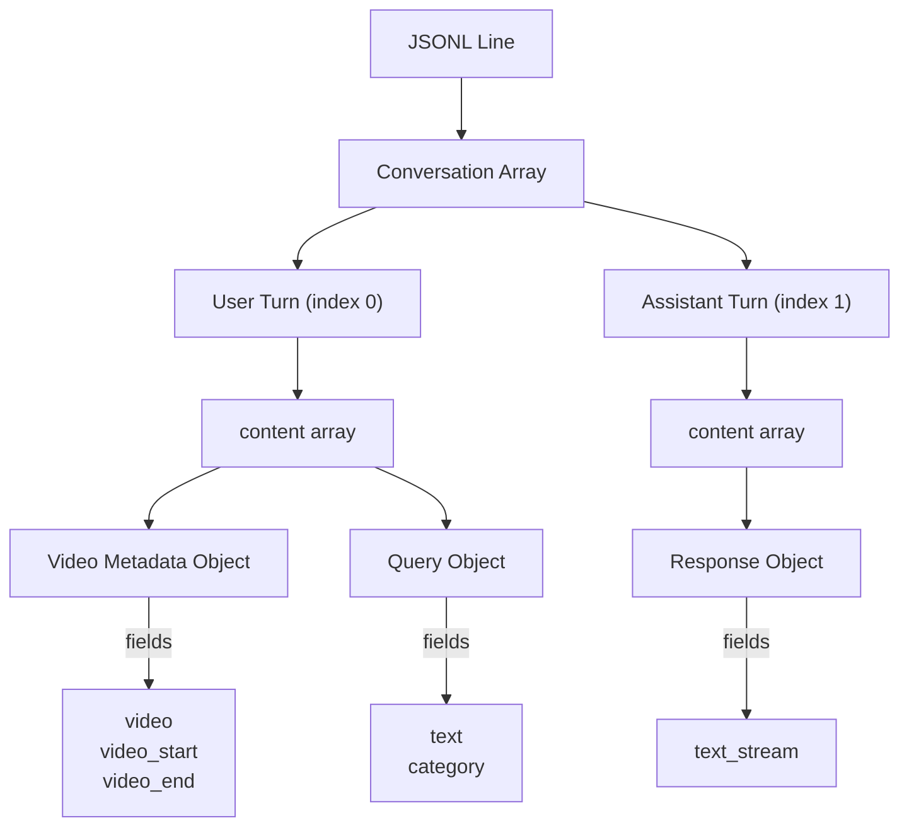
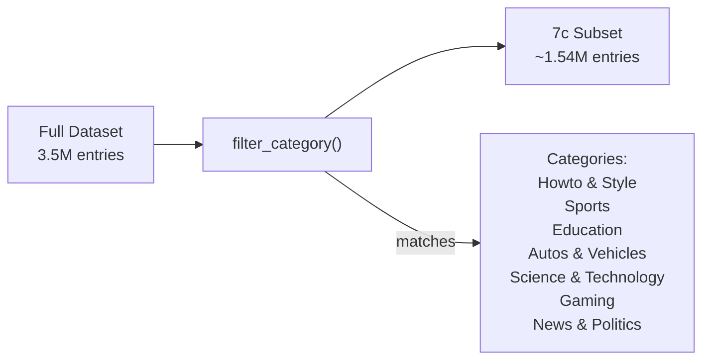
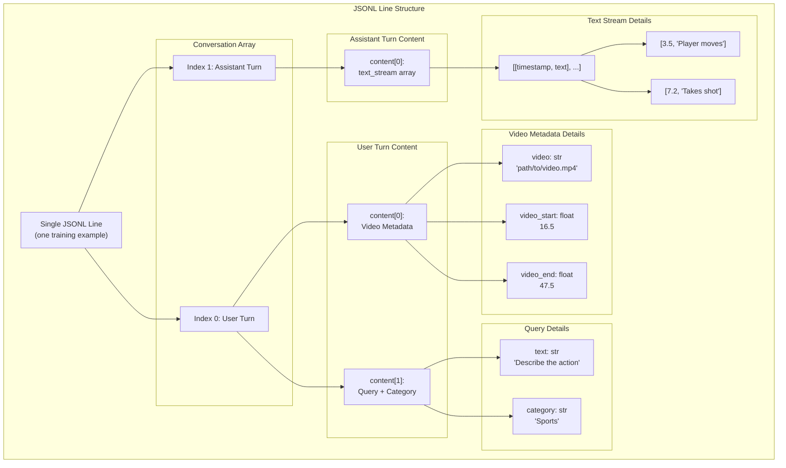
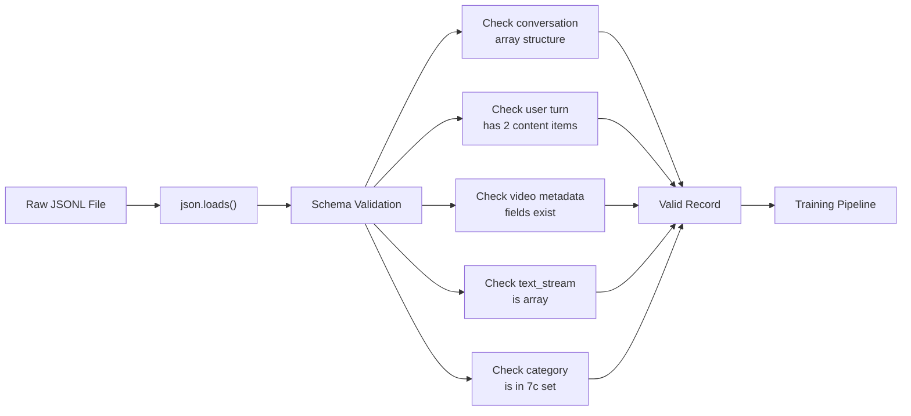

<!-- source: DeepWiki mcp.deepwiki.com · repo mit-han-lab/streaming-vlm · extra page Data Formats and Schemas · fetched 2026-10-30 -->

# Data Formats and Schemas

<details>
<summary>Relevant source files</summary>

The following files were used as context for generating this wiki page:

- [baselines/livecc/debug.py](baselines/livecc/debug.py)
- [readme.md](readme.md)

</details>


## Purpose and Scope

This page documents the data formats and schemas used throughout the StreamingVLM training pipeline. It defines the JSONL schema structure, field specifications, and data organization conventions used by both the Inf-Stream-Train and Live-WhisperX datasets. For information about the data processing pipeline that generates these formats, see [Dataset Processing Pipeline](#4.1.1). For the training procedures that consume this data, see [Stage 1 Training](#4.2) and [Stage 2 Training](#4.3).

## JSONL Format Overview

All training datasets in StreamingVLM use **line-delimited JSON (JSONL)** format, where each line represents a single training example as a complete JSON object. This format enables efficient streaming processing and parallel data loading during training.

```
{"field1": value1, "field2": value2, ...}\n
{"field1": value1, "field2": value2, ...}\n
{"field1": value1, "field2": value2, ...}\n
```

The JSONL files are processed line-by-line during training, with each line being independently parsed as JSON. This allows for memory-efficient processing of large datasets (526K+ examples) using multiprocessing utilities.

**Sources:** [baselines/livecc/debug.py:1-103]()

## Dataset File Types

### Primary Training Files

The training pipeline uses the following JSONL dataset files, as configured in the training scripts:

| File Name | Purpose | Source Dataset |
|-----------|---------|----------------|
| `train_s12w24_with_seeks.jsonl` | Stage 1 & 2 training data | Inf-Stream-Train |
| `valid_s12w24_with_seeks.jsonl` | Validation data | Inf-Stream-Train |
| `train_livecc_with_seeks.jsonl` | LiveCC training data | Live-WhisperX-526K |
| `valid_livecc_with_seeks.jsonl` | LiveCC validation data | Live-WhisperX-526K |

### Intermediate Processing Files

The data curation pipeline generates several intermediate files:

| File Pattern | Description |
|--------------|-------------|
| `live_whisperx_7c_30-240s.jsonl` | Filtered by 7 categories, 30-240s duration |
| `live_whisperx_7c_30-240s_lmloss1.5-5_*.jsonl` | Filtered by language model loss thresholds |
| `live_whisperx_7c_30-240s_lmloss1.5-5_asd0-*.jsonl` | Filtered by Audio Segment Detection ratio |
| `live_whisperx_526k_with_seeks.jsonl` | Final 526K dataset with seek annotations |

**Sources:** [scripts/sft_stage_1.sh:30-42](), [baselines/livecc/debug.py:6-23, 44-55]()

## Data Schema

### Conversation Format Structure

Each JSONL line contains a **conversation format** following the standard instruction-tuning schema. The data is structured as a list of conversation turns:



**Sources:** [baselines/livecc/debug.py:72-73]()

### Field Specifications

#### Video Metadata Fields

The first element of the user's content array contains video metadata:

| Field | Type | Description | Example |
|-------|------|-------------|---------|
| `video` | string | Relative path to video file from dataset root | `"Livecc_sft/video123.mp4"` |
| `video_start` | float | Start timestamp in seconds | `16.5` |
| `video_end` | float | End timestamp in seconds | `47.5` |

These fields define the temporal segment of the video used for training. The video path is resolved relative to the `$DATASET_PATH` environment variable.

#### Query Object Fields

The second element of the user's content array contains the query:

| Field | Type | Description | Example |
|-------|------|-------------|---------|
| `text` | string | User query/instruction | `"Describe what is happening in this video."` |
| `category` | string | Video category label | `"Sports"` |

#### Response Object Fields

The assistant's content array contains the response with streaming annotations:

| Field | Type | Description |
|-------|------|-------------|
| `text_stream` | array | List of timestamped text segments for streaming output |

**Sources:** [baselines/livecc/debug.py:72-73](), [scripts/sft_stage_1.sh:1-5]()

### Text Stream Format

The `text_stream` field is an **array of timestamped text segments** that enables training for streaming commentary generation. Each segment has the structure:

```json
[
  [timestamp_seconds, "text content"],
  [timestamp_seconds, "text content"],
  ...
]
```

This format aligns with the streaming inference objective, where the model generates commentary with explicit timestamps. During training, the model learns to produce both the content and timing of responses.

**Example:**
```json
"text_stream": [
  [3.5, "The player approaches the ball."],
  [7.2, "They take the shot!"],
  [9.8, "Goal! The ball goes into the net."]
]
```

**Sources:** [baselines/livecc/debug.py:72]()

### Seeks and Temporal Annotations

Files with the suffix `_with_seeks.jsonl` include additional temporal seek points that indicate when new video frames should be loaded during training. This annotation is critical for training the model to handle streaming video input.

The seeks are embedded within the conversation structure and align with the chunking strategy used during inference (6 initial frames, then 2-frame chunks for streaming).

**Sources:** [scripts/sft_stage_1.sh:30-38](), [readme.md:47-48]()

## Category Taxonomy

### Seven-Category (7c) Subset

The LiveCC dataset focuses on a curated **7-category (7c) subset** of instructional and dynamic content:

| Category | Purpose |
|----------|---------|
| Howto & Style | Instructional content, tutorials |
| Sports | Athletic events, gameplay |
| Education | Educational content, lectures |
| Autos & Vehicles | Vehicle demonstrations, reviews |
| Science & Technology | Technical content, product reviews |
| Gaming | Video game footage, walkthroughs |
| News & Politics | News coverage, political content |

This subset is filtered from the larger dataset using the `filter_category()` function, which processes millions of entries to extract only these seven categories.



**Sources:** [baselines/livecc/debug.py:4-23]()

### Category Storage and Correction

Categories are stored in two ways:

1. **Inline in JSONL:** Each datum contains a `category` field
2. **External mapping:** A `video2cat.json` file maps video IDs to categories

The `correct_category()` function updates category labels by consulting the external mapping, correcting any mislabeled entries in the dataset.

**Sources:** [baselines/livecc/debug.py:25-42]()

## Complete Data Structure Diagram



**Sources:** [baselines/livecc/debug.py:72-73]()

## Example Data Record

Here is a concrete example of a single JSONL line (formatted for readability):

```json
[
  {
    "role": "user",
    "content": [
      {
        "video": "Livecc_sft/basketball_game_123.mp4",
        "video_start": 45.0,
        "video_end": 75.0
      },
      {
        "text": "Provide live commentary for this basketball play.",
        "category": "Sports"
      }
    ]
  },
  {
    "role": "assistant",
    "content": [
      {
        "text_stream": [
          [2.5, "The point guard brings the ball up the court."],
          [5.8, "They pass to the shooting guard on the wing."],
          [9.2, "Quick crossover! The defender is off balance."],
          [12.0, "Drive to the basket!"],
          [14.5, "And it's a layup! Two points."]
        ]
      }
    ]
  }
]
```

This structure is parsed during training to:
1. Load the video segment from `45.0s` to `75.0s`
2. Extract frames according to the seek annotations
3. Train the model to generate timestamped commentary
4. Associate the content with the `Sports` category

**Sources:** [baselines/livecc/debug.py:69-73]()

## Environment Variables and Path Resolution

### Dataset Path Configuration

Training and evaluation scripts rely on environment variables to locate datasets:

| Variable | Purpose | Example |
|----------|---------|---------|
| `DATASET_PATH` | Root directory for training datasets | `/path/to/your/Inf-Stream-Train` |
| `EVAL_DATASET_PATH` | Root directory for evaluation datasets | `/path/to/your/Inf-Stream-Eval` |

Video paths in JSONL files are **relative paths** resolved from these roots. For example, if `DATASET_PATH=/data/streams` and a record contains `"video": "Livecc_sft/vid.mp4"`, the full path becomes `/data/streams/Livecc_sft/vid.mp4`.

### Video Format Parameters

The training script configures video processing parameters via environment variables:

| Variable | Value | Purpose |
|----------|-------|---------|
| `VIDEO_MIN_PIXELS` | 78400 | Minimum visual tokens (100×28×28) |
| `VIDEO_MAX_PIXELS` | 19267584 | Maximum visual tokens (24576×28×28) |
| `FPS_MAX_FRAMES` | 480 | Maximum frames per video (8 min at 1 FPS) |

These parameters control how videos are resized and sampled during data loading.

**Sources:** [scripts/sft_stage_1.sh:1-9](), [readme.md:46-63]()

## Preview and Debugging Files

The data processing pipeline generates preview files for inspection:

| File | Records | Purpose |
|------|---------|---------|
| `live_whisperx_100_for_preview.json` | 100 | Sample records for manual inspection |

The `make_preview()` function extracts the first 100 records and reformats them into a simplified structure with fields: `video`, `video_start`, `video_end`, `query`, and `text_stream` (as JSON string).

**Sources:** [baselines/livecc/debug.py:69-73]()

## Data Schema Validation Flow



While explicit validation code is not shown in the provided files, the training pipeline implicitly validates data structure during loading. Records that don't conform to the expected schema will cause errors during training initialization.

**Sources:** [baselines/livecc/debug.py:58-62]()

## Statistics and Quality Metrics

### Category Distribution

The `category_statistics()` function computes category distributions across the dataset:

```python
# Pseudocode from debug.py
datums = [json.loads(line) for line in lines]
categories = [datum[0]['content'][1]['category'] for datum in datums]
print(Counter(categories))
```

This enables monitoring dataset balance across the seven categories.

### ASD Ratio Filtering

The Audio Segment Detection (ASD) ratio is used to select high-quality segments:

- **ASD ratio range:** 0.0 to threshold (e.g., 0.05)
- **Purpose:** Filter out segments with excessive silence or poor audio
- **Implementation:** `select_asd(threshold=0.05)` function

Lower ASD ratios indicate better continuous speech content suitable for commentary training.

**Sources:** [baselines/livecc/debug.py:44-62]()

## File Naming Conventions

JSONL files follow systematic naming patterns that encode processing steps:

| Pattern Component | Meaning |
|-------------------|---------|
| `live_whisperx` | Base dataset source |
| `7c` | Filtered to 7 categories |
| `30-240s` | Duration range filter |
| `lmloss1.5-5` | Language model loss range |
| `asd0-0.05` | ASD ratio range |
| `526k` | Approximate record count |
| `with_seeks` | Includes temporal seek annotations |

**Example:** `live_whisperx_7c_30-240s_lmloss1.5-5_asd0-0.05_526k_with_seeks.jsonl`

This naming convention makes it easy to understand the filtering and processing history of each dataset file.

**Sources:** [baselines/livecc/debug.py:6-73](), [scripts/sft_stage_1.sh:30-38]()

---

