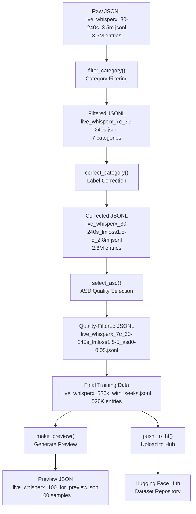
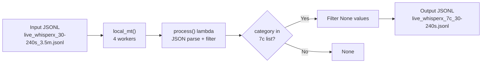
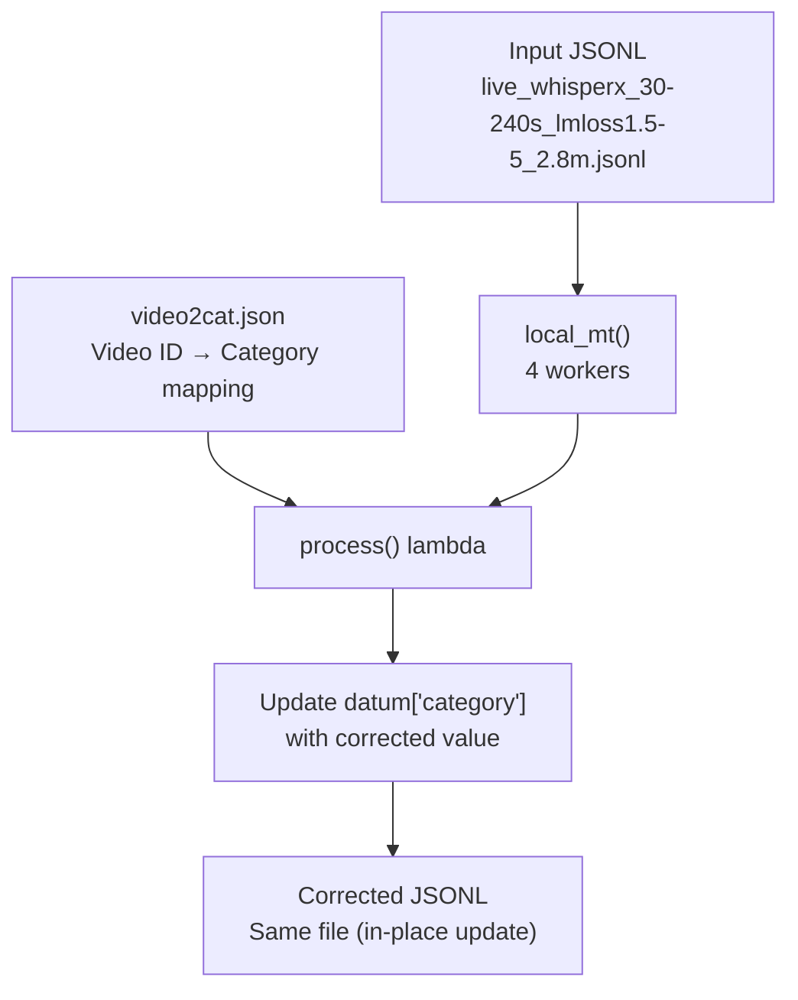
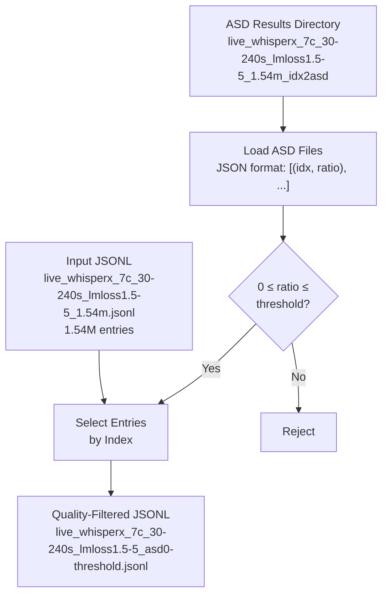
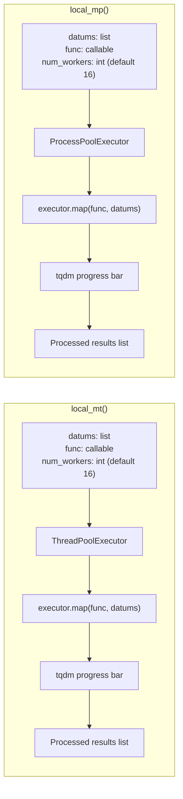
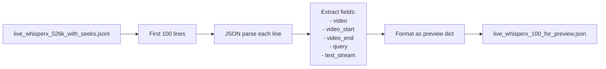
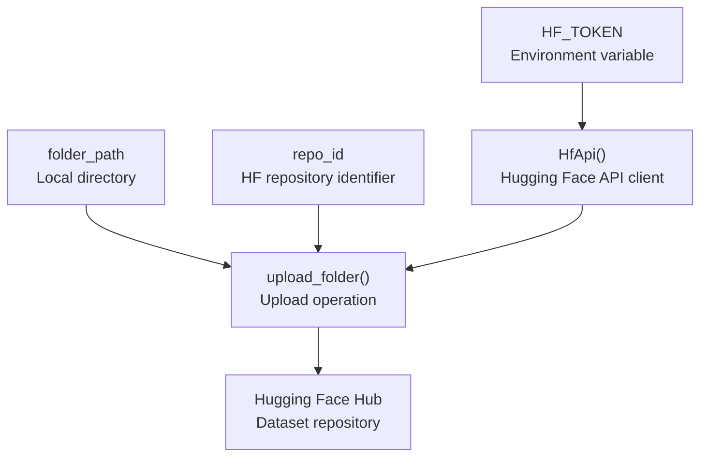

<!-- source: DeepWiki mcp.deepwiki.com · repo mit-han-lab/streaming-vlm · extra page Dataset Processing Pipeline · fetched 2026-10-30 -->

# Dataset Processing Pipeline

Relevant source files

The following files were used as context for generating this wiki page:

- [baselines/livecc/debug.py](baselines/livecc/debug.py)
- [baselines/livecc/utils/multiprocessor.py](baselines/livecc/utils/multiprocessor.py)

## Purpose and Scope

This document describes the data curation and preprocessing pipeline used to prepare training datasets for StreamingVLM. The pipeline implements category filtering, label correction, Audio Segment Detection (ASD) quality selection, and parallel processing to transform raw video data into the JSONL format required for training.

For information about the specific JSONL schema and data format specifications, see [Data Formats and Schemas](#4.1.2). For the overall training pipeline context, see [Training Pipeline](#4).

---

## Pipeline Overview

The dataset processing pipeline is implemented primarily in `baselines/livecc/debug.py` and processes millions of video entries through multiple filtering and quality control stages. The pipeline transforms raw YouTube video metadata with WhisperX transcriptions into curated training datasets.

### End-to-End Processing Flow

Sources: [baselines/livecc/debug.py:6-97]()

---

## Category Filtering

The `filter_category()` function reduces the dataset to a curated subset of 7 categories (referred to as "7c") that are most suitable for live commentary training.

### Targeted Categories

The pipeline filters for the following YouTube categories:

| Category | Description |
|----------|-------------|
| Howto & Style | Instructional and tutorial content |
| Sports | Sports events and highlights |
| Education | Educational videos |
| Autos & Vehicles | Automotive content |
| Science & Technology | Tech reviews and demonstrations |
| Gaming | Gaming streams and playthroughs |
| News & Politics | News and current events |

### Implementation

The function uses parallel processing to efficiently handle millions of entries:

- **Input**: `live_whisperx_30-240s_3.5m.jsonl` (3.5M entries)
- **Processing**: 4-worker multi-threaded execution via `local_mt()`
- **Filter Logic**: Checks if `datum['category']` matches any of the 7 target categories
- **Output**: `live_whisperx_7c_30-240s.jsonl` (filtered subset)

Sources: [baselines/livecc/debug.py:6-23]()

---

## Category Correction

The `correct_category()` function addresses mislabeled entries by applying corrections from a pre-computed video-to-category mapping.

### Correction Workflow

The correction process:

1. Loads the input JSONL and `video2cat.json` lookup table
2. For each entry, replaces `datum['category']` with `video2cat[datum['video']]`
3. Serializes the corrected datum back to JSON
4. Writes results back to the same file (in-place update)

Sources: [baselines/livecc/debug.py:25-42]()

---

## Audio Segment Detection (ASD) Selection

The `select_asd()` function performs quality filtering based on Audio Segment Detection ratios, which measure the proportion of active speech in video segments.

### ASD-Based Quality Filtering

### Parameters and Thresholds

| Parameter | Default Value | Description |
|-----------|---------------|-------------|
| `threshold` | 0.05 | Maximum ASD ratio for selection |
| Valid range | [0.0, threshold] | Entries with ASD ratio in this range are selected |

The function:
- Iterates through all ASD result files in the specified directory
- Selects entries where `0 <= ASD_ratio <= threshold`
- Default threshold of 0.05 filters for videos with minimal background noise
- Returns the filtered subset as a list of lines

Sources: [baselines/livecc/debug.py:44-55]()

---

## Parallel Processing Infrastructure

The pipeline leverages the `multiprocessor.py` utilities for efficient parallel processing of large datasets.

### Multiprocessing Functions

### Function Comparison

| Function | Concurrency Model | Default Workers | Use Case |
|----------|------------------|-----------------|----------|
| `local_mt()` | Multi-threading (ThreadPoolExecutor) | 16 | I/O-bound tasks (JSON parsing, file reading) |
| `local_mp()` | Multi-processing (ProcessPoolExecutor) | 16 | CPU-bound tasks (complex transformations) |

Both functions provide:
- Automatic progress tracking via `tqdm` when `desc` parameter is provided
- Configurable worker count via `num_workers` parameter
- Ordered result collection maintaining input sequence

Usage examples from the pipeline:
- **4 workers**: Category filtering/correction (lighter tasks)
- **8 workers**: JSON parsing for statistics
- **16-64 workers**: Large-scale processing operations

Sources: [baselines/livecc/utils/multiprocessor.py:1-17]()

---

## Output Generation and Preview

The pipeline includes utilities for generating preview datasets and gathering statistics.

### Preview Generation

The `make_preview()` function creates a sample dataset for inspection:

The preview structure extracts key fields from the conversation format:
- Video metadata: `video`, `video_start`, `video_end`
- Query text from `datum[0]['content'][1]['text']`
- Text stream serialized as JSON string from `datum[1]['content'][0]['text_stream']`

### Category Statistics

The `category_statistics()` function generates distribution metrics:

1. Loads the final training JSONL
2. Extracts category from each conversation: `conversations[0]['content'][1]['category']`
3. Uses `collections.Counter` to count category frequencies
4. Processes with 8-worker parallelization for efficiency

Sources: [baselines/livecc/debug.py:57-73]()

---

## Hugging Face Hub Upload

The `push_to_hf()` function uploads processed datasets to Hugging Face Hub for sharing and version control.

### Upload Function

### Parameters

| Parameter | Type | Description |
|-----------|------|-------------|
| `folder_path` | str | Path to local directory containing dataset files |
| `repo_id` | str | Hugging Face repository identifier (e.g., "org/dataset-name") |
| `repo_type` | str | Repository type ("dataset", "model", or "space") |

The function:
- Uses `HfApi` with authentication from `HF_TOKEN` environment variable
- Uploads entire folder structure to the specified repository
- Supports dataset, model, and space repository types

Sources: [baselines/livecc/debug.py:75-82]()

---

## Pipeline Integration Summary

### Complete Processing Chain

The dataset processing pipeline follows this sequence:

1. **Initial Filtering** (`filter_category`): 3.5M → 7c subset
2. **Label Correction** (`correct_category`): Fix mislabeled categories using `video2cat.json`
3. **Quality Selection** (`select_asd`): Filter by ASD ratio (typically ≤ 0.05)
4. **Statistics Generation** (`category_statistics`): Analyze category distribution
5. **Preview Creation** (`make_preview`): Generate 100-sample preview
6. **Hub Upload** (`push_to_hf`): Publish to Hugging Face

### Key Data Transformations

| Stage | Input | Output | Processing |
|-------|-------|--------|------------|
| Category Filtering | 3.5M raw entries | 7c subset | 4-worker parallel filter |
| Label Correction | 2.8M entries | Corrected labels | Video ID lookup + 4-worker update |
| ASD Selection | 1.54M entries | Quality-filtered | Threshold-based selection |
| Final Dataset | Quality-filtered | 526K training entries | With video seeks |

The pipeline emphasizes:
- **Scalability**: Parallel processing with configurable worker counts
- **Quality**: Multi-stage filtering (category, label, ASD ratio)
- **Reproducibility**: Preview datasets and statistics for validation
- **Distribution**: Hugging Face Hub integration for sharing

Sources: [baselines/livecc/debug.py:1-103](), [baselines/livecc/utils/multiprocessor.py:1-17]()

---

