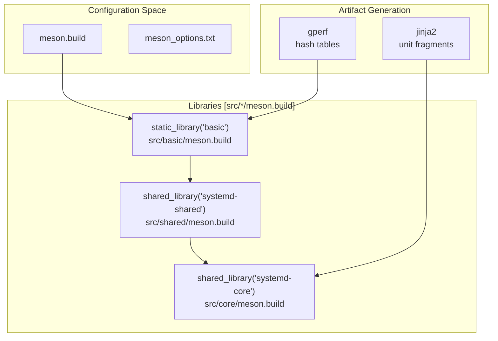
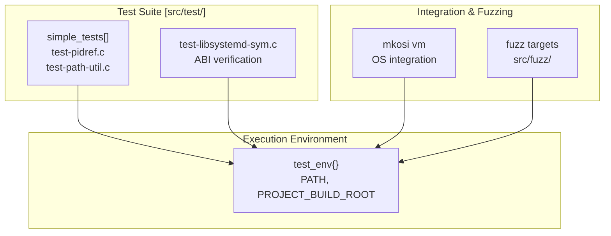

<!-- source: DeepWiki mcp.deepwiki.com · repo systemd/systemd · page 10 Development and Testing · fetched 2026-11-07 -->

# Development and Testing

<details>
<summary>Relevant source files</summary>

The following files were used as context for generating this wiki page:

- [.clusterfuzzlite/Dockerfile](.clusterfuzzlite/Dockerfile)
- [.mailmap](.mailmap)
- [.obs/workflows.yml](.obs/workflows.yml)
- [AGENTS.md](AGENTS.md)
- [CLAUDE.md](CLAUDE.md)
- [NEWS](NEWS)
- [README](README)
- [README.md](README.md)
- [docs/ARCHITECTURE.md](docs/ARCHITECTURE.md)
- [docs/AUTOMATIC_BOOT_ASSESSMENT.md](docs/AUTOMATIC_BOOT_ASSESSMENT.md)
- [docs/BLOCK_DEVICE_LOCKING.md](docs/BLOCK_DEVICE_LOCKING.md)
- [docs/BOOT_LOADER_INTERFACE.md](docs/BOOT_LOADER_INTERFACE.md)
- [docs/BOOT_LOADER_SPECIFICATION.md](docs/BOOT_LOADER_SPECIFICATION.md)
- [docs/BUILDING_IMAGES.md](docs/BUILDING_IMAGES.md)
- [docs/CGROUP_DELEGATION.md](docs/CGROUP_DELEGATION.md)
- [docs/CODE_OF_CONDUCT.md](docs/CODE_OF_CONDUCT.md)
- [docs/CODE_QUALITY.md](docs/CODE_QUALITY.md)
- [docs/CODING_STYLE.md](docs/CODING_STYLE.md)
- [docs/CONTRIBUTING.md](docs/CONTRIBUTING.md)
- [docs/CREDENTIALS.md](docs/CREDENTIALS.md)
- [docs/DISTRO_PORTING.md](docs/DISTRO_PORTING.md)
- [docs/HACKING.md](docs/HACKING.md)
- [docs/MOUNT_REQUIREMENTS.md](docs/MOUNT_REQUIREMENTS.md)
- [docs/PORTABLE_SERVICES.md](docs/PORTABLE_SERVICES.md)
- [docs/PORTING_TO_NEW_ARCHITECTURES.md](docs/PORTING_TO_NEW_ARCHITECTURES.md)
- [docs/RELEASE.md](docs/RELEASE.md)
- [docs/RESOLVED-VPNS.md](docs/RESOLVED-VPNS.md)
- [docs/SECURITY.md](docs/SECURITY.md)
- [docs/TESTING_WITH_SANITIZERS.md](docs/TESTING_WITH_SANITIZERS.md)
- [docs/TRANSLATORS.md](docs/TRANSLATORS.md)
- [docs/UIDS-GIDS.md](docs/UIDS-GIDS.md)
- [docs/index.md](docs/index.md)
- [man/meson.build](man/meson.build)
- [meson.build](meson.build)
- [meson_options.txt](meson_options.txt)
- [src/basic/constants.h](src/basic/constants.h)
- [src/basic/meson.build](src/basic/meson.build)
- [src/core/import-creds.c](src/core/import-creds.c)
- [src/core/meson.build](src/core/meson.build)
- [src/hostname/meson.build](src/hostname/meson.build)
- [src/import/meson.build](src/import/meson.build)
- [src/journal-remote/meson.build](src/journal-remote/meson.build)
- [src/journal/meson.build](src/journal/meson.build)
- [src/libsystemd-network/meson.build](src/libsystemd-network/meson.build)
- [src/libsystemd/meson.build](src/libsystemd/meson.build)
- [src/libudev/meson.build](src/libudev/meson.build)
- [src/locale/meson.build](src/locale/meson.build)
- [src/login/meson.build](src/login/meson.build)
- [src/machine/meson.build](src/machine/meson.build)
- [src/nspawn/meson.build](src/nspawn/meson.build)
- [src/resolve/meson.build](src/resolve/meson.build)
- [src/shared/meson.build](src/shared/meson.build)
- [src/systemd/meson.build](src/systemd/meson.build)
- [src/test/meson.build](src/test/meson.build)
- [src/test/test-dlopen-so.c](src/test/test-dlopen-so.c)
- [src/timedate/meson.build](src/timedate/meson.build)
- [src/timesync/meson.build](src/timesync/meson.build)
- [src/udev/meson.build](src/udev/meson.build)
- [test/fuzz/meson.build](test/fuzz/meson.build)
- [test/meson.build](test/meson.build)
- [tools/git-setup.sh](tools/git-setup.sh)
- [tools/meson-build.sh](tools/meson-build.sh)
- [tools/oss-fuzz.sh](tools/oss-fuzz.sh)
- [tools/sync-docs.py](tools/sync-docs.py)

</details>


This page provides a high-level overview of systemd's build system, testing infrastructure, development workflows, and shipped configuration files. It serves as a parent overview, linking to specialized child pages for detailed technical reference.

For information about systemd's core runtime architecture, see [Core Architecture](#2).

## Quick Start for Developers

To begin developing and testing systemd locally using `mkosi`:

```bash
# Clone the repository
git clone https://github.com/systemd/systemd
cd systemd

# Set up the build directory inside an isolated container
mkosi -f box -- meson setup build -Dmode=developer

# Compile systemd binaries
mkosi -f box -- meson compile -C build

# Execute the unit test suite
mkosi -f box -- meson test -C build --print-errorlogs -q
```

`mkosi` handles all necessary build and runtime dependencies, allowing developers to build and test OS images via virtual machines or containers [docs/HACKING.md:28-31]().

**Sources:** [README:7-8](), [docs/HACKING.md:45-51]()

---

## Build System and Project Organization

systemd uses the Meson build system (`>= 0.62.0`) to coordinate compilation, feature flags, code generation, and test target definitions [meson.build:13-14](). The build layout is structured around modular `meson.build` files located across source directories [src/basic/meson.build:1](), [src/core/meson.build:1]().

Key aspects covered in the child documentation include Meson configuration options (`meson_options.txt`), static/shared library linking tiers (`libbasic`, `libsystemd`, `libsystemd-shared`, `libsystemd-core`), template and header code generation (such as `gperf` hash tables and Jinja2 templates), translation assets (`po/`), and developer documentation (`docs/`).

### Build Architecture Overview

Title: BuildEntityMapping

**Sources:** [meson.build:1-174](), [src/basic/meson.build:208-214](), [src/core/meson.build:121-125]()

For complete details on build flags, target options, code generation scripts, and project organization, see [Build System and Project Organization](#10.1).

---

## Testing Infrastructure and CI/CD

The testing framework spans fast isolated unit tests under `src/test/`, integration testing frameworks, fuzzing targets for `oss-fuzz`, and automated CI workflows [src/test/meson.build:58-211](). Unit tests validate underlying utilities such as path parsing, hashmaps, and PID references, while integration tests boot fully functional systemd environments using `mkosi` [docs/HACKING.md:53-59]().

Quality assurance checks—including static analysis via linters, code formatting rules, and `Coccinelle` semantic patches—run automatically on code submissions to ensure codebase consistency.

### Testing Architecture Overview

Title: TestingEntityMapping

**Sources:** [src/test/meson.build:13-21](), [src/test/meson.build:135-141](), [docs/HACKING.md:53-59]()

For comprehensive coverage of test suites, CI pipelines, and fuzzing instructions, see [Testing Infrastructure and CI/CD](#10.2).

---

## System Configuration Files and Shipped Units

systemd installs a rich set of default configuration files and shipped units that dictate early-boot behavior, file creation, user database defaults, tmpfiles provisioning, udev device rules, and network definitions. These files reside in standard directories like `tmpfiles.d/`, `sysusers.d/`, `sysctl.d/`, `rules.d/`, and `network/`.

These components bridge static package installations with dynamic service manager actions during system initialization and runtime operation.

For a full reference on shipped configuration files, preset defaults, factory defaults, and service definitions, see [System Configuration Files and Shipped Units](#10.3).

---

## Child Pages

- [Build System and Project Organization](#10.1)
- [Testing Infrastructure and CI/CD](#10.2)
- [System Configuration Files and Shipped Units](#10.3)

---

