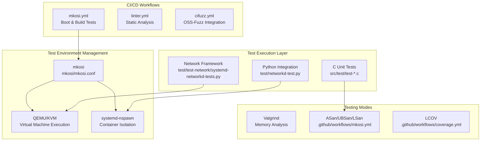
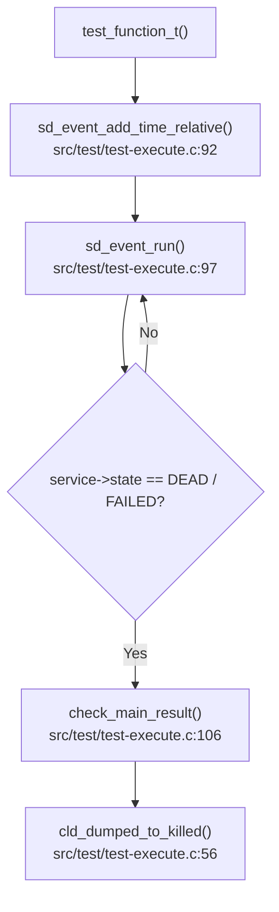

<!-- source: DeepWiki mcp.deepwiki.com · repo systemd/systemd · page 10.2 Testing Infrastructure and CI/CD · fetched 2026-11-07 -->

# Testing Infrastructure and CI/CD

Relevant source files

The following files were used as context for generating this wiki page:

- [.clusterfuzzlite/Dockerfile](.clusterfuzzlite/Dockerfile)
- [.github/workflows/armhf-clang.cross](.github/workflows/armhf-clang.cross)
- [.github/workflows/armhf-gcc.cross](.github/workflows/armhf-gcc.cross)
- [.github/workflows/build-test.sh](.github/workflows/build-test.sh)
- [.github/workflows/build-test.yml](.github/workflows/build-test.yml)
- [.github/workflows/cifuzz.yml](.github/workflows/cifuzz.yml)
- [.github/workflows/claude-review.yml](.github/workflows/claude-review.yml)
- [.github/workflows/coverage.yml](.github/workflows/coverage.yml)
- [.github/workflows/coverity.yml](.github/workflows/coverity.yml)
- [.github/workflows/development-freeze.yml](.github/workflows/development-freeze.yml)
- [.github/workflows/differential-shellcheck.yml](.github/workflows/differential-shellcheck.yml)
- [.github/workflows/gather-pr-metadata.yml](.github/workflows/gather-pr-metadata.yml)
- [.github/workflows/issue-labeler.yml](.github/workflows/issue-labeler.yml)
- [.github/workflows/labeler.yml](.github/workflows/labeler.yml)
- [.github/workflows/linter.yml](.github/workflows/linter.yml)
- [.github/workflows/make-release.yml](.github/workflows/make-release.yml)
- [.github/workflows/mkosi.yml](.github/workflows/mkosi.yml)
- [.github/workflows/riscv64-gcc.cross](.github/workflows/riscv64-gcc.cross)
- [.github/workflows/scorecards.yml](.github/workflows/scorecards.yml)
- [.github/workflows/unit-tests.sh](.github/workflows/unit-tests.sh)
- [.github/workflows/unit-tests.yml](.github/workflows/unit-tests.yml)
- [.mailmap](.mailmap)
- [NEWS](NEWS)
- [README](README)
- [man/meson.build](man/meson.build)
- [meson.build](meson.build)
- [meson_options.txt](meson_options.txt)
- [mkosi/mkosi.conf](mkosi/mkosi.conf)
- [src/basic/bitfield.h](src/basic/bitfield.h)
- [src/basic/constants.h](src/basic/constants.h)
- [src/basic/macro.h](src/basic/macro.h)
- [src/basic/meson.build](src/basic/meson.build)
- [src/basic/static-destruct.c](src/basic/static-destruct.c)
- [src/basic/static-destruct.h](src/basic/static-destruct.h)
- [src/basic/unit-name.c](src/basic/unit-name.c)
- [src/basic/unit-name.h](src/basic/unit-name.h)
- [src/core/meson.build](src/core/meson.build)
- [src/hostname/meson.build](src/hostname/meson.build)
- [src/import/meson.build](src/import/meson.build)
- [src/journal-remote/meson.build](src/journal-remote/meson.build)
- [src/journal/meson.build](src/journal/meson.build)
- [src/libsystemd-network/meson.build](src/libsystemd-network/meson.build)
- [src/libsystemd/meson.build](src/libsystemd/meson.build)
- [src/libsystemd/sd-bus/bus-error.c](src/libsystemd/sd-bus/bus-error.c)
- [src/libsystemd/sd-bus/bus-error.h](src/libsystemd/sd-bus/bus-error.h)
- [src/libsystemd/sd-bus/test-bus-error.c](src/libsystemd/sd-bus/test-bus-error.c)
- [src/libudev/meson.build](src/libudev/meson.build)
- [src/locale/meson.build](src/locale/meson.build)
- [src/login/meson.build](src/login/meson.build)
- [src/machine/meson.build](src/machine/meson.build)
- [src/nspawn/meson.build](src/nspawn/meson.build)
- [src/resolve/meson.build](src/resolve/meson.build)
- [src/shared/meson.build](src/shared/meson.build)
- [src/shared/tests.c](src/shared/tests.c)
- [src/shared/tests.h](src/shared/tests.h)
- [src/shared/unit-file.c](src/shared/unit-file.c)
- [src/shared/unit-file.h](src/shared/unit-file.h)
- [src/systemd/meson.build](src/systemd/meson.build)
- [src/test/meson.build](src/test/meson.build)
- [src/test/test-cgroup-mask.c](src/test/test-cgroup-mask.c)
- [src/test/test-dlopen-so.c](src/test/test-dlopen-so.c)
- [src/test/test-engine.c](src/test/test-engine.c)
- [src/test/test-execute.c](src/test/test-execute.c)
- [src/test/test-macro.c](src/test/test-macro.c)
- [src/test/test-path.c](src/test/test-path.c)
- [src/test/test-sched-prio.c](src/test/test-sched-prio.c)
- [src/test/test-unit-file.c](src/test/test-unit-file.c)
- [src/test/test-unit-name.c](src/test/test-unit-name.c)
- [src/timedate/meson.build](src/timedate/meson.build)
- [src/timesync/meson.build](src/timesync/meson.build)
- [src/udev/meson.build](src/udev/meson.build)
- [test/fuzz/meson.build](test/fuzz/meson.build)
- [test/meson.build](test/meson.build)
- [tools/meson-build.sh](tools/meson-build.sh)
- [tools/oss-fuzz.sh](tools/oss-fuzz.sh)

This document details systemd's testing infrastructure, spanning low-level C unit tests (`src/test/`), python-based network integration test suites, `mkosi`-based container and disk image building, and GitHub Actions CI/CD workflows [.github/workflows/mkosi.yml:4-15](), [src/test/meson.build:58-211](), [docs/HACKING.md:17-31]().

## Overview and Architecture

The systemd test suite is structured into multiple layers to balance execution speed and realism, ranging from standalone host-level C unit tests to full virtualized system boots using QEMU and `mkosi`.

Title: "Test Infrastructure Overview"

Sources: [docs/HACKING.md:17-31](), [.github/workflows/mkosi.yml:4-15](), [src/test/meson.build:58-211]()

## C Unit Testing Framework

Unit tests for low-level utility functions, parsers, and core engines reside under `src/test/` and are defined via Meson in `src/test/meson.build` [src/test/meson.build:58-211](). 

### Service Execution Testing (`src/test/test-execute.c`)
The `src/test/test-execute.c` module validates sandboxing, environment expansion, and lifecycle transitions for system service units by instantiating transient `Manager` and `Service` objects [src/test/test-execute.c:11-40]().

Title: "Service Execution Testing Code Flow"

Key functions within `src/test/test-execute.c`:
*   **`wait_for_service_finish()`**: Waits for a service unit to exit by running an `sd_event` loop with a timeout configured via `detect_virtualization()` and `ci_environment()` [src/test/test-execute.c:75-104]().
*   **`check_main_result()`**: Verifies expected exit status and process termination code against `service->main_exec_status` [src/test/test-execute.c:106-131]().
*   **`check_service_result()`**: Compares the final `ServiceResult` against expected outcomes [src/test/test-execute.c:133-151]().

Sources: [src/test/test-execute.c:11-151](), [src/test/meson.build:58-211]()

## mkosi-Based Image Building

`mkosi` serves as the primary image-building tool for continuous integration and local development, generating reproducible OS images from configuration files in `mkosi/` [docs/HACKING.md:28-31]().

### Configuration and Matrix Execution
The GitHub Actions workflow [.github/workflows/mkosi.yml]() defines a multi-distribution matrix (Arch, Debian, Ubuntu, Fedora, openSUSE, CentOS, PostmarketOS) [.github/workflows/mkosi.yml:56-91](). It sets up a Btrfs loopback device for space-efficient subvolume management [.github/workflows/mkosi.yml:107-118]() and dynamically generates `mkosi/mkosi.local.conf` with sanitizers and build flags [.github/workflows/mkosi.yml:122-151]().

Title: "mkosi CI Pipeline Architecture"

```mermaid
graph LR
    subgraph "Workflow Definition"
        GHA[".github/workflows/mkosi.yml"] --> Btrfs["Create Btrfs Loop Device"]
    end
    
    subgraph "Configuration Generation"
        Btrfs --> LocalConf["Write mkosi/mkosi.local.conf<br/>.github/workflows/mkosi.yml:122"]
        LocalConf --> GenKey["mkosi genkey<br/>.github/workflows/mkosi.yml:163"]
    end
    
    subgraph "Execution"
        GenKey --> ToolsTree["mkosi box -- true<br/>.github/workflows/mkosi.yml:169"]
        ToolsTree --> MesonSetup["meson setup build<br/>.github/workflows/mkosi.yml:176"]
        MesonSetup --> BuildImage["meson compile -C build mkosi<br/>.github/workflows/mkosi.yml:201"]
    end
```

Sources: [.github/workflows/mkosi.yml:4-201](), [docs/HACKING.md:28-59]()

## Integration Testing Frameworks

Integration tests validate complex interactions between systemd components (such as `systemd-networkd`, `systemd-resolved`, and udev) inside virtualized or containerized test rigs [test/meson.build:11-185]().

*   **`test-sysusers`**: Validates user and group creation rules using `test-sysusers.sh` against the built `systemd-sysusers` binary [test/meson.build:4-38]().
*   **`hwdb-test`**: Verifies hardware database matching rules using `hwdb-test.sh` [test/meson.build:42-50]().
*   **`test-systemctl-enable`**: Exercises unit installation, preset logic, and alias resolution via `test-systemctl-enable.sh` [test/meson.build:54-64]().
*   **`test-link-abi`**: Performs ABI checks on compiled libraries (`libsystemd`, `libudev`, `libcore`) during developer builds [test/meson.build:128-142]().

Sources: [test/meson.build:1-185]()

## CI/CD and Automation

GitHub Actions orchestrates continuous integration through specialized workflow files:
*   **`mkosi.yml`**: Compiles systemd across multiple distributions and runs integration tests [.github/workflows/mkosi.yml:4-91]().
*   **`linter.yml`**: Enforces coding standards, static analysis, and script checks [.github/workflows/linter.yml:32-90]().
*   **`coverage.yml`**: Captures code coverage metrics via `lcov` and reports them to Coveralls [.github/workflows/coverage.yml:97-162]().
*   **`cifuzz.yml`**: Integrates OSS-Fuzz fuzzers using sanitizers (`address`, `undefined`, `memory`) [.github/workflows/cifuzz.yml:24-34]().

Sources: [.github/workflows/mkosi.yml:4-91](), [.github/workflows/linter.yml:32-90](), [.github/workflows/coverage.yml:97-162](), [.github/workflows/cifuzz.yml:24-34]()

---

