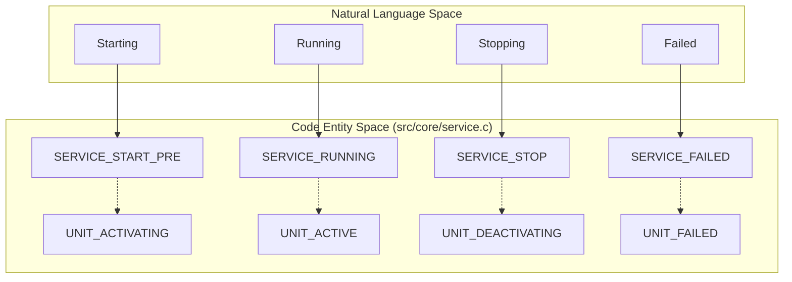
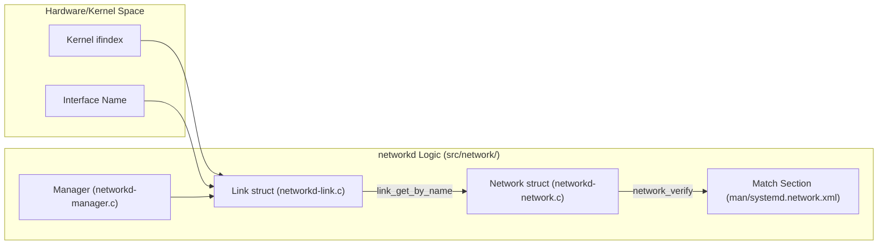

<!-- source: DeepWiki mcp.deepwiki.com · repo systemd/systemd · page 11 Glossary · fetched 2026-11-07 -->

# Glossary

Relevant source files

The following files were used as context for generating this wiki page:

- [man/bootctl.xml](man/bootctl.xml)
- [man/loader.conf.xml](man/loader.conf.xml)
- [man/systemd-boot.xml](man/systemd-boot.xml)
- [man/systemd-cgls.xml](man/systemd-cgls.xml)
- [man/systemd-cgtop.xml](man/systemd-cgtop.xml)
- [man/systemd-detect-virt.xml](man/systemd-detect-virt.xml)
- [man/systemd.network.xml](man/systemd.network.xml)
- [man/systemd.resource-control.xml](man/systemd.resource-control.xml)
- [man/systemd.unit.xml](man/systemd.unit.xml)
- [shell-completion/bash/bootctl](shell-completion/bash/bootctl)
- [shell-completion/bash/systemd-detect-virt](shell-completion/bash/systemd-detect-virt)
- [shell-completion/zsh/_bootctl](shell-completion/zsh/_bootctl)
- [src/analyze/analyze-compare-versions.c](src/analyze/analyze-compare-versions.c)
- [src/analyze/analyze-condition.c](src/analyze/analyze-condition.c)
- [src/analyze/analyze-condition.h](src/analyze/analyze-condition.h)
- [src/analyze/analyze-verify-util.c](src/analyze/analyze-verify-util.c)
- [src/analyze/analyze-verify-util.h](src/analyze/analyze-verify-util.h)
- [src/analyze/analyze-verify.c](src/analyze/analyze-verify.c)
- [src/analyze/analyze-verify.h](src/analyze/analyze-verify.h)
- [src/analyze/test-verify.c](src/analyze/test-verify.c)
- [src/basic/build.h](src/basic/build.h)
- [src/basic/cgroup-util.c](src/basic/cgroup-util.c)
- [src/basic/cgroup-util.h](src/basic/cgroup-util.h)
- [src/basic/confidential-virt.c](src/basic/confidential-virt.c)
- [src/basic/confidential-virt.h](src/basic/confidential-virt.h)
- [src/basic/virt.c](src/basic/virt.c)
- [src/basic/virt.h](src/basic/virt.h)
- [src/bless-boot/bless-boot.c](src/bless-boot/bless-boot.c)
- [src/bootctl/bootctl-install.c](src/bootctl/bootctl-install.c)
- [src/bootctl/bootctl-link.c](src/bootctl/bootctl-link.c)
- [src/bootctl/bootctl-link.h](src/bootctl/bootctl-link.h)
- [src/bootctl/bootctl-random-seed.c](src/bootctl/bootctl-random-seed.c)
- [src/bootctl/bootctl-set-efivar.c](src/bootctl/bootctl-set-efivar.c)
- [src/bootctl/bootctl-status.c](src/bootctl/bootctl-status.c)
- [src/bootctl/bootctl-util.c](src/bootctl/bootctl-util.c)
- [src/bootctl/bootctl-util.h](src/bootctl/bootctl-util.h)
- [src/bootctl/bootctl.c](src/bootctl/bootctl.c)
- [src/bootctl/bootctl.h](src/bootctl/bootctl.h)
- [src/cgls/cgls.c](src/cgls/cgls.c)
- [src/cgtop/cgtop.c](src/cgtop/cgtop.c)
- [src/core/automount.c](src/core/automount.c)
- [src/core/cgroup.c](src/core/cgroup.c)
- [src/core/cgroup.h](src/core/cgroup.h)
- [src/core/dbus-cgroup.c](src/core/dbus-cgroup.c)
- [src/core/dbus-job.c](src/core/dbus-job.c)
- [src/core/dbus-job.h](src/core/dbus-job.h)
- [src/core/dbus-manager.c](src/core/dbus-manager.c)
- [src/core/dbus-unit.c](src/core/dbus-unit.c)
- [src/core/dbus-unit.h](src/core/dbus-unit.h)
- [src/core/dbus.c](src/core/dbus.c)
- [src/core/dbus.h](src/core/dbus.h)
- [src/core/device.c](src/core/device.c)
- [src/core/device.h](src/core/device.h)
- [src/core/job.c](src/core/job.c)
- [src/core/job.h](src/core/job.h)
- [src/core/main.c](src/core/main.c)
- [src/core/manager.c](src/core/manager.c)
- [src/core/manager.h](src/core/manager.h)
- [src/core/mount.c](src/core/mount.c)
- [src/core/org.freedesktop.systemd1.conf](src/core/org.freedesktop.systemd1.conf)
- [src/core/path.c](src/core/path.c)
- [src/core/scope.c](src/core/scope.c)
- [src/core/service.c](src/core/service.c)
- [src/core/slice.c](src/core/slice.c)
- [src/core/socket.c](src/core/socket.c)
- [src/core/swap.c](src/core/swap.c)
- [src/core/target.c](src/core/target.c)
- [src/core/timer.c](src/core/timer.c)
- [src/core/transaction.c](src/core/transaction.c)
- [src/core/transaction.h](src/core/transaction.h)
- [src/core/unit.c](src/core/unit.c)
- [src/core/unit.h](src/core/unit.h)
- [src/detect-virt/detect-virt.c](src/detect-virt/detect-virt.c)
- [src/network/networkd-address.c](src/network/networkd-address.c)
- [src/network/networkd-address.h](src/network/networkd-address.h)
- [src/network/networkd-dhcp4.c](src/network/networkd-dhcp4.c)
- [src/network/networkd-dhcp6.c](src/network/networkd-dhcp6.c)
- [src/network/networkd-ipv4ll.c](src/network/networkd-ipv4ll.c)
- [src/network/networkd-ipv4ll.h](src/network/networkd-ipv4ll.h)
- [src/network/networkd-link.c](src/network/networkd-link.c)
- [src/network/networkd-link.h](src/network/networkd-link.h)
- [src/network/networkd-manager.c](src/network/networkd-manager.c)
- [src/network/networkd-manager.h](src/network/networkd-manager.h)
- [src/network/networkd-ndisc.c](src/network/networkd-ndisc.c)
- [src/network/networkd-network-gperf.gperf](src/network/networkd-network-gperf.gperf)
- [src/network/networkd-network.c](src/network/networkd-network.c)
- [src/network/networkd-network.h](src/network/networkd-network.h)
- [src/network/networkd-route.c](src/network/networkd-route.c)
- [src/network/networkd-route.h](src/network/networkd-route.h)
- [src/network/networkd.c](src/network/networkd.c)
- [src/shared/bootspec.c](src/shared/bootspec.c)
- [src/shared/bootspec.h](src/shared/bootspec.h)
- [src/shared/cgroup-show.c](src/shared/cgroup-show.c)
- [src/shared/cgroup-show.h](src/shared/cgroup-show.h)
- [src/shared/compare-operator.c](src/shared/compare-operator.c)
- [src/shared/compare-operator.h](src/shared/compare-operator.h)
- [src/shared/condition.c](src/shared/condition.c)
- [src/shared/condition.h](src/shared/condition.h)
- [src/shared/varlink-io.systemd.BootControl.c](src/shared/varlink-io.systemd.BootControl.c)
- [src/test/test-bootspec.c](src/test/test-bootspec.c)
- [src/test/test-cgroup-setup.c](src/test/test-cgroup-setup.c)
- [src/test/test-cgroup-util.c](src/test/test-cgroup-util.c)
- [src/test/test-condition.c](src/test/test-condition.c)
- [test/test-compare-versions.sh](test/test-compare-versions.sh)
- [test/test-execute/exec-basic.service](test/test-execute/exec-basic.service)
- [test/units/TEST-87-AUX-UTILS-VM.bootctl.sh](test/units/TEST-87-AUX-UTILS-VM.bootctl.sh)

This glossary defines codebase-specific terms, jargon, and domain concepts essential for navigating the `systemd` repository. It covers core orchestration, networking, device management, and boot-chain terminology with direct pointers to the implementation.

## 1. Core Unit and Orchestration Jargon

The core of systemd is a dependency engine that manages **Units**.

*   **Unit**: The fundamental unit of management. Every entity systemd manages is an abstraction of a `Unit` structure [src/core/unit.h:65](). Units have a type (Service, Socket, Mount, etc.) defined by a `UnitVTable` [src/core/unit.c:82-94]().
*   **Manager**: The central singleton object that tracks all units, jobs, and the event loop [src/core/manager.h:63](). It handles the serialization and deserialization of state during reexec [src/core/manager.c:62-63]().
*   **Job**: A pending operation on a unit (e.g., `START`, `STOP`, `RESTART`). Jobs are organized into transactions to ensure atomicity of dependency resolution [src/core/job.c:1]().
*   **Transaction**: A set of jobs that are applied together. If a transaction cannot be fulfilled due to conflicting dependencies, it is rolled back [src/core/transaction.c:95]().
*   **Dependency Types**: 
    *   `Wants`/`Requires`: Positive dependencies.
    *   `Before`/`After`: Ordering dependencies [src/core/unit.c:233-250]().
    *   `Conflicts`: Negative dependencies that force one unit down if another is up.

### Unit Lifecycle State Machine
The following diagram bridges the natural language "Service States" to the internal `ServiceState` enum and the generic `UnitActiveState`.

**Sources:** [src/core/service.c:73-103](), [src/core/unit.c:82-94]()

## 2. Control Groups (cgroups) Concepts

systemd uses Linux cgroups (specifically v2) for resource partitioning and process tracking.

*   **CGroupContext**: A structure containing the desired resource limits (CPU, Memory, IO) as parsed from unit files [src/core/cgroup.c:147-194]().
*   **CGroupRuntime**: The transient state of a cgroup for a running unit, including the realized `cgroup_path` [src/core/cgroup.c:135-137]().
*   **Slice**: A unit type (`.slice`) used to create a hierarchy in the cgroup tree for resource accounting [src/core/unit.c:92]().
*   **Scope**: A unit type (`.scope`) that manages a set of externally created processes, placing them into a specific cgroup [src/core/unit.c:93]().
*   **BPF Integration**: systemd attaches BPF programs to cgroups for IP filtering, device access control, and filesystem restrictions [src/core/cgroup.c:13-19](), [src/core/cgroup.c:23-24]().

**Sources:** [src/core/cgroup.c:13-19](), [src/core/cgroup.c:23-24](), [src/core/cgroup.c:135-194](), [src/core/unit.c:92-93]()

## 3. IPC and Communication

*   **sd-bus**: systemd's internal D-Bus library. It provides the transport for most `systemctl` commands to the `Manager` [src/core/manager.c:108-116]().
*   **Varlink**: A modern, lightweight IPC used for interfaces that need to work in early boot or inside containers where D-Bus might not be available. Used for udev control and unit activation [src/core/manager.c:99-100]().
*   **Notify Socket**: A Unix socket where services send `READY=1` or status updates using the `sd_notify()` protocol [src/core/manager.c:122]().

**Sources:** [src/core/manager.c:99-122]()

## 4. Networking Entities (systemd-networkd)

`systemd-networkd` manages network configuration through several key entities:

*   **Link**: A representation of a network interface (e.g., `eth0`). Managed by `networkd-link.c` [src/network/networkd-link.c:50]().
*   **Network**: A configuration object parsed from `.network` files that defines how a `Link` should be configured [src/network/networkd-network.c:26]().
*   **NetDev**: A virtual network device (Bridge, Bond, VLAN) defined in `.netdev` files [src/network/networkd-network.c:54-57]().
*   **Address/Route**: Objects representing IP addresses and routing table entries assigned to a `Link` [src/network/networkd-address.c:19](), [src/network/networkd-route.c:1]().

### Network Configuration Mapping
This diagram shows how a physical interface is associated with code structures during the matching process.

**Sources:** [src/network/networkd-link.c:50](), [src/network/networkd-network.c:26-57](), [src/network/networkd-address.c:19](), [src/network/networkd-route.c:1](), [man/systemd.network.xml:82-102]()

## 5. Boot and Image Terminology

*   **UKI (Unified Kernel Image)**: A single EFI executable combining the kernel, initrd, and cmdline, often signed for Secure Boot.
*   **Measured Boot**: A process where each stage of the boot chain hashes the next stage into TPM PCRs.
*   **PCR (Platform Configuration Register)**: TPM2 registers used to store hashes of boot components. `systemd-pcrextend` is used to update these.
*   **TPM SRK (Storage Root Key)**: Used to pin credentials to a specific TPM hardware instance to prevent interposer attacks.
*   **systemd-repart**: A tool for incremental partitioning and growing of disk images.

**Sources:** [src/core/main.c:1-124]()

## 6. Key Data Structures

| Structure | File Pointer | Description |
| :--- | :--- | :--- |
| `Manager` | [src/core/manager.h:63]() | Central state for PID 1. |
| `Unit` | [src/core/unit.h:65]() | Base class for all unit types. |
| `Service` | [src/core/service.h:54]() | Subclass for process-based units. |
| `ExecContext` | [src/core/execute.h:1]() | Execution environment (UID, GID, Env, Caps). |
| `Link` | [src/network/networkd-link.h:1]() | networkd representation of a network interface. |
| `Address` | [src/network/networkd-address.h:19]() | IP address configuration for a link. |
| `CGroupContext` | [src/core/cgroup.h:1]() | Resource control settings for a unit. |

**Sources:** [src/core/unit.c:96-130](), [src/core/manager.c:1-100](), [src/network/networkd-link.c:50](), [src/network/networkd-address.c:19](), [src/core/cgroup.c:147-194]()