<!-- source: DeepWiki mcp.deepwiki.com · repo systemd/systemd · page 2 Core Architecture · fetched 2026-11-07 -->

# Core Architecture

Relevant source files

The following files were used as context for generating this wiki page:

- [.clusterfuzzlite/Dockerfile](.clusterfuzzlite/Dockerfile)
- [.mailmap](.mailmap)
- [NEWS](NEWS)
- [README](README)
- [man/meson.build](man/meson.build)
- [meson.build](meson.build)
- [meson_options.txt](meson_options.txt)
- [src/basic/constants.h](src/basic/constants.h)
- [src/basic/meson.build](src/basic/meson.build)
- [src/core/automount.c](src/core/automount.c)
- [src/core/dbus-job.c](src/core/dbus-job.c)
- [src/core/dbus-job.h](src/core/dbus-job.h)
- [src/core/dbus-manager.c](src/core/dbus-manager.c)
- [src/core/dbus-unit.c](src/core/dbus-unit.c)
- [src/core/dbus-unit.h](src/core/dbus-unit.h)
- [src/core/dbus.c](src/core/dbus.c)
- [src/core/dbus.h](src/core/dbus.h)
- [src/core/device.c](src/core/device.c)
- [src/core/device.h](src/core/device.h)
- [src/core/job.c](src/core/job.c)
- [src/core/job.h](src/core/job.h)
- [src/core/main.c](src/core/main.c)
- [src/core/manager.c](src/core/manager.c)
- [src/core/manager.h](src/core/manager.h)
- [src/core/meson.build](src/core/meson.build)
- [src/core/mount.c](src/core/mount.c)
- [src/core/org.freedesktop.systemd1.conf](src/core/org.freedesktop.systemd1.conf)
- [src/core/path.c](src/core/path.c)
- [src/core/scope.c](src/core/scope.c)
- [src/core/service.c](src/core/service.c)
- [src/core/slice.c](src/core/slice.c)
- [src/core/socket.c](src/core/socket.c)
- [src/core/swap.c](src/core/swap.c)
- [src/core/target.c](src/core/target.c)
- [src/core/timer.c](src/core/timer.c)
- [src/core/transaction.c](src/core/transaction.c)
- [src/core/transaction.h](src/core/transaction.h)
- [src/core/unit.c](src/core/unit.c)
- [src/core/unit.h](src/core/unit.h)
- [src/hostname/meson.build](src/hostname/meson.build)
- [src/import/meson.build](src/import/meson.build)
- [src/journal-remote/meson.build](src/journal-remote/meson.build)
- [src/journal/meson.build](src/journal/meson.build)
- [src/libsystemd-network/meson.build](src/libsystemd-network/meson.build)
- [src/libsystemd/meson.build](src/libsystemd/meson.build)
- [src/libudev/meson.build](src/libudev/meson.build)
- [src/locale/meson.build](src/locale/meson.build)
- [src/login/meson.build](src/login/meson.build)
- [src/machine/meson.build](src/machine/meson.build)
- [src/nspawn/meson.build](src/nspawn/meson.build)
- [src/resolve/meson.build](src/resolve/meson.build)
- [src/shared/meson.build](src/shared/meson.build)
- [src/systemd/meson.build](src/systemd/meson.build)
- [src/test/meson.build](src/test/meson.build)
- [src/test/test-dlopen-so.c](src/test/test-dlopen-so.c)
- [src/timedate/meson.build](src/timedate/meson.build)
- [src/timesync/meson.build](src/timesync/meson.build)
- [src/udev/meson.build](src/udev/meson.build)
- [test/fuzz/meson.build](test/fuzz/meson.build)
- [test/meson.build](test/meson.build)
- [tools/meson-build.sh](tools/meson-build.sh)
- [tools/oss-fuzz.sh](tools/oss-fuzz.sh)

## Purpose and Scope

This document provides a high-level overview of systemd's core architectural components and design principles. It centers on the main system manager (the PID 1 `Manager`), the unit system that forms the foundation for service management, essential process and resource management abstractions, and the IPC mechanisms systemd uses to expose its interfaces.

For detailed exploration of subsystems and implementation specifics, see the corresponding child pages:
- [Library Architecture and Dependencies](#2.1)
- [Process and Namespace Management](#2.2)
- [Unit Management System](#2.3)
- [Process Execution and Sandboxing](#2.4)
- [D-Bus and Varlink IPC](#2.5)
- [Control Groups and Resource Management](#2.6)

---

## System Overview

The core of systemd is the **Manager**, running as PID 1, orchestrating system initialization, service supervision, unit life cycle, job scheduling, and resource control. The architecture is centered on the concept of **units**, which represent system resources or services. Unit state transitions are represented and processed via **jobs**.

---

## Central Manager (PID 1)

The `Manager` structure is the central coordinator managing all systemd units, jobs, and associated state.

```mermaid
graph TB
    Manager["Manager (struct Manager)<br/>src/core/manager.h"]
    
    subgraph "Core Data Structures"
        Units["units: Hashmap*<br/>All loaded units by name"]
        Jobs["jobs: Hashmap*<br/>Active jobs by ID"]
        UnitsByType["units_by_type: LIST_HEAD*<br/>Units grouped by type"]
        UnitsById["units_by_invocation_id: Hashmap*<br/>Units by invocation ID"]
    end
    
    subgraph "Operational Queues"
        LoadQueue["load_queue:<br/>Units loading pending"]
        RunQueue["run_queue:<br/>Enqueued jobs to run"]
        DBusQueue["dbus_unit_queue:<br/>Units with D-Bus property changes"]
        GCQueue["gc_unit_queue:<br/>Units eligible for garbage collection"]
        CGQueue1["cgroup_realize_queue"]
        CGQueue2["cgroup_empty_queue"]
    end
    
    subgraph "Event Handling"
        EventLoop["event: sd_event*<br/>Main event loop"]
        SignalFD["signal_event_source<br/>Signal dispatch"]
        NotifyFD["notify_event_source<br/>Notifications"]
        TimeChange["time_change_event_source<br/>Time change events"]
    end
    
    Manager --> Units
    Manager --> Jobs
    Manager --> UnitsByType
    Manager --> UnitsById
    
    Manager --> LoadQueue
    Manager --> RunQueue
    Manager --> DBusQueue
    Manager --> GCQueue
    Manager --> CGQueue1
    Manager --> CGQueue2
    
    Manager --> EventLoop
    EventLoop --> SignalFD
    EventLoop --> NotifyFD
    EventLoop --> TimeChange
```

Key aspects of the `Manager` include:
- Management of all loaded units (`units`) with indexed access by name and by invocation ID.
- Active job tracking (`jobs`) that manage unit state transitions.
- Lists of units grouped by their unit type (`units_by_type`).
- Queues for processing load requests, job execution, D-Bus updates, and cleanup.
- Integration with the systemd event loop abstraction (`sd_event`) for asynchronous event handling.

The `Manager` struct is defined in detail at [src/core/manager.h:163-400]() and initialized in [src/core/manager.c:653-958](). The main event loop driving the manager is realized using `sd_event_loop` [src/core/manager.c:4380-4440]().

Sources: [src/core/manager.h:163-400](), [src/core/manager.c:653-958](), [src/core/main.c:2615-2702]()

---

## Units: Fundamental Building Blocks

systemd models system components and services as **units**. Units represent entities managed by systemd, such as services, sockets, mount points, devices, timers, etc.

```mermaid
graph TB
    Unit["Unit (struct Unit)<br/>src/core/unit.h"]
    
    subgraph "Unit Types (UnitVTable Array)"
        Service["UNIT_SERVICE<br/>service_vtable"]
        Socket["UNIT_SOCKET<br/>socket_vtable"]
        Target["UNIT_TARGET<br/>target_vtable"]
        Device["UNIT_DEVICE<br/>device_vtable"]
        Mount["UNIT_MOUNT<br/>mount_vtable"]
        Automount["UNIT_AUTOMOUNT<br/>automount_vtable"]
        Swap["UNIT_SWAP<br/>swap_vtable"]
        Timer["UNIT_TIMER<br/>timer_vtable"]
        Path["UNIT_PATH<br/>path_vtable"]
        Slice["UNIT_SLICE<br/>slice_vtable"]
        Scope["UNIT_SCOPE<br/>scope_vtable"]
    end
    
    subgraph "Core Unit Fields"
        ID["id: char* — primary unit name"]
        Aliases["aliases: Set* — alternative names"]
        LoadState["load_state: UnitLoadState (e.g., UNIT_LOADED)"]
        ActiveState["active_state: UnitActiveState (e.g., UNIT_ACTIVE)"]
        Dependencies["dependencies: Hashmap* — unit dependency atoms"]
        Job["job: Job* — current active job on unit"]
    end
    
    Unit --> Service
    Unit --> Socket
    Unit --> Target
    Unit --> Device
    Unit --> Mount
    Unit --> Automount
    Unit --> Swap
    Unit --> Timer
    Unit --> Path
    Unit --> Slice
    Unit --> Scope
    
    Unit -.contains.-> ID
    Unit -.contains.-> Aliases
    Unit -.contains.-> LoadState
    Unit -.contains.-> ActiveState
    Unit -.contains.-> Dependencies
    Unit -.contains.-> Job
```

- Each unit's type determines its behavior through a virtual function table (`UnitVTable`) [src/core/unit.c:82-94]().
- Units track their **load state** (e.g., `UNIT_LOADED`) and **active state** (e.g., `UNIT_ACTIVE`).
- Units maintain a list of dependencies using a nested `Hashmap` keyed by `UnitDependencyAtom` for fine-grained tracking of relationships.
- Units manage their current active job, if any, representing ongoing state transitions.

Units are created with `unit_new()` [src/core/unit.c:96-130]() and initialized with type-specific defaults in `unit_init()` [src/core/unit.c:159-218]().

Sources: [src/core/unit.h:26-394](), [src/core/unit.c:81-322]()

---

## Jobs: Representing State Transitions

Units change state in response to **jobs**, which represent requested operations, like starting, stopping, or reloading a unit.

- The `Job` structure encapsulates requested transitions on units, including dependencies and conditions.
- Jobs are created and managed by the manager, often via D-Bus requests or internal triggers.
- Job dependency resolution and cycle detection are handled in the transaction subsystem.
- Execution of jobs proceeds through callbacks defined in unit vtables.

The job lifecycle and execution are managed primarily in [src/core/job.c]() and dependency cycle detection logic is in [src/core/transaction.c]().

Sources: [src/core/job.h:13-97](), [src/core/job.c:29-886](), [src/core/transaction.c:471-1082]()

---

## Unit Dependency System

systemd captures dependencies among units with a sophisticated two-level hashmap structure for expressive and flexible relations.

- The key is a `UnitDependencyAtom` denoting the type of dependency.
- The value is another hashmap that maps from a unit pointer to `UnitDependencyInfo` describing origin and destination masks.
- Masks explain the origin (e.g., file, udev) and destination (e.g., wanted-by) reasons a dependency was created.
  
This structure allows detailed queries for unit dependency relations, supports complex unit conditions, and enables precise dependency handling.

Sources: [src/core/unit.h:91-228](), [src/core/unit.c:2829-2919]()

---

## Manager Initialization Sequence

The PID 1 bootstrap procedure initializes core subsystems in well-defined steps:

1. **Early System Setup**  
   Mount critical filesystems (procfs, sysfs, devtmpfs) using `mount_setup()` to establish stable runtime state [src/core/main.c:2485]().

2. **Manager Allocation**  
   Create the `Manager` with `manager_new()` to allocate data structures for units, jobs, and IPC [src/core/main.c:2615-2640]().

3. **Startup Initialization**  
   `manager_startup()` prepares signals, cgroup setup, system-wide environment, and IPC mechanisms [src/core/main.c:2640-2655]().

4. **Unit Loading**  
   Load initial system targets, typically `default.target`, setting the stage for system startup [src/core/main.c:2670-2680]().

5. **Enter Event Loop**  
   The manager invokes `sd_event_loop()` to start processing events and job execution asynchronously [src/core/manager.c:4380-4440]().

Sources: [src/core/main.c:2000-2702](), [src/core/manager.c:653-4440]()

---

## IPC Architecture

### D-Bus Interface

- systemd exposes its primary external API over D-Bus with interfaces under `org.freedesktop.systemd1`.
- The `Manager` D-Bus interface is implemented in [src/core/dbus-manager.c](), handling global operations (e.g., unit control, manager properties).
- Each `Unit` type exposes its own D-Bus interface implemented in [src/core/dbus-unit.c]() for unit-specific methods and properties.

### Varlink Interface

- Varlink is used for efficient, modern IPC primarily for internal interfaces and newer system services.
- Interfaces like `io.systemd.Manager` and others are implemented alongside D-Bus handlers [src/core/dbus-manager.c:2800-2900]().

Recent maintenance includes switching `udevadm` control sockets exclusively to Varlink [NEWS:95-101]().

Sources: [src/core/dbus-manager.c:1-2900](), [src/core/dbus-unit.c:1-200](), [src/core/dbus.c:1012-1170](), [NEWS:95-101]()

---

## Process Management Infrastructure

### PidRef: Reliable Process Handles

`PidRef` is a core abstraction that couples a traditional PID with a Linux `pidfd` to track processes without race conditions.

- Encapsulates process identity and supports robust signaling and waiting on processes.
- Used extensively in managing service main processes and control processes.

Examples of operations are found in the execution and manager files, e.g., functions like `pidref_set_pid()`, `pidref_kill()`, and `pidref_wait()`.

Sources: [src/core/execute.c:51](), [src/core/manager.c:73](), [src/core/manager.c:128]()

---

## Event Loop Architecture

systemd uses the `sd-event` library for event-driven asynchronous processing. The manager integrates multiple event sources:

- **Signal Handling**: Delivered and dispatched by `manager_dispatch_signal_fd()` [src/core/manager.c:123-125]().
- **Notification Events**: e.g., systemctl notifications via `manager_dispatch_notify_fd()` [src/core/manager.c:122]().
- **Timers**: Used for watchdog, job progress, and time changes.
- **Child Process Events**: `SIGCHLD` handling to track process termination [src/core/manager.c:131]().

These facilitate responsive and efficient system management.

Sources: [src/core/manager.c:122-188](), [src/core/manager.c:4380-4440]()

---

## Virtual Function Table Pattern for Units

systemd uses C-based polymorphism through the `UnitVTable` abstraction.

- Each unit type (e.g., service, socket, mount) provides its own vtable describing initialization, start, stop, reload, and other operations.
- The `unit_vtable[]` array connects unit types to their implementations [src/core/unit.c:82-94]().
- Example: `service_vtable` for `UNIT_SERVICE`.

This design allows extending systemd with new unit types without modifying core manager logic.

Sources: [src/core/unit.c:82-94](), [src/core/unit.h:65]()

---

# Summary of Child Page Links

- For in-depth information on systemd's core libraries, see [Library Architecture and Dependencies](#2.1).
- For process and namespace handling, see [Process and Namespace Management](#2.2).
- For detailed unit and state management, see [Unit Management System](#2.3).
- For process execution, sandboxing, and executor separation, see [Process Execution and Sandboxing](#2.4).
- For details on D-Bus and Varlink IPC mechanisms, see [D-Bus and Varlink IPC](#2.5).
- For control groups and resource management, see [Control Groups and Resource Management](#2.6).

---

This page provides a concise introduction to systemd's core architecture, designed to inform developers and maintainers of the primary components and their interactions, with pointers to deeper documentation on each subsystem.

---

# Sources

- [src/core/manager.h:163-400]()
- [src/core/manager.c:1-197](), [src/core/manager.c:653-958](), [src/core/manager.c:4380-4440]()
- [src/core/main.c:2000-2702]()
- [src/core/unit.h:26-394]()
- [src/core/unit.c:81-322](), [src/core/unit.c:82-94]()
- [src/core/job.h:13-97](), [src/core/job.c:29-886]()
- [src/core/transaction.c:471-1082]()
- [src/core/dbus-manager.c:1-2900]()
- [src/core/dbus-unit.c:1-200]()
- [src/core/dbus.c:1012-1170]()
- [src/core/execute.c:51]()
- [NEWS:95-101]()

---

