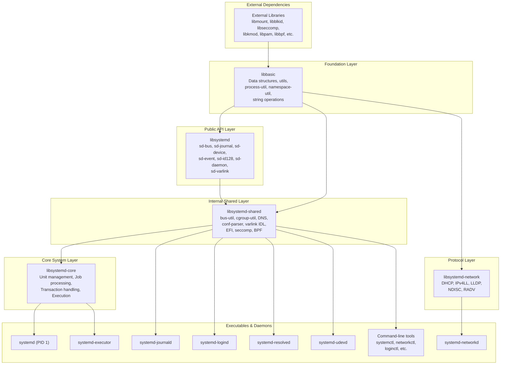
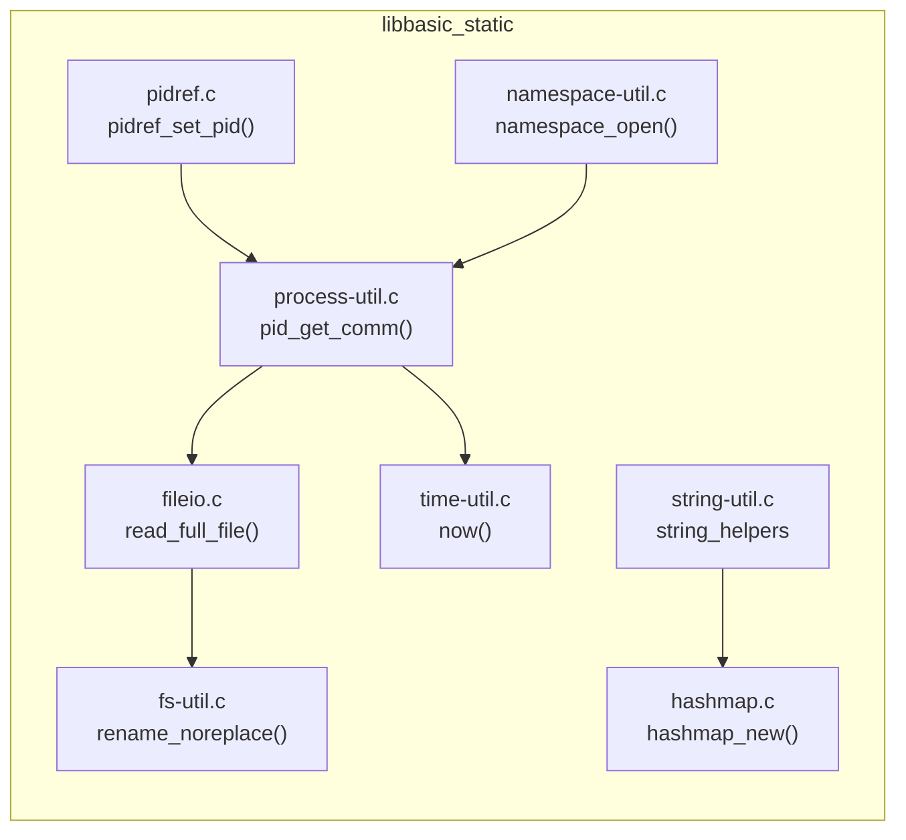
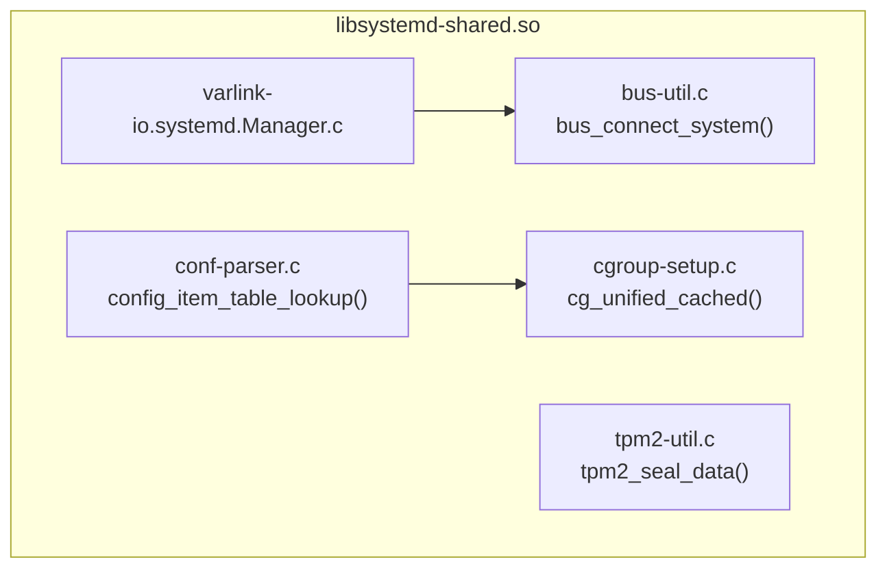

<!-- source: DeepWiki mcp.deepwiki.com · repo systemd/systemd · page 2.1 Library Architecture and Dependencies · fetched 2026-11-07 -->

# Library Architecture and Dependencies

Relevant source files

The following files were used as context for generating this wiki page:

- [.clusterfuzzlite/Dockerfile](.clusterfuzzlite/Dockerfile)
- [.mailmap](.mailmap)
- [NEWS](NEWS)
- [README](README)
- [coccinelle/memcmp.cocci](coccinelle/memcmp.cocci)
- [docs/CATALOG.md](docs/CATALOG.md)
- [docs/MEMORY_PRESSURE.md](docs/MEMORY_PRESSURE.md)
- [docs/NETWORK_ONLINE.md](docs/NETWORK_ONLINE.md)
- [docs/PREDICTABLE_INTERFACE_NAMES.md](docs/PREDICTABLE_INTERFACE_NAMES.md)
- [man/common-variables.xml](man/common-variables.xml)
- [man/meson.build](man/meson.build)
- [man/sd_event_add_child.xml](man/sd_event_add_child.xml)
- [man/sd_event_add_defer.xml](man/sd_event_add_defer.xml)
- [man/sd_event_add_inotify.xml](man/sd_event_add_inotify.xml)
- [man/sd_event_add_io.xml](man/sd_event_add_io.xml)
- [man/sd_event_add_memory_pressure.xml](man/sd_event_add_memory_pressure.xml)
- [man/sd_event_add_signal.xml](man/sd_event_add_signal.xml)
- [man/sd_event_add_time.xml](man/sd_event_add_time.xml)
- [man/sd_event_exit.xml](man/sd_event_exit.xml)
- [man/sd_event_get_fd.xml](man/sd_event_get_fd.xml)
- [man/sd_event_now.xml](man/sd_event_now.xml)
- [man/systemd-ask-password-console.service.xml](man/systemd-ask-password-console.service.xml)
- [man/systemd-ask-password.xml](man/systemd-ask-password.xml)
- [man/systemd-cat.xml](man/systemd-cat.xml)
- [man/systemd-tty-ask-password-agent.xml](man/systemd-tty-ask-password-agent.xml)
- [man/systemd-update-done.service.xml](man/systemd-update-done.service.xml)
- [man/systemd.time.xml](man/systemd.time.xml)
- [meson.build](meson.build)
- [meson_options.txt](meson_options.txt)
- [src/ask-password/ask-password.c](src/ask-password/ask-password.c)
- [src/basic/ansi-color.c](src/basic/ansi-color.c)
- [src/basic/ansi-color.h](src/basic/ansi-color.h)
- [src/basic/constants.h](src/basic/constants.h)
- [src/basic/env-file.c](src/basic/env-file.c)
- [src/basic/env-file.h](src/basic/env-file.h)
- [src/basic/env-util.c](src/basic/env-util.c)
- [src/basic/env-util.h](src/basic/env-util.h)
- [src/basic/escape.c](src/basic/escape.c)
- [src/basic/escape.h](src/basic/escape.h)
- [src/basic/extract-word.c](src/basic/extract-word.c)
- [src/basic/extract-word.h](src/basic/extract-word.h)
- [src/basic/fd-util.c](src/basic/fd-util.c)
- [src/basic/fd-util.h](src/basic/fd-util.h)
- [src/basic/fileio.c](src/basic/fileio.c)
- [src/basic/fileio.h](src/basic/fileio.h)
- [src/basic/format-util.c](src/basic/format-util.c)
- [src/basic/format-util.h](src/basic/format-util.h)
- [src/basic/fs-util.c](src/basic/fs-util.c)
- [src/basic/fs-util.h](src/basic/fs-util.h)
- [src/basic/hash-funcs.c](src/basic/hash-funcs.c)
- [src/basic/hash-funcs.h](src/basic/hash-funcs.h)
- [src/basic/hashmap.c](src/basic/hashmap.c)
- [src/basic/hashmap.h](src/basic/hashmap.h)
- [src/basic/iovec-wrapper.c](src/basic/iovec-wrapper.c)
- [src/basic/iovec-wrapper.h](src/basic/iovec-wrapper.h)
- [src/basic/iterator.h](src/basic/iterator.h)
- [src/basic/log.c](src/basic/log.c)
- [src/basic/log.h](src/basic/log.h)
- [src/basic/memfd-util.c](src/basic/memfd-util.c)
- [src/basic/memfd-util.h](src/basic/memfd-util.h)
- [src/basic/mempool.c](src/basic/mempool.c)
- [src/basic/mempool.h](src/basic/mempool.h)
- [src/basic/meson.build](src/basic/meson.build)
- [src/basic/nulstr-util.c](src/basic/nulstr-util.c)
- [src/basic/nulstr-util.h](src/basic/nulstr-util.h)
- [src/basic/ordered-set.c](src/basic/ordered-set.c)
- [src/basic/ordered-set.h](src/basic/ordered-set.h)
- [src/basic/os-util.c](src/basic/os-util.c)
- [src/basic/os-util.h](src/basic/os-util.h)
- [src/basic/path-util.c](src/basic/path-util.c)
- [src/basic/path-util.h](src/basic/path-util.h)
- [src/basic/psi-util.c](src/basic/psi-util.c)
- [src/basic/psi-util.h](src/basic/psi-util.h)
- [src/basic/set.h](src/basic/set.h)
- [src/basic/string-util.c](src/basic/string-util.c)
- [src/basic/string-util.h](src/basic/string-util.h)
- [src/basic/strv.c](src/basic/strv.c)
- [src/basic/strv.h](src/basic/strv.h)
- [src/basic/terminal-util.c](src/basic/terminal-util.c)
- [src/basic/terminal-util.h](src/basic/terminal-util.h)
- [src/basic/time-util.c](src/basic/time-util.c)
- [src/basic/time-util.h](src/basic/time-util.h)
- [src/basic/tmpfile-util.c](src/basic/tmpfile-util.c)
- [src/basic/tmpfile-util.h](src/basic/tmpfile-util.h)
- [src/basic/utf8.c](src/basic/utf8.c)
- [src/basic/utf8.h](src/basic/utf8.h)
- [src/core/generator-setup.c](src/core/generator-setup.c)
- [src/core/manager-serialize.c](src/core/manager-serialize.c)
- [src/core/meson.build](src/core/meson.build)
- [src/coredump/coredump-backtrace.c](src/coredump/coredump-backtrace.c)
- [src/coredump/coredump-backtrace.h](src/coredump/coredump-backtrace.h)
- [src/hostname/meson.build](src/hostname/meson.build)
- [src/import/meson.build](src/import/meson.build)
- [src/journal-remote/fuzz-journal-remote.c](src/journal-remote/fuzz-journal-remote.c)
- [src/journal-remote/meson.build](src/journal-remote/meson.build)
- [src/journal/cat.c](src/journal/cat.c)
- [src/journal/meson.build](src/journal/meson.build)
- [src/libsystemd-network/meson.build](src/libsystemd-network/meson.build)
- [src/libsystemd-network/network-common.c](src/libsystemd-network/network-common.c)
- [src/libsystemd-network/network-common.h](src/libsystemd-network/network-common.h)
- [src/libsystemd/meson.build](src/libsystemd/meson.build)
- [src/libsystemd/sd-event/event-source.h](src/libsystemd/sd-event/event-source.h)
- [src/libsystemd/sd-event/sd-event.c](src/libsystemd/sd-event/sd-event.c)
- [src/libsystemd/sd-event/test-event.c](src/libsystemd/sd-event/test-event.c)
- [src/libudev/meson.build](src/libudev/meson.build)
- [src/locale/meson.build](src/locale/meson.build)
- [src/login/meson.build](src/login/meson.build)
- [src/login/user-runtime-dir.c](src/login/user-runtime-dir.c)
- [src/machine/meson.build](src/machine/meson.build)
- [src/network/netdev/macsec.c](src/network/netdev/macsec.c)
- [src/network/netdev/macsec.h](src/network/netdev/macsec.h)
- [src/network/netdev/wireguard.c](src/network/netdev/wireguard.c)
- [src/network/netdev/wireguard.h](src/network/netdev/wireguard.h)
- [src/nspawn/meson.build](src/nspawn/meson.build)
- [src/nss-myhostname/nss-myhostname.sym](src/nss-myhostname/nss-myhostname.sym)
- [src/resolve/meson.build](src/resolve/meson.build)
- [src/shared/ask-password-api.c](src/shared/ask-password-api.c)
- [src/shared/ask-password-api.h](src/shared/ask-password-api.h)
- [src/shared/btrfs-util.c](src/shared/btrfs-util.c)
- [src/shared/btrfs-util.h](src/shared/btrfs-util.h)
- [src/shared/calendarspec.c](src/shared/calendarspec.c)
- [src/shared/calendarspec.h](src/shared/calendarspec.h)
- [src/shared/conf-parser.c](src/shared/conf-parser.c)
- [src/shared/conf-parser.h](src/shared/conf-parser.h)
- [src/shared/copy.c](src/shared/copy.c)
- [src/shared/copy.h](src/shared/copy.h)
- [src/shared/data-fd-util.c](src/shared/data-fd-util.c)
- [src/shared/data-fd-util.h](src/shared/data-fd-util.h)
- [src/shared/dev-setup.c](src/shared/dev-setup.c)
- [src/shared/dev-setup.h](src/shared/dev-setup.h)
- [src/shared/enable-mempool.c](src/shared/enable-mempool.c)
- [src/shared/format-table.c](src/shared/format-table.c)
- [src/shared/format-table.h](src/shared/format-table.h)
- [src/shared/journal-importer.c](src/shared/journal-importer.c)
- [src/shared/locale-setup.c](src/shared/locale-setup.c)
- [src/shared/locale-setup.h](src/shared/locale-setup.h)
- [src/shared/meson.build](src/shared/meson.build)
- [src/shared/nss-util.h](src/shared/nss-util.h)
- [src/shared/rm-rf.c](src/shared/rm-rf.c)
- [src/shared/rm-rf.h](src/shared/rm-rf.h)
- [src/shared/serialize.c](src/shared/serialize.c)
- [src/shared/serialize.h](src/shared/serialize.h)
- [src/systemd/meson.build](src/systemd/meson.build)
- [src/systemd/sd-event.h](src/systemd/sd-event.h)
- [src/test/meson.build](src/test/meson.build)
- [src/test/test-ask-password-agent.c](src/test/test-ask-password-agent.c)
- [src/test/test-ask-password-api.c](src/test/test-ask-password-api.c)
- [src/test/test-btrfs.c](src/test/test-btrfs.c)
- [src/test/test-calendarspec.c](src/test/test-calendarspec.c)
- [src/test/test-clock.c](src/test/test-clock.c)
- [src/test/test-conf-parser.c](src/test/test-conf-parser.c)
- [src/test/test-copy.c](src/test/test-copy.c)
- [src/test/test-core-unit.c](src/test/test-core-unit.c)
- [src/test/test-data-fd-util.c](src/test/test-data-fd-util.c)
- [src/test/test-date.c](src/test/test-date.c)
- [src/test/test-dev-setup.c](src/test/test-dev-setup.c)
- [src/test/test-dlopen-so.c](src/test/test-dlopen-so.c)
- [src/test/test-ellipsize.c](src/test/test-ellipsize.c)
- [src/test/test-env-file.c](src/test/test-env-file.c)
- [src/test/test-env-util.c](src/test/test-env-util.c)
- [src/test/test-escape.c](src/test/test-escape.c)
- [src/test/test-extract-word.c](src/test/test-extract-word.c)
- [src/test/test-fd-util.c](src/test/test-fd-util.c)
- [src/test/test-fileio.c](src/test/test-fileio.c)
- [src/test/test-format-table.c](src/test/test-format-table.c)
- [src/test/test-format-util.c](src/test/test-format-util.c)
- [src/test/test-fs-util.c](src/test/test-fs-util.c)
- [src/test/test-hashmap-plain.c](src/test/test-hashmap-plain.c)
- [src/test/test-hashmap.c](src/test/test-hashmap.c)
- [src/test/test-iovec-wrapper.c](src/test/test-iovec-wrapper.c)
- [src/test/test-log.c](src/test/test-log.c)
- [src/test/test-memfd-util.c](src/test/test-memfd-util.c)
- [src/test/test-nss-hosts.c](src/test/test-nss-hosts.c)
- [src/test/test-nss-users.c](src/test/test-nss-users.c)
- [src/test/test-nulstr-util.c](src/test/test-nulstr-util.c)
- [src/test/test-ordered-set.c](src/test/test-ordered-set.c)
- [src/test/test-os-util.c](src/test/test-os-util.c)
- [src/test/test-path-util.c](src/test/test-path-util.c)
- [src/test/test-pressure.c](src/test/test-pressure.c)
- [src/test/test-qrcode-util.c](src/test/test-qrcode-util.c)
- [src/test/test-reread-partition-table.c](src/test/test-reread-partition-table.c)
- [src/test/test-rm-rf.c](src/test/test-rm-rf.c)
- [src/test/test-serialize.c](src/test/test-serialize.c)
- [src/test/test-set-disable-mempool.c](src/test/test-set-disable-mempool.c)
- [src/test/test-set.c](src/test/test-set.c)
- [src/test/test-string-util.c](src/test/test-string-util.c)
- [src/test/test-strip-tab-ansi.c](src/test/test-strip-tab-ansi.c)
- [src/test/test-strv.c](src/test/test-strv.c)
- [src/test/test-terminal-util.c](src/test/test-terminal-util.c)
- [src/test/test-time-util.c](src/test/test-time-util.c)
- [src/test/test-tmpfile-util.c](src/test/test-tmpfile-util.c)
- [src/test/test-utf8.c](src/test/test-utf8.c)
- [src/timedate/meson.build](src/timedate/meson.build)
- [src/timesync/meson.build](src/timesync/meson.build)
- [src/tty-ask-password-agent/tty-ask-password-agent.c](src/tty-ask-password-agent/tty-ask-password-agent.c)
- [src/udev/meson.build](src/udev/meson.build)
- [src/update-done/update-done.c](src/update-done/update-done.c)
- [test/fuzz/meson.build](test/fuzz/meson.build)
- [test/meson.build](test/meson.build)
- [test/units/TEST-04-JOURNAL.journal-remote.sh](test/units/TEST-04-JOURNAL.journal-remote.sh)
- [test/units/TEST-17-UDEV.SYSTEMD_WANTS-escape.sh](test/units/TEST-17-UDEV.SYSTEMD_WANTS-escape.sh)
- [tools/meson-build.sh](tools/meson-build.sh)
- [tools/oss-fuzz.sh](tools/oss-fuzz.sh)
- [units/systemd-update-done.service.in](units/systemd-update-done.service.in)
- [units/user-.slice.d/10-defaults.conf](units/user-.slice.d/10-defaults.conf)
- [units/user-runtime-dir@.service.in](units/user-runtime-dir@.service.in)
- [units/user@.service.d/10-login-barrier.conf](units/user@.service.d/10-login-barrier.conf)
- [units/user@.service.in](units/user@.service.in)
- [units/user@0.service.d/10-login-barrier.conf](units/user@0.service.d/10-login-barrier.conf)

## Purpose and Scope

This page documents the layered library structure within the systemd codebase and details their dependencies and responsibilities. It covers the foundational utilities in `libbasic`, the public-facing `libsystemd` library, the internal shared code in `libsystemd-shared`, and the core system library `libsystemd-core`, along with commonly used utility components such as string manipulation, hashmaps, file descriptor and filesystem helpers, configuration parsing (`conf-parser`), table formatting, logging, and the event loop.

---

## Library Layer Architecture

systemd employs a layered architecture to isolate concerns, improve modularity, and enforce stable API boundaries. The hierarchy from the bottom up is:

- **libbasic**: Low-level utilities and data structures with minimal dependencies.
- **libsystemd**: Public API library exposing `sd-*` interfaces.
- **libsystemd-shared**: Internal shared code used by multiple daemons/tools.
- **libsystemd-core**: Core PID 1 system logic as a private library.
- Others such as `libsystemd-network` serve specialized protocol needs.

### systemd Library Dependency Layers

#### Notes on Layers

- **External Dependencies:** Common system libraries like `libmount`, `libblkid`, `libseccomp`, `libkmod`, `libpam`, and `libbpf` supplement systemd functionality.
- **libbasic:** Implements crucial building blocks such as process utilities, namespace helpers, string functions, hashmap implementations, and FD/filesystem helpers. It avoids dependencies beyond the C library [src/basic/meson.build:3-121]().
- **libsystemd:** Exposes stable `sd-*` APIs including D-Bus bindings (`sd-bus`), journaling (`sd-journal`), device management (`sd-device`), event loop (`sd-event`), identifiers (`sd-id128`), daemon helpers (`sd-daemon`), and Varlink IPC (`sd-varlink`) [src/libsystemd/meson.build:1-200]().
- **libsystemd-shared:** A private shared library containing common internal utilities such as bus helpers, cgroup handling, DNS, varlink IDL code, config parsing, EFI support, and security-related helpers like seccomp and BPF [src/shared/meson.build:3-248]().
- **libsystemd-core:** A static private library housing the heart of PID 1 functionality: unit management, job control, transactions, and the execution model [src/core/meson.build:3-106]().
- **libsystemd-network:** Provides network protocol stacks used by `systemd-networkd` largely focused on DHCP, IPv4LL, LLDP, NDISC, RADV protocols.

**Sources:** [src/basic/meson.build:3-121](), [src/shared/meson.build:3-248](), [src/core/meson.build:3-106](), [src/libsystemd/meson.build:1-200](), [meson.build:30-31]()

---

## libbasic – Foundation Layer

`libbasic` is a critical static library providing all foundational utilities and minimal dependencies for the entire systemd codebase.

### Core Functionalities and Components

| Category            | Representative Files                 | Key Functions/Classes                                  |
|---------------------|------------------------------------|-------------------------------------------------------|
| Process Utilities    | `process-util.c`                   | `pid_get_comm()`, `pid_get_cmdline()`                 |
| PID Reference       | `pidref.c`                        | `pidref_set_pid()`, `pidref_verify()`                 |
| Namespace Utilities  | `namespace-util.c`                 | `namespace_open()`, `namespace_enter()`               |
| Data Structures      | `hashmap.c`, `prioq.c`, `ordered-set.c` | `hashmap_new()`, `prioq_push()`, ordered-set operations |
| FD/Filesystem Helpers| `fd-util.c`, `fs-util.c`, `fileio.c`, `path-util.c` | `read_full_file()`, `rename_noreplace()`, `readlinkat_malloc()` |
| String Handling      | `string-util.c`, `strv.c`          | String manipulation helpers                            |
| Time Utilities       | `time-util.c`                     | `now()`, `dual_timestamp_now()`                        |

### Implementation and Data Flow Highlights

- Process utilities provide scoped access to process info, command lines, and ensure reference counting with `pidref` [src/basic/pidref.c:1-50]().
- Namespace helpers abstract Linux namespaces entering and opening for isolated operation contexts.
- Data structures such as hashmaps and priority queues underpin efficient lookup and event prioritization [src/basic/hashmap.c:1-50]().
- File descriptor and filesystem helpers provide safe, atomic, and race-condition resistant operations like `rename_noreplace()` [src/basic/fs-util.c:68-110]().
- String API improves manipulation of UTF-8 and null-terminated vectors.
- Time functions handle monotonic and realtime clock queries for scheduling.

### Build and Dependency Notes

- Implemented as a static library to optimize performance with inlining.
- Depends only on the standard C library and minimal platform-specific headers [src/basic/meson.build:209-221]().
- Used extensively by higher-level libraries and systemd executables.

**Sources:** [src/basic/meson.build:3-121](), [src/basic/process-util.c:1-100](), [src/basic/namespace-util.c:1-50](), [src/basic/fs-util.c:68-110](), [src/basic/fileio.c:35-85]()

---

## libsystemd – Public API Layer

`libsystemd` is the primary shared systemd library exporting stable, backwards-compatible APIs used by external tools and components.

### Major APIs Exposed

- **sd-bus:** Implements D-Bus IPC client and server functionality, allowing integration with the D-Bus message bus.
- **sd-journal:** Journal log reading, querying, and writing interface.
- **sd-device:** Device enumeration and introspection, superseding `libudev`.
- **sd-event:** General-purpose event loop implementing epoll-based event dispatching.
- **sd-id128:** Utilities to handle 128-bit IDs.
- **sd-daemon:** Collection of functions for daemon integration such as socket activation and watchdog.
- **sd-varlink:** Implements Varlink IPC protocol with code generation support.

This library maintains ABI stability to ensure using systemd's core features outside the daemon is streamlined [src/libsystemd/meson.build:1-200](), [README:330-338]().

**Sources:** [src/libsystemd/meson.build:1-200](), [README:330-338]()

---

## libsystemd-shared – Internal Shared Library

`libsystemd-shared` is a private shared library that contains internal utility code shared across systemd daemons and tools but not exposed as public ABI.

### Subsystem Highlights

| Subsystem           | Example Files                              | Purpose                                      |
|---------------------|--------------------------------------------|----------------------------------------------|
| Bus Utilities       | `bus-util.c`, `bus-polkit.c`               | D-Bus helper functions and polkit integration |
| Control Groups      | `cgroup-setup.c`, `cgroup-show.c`          | Discovery and unified control group handling |
| DNS Utilities       | `dns-domain.c`, `dns-packet.c`, `dns-rr.c`| DNS parsing and query result processing       |
| Varlink Interfaces  | `varlink-io.systemd.*.c`                    | Implements dozens of varlink IPC interfaces    |
| Configuration Parser| `conf-parser.c`                             | Parses `.conf` and `.service` configuration files |
| Cryptographic Helpers| `tpm2-util.c`, `fido2-util.c`              | Support for TPM and FIDO2 credential handling |

### Example Internal Relationships

The shared library layers reusable code to avoid duplication and maintain modularity across components such as networkd, resolved, udevd, journald, and logind [src/shared/meson.build:3-248](), [src/shared/conf-parser.c:50-83]().

**Sources:** [src/shared/meson.build:3-248](), [src/shared/conf-parser.c:50-83]()

---

## libsystemd-core – Core Unit Management Library

`libsystemd-core` contains the core logic needed to implement the PID 1 systemd daemon and the systemd executor.

### Key Components

- **Manager:** Implements the main event loop, state machine, and unit/job lifecycle management (`manager.c`).
- **Unit:** Abstract base representing all unit types (e.g., service, mount) (`unit.c`).
- **Job:** Represents unit job requests and tracking (`job.c`).
- **Transaction:** Handles sets of jobs for dependency resolution and initialization ordering (`transaction.c`).
- **Execution:** Process spawning and sandboxing mechanisms (`execute.c`).

### Unit File Parsing with Perfect Hashing

To efficiently parse unit files, systemd uses [GNU gperf](https://www.gnu.org/software/gperf/) generated perfect hash tables from `.gperf.in` templates, converting unit setting names into structured parsers.

This infrastructure accelerates parsing and supports the wide variety of unit directives [src/core/meson.build:3-106](), [src/core/meson.build:76-87]().

**Sources:** [src/core/meson.build:3-106](), [src/core/meson.build:76-87]()

---

## Shared Utilities and Core Services

### Strings and HashMaps

- String utilities provide UTF-8 safe operations, trimming, splitting (`string-util.c`, `strv.c`).
- `hashmap.c` implements high-performance anonymous and generic hashmap structures used throughout systemd components.
- Priority queues (`prioq.c`) and ordered sets are foundational building blocks for event scheduling and state tracking.

### File Descriptor (FD), Filesystem, and Path Helpers

- `fd-util.c` offers safe FD allocation, duplication, and closure helpers.
- `fs-util.c` contains helpers for atomic renames (`rename_noreplace`), absolute path resolution, and readlink operations.
- `fileio.c` has buffered reading/writing with careful handling for virtual filesystems.
- `path-util.c` provides path safety checking, component extraction, and safety wrappers.

### Configuration Parsing (`conf-parser.c`)

- Handles `.conf` and unit-like files robustly with callbacks for known keys.
- Supports extension keys, ignoring unknown ones gracefully.
- Maintains metadata and error diagnostics on parsing failures.
- Uses in-memory hash tables for config sections and entries.

### Format Table

- `format-table.c` renders tables of text data in rows and columns, used for structured output formatting in tools.

### Logging and Event Loop

- Logging has multiple levels and output targets, supporting debug, info, warning, and error (e.g., `log.c`).
- `sd-event.c` implements the event loop based on epoll, handling timers, signals, file IO events, and child process tracking.

---

## Build System and Linking Strategies

systemd uses Meson for build configuration, enabling flexible linking combinations and static/shared library builds.

### Noteworthy Build Options

| Option                  | Description                                          |
|-------------------------|-----------------------------------------------------|
| `systemd-multicall-binary` | Link `systemd` and `systemd-executor` into one executable for container optimizations [meson_options.txt:19]() |
| `build-static`          | Build static versions of supported binaries [meson_options.txt:46]() |
| `link-udev-shared`      | Link udev daemon against `libsystemd-shared.so` [meson_options.txt:17]() |
| `link-systemctl-shared` | Dynamically link `systemctl` against `libsystemd-shared` if enabled [meson_options.txt:22-23]() |

### Example Linking Patterns

- `systemd` (PID 1) links against `libsystemd-core`, `libsystemd-shared`, and `libbasic` [src/core/meson.build:134-160]().
- Daemons like `resolved` link against `libsystemd-shared` and `libsystemd` [src/resolve/meson.build:7-41]().
- Command-line tools like `systemctl` and `networkctl` can optionally be linked shared (benefitting from `libsystemd-shared`) or statically [meson_options.txt:16-47]().
  
Static linking is preferred for minimal environments and containerized setups, while shared linking reduces binary sizes for systems with full library support.

**Sources:** [meson_options.txt:16-47](), [meson.build:81-83](), [NEWS:111-123]()

---

## Summary: Library Usage Matrix

| Library               | Type                 | Primary Users                            |
|-----------------------|----------------------|----------------------------------------|
| `libbasic.a`          | Static library       | All systemd components                  |
| `libsystemd.so`       | Shared library       | External apps, systemd components       |
| `libsystemd-shared.so`| Private shared library| Most daemons and tools                  |
| `libsystemd-core.a`   | Private static library| `systemd` (PID 1), `systemd-executor` |
| `libsystemd-network.a`| Private static library| `systemd-networkd`, `resolved`         |

**Sources:** [src/basic/meson.build:209-221](), [src/shared/meson.build:3-248](), [src/core/meson.build:134-160](), [src/libsystemd-network/meson.build:3-40]()

---

This architecture ensures maintainability, efficient reuse, and stable APIs critical to systemd’s extensive and growing functionality.

---

