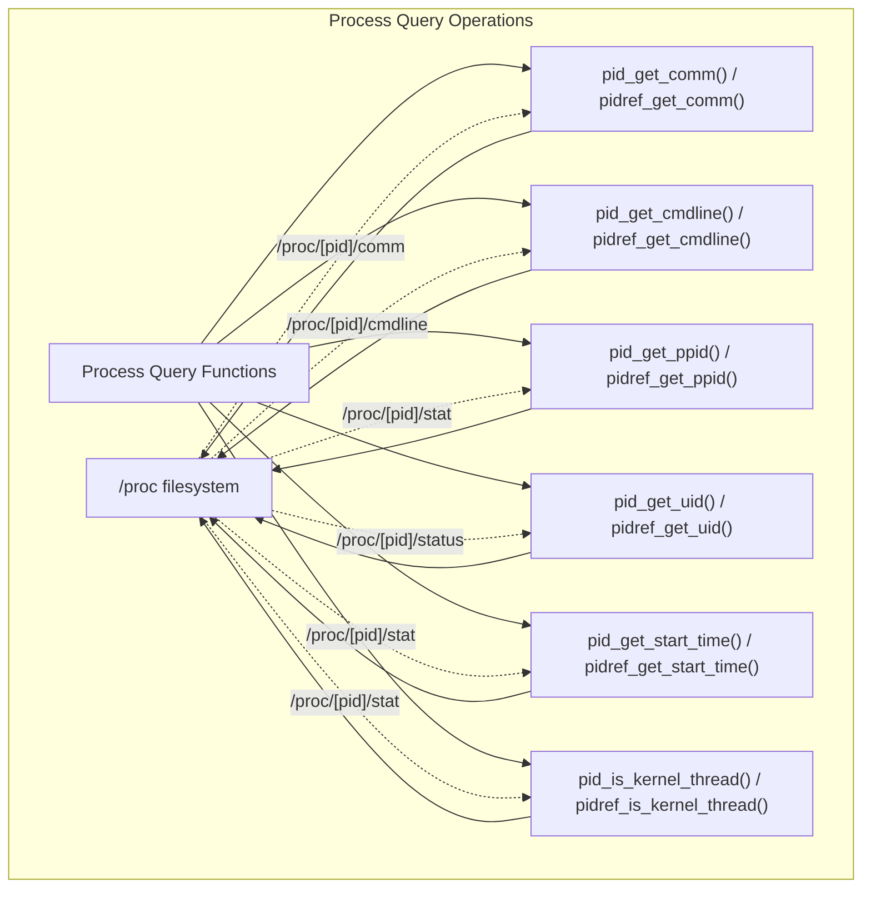
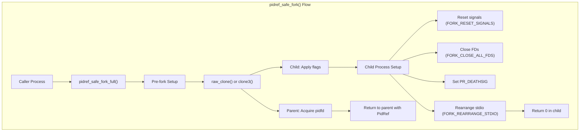
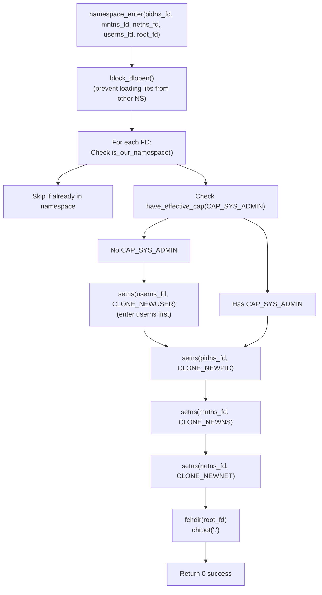
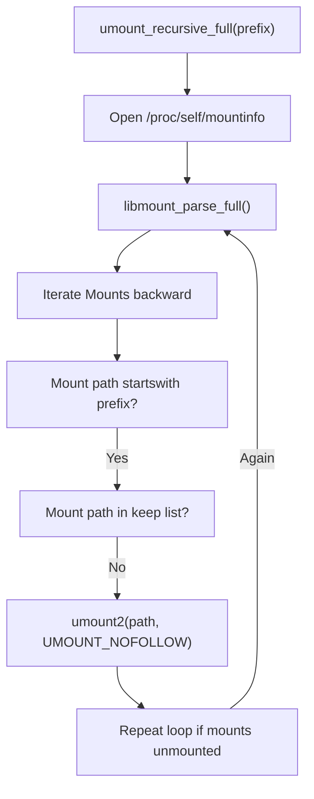

<!-- source: DeepWiki mcp.deepwiki.com · repo systemd/systemd · page 2.2 Process and Namespace Management · fetched 2026-11-07 -->

# Process and Namespace Management

<details>
<summary>Relevant source files</summary>

The following files were used as context for generating this wiki page:

- [src/basic/capability-util.c](src/basic/capability-util.c)
- [src/basic/capability-util.h](src/basic/capability-util.h)
- [src/basic/chase.c](src/basic/chase.c)
- [src/basic/chase.h](src/basic/chase.h)
- [src/basic/dirent-util.c](src/basic/dirent-util.c)
- [src/basic/dirent-util.h](src/basic/dirent-util.h)
- [src/basic/mountpoint-util.c](src/basic/mountpoint-util.c)
- [src/basic/mountpoint-util.h](src/basic/mountpoint-util.h)
- [src/basic/namespace-util.c](src/basic/namespace-util.c)
- [src/basic/namespace-util.h](src/basic/namespace-util.h)
- [src/basic/process-util.c](src/basic/process-util.c)
- [src/basic/process-util.h](src/basic/process-util.h)
- [src/basic/recurse-dir.c](src/basic/recurse-dir.c)
- [src/basic/recurse-dir.h](src/basic/recurse-dir.h)
- [src/basic/stat-util.c](src/basic/stat-util.c)
- [src/basic/stat-util.h](src/basic/stat-util.h)
- [src/basic/uid-range.c](src/basic/uid-range.c)
- [src/basic/uid-range.h](src/basic/uid-range.h)
- [src/basic/user-util.c](src/basic/user-util.c)
- [src/basic/user-util.h](src/basic/user-util.h)
- [src/core/dynamic-user.c](src/core/dynamic-user.c)
- [src/core/dynamic-user.h](src/core/dynamic-user.h)
- [src/firstboot/meson.build](src/firstboot/meson.build)
- [src/fsck/meson.build](src/fsck/meson.build)
- [src/machine-id-setup/meson.build](src/machine-id-setup/meson.build)
- [src/mountfsd/io.systemd.mount-file-system.policy](src/mountfsd/io.systemd.mount-file-system.policy)
- [src/mountfsd/meson.build](src/mountfsd/meson.build)
- [src/mountfsd/mountwork.c](src/mountfsd/mountwork.c)
- [src/shared/ask-password-agent.c](src/shared/ask-password-agent.c)
- [src/shared/exec-util.c](src/shared/exec-util.c)
- [src/shared/exec-util.h](src/shared/exec-util.h)
- [src/shared/find-esp.c](src/shared/find-esp.c)
- [src/shared/find-esp.h](src/shared/find-esp.h)
- [src/shared/libcrypt-util.c](src/shared/libcrypt-util.c)
- [src/shared/libcrypt-util.h](src/shared/libcrypt-util.h)
- [src/shared/mount-util.c](src/shared/mount-util.c)
- [src/shared/mount-util.h](src/shared/mount-util.h)
- [src/shared/polkit-agent.c](src/shared/polkit-agent.c)
- [src/shared/varlink-io.systemd.BootControl.h](src/shared/varlink-io.systemd.BootControl.h)
- [src/shared/varlink-io.systemd.MountFileSystem.c](src/shared/varlink-io.systemd.MountFileSystem.c)
- [src/shared/varlink-io.systemd.MountFileSystem.h](src/shared/varlink-io.systemd.MountFileSystem.h)
- [src/test/test-capability-util.c](src/test/test-capability-util.c)
- [src/test/test-chase.c](src/test/test-chase.c)
- [src/test/test-exec-util.c](src/test/test-exec-util.c)
- [src/test/test-libcrypt-util.c](src/test/test-libcrypt-util.c)
- [src/test/test-mount-util.c](src/test/test-mount-util.c)
- [src/test/test-mountpoint-util.c](src/test/test-mountpoint-util.c)
- [src/test/test-namespace.c](src/test/test-namespace.c)
- [src/test/test-path-lookup.c](src/test/test-path-lookup.c)
- [src/test/test-process-util.c](src/test/test-process-util.c)
- [src/test/test-stat-util.c](src/test/test-stat-util.c)
- [src/test/test-tests.c](src/test/test-tests.c)
- [src/test/test-uid-range.c](src/test/test-uid-range.c)
- [src/test/test-user-util.c](src/test/test-user-util.c)
- [src/volatile-root/volatile-root.c](src/volatile-root/volatile-root.c)
- [units/systemd-mountfsd.service.in](units/systemd-mountfsd.service.in)

</details>


## Purpose and Scope

This page documents the fundamental process management utilities and the namespace abstractions provided by systemd's `libbasic`. These core utilities form the basis for building process lifecycle management, stable process identification without PID reuse issues, secure forking, namespace handling, user and UID utilities, and mountpoint/mount helpers frequently used throughout the systemd ecosystem.

This is a leaf page focusing on fully explaining these low-level primitives in detail. For higher-level process execution and sandboxing, refer to [Process Execution and Sandboxing (2.4)](), and for container-specific namespace management, see [systemd-nspawn Container Manager (5.1)]().

---

## Core Process Management Abstractions

### The PidRef Structure

Systemd uses the `PidRef` abstraction to robustly refer to processes. Unlike raw PIDs, `PidRef` combines multiple identification aspects to safely track a process instance even if the PID is quickly reused.

```c
typedef struct PidRef {
    pid_t pid;      // Process ID
    int fd;         // pidfd file descriptor (optional but preferred)
    ino_t inode;    // Inode number of /proc/[pid] directory (verification)
} PidRef;
```

- The `pidfd` is a Linux kernel feature (since 5.3/5.4) that provides a stable file descriptor handle to a specific process, which prevents ambiguities common to PID reuse.
- The inode of `/proc/[pid]/` provides an additional verification step to detect PID reuse.
  
Users construct, query, and verify `PidRef` objects through accompanying API functions that guarantee the referenced process instance is still valid.

**Key Operations:**

| Function               | Description                                      | Reference                              |
|------------------------|------------------------------------------------|--------------------------------------|
| `pidref_set_pid()`     | Initialize a `PidRef` from a PID                | [src/basic/pidref.c:116-121]()       |
| `pidref_verify()`      | Verify the validity of a `PidRef`               | [src/basic/pidref.c:165-201]()       |
| `pidref_is_set()`      | Check if `PidRef` is defined                     | [src/basic/pidref.h:28-30]()         |
| `pidref_equal()`       | Compare two `PidRef` structs                      | [src/basic/pidref.c:264-278]()       |

Sources: [src/basic/pidref.h:12-32](), [src/basic/pidref.c:1-300]()

---

### Process Information Queries

The process utilities in `process-util` provide a rich set of functions to fetch details about running processes. These functions have variants accepting either raw PIDs or verified `PidRef` objects.

#### Common Process Queries and Implementation

| Function                        | Returns                                | Fallback Behavior                                  | Reference                          |
|--------------------------------|--------------------------------------|---------------------------------------------------|----------------------------------|
| `pid_get_comm(pid, &ret)`       | Command name (max 16 chars)          | None                                              | [src/basic/process-util.c:95-133]()  |
| `pid_get_cmdline(pid, ...)`     | Full command line string             | Falls back to `[comm]` string when empty          | [src/basic/process-util.c:158-217]() |
| `pid_get_ppid(pid, &ret)`       | Parent PID                          | Returns `-EADDRNOTAVAIL` for `pid == 1`            | [src/basic/process-util.c:455-483]() |
| `pid_get_uid(pid, &ret)`        | Real user ID                        | Reads from `/proc/[pid]/status`                    | [src/basic/process-util.c:351-371]() |
| `pid_is_kernel_thread(pid)`     | Boolean: kernel thread status       | Checks `PF_KTHREAD` flag in `/proc/[pid]/stat`     | [src/basic/process-util.c:711-739]() |

- All these functions perform filesystem reads from `/proc/[pid]/` pseudo-files such as `comm`, `cmdline`, `stat`, and `status`.
- The `pidref_*` variants first call `pidref_verify()` to ensure the process has not exited and PID reused before returning info [src/basic/process-util.c:135-156]().

#### Process Query Data Flow



Sources: [src/basic/process-util.c:95-787](), [src/basic/process-util.h:37-55]()

---

### Process Lifecycle Operations: Safe Forking

Forking processes safely with proper cleanup and setup is critical in systemd.

#### pidref_safe_fork() and pidref_safe_fork_full()

- Provide a rich, controlled process fork mechanism.
- Accept `ForkFlags` to specify operations to perform in the child after fork:
  - Reset signal handlers
  - Close file descriptors (except some)
  - Set death signal (PR_DEATHSIG)
  - Rearrange standard input/output/error
- Can create new Linux namespaces (`FORK_NEW_*` flags) via `raw_clone()` which is unsafe in threaded programs due to glibc locking concerns. These flags must be used with care.

| ForkFlag              | Description                                                  | Thread Safety                      |
|-----------------------|--------------------------------------------------------------|----------------------------------|
| `FORK_RESET_SIGNALS`    | Reset all signal handlers and masks                           | Safe                             |
| `FORK_CLOSE_ALL_FDS`    | Close all open FDs except 0, 1, 2 and excepted FD list      | Safe                             |
| `FORK_NEW_MOUNTNS`      | Create a new mount namespace using `raw_clone()`             | 💣 Unsafe in multithreaded apps  |
| `FORK_NEW_USERNS`       | Create a new user namespace using `raw_clone()`              | 💣 Unsafe in multithreaded apps  |
| `FORK_NEW_NETNS`        | Create new network namespace                                  | 💣 Unsafe in multithreaded apps  |
| `FORK_NEW_PIDNS`        | Create new PID namespace                                      | 💣 Unsafe in multithreaded apps  |

#### Safe Forking Data Flow



Sources: [src/basic/process-util.c:1434-1741](), [src/basic/process-util.h:145-175]()

---

## Namespace Management

### Supported Namespace Types and Structure

Linux namespaces supported are represented via the `namespace_info` array:

```c
const struct namespace_info {
    const char *proc_name;              // short name e.g. "pid"
    const char *proc_path;              // path in proc e.g. "ns/pid"
    unsigned long clone_flag;           // CLONE_NEW* flag for namespace
    unsigned long pidfd_get_ns_ioctl_cmd;  // ioctl cmd to get namespace from pidfd
    ino_t root_inode;                   // inode of initial namespace for verification
} namespace_info[_NAMESPACE_TYPE_MAX + 1];
```

Namespace Types covered include:

- `NAMESPACE_CGROUP`
- `NAMESPACE_IPC`
- `NAMESPACE_NET`
- `NAMESPACE_MOUNT`
- `NAMESPACE_PID`
- `NAMESPACE_USER`
- `NAMESPACE_UTS`
- `NAMESPACE_TIME`

Each type maps to its clone flag and `/proc/[pid]/ns` path [src/basic/namespace-util.c:30-43]().

Sources: [src/basic/namespace-util.c:28-41](), [src/basic/namespace-util.h:6-25]()

---

### Entering Namespaces (`namespace_enter()`)

`namespace_enter()` is the primary API to enter one or more namespaces of a target process, given file descriptors for those namespaces.

Key operational features:

- Blocks `dlopen()` temporarily to avoid loading incompatible shared libraries from wrong namespaces.
- Skips redundant `setns()` calls if already in the desired namespace (`is_our_namespace()`).
- Handles capability limitations gracefully: If the caller lacks `CAP_SYS_ADMIN`, it enters the user namespace first to gain the capability inside the new namespace, before entering PID and other namespaces.
- When entering mount and network namespaces, it invokes `setns()` with relevant clone flags.
- If requested, performs `chroot()` into the target root filesystem.

#### namespace_enter Implementation Flow



Sources: [src/basic/namespace-util.c:231-329]()

---

### Namespace Inspection and Utility Functions

Several helper functions assist in working with namespaces:

| Function                  | Description                                 | Reference                         |
|---------------------------|---------------------------------------------|---------------------------------|
| `fd_is_namespace(fd)`      | Checks if FD references a Linux namespace | [src/basic/namespace-util.c:331-348]() |
| `is_our_namespace(fd, type)` | Checks if FD references our current namespace of given type | [src/basic/namespace-util.c:368-384]() |
| `namespace_is_init(fd, type)` | Checks if FD references initial (root) namespace | [src/basic/namespace-util.c:439-455]() |
| `pidref_in_same_namespace(pidref1, pidref2, type)` | Checks if two processes are in the same namespace | [src/basic/namespace-util.c:457-478]() |

Sources: [src/basic/namespace-util.c:331-478](), [src/basic/namespace-util.h:51-60]()

---

## Mount Management and Chase Helpers

### Recursive Mount Operations

systemd provides safe recursive unmounting and remounting of mountpoints.

- `umount_recursive_full(prefix, flags, keep)` recursively unmounts all mounts under `prefix`, excluding any paths specified in the `keep` exclusion list.
- Parsing of mounts uses `libmount` to read `/proc/self/mountinfo` in backward order to unmount deepest mounts first.
- A loop retries if mounts remain after unmount to handle stacked mounts.

#### Recursive Unmount Logic Diagram



Sources: [src/shared/mount-util.c:42-119](), [src/shared/mount-util.h:20-23]()

---

### User and UID Utilities

systemd includes extensive utilities to parse, validate, and handle user and group IDs reliably and securely, avoiding common pitfalls like invalid or reserved IDs.

- `uid_is_valid(uid_t uid)` verifies if a UID is valid, explicitly prohibiting invalid values like `UINT32_MAX` or `0xFFFF` [src/basic/user-util.c:51-64]().
- `parse_uid()` and `parse_uid_range()` parse numeric UID strings strictly disallowing leading zeros, whitespace, or signs for security and correctness [src/basic/user-util.c:65-135]().
- `getusername_malloc()` and related functions fetch effective usernames from the environment or UID mappings.

Sources: [src/basic/user-util.c:51-196]()

---

## Key Design Principles

### PID Reuse Safety

- Traditional PID identification is unsafe due to rapid PID reuse.
- `PidRef` combines the pidfd and inode lookup to ensure robust process referencing.
- All `pidref_*` query functions internally verify the process is still the same using `pidref_verify()` [src/basic/process-util.c:145-156]().

### Thread Safety Boundaries

- Use of namespace-creating flags (`FORK_NEW_USERNS`, etc.) in fork is **unsafe** in multi-threaded parent processes because they internally use `raw_clone()` bypassing glibc malloc locks, which risks deadlocks.
- Such flags should only be used in single-threaded contexts or before other threads spawn [src/basic/process-util.h:145-149]().

### Capability-Aware Namespace Entry

- When entering namespaces, lack of `CAP_SYS_ADMIN` means the user namespace must be entered first to gain capabilities inside that user namespace.
- Then other namespaces (PID, mount, network) can be entered safely.
- The logic in `namespace_enter()` automates this sequence [src/basic/namespace-util.c:277-283]().

---

# Summary Diagram: Natural Language to Code Entities Mapping

```mermaid
graph TD
    A["Process and Namespace Management"] --> B["Process Management Utilities"]
    A --> C["Namespace Abstractions"]
    A --> D["Mount and Chase Helpers"]
    A --> E["User and UID Utilities"]

    B --> F[PidRef Structure]
    B --> G[process-util.c/h]
    B --> H[Safe Forking (pidref_safe_fork)*]

    C --> I[namespace-util.c/h]
    C --> J[namespace_info[] Array]
    C --> K[namespace_enter() Function]
    C --> L[Namespace Inspection Functions]

    D --> M[mount-util.c/h]
    D --> N[umount_recursive_full()]
    D --> O[bind_remount_recursive_with_mountinfo()]

    E --> P[user-util.c/h]
    E --> Q[UID Parsing and Validation]

    style A fill:#fff,stroke:#000,stroke-width:1px
    style B fill:#fff
    style C fill:#fff
    style D fill:#fff
    style E fill:#fff
```

---

# References

- [src/basic/pidref.h:10-40]()
- [src/basic/pidref.c:1-300]()
- [src/basic/process-util.c:50-787]()
- [src/basic/process-util.h:20-180]()
- [src/basic/namespace-util.c:20-480]()
- [src/basic/namespace-util.h:10-60]()
- [src/shared/mount-util.c:40-120]()
- [src/shared/mount-util.h:10-160]()
- [src/basic/user-util.c:50-195]()

---

This completes the detailed explanation of process and namespace management utilities in systemd.

---

