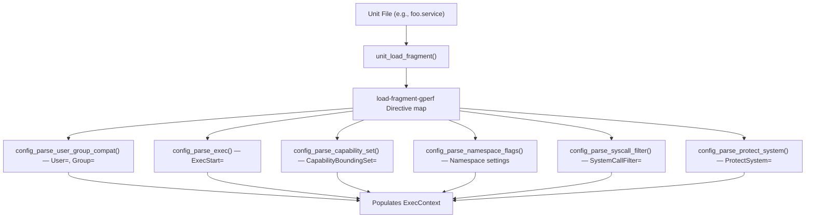
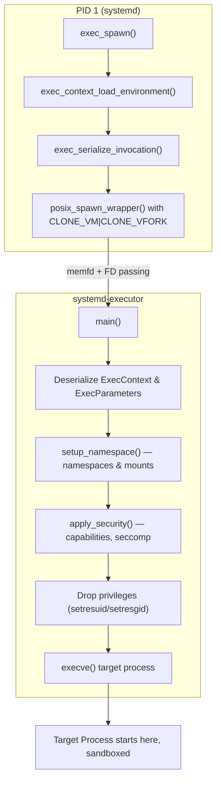
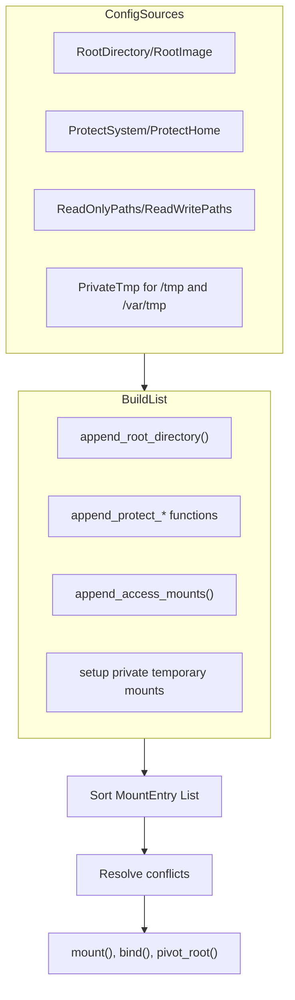
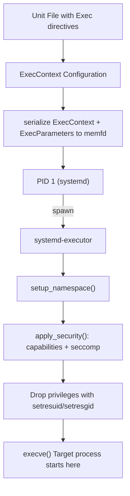

<!-- source: DeepWiki mcp.deepwiki.com · repo systemd/systemd · page 2.4 Process Execution and Sandboxing · fetched 2026-11-07 -->

# Process Execution and Sandboxing

<details>
<summary>Relevant source files</summary>

The following files were used as context for generating this wiki page:

- [man/org.freedesktop.systemd1.xml](man/org.freedesktop.systemd1.xml)
- [man/systemd.exec.xml](man/systemd.exec.xml)
- [src/core/dbus-execute.c](src/core/dbus-execute.c)
- [src/core/exec-invoke.c](src/core/exec-invoke.c)
- [src/core/execute-serialize.c](src/core/execute-serialize.c)
- [src/core/execute.c](src/core/execute.c)
- [src/core/execute.h](src/core/execute.h)
- [src/core/load-fragment-gperf.gperf.in](src/core/load-fragment-gperf.gperf.in)
- [src/core/load-fragment.c](src/core/load-fragment.c)
- [src/core/load-fragment.h](src/core/load-fragment.h)
- [src/core/namespace.c](src/core/namespace.c)
- [src/core/namespace.h](src/core/namespace.h)
- [src/nspawn/nspawn-oci.c](src/nspawn/nspawn-oci.c)
- [src/nspawn/nspawn-seccomp.c](src/nspawn/nspawn-seccomp.c)
- [src/nspawn/nspawn-seccomp.h](src/nspawn/nspawn-seccomp.h)
- [src/shared/bus-unit-util.c](src/shared/bus-unit-util.c)
- [src/shared/bus-util.c](src/shared/bus-util.c)
- [src/shared/bus-util.h](src/shared/bus-util.h)
- [src/shared/seccomp-util.c](src/shared/seccomp-util.c)
- [src/shared/seccomp-util.h](src/shared/seccomp-util.h)
- [src/test/test-ns.c](src/test/test-ns.c)
- [src/test/test-seccomp.c](src/test/test-seccomp.c)

</details>


## Purpose and Scope

This page details the implementation of process execution and sandboxing in systemd. It explains how processes are launched using the `ExecContext` data structure, the two-process execution model involving the systemd PID 1 and `systemd-executor`, the setup of Linux namespaces for isolation, use of seccomp filters for syscall filtering, capability management, and how standard I/O is handled in the sandboxed environment.

This functionality is critical for unit types that launch or manage processes (services, sockets, mounts, swaps) and enables systemd to enforce complex sandboxing and resource constraints as configured through unit files [man/systemd.exec.xml:32-43]().

## ExecContext: Structure for Execution Environment Configuration

The execution environment for a process in systemd is configured through the `ExecContext` structure defined in `src/core/execute.h` [src/core/execute.h:195-430](). It encapsulates all the runtime and sandbox settings derived from unit file directives (such as `User=`, `CapabilityBoundingSet=`, `PrivateTmp=`, etc.).

### Key Fields and Configuration Categories

| Category               | Representative Fields                                     | Configured via Unit Directives                        |
|------------------------|----------------------------------------------------------|------------------------------------------------------|
| **User and Group IDs**  | `user`, `group`, `supplementary_groups`, `dynamic_user` | `User=`, `Group=`, `DynamicUser=`                     |
| **Filesystem Roots**    | `root_directory`, `root_image`, `working_directory`       | `RootDirectory=`, `RootImage=`, `WorkingDirectory=`   |
| **Capabilities**       | `capability_bounding_set`, `capability_ambient_set`       | `CapabilityBoundingSet=`, `AmbientCapabilities=`      |
| **Namespace Isolation**| `private_network`, `private_tmp`, `private_devices`, `private_users`, `private_pids` | `PrivateNetwork=`, `PrivateTmp=`, `PrivateUsers=`, `PrivatePIDs=` |
| **Filesystem Protection** | `protect_system`, `protect_home`, `protect_kernel_tunables`, `protect_control_groups` | `ProtectSystem=`, `ProtectHome=`, `ProtectKernelTunables=`, `ProtectControlGroups=` |
| **System Call Filtering** | `syscall_filter`, `syscall_allow_list`, `syscall_errno`, `syscall_archs` | `SystemCallFilter=`, `SystemCallErrorNumber=`, `SystemCallArchitectures=` |
| **Mount Options**      | `read_write_paths`, `read_only_paths`, `inaccessible_paths`, `bind_mounts` | `ReadWritePaths=`, `ReadOnlyPaths=`, `InaccessiblePaths=`, `BindReadOnlyPaths=` |
| **Standard I/O**       | `std_input`, `std_output`, `std_error`                      | `StandardInput=`, `StandardOutput=`, `StandardError=` |
| **Environment**        | `environment`, `environment_files`, `pass_environment`, `unset_environment` | `Environment=`, `EnvironmentFile=`, `PassEnvironment=`, `UnsetEnvironment=` |
| **Security Context**   | `selinux_context`, `apparmor_profile`, `smack_process_label` | `SELinuxContext=`, `AppArmorProfile=`, `SmackProcessLabel=` |
| **Resource Limits**    | `rlimit[RLIM_NLIMITS]`                                     | `LimitNOFILE=`, `LimitCPU=`, etc.                      |

This structured approach enables precise specification of the process environment and sandboxing policies [src/core/execute.h:195-430]().

### Initialization of ExecContext

The `exec_context_init()` function sets default values for `ExecContext`, such as applying umask `0022`, initializing I/O priorities with defaults, and setting capabilities to a full set by default [src/core/execute.c:614-667](). This prepares a sane baseline before per-unit configuration is applied.

---

## Parsing Execution Environment from Unit Files

Unit configurations are parsed via `unit_load_fragment()` in `src/core/load-fragment.c`. This function consults a generated perfect hash table from `load-fragment-gperf` to efficiently match configuration keys with parser functions [src/core/load-fragment.c:10-176](), [src/core/load-fragment.h:1-134](). Parsers populate fields inside `ExecContext` and related structures.

The parsing flow can be summarized as:



This scheme ensures modular, extendable parsing of all relevant sandboxing and environment properties.

**Sources:** [src/core/load-fragment.c:10-176](), [src/core/load-fragment.h:1-134]()

---

## Two-Process Execution Model: systemd and systemd-executor

Due to the complex and large nature of the systemd PID 1, it cannot `fork()` processes safely without risking memory bloat or deadlocks. systemd therefore employs a two-process model:

- **PID 1 (systemd):** Initiates process spawning by serializing execution context and parameters into an in-memory file descriptor (memfd) which is passed to the executor.
- **systemd-executor:** A lightweight helper process that deserializes the context, sets up the sandbox (namespaces, capabilities, seccomp), adjusts privileges, and `execve()`s the target process.

This design segregates the sandbox/namespace setup code out of PID 1, improving modularity and reliability [src/core/execute.c:462-612]().

### Architecture of the Two-Process Model



**Sources:** [src/core/execute.c:462-612](), [src/core/exec-invoke.c:1-247]()

### Phase 1: Serialization and Spawning in PID 1

- `exec_spawn()` calls `exec_context_load_environment()` to process environment files for the process [src/core/execute.c:490-492]().
- An in-memory serialization FD (`memfd`) is created with `open_serialization_file()` [src/core/execute.c:530-532]().
- The execution context, commands, and parameters are serialized to this memfd using `exec_serialize_invocation()` [src/core/execute-serialize.c:1-500]().
- A collection of file descriptors (activation sockets, open files) is gathered into an `FDSet` [src/core/execute.c:534-540]().
- Finally, `posix_spawn_wrapper()` is used to spawn `systemd-executor` in a way that shares the memory layout optimally (`CLONE_VM|CLONE_VFORK` flags) [src/core/execute.c:578-603]().

---

## Namespace Isolation and Setup

Linux namespaces are instrumental to process sandboxing in systemd. The `setup_namespace()` function in `src/core/namespace.c` manages creation and configuration of namespaces according to the `ExecContext` configuration [src/core/namespace.c:1-163]().

### Supported Namespace Types and Flags

| Namespace | Corresponding `ExecContext` Flags      | Purpose                         |
|-----------|--------------------------------------|--------------------------------|
| Mount     | `root_directory`, `root_image`, `protect_system`, `protect_home` | Filesystem isolation            |
| PID       | `private_pids`                       | Isolate process ID number space |
| Network   | `private_network`                    | Network stack isolation          |
| IPC       | `private_ipc`                       | POSIX & SysV IPC isolation      |
| User      | `private_users`                     | UID/GID mapping and isolation   |
| UTS       | Not always exposed                   | Hostname and domain name isolation |
| Time      | Sometimes configured                 | Isolate system clocks           |

**Sources:** [src/core/execute.h:195-430](), [src/core/namespace.c:1-163]()

### Mount Namespace: Building the Mount List

Mount points are managed via an array of `MountEntry` structures. These entries represent bind mounts, overlays, or ephemeral filesystems required for sandboxing.

The mount list is assembled from various configuration sources:

- Root directory or root image snapshot (`RootDirectory=`, `RootImage=`)
- Protection settings such as `ProtectSystem=`, `ProtectHome=`
- Explicit read-only, read-write, or inaccessible paths
- Private temporary filesystems (`PrivateTmp=`), device nodes, and other sandbox mounts

The process consists of:

1. Collecting mount entries from different configuration categories.
2. Sorting them by mount priority.
3. Resolving any conflicting entries.
4. Applying mounts to configure the process mount namespace.



**Sources:** [src/core/namespace.c:60-127](), [src/core/namespace.c:143-269]()

### Filesystem Protection: Examples

- `ProtectSystem=full` mounts `/usr`, `/boot` and `/efi` read-only, and may mount `/etc` read-only as well.
- `ProtectHome=yes` hides or makes `/home`, `/root`, and `/run/user` inaccessible or read-only.
- `ProtectKernelTunables=yes` remounts various `/proc/sys` and `/sys` subtrees read-only or inaccessible to prevent kernel tunable modifications.

This high-level protection enforces strict filesystem barriers on processes [man/systemd.exec.xml:145-146](), [src/core/namespace.c:151-166]().

---

## Security Mechanisms

### Capability Management

Capabilities limit the privileges of processes without requiring full root privileges. systemd manages these by setting:

- **CapabilityBoundingSet**: The upper limit of capabilities the process can gain.
- **AmbientCapabilities**: Capabilities preserved across `execve()` calls.

Capabilities are applied via `prctl()` and setgroups calls before dropping privileges [src/core/execute.h:230-240](), [src/core/exec-invoke.c:1-50]().

### Seccomp (Secure Computing Mode)

systemd enforces syscall filtering with seccomp BPF programs. The syscall filter is defined by the `SystemCallFilter=` directive and optionally restricted further by architecture filters.

The implementation uses libseccomp APIs to create secure filter programs, which restrict the syscalls a service can execute, improving security against exploits [src/shared/seccomp-util.c:35-185](), [src/shared/seccomp-util.h](). Predefined syscall groups like `@system-service` ease configuration.

---

## Standard Input/Output Handling

systemd carefully configures standard input, output, and error for the executed process. The standard streams may be:

- Redirected to `/dev/null` (e.g., `EXEC_INPUT_NULL`)
- Connected to TTY devices
- Routed to the journal or kernel log via sockets
- Connected to files or named sockets

For example, when outputting to the journal (`EXEC_OUTPUT_JOURNAL`), the executor connects a UNIX stream socket to the journal daemon and sends identification metadata such as UID and the syslog identifier [src/core/exec-invoke.c:136-257]().

| Stream Setting            | Description                                              |
|--------------------------|----------------------------------------------------------|
| `EXEC_INPUT_NULL`         | Standard input replaced with `/dev/null`                 |
| `EXEC_OUTPUT_JOURNAL`     | Outputs to `systemd-journald` via socket stream          |
| `EXEC_OUTPUT_KMSG`        | Outputs to the kernel message buffer                      |
| `EXEC_OUTPUT_TTY`         | Outputs directed to the TTY device                        |

---

## Important Data Structures Overview

### ExecCommand

Describes a single executable command invocation.

```c
typedef struct ExecCommand {
        char *path;         /* Path to executable */
        char **argv;        /* Argument vector, NULL-terminated */
        ExecStatus exec_status; /* Runtime exec/start/exit info, not serialized */
        ExecCommandFlags flags; /* Flags (e.g. for special behavior) */
        LIST_FIELDS(ExecCommand, command); /* Chaining multiple commands */
} ExecCommand;
```

**Source:** [src/core/execute.h:106-112]()

### ExecParameters

Holds runtime execution parameters such as file descriptors, cgroup paths, and environment settings passed to `systemd-executor`.

**Source:** [src/core/execute.h:288-349]()

### ExecSharedRuntime

Allows multiple process invocations (for example, a main process and a reload helper) to share the same runtime environment, including `/tmp` directories and network namespaces.

```c
typedef struct ExecSharedRuntime {
        unsigned n_ref;
        Manager *manager;
        char *id; /* owner unit id */

        /* Temporary directory paths and namespace socket pairs */
        char *tmp_dir;
        char *var_tmp_dir;

        int netns_storage_socket[2];  /* Network namespace FD transfer */
        int ipcns_storage_socket[2];  /* IPC namespace FD transfer */
        int userns_storage_socket[2]; /* User namespace FD transfer */
} ExecSharedRuntime;
```

**Source:** [src/core/execute.h:118-137]()

---

# Summary of the Execution and Sandboxing Workflow



This flow demonstrates the separation of responsibility and how systemd achieves a robust sandboxed execution environment.

---

## References and Sources

- [src/core/execute.h:195-430]()
- [src/core/execute.c:462-612]()
- [src/core/exec-invoke.c:1-247]()
- [src/core/load-fragment.c:10-176]()
- [src/core/load-fragment.h:1-134]()
- [src/core/namespace.c:1-163]()
- [src/shared/seccomp-util.c:35-185]()
- [man/systemd.exec.xml:32-43]()
- [man/systemd.exec.xml:145-146]()

---

This page documents systemd's internals for process execution and sandboxing, facilitating understanding and contributions to process management features.

---

