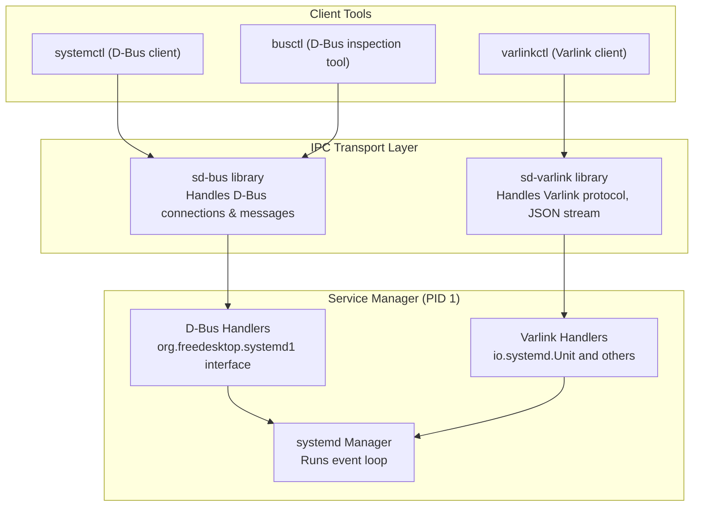
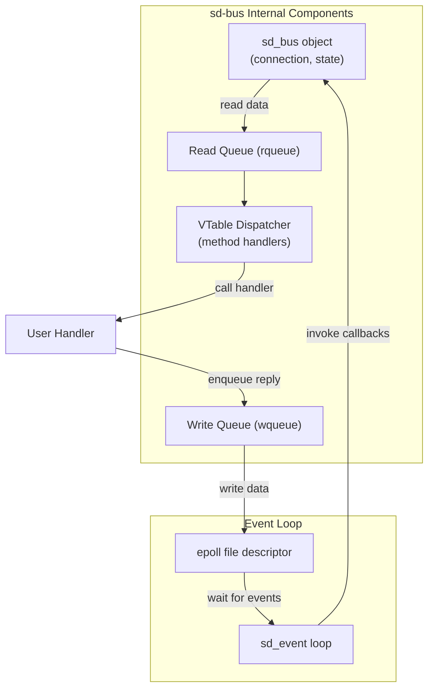
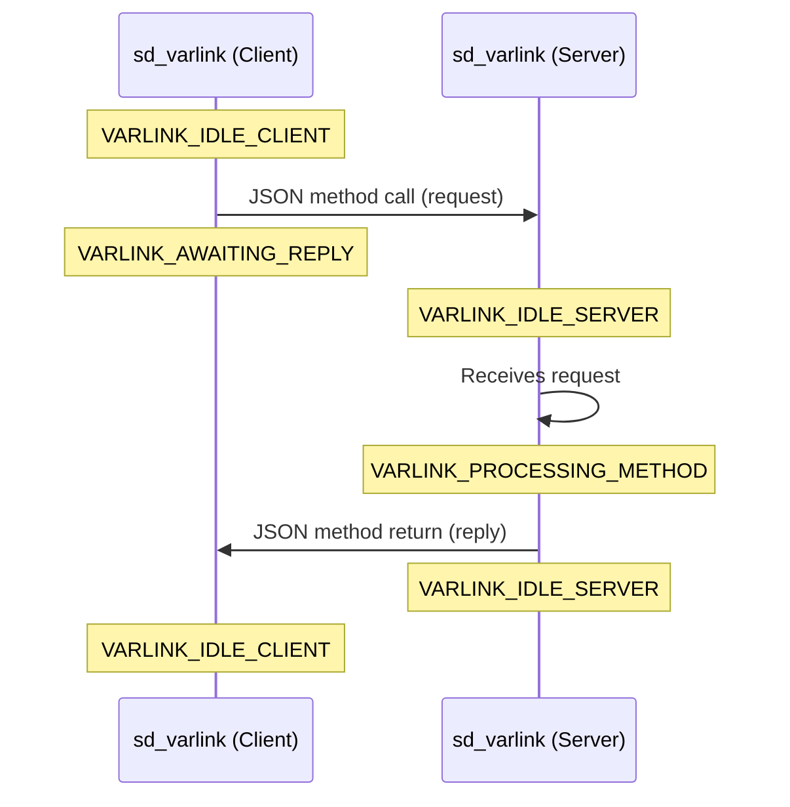
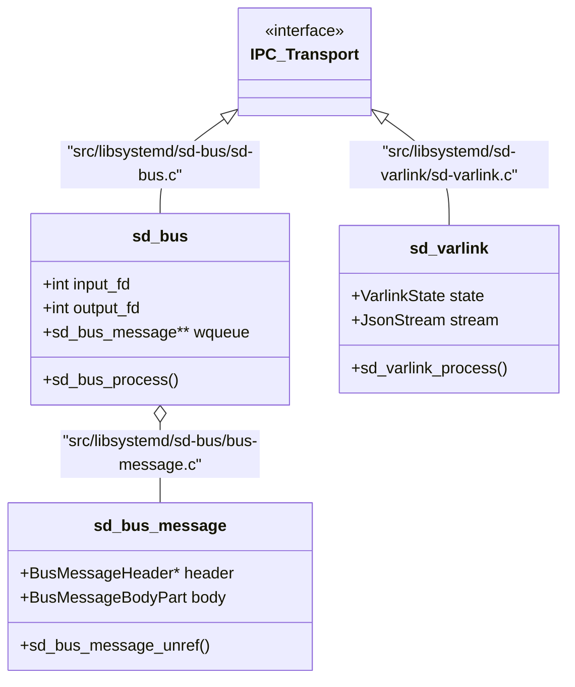

<!-- source: DeepWiki mcp.deepwiki.com · repo systemd/systemd · page 2.5 D-Bus and Varlink IPC · fetched 2026-11-07 -->

# D-Bus and Varlink IPC

Relevant source files

The following files were used as context for generating this wiki page:

- [docs/INHIBITOR_LOCKS.md](docs/INHIBITOR_LOCKS.md)
- [man/org.freedesktop.hostname1.xml](man/org.freedesktop.hostname1.xml)
- [man/org.freedesktop.import1.xml](man/org.freedesktop.import1.xml)
- [man/org.freedesktop.locale1.xml](man/org.freedesktop.locale1.xml)
- [man/org.freedesktop.login1.xml](man/org.freedesktop.login1.xml)
- [man/org.freedesktop.machine1.xml](man/org.freedesktop.machine1.xml)
- [man/org.freedesktop.resolve1.xml](man/org.freedesktop.resolve1.xml)
- [man/org.freedesktop.timedate1.xml](man/org.freedesktop.timedate1.xml)
- [man/org.freedesktop.timesync1.xml](man/org.freedesktop.timesync1.xml)
- [man/sd_varlink_call_and_upgrade.xml](man/sd_varlink_call_and_upgrade.xml)
- [man/sd_varlink_reply_and_upgrade.xml](man/sd_varlink_reply_and_upgrade.xml)
- [man/systemd-hostnamed.service.xml](man/systemd-hostnamed.service.xml)
- [man/systemd-importd.service.xml](man/systemd-importd.service.xml)
- [man/systemd-inhibit.xml](man/systemd-inhibit.xml)
- [man/systemd-localed.service.xml](man/systemd-localed.service.xml)
- [man/systemd-logind.service.xml](man/systemd-logind.service.xml)
- [man/systemd-machined.service.xml](man/systemd-machined.service.xml)
- [man/systemd-suspend.service.xml](man/systemd-suspend.service.xml)
- [man/systemd-timedated.service.xml](man/systemd-timedated.service.xml)
- [man/varlinkctl.xml](man/varlinkctl.xml)
- [shell-completion/bash/varlinkctl](shell-completion/bash/varlinkctl)
- [shell-completion/zsh/_varlinkctl](shell-completion/zsh/_varlinkctl)
- [src/core/varlink-cgroup.c](src/core/varlink-cgroup.c)
- [src/core/varlink-cgroup.h](src/core/varlink-cgroup.h)
- [src/core/varlink-execute.c](src/core/varlink-execute.c)
- [src/core/varlink-scope.c](src/core/varlink-scope.c)
- [src/core/varlink-scope.h](src/core/varlink-scope.h)
- [src/core/varlink-service.c](src/core/varlink-service.c)
- [src/core/varlink-service.h](src/core/varlink-service.h)
- [src/core/varlink-socket.c](src/core/varlink-socket.c)
- [src/core/varlink-socket.h](src/core/varlink-socket.h)
- [src/core/varlink-swap.c](src/core/varlink-swap.c)
- [src/core/varlink-swap.h](src/core/varlink-swap.h)
- [src/core/varlink-timer.c](src/core/varlink-timer.c)
- [src/core/varlink-timer.h](src/core/varlink-timer.h)
- [src/core/varlink-unit.c](src/core/varlink-unit.c)
- [src/delta/delta.c](src/delta/delta.c)
- [src/libsystemd/libsystemd.sym](src/libsystemd/libsystemd.sym)
- [src/libsystemd/sd-bus/bus-control.c](src/libsystemd/sd-bus/bus-control.c)
- [src/libsystemd/sd-bus/bus-control.h](src/libsystemd/sd-bus/bus-control.h)
- [src/libsystemd/sd-bus/bus-convenience.c](src/libsystemd/sd-bus/bus-convenience.c)
- [src/libsystemd/sd-bus/bus-creds.c](src/libsystemd/sd-bus/bus-creds.c)
- [src/libsystemd/sd-bus/bus-creds.h](src/libsystemd/sd-bus/bus-creds.h)
- [src/libsystemd/sd-bus/bus-dump.c](src/libsystemd/sd-bus/bus-dump.c)
- [src/libsystemd/sd-bus/bus-dump.h](src/libsystemd/sd-bus/bus-dump.h)
- [src/libsystemd/sd-bus/bus-internal.h](src/libsystemd/sd-bus/bus-internal.h)
- [src/libsystemd/sd-bus/bus-kernel.c](src/libsystemd/sd-bus/bus-kernel.c)
- [src/libsystemd/sd-bus/bus-kernel.h](src/libsystemd/sd-bus/bus-kernel.h)
- [src/libsystemd/sd-bus/bus-message.c](src/libsystemd/sd-bus/bus-message.c)
- [src/libsystemd/sd-bus/bus-message.h](src/libsystemd/sd-bus/bus-message.h)
- [src/libsystemd/sd-bus/bus-protocol.h](src/libsystemd/sd-bus/bus-protocol.h)
- [src/libsystemd/sd-bus/bus-slot.c](src/libsystemd/sd-bus/bus-slot.c)
- [src/libsystemd/sd-bus/bus-slot.h](src/libsystemd/sd-bus/bus-slot.h)
- [src/libsystemd/sd-bus/bus-socket.c](src/libsystemd/sd-bus/bus-socket.c)
- [src/libsystemd/sd-bus/bus-track.c](src/libsystemd/sd-bus/bus-track.c)
- [src/libsystemd/sd-bus/sd-bus.c](src/libsystemd/sd-bus/sd-bus.c)
- [src/libsystemd/sd-json/json-util.c](src/libsystemd/sd-json/json-util.c)
- [src/libsystemd/sd-json/json-util.h](src/libsystemd/sd-json/json-util.h)
- [src/libsystemd/sd-json/sd-json.c](src/libsystemd/sd-json/sd-json.c)
- [src/libsystemd/sd-json/test-json.c](src/libsystemd/sd-json/test-json.c)
- [src/libsystemd/sd-varlink/sd-varlink-idl.c](src/libsystemd/sd-varlink/sd-varlink-idl.c)
- [src/libsystemd/sd-varlink/sd-varlink.c](src/libsystemd/sd-varlink/sd-varlink.c)
- [src/libsystemd/sd-varlink/test-varlink.c](src/libsystemd/sd-varlink/test-varlink.c)
- [src/libsystemd/sd-varlink/varlink-idl-util.h](src/libsystemd/sd-varlink/varlink-idl-util.h)
- [src/libsystemd/sd-varlink/varlink-internal.h](src/libsystemd/sd-varlink/varlink-internal.h)
- [src/libsystemd/sd-varlink/varlink-util.c](src/libsystemd/sd-varlink/varlink-util.c)
- [src/libsystemd/sd-varlink/varlink-util.h](src/libsystemd/sd-varlink/varlink-util.h)
- [src/login/inhibit.c](src/login/inhibit.c)
- [src/shared/varlink-io.systemd.Import.c](src/shared/varlink-io.systemd.Import.c)
- [src/shared/varlink-io.systemd.Unit.c](src/shared/varlink-io.systemd.Unit.c)
- [src/shared/varlink-io.systemd.Unit.h](src/shared/varlink-io.systemd.Unit.h)
- [src/shared/varlink-io.systemd.service.c](src/shared/varlink-io.systemd.service.c)
- [src/shared/varlink-io.systemd.service.h](src/shared/varlink-io.systemd.service.h)
- [src/shared/varlink-serialize.c](src/shared/varlink-serialize.c)
- [src/shared/varlink-serialize.h](src/shared/varlink-serialize.h)
- [src/systemd/sd-bus.h](src/systemd/sd-bus.h)
- [src/systemd/sd-json.h](src/systemd/sd-json.h)
- [src/systemd/sd-varlink-idl.h](src/systemd/sd-varlink-idl.h)
- [src/systemd/sd-varlink.h](src/systemd/sd-varlink.h)
- [src/test/test-varlink-idl-unit.c](src/test/test-varlink-idl-unit.c)
- [src/varlinkctl/varlinkctl.c](src/varlinkctl/varlinkctl.c)
- [test/units/TEST-26-SYSTEMCTL.sh](test/units/TEST-26-SYSTEMCTL.sh)
- [test/units/TEST-74-AUX-UTILS.varlinkctl-list-sockets.sh](test/units/TEST-74-AUX-UTILS.varlinkctl-list-sockets.sh)
- [test/units/TEST-74-AUX-UTILS.varlinkctl-metrics.sh](test/units/TEST-74-AUX-UTILS.varlinkctl-metrics.sh)
- [test/units/TEST-74-AUX-UTILS.varlinkctl-network.sh](test/units/TEST-74-AUX-UTILS.varlinkctl-network.sh)
- [test/units/TEST-74-AUX-UTILS.varlinkctl-unit.sh](test/units/TEST-74-AUX-UTILS.varlinkctl-unit.sh)
- [test/units/TEST-74-AUX-UTILS.varlinkctl.sh](test/units/TEST-74-AUX-UTILS.varlinkctl.sh)
- [tools/dbus_ignorelist](tools/dbus_ignorelist)
- [tools/update-dbus-docs.py](tools/update-dbus-docs.py)

## Purpose and Scope

This document describes the inter-process communication (IPC) mechanisms used within systemd that enable communication between the service manager (PID 1), system services, and user-facing tools. systemd employs two main IPC protocols: D-Bus (legacy) and Varlink (modern). This page details the implementation of the `sd-bus` and `sd-varlink` libraries, and explains the structured interfaces exposed such as `org.freedesktop.systemd1` (D-Bus) and `io.systemd.*` (Varlink).

---

## IPC Architecture Overview

systemd uses two IPC mechanisms serving complementary purposes:

| Protocol | Status | Primary Use Cases | Interface Namespace  |
|----------|--------|-------------------|----------------------|
| **D-Bus** | Legacy | Manager control, unit management, and system-wide coordination | `org.freedesktop.systemd1.*` |
| **Varlink** | Modern | Service-specific APIs with native JSON, streaming support | `io.systemd.*` |

**D-Bus** is the established IPC protocol for managing system units, exposed via the `org.freedesktop.systemd1` interface hierarchy. Its implementation is encapsulated in the `sd-bus` library, which manages connection lifecycles, authentication, asynchronous message processing, and object method dispatch [src/libsystemd/sd-bus/sd-bus.c:1-134]().

**Varlink** is designed as a modern replacement for service communication, enabling rich JSON interfaces and streaming capabilities via `sd-varlink` [src/libsystemd/sd-varlink/sd-varlink.c:1-125](). It offers simpler, efficient connections suited for structured data transfer, with interfaces under the `io.systemd.*` namespace [src/core/varlink-unit.c:40-175]().

### IPC Layer Integration

**Sources:** [src/libsystemd/sd-bus/sd-bus.c:1-134](), [src/libsystemd/sd-varlink/sd-varlink.c:1-125](), [src/core/varlink-unit.c:40-175]()

---

## D-Bus Legacy IPC

### D-Bus Service Architecture & `sd-bus` Library

The legacy IPC layer uses D-Bus for system and user bus communication. This is implemented via the `sd-bus` library, which abstracts protocol details, connection management, message queuing, and object method dispatch.

**Key Data Structures:**

- **`sd_bus`**: Represents an active bus connection, encapsulating file descriptors, state, message queues, authorization info, and associated event sources [src/libsystemd/sd-bus/bus-internal.h:169-230]().

- **`sd_bus_message`**: Represents D-Bus messages including method calls, replies, signals, and errors. Messages contain headers and typed data payloads handled with memory optimization (memfd, mmaped buffers) [src/libsystemd/sd-bus/bus-message.c:118-143]().

- **`sd_bus_slot`**: Lifecycle manager for registered callbacks such as method handlers, filters, matches, and object vtables [src/libsystemd/sd-bus/bus-internal.h:114-145]().

### `sd-bus` Message Flow and Event Loop Integration

The `sd-bus` library integrates tightly with the `sd-event` event loop for asynchronous operation, using `sd_bus_attach_event()` to register file descriptors and timers.

Messages flow through read and write queues (`rqueue`, `wqueue`), where incoming messages are parsed and dispatched to appropriate handlers based on their VTables (object method tables). Replies are queued and eventually written back asynchronously.

The library manages complex states like authenticating the connection, managing queued replies, monitoring file descriptors, and handling connection lifecycle from open to close [src/libsystemd/sd-bus/bus-internal.h:169-230](), [src/libsystemd/sd-bus/sd-bus.c:178-201]().

### Connection Setup and Authentication

Typical D-Bus clients connect via:

- `sd_bus_open_system()` - connects to the system bus
- `sd_bus_open_user()` - connects to the user/session bus

These functions handle caching and selection of default bus connections, environment variable overrides, and fallback logic [src/libsystemd/sd-bus/sd-bus.c:78-121]().

The library performs SASL-based authentication, supporting `EXTERNAL` (peer credentials) and `ANONYMOUS` mechanisms during the `BUS_AUTHENTICATING` phase [src/libsystemd/sd-bus/bus-socket.c:131-236]().

---

## Varlink Modern IPC

### Varlink Protocol Principles and `sd-varlink` Library

Varlink is designed as a service-to-service JSON RPC protocol optimized for native JSON messaging and bidirectional streaming. It provides a simpler semantic model and effective integration with JSON parsing libraries.

The `sd-varlink` library implements Varlink connections with a robust state machine managing connection lifecycle, message parsing, and dispatch [src/libsystemd/sd-varlink/sd-varlink.c:50-76]().

**Connection States include:**

- `VARLINK_IDLE_CLIENT`: Idle, waiting to send a request
- `VARLINK_AWAITING_REPLY`: Waiting for response to a request
- `VARLINK_IDLE_SERVER`: Waiting for incoming request on server
- `VARLINK_PROCESSING_METHOD`: Processing a method call on server

The state machine controls when IO is expected, timeout handling, and response processing.

### Varlink Connection Creation and I/O

Varlink connections wrap a `JsonStream` object which manages JSON parsing and serializing over socket or pipe fds. On initialization, `varlink_new()` sets up this stream with callbacks for state and dispatch handling [src/libsystemd/sd-varlink/sd-varlink.c:130-160]().

Typical Varlink connections use AF_UNIX sockets or subprocesses for transport. The API allows setting socket metadata (via extended attributes) to track roles like `client`, `server`, `listen`, and `entrypoint` [src/libsystemd/sd-varlink/sd-varlink.c:160-183]().

### Varlink Interfaces in systemd

systemd exposes its modern structured APIs using Varlink interfaces under `io.systemd.*`.

For example, `io.systemd.Unit` provides unit state information, capabilities, and control methods in JSON encoded structures. The core manages conversion of internal unit state to JSON variants via functions like `unit_context_build_json()` using the `sd-json` library [src/core/varlink-unit.c:129-175](), [src/libsystemd/sd-json/sd-json.c:61-173]().

---

## Comparison and Client Tooling

| Tool         | IPC Protocol | Primary Purpose                               |
|--------------|--------------|-----------------------------------------------|
| `systemctl`  | D-Bus        | Control systemd services and units [src/libsystemd/libsystemd.sym:175-251]() |
| `busctl`     | D-Bus        | Introspect and invoke D-Bus method calls     |
| `varlinkctl` | Varlink      | Interact with Varlink APIs, call/inspect interfaces [src/varlinkctl/varlinkctl.c:1-50]() |

### Mapping of Concepts to Code Entities

---

## Event Loop Integration

Both IPC layers integrate with `sd-event` for asynchronous I/O and dispatch:

- **sd-bus**: Registers sockets and timers with `sd_event` using `sd_bus_attach_event()`. It processes ready messages and schedules writes within the event context [src/systemd/sd-bus.h:129-130](), [src/libsystemd/sd-bus/sd-bus.c:187-200]().

- **sd-varlink**: Also attaches to `sd-event`. It uses the `json_stream` abstraction for JSON streaming with timeouts, polling, and callbacks [src/libsystemd/sd-varlink/sd-varlink.c:146-155]().

- **sd-event**: The core event loop handles epoll-based readiness notification, timers, signals, and priorities. It manages source dispatch using a priority queue to optimize event handling [src/libsystemd/sd-event/sd-event.c:116-186]().

---

# Summary

systemd uses the `sd-bus` library to provide a robust, traditional D-Bus IPC layer for control of the system manager and related components, exposing interfaces in the `org.freedesktop.systemd1` namespace. For more modern and JSON-native IPC, systemd uses the `sd-varlink` library implementing the Varlink protocol with interfaces under `io.systemd.*`. Both integrate with the `sd-event` loop for asynchronous communication, enabling efficient, non-blocking IPC mechanisms that client tools like `systemctl`, `busctl`, and `varlinkctl` rely upon.

---

**Sources:**  
- D-Bus: [src/libsystemd/sd-bus/sd-bus.c:1-134](), [src/libsystemd/sd-bus/bus-internal.h:169-230](), [src/libsystemd/sd-bus/bus-message.c:118-143](), [src/libsystemd/sd-bus/bus-socket.c:1-228](), [src/systemd/sd-bus.h:40-152]()  
- Varlink: [src/libsystemd/sd-varlink/sd-varlink.c:1-183](), [src/core/varlink-unit.c:40-175](), [src/libsystemd/sd-json/sd-json.c:61-173]()  
- Event Loop: [src/libsystemd/sd-event/sd-event.c:116-186]()

---

