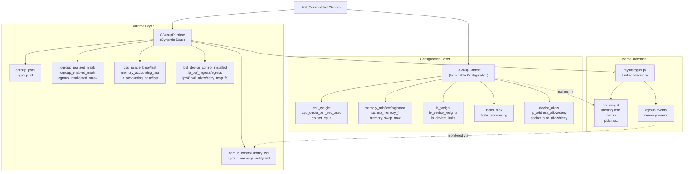
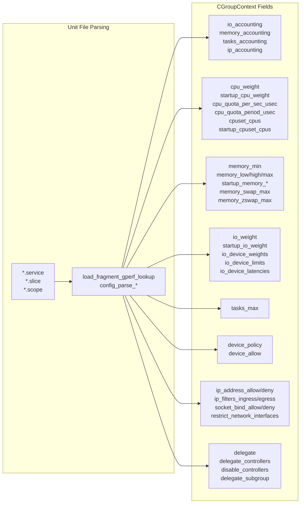
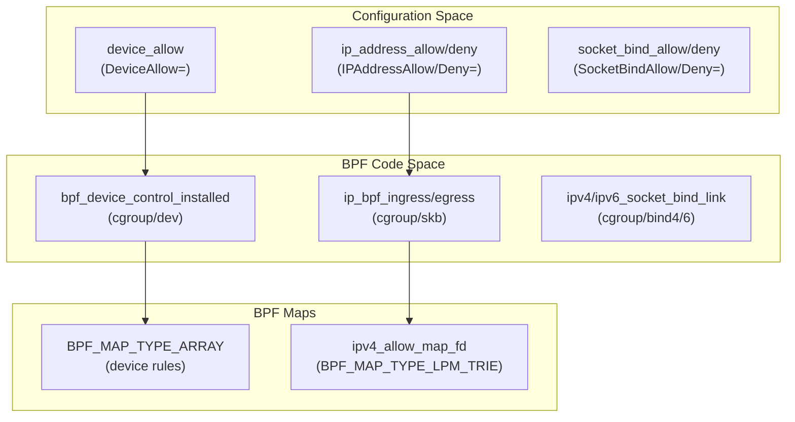
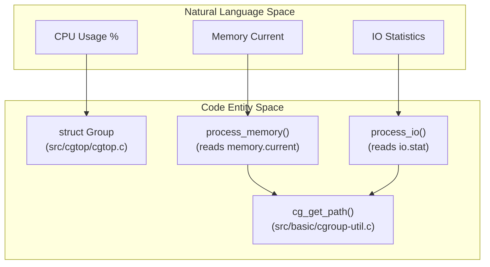

<!-- source: DeepWiki mcp.deepwiki.com · repo systemd/systemd · page 2.6 Control Groups and Resource Management · fetched 2026-11-07 -->

# Control Groups and Resource Management

<details>
<summary>Relevant source files</summary>

The following files were used as context for generating this wiki page:

- [man/oomd.conf.xml](man/oomd.conf.xml)
- [man/systemd-cgls.xml](man/systemd-cgls.xml)
- [man/systemd-cgtop.xml](man/systemd-cgtop.xml)
- [man/systemd-oomd.service.xml](man/systemd-oomd.service.xml)
- [man/systemd.resource-control.xml](man/systemd.resource-control.xml)
- [src/basic/build.h](src/basic/build.h)
- [src/basic/cgroup-util.c](src/basic/cgroup-util.c)
- [src/basic/cgroup-util.h](src/basic/cgroup-util.h)
- [src/cgls/cgls.c](src/cgls/cgls.c)
- [src/cgtop/cgtop.c](src/cgtop/cgtop.c)
- [src/core/cgroup.c](src/core/cgroup.c)
- [src/core/cgroup.h](src/core/cgroup.h)
- [src/core/dbus-cgroup.c](src/core/dbus-cgroup.c)
- [src/journal/journald-client.c](src/journal/journald-client.c)
- [src/journal/journald-client.h](src/journal/journald-client.h)
- [src/oom/oomctl.c](src/oom/oomctl.c)
- [src/oom/oomd-conf.c](src/oom/oomd-conf.c)
- [src/oom/oomd-conf.h](src/oom/oomd-conf.h)
- [src/oom/oomd-manager-bus.c](src/oom/oomd-manager-bus.c)
- [src/oom/oomd-manager-bus.h](src/oom/oomd-manager-bus.h)
- [src/oom/oomd-manager.c](src/oom/oomd-manager.c)
- [src/oom/oomd-manager.h](src/oom/oomd-manager.h)
- [src/oom/oomd-util.c](src/oom/oomd-util.c)
- [src/oom/oomd-util.h](src/oom/oomd-util.h)
- [src/oom/oomd.c](src/oom/oomd.c)
- [src/oom/test-oomd-util.c](src/oom/test-oomd-util.c)
- [src/shared/cgroup-show.c](src/shared/cgroup-show.c)
- [src/shared/cgroup-show.h](src/shared/cgroup-show.h)
- [src/test/test-cgroup-setup.c](src/test/test-cgroup-setup.c)
- [src/test/test-cgroup-util.c](src/test/test-cgroup-util.c)
- [test/integration-tests/TEST-55-OOMD/TEST-55-OOMD.units/TEST-55-OOMD-testbloat.service](test/integration-tests/TEST-55-OOMD/TEST-55-OOMD.units/TEST-55-OOMD-testbloat.service)
- [test/integration-tests/TEST-55-OOMD/TEST-55-OOMD.units/TEST-55-OOMD-testmunch.service](test/integration-tests/TEST-55-OOMD/TEST-55-OOMD.units/TEST-55-OOMD-testmunch.service)
- [test/units/TEST-55-OOMD.sh](test/units/TEST-55-OOMD.sh)

</details>


## Purpose and Scope

This document describes systemd's control group (cgroup) subsystem, which provides resource management and accounting for system units. It covers the architecture of cgroup configuration and runtime state, resource controllers (CPU, memory, IO, PIDs, CPUSet), BPF-based enforcement policies, and the tools for monitoring resource usage.

For information about process execution and sandboxing mechanisms that complement resource control, see [Process Execution and Sandboxing](src/core/execute.c). For the unit management system that drives cgroup lifecycle, see [Unit Management System](src/core/unit.c).

---

## Architecture Overview

systemd's cgroup subsystem separates immutable configuration (`CGroupContext`) from dynamic runtime state (`CGroupRuntime`). This abstraction allows configuration to be reloaded without disrupting running processes and supports serialization for manager restarts.

### Core Data Structures

The association between units and their cgroup state is maintained through two primary structures attached to the `Unit` object:

| Structure       | Role                  | Key Members                                  |
|-----------------|-----------------------|----------------------------------------------|
| `CGroupContext` | Immutable Configuration | `cpu_weight`, `memory_max`, `tasks_max`, `device_allow`  |
| `CGroupRuntime` | Dynamic Runtime State    | `cgroup_path`, `cgroup_id`, `cgroup_realized_mask`, `cpu_usage_base` |

**Sources:** [src/core/cgroup.h:123-210](), [src/core/cgroup.h:250-336]()



---

### Controller Types and Masks

systemd tracks controllers using bitmasks that represent which controllers are active or required. The enum `CGroupController` defines both kernel cgroup controllers and systemd's BPF-based pseudo-controllers.

| Controller                             | Mask                         | Purpose                              | Cgroup v2 |
|--------------------------------------|------------------------------|------------------------------------|-----------|
| `CGROUP_CONTROLLER_CPU`               | `CGROUP_MASK_CPU`             | CPU time distribution and quota    | ✓         |
| `CGROUP_CONTROLLER_CPUSET`            | `CGROUP_MASK_CPUSET`          | CPU and memory node affinity       | ✓         |
| `CGROUP_CONTROLLER_IO`                | `CGROUP_MASK_IO`              | Block I/O bandwidth control        | ✓         |
| `CGROUP_CONTROLLER_MEMORY`            | `CGROUP_MASK_MEMORY`          | Memory usage limits and accounting | ✓         |
| `CGROUP_CONTROLLER_PIDS`              | `CGROUP_MASK_PIDS`            | Process/thread count limits        | ✓         |
| `CGROUP_CONTROLLER_BPF_FIREWALL`     | `CGROUP_MASK_BPF_FIREWALL`   | IP filtering via BPF               | Pseudo    |
| `CGROUP_CONTROLLER_BPF_DEVICES`      | `CGROUP_MASK_BPF_DEVICES`    | Device access via BPF              | Pseudo    |
| `CGROUP_CONTROLLER_BPF_SOCKET_BIND`  | `CGROUP_MASK_BPF_SOCKET_BIND`| Socket bind restrictions           | Pseudo    |
| `CGROUP_CONTROLLER_BPF_RESTRICT_NETWORK_INTERFACES` | `CGROUP_MASK_BPF_RESTRICT_NETWORK_INTERFACES` | Network interface filtering | Pseudo |

**Sources:** [src/basic/cgroup-util.h:9-67]()

---

## Configuration Model

### CGroupContext Structure

`CGroupContext` holds the user-configured resource limits parsed from unit files. It is initialized with kernel defaults (e.g., `CGROUP_LIMIT_MAX`) in the function `cgroup_context_init()`, which sets sane defaults for weights, limits, and flags.



**Sources:** [src/core/cgroup.h:123-210](), [src/core/cgroup.c:147-194]()

### Startup vs. Runtime Settings

Many resource limits support separate "startup" values that apply during system initialization and shutdown phases. These are reflected in "startup_" prefixed fields such as `startup_cpu_weight` and `startup_memory_high`.

The function `unit_has_startup_cgroup_constraints()` detects when any such startup/shutdown controls apply to a unit.

- `startup_cpu_weight` vs `cpu_weight`
- `startup_memory_low`, `startup_memory_high`, `startup_memory_max` vs their runtime counterparts
- `startup_io_weight` vs `io_weight`
- `startup_cpuset_cpus` vs `cpuset_cpus`

**Sources:** [src/core/cgroup.c:106-126](), [man/systemd.resource-control.xml:215-218]()

---

## CPU Resource Control

### Weight-Based Scheduling

CPU time is distributed proportionally based on `cpu.weight` values configured via `CPUWeight=` in unit files. Systemd uses the constant `CGROUP_WEIGHT_DEFAULT` (100) as a baseline.

When `CGroupContext` is applied (via `cgroup_context_apply()`), the appropriate values are written to the cgroup filesystem using `cg_set_attribute()` calls.

**Sources:** [src/core/cgroup.c:1420-1485](), [src/basic/cgroup-util.h:70-74](), [man/systemd.resource-control.xml:186-229]()

### CPU Quota

CPU quota limits the maximum CPU time a unit can consume. It is expressed as microseconds of CPU time available per second and controlled through `cpu.max` file in the cgroup.

The default quota period is 100ms:

```c
#define CGROUP_CPU_QUOTA_DEFAULT_PERIOD_USEC (100 * USEC_PER_MSEC)
```

Quota is set by writing two space-separated values in `cpu.max`: the max quota and the period, both in microseconds.

**Sources:** [src/core/cgroup.c:60](), [src/core/cgroup.c:1487-1583](), [man/systemd.resource-control.xml:232-275]()

---

## Memory Resource Control

### Memory Limit Hierarchy

Memory resource control uses multiple limit types mapped to kernel attributes:

| Attribute       | Corresponding systemd Setting | Kernel Effect                                  |
|-----------------|-------------------------------|-----------------------------------------------|
| `memory.min`    | `MemoryMin=`                   | Hard protection preventing reclaim            |
| `memory.low`    | `MemoryLow=`                   | Soft protection, reclaimed only as last resort |
| `memory.high`   | `MemoryHigh=`                  | Throttling resource when exceeded             |
| `memory.max`    | `MemoryMax=`                   | Hard limit, triggering OOM if exceeded        |

**Sources:** [src/core/cgroup.c:1890-2054](), [man/systemd.resource-control.xml:328-423]()

### Managed OOM (systemd-oomd)

Systemd integrates with `systemd-oomd` to provide userspace OOM handling based on Pressure Stall Information (PSI) from the kernel. `systemd-oomd` monitors cgroups via `OomdCGroupContext` structures and triggers memory reclaim or process killing in response to sustained memory pressure.

The function `oomd_pressure_above()` determines which cgroups exceed their configured pressure threshold over the required duration.

**Sources:** [src/core/cgroup.h:201-206](), [src/oom/oomd-manager.c:113-118](), [src/oom/oomd-util.c:91-128]()

---

## BPF-Based Enforcement

Systemd uses Berkeley Packet Filter (BPF) programs attached to cgroups as pseudo-controllers to enforce fine-grained access control policies on devices and network communication.

### BPF Controller Architecture



The `CGroupContext` contains lists for device access permissions, IP address allow/deny sets, and socket bind allow/deny lists. When `cgroup_context_apply()` is called (see `src/core/cgroup.c` lines ~2607-2843), it sets up and attaches BPF programs as required.

**Sources:** [src/core/cgroup.h:281-325](), [src/core/cgroup.c:2607-2843]()

---

## Monitoring and Tools

### systemd-cgtop

`systemd-cgtop` provides real-time monitoring of cgroup resource usage, showing CPU, memory, and IO statistics. It uses the `Group` structure from `src/cgtop/cgtop.c` to maintain per-cgroup stats such as:

- Number of tasks
- CPU usage (absolute and fraction)
- Memory usage
- IO throughput



**Sources:** [src/cgtop/cgtop.c:31-52](), [src/cgtop/cgtop.c:177-206](), [src/cgtop/cgtop.c:208-234]()

### Path Resolution and Queries

Systemd provides several utilities to map process IDs to their cgroup paths and extract unit names from cgroup paths, essential for resource attribution to units.

- `cg_path_get_unit()` extracts the unit name from a cgroup path.
- `cg_pidref_get_path()` obtains the cgroup path a process belongs to.

These functions, found in `src/basic/cgroup-util.c`, support name mangling conventions and robust error handling useful in managing systemd units and cgroup relationships.

**Sources:** [src/basic/cgroup-util.c:152-153](), [src/test/test-cgroup-util.c:41-49](), [src/basic/cgroup-util.h:153]()

---

## Summary

systemd's cgroup subsystem provides comprehensive resource management by combining:

1. **Hierarchical Configuration:** Immutable `CGroupContext` for resource limits with dynamic `CGroupRuntime` to track applied state.
2. **Multi-controller support:** CPU, memory, IO, PIDs, CPUSet, and BPF-based enforcement pseudo-controllers.
3. **BPF-based Policies:** Fine-grained device and network policies using BPF programs attached as cgroup pseudo-controllers.
4. **Userspace OOM Handling:** Integration with systemd-oomd for memory pressure monitoring and reactive process killing.
5. **Monitoring Tools:** `systemd-cgtop` and utilities to inspect and manage cgroups and units.

This architecture enables both fine control and efficient monitoring of system resource utilization, ensuring systemd can enforce resource constraints consistently across services, slices, and scopes.

**Sources:** [src/core/cgroup.c:1-500](), [src/core/cgroup.h:1-203](), [src/basic/cgroup-util.c:1-200](), [src/basic/cgroup-util.h:1-67]()

---

