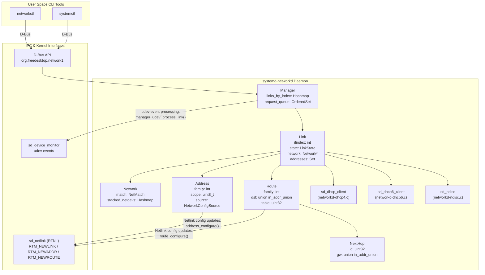
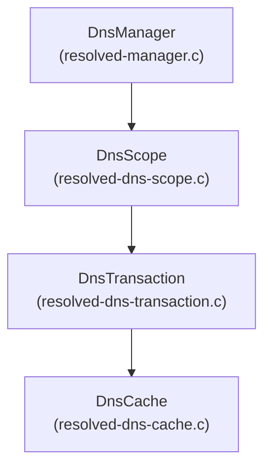

<!-- source: DeepWiki mcp.deepwiki.com · repo systemd/systemd · page 3 Networking Subsystems · fetched 2026-11-07 -->

# Networking Subsystems

Relevant source files

The following files were used as context for generating this wiki page:

- [man/systemd.network.xml](man/systemd.network.xml)
- [src/network/meson.build](src/network/meson.build)
- [src/network/networkd-address.c](src/network/networkd-address.c)
- [src/network/networkd-address.h](src/network/networkd-address.h)
- [src/network/networkd-dhcp4.c](src/network/networkd-dhcp4.c)
- [src/network/networkd-dhcp6.c](src/network/networkd-dhcp6.c)
- [src/network/networkd-ipv4ll.c](src/network/networkd-ipv4ll.c)
- [src/network/networkd-ipv4ll.h](src/network/networkd-ipv4ll.h)
- [src/network/networkd-link.c](src/network/networkd-link.c)
- [src/network/networkd-link.h](src/network/networkd-link.h)
- [src/network/networkd-manager.c](src/network/networkd-manager.c)
- [src/network/networkd-manager.h](src/network/networkd-manager.h)
- [src/network/networkd-ndisc.c](src/network/networkd-ndisc.c)
- [src/network/networkd-network-gperf.gperf](src/network/networkd-network-gperf.gperf)
- [src/network/networkd-network.c](src/network/networkd-network.c)
- [src/network/networkd-network.h](src/network/networkd-network.h)
- [src/network/networkd-route.c](src/network/networkd-route.c)
- [src/network/networkd-route.h](src/network/networkd-route.h)
- [src/network/networkd.c](src/network/networkd.c)
- [src/network/tc/cake.c](src/network/tc/cake.c)
- [src/network/tc/cake.h](src/network/tc/cake.h)
- [src/network/tc/codel.c](src/network/tc/codel.c)
- [src/network/tc/drr.c](src/network/tc/drr.c)
- [src/network/tc/ets.c](src/network/tc/ets.c)
- [src/network/tc/fifo.c](src/network/tc/fifo.c)
- [src/network/tc/fifo.h](src/network/tc/fifo.h)
- [src/network/tc/fq-codel.c](src/network/tc/fq-codel.c)
- [src/network/tc/fq-codel.h](src/network/tc/fq-codel.h)
- [src/network/tc/fq.c](src/network/tc/fq.c)
- [src/network/tc/fq.h](src/network/tc/fq.h)
- [src/network/tc/gred.c](src/network/tc/gred.c)
- [src/network/tc/hhf.c](src/network/tc/hhf.c)
- [src/network/tc/htb.c](src/network/tc/htb.c)
- [src/network/tc/netem.c](src/network/tc/netem.c)
- [src/network/tc/netem.h](src/network/tc/netem.h)
- [src/network/tc/pie.c](src/network/tc/pie.c)
- [src/network/tc/pie.h](src/network/tc/pie.h)
- [src/network/tc/qdisc.c](src/network/tc/qdisc.c)
- [src/network/tc/qdisc.h](src/network/tc/qdisc.h)
- [src/network/tc/qfq.c](src/network/tc/qfq.c)
- [src/network/tc/sfb.c](src/network/tc/sfb.c)
- [src/network/tc/sfq.c](src/network/tc/sfq.c)
- [src/network/tc/sfq.h](src/network/tc/sfq.h)
- [src/network/tc/tbf.c](src/network/tc/tbf.c)
- [src/network/tc/tbf.h](src/network/tc/tbf.h)
- [src/network/tc/tc.c](src/network/tc/tc.c)
- [src/network/tc/tc.h](src/network/tc/tc.h)
- [src/network/tc/tclass.c](src/network/tc/tclass.c)
- [src/network/tc/tclass.h](src/network/tc/tclass.h)

## Purpose and Scope

This page provides a high-level overview of systemd's key networking components and their architecture. It focuses on the networking daemons **systemd-networkd** and **systemd-resolved**, their roles in Linux network management, and their interaction through kernel and IPC interfaces.

For comprehensive technical details, please refer to the dedicated child pages:  
- [systemd-networkd Architecture](#3.1)  
- [DNS Resolution with systemd-resolved](#3.2)  
- [Network Testing Framework](#3.3)  

## System Overview

systemd's networking stack divides responsibilities primarily between two daemons:

| Daemon                | Purpose                        | Main Responsibilities                                       |
|-----------------------|--------------------------------|-------------------------------------------------------------|
| **systemd-networkd**  | Network Configuration Manager  | Interface state management, DHCP (v4/v6), RA/NDisc, routing, VLANs, bridges, and link configuration |
| **systemd-resolved**  | DNS Resolution Service         | DNS caching, DNSSEC, DNS-over-TLS, mDNS, LLMNR, name resolution over D-Bus and local stub resolver |

Both daemons interact with kernel networking via Netlink sockets and monitor device events via udev, while exposing D-Bus APIs for external control and scripts.

**Sources:** [src/network/networkd-manager.c:1-62](), [src/resolve/resolved-dns-transaction.c:1-34]()

## High-Level Architecture

This diagram relates the high-level components and how they map to central code entities such as `Manager`, `Link`, and protocol client implementations.

**Sources:**  
[src/network/networkd-manager.h:35-156](),  
[src/network/networkd-link.h:49-264](),  
[src/network/networkd-network.h:58-300](),  
[src/network/networkd-address.h:173](),  
[src/network/networkd-route.c:79-134](),  
[src/network/networkd-manager.c:108-157](),  
[src/network/networkd-manager.c:159-181]()

## systemd-networkd Components

### Core Data Structures Overview

| Structure | Location and Lines | Description | Important Members |
|-----------|--------------------|-------------|-------------------|
| `Manager` | [src/network/networkd-manager.h:35-156]() | Tracks all links, holds global networkd state and event loop references | `links_by_index` (Hashmap of Links), `request_queue` (OrderedSet of pending requests), `device_monitor` (udev) |
| `Link` | [src/network/networkd-link.h:31-203]() | Represents a single network interface with its state and protocols | `ifindex`, `state`, `network`, `addresses`, `dhcp_client` pointers, `ndisc`, and `radv` clients |
| `Network` | [src/network/networkd-network.h:58-206]() | Holds parsed `.network` file configuration and associated settings | `match` structure, stacked netdevs (bridges/bond/vrf), DHCP and NDisc flags |

#### Manager

The `Manager` is the central orchestrator which:
- Initializes D-Bus API for `org.freedesktop.network1`  
- Listens to udev events and netlink messages to detect and configure links  
- Maintains collections of links and orchestrates requests for network configuration  
  
Key code: `manager_connect_bus()` and `manager_connect_udev()` [src/network/networkd-manager.c:108-210]()

#### Link

Each `Link` tracks:
- Current interface index and name  
- Link state machine (`LINK_STATE_CONFIGURING`, `LINK_STATE_CONFIGURED`, etc.)  
- Attached configuration via `Network` object parsed from `.network` files
- Addresses, routes, and protocol client states for DHCP, NDisc, RADV  
  
Key code snippets:  
- `link_required_operstate_for_online()` determines the operational state conditions for online readiness [src/network/networkd-link.c:79-106]()  
- `link_is_ready_to_configure()` tests if link has carrier and protocol engines are ready [src/network/networkd-link.c:176-200]()

#### Network

The `Network` object holds configuration directives (from `.network` files) that match links based on criteria like interface name or MAC address. It manages protocol options such as DHCP, NDisc, and routing policy rules.

Validation and resolution of network configuration is done via `network_verify()` and `network_resolve_netdev_one()` [src/network/networkd-network.c:53-321]().

**Sources:**  
[src/network/networkd-manager.h:35-156](),  
[src/network/networkd-link.h:31-203](),  
[src/network/networkd-network.h:58-300](),  
[src/network/networkd-manager.c:108-210](),  
[src/network/networkd-network.c:53-321](),  
[src/network/networkd-link.c:79-204]()

### Link State and Configuration Management

systemd-networkd employs a staged link state machine to apply network configuration only when appropriate:

- `LINK_STATE_CONFIGURING`: The link is ready to receive configuration requests (addresses, DHCP, routes). Usually occurs after udev initialized the interface and a carrier is present (unless overridden).  
- `LINK_STATE_CONFIGURED`: Configuration done, interface is operational.  
- `LINK_STATE_UNMANAGED`: Link is explicitly unmanaged via config and will not be configured by networkd.

The helper `link_is_ready_to_configure_one()` ensures no conflicting netlink messages are in progress and the carrier state matches configuration needs before starting configuration with protocol clients.

**Sources:** [src/network/networkd-link.c:176-200]()

### Protocol Engines

systemd-networkd integrates several key network address and routing protocols:

| Protocol   | Source Location            | Functionality Summary                            |
|------------|----------------------------|------------------------------------------------|
| **DHCPv4** | [src/network/networkd-dhcp4.c]() | IPv4 DHCP lease acquisition and renewal including router and classless static routes handling. Supported by `sd_dhcp_client` API. |
| **DHCPv6** | [src/network/networkd-dhcp6.c]() | IPv6 DHCP client and prefix delegation, managing IPv6 lease lifetimes and routes via `sd_dhcp6_client`. |
| **NDisc**  | [src/network/networkd-ndisc.c]()  | IPv6 Neighbor Discovery and SLAAC address configuration (`sd_ndisc`). Handles Router Advertisements and Prefix Information. |

Each engine watches link changes and netlink to update addressing state and initiate or refresh configuration dynamically.

**Sources:**  
[src/network/networkd-dhcp4.c:122-153](),  
[src/network/networkd-dhcp6.c:113-139](),  
[src/network/networkd-ndisc.c:128-165]()

## systemd-resolved Components

### DNS Resolution Architecture

systemd-resolved provides an advanced name resolution service with caching, DNSSEC validation, and support for various DNS protocols such as DNS-over-TLS, mDNS, and LLMNR.

Key entities include:

- `DnsManager`: Oversees DNS scopes and transactions.  
- `DnsScope`: Represents per-link or per-domain DNS configurations.  
- `DnsTransaction`: Handles individual DNS queries, including retries, timeouts, and UDP socket lifecycle management via the "graveyard" concept.  
- `DnsCache`: Caches DNS responses for efficiency.

The transaction lifecycle is carefully managed with timers and socket reuse to handle transient failures and delays in DNS replies.

**Sources:** [src/resolve/resolved-dns-transaction.c:93-184]()

## Configuration Flow and Parsing

systemd-networkd uses a high-performance configuration parser generated from a `.gperf` file:

| Section | Directive Example | Parsing Function | File Reference |
|---------|-------------------|------------------|----------------|
| [Match] | `Name=`           | `config_parse_match_ifnames` | [networkd-network-gperf.gperf:87]() |
| [Link]  | `MACAddress=`     | `config_parse_hw_addr`        | [networkd-network-gperf.gperf:98]() |
| [Network]| `DHCP=`          | `config_parse_dhcp`           | [networkd-network-gperf.gperf:113]() |

This parser maps configuration keys efficiently to internal structure fields, enabling fast runtime configuration reloads and verification.

**Sources:** [src/network/networkd-network-gperf.gperf:78-113]()

## Inter-Component and Kernel Integration

### networkd ↔ resolved Communication

- systemd-networkd provides resolved with per-link DNS server addresses, search domains, and routing decisions via D-Bus interfaces for `org.freedesktop.resolve1`.  
- This allows resolved to maintain accurate DNS scope information aligned with the network configuration and routing state.

### Kernel Netlink Monitoring

- Both daemons monitor kernel RTNL events for link, address, and route changes.  
- networkd handles these to maintain interface states and network topology, while resolved adjusts DNS scopes and server configurations accordingly.

### udev Device Monitoring

- systemd-networkd uses an `sd_device_monitor` to watch udev events in `net`, `ieee80211`, and `rfkill` subsystems, enabling dynamic detection and management of network interfaces.

**Sources:**  
[src/network/networkd-manager.c:159-181](),  
[src/network/networkd-manager.c:183-210](),  
[src/resolve/resolved-dns-transaction.c:93-108]()

---

This overview bridges the conceptual roles of systemd's networking components with the central code entities and files managing them. For deep dives into each area, please consult the child pages:

- [systemd-networkd Architecture](#3.1)  
- [DNS Resolution with systemd-resolved](#3.2)  
- [Network Testing Framework](#3.3)

---

