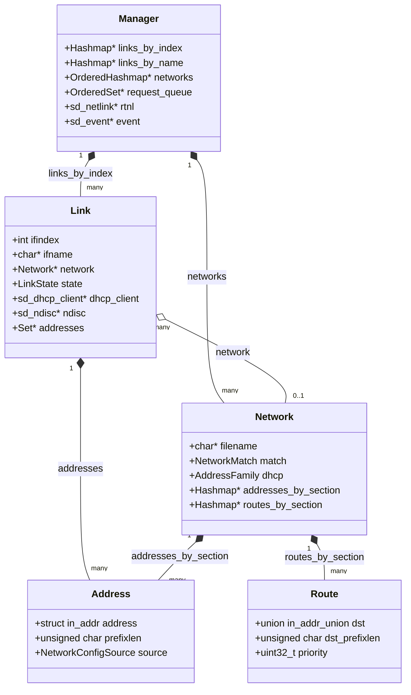
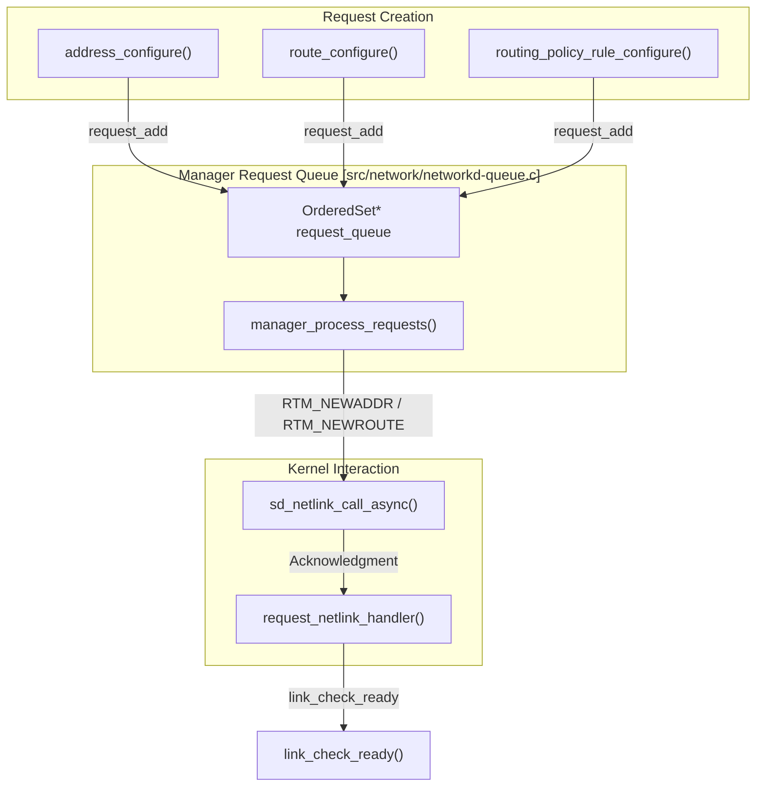

<!-- source: DeepWiki mcp.deepwiki.com · repo systemd/systemd · page 3.1 systemd-networkd Architecture · fetched 2026-11-07 -->

# systemd-networkd Architecture

<details>
<summary>Relevant source files</summary>

The following files were used as context for generating this wiki page:

- [man/networkctl.xml](man/networkctl.xml)
- [man/org.freedesktop.network1.xml](man/org.freedesktop.network1.xml)
- [man/org.freedesktop.oom1.xml](man/org.freedesktop.oom1.xml)
- [man/systemd.link.xml](man/systemd.link.xml)
- [man/systemd.netdev.xml](man/systemd.netdev.xml)
- [man/systemd.network.xml](man/systemd.network.xml)
- [shell-completion/bash/coredumpctl](shell-completion/bash/coredumpctl)
- [shell-completion/bash/networkctl](shell-completion/bash/networkctl)
- [shell-completion/zsh/_coredumpctl](shell-completion/zsh/_coredumpctl)
- [shell-completion/zsh/_kernel-install](shell-completion/zsh/_kernel-install)
- [shell-completion/zsh/_networkctl](shell-completion/zsh/_networkctl)
- [src/core/org.freedesktop.systemd1.policy.in](src/core/org.freedesktop.systemd1.policy.in)
- [src/hostname/org.freedesktop.hostname1.policy](src/hostname/org.freedesktop.hostname1.policy)
- [src/import/org.freedesktop.import1.conf](src/import/org.freedesktop.import1.conf)
- [src/import/org.freedesktop.import1.policy](src/import/org.freedesktop.import1.policy)
- [src/libsystemd-network/network-internal.c](src/libsystemd-network/network-internal.c)
- [src/libsystemd-network/network-internal.h](src/libsystemd-network/network-internal.h)
- [src/libsystemd/sd-network/sd-network.c](src/libsystemd/sd-network/sd-network.c)
- [src/locale/org.freedesktop.locale1.policy](src/locale/org.freedesktop.locale1.policy)
- [src/login/org.freedesktop.login1.conf](src/login/org.freedesktop.login1.conf)
- [src/login/org.freedesktop.login1.policy](src/login/org.freedesktop.login1.policy)
- [src/machine/org.freedesktop.machine1.policy](src/machine/org.freedesktop.machine1.policy)
- [src/network/meson.build](src/network/meson.build)
- [src/network/netdev/batadv.c](src/network/netdev/batadv.c)
- [src/network/netdev/bond.c](src/network/netdev/bond.c)
- [src/network/netdev/bond.h](src/network/netdev/bond.h)
- [src/network/netdev/bridge.c](src/network/netdev/bridge.c)
- [src/network/netdev/bridge.h](src/network/netdev/bridge.h)
- [src/network/netdev/geneve.c](src/network/netdev/geneve.c)
- [src/network/netdev/geneve.h](src/network/netdev/geneve.h)
- [src/network/netdev/netdev-gperf.gperf](src/network/netdev/netdev-gperf.gperf)
- [src/network/netdev/netdev.c](src/network/netdev/netdev.c)
- [src/network/netdev/netdev.h](src/network/netdev/netdev.h)
- [src/network/netdev/tunnel.c](src/network/netdev/tunnel.c)
- [src/network/netdev/tunnel.h](src/network/netdev/tunnel.h)
- [src/network/netdev/vxlan.c](src/network/netdev/vxlan.c)
- [src/network/netdev/vxlan.h](src/network/netdev/vxlan.h)
- [src/network/netdev/xfrm.c](src/network/netdev/xfrm.c)
- [src/network/networkctl.c](src/network/networkctl.c)
- [src/network/networkd-address-label.c](src/network/networkd-address-label.c)
- [src/network/networkd-address-label.h](src/network/networkd-address-label.h)
- [src/network/networkd-address.c](src/network/networkd-address.c)
- [src/network/networkd-address.h](src/network/networkd-address.h)
- [src/network/networkd-dhcp4.c](src/network/networkd-dhcp4.c)
- [src/network/networkd-dhcp6.c](src/network/networkd-dhcp6.c)
- [src/network/networkd-ipv4ll.c](src/network/networkd-ipv4ll.c)
- [src/network/networkd-ipv4ll.h](src/network/networkd-ipv4ll.h)
- [src/network/networkd-json.c](src/network/networkd-json.c)
- [src/network/networkd-link-bus.c](src/network/networkd-link-bus.c)
- [src/network/networkd-link-bus.h](src/network/networkd-link-bus.h)
- [src/network/networkd-link.c](src/network/networkd-link.c)
- [src/network/networkd-link.h](src/network/networkd-link.h)
- [src/network/networkd-manager-bus.c](src/network/networkd-manager-bus.c)
- [src/network/networkd-manager.c](src/network/networkd-manager.c)
- [src/network/networkd-manager.h](src/network/networkd-manager.h)
- [src/network/networkd-ndisc.c](src/network/networkd-ndisc.c)
- [src/network/networkd-neighbor.c](src/network/networkd-neighbor.c)
- [src/network/networkd-neighbor.h](src/network/networkd-neighbor.h)
- [src/network/networkd-network-gperf.gperf](src/network/networkd-network-gperf.gperf)
- [src/network/networkd-network.c](src/network/networkd-network.c)
- [src/network/networkd-network.h](src/network/networkd-network.h)
- [src/network/networkd-nexthop.c](src/network/networkd-nexthop.c)
- [src/network/networkd-nexthop.h](src/network/networkd-nexthop.h)
- [src/network/networkd-route.c](src/network/networkd-route.c)
- [src/network/networkd-route.h](src/network/networkd-route.h)
- [src/network/networkd-routing-policy-rule.c](src/network/networkd-routing-policy-rule.c)
- [src/network/networkd-routing-policy-rule.h](src/network/networkd-routing-policy-rule.h)
- [src/network/networkd-state-file.c](src/network/networkd-state-file.c)
- [src/network/networkd.c](src/network/networkd.c)
- [src/network/org.freedesktop.network1.conf](src/network/org.freedesktop.network1.conf)
- [src/network/org.freedesktop.network1.policy](src/network/org.freedesktop.network1.policy)
- [src/network/tc/cake.c](src/network/tc/cake.c)
- [src/network/tc/cake.h](src/network/tc/cake.h)
- [src/network/tc/codel.c](src/network/tc/codel.c)
- [src/network/tc/drr.c](src/network/tc/drr.c)
- [src/network/tc/ets.c](src/network/tc/ets.c)
- [src/network/tc/fifo.c](src/network/tc/fifo.c)
- [src/network/tc/fifo.h](src/network/tc/fifo.h)
- [src/network/tc/fq-codel.c](src/network/tc/fq-codel.c)
- [src/network/tc/fq-codel.h](src/network/tc/fq-codel.h)
- [src/network/tc/fq.c](src/network/tc/fq.c)
- [src/network/tc/fq.h](src/network/tc/fq.h)
- [src/network/tc/gred.c](src/network/tc/gred.c)
- [src/network/tc/hhf.c](src/network/tc/hhf.c)
- [src/network/tc/htb.c](src/network/tc/htb.c)
- [src/network/tc/netem.c](src/network/tc/netem.c)
- [src/network/tc/netem.h](src/network/tc/netem.h)
- [src/network/tc/pie.c](src/network/tc/pie.c)
- [src/network/tc/pie.h](src/network/tc/pie.h)
- [src/network/tc/qdisc.c](src/network/tc/qdisc.c)
- [src/network/tc/qdisc.h](src/network/tc/qdisc.h)
- [src/network/tc/qfq.c](src/network/tc/qfq.c)
- [src/network/tc/sfb.c](src/network/tc/sfb.c)
- [src/network/tc/sfq.c](src/network/tc/sfq.c)
- [src/network/tc/sfq.h](src/network/tc/sfq.h)
- [src/network/tc/tbf.c](src/network/tc/tbf.c)
- [src/network/tc/tbf.h](src/network/tc/tbf.h)
- [src/network/tc/tc.c](src/network/tc/tc.c)
- [src/network/tc/tc.h](src/network/tc/tc.h)
- [src/network/tc/tclass.c](src/network/tc/tclass.c)
- [src/network/tc/tclass.h](src/network/tc/tclass.h)
- [src/network/test-network.c](src/network/test-network.c)
- [src/portable/org.freedesktop.portable1.policy](src/portable/org.freedesktop.portable1.policy)
- [src/resolve/org.freedesktop.resolve1.policy](src/resolve/org.freedesktop.resolve1.policy)
- [src/shared/ethtool-util.c](src/shared/ethtool-util.c)
- [src/shared/ethtool-util.h](src/shared/ethtool-util.h)
- [src/shared/import-util.c](src/shared/import-util.c)
- [src/shared/import-util.h](src/shared/import-util.h)
- [src/systemd/sd-network.h](src/systemd/sd-network.h)
- [src/timedate/org.freedesktop.timedate1.policy](src/timedate/org.freedesktop.timedate1.policy)
- [src/udev/net/link-config-gperf.gperf](src/udev/net/link-config-gperf.gperf)
- [src/udev/net/link-config.c](src/udev/net/link-config.c)
- [src/udev/net/link-config.h](src/udev/net/link-config.h)

</details>


## Purpose and Scope

This document details the architecture of `systemd-networkd`, the systemd daemon responsible for managing network interfaces, their addressing, routing, and network-related protocols. It focuses on the key internal components — the Manager, Link, and Network objects — as well as the integrated protocol engines and the asynchronous request queue orchestrating configuration changes. This high-level overview introduces how these components relate and work together, with pointers to child pages for deeper technical details.

This page is a parent page specific to `systemd-networkd` internals, complementing broader systemd networking documentation and covering core concepts that frame detailed protocol and configuration handling.


---

## Core Data Structures and Relationships

### Manager-Link-Network Hierarchy

At its core, `systemd-networkd` is organized around three fundamental data structures that represent the management hierarchy and configuration model:

- **Manager**: The global singleton instance that supervises the entire network configuration and state system. It tracks all active network interfaces (`Link`), loaded configuration files (`Network`), and queues asynchronous requests for kernel configuration changes.
- **Link**: Represents one network interface instance on the system (e.g., "eth0", "wlan0"). It encapsulates the current interface state, protocol engine contexts (like DHCP clients), and runtime data such as addresses and routes.
- **Network**: A parsed representation of a `.network` configuration file that defines settings and matching criteria for one or multiple `Link`s. Networks are templates for applying configuration to matching interfaces.

These objects collaborate to apply configuration, monitor hardware and kernel state, and run protocol handlers like DHCP, RADV, NDISC, and more.


### Code Entity Space: Object Relationships

The following class diagram maps these natural language concepts to the corresponding primary C structs and their key members, offering a direct code entity perspective:




**Sources:** [src/network/networkd-manager.h:16-111](), [src/network/networkd-link.h:31-178](), [src/network/networkd-network.h:54-379](), [src/network/networkd-address.h:38-95](), [src/network/networkd-route.h:17-94]()


---

## Manager: Central Orchestrator

The `Manager` struct is the central orchestrator within `systemd-networkd`. It oversees interface monitoring, configuration application, protocol engine lifecycle, and the request queue that serializes kernel configuration changes.

Key components include:

| Field | Type | Description |
|-------|------|-------------|
| `sd_netlink *rtnl` | RTNETLINK socket | Monitors kernel network events: link, address, route, neighbor updates. |
| `sd_netlink *genl` | Generic netlink | Used for nl80211 wireless device control and wifi-related features. |
| `sd_event *event` | Event loop | Central event context managing asynchronous IO, timers, and netlink message processing. |
| `sd_bus *bus` | D-Bus Connection | Exposes the D-Bus API for configuration management and status queries. |
| `sd_varlink_server *varlink_server` | Varlink IPC server | Provides an IPC interface for clients such as `networkctl`. |
| `Hashmap *links_by_index` | Network interface map | Allows quick lookup of `Link` objects by their kernel interface index. |
| `OrderedHashmap *networks` | Loaded network configurations | Stores all parsed `.network` files keyed by filename. |
| `OrderedSet *request_queue` | Request serialization queue | Manages asynchronous requests for applying network changes in order to the kernel. |

`Manager` initializes netlink sockets, sets up udev monitors to listen to device hotplug events (e.g., new network interfaces), loads configuration files at startup, tracks interface states, and manages the lifecycle and state transitions of `Link` and protocol engines.

**Sources:** [src/network/networkd-manager.h:16-111](), [src/network/networkd-manager.c:1-202]()


---

## Link: Network Interface Representation

The `Link` struct represents a single network interface in the system, encapsulating both static and dynamic state, as well as protocol engine context and addressing details.

- Each `Link` corresponds to one real or virtual device, tracked by kernel interface index (`ifindex`) and interface name (`ifname`).
- Interfaces progress through states like `LINK_STATE_INITIALIZED`, `LINK_STATE_CONFIGURING`, and `LINK_STATE_CONFIGURED` governed by event feedback and configuration application success.
- Protocol engines (e.g., DHCP client, IPv6 Router Advertisement via NDisc) are hosted within the `Link` struct to handle relevant network protocols on that interface.
- A `Link` is bound to a single `Network` configuration object when matched, which drives its configuration parameters.

The link lifecycle is illustrated by this state transition diagram:

```mermaid
graph LR
    subgraph "Link State Lifecycle [src/network/networkd-link.h]"
        PENDING["LINK_STATE_PENDING"]
        INITIALIZED["LINK_STATE_INITIALIZED"]
        CONFIGURING["LINK_STATE_CONFIGURING"]
        CONFIGURED["LINK_STATE_CONFIGURED"]
        UNMANAGED["LINK_STATE_UNMANAGED"]
        FAILED["LINK_STATE_FAILED"]

        PENDING -->|udev initialization| INITIALIZED
        INITIALIZED -->|Network match| CONFIGURING
        CONFIGURING -->|link_check_ready()| CONFIGURED
        INITIALIZED -->|Unmanaged=yes| UNMANAGED
        CONFIGURING -->|Error| FAILED
    end
```

Key protocol engine pointers often embedded in Link include:

- `sd_dhcp_client *dhcp_client` — DHCPv4 client engine
- `sd_dhcp6_client *dhcp6_client` — DHCPv6 client engine
- `sd_ndisc *ndisc` — IPv6 Router Advertisement listener (NDisc)
- `sd_ipv4ll *ipv4ll` — IPv4 Link Local address engine (AutoIP/zeroconf)

**Sources:** [src/network/networkd-link.h:31-178](), [src/network/networkd-link.c:1-205]()


---

## Network: Configuration Template

Each `.network` configuration file parsed by `systemd-networkd` corresponds to a `Network` struct instance. These contain the parsed configuration data and matching rules used to bind the configuration onto network interfaces (`Link`s).

- The `.network` files use INI-style sections like `[Match]`, `[Network]`, `[Address]` to specify which interfaces are matched and what configuration they get.
- Matching criteria in the `[Match]` section map to the `Network.match` structure, holding patterns on interface name, MAC address, driver, kind, etc.
- Protocol configuration options such as DHCP, NDisc (IPv6 Router Advertisement), IPv6 token, VLANs, bridges, bonding, etc. are stored with the `Network` object.
- Network settings specify parameters for protocol engagement, static IP assignment, routing, and more.

Parsing of key directives is heavily driven by `networkd-network-gperf.gperf`, which efficiently maps keys to config parsing functions.

```plaintext
[Match]          - Specifies interface matching conditions (e.g. Name, MAC, Driver)
[Link]           - Character device-level settings (e.g. MTU, ARP, promiscuous mode)
[Network]        - Protocol-level settings (e.g. DHCP, IPv6AcceptRA, LinkLocalAddressing)
```

To apply a configuration, `systemd-networkd` matches the loaded `Network` objects against detected network interfaces (`Link`s) using these criteria.

**Sources:** [src/network/networkd-network.h:58-206](), [src/network/networkd-network.c:1-167](), [src/network/networkd-network-gperf.gperf:70-108](), [man/systemd.network.xml:30-100]()


---

## Protocol Engines

`systemd-networkd` integrates several protocol engines responsible for managing dynamic networking protocols on interfaces.

### DHCP Client (IPv4 and IPv6)

- The DHCPv4 client engine is implemented via the `sd-dhcp-client` library, wrapped inside the `networkd-dhcp4.c` module.
- The DHCPv6 client is implemented via `sd-dhcp6-client` and managed by `networkd-dhcp6.c`.
- These engines provide lease negotiation, renewal, and address assignment.
- DHCP options such as hostname, vendor class, and additional configuration parameters are all handled within these clients, with detailed parameter management in `Network` objects.
- Configuration flags controlling DHCP behavior, such as client identifiers and rapid commit, are set according to network config and enforced in the DHCP engine.

### IPv6 Router Discovery (NDisc)

- IPv6 Router Advertisement protocol is implemented by the `sd-ndisc` engine wrapped in `networkd-ndisc.c`.
- It listens for router advertisements, processes prefix information (for SLAAC addresses), DNS server options (RDNSS), and other IPv6-specific network settings.
- NDisc interacts closely with the link for dynamic address generation and route insertion.

### Other Engines

- Link-local IPv4 addressing (AutoIP) is handled via the `sd-ipv4ll` client.
- DHCP server functionality for managing static leases exists within `networkd-dhcp-server.c`.
- Additional protocol support includes LLDP (Link Layer Discovery Protocol), RADV (Router Advertisement daemon), and custom netlink operations.

The protocol engines cooperate with the `Link` state machine to acquire network configuration and report readiness.

For technical protocol library details, see the child page:

- [Network Protocol Libraries (libsystemd-network)](#3.1.1)

**Sources:** [src/network/networkd-dhcp4.c:1-191](), [src/network/networkd-dhcp6.c:1-196](), [src/network/networkd-ndisc.c:1-206](), [src/network/networkd-link.c:1-205]()


---

## Virtual Devices and Traffic Control

`systemd-networkd` supports virtual network devices and advanced traffic control functions:

- Network devices such as `bridge`, `bond`, `batadv`, and `vrf` are tracked and managed as part of `Network` and `Link` objects, with support for stacking and nesting.
- Traffic control (TC) configurations such as queuing disciplines (qdisc) and classes are implemented in the `tc/` components integrated with networkd.
- These components allow shaping, policing, and scheduling of network traffic on interfaces.

---

## Routing and Routing Policy Rules

Routing is managed via `Route` objects associated with either `Link` or `Network` instances. Key features include:

- Support for IPv4 and IPv6 static and dynamic routes.
- Full route comparison and hash functions to detect duplicates and manage kernel routing tables efficiently.
- Routing policy rules used to define routing preferences and rulesets.
- Routes are distributed via `Request`s enqueued in the `Manager`'s request queue and asynchronously applied to the kernel.
  
Routing policy rules and route objects ensure proper traffic flow and routing preferences on each interface.

---

## DHCP Server

`systemd-networkd` includes a DHCP server capability via `sd-dhcp-server`:

- Offers static lease and dynamic address assignment services for IPv4.
- Controlled and configured via corresponding `.network` and `.netdev` files.
- Supports features such as lease lifetime, vendor options, and relay via `sd-dhcp-relay`.

---

## .link Configuration Files

- `.link` files provide low-level Ethernet device configuration independent of network protocol configuration in `.network` files.
- Manage device-level settings such as MAC addresses, MTU, and link mode.
- Applied early before higher-level `Network` objects take effect.
  
For details see `systemd.link` man page and related internal parsing in the `udev` sources.

---

## networkctl: Command Line Interface

`networkctl` is a tool interfacing with `systemd-networkd` for:

- Querying network interfaces, their state, addressing, and statistics.
- Controlling link state (bring up/down), renewing DHCP leases, and editing configs.
- Principally interacts with `Manager` over D-Bus and Varlink IPC.

The code implements `networkctl` as a client-side tool tying together the management operations exposed by `systemd-networkd`.

**Sources:** [src/network/networkctl.c:1-160]()

---

## Asynchronous Request Processing Queue

To ensure consistent and race-free configuration application, `systemd-networkd` uses a serialized request queue model:

- All interface changes (address additions, route changes, routing policy rules) create `Request` objects.
- The `Manager` maintains an ordered set queue serializing these requests.
- Requests are asynchronously processed and sent to the kernel via netlink calls (`sd_netlink_call_async`).
- Upon kernel acknowledgment, completion handlers update `Link` readiness and trigger further processing.

This design ensures that protocol engines and configuration logic do not conflict when applying changes, and the kernel state remains coherent.

### Code Entity Space: Request Handling



**Sources:** [src/network/networkd-queue.c:522](), [src/network/networkd-address.c:1615-1745](), [src/network/networkd-route.c:1186-1210]()

---

## Summary of Key Functions

| Function | File | Purpose |
|----------|------|---------|
| `link_check_ready` | `networkd-link.c` | Evaluates whether a link is fully configured and ready; marks interface state accordingly. |
| `network_load_one` | `networkd-network.c` | Parses and verifies a single `.network` configuration file. |
| `manager_rtnl_process_link` | `networkd-manager.c` | Callback processing RTM_NEWLINK netlink messages — updates Link state. |
| `address_new` | `networkd-address.c` | Allocates and initializes a new Address struct. |
| `route_compare_func` | `networkd-route.c` | Implements route comparison logic for deduplication and ordering. |

---

## Further Reading

For a detailed exploration of the individual protocol implementations, parsing internals, and IPC APIs, see the child page:

- [Network Protocol Libraries (libsystemd-network)](#3.1.1)

---

**Sources:**  
[src/network/networkd-manager.h:1-133](),  
[src/network/networkd-manager.c:1-202](),  
[src/network/networkd-link.h:31-178](),  
[src/network/networkd-link.c:1-205](),  
[src/network/networkd-network.h:30-206](),  
[src/network/networkd-network.c:1-167](),  
[src/network/networkd-network-gperf.gperf:70-108](),  
[man/systemd.network.xml:30-100](),  
[src/network/networkd-dhcp4.c:1-191](),  
[src/network/networkd-dhcp6.c:1-196](),  
[src/network/networkd-ndisc.c:1-206](),  
[src/network/networkctl.c:1-160](),  
[src/network/networkd-queue.c:500-522](),  
[src/network/networkd-address.c:1400-1750](),  
[src/network/networkd-route.c:1100-1250]()

---

