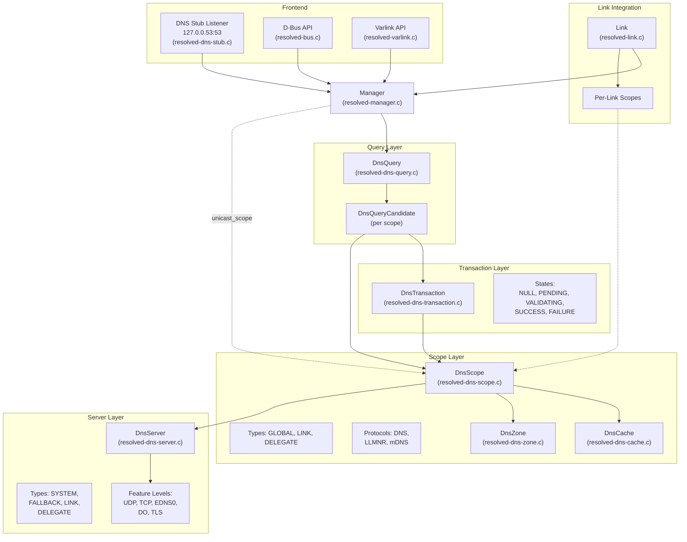
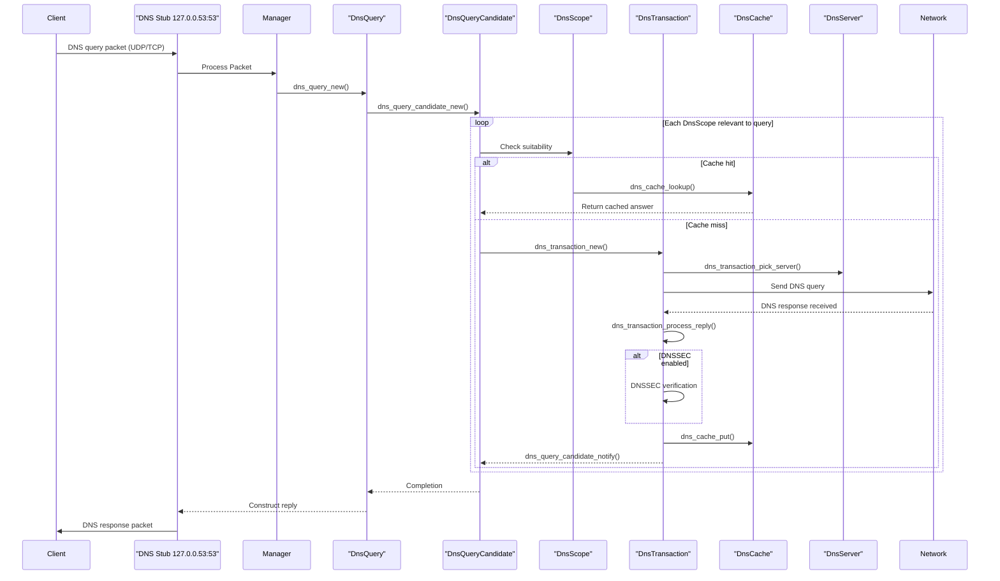
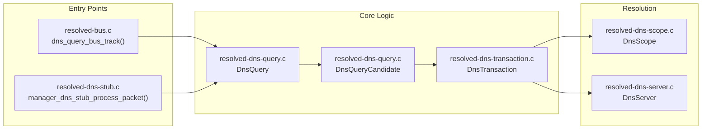
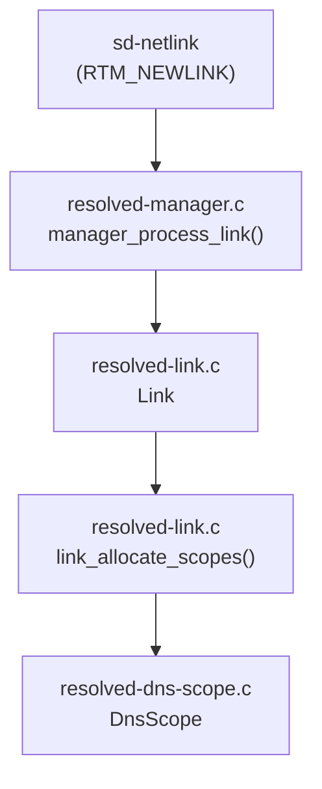

<!-- source: DeepWiki mcp.deepwiki.com · repo systemd/systemd · page 3.2 DNS Resolution with systemd-resolved · fetched 2026-11-07 -->

# DNS Resolution with systemd-resolved

Relevant source files

The following files were used as context for generating this wiki page:

- [man/nss-myhostname.xml](man/nss-myhostname.xml)
- [man/nss-mymachines.xml](man/nss-mymachines.xml)
- [man/nss-resolve.xml](man/nss-resolve.xml)
- [man/nss-systemd.xml](man/nss-systemd.xml)
- [man/resolvectl.xml](man/resolvectl.xml)
- [man/resolved.conf.xml](man/resolved.conf.xml)
- [man/systemd-id128.xml](man/systemd-id128.xml)
- [man/systemd-resolved.service.xml](man/systemd-resolved.service.xml)
- [man/user@.service.xml](man/user@.service.xml)
- [man/userdbctl.xml](man/userdbctl.xml)
- [src/home/homed-varlink.c](src/home/homed-varlink.c)
- [src/home/user-record-sign.c](src/home/user-record-sign.c)
- [src/id128/id128.c](src/id128/id128.c)
- [src/nss-myhostname/nss-myhostname.c](src/nss-myhostname/nss-myhostname.c)
- [src/nss-mymachines/nss-mymachines.c](src/nss-mymachines/nss-mymachines.c)
- [src/nss-resolve/nss-resolve.c](src/nss-resolve/nss-resolve.c)
- [src/nss-systemd/nss-systemd.c](src/nss-systemd/nss-systemd.c)
- [src/nss-systemd/nss-systemd.h](src/nss-systemd/nss-systemd.h)
- [src/nss-systemd/nss-systemd.sym](src/nss-systemd/nss-systemd.sym)
- [src/nss-systemd/userdb-glue.c](src/nss-systemd/userdb-glue.c)
- [src/nss-systemd/userdb-glue.h](src/nss-systemd/userdb-glue.h)
- [src/resolve/resolv.conf](src/resolve/resolv.conf)
- [src/resolve/resolvconf-compat.c](src/resolve/resolvconf-compat.c)
- [src/resolve/resolvconf-compat.h](src/resolve/resolvconf-compat.h)
- [src/resolve/resolvectl.c](src/resolve/resolvectl.c)
- [src/resolve/resolvectl.h](src/resolve/resolvectl.h)
- [src/resolve/resolved-bus.c](src/resolve/resolved-bus.c)
- [src/resolve/resolved-bus.h](src/resolve/resolved-bus.h)
- [src/resolve/resolved-conf.c](src/resolve/resolved-conf.c)
- [src/resolve/resolved-conf.h](src/resolve/resolved-conf.h)
- [src/resolve/resolved-dns-cache.c](src/resolve/resolved-dns-cache.c)
- [src/resolve/resolved-dns-cache.h](src/resolve/resolved-dns-cache.h)
- [src/resolve/resolved-dns-delegate.c](src/resolve/resolved-dns-delegate.c)
- [src/resolve/resolved-dns-dnssec-crypto.h](src/resolve/resolved-dns-dnssec-crypto.h)
- [src/resolve/resolved-dns-dnssec.c](src/resolve/resolved-dns-dnssec.c)
- [src/resolve/resolved-dns-dnssec.h](src/resolve/resolved-dns-dnssec.h)
- [src/resolve/resolved-dns-query.c](src/resolve/resolved-dns-query.c)
- [src/resolve/resolved-dns-query.h](src/resolve/resolved-dns-query.h)
- [src/resolve/resolved-dns-scope.c](src/resolve/resolved-dns-scope.c)
- [src/resolve/resolved-dns-scope.h](src/resolve/resolved-dns-scope.h)
- [src/resolve/resolved-dns-server.c](src/resolve/resolved-dns-server.c)
- [src/resolve/resolved-dns-server.h](src/resolve/resolved-dns-server.h)
- [src/resolve/resolved-dns-stream.c](src/resolve/resolved-dns-stream.c)
- [src/resolve/resolved-dns-stream.h](src/resolve/resolved-dns-stream.h)
- [src/resolve/resolved-dns-stub.c](src/resolve/resolved-dns-stub.c)
- [src/resolve/resolved-dns-stub.h](src/resolve/resolved-dns-stub.h)
- [src/resolve/resolved-dns-transaction.c](src/resolve/resolved-dns-transaction.c)
- [src/resolve/resolved-dns-transaction.h](src/resolve/resolved-dns-transaction.h)
- [src/resolve/resolved-dns-zone.c](src/resolve/resolved-dns-zone.c)
- [src/resolve/resolved-dns-zone.h](src/resolve/resolved-dns-zone.h)
- [src/resolve/resolved-dnssd-bus.c](src/resolve/resolved-dnssd-bus.c)
- [src/resolve/resolved-dnssd-bus.h](src/resolve/resolved-dnssd-bus.h)
- [src/resolve/resolved-dnssd-gperf.gperf](src/resolve/resolved-dnssd-gperf.gperf)
- [src/resolve/resolved-dnssd.c](src/resolve/resolved-dnssd.c)
- [src/resolve/resolved-dnssd.h](src/resolve/resolved-dnssd.h)
- [src/resolve/resolved-dnstls.h](src/resolve/resolved-dnstls.h)
- [src/resolve/resolved-gperf.gperf](src/resolve/resolved-gperf.gperf)
- [src/resolve/resolved-link-bus.c](src/resolve/resolved-link-bus.c)
- [src/resolve/resolved-link-bus.h](src/resolve/resolved-link-bus.h)
- [src/resolve/resolved-link.c](src/resolve/resolved-link.c)
- [src/resolve/resolved-link.h](src/resolve/resolved-link.h)
- [src/resolve/resolved-llmnr.c](src/resolve/resolved-llmnr.c)
- [src/resolve/resolved-llmnr.h](src/resolve/resolved-llmnr.h)
- [src/resolve/resolved-manager.c](src/resolve/resolved-manager.c)
- [src/resolve/resolved-manager.h](src/resolve/resolved-manager.h)
- [src/resolve/resolved-mdns.c](src/resolve/resolved-mdns.c)
- [src/resolve/resolved-resolv-conf.c](src/resolve/resolved-resolv-conf.c)
- [src/resolve/resolved-resolv-conf.h](src/resolve/resolved-resolv-conf.h)
- [src/resolve/resolved-varlink.c](src/resolve/resolved-varlink.c)
- [src/resolve/resolved.conf.in](src/resolve/resolved.conf.in)
- [src/resolve/test-dnssec-complex.c](src/resolve/test-dnssec-complex.c)
- [src/resolve/test-dnssec-crypto.c](src/resolve/test-dnssec-crypto.c)
- [src/resolve/test-dnssec.c](src/resolve/test-dnssec.c)
- [src/shared/dns-domain.c](src/shared/dns-domain.c)
- [src/shared/dns-domain.h](src/shared/dns-domain.h)
- [src/shared/fsprg-openssl.c](src/shared/fsprg-openssl.c)
- [src/shared/fsprg-openssl.h](src/shared/fsprg-openssl.h)
- [src/shared/options.c](src/shared/options.c)
- [src/shared/options.h](src/shared/options.h)
- [src/shared/userdb.c](src/shared/userdb.c)
- [src/shared/userdb.h](src/shared/userdb.h)
- [src/shared/verbs.c](src/shared/verbs.c)
- [src/shared/verbs.h](src/shared/verbs.h)
- [src/test/fsprg.c](src/test/fsprg.c)
- [src/test/fsprg.h](src/test/fsprg.h)
- [src/test/gcrypt-util.c](src/test/gcrypt-util.c)
- [src/test/gcrypt-util.h](src/test/gcrypt-util.h)
- [src/test/test-bpf-token.c](src/test/test-bpf-token.c)
- [src/test/test-dns-domain.c](src/test/test-dns-domain.c)
- [src/test/test-fsprg.c](src/test/test-fsprg.c)
- [src/test/test-options.c](src/test/test-options.c)
- [src/test/test-verbs.c](src/test/test-verbs.c)
- [src/userdb/userdbctl.c](src/userdb/userdbctl.c)
- [src/userdb/userwork.c](src/userdb/userwork.c)
- [test/units/TEST-74-AUX-UTILS.id128.sh](test/units/TEST-74-AUX-UTILS.id128.sh)
- [test/units/TEST-75-RESOLVED.sh](test/units/TEST-75-RESOLVED.sh)

## Purpose and Scope

This page documents the DNS resolution subsystem provided by `systemd-resolved`. It details systemd-resolved's capabilities for DNS name resolution, support for multiple name resolution protocols (DNS, LLMNR, mDNS), secure DNS validation via DNSSEC, caching strategies, and its integration with `systemd-networkd` for network-aware DNS configuration management.

The scope includes an architectural overview, the resolution data flow, an explanation of core implementations including key functions and data structures, and integration points that provide a comprehensive DNS resolving interface on the host.

---

## Architecture Overview

`systemd-resolved` is a local DNS resolver daemon that offers a multi-protocol name resolution stack with DNSSEC validation and caching. It partitions resolution into scopes tied to network interfaces, delegated domains, or globally, tracks DNS servers, and exposes a local stub resolver interface on `127.0.0.53:53` for clients on the machine.

### Core Components and Their Relationships

This diagram highlights the layered abstractions running inside `systemd-resolved` starting from the central `Manager` that coordinates queries, scopes, servers, and links, down to the transactions responsible for network exchanges, and caches holding DNS answers.

Sources: [src/resolve/resolved-manager.c:63-133](), [src/resolve/resolved-dns-query.c:36-124](), [src/resolve/resolved-dns-transaction.c:116-184](), [src/resolve/resolved-dns-scope.c:48-119]()

---

## Manager Structure and State

The `Manager` is the primary struct maintaining the global state for DNS resolution. It controls network interface links, active queries, DNS servers, configurations, and manages event processing for resolution.

| Field                | Description                                          | Implementation Reference                     |
|----------------------|------------------------------------------------------|----------------------------------------------|
| `links`              | Hashmap mapping network interface indices (`ifindex`) to `Link` objects | [src/resolve/resolved-manager.c:80-111]()    |
| `dns_transactions`   | Hashmap of active DNS transactions indexed by transaction ID | [src/resolve/resolved-dns-transaction.c:148-150]() |
| `dns_scopes`         | Linked list of all DNS resolution scopes (`DnsScope`) | [src/resolve/resolved-dns-scope.c:105-105]() |
| `dns_servers`        | List of system-wide DNS servers                       | [src/resolve/resolved-dns-server.c:105-108]() |
| `dns_queries`        | List of all currently active DNS queries              | [src/resolve/resolved-dns-stub.c:114-116]()  |

The manager receives kernel network updates (links, addresses, routes) and updates the corresponding network interface representations (`Link`), DNS scopes, and DNS server lists dynamically.

Sources: [src/resolve/resolved-manager.c:63-220](), [src/resolve/resolved-dns-server.c:37-135](), [src/resolve/resolved-dns-scope.c:48-119]()

---

## DNS Resolution Flow

### High-Level Query Processing Sequence

This sequence diagram traces how a DNS query is received from a client, parsed by the local stub listener, passed to the `Manager` which creates a new `DnsQuery`. Query candidates are created per relevant scope. Each candidate tries to answer from its cache or triggers network transactions if necessary. Transactions contact DNS servers, process replies including DNSSEC validation, then cache the results and notify completion. The final consolidated answer is handed back to the stub listener and the client.

Sources: [src/resolve/resolved-dns-stub.c:189-215](), [src/resolve/resolved-dns-query.c:36-58](), [src/resolve/resolved-dns-transaction.c:116-184](), [src/resolve/resolved-dns-cache.c:180-212]()

---

## Scope Management and Protocol Selection

### Scope Types and Organization

A **Scope** (`DnsScope`) represents a lookup context tied to a network interface (`LINK`), a delegated DNS domain (`DELEGATE`), or a global context (`GLOBAL`).

- **LINK Scopes** are bound to specific network interfaces and resolve queries attached to those paths.
- **DELEGATE Scopes** handle DNS zones delegated explicitly to systemd-resolved.
- **GLOBAL Scope** applies when no interface-specific scope matches or for global queries.

### Supported Protocols

- **DNS (Unicast)**: Standard DNS queries sent to configured DNS servers.
- **LLMNR (Link-Local Multicast Name Resolution)**: Multicast-based name resolution on local links, allowing name resolution without DNS servers.
- **mDNS (Multicast DNS)**: Multicast protocol enabling host and service discovery on local networks.

When scopes are instantiated (e.g., in `dns_scope_new()`), their DNSSEC and DNS-over-TLS modes are initialized either from the link's settings or the global manager settings.

Sources: [src/resolve/resolved-dns-scope.c:48-119](), [src/resolve/resolved-link.c:143-195]()

---

## DNS Transaction Processing

A `DnsTransaction` encapsulates a network request and response cycle for a specific DNS resource key, within a particular scope.

- **State Lifecycle**: Transactions transit through states like `DNS_TRANSACTION_NULL`, `PENDING`, `VALIDATING`, and finally either `SUCCESS` or `FAILURE` [src/resolve/resolved-dns-transaction.c:196-196]().

- **Resource Management**: The transaction manages UDP socket and TCP stream I/O, detaching streams on closure and optionally inserting UDP sockets into a "socket graveyard" to tolerate late UDP replies without triggering ICMP errors [src/resolve/resolved-dns-transaction.c:64-108]().

- **Garbage Collection**: Transactions maintain reference sets to query candidates and DNSSEC transactions, freeing themselves only when no longer referenced [src/resolve/resolved-dns-transaction.c:168-184]().

These transactions also accommodate DNS-over-TLS (if enabled on the server) and DNSSEC verification during reply processing.

Sources: [src/resolve/resolved-dns-transaction.c:37-108](), [src/resolve/resolved-dns-transaction.c:116-184]()

---

## DNS Caching

`systemd-resolved` maintains a per-scope cache of DNS responses in a `DnsCache` structure.

- **Data Structures**: Uses a hashmap keyed by DNS resource keys for immediate lookup and a priority queue to order items by expiration time [src/resolve/resolved-dns-cache.c:165-178]().

- **Cache Item Types**:
  - `DNS_CACHE_POSITIVE`: Successful DNS answers [src/resolve/resolved-dns-cache.c:77-87]().
  - `DNS_CACHE_NODATA`: Negative caching for no-data responses.
  - `DNS_CACHE_NXDOMAIN`: Negative cache for non-existent domains.
  - `DNS_CACHE_RCODE`: For caching certain DNS error responses (e.g., SERVFAIL).

- **Cache Maintenance**: The cache obeys TTL constraints and has mechanisms (`dns_cache_make_space()`) to evict old entries when size limits are exceeded, ensuring memory use stays reasonable.

Sources: [src/resolve/resolved-dns-cache.c:33-105](), [src/resolve/resolved-dns-cache.c:165-212]()

---

## DNSSEC Validation

DNSSEC validation is fully implemented and aims to establish a chain of trust using resource record signatures (RRSIGs), keys (DNSKEYs), and delegations (DS records).

- **Algorithm Support**: Cryptographic verification supports RSA, ECDSA, EdDSA, leveraging OpenSSL cryptographic primitives [src/resolve/resolved-dns-dnssec.c:42-145]().

- **Verification Functions**:
  - `dnssec_rsa_verify_raw()`: Performs raw RSA signature verification with proper padding and hashing [src/resolve/resolved-dns-dnssec.c:76-145]().
  - `dnssec_verify_errno()`: Maps internal cryptographic error codes to DNSSEC validation outcomes, distinguishing unsupported algorithm errors.

- **NSEC3 Handling**: For authenticated denial of existence, NSEC3 iteration caps reduce computational load while maintaining compliance [src/resolve/resolved-dns-dnssec.c:27-29]().

Systemd-resolved's DNSSEC code forms the security backbone validating DNS responses before caching and responding to clients.

Sources: [src/resolve/resolved-dns-dnssec.c:21-145]()

---

## DNS Stub Listener and API Interfaces

`systemd-resolved` provides a local DNS stub resolver bound to `127.0.0.53:53`, which listens for DNS queries from client applications and delegates those to the internal resolution machinery.

- **Listener Management**: Supports multiple listeners and extra listeners on various addresses for flexibility and compatibility with different network setups [src/resolve/resolved-dns-stub.c:80-96]().

- **Query Tracking**: Maintains a hashmap `queries_by_packet` linking incoming packets to queries to correctly associate responses [src/resolve/resolved-dns-stub.c:109-118]().

- **Answer Filtering**: Functions like `dns_stub_collect_answer_by_question()` selectively extract and assemble responses matching the original question, including RRSIGs when appropriate [src/resolve/resolved-dns-stub.c:189-215]().

- **APIs**: `systemd-resolved` exposes D-Bus and Varlink interfaces (`resolved-bus.c`, `resolved-varlink.c`) that allow querying status, requesting resolutions, and configuring the resolver.

Sources: [src/resolve/resolved-dns-stub.c:40-121](), [src/resolve/resolved-dns-stub.c:189-215](), [src/resolve/resolved-bus.c:79-96]()

---

## Integration with systemd-networkd

`systemd-resolved` integrates tightly with `systemd-networkd` through netlink to react dynamically to network changes:

- **Link Recognition**: Processes `RTM_NEWLINK` and `RTM_DELLINK` netlink messages to add or remove network interfaces (`Link` objects) and their associated DNS configurations [src/resolve/resolved-manager.c:63-119]().

- **Address Updates**: Reacts to `RTM_NEWADDR` and `RTM_DELADDR` messages to maintain accurate IP addressing state and update DNS configurations accordingly [src/resolve/resolved-manager.c:135-219]().

- **Scope Allocation**: Per-link DNS scopes are allocated based on link relevance and support flags. This includes enabling or disabling LLMNR and mDNS protocols per-interface, based on link operational state and user configuration [src/resolve/resolved-link.c:117-195]().

This integration ensures that DNS configuration is always consistent with the current network topology and interface state.

Sources: [src/resolve/resolved-manager.c:63-220](), [src/resolve/resolved-link.c:117-195]()

---

## Code Entity Mapping Diagrams

### DNS Query Execution Path

This diagram associates runtime components and code entities for query processing from bus and stub entry points through queries, candidates, transactions, scopes, and servers.

Sources: [src/resolve/resolved-bus.c:79-96](), [src/resolve/resolved-dns-query.c:155-202](), [src/resolve/resolved-dns-transaction.c:116-184]()

---

### Network State to DNS Scope Mapping

This diagram illustrates how network link updates from netlink messages are processed by the manager and translated to link objects and subsequently DNS resolution scopes allocation.

Sources: [src/resolve/resolved-manager.c:63-133](), [src/resolve/resolved-link.c:117-195](), [src/resolve/resolved-dns-scope.c:48-119]()

---

# Summary

`systemd-resolved` is a fully featured, secure local DNS resolver with multi-protocol support (DNS, LLMNR, mDNS), DNSSEC validation, caching, and tight integration with the system network state via systemd-networkd. Its modular architecture separates queries, scopes, transactions, and servers into manageable layers coordinated by a central manager object. This design enables scalable, secure, and dynamic name resolution services on modern Linux systems.

This page serves as a technical guide to the design and internals of the DNS resolution system inside systemd, helping developers and maintainers understand the data flow, code structure, and integration points for enhancing or debugging this subsystem.

---

