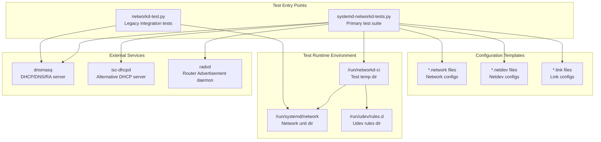
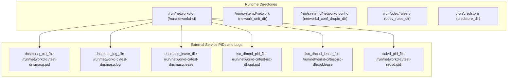
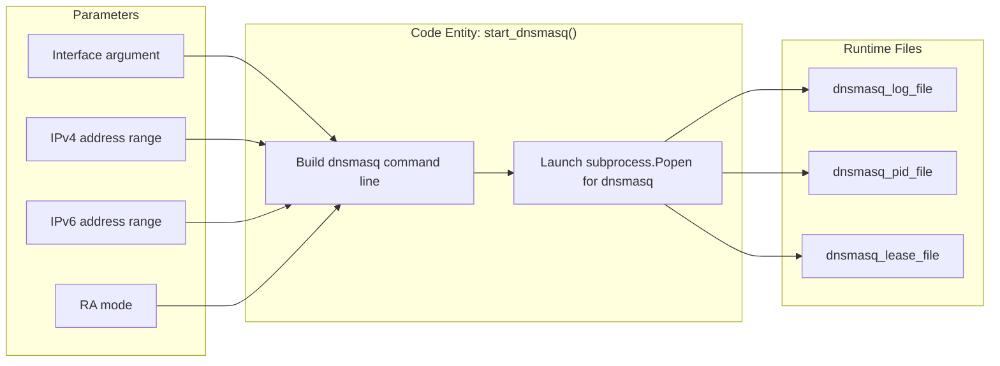

<!-- source: DeepWiki mcp.deepwiki.com · repo systemd/systemd · page 3.3 Network Testing Framework · fetched 2026-11-07 -->

# Network Testing Framework

<details>
<summary>Relevant source files</summary>

The following files were used as context for generating this wiki page:

- [test/networkd-test.py](test/networkd-test.py)
- [test/test-network/conf/25-address-static.network](test/test-network/conf/25-address-static.network)
- [test/test-network/conf/25-address-static.network.d/10-many-address.conf](test/test-network/conf/25-address-static.network.d/10-many-address.conf)
- [test/test-network/conf/25-address-static.network.d/10-override.conf](test/test-network/conf/25-address-static.network.d/10-override.conf)
- [test/test-network/conf/25-dhcp-client-ipv4-only.network](test/test-network/conf/25-dhcp-client-ipv4-only.network)
- [test/test-network/conf/25-dhcp-pd-downstream-dummy98.network](test/test-network/conf/25-dhcp-pd-downstream-dummy98.network)
- [test/test-network/conf/25-ipv6-prefix-veth.network](test/test-network/conf/25-ipv6-prefix-veth.network)
- [test/test-network/conf/25-route-static-test1.network](test/test-network/conf/25-route-static-test1.network)
- [test/test-network/conf/25-route-static.network](test/test-network/conf/25-route-static.network)
- [test/test-network/conf/25-route-via-ipv6.network](test/test-network/conf/25-route-via-ipv6.network)
- [test/test-network/conf/25-sit-dhcp4.netdev](test/test-network/conf/25-sit-dhcp4.netdev)
- [test/test-network/conf/25-sit-dhcp4.network](test/test-network/conf/25-sit-dhcp4.network)
- [test/test-network/systemd-networkd-tests.py](test/test-network/systemd-networkd-tests.py)

</details>


## Purpose and Scope

The Network Testing Framework provides a comprehensive Python-based integration test infrastructure focused on `systemd-networkd`. It validates network configuration parsing, network device and protocol management (e.g. DHCP, IPv6 RA), routing, and interaction with external components like DHCP servers and router advertisement daemons. The framework runs tests in isolated environments such as systemd mkosi images booted inside QEMU or containers. It uses temporary configurations, controlled network devices, and external server processes to simulate varied networking scenarios and verify correct behavior.

This framework helps maintain systemd-networkd’s resilience, correctness, and interoperability by exercising real-world scenarios with automated checks of low-level kernel and networkd states.

Sources: [test/test-network/systemd-networkd-tests.py:1-47](), [test/networkd-test.py:1-20]()

---

## Test File Organization

The test suite is organized mainly under the `test/test-network/` directory with additional legacy tests in `test/networkd-test.py`. It is composed of:

| Component                 | Location                                  | Description                                    |
|---------------------------|-------------------------------------------|----------------------------------------------|
| Primary Test Suite         | `test/test-network/systemd-networkd-tests.py` | Large integration tests (~11k lines) for networkd networking features |
| Legacy Integration Tests   | `test/networkd-test.py`                   | Older networkd-dhcp-related tests with veth |
| Network Configuration Files| `test/test-network/conf/`                 | Template configuration files (`.network`, `.netdev`, `.link`) used in tests |
| Test Runtime Directories   | `/run/networkd-ci`, `/run/systemd/network` | Temporary directories for ephemeral configs and daemon runtime state |
| External Servers           | -                                         | Simulated DHCP/DNS/RA servers (dnsmasq, isc-dhcpd, radvd) |

### Test Organization Diagram



Sources: [test/test-network/systemd-networkd-tests.py:50-75](), [test/networkd-test.py:31-38]()

---

## Test Execution Model

### Execution Environment and Entry Point

Tests are mainly designed to run inside a systemd mkosi image booted with QEMU, enabled by systemd CI infrastructure. Inside the VM or container environment, the main test script is located at:

```
/usr/lib/systemd/tests/testdata/test-network/systemd-networkd-tests.py
```

This script integrates multiple test classes covering different networkd components and behaviors [test/test-network/systemd-networkd-tests.py:5-7]().

### Running Individual Tests and Full Suite

The framework allows running specific test methods by specifying class and method names:

```bash
run0 ./systemd-networkd-tests.py NetworkdMTUTests.test_ipv6_mtu
```

This example runs the `test_ipv6_mtu` method in the `NetworkdMTUTests` class.

Tests can also be run with executables (e.g., networkd, networkctl) overridden by specifying a build directory:

```bash
run0 ./systemd-networkd-tests.py --build-dir=/path/to/build NetworkdNetworkTests.test_address_static
```

### Build Directory Integration and Executable Resolution

The test infrastructure discovers executables needed for testing (`systemd-networkd`, `systemd-resolved`, `networkctl`, `udevadm`, etc.) by searching specific systemd library paths combined with the environment PATH. The paths can be overridden by providing a `build_dir`, allowing tests to verify the current development build instead of installed binaries [test/test-network/systemd-networkd-tests.py:65-78]().

Sources: [test/test-network/systemd-networkd-tests.py:9-22,65-78]()

---

## Test Infrastructure Components

### Runtime Directory and Filesystem Layout

The framework uses well-defined runtime directories and files to isolate test artifacts and runtime states:



These locations store temporary network configurations, drop-in snippets, udev rules, credential stores, and PID/log files for external services.

Sources: [test/test-network/systemd-networkd-tests.py:50-63]()

### Network Interfaces and Link Management

The framework manipulates Linux network interfaces for tests. It maintains a set of `protected_links` which it will not touch or remove to avoid destabilizing the host system. These include core kernel virtual interfaces like `lo`, `sit0`, tunnels (`tunl0`), GRE and ERSPAN devices, and IFB devices (`ifb0`, `ifb1`) [test/test-network/systemd-networkd-tests.py:93-106]().

Tests usually create temporary test interfaces (like `veth` pairs) and clean them up after completion.

Sources: [test/test-network/systemd-networkd-tests.py:93-106]()

---

## External Service Integration

### dnsmasq DHCP/DNS/RA Server

The testing framework can launch the `dnsmasq` server to simulate DHCPv4, DHCPv6, and DNS functionality used in networkd tests. It controls the command-line parameters for interface, IPv4/IPv6 ranges, router advertisement mode, and leases. The launched daemon's logs, PID, and lease files are stored under `/run/networkd-ci/` for inspection and lifecycle management.



Sources: [test/test-network/systemd-networkd-tests.py:56-58](), [test/networkd-test.py:31]()

### radvd Router Advertisement Daemon

For IPv6 Router Advertisement testing, the framework controls the `radvd` daemon with helper functions:

- `start_radvd(config, *options)`: Starts radvd using provided configuration.
- `stop_radvd()`: Stops the radvd process.
- `radvd_check_config(config)`: Validates that radvd is running with expected config.

These functions facilitate control and verification of IPv6 RA behavior during tests.

Sources: [test/test-network/systemd-networkd-tests.py:958-979](), [test/test-network/systemd-networkd-tests.py:63]()

---

## State Verification Utilities

The testing framework contains several utilities to inspect current network state from multiple layers:

| Function                        | Description                                               |
|--------------------------------|-----------------------------------------------------------|
| `read_link_attr(link, attribute)` | Reads attribute value for given network link from `/sys/class/net/link/attribute` sysfs. |
| `read_manager_state_file()`         | Reads the global state file `/run/systemd/netif/state` representing manager-wide network status. |
| `read_link_state_file(link)`         | Reads per-link state from `/run/systemd/netif/links/index` file describing link status. |
| `get_link_description(link)`         | Using `networkctl --json=short`, obtains detailed JSON description of a network link. |

These utilities enable verification of test-induced network changes, matching internal state with expected outcomes.

Sources: [test/test-network/systemd-networkd-tests.py:773-785](), [test/test-network/systemd-networkd-tests.py:944-956](), [test/networkd-test.py:173-181]()

---

## Test Configuration Examples

The framework leverages a rich set of network configuration snippets under `test/test-network/conf/` to cover broad networking features.

### Static Address Configuration

`25-address-static.network` showcases testing various static address properties:

- Setting multiple IP addresses per interface.
- Address label management (`Label=label1`).
- Broadcast address settings including `Broadcast=no` and explicit broadcasts.
- Peer address assignments (`Peer=10.5.1.101/24`).
- Address lifetimes (`PreferredLifetime=infinity` and `0`).
- Route metrics and prefix route flags.

This coverage ensures networkd properly parses and applies address-related options.

Sources: [test/test-network/conf/25-address-static.network:1-183]()

### Static Route Configuration

`25-route-static.network` is used to test routing logic:

- Static routes with explicit gateways.
- Multipath routes spreading traffic over multiple next-hops.
- Various route types: blackhole, unreachable, prohibit, local, anycast, broadcast, multicast.
- Route attributes like `InitialCongestionWindow`, `InitialAdvertisedReceiveWindow`.

These ensure route configuration and kernel routing table manipulation behave as expected.

Sources: [test/test-network/conf/25-route-static.network:1-122]()

### DHCPv4 Client Configuration

`25-dhcp-client-ipv4-only.network` tests DHCP client functionality:

- Requesting specific DHCP options and address.
- Hostname and vendor class identifiers.
- Route and DNS related DHCP options.
- Allow and deny lists controlling DHCP scope.

Used in tests involving integration with DHCP servers such as dnsmasq.

Sources: [test/test-network/conf/25-dhcp-client-ipv4-only.network:1-51]()

---

## Helper Utilities

### Subprocess Execution Wrappers

The test framework provides wrappers around `subprocess` calls to standardize output handling:

| Function        | Behavior                                                  |
|-----------------|-----------------------------------------------------------|
| `check_output()` | Runs a command, returns stdout on success, raises on failure after printing output. |
| `call()`        | Runs a command, returns return code, merges stdout/stderr to console. |
| `call_check()`  | Like `call()`, but raises `CalledProcessError` if return code != 0. |
| `call_quiet()`  | Runs command suppressing all output.                      |
| `run()`         | Runs command returning `CompletedProcess` object with captured output. |

These enable tests to invoke system tools reliably and handle errors properly.

Sources: [test/test-network/systemd-networkd-tests.py:139-202]()

### Kernel Feature and Module Availability Checks

To skip tests requiring specific kernel features or modules not available in the running kernel, decorators and helpers include:

- `is_module_available()` which checks `lsmod` output and tries to `modprobe` modules.
- `expectedFailureIfModuleIsNotAvailable()` decorator to mark tests as expected failures if modules are missing.
- `compare_kernel_version()` to compare running kernel versions against minimum requirements.

These ensure tests only run when environment prerequisites are met.

Sources: [test/test-network/systemd-networkd-tests.py:213-245]()

---

# Summary

The Network Testing Framework in systemd consists of a large Python-based test suite that performs integration-style testing of `systemd-networkd` and related networking components. Tests run inside controlled isolated environments with temporary configs and virtual interfaces, simulating diverse network scenarios and verifying kernel and daemon states. The framework integrates external servers like dnsmasq and radvd for protocol testing, and provides rich means of inspecting link state and configuration application correctness. It relies on templated configuration files and flexible subprocess management utilities for robust testing.

This infrastructure is a critical part of ensuring the reliability and correctness of systemd-networkd’s complex networking functionality.

Sources:  
[test/test-network/systemd-networkd-tests.py:1-230,770-980](),  
[test/networkd-test.py:1-181](),  
[test/test-network/conf/25-address-static.network:1-183](),  
[test/test-network/conf/25-route-static.network:1-122](),  
[test/test-network/conf/25-dhcp-client-ipv4-only.network:1-51]()

---

