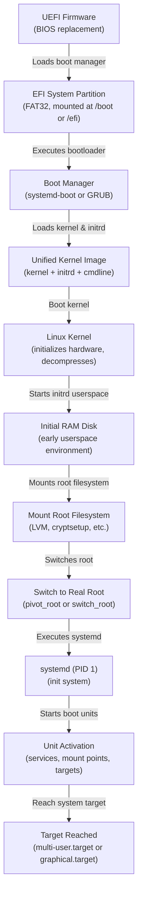
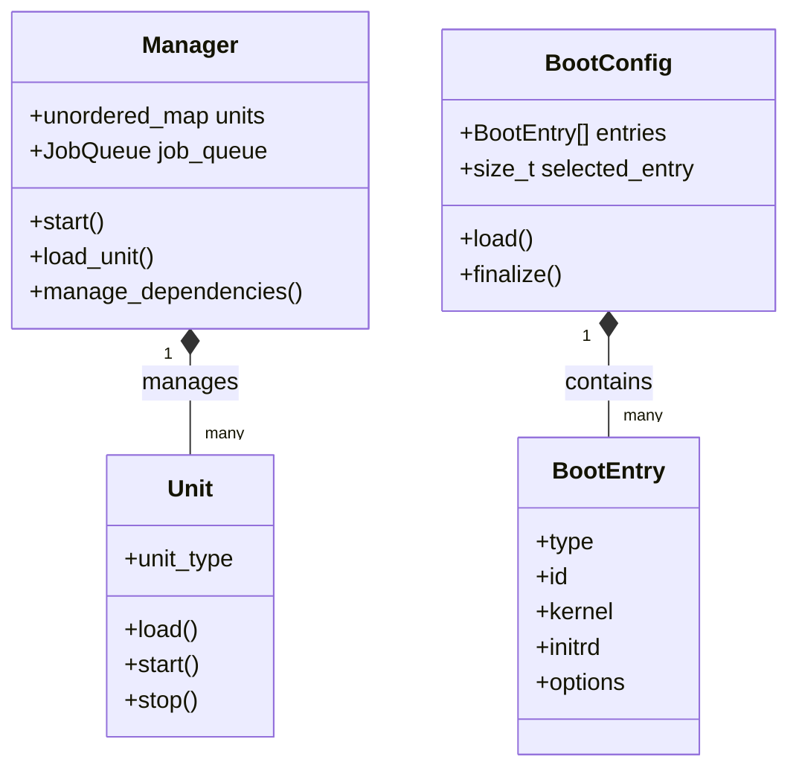
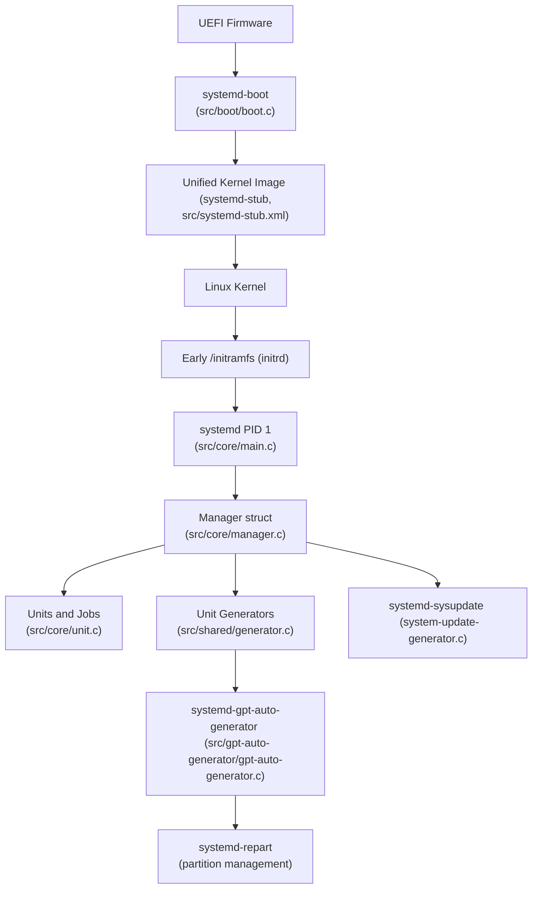

<!-- source: DeepWiki mcp.deepwiki.com · repo systemd/systemd · page 4 System Initialization and Boot · fetched 2026-11-07 -->

# System Initialization and Boot

Relevant source files

The following files were used as context for generating this wiki page:

- [docs/TPM2_PCR_MEASUREMENTS.md](docs/TPM2_PCR_MEASUREMENTS.md)
- [man/binfmt.d.xml](man/binfmt.d.xml)
- [man/dnssec-trust-anchors.d.xml](man/dnssec-trust-anchors.d.xml)
- [man/modules-load.d.xml](man/modules-load.d.xml)
- [man/standard-specifiers.xml](man/standard-specifiers.xml)
- [man/systemd-cryptsetup-generator.xml](man/systemd-cryptsetup-generator.xml)
- [man/systemd-debug-generator.xml](man/systemd-debug-generator.xml)
- [man/systemd-firstboot.xml](man/systemd-firstboot.xml)
- [man/systemd-fstab-generator.xml](man/systemd-fstab-generator.xml)
- [man/systemd-getty-generator.xml](man/systemd-getty-generator.xml)
- [man/systemd-gpt-auto-generator.xml](man/systemd-gpt-auto-generator.xml)
- [man/systemd-machine-id-setup.xml](man/systemd-machine-id-setup.xml)
- [man/systemd-modules-load.service.xml](man/systemd-modules-load.service.xml)
- [man/systemd-stub.xml](man/systemd-stub.xml)
- [man/systemd-sysusers.xml](man/systemd-sysusers.xml)
- [man/systemd-tmpfiles.xml](man/systemd-tmpfiles.xml)
- [man/systemd.dnssd.xml](man/systemd.dnssd.xml)
- [man/systemd.image-policy.xml](man/systemd.image-policy.xml)
- [man/sysusers.d.xml](man/sysusers.d.xml)
- [man/tmpfiles.d.xml](man/tmpfiles.d.xml)
- [src/basic/conf-files.c](src/basic/conf-files.c)
- [src/basic/conf-files.h](src/basic/conf-files.h)
- [src/basic/special.h](src/basic/special.h)
- [src/boot/boot.c](src/boot/boot.c)
- [src/boot/efi-firmware.c](src/boot/efi-firmware.c)
- [src/boot/efi-firmware.h](src/boot/efi-firmware.h)
- [src/boot/initrd.c](src/boot/initrd.c)
- [src/boot/initrd.h](src/boot/initrd.h)
- [src/boot/linux.c](src/boot/linux.c)
- [src/boot/meson.build](src/boot/meson.build)
- [src/boot/pe.c](src/boot/pe.c)
- [src/boot/pe.h](src/boot/pe.h)
- [src/boot/proto/memory-attribute.h](src/boot/proto/memory-attribute.h)
- [src/boot/secure-boot.c](src/boot/secure-boot.c)
- [src/boot/secure-boot.h](src/boot/secure-boot.h)
- [src/boot/stub.c](src/boot/stub.c)
- [src/cryptsetup/cryptsetup-generator.c](src/cryptsetup/cryptsetup-generator.c)
- [src/debug-generator/debug-generator.c](src/debug-generator/debug-generator.c)
- [src/firstboot/firstboot.c](src/firstboot/firstboot.c)
- [src/fstab-generator/fstab-generator.c](src/fstab-generator/fstab-generator.c)
- [src/fundamental/tpm2-pcr.h](src/fundamental/tpm2-pcr.h)
- [src/getty-generator/getty-generator.c](src/getty-generator/getty-generator.c)
- [src/gpt-auto-generator/gpt-auto-generator.c](src/gpt-auto-generator/gpt-auto-generator.c)
- [src/machine-id-setup/machine-id-setup-main.c](src/machine-id-setup/machine-id-setup-main.c)
- [src/shared/generator.c](src/shared/generator.c)
- [src/shared/generator.h](src/shared/generator.h)
- [src/shared/main-func.c](src/shared/main-func.c)
- [src/shared/main-func.h](src/shared/main-func.h)
- [src/storagetm/meson.build](src/storagetm/meson.build)
- [src/system-update-generator/system-update-generator.c](src/system-update-generator/system-update-generator.c)
- [src/sysusers/sysusers.c](src/sysusers/sysusers.c)
- [src/test/test-conf-files.c](src/test/test-conf-files.c)
- [src/test/test-main-func-fiber.c](src/test/test-main-func-fiber.c)
- [src/test/test-main-func.c](src/test/test-main-func.c)
- [src/tmpfiles/tmpfiles.c](src/tmpfiles/tmpfiles.c)
- [src/veritysetup/veritysetup-generator.c](src/veritysetup/veritysetup-generator.c)
- [test/test-fstab-generator/test-19-mounts-from-cmdline.input](test/test-fstab-generator/test-19-mounts-from-cmdline.input)
- [test/test-fstab-generator/test-20-swap-from-cmdline.input](test/test-fstab-generator/test-20-swap-from-cmdline.input)
- [test/test-systemd-tmpfiles.py](test/test-systemd-tmpfiles.py)
- [test/units/TEST-74-AUX-UTILS.firstboot.sh](test/units/TEST-74-AUX-UTILS.firstboot.sh)
- [units/storage-target-mode.target](units/storage-target-mode.target)
- [units/systemd-firstboot.service](units/systemd-firstboot.service)
- [units/systemd-homed-firstboot.service](units/systemd-homed-firstboot.service)
- [units/systemd-pcrnvdone.service.in](units/systemd-pcrnvdone.service.in)
- [units/systemd-pcrphase-factory-reset.service.in](units/systemd-pcrphase-factory-reset.service.in)
- [units/systemd-pcrphase-storage-target-mode.service.in](units/systemd-pcrphase-storage-target-mode.service.in)
- [units/systemd-pcrproduct.service.in](units/systemd-pcrproduct.service.in)
- [units/systemd-storagetm.service.in](units/systemd-storagetm.service.in)

## Purpose and Scope

This page provides a high-level overview of systemd's role in system initialization and boot, outlining the main phases from firmware startup through to systemd's full activation of system services. It covers

- The complete boot chain on modern UEFI-based Linux systems
- systemd as the system manager (PID 1)
- Integration with UEFI firmware and boot loader components
- Usage of unit generators for early system setup
- Storage and partition management during boot

For deeper technical details, please refer to the following child pages:

- [Early Boot, UEFI, and Measured Boot](#4.1) — systemd-boot, systemd-stub, TPM measurements, UKI generation, secure boot integration, and bootctl.
- [Partition Management with systemd-repart](#4.2) — declarative disk partitioning, repart.d configuration, filesystem creation, systemd-dissect, and loop device utilities.
- [System Update with systemd-sysupdate](#4.3) — atomic A/B updates, transfer resources, configuration, the sysupdated daemon, factory reset, and system installation.
- [Generators, Early Setup and Shutdown](#4.4) — systemd unit generators (fstab, cryptsetup, getty, debug), early setup helpers (sysctl, modules-load, fsck), first boot provisioning (tmpfiles, sysusers, firstboot), and shutdown/unmount sequences.

---

## Boot Chain Overview

Modern Linux boot on UEFI systems progresses through multiple stages from firmware initialization to running user services under systemd management:

The UEFI firmware initializes hardware and locates boot entries stored in NVRAM or on the EFI System Partition (ESP). It loads a boot manager like `systemd-boot` or GRUB, which selects a boot entry. Modern boot setups may use a Unified Kernel Image (UKI) — a PE binary embedding kernel, initrd, kernel command line, and optional firmware resources — enabling simplified signed boot chains.

After the kernel initializes and decompresses, it runs early userspace (initrd/initramfs), where systemd can operate to mount root filesystems and enable early services. Finally, systemd is executed as PID 1 to manage system initialization.

**Sources:** [src/boot/boot.c:59-96](), [man/systemd-boot.xml:27-62](), [man/systemd-stub.xml:48-59]()

### Boot Chain Components Table

| Stage         | Component                   | Role                                         | Typical Configuration Location             |
|---------------|-----------------------------|----------------------------------------------|--------------------------------------------|
| Firmware      | UEFI                        | Hardware init, boot manager execution         | Firmware (NVRAM) boot entries               |
| Boot Manager  | systemd-boot or GRUB        | Load kernel/initrd, provide UI menu          | ESP `/loader/entries/*.conf` or config files |
| Kernel        | Linux kernel                | Initialize hardware, mount initrd             | Kernel command line parameters              |
| Early Userspace | initrd (with systemd)      | Setup root devices (LVM, dm-crypt), mount root | Initrd overlay, generators, cryptsetup     |
| Switch Root   | systemd (in initrd)         | Transition to real root filesystem             | `switch_root` or `pivot_root` mechanism     |
| Init System   | systemd pid 1               | Service and unit activation                    | `/etc/systemd/system/`, `/usr/lib/systemd/` |

**Sources:** [src/shared/bootspec.h:9-16](), [man/kernel-install.xml:61-86](), [man/bootctl.xml:34-38]()

---

## systemd as System Manager (PID 1)

Once the kernel completes early initialization and mounts the real root filesystem, it execs systemd as the first userland process (PID 1). systemd then assumes control over the system, orchestrating service startup, mounting filesystems, device management, and system state transitions.

### Initialization Phases

systemd’s initialization consists of multiple phases:

- Mount API filesystems (`/proc`, `/sys`, `/dev`) needed for dynamic device and filesystem info.
- Initialize `Manager` object to track unit definitions and system state.
- Load unit files and generators to create dynamic units.
- Activate targets according to default or requested system state (e.g., `multi-user.target`).
- Manage dependencies and lifecycle of all system units.

This structured initialization ensures parallel and efficient boot with strict dependency management.

**Sources:** [src/core/main.c:2200-2800](), [src/core/manager.c:800-1200]()

---

## Manager Initialization and Unit Orchestration

The heart of systemd’s logic is the `Manager` structure, responsible for unit tracking, job control, event loop, IPC connections, and signal handling.

### Unit Loading and Dependency Graph

Units are loaded with awareness of drop-in configurations, default behaviors, and masks. systemd comprehends multiple unit types (service, mount, automount, device, target, swap, timer, snapshot, etc.) via distinct vtables encapsulating type-specific behaviors.

The boot process begins with the detection of boot configuration and selection of boot entry data structures (`BootConfig`, `BootEntry`), representing OS kernel options discovered on the ESP or XBOOTLDR partitions.

**Sources:** [src/shared/bootspec.h:45-106](), [src/shared/bootspec.c:130-154](), [src/core/manager.c:1400-1500]()

---

## UEFI Boot and Secure Boot Integration

systemd integrates tightly with modern UEFI firmware to enable secure and flexible boot loading.

- **systemd-boot** is a simple UEFI boot manager implementing the Boot Loader Specification. It manages boot entries of type #1 (`.conf` files) and #2 (EFI/UKI binaries) [man/systemd-boot.xml:27-29]().
- **systemd-stub** is a minimal UEFI boot stub attached to Linux kernels to provide UEFI binary compatibility and embedded resources support inside a Unified Kernel Image [man/systemd-stub.xml:48-59]().
- **ukify** is a tool for assembling UKIs by combining the Linux kernel, initrd images, stubs, and other resources into a single PE binary.
- **bootctl** is the user command line tool to manage firmware boot variables, boot loaders, and boot entries.
- **kernel-install** handles automated kernel and initrd installation/removal and triggers generator components like `90-loaderentry.install`.

These components support TPM measurements, PCR extensions, Secure Boot signing, and measured boot policies vital for secure system startup.

**Sources:** [src/boot/boot.c:59-74](), [src/shared/bootspec.c:37-42](), [man/systemd-stub.xml:48-96](), [man/systemd-boot.xml:27-62](), [src/ukify/ukify.py:1-60](), [src/kernel-install/kernel-install.c:78-84]()

---

## Partition Management and Storage Configuration

systemd employs multiple tools to handle partition discovery, creation, and filesystem setup during early boot.

- **systemd-repart** implements declarative and incremental partition management based on `repart.d/` configuration files, enabling resizing or creating partitions and filesystems safely at boot or factory reset stages.
- **systemd-gpt-auto-generator** is a unit generator that automatically scans GPT partition tables for standard partition types like root, `/home`, `/var`, ESP, and swap partitions, generating appropriate mount and swap units. It applies heuristics to detect the boot device and creates systemd mount units dynamically.

These tools ensure storage devices are correctly identified, partitioned, and mounted consistently during startup.

For comprehensive details, see **[Partition Management with systemd-repart](#4.2)**.

**Sources:** [src/gpt-auto-generator/gpt-auto-generator.c:1-191](), [man/systemd-gpt-auto-generator.xml:1-115]()

---

## System Update and Maintenance

systemd includes facilities for OS and boot loader update management to support seamless atomic upgrades and rollbacks.

- **systemd-sysupdate** handles A/B style updates for the kernel and UKIs by scanning available transfer resources, coordinating updates with the sysupdated daemon.
- **systemd-boot** tracks boot success and failure through the Boot Loader Specification's boot attempt counters and status flags, automatically rolling back to previous kernels if needed.

These features add robustness and reliability to system upgrades and boot management.

For expanded coverage, see **[System Update with systemd-sysupdate](#4.3)**.

**Sources:** [src/system-update-generator/system-update-generator.c:1-87]() (not shown but described), [man/sysupdate.d.xml:1-120](), [man/systemd-boot.xml:91-93]()

---

## Unit Generators, Early Setup, and Shutdown

systemd uses a variety of generators and early setup helpers to prepare the system environment before activating standard units:

- **Unit generators** create `.mount`, `.service`, and other units dynamically based on configuration files like `/etc/fstab`, GPT partitions, cryptsetup tokens, and virtual terminals. Examples include `fstab-generator`, `gpt-auto-generator`, `cryptsetup-generator`, and `getty-generator`.
- **Early setup helpers** include units for kernel parameter tuning (sysctl), loading kernel modules, filesystem checks on disks (fsck), binary format handler registrations (binfmt), and console initialization (vconsole).
- **First boot provisioning** consists of services like `systemd-firstboot` that configure locale, keymap, timezone, and root password on new installations.
- **Shutdown and unmount paths** ensure orderly service and resource termination on system halt or reboot.

For detailed insights, see **[Generators, Early Setup and Shutdown](#4.4)**.

**Sources:** [src/tmpfiles/tmpfiles.c:1-232](), [src/sysusers/sysusers.c:1-216](), [src/firstboot/firstboot.c:1-199](), [src/fstab-generator/fstab-generator.c:1-234](), [src/shared/generator.c:1-199]()

---

# Summary Diagram: Natural Language to Key Code Entities in System Initialization

---

# Summary Diagram: systemd Components in Boot and Initialization

```mermaid
classDiagram
    class systemd {
        +main(int argc, char** argv)
        +init()
        +run_manager()
    }
    class Manager {
        +load_units()
        +activate_units()
        +manage_jobs()
    }
    class UnitGenerator {
        +generate_units()
        +fstab_generator()
        +gpt_auto_generator()
        +cryptsetup_generator()
        +debug_generator()
    }
    class systemdRepart {
        +apply_repart_d()
        +create_partitions()
        +create_filesystems()
    }
    class systemdSysupdate {
        +scan_resources()
        +perform_updates()
        +manage_AB_updates()
    }
    class UEFIBoot {
        +systemd_boot()
        +systemd_stub()
    }

    systemd "1" *-- "1" Manager
    Manager "1" *-- "*" UnitGenerator
    UnitGenerator "1" <-- "1" GPTGen : uses
    UnitGenerator "1" <-- "1" FstabGen : uses
    Manager "1" *-- "1" systemdSysupdate
    Manager "1" *-- "1" systemdRepart
    UEFIBoot <-- systemd
```

---

## References and Further Reading

- Early Boot, UEFI, and Measured Boot: Boot loader protocols, TPM integration, UKI creation [#4.1]
- Partition Management with systemd-repart: disk partitioning and filesystem creation [#4.2]
- System Update with systemd-sysupdate: atomic updates and sysupdated daemon [#4.3]
- Generators, Early Setup and Shutdown: dynamic unit generation, system tuning, provisioning [#4.4]

---

**Sources:**  
- [src/boot/boot.c:59-96]()  
- [man/systemd-boot.xml:27-62]()  
- [man/systemd-stub.xml:48-59]()  
- [src/shared/bootspec.h:9-16]()  
- [src/shared/bootspec.c:37-42, 130-154]()  
- [src/core/main.c:2200-2800]()  
- [src/core/manager.c:800-1200, 1400-1500]()  
- [src/ukify/ukify.py:1-60]()  
- [src/kernel-install/kernel-install.c:78-84]()  
- [src/gpt-auto-generator/gpt-auto-generator.c:1-191]()  
- [src/shared/generator.c:1-199]()  
- [src/tmpfiles/tmpfiles.c:1-232]()  
- [src/sysusers/sysusers.c:1-216]()  
- [src/firstboot/firstboot.c:1-199]()

---

