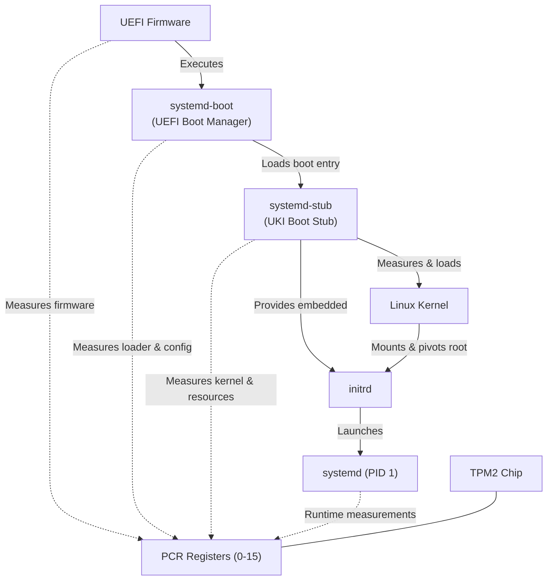
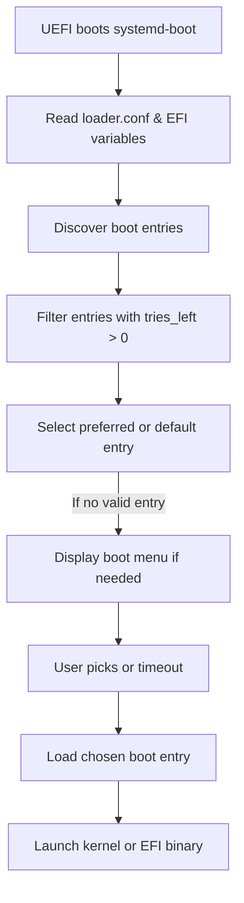
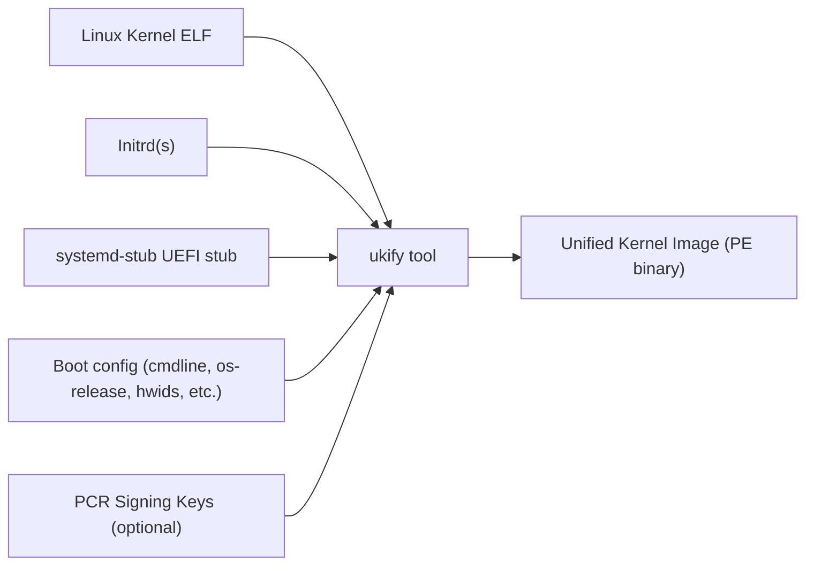
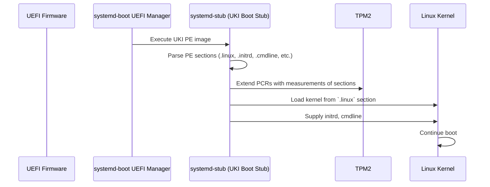
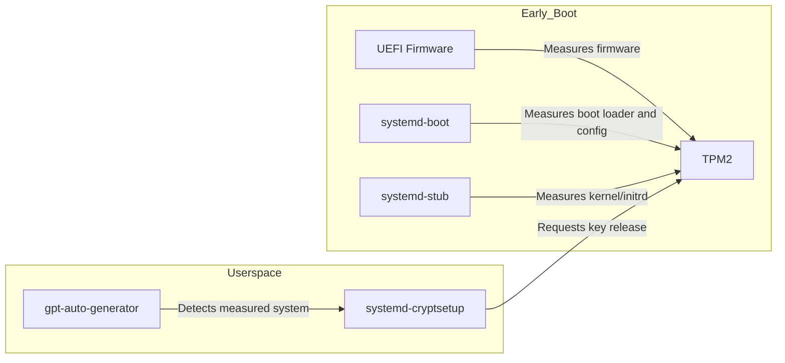
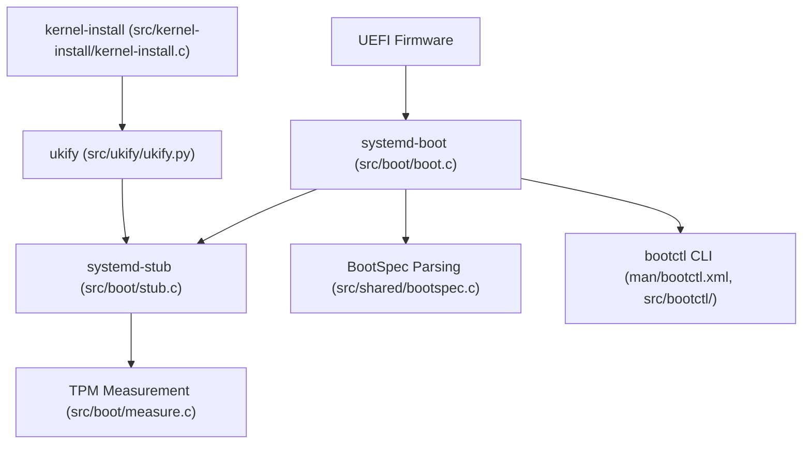

<!-- source: DeepWiki mcp.deepwiki.com · repo systemd/systemd · page 4.1 Early Boot, UEFI, and Measured Boot · fetched 2026-11-07 -->

# Early Boot, UEFI, and Measured Boot

<details>
<summary>Relevant source files</summary>

The following files were used as context for generating this wiki page:

- [docs/TPM2_PCR_MEASUREMENTS.md](docs/TPM2_PCR_MEASUREMENTS.md)
- [man/bootctl.xml](man/bootctl.xml)
- [man/kernel-install.xml](man/kernel-install.xml)
- [man/loader.conf.xml](man/loader.conf.xml)
- [man/systemd-boot.xml](man/systemd-boot.xml)
- [man/systemd-measure.xml](man/systemd-measure.xml)
- [man/systemd-pcrphase.service.xml](man/systemd-pcrphase.service.xml)
- [man/systemd-stub.xml](man/systemd-stub.xml)
- [man/uki.conf.example](man/uki.conf.example)
- [man/ukify.xml](man/ukify.xml)
- [network/meson.build](network/meson.build)
- [shell-completion/bash/bootctl](shell-completion/bash/bootctl)
- [shell-completion/bash/kernel-install](shell-completion/bash/kernel-install)
- [shell-completion/zsh/_bootctl](shell-completion/zsh/_bootctl)
- [src/basic/build.c](src/basic/build.c)
- [src/bless-boot/bless-boot.c](src/bless-boot/bless-boot.c)
- [src/boot/boot.c](src/boot/boot.c)
- [src/boot/efi-firmware.c](src/boot/efi-firmware.c)
- [src/boot/efi-firmware.h](src/boot/efi-firmware.h)
- [src/boot/initrd.c](src/boot/initrd.c)
- [src/boot/initrd.h](src/boot/initrd.h)
- [src/boot/linux.c](src/boot/linux.c)
- [src/boot/measure.c](src/boot/measure.c)
- [src/boot/meson.build](src/boot/meson.build)
- [src/boot/pe.c](src/boot/pe.c)
- [src/boot/pe.h](src/boot/pe.h)
- [src/boot/proto/memory-attribute.h](src/boot/proto/memory-attribute.h)
- [src/boot/secure-boot.c](src/boot/secure-boot.c)
- [src/boot/secure-boot.h](src/boot/secure-boot.h)
- [src/boot/stub.c](src/boot/stub.c)
- [src/bootctl/bootctl-install.c](src/bootctl/bootctl-install.c)
- [src/bootctl/bootctl-link.c](src/bootctl/bootctl-link.c)
- [src/bootctl/bootctl-link.h](src/bootctl/bootctl-link.h)
- [src/bootctl/bootctl-random-seed.c](src/bootctl/bootctl-random-seed.c)
- [src/bootctl/bootctl-set-efivar.c](src/bootctl/bootctl-set-efivar.c)
- [src/bootctl/bootctl-status.c](src/bootctl/bootctl-status.c)
- [src/bootctl/bootctl-util.c](src/bootctl/bootctl-util.c)
- [src/bootctl/bootctl-util.h](src/bootctl/bootctl-util.h)
- [src/bootctl/bootctl.c](src/bootctl/bootctl.c)
- [src/bootctl/bootctl.h](src/bootctl/bootctl.h)
- [src/fundamental/tpm2-pcr.h](src/fundamental/tpm2-pcr.h)
- [src/fundamental/uki.c](src/fundamental/uki.c)
- [src/fundamental/uki.h](src/fundamental/uki.h)
- [src/kernel-install/50-depmod.install](src/kernel-install/50-depmod.install)
- [src/kernel-install/60-ukify.install.in](src/kernel-install/60-ukify.install.in)
- [src/kernel-install/90-loaderentry.install.in](src/kernel-install/90-loaderentry.install.in)
- [src/kernel-install/90-uki-copy.install](src/kernel-install/90-uki-copy.install)
- [src/kernel-install/install.conf](src/kernel-install/install.conf)
- [src/kernel-install/kernel-install.c](src/kernel-install/kernel-install.c)
- [src/kernel-install/meson.build](src/kernel-install/meson.build)
- [src/kernel-install/test-kernel-install.sh](src/kernel-install/test-kernel-install.sh)
- [src/kernel-install/test-ukify-install.py](src/kernel-install/test-ukify-install.py)
- [src/measure/measure-tool.c](src/measure/measure-tool.c)
- [src/pcrextend/pcrextend.c](src/pcrextend/pcrextend.c)
- [src/shared/bootspec.c](src/shared/bootspec.c)
- [src/shared/bootspec.h](src/shared/bootspec.h)
- [src/shared/kernel-config.c](src/shared/kernel-config.c)
- [src/shared/kernel-config.h](src/shared/kernel-config.h)
- [src/shared/kernel-image.c](src/shared/kernel-image.c)
- [src/shared/kernel-image.h](src/shared/kernel-image.h)
- [src/shared/pe-binary.c](src/shared/pe-binary.c)
- [src/shared/pe-binary.h](src/shared/pe-binary.h)
- [src/shared/varlink-io.systemd.BootControl.c](src/shared/varlink-io.systemd.BootControl.c)
- [src/test/test-bootspec.c](src/test/test-bootspec.c)
- [src/ukify/test/test_ukify.py](src/ukify/test/test_ukify.py)
- [src/ukify/ukify.py](src/ukify/ukify.py)
- [sysctl.d/meson.build](sysctl.d/meson.build)
- [sysusers.d/meson.build](sysusers.d/meson.build)
- [test/units/TEST-70-TPM2.measure.sh](test/units/TEST-70-TPM2.measure.sh)
- [test/units/TEST-87-AUX-UTILS-VM.bootctl.sh](test/units/TEST-87-AUX-UTILS-VM.bootctl.sh)
- [tmpfiles.d/meson.build](tmpfiles.d/meson.build)
- [tools/meson-render-jinja2.py](tools/meson-render-jinja2.py)
- [units/systemd-pcrnvdone.service.in](units/systemd-pcrnvdone.service.in)
- [units/systemd-pcrproduct.service.in](units/systemd-pcrproduct.service.in)

</details>


## Purpose and Scope

This document provides a detailed technical overview of systemd's early boot components on UEFI systems, emphasizing the UEFI boot manager (`systemd-boot`), the Unified Kernel Images (UKI) with the `systemd-stub`, TPM2-based measured boot using PCR extensions, boot assessment with automatic fallback, and related tooling such as `ukify`, `kernel-install`, and `bootctl`. It explains key implementation details, data flow, and critical code entities involved in establishing secure, measured, and configurable boot processes on modern UEFI platforms.

---

## Boot Flow Overview

On a typical UEFI platform, the boot sequence leverages the Trusted Platform Module (TPM2) to extend integrity measurements at multiple stages, establishing a chain of trust from firmware to userspace. The UEFI firmware executes the UEFI boot manager (`systemd-boot`), which presents a boot menu, selects a boot entry, and launches a Unified Kernel Image (UKI). The UKI is a single signed PE executable embedding the Linux kernel, initrd, and configuration.

The `systemd-stub`, a UEFI kernel boot stub, executes the UKI, performs TPM PCR measurements of all embedded components (kernel, initrd, command line, signatures), and then boots the Linux kernel. The kernel mounts the initrd, continues booting, and finally starts `systemd` as PID 1. Userspace continues with runtime PCR extensions by `systemd` as needed.



Key files and concepts:
- Boot entry parsing and management in `src/shared/bootspec.c`.
- The boot manager logic in `src/boot/boot.c`.
- Definitions in `src/shared/bootspec.h`.

Sources: [src/shared/bootspec.c:1-200](), [src/boot/boot.c:59-174](), [src/shared/bootspec.h:9-32]()

---

## systemd-boot: UEFI Boot Manager

`systemd-boot` is a minimalistic UEFI boot manager implementing the UAPI.1 Boot Loader Specification, providing a simple textual menu, keyboard editor for kernel command lines, and TPM-based boot assessment features.

### Core Features and Design

- **Entry Discovery:**
  - Supports **Type 1 entries**: `.conf` files describing kernels, initrds, and options, located under `/loader/entries/` on the EFI System Partition (ESP).
  - Supports **Type 2 entries**: Unified Kernel Images (UKIs), executable EFI binaries under `\EFI\Linux\`.
  - Integrates with firmware-resident boot loaders for additional entries (Windows, macOS).
- **Boot Entries Management:**
  - Reads global config `loader.conf` with overrides from SMBIOS and EFI variables.
  - Maintains tries-left counters per entry to enable automatic fallback on failed boots.
  - Selects default entry based on config, last boot, or fallback logic.
- **Menu and Input:**
  - Displays a boot menu with formatted entries using `BootEntry` structs.
  - Supports interactive command line editing within boot UI.
- **Secure Boot:**
  - Enrolls Secure Boot keys if firmware is in setup mode and keys are provided on ESP.
- **Random Seed:**
  - Reads and combines early random seed from ESP with system token stored persistently.

### Key Data Structures and Enumerations

```c
typedef enum LoaderType {
    LOADER_UNDEFINED,
    LOADER_AUTO,
    LOADER_EFI,           // BLS Type #1 entries with "efi" line
    LOADER_LINUX,         // BLS Type #1 entries with "linux" line
    LOADER_UKI,           // BLS Type #1 entries with "uki" line (UKIs)
    LOADER_UKI_URL,       // BLS Type #1 entries with "uki-url" line
    LOADER_TYPE2_UKI,     // BLS Type #2 entries (executables)
    LOADER_SECURE_BOOT_KEYS,
    LOADER_BAD,
    LOADER_IGNORE,
    LOADER_REBOOT,
    LOADER_POWEROFF,
    LOADER_FWSETUP,
    _LOADER_TYPE_MAX,
} LoaderType;
```

The boot entries are represented by the `BootEntry` struct:

```c
typedef struct BootEntry {
    char16_t *id;                // Unique entry ID (file basename)
    char16_t *id_without_profile;
    char16_t *title_show;        // Display title (unique)
    char16_t *title;             // Raw human-readable title
    char16_t *sort_key;          // Sort key (OS ID etc)
    char16_t *version;           
    char16_t *machine_id;
    EFI_HANDLE *device;
    LoaderType type;
    char16_t *loader;
    char16_t *url;
    char16_t *devicetree;
    char16_t *options;
    bool options_implied;
    char16_t **initrd;
    char16_t **extras;
    EFI_STATUS (*call)(const struct BootEntry *entry, EFI_FILE *root_dir, EFI_HANDLE parent_image);
    int tries_done;
    int tries_left;
    char16_t *directory;
    unsigned profile;
} BootEntry;
```

### Boot Entry Selection Flow

An overview of the boot entry selection process in `systemd-boot`:



Sources: [man/bootctl.xml:34-57](), [src/boot/boot.c:59-174](), [src/shared/bootspec.h:45-74]()

---

## systemd-stub and Unified Kernel Images (UKI)

`systemd-stub` is a UEFI kernel boot stub designed to execute Unified Kernel Images (UKIs), a single PE executable format embedding the Linux kernel and ancillary data.

### Unified Kernel Image (UKI) Format

A UKI is a Portable Executable (PE) binary that combines multiple sections representing boot components, signed together for Secure Boot and TPM attestation.

| Section Name | Purpose                                      |
|--------------|----------------------------------------------|
| `.linux`     | ELF Linux kernel binary                       |
| `.initrd`    | Initial Ramdisk (initramfs/initrd)            |
| `.cmdline`   | Kernel command line                           |
| `.osrel`     | OS release metadata (contents of `os-release`) |
| `.uname`     | Kernel version string                         |
| `.splash`    | Optional BMP splash image                     |
| `.dtb`       | Device Tree Blob (typically ARM)             |
| `.dtbauto`   | Auto-selected Device Tree based on hardware IDs |
| `.hwids`     | Hardware ID entries for matching device tree |
| `.pcrsig`    | TPM PCR signature for boot attestation       |
| `.sbat`      | Security Boot Advanced Targeting data         |

### UKI Assembly via `ukify`

The utility `ukify` creates UKIs by combining kernel, initrd, and sections into a PE file [src/ukify/ukify.py:65-121](). It supports embedding TPM PCR signatures computed by `systemd-measure`, Secure Boot signing, and generation of additional sections.

Workflow of `ukify` during build:



### systemd-stub Functionality

At boot time, `systemd-stub`:

- Parses embedded PE sections inside the UKI.
- Measures the kernel image, initrd(s), command line, and other sections into TPM2 PCRs for secure attestation.
- Optionally verifies signatures.
- Loads the Linux kernel and passes kernel parameters.
- Provides extension points to load additional resources such as system extensions or configuration extensions.



Sources: [man/ukify.xml:6-129](), [src/ukify/ukify.py:65-121](), [src/boot/boot.c:59-100]()

---

## Boot Loader Specification (BLS)

BLS standardizes boot configuration file formats and discovery paths to enable reliable and interoperable boot loading.

### Type 1 Entries: `.conf` Files

- Plain-text files located typically under `/loader/entries/` on the ESP.
- Describe kernels, initrds, boot options, and other metadata.
- Support embedding tries-left/tries-done counters for boot assessment.

### Type 2 Entries: UKIs

- Executable PE files embedding kernel and resources as sections.
- Located under `\EFI\Linux\` on the ESP or Extended Boot Loader Partition.

### Boot Assessment via Tries Counter

To improve boot robustness, entries encode boot attempt counters within filenames. The systemd boot manager decrements tries-left on failed boots, and skips entries when tries reach zero.

- `tries-left`: Number of attempts remaining before ignoring entry.
- `tries-done`: Tracks number of successful boots.

The function `boot_filename_extract_tries` in `src/shared/bootspec.c` handles parsing these attempts counters.

Sources: [src/shared/bootspec.h:9-83](), [man/bootctl.xml:105-147](), [src/shared/bootspec.c:130-154]()

---

## TPM2 and Measured Boot

Measured boot with TPM2 enables recording cryptographic hashes of boot components in Platform Configuration Registers (PCRs), allowing attestation to remote verifiers and protection against tampering.

### PCR Allocation Strategy

| PCR Index | Measurement Target                | Entity Performing Measurement            |
|-----------|---------------------------------|-----------------------------------------|
| 0–7       | Firmware and UEFI services       | UEFI firmware                           |
| 8–9       | Bootloader and configuration     | `systemd-boot`                          |
| 11        | Kernel and embedded resources     | `systemd-stub` (UKI boot stub)          |
| 12        | Linux kernel command line         | `systemd-stub`                          |
| 13        | Initrd image                     | `systemd-stub`                          |
| 14        | System extensions (sysext)       | `systemd-stub`                          |
| 15        | Runtime measurements             | `systemd` (userspace PID 1)             |

### Implementation Highlights

- `systemd-stub` and `systemd-boot` extend accordingly the PCR registers on the TPM device.
- `systemd-pcrextend` allows userspace to extend PCR 15 with arbitrary data, such as machine IDs or volume keys.
- The `systemd-gpt-auto-generator` can detect measured boot and TPM availability, triggering automatic unlocking of encrypted volumes with TPM-bound keys.



Sources: [src/boot/measure.c:12-189](), [docs/TPM2_PCR_MEASUREMENTS.md](), [src/gpt-auto-generator/gpt-auto-generator.c:119-137]()

---

## Command-Line Tools and EFI Interfaces

### `bootctl`

`bootctl` is the primary management CLI for EFI boot settings and `systemd-boot`.

- **Capabilities:**
  - Show EFI firmware and boot loader status.
  - List Boot Loader Specification entries, including boot entries and UKIs.
  - Manage installation and updates of `systemd-boot` on the EFI System Partition.
  - Set reboot-to-firmware flags to enter EFI setup on next boot.

Typical commands:

| Command                | Description                              |
|------------------------|------------------------------------------|
| `bootctl status`        | Show firmware, available entries status  |
| `bootctl list`          | List available boot loader entries      |
| `bootctl install`       | Install or update systemd-boot bootloader |
| `bootctl unlink ID`     | Remove boot entry and associated files   |

Sources: [man/bootctl.xml:6-144]()

---

### `kernel-install`

`kernel-install` automates installing and removing kernels and initrd images on the boot partition, generating boot loader entries as per the Boot Loader Specification.

- Executes plugins from `/usr/lib/kernel/install.d/` and `/etc/kernel/install.d/` for modular operations.
- Supports multiple layouts including UKI (Unified Kernel Image) and BLS.
- The `90-loaderentry.install` plugin creates BLS Type 1 boot entries.

Typical usage includes adding/removing kernels with associated initrds, generating UKIs, and listing installed kernels.

Sources: [man/kernel-install.xml:6-136](), [src/kernel-install/kernel-install.c:1-209]()

---

### `ukify`

`ukify` is a tool to create signed Unified Kernel Images by combining kernel, initrd(s), systemd-stub, and metadata sections into a single PE binary.

- Supports PCR signing and embedding TPM PCR signatures.
- Allows specifying multiple boot phases and keys for attestation.
- Can generate auxiliary images such as configuration extensions, system extensions, and credentials.
- Also supports key and certificate generation for Secure Boot and PCR signatures.

Common verbs and options:

| Verb    | Description                        |
|---------|----------------------------------|
| `build` | Create a UKI from given components |
| `genkey`| Generate keys for PCR signing or Secure Boot |
| `inspect`| Show detailed UKI content information |

Sources: [src/ukify/ukify.py:1-207](), [man/ukify.xml:6-129]()

---

## Summary Mermaid Diagram: System Components to Code Entities



Sources: Combined from multiple files listed above.

---

# References

- `src/shared/bootspec.c`, `src/shared/bootspec.h`
- `src/boot/boot.c`, `src/boot/measure.c`
- `src/ukify/ukify.py`
- `src/kernel-install/kernel-install.c`
- Manual pages: `bootctl(1)`, `systemd-boot(7)`, `systemd-stub(7)`, `ukify(1)`, `kernel-install(8)`

---

This page is a standalone technical reference describing the early boot, UEFI, and measured boot architecture and implementation inside systemd.

---

