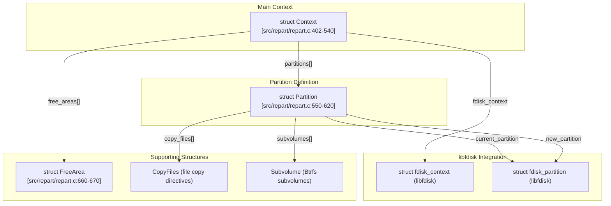
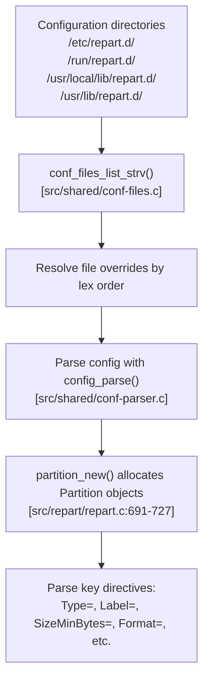
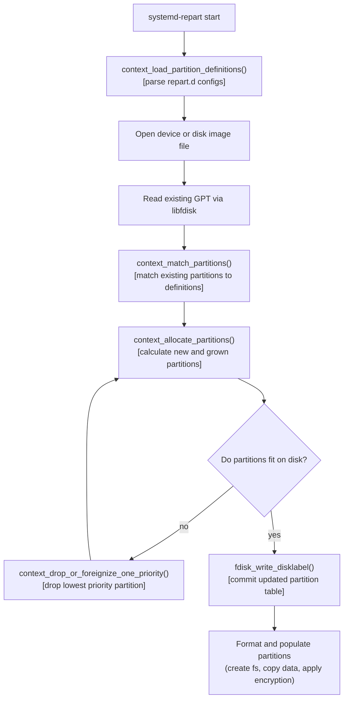
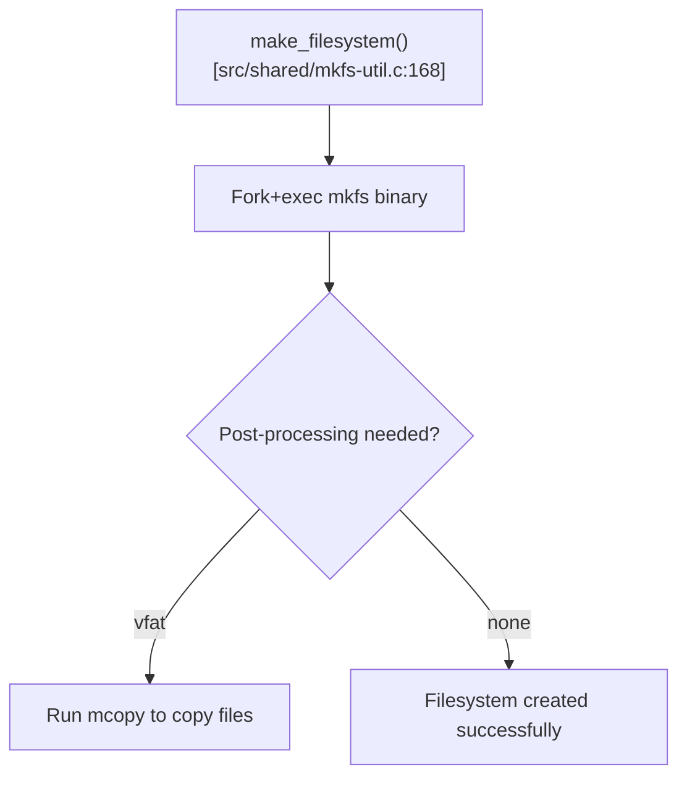
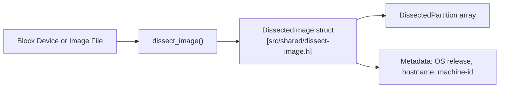

<!-- source: DeepWiki mcp.deepwiki.com · repo systemd/systemd · page 4.2 Partition Management with systemd-repart · fetched 2026-11-07 -->

# Partition Management with systemd-repart

Relevant source files

The following files were used as context for generating this wiki page:

- [man/repart.d.xml](man/repart.d.xml)
- [man/systemd-dissect.xml](man/systemd-dissect.xml)
- [man/systemd-repart.xml](man/systemd-repart.xml)
- [man/systemd-report-sign-tpm2@.service.xml](man/systemd-report-sign-tpm2@.service.xml)
- [man/systemd-storagetm.service.xml](man/systemd-storagetm.service.xml)
- [src/basic/strbuf.c](src/basic/strbuf.c)
- [src/basic/strbuf.h](src/basic/strbuf.h)
- [src/dissect/dissect.c](src/dissect/dissect.c)
- [src/hwdb/hwdb.c](src/hwdb/hwdb.c)
- [src/machine/image.c](src/machine/image.c)
- [src/machine/image.h](src/machine/image.h)
- [src/portable/portable.c](src/portable/portable.c)
- [src/repart/repart-list-candidate-devices.c](src/repart/repart-list-candidate-devices.c)
- [src/repart/repart-list-candidate-devices.h](src/repart/repart-list-candidate-devices.h)
- [src/repart/repart.c](src/repart/repart.c)
- [src/report/report-sign-tpm2.c](src/report/report-sign-tpm2.c)
- [src/shared/blockdev-list.c](src/shared/blockdev-list.c)
- [src/shared/blockdev-list.h](src/shared/blockdev-list.h)
- [src/shared/blockdev-util.c](src/shared/blockdev-util.c)
- [src/shared/blockdev-util.h](src/shared/blockdev-util.h)
- [src/shared/discover-image.c](src/shared/discover-image.c)
- [src/shared/discover-image.h](src/shared/discover-image.h)
- [src/shared/dissect-image.c](src/shared/dissect-image.c)
- [src/shared/dissect-image.h](src/shared/dissect-image.h)
- [src/shared/loop-util.c](src/shared/loop-util.c)
- [src/shared/loop-util.h](src/shared/loop-util.h)
- [src/shared/mkfs-util.c](src/shared/mkfs-util.c)
- [src/shared/mkfs-util.h](src/shared/mkfs-util.h)
- [src/shared/tpm2-report.c](src/shared/tpm2-report.c)
- [src/shared/tpm2-report.h](src/shared/tpm2-report.h)
- [src/shared/varlink-io.systemd.Repart.c](src/shared/varlink-io.systemd.Repart.c)
- [src/storagetm/storagetm.c](src/storagetm/storagetm.c)
- [src/sysext/sysext.c](src/sysext/sysext.c)
- [src/test/test-blockdev-util.c](src/test/test-blockdev-util.c)
- [src/test/test-strbuf.c](src/test/test-strbuf.c)
- [src/udev/udevadm-hwdb.c](src/udev/udevadm-hwdb.c)
- [src/udev/udevadm-lock.c](src/udev/udevadm-lock.c)
- [src/udev/udevadm.c](src/udev/udevadm.c)
- [src/udev/udevadm.h](src/udev/udevadm.h)
- [test/units/TEST-50-DISSECT.dissect.sh](test/units/TEST-50-DISSECT.dissect.sh)
- [test/units/TEST-50-DISSECT.sh](test/units/TEST-50-DISSECT.sh)
- [test/units/TEST-50-DISSECT.sysext.sh](test/units/TEST-50-DISSECT.sysext.sh)
- [test/units/TEST-58-REPART.sh](test/units/TEST-58-REPART.sh)
- [test/units/TEST-64-UDEV-STORAGE.sh](test/units/TEST-64-UDEV-STORAGE.sh)
- [test/units/TEST-67-INTEGRITY.sh](test/units/TEST-67-INTEGRITY.sh)
- [test/units/TEST-74-AUX-UTILS.introspect-cli.sh](test/units/TEST-74-AUX-UTILS.introspect-cli.sh)
- [test/units/TEST-81-GENERATORS.fstab-generator.sh](test/units/TEST-81-GENERATORS.fstab-generator.sh)
- [test/units/TEST-84-STORAGETM.sh](test/units/TEST-84-STORAGETM.sh)
- [test/units/TEST-87-AUX-UTILS-VM.mount.sh](test/units/TEST-87-AUX-UTILS-VM.mount.sh)
- [test/units/TEST-87-AUX-UTILS-VM.validatefs.sh](test/units/TEST-87-AUX-UTILS-VM.validatefs.sh)

systemd-repart provides declarative, incremental partition management for GPT partition tables. It reads partition definitions from configuration files in `repart.d/` directories and automatically creates or grows partitions to match the desired state, without shrinking, deleting, or moving existing partitions. This makes it suitable for both building OS images and expanding minimal images on first boot.

The tool is implemented in [src/repart/repart.c:1-58]() and operates on block devices or disk image files. It integrates with the filesystem creation utilities in [src/shared/mkfs-util.c:1-22]() and supports encryption via LUKS2, integrity verification via dm-verity, and content population via `CopyBlocks=` and `CopyFiles=` directives.

## Overview

systemd-repart is designed for two primary use cases:

1. **Building OS Images**: During image creation, systemd-repart can create complete partition layouts from scratch, format filesystems, and populate them with content.

2. **First Boot Expansion**: Deployed with minimal-sized images, systemd-repart runs at boot (via `systemd-repart.service`) to automatically expand partitions to use available disk space.

The key principle is **incremental operation**: existing partitions are never shrunk, moved, or deleted. Partitions are only added or grown, making the operation safe to run repeatedly. This incremental strategy preserves existing data while augmenting the system's partitions to utilize free space and fulfill configured needs.

Sources: [src/repart/repart.c:1-160](), [man/systemd-repart.xml:35-65]()

## Core Data Structures

systemd-repart relies on a suite of core data structures to orchestrate the repartitioning process, describing both existing and planned partitions, as well as free space segments on disk:

- **`Context`**: Central orchestrator managing repartitioning state including the array of user-defined `Partition` objects, disk free areas, and the libfdisk context for GPT manipulation [src/repart/repart.c:400-550]().

- **`Partition`**: Represents each partition's desired configuration and current state. It manages GPT type UUIDs, labels, size limits, filesystem format info, encryption settings, and copy directives for populating the partition [src/repart/repart.c:550-620]().

- **`FreeArea`**: Marks segments of unused disk space visible to the partitioner—these areas are candidates for new partitions or growth [src/repart/repart.c:660-670]().

Supporting abstractions such as `CopyFiles` and `Subvolume` relay instructions for recursive copying of filesystem content or creating btrfs subvolumes inside partitions.

Sources: [src/repart/repart.c:400-670]()

## Configuration File Discovery and Parsing

systemd-repart reads partition definitions from drop-in style configuration files located in multiple standard directories:

- `/etc/repart.d/`
- `/run/repart.d/`
- `/usr/local/lib/repart.d/`
- `/usr/lib/repart.d/`

These directories are scanned and their `.conf` files loaded, sorted lexically by filename to guarantee deterministic processing order. Drop-in snippets named with `.d/` suffixes are also handled for granular overrides or augmentation.

Key parsing functions handle the specifics of partition configuration directives:

- `config_parse_type()` parses GPT partition types, including known aliases and architecture-specific labels.
- `config_parse_label()` extracts GPT partition labels.
- Size-related parsers handle byte-aligned sizes with 4KiB granularity via `config_parse_size4096()`.
- Filesystem types are validated and set via `config_parse_fstype()`.

Sources: [src/repart/repart.c:691-727](), [man/repart.d.xml:24-31]()

## Partition Definition Format (`repart.d/*.conf`)

Partitions are defined in standard INI format with sections named `[Partition]`. Each file typically defines a single partition with a set of properties:

| Directive       | Type/Parser                  | Description                                                      |
|-----------------|------------------------------|------------------------------------------------------------------|
| `Type=`          | GPT UUID/Alias (`config_parse_type`) | GPT partition type UUID or well-known alias (`esp`, `root`, etc.) |
| `Label=`         | String                       | Partition label displayed in GPT partition table                 |
| `Weight=`        | Integer                     | Relative weight for proportional size allocation                 |
| `SizeMinBytes=`  | Bytes (4K aligned)            | Minimum byte size for partition                                |
| `SizeMaxBytes=`  | Bytes (4K aligned)            | Maximum byte size allowed                                        |
| `Format=`        | Filesystem type (`ext4`, `btrfs`, `swap`, etc.) | Filesystem to create inside partition                           |
| `CopyBlocks=`    | List of block copy operations | Copy raw block data from sources                                |
| `CopyFiles=`     | List of file copy operations  | Copy directories/files into the new filesystem                  |
| `Encrypt=`       | Enum (`luks2-offline`, etc.)  | Enable LUKS2 encryption and select encryption mode             |
| `Verity=`        | Enum (`off`, `data`, `hash`, `signature`) | Enable dm-verity for integrity validation                        |
| `GrowFileSystem=`| Boolean                     | Grow filesystem with partition on first mount                   |

### Partition Type Aliases and Architecture Awareness

For convenience, aliases like `root` or `usr` are resolved to architecture-specific GPT partition type UUIDs depending on the detected host architecture or user override. This allows images to be architecture-portable while still applying correct partition semantics on each device.

Sources: [man/repart.d.xml:72-617](), [src/repart/repart.c:3800-4000]()

## Incremental Partitioning Algorithm

systemd-repart works incrementally, always preserving existing partitions and avoiding destructive operations. It performs the following high-level steps:

This process ensures:

- **Preservation of existing data:** No partitions are deleted, moved, or shrunk.
- **Space allocation:** Satisfy minimum size constraints and distribute remaining space among partitions weighted by `Weight=`.
- **Partition matching:** Existing partitions are matched by GPT type UUID to partition definitions, supporting multiple partitions of same type.
- **Incremental growth:** Existing partitions flagged for growth have their size increased up to `SizeMaxBytes=`.
- **Priority-based dropping:** If disk too small for all partitions, those with higher `Priority=` values are dropped or foreignized before applying changes.

Sources: [src/repart/repart.c:5400-5600](), [src/repart/repart.c:6200-6400](), [src/repart/repart.c:6700-7200](), [man/systemd-repart.xml:78-116]()

### Space Allocation Algorithm Details

The allocation stage considers partitions in phases:

- Fixed-size partitions are allocated their exact sizes within `SizeMinBytes=` and `SizeMaxBytes=`.
- Remaining free space on disk is divided proportionally to partition weights for flexible partitions.
- Partitions are aligned to 4KiB boundaries for optimal disk performance.

Partitions that cannot fit due to size constraints and available free space are selectively excluded according to priority.

Sources: [src/repart/repart.c:1028-1057](), [src/repart/repart.c:6700-7200]()

## Filesystem Creation and Population

### Filesystem Creation via `mkfs-util`

systemd-repart leverages the shared filesystem creation helper in `mkfs-util.c`. The function `make_filesystem()` executes appropriate `mkfs.*` utilities (e.g., `mkfs.ext4`, `mkswap`, `mksquashfs`) to create filesystems on partition devices.

Supported filesystems include `ext4`, `btrfs`, `xfs`, `vfat`, `erofs`, and `squashfs` ([src/shared/mkfs-util.c:20-200]()). Some filesystems support populating with a source tree during creation (`root=` option).

### Content Population

Partitions can be populated with content in various ways:

- **CopyBlocks=**: Copies raw blocks from existing disk/image sources into the partition device.
- **CopyFiles=**: Performs recursive file copying from source directories into the newly formatted filesystem.
- **MakeDirectories=**: Creates directories inside the filesystem.

These operations facilitate provisioning partitions with necessary content, such as base system files or stateful data.

Sources: [src/shared/mkfs-util.c:150-300](), [src/repart/repart.c:3000-3500]()

## Encryption and Integrity Support

### LUKS2 Encryption

The `Encrypt=` directive enables LUKS2 encryption for partitions. The function `partition_encrypt()` sets up encryption metadata and formats the partition using `cryptsetup luksFormat`.

- Supports offline encryption modes.
- Integrates with TPM2 for key sealing where applicable.
- Ensures free space reservation for LUKS metadata growth ([src/repart/repart.c:2400-2700]()).

### dm-verity Integrity

`Verity=` can enable dm-verity partitions, which provide read-only integrity validation of the data device.

- Verity data and hash partitions are created alongside data partitions.
- The `verify_grow_areas()` and `verity_setup_partitions()` logic computes tree sizes and prepares verity tables.
- Support for embedded PKCS#7 signatures (`root-verity-sig` type partitions).

Sources: [src/repart/repart.c:644-689](), [src/repart/repart.c:2400-2700]()

## systemd-dissect and Image Handling

`systemd-dissect` (in [src/dissect/dissect.c]()) is the counterpart tool to analyze and operate on disk images (DDI). It dissects images to identify partitions, examine filesystems, and mount or copy contents.

### Dissection Logic

The core function `dissect_image()` in [src/shared/dissect-image.c]() analyzes a block device or image, identifying partitions by GPT type and reading assembly info such as OS release data and host identity.

This structure feeds tools and subsystems like systemd-repart and systemd-sysext, which consume image metadata to perform operations like mounting, merging, or updating images on disk.

### Loop Device Management

`loop-util.c` provides abstractions to attach and manage loop devices for image files, crucial for mounting image content or performing partition operations on sparse files.

- `loop_device_make()` manages `LOOP_CONFIGURE` ioctl with appropriate flags like `LO_FLAGS_PARTSCAN` to enable automatic partition scanning.
- Validation of direct I/O settings and fallback mechanisms mitigate kernel compatibility quirks ([src/shared/loop-util.c:40-160](), [src/shared/loop-util.c:200-350]()).

Sources: [src/dissect/dissect.c:1-100](), [src/shared/dissect-image.c:1200-1500](), [src/shared/loop-util.c:40-160,200-350]()

## systemd-sysext and sysext.d

`systemd-sysext` (implemented in [src/sysext/sysext.c]()) manages system extension images layered into the system at runtime:

- Merges extension images into `/usr/` and `/opt/` via OverlayFS.
- Looks for extension images in `/var/lib/extensions/`, `/etc/extensions/`, `/run/extensions/`, and other well-known locations ([src/shared/discover-image.c:61-87]()).
- Validates images against host OS metadata to ensure compatibility, rejecting mismatched or invalid extensions ([src/sysext/sysext.c:200-400]()).

This mechanism complements systemd-repart by managing supplemental system image layers, often co-deployed with partition management.

Sources: [src/sysext/sysext.c:1-150](), [src/shared/discover-image.c:61-87]()

## Varlink API for systemd-repart

systemd-repart exposes its partitioning functionality via a Varlink D-Bus API, allowing clients to invoke repartitioning or query candidate devices programmatically ([src/shared/varlink-io.systemd.Repart.c:1-50]()).

### Progress Reporting

During repartitioning, progress updates are emitted on the Varlink interface include phases such as:

- `loading-definitions`
- `placing`
- `formatting-partition`
- `writing-table`

This enables interactive clients to track repartitioning status and handle errors gracefully ([src/repart/repart.c:604-618]()).

---

This page documents the internals and mechanisms of systemd's incremental GPT partition management with systemd-repart, linking partition definition with disk actions, filesystem provisioning, encryption, verity, and image layering.

Sources:  
[src/repart/repart.c:1-160,400-750,1028-1057,2400-2700,3000-3500,5400-5600,6200-6400,6700-7200]()  
[man/systemd-repart.xml:35-116]()  
[src/shared/mkfs-util.c:1-203]()  
[src/shared/dissect-image.c:1-217]()  
[src/dissect/dissect.c:1-212]()  
[src/shared/loop-util.c:40-160,200-350]()  
[src/sysext/sysext.c:1-150]()  
[src/shared/discover-image.c:61-87]()  
[src/shared/varlink-io.systemd.Repart.c:1-50]()

---

