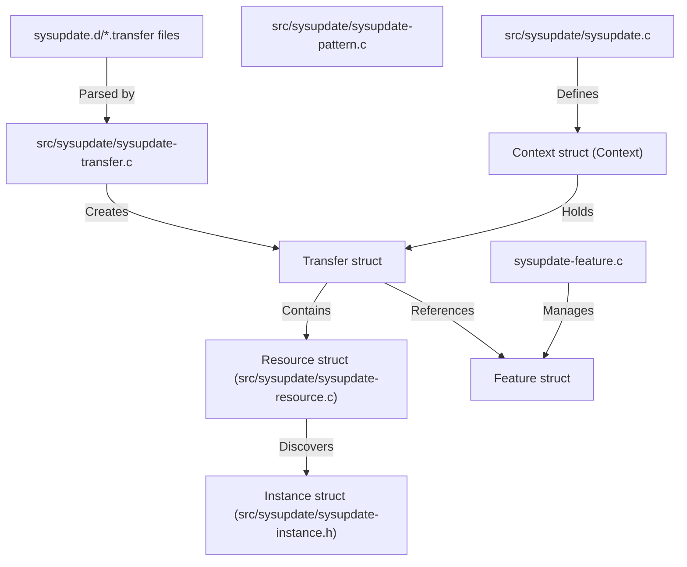
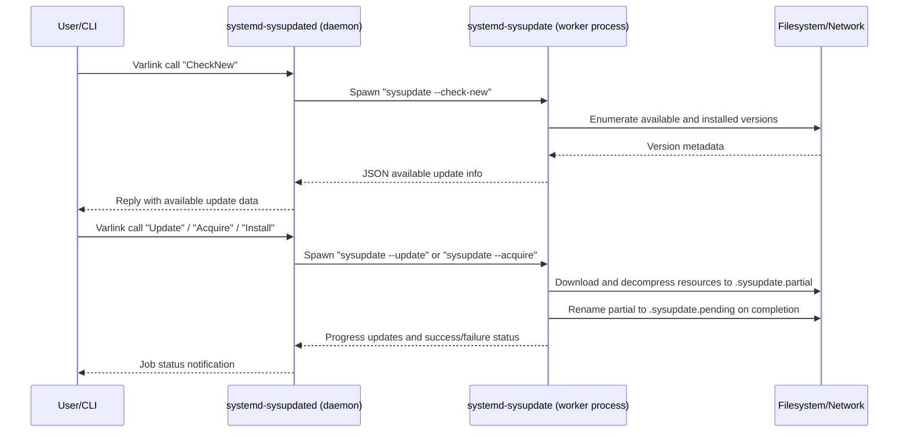

<!-- source: DeepWiki mcp.deepwiki.com · repo systemd/systemd · page 4.3 System Update with systemd-sysupdate · fetched 2026-11-07 -->

# System Update with systemd-sysupdate

Relevant source files

The following files were used as context for generating this wiki page:

- [man/importctl.xml](man/importctl.xml)
- [man/systemd-sysupdate.xml](man/systemd-sysupdate.xml)
- [man/sysupdate.components.xml](man/sysupdate.components.xml)
- [man/sysupdate.d.xml](man/sysupdate.d.xml)
- [man/sysupdate.features.xml](man/sysupdate.features.xml)
- [src/shared/fdisk-util.c](src/shared/fdisk-util.c)
- [src/shared/fdisk-util.h](src/shared/fdisk-util.h)
- [src/shared/varlink-io.systemd.SysUpdate.c](src/shared/varlink-io.systemd.SysUpdate.c)
- [src/sysupdate/sysupdate-cache.h](src/sysupdate/sysupdate-cache.h)
- [src/sysupdate/sysupdate-cleanup.c](src/sysupdate/sysupdate-cleanup.c)
- [src/sysupdate/sysupdate-cleanup.h](src/sysupdate/sysupdate-cleanup.h)
- [src/sysupdate/sysupdate-feature.c](src/sysupdate/sysupdate-feature.c)
- [src/sysupdate/sysupdate-feature.h](src/sysupdate/sysupdate-feature.h)
- [src/sysupdate/sysupdate-forward.h](src/sysupdate/sysupdate-forward.h)
- [src/sysupdate/sysupdate-instance.c](src/sysupdate/sysupdate-instance.c)
- [src/sysupdate/sysupdate-instance.h](src/sysupdate/sysupdate-instance.h)
- [src/sysupdate/sysupdate-partition.c](src/sysupdate/sysupdate-partition.c)
- [src/sysupdate/sysupdate-partition.h](src/sysupdate/sysupdate-partition.h)
- [src/sysupdate/sysupdate-pattern.c](src/sysupdate/sysupdate-pattern.c)
- [src/sysupdate/sysupdate-pattern.h](src/sysupdate/sysupdate-pattern.h)
- [src/sysupdate/sysupdate-resource.c](src/sysupdate/sysupdate-resource.c)
- [src/sysupdate/sysupdate-resource.h](src/sysupdate/sysupdate-resource.h)
- [src/sysupdate/sysupdate-transfer.c](src/sysupdate/sysupdate-transfer.c)
- [src/sysupdate/sysupdate-transfer.h](src/sysupdate/sysupdate-transfer.h)
- [src/sysupdate/sysupdate-update-set-flags.c](src/sysupdate/sysupdate-update-set-flags.c)
- [src/sysupdate/sysupdate-update-set-flags.h](src/sysupdate/sysupdate-update-set-flags.h)
- [src/sysupdate/sysupdate-update-set.c](src/sysupdate/sysupdate-update-set.c)
- [src/sysupdate/sysupdate-update-set.h](src/sysupdate/sysupdate-update-set.h)
- [src/sysupdate/sysupdate.c](src/sysupdate/sysupdate.c)
- [src/sysupdate/sysupdate.h](src/sysupdate/sysupdate.h)
- [test/units/TEST-72-SYSUPDATE.sh](test/units/TEST-72-SYSUPDATE.sh)

This section documents the system update mechanism implemented via `systemd-sysupdate` in the systemd codebase. It covers the A/B update model, resource transfer abstractions, configuration file handling under `sysupdate.d`, and the `sysupdated` daemon's role in managing updates. The explanations dive into the implementation details, key data structures and functions, control and data flow, aligning system components with their code-level counterparts.

---

## 1. Overview

`systemd-sysupdate` is a system update utility designed to provide a clean, atomic, and robust update mechanism through an A/B partition model. It manages the installation of system images and related resources, ensuring that updates are prepared in a "candidate" slot and switched atomically upon successful installation.

Key functionality includes:

- Managing transfers and updates of system components via configurable `Transfer` definitions.
- Parsing update definitions from multiple configuration directories (`sysupdate.d`).
- Abstracting update targets and managing image versions.
- Running update jobs that perform installation or acquisition of updates.
- A running daemon `sysupdated` that orchestrates and tracks update jobs.

Sources: `[src/sysupdate/sysupdate.c:1-170]()`

---

## 2. A/B Update Mechanism

`systemd-sysupdate` implements an A/B style update process designed to minimize downtime and ensure system integrity during updates. The model uses two or more sets of system partitions or image sets:

- **Active Slot**: The currently booted and running system.
- **Candidate Slot**: A non-active slot where the update is downloaded and prepared.
- **Additional Slots**: Optionally more than two slots (A/B/C/D...), supporting multiple prepared versions.

### Update Flow

1. **Acquire Phase**: Downloads or prepares a new version of system components into the candidate slot. Data is staged in temporary locations, such as `.sysupdate.partial.` or `.sysupdate.pending.` prefixed files or partitions, enabling atomic updates.

2. **Installation Phase**: Upon successful transfer of all required resources, atomically switch the active slot to the candidate version by updating symbolic links or bootloader configurations.

3. **Check-New**: Enumerates and compares installed and downloadable versions to detect update availability.

4. **Vacuum/Cleanup**: Prunes old or obsolete versions and maintains installation database consistency.

### Data Model

The update mechanism is centered around the `UpdateSet` concept in the internal codebase, a collection of `Transfer` elements representing multiple resources (e.g., kernel, rootfs, verity partition) that form a complete coherent update.

This mechanism is reflected in the management of `UpdateSet` abstractions inside the `Context` structure and the operations exposed by the CLI and daemon.

#### Key Code Reference

- The `Context` struct models runtime state including update candidates, installed sets, and transfer definitions.
- The commands and update steps work on `UpdateSet` instances that coordinate transfers.

Sources: `[src/sysupdate/sysupdate.c:91-180]()`

---

## 3. Transfer Resources

The fundamental unit for update in `systemd-sysupdate` is the **Transfer**. A `Transfer` represents one resource to acquire and install—such as a disk partition, regular file, or directory tree.

### 3.1. Transfer Structure and Lifecycle

The `Transfer` struct (defined and manipulated primarily in `sysupdate-transfer.c`) contains comprehensive metadata necessary to manage resource acquisition and installation:

- **Identifiers and Versioning**
  - `id`: Unique identifier string of the transfer.
  - `min_version`: Minimum acceptable version string.
  - `protected_versions`: Array of version strings that must be safeguarded from removal.
  - `current_symlink`: Optional symlink path representing the currently active version.

- **Feature Flags and Requirements**
  - `features`: List of features enabling this transfer.
  - `requisite_features`: Features that must be enabled for this transfer.
  - `enabled`: Whether the transfer is active.
  - `verify`: Whether to verify downloaded data.

- **Paths and Resource Elements**
  - `source` and `target`: `Resource` structs representing the source (remote/download location) and target (local installation destination).
  - `temporary_partial_path` and `temporary_pending_path`: Paths used for atomic update staging.
  - `final_path`: The final path where the transferred resource will reside.

- **Partition-specific Metadata**
  - `partition_info`: Holds GPT partition info if the resource corresponds to a partition.

- **Miscellaneous**
  - `no_auto`, `read_only`, `growfs`: Flags influencing installation behavior and permissions.
  - Counters for retries (`tries_left` and `tries_done`).
  
### Creation and Cleanup

- `transfer_new(Context *ctx)` allocates and initializes a new `Transfer` object with default values and associates it with an update `Context`.
- `transfer_free(Transfer *t)` deallocates all memory and cleans up contained fields to avoid leaks.

These functions are essential for managing transfer objects throughout their lifecycle.

### 3.2. Transfer Configuration Parsing

Transfer resource definitions come from `*.transfer` files located in configured `sysupdate.d` directories. These files describe how to acquire resources and where to install them.

Parsing includes:

- Reading the `[Transfer]`, `[Source]` and `[Target]` sections of files.
- Handling version constraints such as `MinVersion=` and `ProtectVersion=`.
- Expanding specifiers in strings using `specifier_printf()`.
- Loading URLs, file paths, partition labels, and other settings.
- Populating Transfer fields accordingly.

This parsing happens in callback functions specific to each config item (e.g., `config_parse_protect_version()`, `config_parse_min_version()`) that handle specifier expansion, validation, and error logging.

Sources:  
- `Transfer` lifecycle and parsing: `[src/sysupdate/sysupdate-transfer.c:57-116]()`  
- Transfer version parsing: `[src/sysupdate/sysupdate-transfer.c:118-200]()`  
- Context setup: `[src/sysupdate/sysupdate.c:103-141]()`  

---

## 4. sysupdate.d Configuration

The update system uses a hierarchical configuration mechanism with files placed in these directories (in increasing order of priority):

- `/usr/lib/sysupdate.d/` — system vendor defaults
- `/run/sysupdate.d/` — runtime overrides
- `/etc/sysupdate.d/` — administrator customizations

### 4.1. File Types and Syntax

- `*.transfer` files define what resources to update, their sources and targets.
- `*.feature` files define optional features that can be enabled/disabled.
- These files use an INI-style key-value configuration with distinct sections `[Transfer]`, `[Source]`, `[Target]`, and `[Feature]`.

### 4.2. Processing Configuration

The function `context_read_definitions` parses these files and merges them into a coherent `Context`:

- It considers configured component names and selectors.
- Loads enabled or suggested features according to selection mode.
- Builds a list of enabled and disabled `Transfer` objects based on features and component criteria.
- Constructs `UpdateSet` objects grouping transfers by version for atomic update operations.

This configuration system enables flexible definition of update resources, their conditions, and dependency relations between features.

Sources:  
- Config locations and file formats: `[man/sysupdate.d.xml:6-124]()`  
- Parsing coordination: `[src/sysupdate/sysupdate.c:143-180]()`  

---

## 5. sysupdated Daemon

`sysupdated` is the background daemon responsible for managing and orchestrating system updates at runtime.

### 5.1. Core Data Structures

- **Manager**: Holds the main event loop, `sd_bus` connection, and hashmaps for active targets and jobs.
- **Target**: Represents an entity on the system subject to updates (e.g., the host system or a container). Tracks its class, unique identifier, and busy status to serialize operations.
- **Job**: Represents an in-progress update operation, identified by a unique job ID, type (install, acquire, etc.), and contains process handles and status percentages.

### 5.2. Job Lifecycle and Execution

- Jobs are created dynamically (`job_new()`), inserted into manager hashmaps, and exposed on bus paths.
- The daemon spawns `systemd-sysupdate` CLI processes to perform actual update operations, passing appropriate arguments.
- It monitors the child process output to parse progress updates.
- Job completion updates internal state and notifies clients.

This design cleanly separates control and UI from the actual execution of potentially long-running, possibly failing, updates.

Sources:  
- Job and job lifecycle: `[src/sysupdate/sysupdate.c:54-83]()`  
- Varlink and D-Bus interfaces: `[src/shared/varlink-io.systemd.SysUpdate.c:5-20]()`  

---

## 6. Factory Reset and Installation Tooling

While not the focus of `systemd-sysupdate`, systemd provides facilities like `systemd-firstboot` and `systemd-tmpfiles` to support factory resets and new system installations.

### 6.1. systemd-firstboot

- Configures initial boot properties such as hostname, locale, timezone, and root password.
- Can operate offline on disk images or live systems.
- Allows configuring fstab and root password hashes for machine initialization.

### 6.2. systemd-tmpfiles

- Manages volatile and temporary files and directories during early boot.
- Supports complex rules including btrfs subvolumes, ACLs, and symlink handling.
- Primarily configured via `tmpfiles.d` directories.

These tools complement the update mechanism by enabling system provisioning and cleaning state for new or reset systems.

Sources:  
- Firstboot: `[src/firstboot/firstboot.c:120-175]()`  
- Tmpfiles: `[src/tmpfiles/tmpfiles.c:86-119]()`  
- Tmpfiles documentation: `[man/tmpfiles.d.xml:44-118]()`  

---

## 7. Natural Language to Code Entity Space

**Description:**  
This diagram connects the different entities from the natural language domain (configuration files, concepts of transfers and features) to the associated code components and data structures. It shows how transfer files are parsed into `Transfer` objects, which internally manage their `Resource` objects and contain discovered `Instance` versions. The `Feature` subsystem manages optional capabilities that affect transfers. The `Context` keeps all transfers together during updates.

Sources:  
- Parsing and structures: `[src/sysupdate/sysupdate-transfer.c:57-116]()`  
- Resources: `[src/sysupdate/sysupdate-resource.c:41-50]()`  
- Features: `[src/sysupdate/sysupdate-feature.c:16-125]()`  
- Context: `[src/sysupdate/sysupdate.h:15-61]()`  
- sysupdate core: `[src/sysupdate/sysupdate.c:91-180]()`  

---

## 8. sysupdate Operation Data Flow

**Description:**  
This illustrates the interaction between user commands, the update daemon, the worker update process (`systemd-sysupdate`), and underlying file/network resources. The daemon acts as a coordinator and front-end for concurrent update requests, while the worker handles actual data transfers, staging, and installation with atomic renames.

Sources:  
- Daemon-user interaction: `[src/sysupdate/sysupdate.c:45-56]()`  
- Integration test hints: `[test/units/TEST-72-SYSUPDATE.sh:144-172]()`  
- Resource staging: `[src/sysupdate/sysupdate-resource.c:152-161]()`  

---

## 9. Appendix: Transfer Resource Types

| Type Code | Description            | Implementation (tmpfiles semantics) |
|-----------|------------------------|------------------------------------|
| `f`       | Regular File           | `CREATE_FILE`                      |
| `d`       | Directory              | `CREATE_DIRECTORY`                 |
| `v`       | Btrfs Subvolume        | `CREATE_SUBVOLUME`                 |
| `b`       | Block Device           | `CREATE_BLOCK_DEVICE`              |
| `L`       | Symlink                | `CREATE_SYMLINK`                   |

These resource types correspond to the kind of entities that `systemd-sysupdate` manages for installation and updates. The types affect transfer handling strategies during updates.

Sources: `[src/tmpfiles/tmpfiles.c:86-119]()`

---

# Summary

`systemd-sysupdate` provides an A/B style atomic update mechanism by managing a set of transfers representing system resources. Through configuration files under `sysupdate.d`, transfers are declared, parsed, and grouped into coherent update sets. The `sysupdated` daemon orchestrates update jobs by spawning worker processes to carry out actual installs or acquisitions. This model guarantees robust, restart-resilient updates, supporting complex system resource update scenarios including partitions, files, and directories, augmented by optional feature flags and update policies.

# End of Document

---

