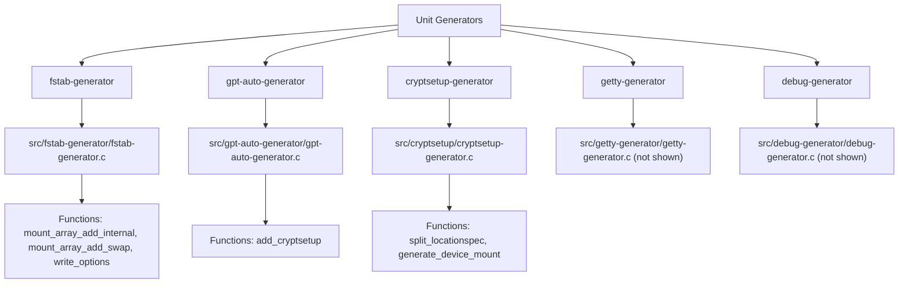
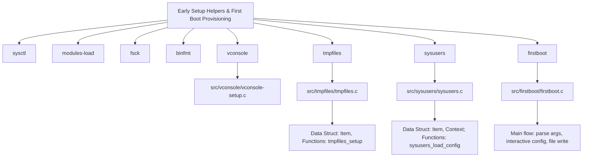
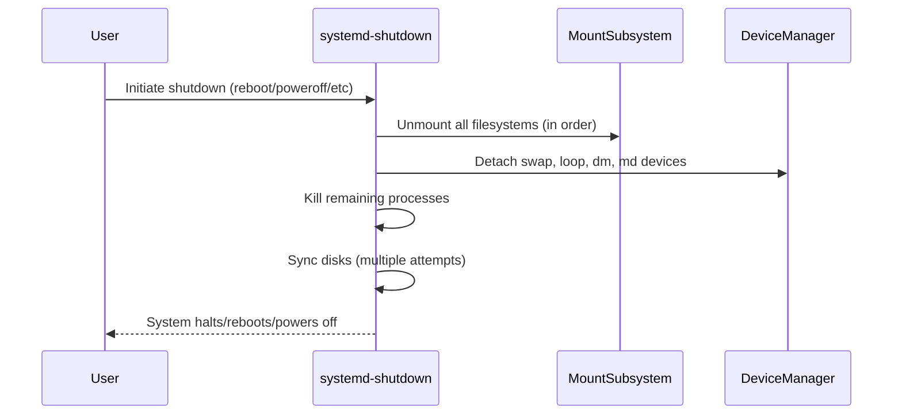

<!-- source: DeepWiki mcp.deepwiki.com · repo systemd/systemd · page 4.4 Generators, Early Setup and Shutdown · fetched 2026-11-07 -->

# 4.4 Generators, Early Setup and Shutdown

Relevant source files

The following files were used as context for generating this wiki page:

- [factory/templates/locale.conf.in](factory/templates/locale.conf.in)
- [factory/templates/meson.build](factory/templates/meson.build)
- [factory/templates/nsswitch.conf](factory/templates/nsswitch.conf)
- [factory/templates/vconsole.conf.in](factory/templates/vconsole.conf.in)
- [man/binfmt.d.xml](man/binfmt.d.xml)
- [man/custom-entities.ent.in](man/custom-entities.ent.in)
- [man/dnssec-trust-anchors.d.xml](man/dnssec-trust-anchors.d.xml)
- [man/hostnamectl.xml](man/hostnamectl.xml)
- [man/locale.conf.xml](man/locale.conf.xml)
- [man/localtime.xml](man/localtime.xml)
- [man/machine-info.xml](man/machine-info.xml)
- [man/modules-load.d.xml](man/modules-load.d.xml)
- [man/networkd.conf.xml](man/networkd.conf.xml)
- [man/os-release.xml](man/os-release.xml)
- [man/standard-specifiers.xml](man/standard-specifiers.xml)
- [man/systemd-binfmt.service.xml](man/systemd-binfmt.service.xml)
- [man/systemd-cryptsetup-generator.xml](man/systemd-cryptsetup-generator.xml)
- [man/systemd-debug-generator.xml](man/systemd-debug-generator.xml)
- [man/systemd-firstboot.xml](man/systemd-firstboot.xml)
- [man/systemd-fsck@.service.xml](man/systemd-fsck@.service.xml)
- [man/systemd-fstab-generator.xml](man/systemd-fstab-generator.xml)
- [man/systemd-getty-generator.xml](man/systemd-getty-generator.xml)
- [man/systemd-gpt-auto-generator.xml](man/systemd-gpt-auto-generator.xml)
- [man/systemd-machine-id-setup.xml](man/systemd-machine-id-setup.xml)
- [man/systemd-makefs@.service.xml](man/systemd-makefs@.service.xml)
- [man/systemd-modules-load.service.xml](man/systemd-modules-load.service.xml)
- [man/systemd-sleep.conf.xml](man/systemd-sleep.conf.xml)
- [man/systemd-sysctl.service.xml](man/systemd-sysctl.service.xml)
- [man/systemd-sysext.xml](man/systemd-sysext.xml)
- [man/systemd-sysusers.xml](man/systemd-sysusers.xml)
- [man/systemd-tmpfiles.xml](man/systemd-tmpfiles.xml)
- [man/systemd-vconsole-setup.service.xml](man/systemd-vconsole-setup.service.xml)
- [man/systemd.dnssd.xml](man/systemd.dnssd.xml)
- [man/systemd.image-policy.xml](man/systemd.image-policy.xml)
- [man/systemd.system-credentials.xml](man/systemd.system-credentials.xml)
- [man/sysusers.d.xml](man/sysusers.d.xml)
- [man/timesyncd.conf.xml](man/timesyncd.conf.xml)
- [man/tmpfiles.d.xml](man/tmpfiles.d.xml)
- [man/vconsole.conf.xml](man/vconsole.conf.xml)
- [shell-completion/bash/hostnamectl](shell-completion/bash/hostnamectl)
- [shell-completion/bash/localectl](shell-completion/bash/localectl)
- [shell-completion/zsh/_hostnamectl](shell-completion/zsh/_hostnamectl)
- [shell-completion/zsh/_localectl](shell-completion/zsh/_localectl)
- [src/basic/conf-files.c](src/basic/conf-files.c)
- [src/basic/conf-files.h](src/basic/conf-files.h)
- [src/basic/log-context.c](src/basic/log-context.c)
- [src/basic/log-context.h](src/basic/log-context.h)
- [src/basic/special.h](src/basic/special.h)
- [src/binfmt/binfmt.c](src/binfmt/binfmt.c)
- [src/core/kmod-setup.c](src/core/kmod-setup.c)
- [src/core/user.conf.in](src/core/user.conf.in)
- [src/coredump/coredump.conf](src/coredump/coredump.conf)
- [src/cryptsetup/cryptsetup-generator.c](src/cryptsetup/cryptsetup-generator.c)
- [src/debug-generator/debug-generator.c](src/debug-generator/debug-generator.c)
- [src/firstboot/firstboot.c](src/firstboot/firstboot.c)
- [src/fsck/fsck.c](src/fsck/fsck.c)
- [src/fstab-generator/fstab-generator.c](src/fstab-generator/fstab-generator.c)
- [src/getty-generator/getty-generator.c](src/getty-generator/getty-generator.c)
- [src/gpt-auto-generator/gpt-auto-generator.c](src/gpt-auto-generator/gpt-auto-generator.c)
- [src/growfs/growfs.c](src/growfs/growfs.c)
- [src/growfs/makefs.c](src/growfs/makefs.c)
- [src/home/homed.conf](src/home/homed.conf)
- [src/journal-remote/journal-remote.conf.in](src/journal-remote/journal-remote.conf.in)
- [src/journal-remote/journal-upload.conf.in](src/journal-remote/journal-upload.conf.in)
- [src/machine-id-setup/machine-id-setup-main.c](src/machine-id-setup/machine-id-setup-main.c)
- [src/modules-load/modules-load.c](src/modules-load/modules-load.c)
- [src/network/networkd-gperf.gperf](src/network/networkd-gperf.gperf)
- [src/network/networkd.conf](src/network/networkd.conf)
- [src/oom/oomd.conf](src/oom/oomd.conf)
- [src/pstore/pstore.conf](src/pstore/pstore.conf)
- [src/quotacheck/quotacheck.c](src/quotacheck/quotacheck.c)
- [src/shared/async.c](src/shared/async.c)
- [src/shared/async.h](src/shared/async.h)
- [src/shared/binfmt-util.c](src/shared/binfmt-util.c)
- [src/shared/binfmt-util.h](src/shared/binfmt-util.h)
- [src/shared/generator.c](src/shared/generator.c)
- [src/shared/generator.h](src/shared/generator.h)
- [src/shared/libmount-util.c](src/shared/libmount-util.c)
- [src/shared/libmount-util.h](src/shared/libmount-util.h)
- [src/shared/main-func.c](src/shared/main-func.c)
- [src/shared/main-func.h](src/shared/main-func.h)
- [src/shared/sleep-config.c](src/shared/sleep-config.c)
- [src/shared/sleep-config.h](src/shared/sleep-config.h)
- [src/shared/switch-root.c](src/shared/switch-root.c)
- [src/shared/switch-root.h](src/shared/switch-root.h)
- [src/shutdown/detach-dm.c](src/shutdown/detach-dm.c)
- [src/shutdown/detach-dm.h](src/shutdown/detach-dm.h)
- [src/shutdown/detach-loopback.c](src/shutdown/detach-loopback.c)
- [src/shutdown/detach-loopback.h](src/shutdown/detach-loopback.h)
- [src/shutdown/detach-md.c](src/shutdown/detach-md.c)
- [src/shutdown/detach-md.h](src/shutdown/detach-md.h)
- [src/shutdown/detach-swap.c](src/shutdown/detach-swap.c)
- [src/shutdown/detach-swap.h](src/shutdown/detach-swap.h)
- [src/shutdown/shutdown.c](src/shutdown/shutdown.c)
- [src/shutdown/shutdown.h](src/shutdown/shutdown.h)
- [src/shutdown/test-umount.c](src/shutdown/test-umount.c)
- [src/shutdown/umount.c](src/shutdown/umount.c)
- [src/shutdown/umount.h](src/shutdown/umount.h)
- [src/sleep/sleep.c](src/sleep/sleep.c)
- [src/sleep/sleep.conf](src/sleep/sleep.conf)
- [src/storagetm/meson.build](src/storagetm/meson.build)
- [src/sysctl/sysctl.c](src/sysctl/sysctl.c)
- [src/system-update-generator/system-update-generator.c](src/system-update-generator/system-update-generator.c)
- [src/sysusers/sysusers.c](src/sysusers/sysusers.c)
- [src/test/test-async.c](src/test/test-async.c)
- [src/test/test-binfmt-util.c](src/test/test-binfmt-util.c)
- [src/test/test-conf-files.c](src/test/test-conf-files.c)
- [src/test/test-main-func-fiber.c](src/test/test-main-func-fiber.c)
- [src/test/test-main-func.c](src/test/test-main-func.c)
- [src/test/test-netlink-manual.c](src/test/test-netlink-manual.c)
- [src/test/test-sleep-config.c](src/test/test-sleep-config.c)
- [src/test/test-sleep.c](src/test/test-sleep.c)
- [src/timesync/timesyncd.conf.in](src/timesync/timesyncd.conf.in)
- [src/tmpfiles/tmpfiles.c](src/tmpfiles/tmpfiles.c)
- [src/vconsole/vconsole-setup.c](src/vconsole/vconsole-setup.c)
- [src/veritysetup/veritysetup-generator.c](src/veritysetup/veritysetup-generator.c)
- [test/test-fstab-generator/test-19-mounts-from-cmdline.input](test/test-fstab-generator/test-19-mounts-from-cmdline.input)
- [test/test-fstab-generator/test-20-swap-from-cmdline.input](test/test-fstab-generator/test-20-swap-from-cmdline.input)
- [test/test-network/conf/25-routing-policy-rule-test1.network](test/test-network/conf/25-routing-policy-rule-test1.network)
- [test/test-systemd-tmpfiles.py](test/test-systemd-tmpfiles.py)
- [test/units/TEST-74-AUX-UTILS.firstboot.sh](test/units/TEST-74-AUX-UTILS.firstboot.sh)
- [test/units/TEST-87-AUX-UTILS-VM.sysctl.sh](test/units/TEST-87-AUX-UTILS-VM.sysctl.sh)
- [units/storage-target-mode.target](units/storage-target-mode.target)
- [units/systemd-firstboot.service](units/systemd-firstboot.service)
- [units/systemd-fsck-root.service.in](units/systemd-fsck-root.service.in)
- [units/systemd-fsck@.service.in](units/systemd-fsck@.service.in)
- [units/systemd-homed-firstboot.service](units/systemd-homed-firstboot.service)
- [units/systemd-pcrphase-factory-reset.service.in](units/systemd-pcrphase-factory-reset.service.in)
- [units/systemd-pcrphase-storage-target-mode.service.in](units/systemd-pcrphase-storage-target-mode.service.in)
- [units/systemd-storagetm.service.in](units/systemd-storagetm.service.in)

This page provides an in-depth technical explanation of systemd's mechanisms around unit generators (for fstab, GPT partitioning, cryptsetup, getty, debug units), early system setup helpers (sysctl, modules-load, fsck, binfmt, vconsole), first boot provisioning utilities (tmpfiles, sysusers, firstboot), and the system shutdown and unmount path. These components are fundamental to system initialization and finalization, enabling systemd to dynamically build unit files, prepare essential runtime files and users, configure kernel parameters and console settings early in the boot, and cleanly tear down services and mounts during shutdown.

---

## 1. Unit Generators

Systemd uses *unit generators* during early boot to dynamically generate units from system configuration files or hardware state. These units mostly take the form of `.service`, `.mount`, `.device`, or other types, and are written to `/run/systemd/generator/` or similar directories. They allow systemd to adapt its control logic to the system's current configuration and hardware state before the full initrd or root filesystem is mounted.

### 1.1 fstab-generator

The `fstab-generator` parses `/etc/fstab` and other mount table sources to produce `.mount` and `.swap` units dynamically.

- It reads lines from `fstab` files and converts each mount entry into a corresponding mount unit.
- It supports special flags and options such as `noauto`, `nofail`, or filesystem checking settings.
- Generated `.mount` units specify `What=`, `Where=`, `Options=`, and are linked into the dependency tree for automatic mount order.
- Swap entries create swap units dynamically, with safeguards to check `/proc/swaps` availability.
  
Key functions and data flow:

- Mount entries are parsed and stored in an internal array of `Mount` structures.
- `mount_array_add_internal()` adds mount entries (file systems or swap).
- Units are generated by creating unit files with `[Mount]` sections using `generator_open_unit_file()` and emitting parameters.
- The generator writes the units into the configured destination directory.

This generator is implemented in `src/fstab-generator/fstab-generator.c` lines 1-234.

### 1.2 gpt-auto-generator

The `gpt-auto-generator` handles GPT partitioned disks, detecting partitions, and generating mount and cryptsetup units as needed.

- Supports automatic detection of partitions based on GPT metadata.
- Automatically generates units for encrypted partitions by invoking cryptsetup generator functionality.
- Supports measuring volumes with TPM2 for secure boot and integrity verification.
- Creates device and mount units dynamically with appropriate ordering and dependencies.

Key implementation points:

- `add_cryptsetup()` generates systemd units for unlocking encrypted partitions.
- Encryption units are written with dependencies such as `Before=umount.target cryptsetup.target`.
- The generator handles options such as read-only mounts and TPM-based measurements.
  
Source: `src/gpt-auto-generator/gpt-auto-generator.c` lines 1-191.

### 1.3 cryptsetup-generator

The `cryptsetup-generator` reads `/etc/crypttab` or encryption metadata to produce units that unlock encrypted volumes at boot time.

- Parses crypttab entries and generates `systemd-cryptsetup@.service` units with parameters for key files, headers, and options.
- Supports drop-in configurations and device timeout management.
- Generates mount units for key device and header device if specified.

Notable code sections include:

- `split_locationspec()` parses location specifications into file/device components.
- `generate_device_mount()` creates mount units for key files or header files used by cryptsetup.
- The main generation logic produces appropriate unit files and manages dependencies.

Found in `src/cryptsetup/cryptsetup-generator.c` lines 1-201.

### 1.4 getty-generator and debug-generator

Though less detailed in provided files, these generators produce units for serial console getty devices and debug related units, respectively, following a similar pattern of reading configuration / state and emitting units.

---

## 2. Early Setup Helpers

These helpers are invoked during early boot, prior to most unit activation, to configure critical system aspects.

### 2.1 sysctl

- Applies kernel parameter settings before services start.
- Reads `/etc/sysctl.d/` and other sysctl drop-in files.
- Configured via `src/sysctl/sysctl.c` (not fully shown).
- Systemd's `systemd-sysctl.service` manages invoking the helper.

### 2.2 modules-load

- Loads kernel modules specified in configuration files (`/etc/modules-load.d/` etc).
- Can set parameters for modules and is triggered very early.

### 2.3 fsck

- File system check utility run via generated units from mount specification.
- Ensures file systems are in a consistent state before mounting.

### 2.4 binfmt

- Configures binary format handlers (e.g., for running non-native binaries).
- Early helper to register handlers via `/proc/sys/fs/binfmt_misc`.

### 2.5 vconsole

The `vconsole-setup` component configures virtual console keyboard layouts and fonts early:

- Reads settings from multiple sources in precedence order:
  - EFI keymap (firmware provided)
  - Credentials subsystem (user-supplied settings)
  - `/etc/vconsole.conf`
  - Kernel command line options (proc cmdline)
- Applies keyboard map and font settings using `ioctl` calls.
- The main configuration struct is `Context`, managing fields such as `keymap`, `font`, and `font_scale`.
- The merging of configuration from various layers is done in `context_merge_config()`.
- Font scaling parsing supports percentages with bounded checks.

Core implementation in `src/vconsole/vconsole-setup.c`, lines 1-204.

---

## 3. First Boot Provisioning

On first boots or system resets, systemd employs special helpers to provision system state, users, and temporary files.

### 3.1 tmpfiles

- The tmpfiles utility (`src/tmpfiles/tmpfiles.c`) parses multiple `.conf` files (e.g., `/etc/tmpfiles.d/*.conf`).
- Supports creating/removing/truncating files, directories, symlinks, device nodes, setting attributes like mode, ownership, ACLs, xattrs, and cleaning up based on aging.
- Defines a rich set of operation types (`ItemType`) like `CREATE_FILE`, `REMOVE_PATH`, `SET_ACL` etc.
- Used to initialize runtime directories like `/run`, `/tmp` with proper ownership and permissions.
- The core data structure is `Item` which defines an action on a path.
- The utility runs on boot and periodically for cleanup.

For detailed semantics and item types, see XML docs (`man/tmpfiles.d.xml`) and implementation starting at line 74 in `src/tmpfiles/tmpfiles.c`.

### 3.2 sysusers

- The sysusers utility (`src/sysusers/sysusers.c`) allows declarative creation of system users, groups, and membership.
- Parses configuration files to add users/groups, specify UID/GID, descriptions, home directories, shells, etc.
- Uses `ItemType` enum with `ADD_USER`, `ADD_GROUP`, `ADD_MEMBER`.
- Data structures track users and groups in hashmaps (`Context` contains OrderedHashmaps).
- Supports dry-run and replacement modes.
- Logs audit events if enabled.

Sysusers enables declarative provisioning of system accounts during initial setup.

### 3.3 firstboot

- The `systemd-firstboot` tool (`src/firstboot/firstboot.c`) provides interactive system initial configuration.
- Allows configuring locale, timezone, hostname, machine ID, root password, root shell, and keymap.
- Supports prompting for parameters with consoles, or automatic setting from options.
- Integrates with credential and label subsystems.
- Displays welcome message on first invocation and supports chroming for boot splash elimination.
- Reads and writes to configuration files, and uses various utility helpers for each setting type.

Located at lines 1-199 in `src/firstboot/firstboot.c`.

---

## 4. Shutdown and Unmount Path

Systemd's shutdown is controlled by the `systemd-shutdown` binary (`src/shutdown/shutdown.c`).

- It parses the shutdown verb (`reboot`, `poweroff`, `halt`, `kexec`, `exit`) and options such as timeout and exit code.
- Shutdown tasks include:
  - Killing all remaining processes.
  - Syncing disks and disabling automatic syncing to avoid unnecessary operations during root switching.
  - Detaching device-mapper, loopback, MD RAID, and swap devices cleanly (`detach-dm`, `detach-loopback`, `detach-md`, `detach-swap`).
  - Unmounting all mount points, including `/run/initramfs` if applicable.
  - Logging and confirming the system state during shutdown.
- The unmount logic (`src/shutdown/umount.c`, not shown) is carefully ordered to unmount filesystems in the correct dependency order, prevent data loss, and handle failures gracefully.
- An internal timeout ensures shutdown does not hang indefinitely.

Key shutdown parsing logic starts around line 72 in `src/shutdown/shutdown.c`.

---

## Diagrams

### Diagram 1: Mapping Natural Language Entities to Code Entities for Unit Generators

**Sources:**  
- `src/fstab-generator/fstab-generator.c:1-234`  
- `src/gpt-auto-generator/gpt-auto-generator.c:1-191`  
- `src/cryptsetup/cryptsetup-generator.c:1-201`

---

### Diagram 2: Early Setup Helpers and Boot Provisioning to Code Entities

**Sources:**  
- `src/vconsole/vconsole-setup.c:1-204`  
- `src/tmpfiles/tmpfiles.c:1-232`  
- `src/sysusers/sysusers.c:1-216`  
- `src/firstboot/firstboot.c:1-199`

---

### Diagram 3: Shutdown and Unmount Sequence

**Sources:**  
- `src/shutdown/shutdown.c:1-189`  
- `src/shutdown/umount.c (not shown)`

---

## Summary Table of Key Components

| Component          | Functionality                                    | Primary Source File                           |
|--------------------|-------------------------------------------------|-----------------------------------------------|
| fstab-generator    | Dynamic unit generation from /etc/fstab         | `fstab-generator/fstab-generator.c`          |
| gpt-auto-generator | GPT partition detection and unit generation      | `gpt-auto-generator/gpt-auto-generator.c`    |
| cryptsetup-generator | Encrypted volume units from `/etc/crypttab`    | `cryptsetup/cryptsetup-generator.c`          |
| vconsole-setup     | Early console keyboard and font configuration    | `vconsole/vconsole-setup.c`                    |
| tmpfiles           | Management of volatile and runtime files         | `tmpfiles/tmpfiles.c`                          |
| sysusers           | Provisioning system users and groups              | `sysusers/sysusers.c`                          |
| firstboot          | Interactive first boot configuration tool         | `firstboot/firstboot.c`                        |
| shutdown           | System shutdown logic and unmounting              | `shutdown/shutdown.c`                          |

---

# End of Page

---

**Sources Cited:**  
- `src/fstab-generator/fstab-generator.c:1-234`  
- `src/gpt-auto-generator/gpt-auto-generator.c:1-191`  
- `src/cryptsetup/cryptsetup-generator.c:1-201`  
- `src/vconsole/vconsole-setup.c:1-204`  
- `src/tmpfiles/tmpfiles.c:1-232`  
- `src/sysusers/sysusers.c:1-216`  
- `src/firstboot/firstboot.c:1-199`  
- `src/shutdown/shutdown.c:1-189`

---

